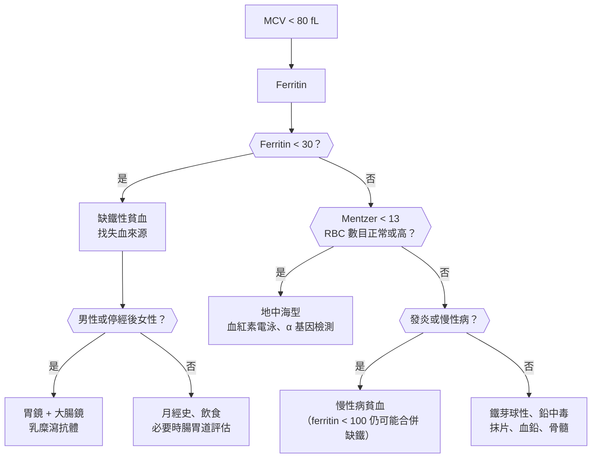
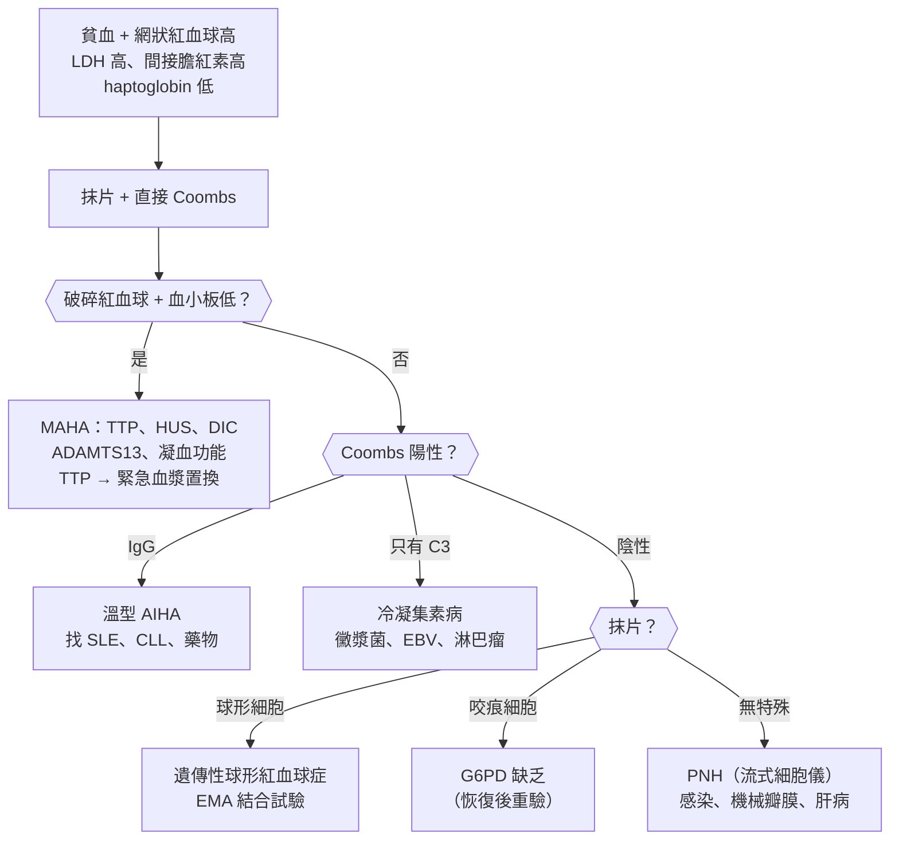
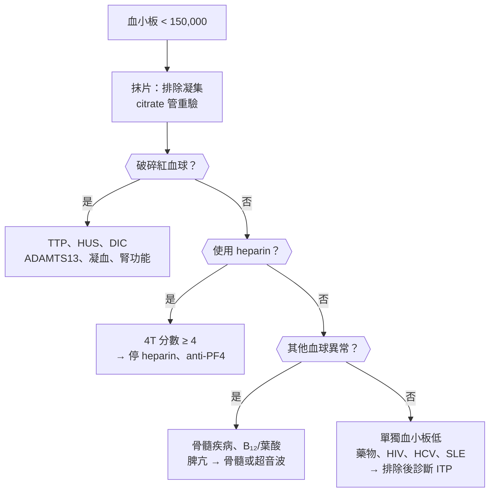

## 紅血球（Red Cells）

### 小球性貧血（Microcytic Anemia）

#### 定義與分類

- **貧血**：**男性 Hb < :red[13] g/dL、女性 < :red[12] g/dL**（WHO；懷孕 < 11）。
- **小球性**：**MCV :red[< 80] fL**。
- **主要原因（TAILS）**：
    - **T**halassemia：**地中海型貧血（台灣常見）**。
    - **A**nemia of chronic disease：**慢性病貧血**（少數為小球性，多為正球性）。
    - **I**ron deficiency：**缺鐵性貧血（全世界最常見的貧血）**。
    - **L**ead poisoning：**鉛中毒**。
    - **S**ideroblastic：**鐵芽球性貧血**（酒精、isoniazid、銅缺乏、遺傳）。
- **台灣重點**：**地中海型貧血帶因率約 6%**（α 約 4–5%、β 約 1–2%）；**產前篩檢 MCV < 80 → 配偶也驗**。
- **缺鐵的原因**：
    - **失血（成人最重要）**：**月經過多**、**腸胃道出血（> 50 歲或男性 → 一定要找腸胃道癌）**、頻繁抽血、捐血。
    - **攝取不足**：素食、嬰幼兒（**大量喝鮮奶**）、青春期。
    - **[[消化內科#吸收不良（Malabsorption）|吸收不良]]**：**[[消化內科#Celiac Disease（乳糜瀉）|乳糜瀉]]**、**胃切除或繞道**、**萎縮性胃炎、幽門螺旋桿菌**、**PPI**。
    - **需求增加**：懷孕、哺乳、生長期、**EPO 治療**。

#### Red flags

- **男性或停經後女性的缺鐵性貧血** → **:red[腸胃道惡性腫瘤直到排除]**（大腸鏡 + 胃鏡）。
- **Hb < 7 g/dL**、心衰竭症狀、胸痛、暈厥、**活動性出血**。
- **黑便、血便、體重減輕、排便習慣改變**。
- **兒童：異食癖 + 腹痛 + 發展遲緩、住舊房子** → 鉛中毒。
- **懷孕**（嬰兒神經發育）。
- **補鐵無效** → 診斷錯誤（地中海型）、持續失血、吸收不良、服藥順從性差。

#### 鑑別診斷

| 類別 | 疾病 | 鑑別關鍵 |
|---|---|---|
| **缺鐵** | **[[血液腫瘤科#缺鐵性貧血（Iron Deficiency Anemia, IDA）\|缺鐵性貧血]]**（失血、攝取不足、吸收不良、需求增加） | **ferritin 低（< 30）**、RDW 高 |
| **地中海型** | **[[血液腫瘤科#α-Thalassemia（第 16 號染色體）\|α 地中海型]]**、**[[血液腫瘤科#β-Thalassemia（第 11 號染色體）\|β 地中海型]]** | **RBC 數目正常或高、MCV 很低、Mentzer < 13** |
| **慢性病** | **[[血液腫瘤科#慢性病貧血（Anemia of Chronic Disease, ACD）\|慢性病貧血]]**（感染、發炎、腫瘤、慢性腎病） | **ferritin 正常或高、TIBC 低** |
| **鐵芽球性** | **[[血液腫瘤科#Sideroblastic Anemia\|鐵芽球性貧血]]**（酒精、**isoniazid（B6 缺乏）**、銅缺乏、遺傳 X 性聯） | **環狀鐵芽球**（骨髓）、鐵高 |
| **鉛中毒** | **[[小兒科#鉛中毒（Lead Poisoning）\|鉛中毒]]** | **嗜鹼性點彩**、血鉛 |

#### 易混淆鑑別

:::compare[小球性貧血的鐵學檢查]
| | 缺鐵性貧血 | 慢性病貧血 | 地中海型帶因 | 鐵芽球性 |
|---|---|---|---|---|
| **Ferritin** | **↓（:red[< 30]）** | **正常或 ↑**（急性期反應物） | 正常 | **↑** |
| 血清鐵 | ↓ | ↓ | 正常 | ↑ |
| **TIBC（transferrin）** | **↑** | **↓** | 正常 | 正常或 ↓ |
| 轉鐵蛋白飽和度 | **↓（< 16–20%）** | ↓ 或正常 | 正常 | ↑ |
| RDW | **↑** | 正常 | **正常（或輕度 ↑）** | ↑（雙峰） |
| RBC 數目 | ↓ | ↓ | **正常或 ↑** | ↓ |
| 抹片 | 小球低色素、**筆狀細胞** | 正球或小球 | **標靶細胞**、嗜鹼性點彩 | **環狀鐵芽球（骨髓）** |
| 補鐵反應 | **有** | 無 | **無（且可能鐵過量）** | 無（B6 反應型例外） |
:::

:::compare[缺鐵性貧血 vs 地中海型貧血帶因]
| | 缺鐵性貧血 | 地中海型帶因 |
|---|---|---|
| Hb | 依嚴重度 | **輕度降低或正常** |
| MCV | 降低（與 Hb 成比例） | **明顯降低（與 Hb 不成比例，常 < 70）** |
| RBC 數目 | **↓** | **正常或 ↑（> 5 × 10⁶/μL）** |
| **Mentzer index（MCV ÷ RBC）** | **> 13** | **:red[< 13]** |
| RDW | **↑** | 正常 |
| Ferritin | **↓** | 正常 |
| 確認 | ferritin | **血紅素電泳（β：HbA2 > 3.5%）**；**α：基因檢測（電泳常正常）** |
| 治療 | **補鐵** | **不需治療；不要補鐵**；**遺傳諮詢（配偶篩檢）** |
:::

:::compare[地中海型貧血的分型]
| 類型 | 基因 | 臨床 |
|---|---|---|
| **α 靜默帶因** | 1 個 α 缺失 | 正常 |
| **α 輕型（trait）** | 2 個 α 缺失（**台灣多為順式 --SEA**） | **輕度小球性貧血** |
| **HbH 病** | 3 個 α 缺失 | 中度溶血性貧血、脾腫大；**HbH（β4）** |
| **Hb Bart's 胎兒水腫** | 4 個 α 缺失 | **胎死腹中（γ4）**；**夫妻都是順式 α 輕型 → 1/4 機率** |
| **β 輕型** | 1 個 β 異常 | 輕度小球性，**HbA2 > 3.5%** |
| **β 中間型** | — | 中度，不一定需規則輸血 |
| **β 重型（Cooley）** | 2 個 β 異常 | **6 個月後出現**（HbF 轉 HbA）、**規則輸血 + 排鐵**、**骨髓擴張（地中海臉、頭骨毛刷狀）**、脾腫大；[[血液腫瘤科#造血幹細胞移植（HSCT）\|造血幹細胞移植]] |
:::

#### 問診與理學檢查

- **出血來源**：月經量（換衛生棉頻率、血塊）、**黑便、血便**、血尿、捐血、手術。
- 飲食（素食、嬰幼兒喝鮮奶量）、**胃部手術**、**PPI**、乳糜瀉症狀、慢性病、**家族地中海型貧血**、**種族**、懷孕。
- **異食癖（吃冰 pagophagia）**、不寧腿、疲倦、運動耐受度。
- 理學檢查：蒼白、心跳快、心雜音、**匙狀甲**、口角炎、**舌炎**、脾腫大（地中海型）、肛門指診（潛血）。

#### 檢查流程

- **CBC（MCV、RDW、RBC 數目）、網狀紅血球、抹片**。
- **Ferritin（最好的單一檢查）**；**發炎時 ferritin < 100 仍可能缺鐵** → 看轉鐵蛋白飽和度。
- **缺鐵確定後一定要找原因**：成年男性與停經後女性 → **胃鏡 + 大腸鏡**、**乳糜瀉抗體**、幽門螺旋桿菌；育齡女性 → 月經評估，有腸胃症狀或家族史也要內視鏡。
- 地中海型：**血紅素電泳**（β）、**α 基因檢測**；**孕婦 MCV < 80 → 配偶篩檢**。

#### 初步處置

- **補鐵**：
    - **口服鐵劑**（ferrous sulfate 等），**隔日一次可能吸收更好**（hepcidin）；**空腹或與維生素 C 吸收較好**；避免與茶、咖啡、鈣、制酸劑同服。
    - **反應**：**網狀紅血球 1 週上升、Hb 每 2–3 週上升約 1–2 g/dL**；Hb 正常後**再補 :red[3 個月]補足儲存**。
    - **靜脈鐵劑**：口服無法耐受或無效、吸收不良、慢性腎病、IBD、懷孕後期、需快速補充。
- **輸血**：症狀嚴重或 Hb < 7（心臟病 < 8）。
- **地中海型帶因**：**不要補鐵**；遺傳諮詢、產前篩檢。
- **治療出血原因**。

:::pitfall
60 歲男性缺鐵性貧血，開了鐵劑 Hb 回升就結案 → 缺鐵只是表現，背後可能是大腸癌或胃癌。成年男性與停經後女性的缺鐵性貧血，一定要做胃鏡與大腸鏡。
:::

:::pitfall
小球性貧血沒驗 ferritin 就長期補鐵 → 在台灣常是地中海型貧血帶因，補鐵無效甚至造成鐵過量。MCV 很低但 RBC 數目正常或偏高（Mentzer < 13）時，先驗 ferritin 與血紅素電泳。
:::

:::exam
- 小球性：TAILS（地中海型、慢性病、缺鐵、鉛、鐵芽球性）。
- 缺鐵：ferritin 低、TIBC 高、RDW 高、Mentzer > 13；地中海型：RBC 正常或高、RDW 正常、Mentzer < 13、標靶細胞。
- 慢性病貧血：ferritin 正常或高、TIBC 低（hepcidin 升高）。
- 男性與停經後女性缺鐵 → 胃鏡 + 大腸鏡。
- β 輕型 HbA2 > 3.5%；α 輕型電泳正常 → 基因檢測；夫妻都是順式 α 輕型 → Hb Bart's 胎兒水腫風險。
- 鉛中毒：嗜鹼性點彩；isoniazid → 鐵芽球性（B6）。
:::

### 正球性貧血（Normocytic Anemia）

#### 定義與分類

- **正球性**：**MCV 80–100 fL**。
- **:red[第一步：網狀紅血球]**（**矯正網狀紅血球指數 RPI**）區分「**製造不足**」或「**流失與破壞**」：
    - **網狀紅血球高（RPI > 2–3）**：**急性失血**、**溶血**（見[[#溶血（Hemolysis）|溶血]]）。
    - **網狀紅血球低（RPI < 2）**：**製造不足**：
        - **慢性病貧血（發炎性貧血）**：最常見之一。
        - **慢性腎病（EPO 不足）**：**eGFR < 30–45**。
        - **內分泌**：甲狀腺低下、腎上腺功能不全、性腺功能低下。
        - **早期缺鐵或混合型（缺鐵 + B₁₂ 缺乏 → MCV 正常、RDW 高）**。
        - **骨髓問題**：**再生不良性貧血**、**純紅血球再生不良（[[感染科#Parvovirus B19|Parvovirus B19]]、胸腺瘤）**、**MDS**、**骨髓浸潤（白血病、淋巴瘤、轉移、骨髓纖維化）**、**多發性骨髓瘤**。
- **急性失血**：初期 Hb 可正常（血液濃縮前），**補液後才下降**。

#### Red flags

- **合併白血球或血小板異常** → 骨髓疾病（見[[#全血球低下（Pancytopenia）|全血球低下]]）。
- **抹片有芽細胞、淚滴狀紅血球、有核紅血球（leukoerythroblastic）** → 骨髓浸潤。
- **老人貧血 + 腎功能差 + 高血鈣 + 骨痛 + 高球蛋白** → **多發性骨髓瘤**。
- **急性出血、血行動力不穩**。
- **鐮刀型貧血或溶血性貧血 + 突然 Hb 下降、網狀紅血球降到幾乎為零** → **再生不全危象（Parvovirus B19）**。
- 不明原因的體重減輕、發燒、淋巴結腫大。

#### 鑑別診斷

| 類別 | 疾病 | 鑑別關鍵 |
|---|---|---|
| **失血與溶血** | **急性失血**、**[[血液腫瘤科#溶血性貧血（Hemolytic Anemia）\|溶血]]** | **網狀紅血球高** |
| **慢性病** | **[[血液腫瘤科#慢性病貧血（Anemia of Chronic Disease, ACD）\|慢性病貧血]]** | **ferritin 正常或高、CRP 高** |
| **腎** | **[[腎臟內科#慢性腎臟病（CKD）\|慢性腎病]]（EPO 不足）** | **eGFR 低** |
| **內分泌** | [[代謝內分泌科#甲狀腺機能低下（Hypothyroidism）\|甲狀腺低下]]、腎上腺功能不全、睪固酮不足 | TSH |
| **混合型營養缺乏** | 缺鐵 + B₁₂ 或葉酸缺乏 | **RDW 高**、抹片雙族群 |
| **骨髓衰竭** | **[[血液腫瘤科#再生不良性貧血（Aplastic Anemia）\|再生不良性貧血]]**、**純紅血球再生不良**、**[[血液腫瘤科#骨髓分化不良症候群（Myelodysplastic Syndromes, MDS）\|MDS]]** | **網狀紅血球極低**、其他血球 |
| **骨髓浸潤** | **[[血液腫瘤科#急性白血病（Acute Leukemia）\|白血病]]**、淋巴瘤、**[[血液腫瘤科#多發性骨髓瘤（Multiple Myeloma）\|多發性骨髓瘤]]**、**[[血液腫瘤科#原發性骨髓纖維化（Primary Myelofibrosis, PMF）\|骨髓纖維化]]**、癌症轉移、結核 | **leukoerythroblastic 抹片**、淚滴細胞 |

#### 易混淆鑑別

:::compare[網狀紅血球的判讀]
| 項目 | 內容 |
|---|---|
| **矯正網狀紅血球百分比** | 網狀紅血球 % × （病人 Hct ÷ 45） |
| **RPI（網狀紅血球生成指數）** | 矯正百分比 ÷ 成熟時間（Hct 45 → 1、35 → 1.5、25 → 2、15 → 2.5） |
| **RPI > 2–3** | **骨髓反應良好 → 失血或溶血** |
| **RPI < 2** | **骨髓製造不足** |
| **注意** | 缺鐵、B₁₂、葉酸補充後 **1 週內網狀紅血球上升** → 治療反應指標 |
:::

:::compare[慢性病貧血 vs 慢性腎病貧血 vs 骨髓衰竭]
| | 慢性病貧血 | 慢性腎病貧血 | 骨髓衰竭（再生不良、MDS） |
|---|---|---|---|
| 機轉 | **hepcidin 升高 → 鐵無法利用**、EPO 反應差 | **EPO 製造不足** | 幹細胞減少或異常 |
| Hb | **輕到中度（8–10）** | 依腎功能 | 可嚴重 |
| 其他血球 | 正常 | 正常 | **常同時低（全血球低下）** |
| Ferritin | **正常或高** | 正常或高 | 正常或高 |
| 線索 | **CRP、ESR 高**、慢性發炎 | **eGFR 低** | **抹片異常、巨球性（MDS）** |
| 治療 | **治療原發病** | **ESA（目標 Hb 10–11.5，不超過 13）+ 補鐵** | 骨髓切片、依診斷治療 |
:::

#### 問診與理學檢查

- **出血史**、慢性病（感染、自體免疫、腫瘤、腎病）、**甲狀腺症狀**、用藥（化療、抗病毒、抗癲癇藥）、酒精。
- **全身症狀**（發燒、體重減輕、盜汗）、骨痛、反覆感染、出血傾向。
- 理學檢查：**淋巴結、肝脾腫大**、骨骼壓痛、出血點、黃疸、關節。

#### 檢查流程

- **網狀紅血球（RPI）**、**抹片**。
- **鐵學、B₁₂、葉酸**（混合缺乏）、**腎功能、TSH**、**CRP**、肝功能。
- 網狀紅血球高 → **溶血檢查（LDH、膽紅素、haptoglobin、Coombs）**、找出血。
- **抹片異常或合併其他血球異常 → 骨髓切片**；> 50 歲合併腎功能差或高血鈣 → **血清蛋白電泳、游離輕鏈**。

#### 初步處置

- 治療原因。
- 慢性腎病貧血：**先補足鐵（ferritin > 100–200、飽和度 > 20%）→ ESA**；**目標 Hb 不超過 13**（過高增加中風與心血管事件）。
- 慢性病貧血：治療原發疾病；必要時 ESA（腫瘤病人有爭議）、輸血。
- **輸血門檻：Hb :red[< 7] g/dL**（**急性冠心症或心臟病 < 8**）。

:::pitfall
正球性貧血沒有驗網狀紅血球就直接補鐵、補維生素 → 錯過溶血或骨髓疾病。正球性貧血第一步看網狀紅血球：高 → 失血或溶血；低 → 製造不足，再看腎功能、發炎與骨髓。
:::

:::pitfall
慢性腎病病人 Hb 用 ESA 拉到 13 以上 → 中風、高血壓、血管通路栓塞增加。ESA 的目標 Hb 約 10–11.5，不超過 13，並先補足鐵。
:::

:::exam
- 正球性第一步：網狀紅血球；RPI > 2 → 失血或溶血；< 2 → 製造不足。
- 慢性病貧血：hepcidin 升高、ferritin 正常或高、TIBC 低。
- 慢性腎病：EPO 不足 → 先補鐵再 ESA，目標 Hb 10–11.5、不超過 13。
- Parvovirus B19 → 溶血性貧血病人的再生不全危象、純紅血球再生不良。
- 輸血門檻 Hb < 7（心臟病 < 8）。
:::

### 巨球性貧血（Macrocytic Anemia）

#### 定義與分類

- **巨球性**：**MCV :red[> 100] fL**。
- **巨母細胞性（megaloblastic）**：**DNA 合成障礙** → **MCV 常 > 110–115**、**多分葉嗜中性球（≥ 6 葉，或 > 5% 為 5 葉）**、**卵圓形巨紅血球**：
    - **維生素 B₁₂ 缺乏**：**惡性貧血（自體免疫，內在因子抗體）**、**胃切除或繞道**、**迴腸切除或克隆氏症**、**metformin**、**PPI 或 H2 阻斷劑**、**純素食**、細菌過度生長、魚絛蟲、**N₂O（笑氣）濫用**。
    - **葉酸缺乏**：**酒精**、營養不良、**懷孕**、**溶血（需求增加）**、**methotrexate、trimethoprim、phenytoin**、吸收不良。
    - **藥物**：**hydroxyurea、zidovudine、化療（5-FU、azathioprine）**。
- **非巨母細胞性**：**MCV 常 100–110**：
    - **酒精（最常見原因之一）**、**肝病**（膜脂質）、**甲狀腺低下**、**網狀紅血球增加（溶血、急性失血後）**、**MDS**、多發性骨髓瘤、再生不良性貧血。
- **B₁₂ 缺乏的神經症狀**：**[[神經內科#亞急性聯合退化（Subacute Combined Degeneration）|亞急性聯合退化]]（後柱 + 側柱：本體感覺與振動覺喪失、痙攣性無力、Romberg 陽性）**、周邊神經病變、失智、精神症狀；**葉酸缺乏沒有神經症狀**。

#### Red flags

- **神經症狀（麻木、步態不穩、本體感覺喪失、記憶力下降）** → B₁₂ 缺乏，**可在貧血前出現**、**延誤會不可逆**。
- **先補葉酸而 B₁₂ 缺乏未治療** → 貧血改善但**神經病變惡化**。
- **全血球低下 + 巨球性** → B₁₂ 缺乏（可全血球低下）、**MDS**、再生不良、白血病。
- **老人巨球性 + 血球低下、無營養缺乏** → **MDS**。
- **溶血徵象**（LDH 極高、間接膽紅素高）：巨母細胞性貧血有**無效造血**（骨髓內溶血），可像 TTP。
- **年輕人吸笑氣** → 急性 B₁₂ 功能缺乏、脊髓病變。

#### 鑑別診斷

| 類別 | 疾病 | 鑑別關鍵 |
|---|---|---|
| **B₁₂ 缺乏** | **[[血液腫瘤科#維生素 B₁₂（Cobalamin）缺乏\|惡性貧血]]**、胃切除、迴腸疾病、**metformin、PPI**、純素食、**笑氣** | **神經症狀、MMA 與 homocysteine 都高** |
| **葉酸缺乏** | **[[血液腫瘤科#葉酸（Folate）缺乏\|葉酸缺乏]]**（酒精、營養、懷孕、溶血、**methotrexate**） | **只有 homocysteine 高、無神經症狀** |
| **藥物** | hydroxyurea、zidovudine、化療、**methotrexate、trimethoprim、phenytoin** | 用藥 |
| **非巨母細胞性** | **酒精**、**肝病**、**[[代謝內分泌科#甲狀腺機能低下（Hypothyroidism）\|甲狀腺低下]]**、**網狀紅血球增加** | **MCV 100–110**、無多分葉 |
| **骨髓疾病** | **[[血液腫瘤科#骨髓分化不良症候群（Myelodysplastic Syndromes, MDS）\|MDS]]**、[[血液腫瘤科#再生不良性貧血（Aplastic Anemia）\|再生不良性貧血]]、白血病、[[血液腫瘤科#多發性骨髓瘤（Multiple Myeloma）\|多發性骨髓瘤]] | **老人、其他血球低、抹片分化異常** |

#### 易混淆鑑別

:::compare[B₁₂ 缺乏 vs 葉酸缺乏]
| | 維生素 B₁₂ 缺乏 | 葉酸缺乏 |
|---|---|---|
| 體內儲存 | **數年（3–5 年）** | **數月（3–4 個月）** |
| 常見原因 | **惡性貧血**、胃或迴腸手術、**metformin**、PPI、純素食、笑氣 | **酒精**、營養不良、**懷孕**、溶血、**methotrexate** |
| **神經症狀** | **有（亞急性聯合退化、周邊神經、失智）** | **無** |
| **Methylmalonic acid（MMA）** | **:red[↑]** | **正常** |
| **Homocysteine** | **↑** | **↑** |
| 舌炎、黃疸（無效造血） | 有 | 有 |
| 治療 | **IM cyanocobalamin**（惡性貧血或神經症狀）；口服高劑量也可 | **口服葉酸 1–5 mg/day** |
| **注意** | **:red[先排除 B₁₂ 缺乏再單獨補葉酸]** | |
:::

:::compare[惡性貧血的重點]
| 項目 | 內容 |
|---|---|
| 機轉 | **自體免疫萎縮性胃炎**：抗**壁細胞**與抗**內在因子**抗體 → B₁₂ 無法在迴腸吸收 |
| 相關 | **其他自體免疫（甲狀腺、白斑、第 1 型糖尿病、Addison）** |
| 檢驗 | **抗內在因子抗體（特異性高）**、抗壁細胞抗體（敏感但不特異）、**gastrin 升高**、胃酸缺乏 |
| 併發症 | **胃癌與[[胃小腸外科#胃類癌（Gastric NET）\|胃類癌]]風險上升** → 內視鏡追蹤 |
| 治療 | **終身 IM B₁₂**（或高劑量口服） |
:::

#### 問診與理學檢查

- **飲食（純素）**、**酒精**、**胃腸手術**、**用藥（metformin、PPI、methotrexate、抗癲癇藥、化療、hydroxyurea）**、**笑氣**、自體免疫疾病。
- **神經症狀**：手腳麻木、走路不穩（**黑暗中更明顯**）、記憶力、情緒。
- 理學檢查：**蒼白合併輕度黃疸（檸檬黃）**、**舌炎（牛肉舌）**、**振動覺與本體感覺**、**Romberg**、反射（下肢反射可消失但 Babinski 陽性）、認知。

#### 檢查流程

- **抹片（多分葉嗜中性球、卵圓形巨紅血球）**、網狀紅血球。
- **B₁₂、葉酸**；**B₁₂ 臨界值（200–300 pg/mL）→ MMA、homocysteine**。
- 惡性貧血：**抗內在因子抗體**。
- **LDH、間接膽紅素**（無效造血）、肝功能、**TSH**、酒精史。
- 原因不明或全血球低下 → **骨髓切片**（MDS）。

#### 初步處置

- **B₁₂ 缺乏**：**IM cyanocobalamin**（例如每天或隔天 1000 μg 一週 → 每週 → 每月終身）；**口服高劑量（1000–2000 μg/day）在非神經症狀者也有效**；**補充後注意低血鉀**（造血大量用鉀）。
- **葉酸缺乏**：**口服葉酸**（**先確認 B₁₂ 正常或同時補**）。
- 停用致病藥物、戒酒。
- **網狀紅血球 1 週內上升、Hb 約 8 週恢復**；神經症狀可能部分不可逆。

:::pitfall
巨球性貧血只驗葉酸、就開葉酸 → B₁₂ 缺乏時葉酸能改善貧血，卻讓脊髓病變繼續惡化甚至不可逆。巨球性貧血要同時驗 B₁₂ 與葉酸，臨界值加驗 MMA。
:::

:::pitfall
長期服用 metformin 的糖尿病病人手腳麻木，被當成糖尿病神經病變 → 可能是 metformin 造成的 B₁₂ 缺乏，補充後可以改善。長期 metformin 使用者要定期驗 B₁₂。
:::

:::exam
- 巨母細胞性：多分葉嗜中性球、卵圓形巨紅血球、MCV 常 > 115；非巨母細胞性：酒精、肝病、甲狀腺低下、網狀紅血球增加、MDS。
- B₁₂ 缺乏：神經症狀（亞急性聯合退化）、MMA 與 homocysteine 都高；葉酸缺乏：只有 homocysteine 高。
- 惡性貧血：抗內在因子抗體、胃癌風險；metformin、PPI、笑氣。
- 不可只補葉酸；補 B₁₂ 後注意低血鉀。
:::

### 溶血（Hemolysis）

#### 定義與分類

- **溶血的實驗室證據**：**貧血 + 網狀紅血球升高 + LDH 升高 + 間接膽紅素升高 + haptoglobin 降低**。
- **血管內溶血**：**血紅素尿（茶色尿）、血紅素血症、haptoglobin 極低、含鐵血黃素尿**；**輸血反應（ABO 不合）、G6PD、PNH、MAHA、瘧疾、機械瓣膜**。
- **血管外溶血**：**脾臟與肝臟巨噬細胞吞噬**；**脾腫大、[[消化內科#膽結石（Cholelithiasis）|膽結石]]（色素性）**；**遺傳性球形紅血球症、溫型 AIHA**。
- **依原因分類**：
    - **遺傳性（紅血球本身）**：
        - **膜**：**遺傳性球形紅血球症**（球形細胞、脾腫大、**家族史**）。
        - **酵素**：**G6PD 缺乏（台灣常見，男性，氧化壓力誘發：蠶豆、樟腦丸、藥物、感染）**、丙酮酸激酶缺乏。
        - **血紅素**：**地中海型（HbH、β 重型）**、**鐮刀型**。
    - **後天性（紅血球外）**：
        - **免疫**：**溫型 AIHA（IgG，SLE、[[血液腫瘤科#慢性淋巴球白血病（Chronic Lymphocytic Leukemia, CLL）|CLL]]、淋巴瘤、藥物）**、**冷凝集素病（IgM，黴漿菌、[[感染科#EBV（Infectious Mononucleosis）|EBV]]、淋巴瘤）**、**輸血反應**、**藥物誘發**。
        - **機械或微血管病**：**MAHA（TTP、HUS、DIC、惡性高血壓、子癇前症/HELLP）**、**機械瓣膜**、行軍性血紅素尿。
        - **其他**：**PNH**、感染（瘧疾、Clostridium）、**蛇毒**、燒傷、**肝病（spur cell）**、Wilson 病。

#### Red flags

- **破碎紅血球（schistocytes）+ 血小板低** → **TTP、HUS、DIC**，**TTP 要緊急血漿置換**。
- **輸血中發燒、寒顫、腰痛、茶色尿、低血壓** → **急性溶血性輸血反應**（立即停輸）。
- **Hb 快速下降、心衰竭**。
- **溶血 + 血栓（腹部靜脈、腦靜脈）+ 全血球低下** → **PNH**。
- **溶血 + 肝炎 + 年輕人 + 神經精神症狀** → **Wilson 病**（急性肝衰竭）。
- **G6PD 缺乏病人吃了蠶豆或用了禁忌藥物**。
- **溶血病人突然網狀紅血球消失** → 再生不全危象（[[感染科#Parvovirus B19|Parvovirus B19]]）。

#### 鑑別診斷

| 類別 | 疾病 | 鑑別關鍵 |
|---|---|---|
| **膜異常** | **[[血液腫瘤科#遺傳性球形紅血球症（Hereditary Spherocytosis, HS）\|遺傳性球形紅血球症]]** | **球形細胞、Coombs 陰性、MCHC 高、家族史** |
| **酵素** | **[[血液腫瘤科#G6PD 缺乏症（Glucose-6-Phosphate Dehydrogenase Deficiency）\|G6PD 缺乏]]**、丙酮酸激酶缺乏 | **咬痕細胞、Heinz 小體**、誘因 |
| **血紅素** | **[[血液腫瘤科#地中海型貧血（Thalassemia）\|地中海型]]**、**[[血液腫瘤科#鐮刀型紅血球症（Sickle Cell Disease）\|鐮刀型]]** | 電泳 |
| **免疫** | **[[血液腫瘤科#自體免疫溶血性貧血（Autoimmune Hemolytic Anemia, AIHA）\|溫型 AIHA、冷凝集素病]]**、**[[血液腫瘤科#輸血反應\|溶血性輸血反應]]**、藥物 | **直接 Coombs 陽性** |
| **微血管病** | **[[血液腫瘤科#微血管病性溶血性貧血（Microangiopathic Hemolytic Anemia, MAHA）\|MAHA]]**：**[[血液腫瘤科#血栓性血小板低下紫斑症（Thrombotic Thrombocytopenic Purpura, TTP）\|TTP]]**、**[[血液腫瘤科#溶血性尿毒症症候群（Hemolytic Uremic Syndrome, HUS）\|HUS]]**、**[[血液腫瘤科#DIC（Disseminated Intravascular Coagulation）\|DIC]]**、HELLP、惡性高血壓；**機械瓣膜** | **破碎紅血球** |
| **其他** | **[[血液腫瘤科#Paroxysmal Nocturnal Hemoglobinuria（PNH）\|PNH]]**、瘧疾、Clostridium 敗血症、蛇毒、**[[神經內科#威爾森氏病（Wilson Disease）\|Wilson 病]]**、肝病 | **流式細胞儀（CD55、CD59）**、旅遊 |

#### 易混淆鑑別

:::compare[溶血的抹片線索]
| 抹片 | 想到 |
|---|---|
| **球形細胞（spherocytes）** | **遺傳性球形紅血球症**、**溫型 AIHA** |
| **破碎紅血球（schistocytes）** | **MAHA（TTP、HUS、DIC）**、機械瓣膜 |
| **咬痕細胞（bite cells）、Heinz 小體** | **G6PD 缺乏**（氧化壓力） |
| **凝集（agglutination）** | **冷凝集素病** |
| **鐮刀細胞** | 鐮刀型貧血 |
| **標靶細胞** | 地中海型、肝病、HbC |
| **棘狀細胞（spur cells）** | 嚴重肝病 |
| **紅血球內寄生蟲** | **瘧疾**、巴貝西蟲 |
:::

:::compare[溫型 AIHA vs 冷凝集素病 vs 遺傳性球形紅血球症]
| | 溫型 AIHA | 冷凝集素病 | 遺傳性球形紅血球症 |
|---|---|---|---|
| 抗體 | **IgG（37°C）** | **IgM（< 37°C）**、補體 | 無（**膜蛋白異常：spectrin、ankyrin**） |
| 溶血部位 | 血管外（脾） | **補體 → 血管內與肝臟** | 血管外（脾） |
| **直接 Coombs** | **IgG ± C3 陽性** | **只有 C3 陽性** | **陰性** |
| 相關 | **SLE、CLL、淋巴瘤**、藥物（methyldopa、penicillin） | **黴漿菌、EBV**、淋巴瘤 | **家族史（體染色體顯性）** |
| 特徵 | 球形細胞 | **冷時手指發紫（肢端發紺）**、凝集 | **球形細胞、MCHC 高、脾腫大、膽結石**；**EMA 結合試驗** |
| 治療 | **類固醇**、rituximab、脾切除 | **保暖**、rituximab；**類固醇與脾切除效果差** | 葉酸、**脾切除（中重度）** |
:::

:::compare[G6PD 缺乏的重點（台灣）]
| 項目 | 內容 |
|---|---|
| 遺傳 | **X 性聯隱性 → 男性多**；台灣**新生兒篩檢**項目 |
| 機轉 | NADPH 不足 → 無法對抗**氧化壓力** → 血紅素變性（Heinz 小體）→ 溶血 |
| **誘因** | **蠶豆**、**樟腦丸（萘）**、**紫藥水**、**藥物（primaquine、dapsone、sulfonamide、nitrofurantoin、rasburicase、methylene blue）**、**感染（最常見）** |
| 表現 | **誘因後 1–3 天急性血管內溶血**（茶色尿、黃疸）；新生兒黃疸 |
| 診斷 | **急性期 G6PD 活性可能假性正常**（老紅血球已破壞）→ **恢復後 :red[2–3 個月]重驗** |
| 治療 | **避開誘因**、支持、必要時輸血 |
:::

#### 問診與理學檢查

- **茶色尿**、黃疸、發作誘因（**感染、藥物、蠶豆、樟腦丸、冷**）、**輸血**、旅遊（瘧疾）、**家族史（脾切除、膽結石、貧血）**、自體免疫疾病、淋巴瘤。
- **新藥**、**心臟瓣膜手術**、懷孕、腹瀉（HUS）、神經症狀（TTP）、腹痛與血栓（PNH）。
- 理學檢查：**黃疸、蒼白、脾腫大**、肢端發紺、**腿部潰瘍（鐮刀型、球形）**、神經學、血壓。

#### 檢查流程

- **CBC、網狀紅血球、LDH、間接膽紅素、haptoglobin、抹片、直接 Coombs（DAT）**、尿液（**血紅素尿：潛血陽性但無紅血球**）。
- 依抹片與 Coombs：ADAMTS13、凝血功能、G6PD、EMA、**PNH 流式細胞儀**、電泳、冷凝集素效價、瘧疾抹片。
- 找原因：ANA、淋巴球表型（CLL）、黴漿菌、EBV、腹部影像（脾、淋巴結）。

#### 初步處置

- **TTP → :red[緊急血漿置換] + 類固醇 ± caplacizumab、rituximab**；**避免輸血小板**。
- **急性溶血性輸血反應 → 立即停止輸血、維持尿量、核對血品**。
- **溫型 AIHA → 類固醇（prednisolone 1 mg/kg）** → rituximab → 脾切除；**冷凝集素 → 保暖、rituximab**。
- **補充葉酸**（慢性溶血需求增加）。
- G6PD → 避開誘因；HS → 中重度考慮脾切除（**術前疫苗：肺炎鏈球菌、腦膜炎雙球菌、Hib**）。
- **輸血**：AIHA 交叉試驗困難，必要時仍要輸（選最不凝集的血）。

:::pitfall
溶血性貧血合併血小板低，沒有看抹片就當成 Evans 症候群（AIHA + ITP）給類固醇 → 漏掉 TTP，錯過血漿置換。溶血合併血小板低一定要看抹片找破碎紅血球。
:::

:::pitfall
G6PD 缺乏的男孩在急性溶血時驗 G6PD 活性正常，就排除診斷 → 急性期缺乏酵素的老紅血球已被破壞，剩下的年輕紅血球活性較高，造成假性正常。要在恢復 2–3 個月後重驗。
:::

:::exam
- 溶血：網狀紅血球高、LDH 高、間接膽紅素高、haptoglobin 低。
- 血管內：血紅素尿、haptoglobin 極低（G6PD、PNH、輸血反應、MAHA）；血管外：脾腫大、膽結石（HS、溫型 AIHA）。
- 溫型 AIHA：IgG、球形細胞 → 類固醇；冷凝集素：只有 C3、黴漿菌 → 保暖、rituximab。
- HS：Coombs 陰性、MCHC 高、EMA；G6PD：咬痕細胞、Heinz 小體、蠶豆、樟腦丸、primaquine、dapsone。
- 破碎紅血球 + 血小板低 → TTP（血漿置換）；PNH：流式細胞儀 CD55、CD59 缺乏、血栓。
:::

### 紅血球增多（Polycythemia / Erythrocytosis）

#### 定義與分類

- **紅血球增多**：**Hb > 16.5 g/dL（男）、> 16.0 g/dL（女）**，或 **Hct > 49%（男）、> 48%（女）**（WHO 2016 PV 標準）。
- **相對性（假性）**：**血漿量減少**：**脫水、利尿劑**、**Gaisböck 症候群（壓力性，肥胖抽菸高血壓男性）**。
- **絕對性**：
    - **原發性：真性紅血球增多症（PV）** → **JAK2 V617F（~95%）**、**EPO 低**；骨髓增生性腫瘤。
    - **續發性（EPO 高或正常）**：
        - **缺氧驅動（適當）**：**慢性肺病（COPD）**、**OSA**、**發紺性心臟病**、**高海拔**、**抽菸（CO）**、肥胖低換氣、高親和力血紅素。
        - **EPO 不適當分泌**：**腎細胞癌**、**肝細胞癌**、腎臟囊腫、腎移植後、**小腦血管母細胞瘤**、子宮肌瘤、嗜鉻細胞瘤。
        - **藥物**：**睪固酮**、**EPO 濫用**、**SGLT2 抑制劑（輕度）**。

#### Red flags

- **血栓**（中風、心肌梗塞、**腹部靜脈血栓：[[消化內科#Budd-Chiari Syndrome|Budd-Chiari]]、門靜脈**）→ PV。
- **頭痛、視力模糊、紅臉、耳鳴、頭暈**（高黏滯）。
- **洗澡後癢（aquagenic pruritus）**、**紅斑性肢痛症（手腳燒灼紅）**、脾腫大 → PV。
- **血尿、腰痛、腹部腫塊** → 腎細胞癌。
- **Hct > 55–60%**。
- **使用睪固酮**的男性。

#### 鑑別診斷

| 類別 | 疾病 | 鑑別關鍵 |
|---|---|---|
| **相對性** | **脫水**、**利尿劑**、Gaisböck 症候群 | 補液後恢復、紅血球總量正常 |
| **原發性** | **[[血液腫瘤科#真性紅血球增多症（Polycythemia Vera, PV）\|真性紅血球增多症]]**、EPO 受體突變 | **JAK2、EPO 低**、白血球與血小板也高、脾腫大 |
| **續發性：缺氧** | **[[胸腔內科#慢性阻塞性肺病（COPD）\|COPD]]**、**[[胸腔內科#阻塞性睡眠呼吸中止症（OSA）\|OSA]]**、**發紺性心臟病**、高海拔、**抽菸**、肥胖低換氣 | **SpO₂、COHb**、睡眠檢查 |
| **續發性：腫瘤** | **[[泌尿科#腎細胞癌（Renal Cell Carcinoma, RCC）\|腎細胞癌]]**、**[[消化內科#肝細胞癌（Hepatocellular Carcinoma, HCC）\|肝細胞癌]]**、小腦血管母細胞瘤、肌瘤 | **EPO 高、SpO₂ 正常** → 腹部影像 |
| **藥物** | **睪固酮**、EPO、SGLT2 抑制劑 | 用藥史 |

#### 易混淆鑑別

:::compare[真性紅血球增多症 vs 續發性紅血球增多]
| | 真性紅血球增多症（PV） | 續發性 |
|---|---|---|
| EPO | **低** | **正常或高** |
| **JAK2 V617F 或 exon 12** | **陽性** | 陰性 |
| 白血球、血小板 | **常同時升高（三系）** | 正常 |
| 脾腫大 | **常見** | 少 |
| 特徵 | **洗澡後癢、紅斑性肢痛症、血栓（含腹部靜脈）** | 缺氧原因或腫瘤 |
| 骨髓 | 三系增生 | 只有紅血球系 |
| 治療 | **放血（Hct < 45%）+ 低劑量 aspirin**；高風險（> 60 歲或曾血栓）→ **hydroxyurea**；ruxolitinib、interferon | **治療原因**；抽菸戒菸、OSA → CPAP、停睪固酮 |
:::

#### 問診與理學檢查

- **抽菸、睡眠打鼾、慢性肺病、心臟病、高海拔、睪固酮或 EPO 使用**、利尿劑。
- **洗澡後癢、手腳燒灼、頭痛、視力模糊、血栓史**、血尿、腰痛。
- 理學檢查：**紅臉（plethora）**、**脾腫大**、杵狀指、發紺、**SpO₂**、腹部腫塊、心肺。

#### 檢查流程

- **重複驗 CBC**（排除脫水）、**EPO**、**JAK2 V617F**（陰性但懷疑 → exon 12）。
- **SpO₂、動脈血氣、COHb**、胸部 X 光、肺功能、**睡眠檢查**。
- **EPO 高、無缺氧** → **腹部超音波或 CT（腎、肝）**、腦部 MRI（神經症狀）。
- 骨髓切片（PV 確認或排除其他 MPN）。

#### 初步處置

- **PV**：**放血使 Hct :red[< 45%]** + **低劑量 aspirin**；高風險加 **hydroxyurea**；控制心血管危險因子。
- 續發性：治療原因；**戒菸**、CPAP、停睪固酮；**缺氧驅動的紅血球增多不要積極放血**（除非症狀或 Hct 極高）。
- 發紺性心臟病：只有高黏滯症狀時才放血，避免造成缺鐵。

:::pitfall
Hb 高的男性直接當成 PV 開始放血 → 可能是抽菸、睡眠呼吸中止或使用睪固酮造成的續發性紅血球增多，放血沒有處理原因。先驗 EPO 與 JAK2，並問抽菸、打鼾與用藥。
:::

:::pitfall
年輕人門靜脈或肝靜脈血栓，血球「只是略高」沒有驗 JAK2 → 骨髓增生性腫瘤常是腹部靜脈血栓的原因，PV 可能被缺鐵或脾臟擴大掩蓋。不明原因的腹部靜脈血栓要驗 JAK2。
:::

:::exam
- PV：JAK2 V617F、EPO 低、三系升高、洗澡後癢、紅斑性肢痛症、Budd-Chiari → 放血 Hct < 45% + aspirin ± hydroxyurea。
- 續發性：EPO 正常或高；缺氧（COPD、OSA、抽菸、發紺性心臟病、高海拔）、腫瘤（腎細胞癌、肝細胞癌、小腦血管母細胞瘤）、睪固酮。
- 相對性：脫水、利尿劑、Gaisböck。
:::

## 白血球（White Cells）

### 白血球增多（Leukocytosis）

#### 定義與分類

- **白血球增多**：成人 **WBC > 11,000/μL**；**一定要看分類**。
- **嗜中性球增多（最常見）**：
    - **感染（細菌）**、**發炎**（外傷、手術、燒傷、心肌梗塞、胰臟炎）、**壓力與運動**、**抽菸**、**肥胖**。
    - **藥物**：**類固醇（去邊緣化）**、**lithium**、**G-CSF**、**β 致效劑**、epinephrine。
    - **脾切除後**、**類白血病反應（leukemoid reaction：WBC > 50,000）**：**[[感染科#C. difficile（Pseudomembranous colitis，偽膜性大腸炎）|C. difficile]]**、嚴重感染、腫瘤（分泌 G-CSF）。
    - **骨髓增生性腫瘤**：**CML**（**左移 + 嗜鹼性球增多**）、其他 MPN。
- **淋巴球增多**：**病毒感染（EBV 非典型淋巴球、CMV）**、**[[感染科#Bordetella pertussis（百日咳）|百日咳]]（極高淋巴球）**、結核、**CLL（老人、無症狀、smudge cells）**、淋巴瘤白血病期、脾切除後、甲狀腺機能亢進。
- **單核球增多**：**結核**、心內膜炎、恢復期、**CMML**、Hodgkin、發炎性腸病。
- **嗜酸性球增多**：見[[#嗜酸性球增多（Eosinophilia）|嗜酸性球增多]]。
- **嗜鹼性球增多**：**CML（特徵）**、其他 MPN、甲狀腺低下。
- **芽細胞（blasts）出現在周邊血** → **急性白血病**直到排除。
- **假性白血球增多**：有核紅血球、血小板凝集、冷凝球蛋白（儀器誤判）。

#### Red flags

- **周邊血有芽細胞**、**WBC :red[> 100,000]（白血球淤滯：呼吸困難、意識改變、視力模糊）** → 血液科急症。
- **Auer rods** → AML；**APL（t(15;17)）+ DIC** → 緊急 ATRA。
- **合併貧血、血小板低下**（骨髓被取代）。
- **發燒 + 低血壓** → 敗血症。
- **淋巴結腫大、脾腫大、B 症狀** → 淋巴瘤、CLL、CML。
- **腫瘤溶解症候群**徵象（高尿酸、高鉀、高磷、低鈣、腎衰竭）。

#### 鑑別診斷

| 類別 | 疾病 | 鑑別關鍵 |
|---|---|---|
| **反應性嗜中性球增多** | **細菌感染**、發炎、**類固醇**、抽菸、壓力、脾切除後、**類白血病反應** | **毒性顆粒、Döhle 小體、左移（帶狀核）** |
| **骨髓增生** | **[[血液腫瘤科#慢性骨髓性白血病（Chronic Myeloid Leukemia, CML）\|CML]]**、[[血液腫瘤科#真性紅血球增多症（Polycythemia Vera, PV）\|PV]]、[[血液腫瘤科#原發性骨髓纖維化（Primary Myelofibrosis, PMF）\|骨髓纖維化]]、CMML | **嗜鹼性球、脾腫大、BCR-ABL** |
| **急性白血病** | **[[血液腫瘤科#急性骨髓性白血病（Acute Myeloid Leukemia, AML）\|AML]]**、**[[血液腫瘤科#急性淋巴芽球白血病（Acute Lymphoblastic Leukemia, ALL）\|ALL]]** | **芽細胞**、其他血球低 |
| **淋巴球增多** | **[[感染科#EBV（Infectious Mononucleosis）\|EBV]]**、CMV、**百日咳**、**[[血液腫瘤科#慢性淋巴球白血病（Chronic Lymphocytic Leukemia, CLL）\|CLL]]**、[[血液腫瘤科#Non-Hodgkin Lymphoma（NHL）\|淋巴瘤]] | 年齡、**非典型淋巴球 vs smudge cells**、流式細胞儀 |
| **假性** | 有核紅血球、血小板凝集 | 抹片 |

#### 易混淆鑑別

:::compare[類白血病反應 vs CML]
| | 類白血病反應 | CML |
|---|---|---|
| 原因 | **嚴重感染、C. difficile、腫瘤、出血** | **BCR-ABL（費城染色體 t(9;22)）** |
| 分類 | **左移，以帶狀核、後骨髓細胞為主** | **各階段骨髓細胞都有（myelocyte 高峰）** |
| **嗜鹼性球** | 正常 | **增加（特徵）** |
| 嗜酸性球 | 正常或低 | 增加 |
| 中毒性顆粒、Döhle 小體 | **有** | 無 |
| 脾腫大 | 少 | **常見（可巨脾）** |
| **LAP 分數（白血球鹼性磷酸酶）** | **高** | **低**（舊檢查） |
| 確認 | 找原因 | **BCR-ABL PCR、FISH** |
| 治療 | 治療原因 | **TKI（imatinib）** |
:::

:::compare[EBV 非典型淋巴球 vs CLL]
| | 傳染性單核球症（EBV） | CLL |
|---|---|---|
| 年齡 | **青少年、年輕人** | **> 60 歲** |
| 症狀 | **發燒、咽喉炎、後頸淋巴結、脾腫大、疲倦** | **多無症狀**（偶然發現） |
| 抹片 | **非典型淋巴球（大、細胞質豐富、被紅血球擠壓呈裙邊）** | **小而成熟的淋巴球、smudge cells（破碎細胞）** |
| 淋巴球數 | 短暫升高 | **持續 > 5,000 單株 B 細胞** |
| 檢查 | **Monospot、EBV VCA IgM**、肝功能 | **流式細胞儀（CD5⁺、CD19⁺、CD23⁺）** |
| 病程 | 數週緩解 | 慢性；**Richter 轉化、AIHA、低免疫球蛋白** |
:::

#### 問診與理學檢查

- **感染症狀**（發燒、咳嗽、尿路、腹瀉）、**近期手術、外傷、心肌梗塞**、**用藥（類固醇、lithium、G-CSF）**、**抽菸**、脾切除史。
- **B 症狀**、骨痛、出血、反覆感染、疲倦、**腹脹（脾腫大）**。
- 理學檢查：**發燒、感染病灶**、**淋巴結、肝脾腫大**、出血點、牙齦增生（AML M4、M5）、皮膚浸潤。

#### 檢查流程

- **CBC 分類 + 周邊血液抹片（最重要）**：毒性顆粒、左移、芽細胞、非典型淋巴球、smudge cells、嗜鹼性球。
- 反應性：找感染（培養、CRP、procalcitonin、影像）。
- **芽細胞 → 緊急血液科、骨髓切片、流式細胞儀、細胞遺傳學**、**凝血功能（APL 的 DIC）**、**腫瘤溶解檢驗（尿酸、K、P、Ca、LDH、肌酸酐）**。
- 持續無法解釋 → **BCR-ABL**、JAK2、**流式細胞儀（淋巴球）**。

#### 初步處置

- 反應性 → **治療原因**。
- **急性白血病** → 血液科：**白血球淤滯 → 水化、hydroxyurea、白血球分離術**；**腫瘤溶解預防（水化、allopurinol 或 rasburicase）**；**APL → :red[立即 ATRA]**（不等基因確認）。
- CML → **TKI**；CLL → 早期無症狀者觀察。

:::pitfall
白血球 30,000 的病人只看總數就開抗生素，沒有看抹片 → 漏掉周邊血芽細胞的急性白血病，或嗜鹼性球增多的 CML。白血球增多一定要看分類與抹片。
:::

:::pitfall
懷疑急性前骨髓性白血病（APL）的病人，等基因確認才開始治療 → APL 常合併 DIC，早期出血死亡率高。抹片懷疑 APL（Auer rods 成束、凝血異常）就立即給 ATRA 並矯正凝血。
:::

:::exam
- 白血球增多看分類；嗜中性球增多最常見：感染、類固醇（去邊緣化）。
- 類白血病反應：左移、毒性顆粒、LAP 高；CML：各階段骨髓細胞、嗜鹼性球增多、BCR-ABL、巨脾 → imatinib。
- EBV：非典型淋巴球；CLL：smudge cells、CD5⁺ CD23⁺；百日咳：淋巴球極高。
- 芽細胞 → 急性白血病；Auer rods → AML；APL → ATRA、DIC。
- WBC > 100,000 → 白血球淤滯。
:::

### 嗜中性球低下（Neutropenia）

#### 定義與分類

- **絕對嗜中性球數（ANC）= WBC × （分葉核 % + 帶狀核 %）**。
- **分級**：**輕度 1,000–1,500**、**中度 500–1,000**、**重度 :red[< 500]**（感染風險明顯上升）；**< 100 極重度**。
- **族群性良性嗜中性球低下**：**非洲、中東族裔**（ACKR1/Duffy 陰性），ANC 1,000–1,500，**不增加感染**。
- **原因**：
    - **藥物（最常見後天原因之一）**：**化療**（預期性）、**clozapine**、**抗甲狀腺藥（methimazole、PTU）**、**sulfasalazine**、**TMP-SMX**、β-lactam、**vancomycin**、carbamazepine、**dapsone**、**deferiprone**、procainamide。
    - **感染**：**病毒（最常見，短暫）**、**敗血症（消耗）**、**結核**、HIV、**傷寒**、立克次體、瘧疾、登革熱。
    - **營養**：**B₁₂、葉酸、銅缺乏**。
    - **自體免疫**：**SLE**、**Felty 症候群（RA + 脾腫大 + 嗜中性球低下）**、**大顆粒淋巴球白血病（LGL）**。
    - **脾亢（肝硬化）**。
    - **骨髓疾病**：**再生不良性貧血**、**MDS**、**白血病**、骨髓浸潤。
    - **先天性**：**週期性嗜中性球低下（約 21 天週期，ELANE）**、嚴重先天性嗜中性球低下（Kostmann）、Chediak-Higashi。

#### Red flags

- **ANC < 500 + 發燒（≥ 38.3°C 單次或 ≥ 38.0°C 持續 1 小時）** → **嗜中性球低下發燒，:red[1 小時內]給廣效抗生素**。
- **服用 clozapine、抗甲狀腺藥 + 發燒喉嚨痛** → 顆粒性白血球缺乏，立即停藥。
- **合併貧血與血小板低** → 骨髓疾病（全血球低下）。
- **周邊血有芽細胞**。
- **口腔潰瘍、肛周感染、蜂窩性組織炎**（嗜中性球低下時發炎反應弱、可無膿）。

#### 鑑別診斷

| 類別 | 疾病 | 鑑別關鍵 |
|---|---|---|
| **藥物** | **化療**、**[[精神科#第二代抗精神病藥（Atypical Antipsychotics）\|clozapine]]**、**[[代謝內分泌科#甲狀腺機能亢進（Hyperthyroidism）\|抗甲狀腺藥]]**、sulfasalazine、TMP-SMX、β-lactam、carbamazepine | **用藥時間、停藥後恢復** |
| **感染** | **病毒**、**敗血症**、結核、[[感染科#HIV / AIDS\|HIV]]、[[感染科#登革熱（Dengue）\|登革熱]]、傷寒 | 發燒、病程 |
| **營養** | **[[血液腫瘤科#維生素 B₁₂（Cobalamin）缺乏\|B₁₂]]、葉酸、銅缺乏** | **巨球性、多分葉** |
| **免疫** | **[[免疫風濕科#全身性紅斑狼瘡（SLE）\|SLE]]**、**Felty 症候群**、**LGL 白血病** | 自體免疫、脾腫大 |
| **脾亢** | **[[消化內科#肝硬化（Liver Cirrhosis）\|肝硬化]]**、脾腫大 | 血小板也低 |
| **骨髓** | **[[血液腫瘤科#再生不良性貧血（Aplastic Anemia）\|再生不良性貧血]]**、**[[血液腫瘤科#骨髓分化不良症候群（Myelodysplastic Syndromes, MDS）\|MDS]]**、**白血病**、骨髓浸潤 | **全血球低下、抹片** |
| **良性與先天** | **族群性良性嗜中性球低下**、**週期性嗜中性球低下**、Kostmann | **族裔、週期性口腔潰瘍** |

#### 易混淆鑑別

:::compare[嗜中性球低下的評估順序]
| 步驟 | 內容 |
|---|---|
| **1. 有無發燒或感染** | **ANC < 500 + 發燒 → 立即血液培養 + 廣效抗生素**（見[[全身症狀#嗜中性球低下發燒（Febrile Neutropenia）\|嗜中性球低下發燒]]） |
| **2. 其他血球** | **只有嗜中性球低 vs 全血球低下**（後者 → 骨髓） |
| **3. 抹片** | 芽細胞、**多分葉（B₁₂）**、**大顆粒淋巴球（LGL）**、分化異常（MDS） |
| **4. 用藥** | **停可疑藥物**，觀察恢復 |
| **5. 重複追蹤** | 病毒後多在數週內恢復；**週期性 → 每週 2–3 次驗 CBC 共 6 週** |
| **6. 進一步** | B₁₂、葉酸、銅、HIV、ANA、RF、**脾臟超音波**、**骨髓切片**（持續或嚴重或合併其他異常） |
:::

#### 問診與理學檢查

- **用藥（新開始的藥物 2–3 個月內）**、化療、**近期病毒感染**、反覆感染（口腔潰瘍、牙齦炎、皮膚感染）、發作週期性。
- **族裔**、家族史、自體免疫症狀、飲食與酒精、**胃手術（銅、B₁₂）**、鋅補充（銅缺乏）。
- 理學檢查：**發燒、口腔潰瘍、牙齦、肛周**、皮膚、**淋巴結、脾腫大**、關節（RA）。

#### 檢查流程

- **CBC 分類、抹片**、重複驗。
- 依臨床：**B₁₂、葉酸、銅**、**HIV、肝炎**、**ANA、RF**、**流式細胞儀（LGL）**、脾臟超音波。
- **骨髓切片**：重度、持續、合併其他血球異常、抹片異常。

#### 初步處置

- **嗜中性球低下發燒 → :red[1 小時]內廣效抗綠膿桿菌抗生素**（cefepime、piperacillin-tazobactam、carbapenem）。
- **停用可疑藥物**；**clozapine 引起的顆粒性白血球缺乏 → 永久停用**。
- **G-CSF**：化療後高風險、嚴重先天性、部分藥物性。
- 衛教：**發燒立即就醫**、避免生食、手部衛生。

:::pitfall
化療病人嗜中性球低下發燒，在急診等檢驗與影像結果才給抗生素 → 每延遲一小時死亡率上升。ANC < 500（或預期會降到）合併發燒，抽完血液培養就在 1 小時內給廣效抗生素。
:::

:::pitfall
非洲裔或中東裔的健康病人 ANC 1,200，被安排一連串檢查甚至骨髓切片 → 可能是族群性良性嗜中性球低下，不增加感染風險。先了解族裔、過去 CBC 與有無反覆感染。
:::

:::exam
- ANC = WBC × （分葉核 + 帶狀核 %）；重度 < 500。
- 嗜中性球低下發燒：1 小時內廣效抗綠膿桿菌抗生素。
- 藥物：化療、clozapine、methimazole/PTU、sulfasalazine、TMP-SMX、carbamazepine。
- Felty：RA + 脾腫大 + 嗜中性球低下；週期性嗜中性球低下：約 21 天、ELANE。
- 營養：B₁₂、葉酸、銅缺乏。
:::

### 嗜酸性球增多（Eosinophilia）

#### 定義與分類

- **嗜酸性球增多**：**> 500/μL**；**:red[> 1,500/μL]** → **嗜酸性球增多症（hypereosinophilia）**，持續 → 器官損傷風險。
- **原因（「NAACP」或依類別）**：
    - **過敏與異位性（已開發國家最常見）**：**氣喘、過敏性鼻炎、異位性皮膚炎**、**藥物過敏（DRESS）**。
    - **寄生蟲（開發中國家最常見）**：**組織侵入型蠕蟲**：**糞小桿線蟲（Strongyloides）**、鉤蟲、蛔蟲（肺部移行期 Löffler）、**廣東住血線蟲（台灣：嗜酸性腦膜炎，吃生蝸牛）**、肝吸蟲、**血吸蟲**、旋毛蟲、絛蟲（囊尾幼蟲）。**單細胞原蟲通常不造成嗜酸性球增多**。
    - **藥物**：**抗生素（β-lactam、sulfonamide）**、**抗癲癇藥**、allopurinol、NSAIDs → **DRESS**、**[[腎臟內科#急性間質性腎炎（AIN）|急性間質性腎炎]]**、嗜酸性肺炎。
    - **肺部**：**ABPA（過敏性支氣管肺麴菌症）**、**EGPA（嗜酸性肉芽腫性多血管炎）**、急性或慢性嗜酸性肺炎。
    - **腫瘤**：**Hodgkin 淋巴瘤**、T 細胞淋巴瘤、**骨髓腫瘤（PDGFRA、PDGFRB、FGFR1 重組）**、**慢性嗜酸性球白血病**、全身性肥大細胞增生症。
    - **內分泌**：**腎上腺功能不全**（cortisol 不足 → 嗜酸性球上升）。
    - **其他**：**膽固醇栓塞**、嗜酸性食道炎與腸胃炎、[[免疫風濕科#IgG4-Related Disease（IgG4-RD）|IgG4 相關疾病]]、移植物抗宿主病。

#### Red flags

- **> 1,500/μL 持續** → 器官損傷：**心臟（心內膜心肌纖維化、血栓）**、肺、皮膚、神經。
- **使用類固醇或免疫抑制前**：**:red[Strongyloides 必須先排除]**（**高度感染症候群：敗血症、腦膜炎，死亡率高**）。
- **新藥 2–8 週後 + 發燒、皮疹、肝炎** → DRESS。
- **氣喘 + 鼻竇炎 + 神經病變（垂足）+ 嗜酸性球** → EGPA。
- **吃生螺類（福壽螺、非洲大蝸牛）+ 頭痛、頸部僵硬 + 腦脊髓液嗜酸性球** → **廣東住血線蟲**。
- **低血壓、低血鈉、高血鉀 + 嗜酸性球增多** → 腎上腺功能不全。

#### 鑑別診斷

| 類別 | 疾病 | 鑑別關鍵 |
|---|---|---|
| **過敏** | **[[胸腔內科#氣喘（Asthma）\|氣喘]]**、[[耳鼻喉科#過敏性鼻炎（Allergic Rhinitis）\|過敏性鼻炎]]、**[[皮膚科#異位性皮膚炎（Atopic Dermatitis, AD）\|異位性皮膚炎]]** | **輕度（< 1,500）**、異位性病史 |
| **藥物** | **[[皮膚科#Drug Reaction with Eosinophilia and Systemic Symptoms（DRESS）\|DRESS]]**、**急性間質性腎炎**、藥物性嗜酸性肺炎 | 用藥時間 |
| **寄生蟲** | **糞小桿線蟲**、鉤蟲、蛔蟲、**廣東住血線蟲**、肝吸蟲、血吸蟲、旋毛蟲 | **旅遊、飲食、赤腳**；**糞便檢查與血清學** |
| **肺** | **ABPA**、**[[免疫風濕科#ANCA 相關血管炎（AAV）\|EGPA]]**、嗜酸性肺炎、Löffler 症候群 | 肺浸潤、氣喘 |
| **腫瘤** | **[[血液腫瘤科#Hodgkin Lymphoma（HL）\|Hodgkin 淋巴瘤]]**、T 細胞淋巴瘤、**PDGFRA 骨髓腫瘤**、慢性嗜酸性球白血病、[[皮膚科#肥大細胞增生症（Mastocytosis）\|肥大細胞增生症]] | **> 1,500、脾腫大、tryptase、B12 升高** |
| **內分泌** | **[[代謝內分泌科#腎上腺功能不全（Adrenal Insufficiency）\|腎上腺功能不全]]** | 低血壓、電解質 |
| **其他** | 膽固醇栓塞、嗜酸性食道炎、IgG4 相關疾病 | 病史 |

#### 易混淆鑑別

:::compare[嗜酸性球增多的寄生蟲（台灣相關）]
| 寄生蟲 | 感染途徑 | 表現 | 重點 |
|---|---|---|---|
| **糞小桿線蟲（Strongyloides）** | **赤腳接觸土壤** | 腹瀉、**匍行疹（larva currens）**、可無症狀數十年 | **類固醇前篩檢 → 高度感染症候群**；ivermectin |
| **廣東住血線蟲** | **生吃福壽螺、非洲大蝸牛、蛞蝓** | **嗜酸性腦膜炎**（頭痛、感覺異常） | **腦脊髓液嗜酸性球 > 10%**；支持、類固醇 |
| **蛔蟲** | 糞口 | 肺部移行期 **Löffler 症候群**、腸阻塞、膽道阻塞 | albendazole |
| **鉤蟲** | 赤腳 | **缺鐵性貧血** | albendazole |
| **肝吸蟲（中華肝吸蟲）** | **生食淡水魚** | 膽管炎、**[[消化內科#膽管癌（Cholangiocarcinoma, CCA）\|膽管癌]]** | praziquantel |
| **旋毛蟲** | 生豬肉、野味 | **肌肉痛、眼瞼水腫、CK 高** | albendazole |
:::

#### 問診與理學檢查

- **過敏史**（氣喘、鼻炎、濕疹）、**新藥**、**旅遊與居住地**、**飲食（生螺、生魚、生肉）**、**赤腳**、寵物。
- **系統症狀**：皮疹、喘、咳嗽、鼻竇炎、腹瀉、頭痛、麻木、心臟症狀、體重減輕、盜汗。
- 理學檢查：**皮膚（皮疹、匍行疹）**、肺部（哮鳴）、**淋巴結、肝脾**、神經學（多發性單一神經炎）、心臟。

#### 檢查流程

- **重複 CBC 與抹片**、**肝腎功能、尿液**、**IgE**。
- **寄生蟲**：**糞便蟲卵檢查（多次）**、**Strongyloides 血清學**（類固醇前必做）、其他血清學。
- **> 1,500 持續或有器官症狀** → **心臟（troponin、心臟超音波）**、胸部影像、肺功能、**ANCA**、**tryptase、B₁₂**、**骨髓切片 + FIP1L1-PDGFRA 等基因**、T 細胞克隆性。

#### 初步處置

- **治療原因**：停藥、驅蟲、控制過敏。
- **使用類固醇前若有 Strongyloides 風險 → 先驗或經驗性給 ivermectin**。
- 嗜酸性球增多症（器官損傷）→ **類固醇**；**PDGFRA 重組 → imatinib（效果極好）**；mepolizumab（anti-IL-5）。

:::pitfall
嗜酸性球增多的病人氣喘或皮膚炎惡化，直接開大劑量類固醇 → 若有潛伏的糞小桿線蟲，類固醇會引發高度感染症候群（廣泛散播、革蘭氏陰性菌敗血症），死亡率高。有流行地區居住或赤腳史者，使用類固醇前先篩檢或給 ivermectin。
:::

:::pitfall
嗜酸性球持續 > 1,500 只開抗組織胺觀察 → 嗜酸性球會浸潤心臟造成心內膜心肌纖維化與血栓。持續升高要評估器官損傷（心臟超音波、troponin）並找腫瘤性原因。
:::

:::exam
- > 500 嗜酸性球增多；> 1,500 嗜酸性球增多症 → 器官損傷（心臟）。
- 已開發國家最常見：過敏；開發中：寄生蟲（組織侵入型蠕蟲）。
- 類固醇前排除 Strongyloides（高度感染症候群）→ ivermectin。
- 廣東住血線蟲：生食福壽螺、嗜酸性腦膜炎；肝吸蟲：生淡水魚、膽管癌。
- EGPA：氣喘 + 嗜酸性球 + 血管炎；DRESS；PDGFRA → imatinib；腎上腺功能不全 → 嗜酸性球升高。
:::

### 全血球低下（Pancytopenia）

#### 定義與分類

- **全血球低下**：**貧血 + 白血球低下 + 血小板低下**同時存在。
- **兩大機轉**：
    - **骨髓製造不足**：
        - **骨髓衰竭**：**再生不良性貧血（細胞稀少）**、PNH、遺傳性（Fanconi）。
        - **骨髓浸潤**：**急性白血病**、**MDS**、淋巴瘤、**多發性骨髓瘤**、**骨髓纖維化**、**癌症轉移**、結核、**噬血症候群（HLH）**。
        - **營養**：**B₁₂、葉酸缺乏**（可嚴重全血球低下）、銅缺乏。
        - **藥物與毒物**：**化療、放射治療**、**chloramphenicol**、**methotrexate**、azathioprine（**TPMT/NUDT15 缺乏，台灣人 NUDT15 較常見**）、抗癲癇藥、酒精、苯。
        - **感染**：**病毒（HIV、肝炎後再生不良、[[感染科#EBV（Infectious Mononucleosis）|EBV]]、Parvovirus B19）**、**敗血症**、結核、**登革熱**、黑熱病。
    - **周邊破壞或滯留**：
        - **脾亢（肝硬化最常見）**。
        - **自體免疫（SLE）**、Evans 症候群。
        - **消耗**：DIC、敗血症。

#### Red flags

- **周邊血芽細胞** → 急性白血病。
- **ANC < 500 + 發燒** → [[全身症狀#嗜中性球低下發燒（Febrile Neutropenia）|嗜中性球低下發燒]]。
- **血小板 < 10,000–20,000 或出血**。
- **高燒、肝脾腫大、ferritin 極高（> 10,000）、三酸甘油脂高、纖維蛋白原低** → **HLH**，死亡率高。
- **APL**（DIC）。
- **年輕人全血球低下 + 肝炎後** → 再生不良性貧血。

#### 鑑別診斷

| 類別 | 疾病 | 鑑別關鍵 |
|---|---|---|
| **骨髓衰竭** | **[[血液腫瘤科#再生不良性貧血（Aplastic Anemia）\|再生不良性貧血]]**、[[血液腫瘤科#Paroxysmal Nocturnal Hemoglobinuria（PNH）\|PNH]]、Fanconi 貧血 | **骨髓細胞稀少、無脾腫大、網狀紅血球極低** |
| **骨髓浸潤或腫瘤** | **[[血液腫瘤科#急性白血病（Acute Leukemia）\|急性白血病]]**、**[[血液腫瘤科#骨髓分化不良症候群（Myelodysplastic Syndromes, MDS）\|MDS]]**、[[血液腫瘤科#Hairy Cell Leukemia\|毛細胞白血病]]、淋巴瘤、**[[血液腫瘤科#多發性骨髓瘤（Multiple Myeloma）\|多發性骨髓瘤]]**、**[[血液腫瘤科#原發性骨髓纖維化（Primary Myelofibrosis, PMF）\|骨髓纖維化]]**、轉移 | **芽細胞、淚滴細胞、leukoerythroblastic** |
| **營養** | **[[血液腫瘤科#維生素 B₁₂（Cobalamin）缺乏\|B₁₂]]、葉酸**、銅缺乏 | **巨球性、多分葉、LDH 高** |
| **藥物與毒物** | **化療**、chloramphenicol、methotrexate、azathioprine、酒精 | 用藥 |
| **感染** | **HIV**、肝炎、**[[感染科#登革熱（Dengue）\|登革熱]]**、敗血症、結核、Parvovirus B19 | 發燒、流行病學 |
| **噬血** | **[[免疫風濕科#Macrophage Activation Syndrome / Hemophagocytic Lymphohistiocytosis（MAS / HLH）\|HLH、MAS]]** | **高燒、ferritin 極高、脾腫大** |
| **周邊破壞** | **脾亢（[[消化內科#肝硬化（Liver Cirrhosis）\|肝硬化]]）**、**[[免疫風濕科#全身性紅斑狼瘡（SLE）\|SLE]]** | **脾腫大**、自體抗體 |

#### 易混淆鑑別

:::compare[再生不良性貧血 vs MDS vs 急性白血病 vs 脾亢]
| | 再生不良性貧血 | MDS | 急性白血病 | 脾亢 |
|---|---|---|---|---|
| 年齡 | **年輕人與老人兩高峰** | **> 60 歲** | 任何 | 任何 |
| MCV | 正常或輕度大 | **常巨球性** | 不定 | 正常 |
| 抹片 | 血球少但型態正常 | **分化異常（假 Pelger-Huët、低分葉）** | **芽細胞** | 正常 |
| 脾腫大 | **無** | 少 | 可有 | **明顯** |
| 骨髓 | **細胞稀少、脂肪取代** | **細胞多、分化異常**、芽細胞 < 20% | **芽細胞 ≥ 20%** | 正常或增生 |
| 治療 | **[[血液腫瘤科#造血幹細胞移植（HSCT）\|造血幹細胞移植]]**、**免疫抑制（ATG + cyclosporine）+ eltrombopag** | 依風險：支持、azacitidine、移植 | 化療、移植 | 治療肝病 |
:::

:::compare[HLH 的診斷（HLH-2004，符合 ≥ 5 項）]
| 項目 |
|---|
| **發燒 ≥ 38.5°C** |
| **脾腫大** |
| **血球低下（≥ 2 系）** |
| **高三酸甘油脂（空腹 ≥ 265 mg/dL）或低纖維蛋白原（≤ 150 mg/dL）** |
| **骨髓、脾或淋巴結看到噬血現象** |
| **NK 細胞活性低或缺乏** |
| **Ferritin ≥ 500 ng/mL（:red[> 10,000] 高度提示）** |
| **可溶性 CD25（sIL-2R）升高** |
:::

- HLH 常見誘因：**EBV（台灣兒童常見）**、淋巴瘤、自體免疫（MAS：成人 Still's、SLE、全身型 JIA）。

#### 問診與理學檢查

- **用藥與化學暴露**、放射治療、**酒精**、**病毒感染或肝炎**、飲食與胃手術、自體免疫症狀、旅遊。
- **出血（瘀點、牙齦、流鼻血）、反覆感染、疲倦**、B 症狀、骨痛。
- 理學檢查：**脾腫大（脾亢、MDS 少、骨髓纖維化巨脾）**、肝病徵象、淋巴結、出血點、發燒、皮疹。

#### 檢查流程

- **網狀紅血球、抹片（芽細胞、淚滴細胞、分化異常、多分葉）**、**B₁₂、葉酸、銅**、肝腎功能、**LDH**。
- **HIV、肝炎、EBV、CMV**、ANA、**腹部超音波（脾臟、肝）**。
- 懷疑 HLH → **ferritin、三酸甘油脂、纖維蛋白原、sIL-2R**。
- **骨髓抽吸與切片（多數全血球低下都需要）**：細胞量、浸潤、細胞遺傳學。
- PNH → 流式細胞儀。

#### 初步處置

- **支持**：輸血（紅血球、血小板）、**嗜中性球低下發燒處理**。
- **停可疑藥物**、補充 B₁₂ 或葉酸。
- 再生不良性貧血：**年輕且有配對捐贈者 → 造血幹細胞移植**；否則免疫抑制；**輸血時用減除白血球、照射過的血品**（減少致敏）。
- HLH → **dexamethasone、etoposide**（HLH-94）、治療誘因。

:::pitfall
全血球低下的病人只輸血、不做骨髓切片，等了好幾個月 → 漏掉 MDS、白血病或骨髓浸潤。原因不明的全血球低下（尤其沒有脾腫大、營養缺乏已排除）要做骨髓檢查。
:::

:::pitfall
高燒、全血球低下、肝脾腫大的病人，被當成敗血症換了好幾種抗生素 → 漏掉 HLH，死亡率很高。驗 ferritin（常 > 10,000）、三酸甘油脂、纖維蛋白原，懷疑時儘早會診血液科。
:::

:::exam
- 全血球低下：骨髓製造不足（衰竭、浸潤、營養、藥物、感染）vs 周邊破壞（脾亢、自體免疫）。
- 再生不良性貧血：細胞稀少、無脾腫大 → 移植或 ATG + cyclosporine；MDS：老人、巨球性、分化異常。
- 淚滴細胞 + leukoerythroblastic → 骨髓纖維化或浸潤。
- HLH：發燒、脾腫大、血球低、ferritin 極高、高三酸甘油脂、低纖維蛋白原、噬血；EBV。
- azathioprine 前驗 TPMT、NUDT15（台灣）。
:::

## 血小板與凝血（Platelets and Coagulation）

### 血小板低下（Thrombocytopenia）

#### 定義與分類

- **血小板低下**：**< 150,000/μL**；**< 50,000** 手術出血風險上升；**< 10,000–20,000** 自發性出血風險。
- **:red[第一步排除假性血小板低下]**：**EDTA 誘發的血小板凝集**（抹片可見凝集）→ **用檸檬酸鈉（citrate）管重驗**。
- **依機轉**：
    - **製造減少**：**骨髓衰竭或浸潤**、**化療**、**酒精**、**B₁₂/葉酸缺乏**、**病毒（HIV、[[消化內科#Hepatitis C（HCV）|HCV]]）**、MDS。
    - **破壞增加（免疫）**：**ITP**、**HIT**、**藥物（quinine、vancomycin、sulfonamide、heparin、linezolid、valproate）**、**SLE**、抗磷脂症候群、**輸血後紫斑**、**新生兒同族免疫**。
    - **消耗（非免疫）**：**TTP、HUS、DIC**、HELLP、**敗血症**、機械瓣膜、大量出血。
    - **滯留**：**脾亢（肝硬化最常見）**。
    - **稀釋**：大量輸液或輸血。
- **懷孕**：**妊娠性血小板低下（最常見，> 70,000、第三孕期、無症狀）**、子癇前症/HELLP、ITP、TTP、[[產科#妊娠期急性脂肪肝（Acute Fatty Liver of Pregnancy, AFLP）|AFLP]]。
- **住院病人**：**敗血症、藥物、HIT、DIC** 最常見。

#### Red flags

- **合併溶血（破碎紅血球）** → **TTP、HUS**。
- **使用 heparin 第 5–10 天血小板下降 > 50% 或發生血栓** → **HIT**。
- **合併 PT、aPTT 延長、纖維蛋白原低** → **DIC**。
- **血小板 < 10,000、黏膜出血（口腔血疱）、顱內出血、腸胃道出血**。
- **合併其他血球低下、芽細胞** → 骨髓疾病。
- **懷孕 + 高血壓 + 肝指數高** → HELLP。

#### 鑑別診斷

| 類別 | 疾病 | 鑑別關鍵 |
|---|---|---|
| **假性** | EDTA 誘發凝集 | **抹片凝集、citrate 管正常** |
| **免疫** | **[[血液腫瘤科#免疫性血小板低下紫斑症（Immune Thrombocytopenia, ITP）\|ITP]]**、**[[血液腫瘤科#Heparin-Induced Thrombocytopenia（HIT）\|HIT]]**、**藥物**、[[免疫風濕科#全身性紅斑狼瘡（SLE）\|SLE]]、[[免疫風濕科#Antiphospholipid Syndrome（APS）\|抗磷脂症候群]]、HIV、HCV | **單獨血小板低、大血小板** |
| **消耗與微血管病** | **[[血液腫瘤科#血栓性血小板低下紫斑症（Thrombotic Thrombocytopenic Purpura, TTP）\|TTP]]**、**[[血液腫瘤科#溶血性尿毒症症候群（Hemolytic Uremic Syndrome, HUS）\|HUS]]**、**[[血液腫瘤科#DIC（Disseminated Intravascular Coagulation）\|DIC]]**、**[[產科#HELLP Syndrome\|HELLP]]**、敗血症 | **破碎紅血球、凝血功能** |
| **製造減少** | **骨髓疾病**、化療、**酒精**、B₁₂/葉酸、病毒 | **其他血球**、MCV |
| **滯留** | **脾亢（[[消化內科#肝硬化（Liver Cirrhosis）\|肝硬化]]）** | **脾腫大、輕中度** |
| **懷孕** | **妊娠性血小板低下** | **> 70,000、第三孕期、無症狀** |
| **遺傳** | Bernard-Soulier、MYH9 相關（巨大血小板）、Wiskott-Aldrich（小血小板 + 濕疹 + 免疫缺陷） | **家族史、血小板大小** |

#### 易混淆鑑別

:::compare[ITP vs HIT vs TTP vs DIC]
| | ITP | HIT | TTP | DIC |
|---|---|---|---|---|
| 機轉 | **抗血小板抗體** | **抗 PF4–heparin 抗體 → 血小板活化** | **ADAMTS13 缺乏** | **凝血廣泛活化與消耗** |
| 血小板 | **常極低（< 20,000）** | **中度（30,000–70,000）**、下降 > 50% | 低 | 低 |
| 出血或血栓 | **出血（黏膜、瘀點）** | **血栓（動脈與靜脈）** | **微血栓（神經、腎）** | **出血 + 血栓** |
| 破碎紅血球 | 無 | 無 | **有** | 可有 |
| PT、aPTT、纖維蛋白原 | 正常 | 正常 | **正常** | **延長、纖維蛋白原低** |
| 時間 | 任何 | **heparin 後 5–10 天**（近期用過 → 數小時） | — | 有誘因（敗血症、產科、腫瘤） |
| 診斷 | **排除診斷** | **4T 分數 → anti-PF4 抗體 → 功能試驗（SRA）** | **ADAMTS13 < 10%**、PLASMIC 分數 | **ISTH 分數**、D-dimer |
| 治療 | 血小板 < 30,000 或出血 → **類固醇、IVIG**、TPO 致效劑、rituximab | **停所有 heparin → argatroban、fondaparinux、DOAC**；**不輸血小板、不立即用 warfarin** | **血漿置換**、類固醇、caplacizumab；**避免輸血小板** | **治療病因**、補充血品 |
:::

:::compare[HIT 的 4T 分數]
| 項目 | 2 分 | 1 分 | 0 分 |
|---|---|---|---|
| **Thrombocytopenia** | 下降 > 50% 且最低 ≥ 20,000 | 下降 30–50% 或最低 10,000–19,000 | 下降 < 30% 或 < 10,000 |
| **Timing** | **heparin 後 5–10 天**，或 30 天內用過 heparin 後 ≤ 1 天 | > 10 天或時間不明 | < 4 天且最近未用過 |
| **Thrombosis** | **新血栓、皮膚壞死、急性全身反應** | 進展或復發血栓、可疑 | 無 |
| **oTher cause** | 無其他原因 | 可能有 | 明確有 |
| **判讀** | **:red[0–3] 低機率（可排除）**、4–5 中、**6–8 高 → 停 heparin、驗抗體、改用非 heparin 抗凝血劑** | | |
:::

#### 問診與理學檢查

- **出血型態**（瘀點、黏膜、月經過多、手術或拔牙出血）、**用藥（heparin、新藥、quinine、保健品）**、**近期病毒感染或疫苗**、酒精、肝病、懷孕、輸血史。
- 發燒、神經症狀、腹瀉血便、血栓。
- 理學檢查：**瘀點、紫斑、口腔血疱**、**脾腫大**、淋巴結、肝病徵象、血栓徵象、神經學。

#### 檢查流程

- **CBC、抹片（凝集、血小板大小、破碎紅血球、芽細胞）**、**PT、aPTT、纖維蛋白原、D-dimer**、肝腎功能、LDH。
- 單獨血小板低：**HIV、HCV、幽門螺旋桿菌**、ANA、懷孕試驗；> 60 歲或非典型 → 骨髓。
- **HIT → 4T、anti-PF4 ELISA、功能試驗**。

#### 初步處置

- **輸血小板時機**：**< 10,000（預防性）**、**活動性出血 < 50,000**、**手術或侵入性處置前 < 50,000（神經外科 < 100,000）**、**腰椎穿刺 < 40,000–50,000**、**中心靜脈導管 < 20,000**。
- **TTP、HIT 避免輸血小板**（除非危及生命出血）。
- ITP、HIT、TTP、DIC → 見上表；HIT 見下圖。

::chart{id="hit-management"}

- **停用可疑藥物**；**避免 NSAIDs、aspirin、肌肉注射**。

:::pitfall
血小板 30,000 的病人沒看抹片就安排骨髓切片或輸血小板 → 可能是 EDTA 造成的假性血小板低下，用 citrate 管重驗就正常。血小板低下先看抹片有沒有凝集。
:::

:::pitfall
住院打 heparin 的病人血小板掉一半又出現下肢 DVT，加大 heparin 劑量 → HIT 會使血栓惡化。依 4T 分數，中高機率就停掉所有 heparin（含沖管、LMWH），改用 argatroban 或 fondaparinux。
:::

:::exam
- 先排除假性（EDTA 凝集 → citrate 管）。
- ITP：排除診斷、大血小板 → < 30,000 或出血用類固醇、IVIG。
- HIT：heparin 5–10 天、下降 > 50%、血栓 → 4T、停 heparin、argatroban；不輸血小板、不立即 warfarin。
- TTP：破碎紅血球、ADAMTS13 < 10% → 血漿置換；DIC：PT、aPTT 延長、纖維蛋白原低。
- 妊娠性血小板低下：> 70,000、第三孕期、無症狀。
:::

### 血小板增多（Thrombocytosis）

#### 定義與分類

- **血小板增多**：**:red[> 450,000/μL]**。
- **反應性（續發性，~85–90%）**：
    - **缺鐵（常見）**、**感染與發炎**（急性期反應，IL-6）、**急性出血**、**腫瘤**（肺癌、卵巢癌等）、**脾切除後或無脾**、**手術與外傷後**、**溶血**、運動、藥物（epinephrine、vincristine）。
- **原發性（克隆性）**：
    - **原發性血小板增多症（ET）**：**JAK2（~55%）、CALR（~25%）、MPL（~5%）**、三陰性。
    - 其他骨髓增生性腫瘤：**PV、骨髓纖維化、CML**（**一定要驗 BCR-ABL 排除**）、MDS（**5q− 症候群**）。
- **假性**：冷凝球蛋白、紅血球碎片、細菌被儀器誤算。

#### Red flags

- **> 1,000,000/μL** → **[[血液腫瘤科#von Willebrand Disease（vWD）|後天性 von Willebrand 症候群]]**（大型多聚體被吸附）→ **反而出血**。
- **血栓**（動脈：中風、心肌梗塞；靜脈：**腹部靜脈**）→ MPN。
- **紅斑性肢痛症**（手腳燒灼紅痛、**aspirin 有效**）、頭痛、視覺異常（微血管症狀）。
- **脾腫大**、**白血球或紅血球同時異常**、**嗜鹼性球增多** → MPN、CML。
- **持續增多但找不到反應性原因**。
- **體重減輕、咳嗽、腹脹** → 潛藏腫瘤（血小板增多是部分癌症的預後不良指標）。

#### 鑑別診斷

| 類別 | 疾病 | 鑑別關鍵 |
|---|---|---|
| **反應性** | **缺鐵**、**感染與發炎**、急性出血、**腫瘤**、脾切除後、手術外傷、溶血 | **ferritin、CRP**、原因消失後恢復 |
| **骨髓增生性腫瘤** | **[[血液腫瘤科#原發性血小板增多症（Essential Thrombocythemia, ET）\|原發性血小板增多症]]**、[[血液腫瘤科#真性紅血球增多症（Polycythemia Vera, PV）\|PV]]、**[[血液腫瘤科#原發性骨髓纖維化（Primary Myelofibrosis, PMF）\|骨髓纖維化]]**、**[[血液腫瘤科#慢性骨髓性白血病（Chronic Myeloid Leukemia, CML）\|CML]]** | **JAK2、CALR、MPL、BCR-ABL**、脾腫大 |
| **MDS** | **[[血液腫瘤科#骨髓分化不良症候群（Myelodysplastic Syndromes, MDS）\|5q− 症候群]]** | **老年女性、巨球性貧血 + 血小板高** → lenalidomide |
| **假性** | 冷凝球蛋白、紅血球碎片 | 抹片 |

#### 易混淆鑑別

:::compare[反應性 vs 原發性血小板增多]
| | 反應性 | 原發性（ET 等 MPN） |
|---|---|---|
| 比例 | **大多數** | 少數 |
| 原因 | **缺鐵、感染、發炎、腫瘤、脾切除** | **JAK2、CALR、MPL** |
| CRP、ferritin | **CRP 高或 ferritin 低** | 正常 |
| 脾腫大 | 無（脾切除者無脾） | **可有** |
| 血栓與出血 | **不增加** | **增加（血栓為主；極高時出血）** |
| 紅斑性肢痛症 | 無 | **有** |
| 病程 | **原因解除後恢復** | 持續 |
| 治療 | **治療原因**（補鐵、控制感染） | **低劑量 aspirin**；高風險（> 60 歲、血栓史、JAK2）→ **hydroxyurea**、anagrelide |
:::

#### 問診與理學檢查

- **感染或發炎症狀**、**出血（缺鐵）**、**手術或脾切除史**、腫瘤症狀、用藥。
- **血栓史**、**紅斑性肢痛症**、頭痛、視覺症狀、出血傾向。
- 理學檢查：**脾腫大**、感染病灶、關節炎、腫瘤徵象。

#### 檢查流程

- **重複 CBC、抹片**、**ferritin、CRP**、找感染或腫瘤（依臨床）。
- **持續 > 450,000 且無反應性原因** → **JAK2 V617F → CALR → MPL**、**BCR-ABL**、骨髓切片。
- **> 1,000,000** → **von Willebrand 因子活性（ristocetin cofactor）**再決定能否用 aspirin。

#### 初步處置

- 反應性 → **治療原因**，通常不需 aspirin。
- ET：**低劑量 aspirin**（**後天性 vWD 時避免**）；**高風險 → hydroxyurea**；**懷孕 → interferon**。
- 控制心血管危險因子。

:::pitfall
血小板 600,000 就轉血液科驗 JAK2 → 大多數是缺鐵、感染或發炎造成的反應性增多。先驗 ferritin 與 CRP，治療原因後追蹤，持續且找不到原因才做 MPN 檢查。
:::

:::pitfall
血小板 > 1,000,000 的 ET 病人照常規開 aspirin → 可能合併後天性 von Willebrand 症候群，aspirin 會增加出血。極度血小板增多時先驗 vWF 活性。
:::

:::exam
- 血小板增多多為反應性：缺鐵、感染、發炎、腫瘤、脾切除後。
- ET：JAK2（~55%）、CALR、MPL；排除 CML（BCR-ABL）；紅斑性肢痛症 → aspirin 有效。
- > 1,000,000 → 後天性 vWD → 出血，避免 aspirin。
- 5q− 症候群：老年女性、巨球性貧血 + 血小板高 → lenalidomide。
:::

### 凝血功能異常（Prolonged PT / aPTT）

#### 定義與分類

- **PT（INR）**：**外在路徑 + 共同路徑**（**第 VII 因子**最敏感）→ **warfarin、維生素 K 缺乏、肝病**。
- **aPTT**：**內在路徑 + 共同路徑**（**VIII、IX、XI、XII**）→ **heparin、血友病、von Willebrand（VIII 下降時）、狼瘡抗凝物**。
- **兩者都延長**：**共同路徑（X、V、II、纖維蛋白原）**、**DIC**、**嚴重肝病**、**嚴重維生素 K 缺乏**、**大量輸血稀釋**、**DOAC（Xa 抑制劑）**、超治療劑量 warfarin 或 heparin。
- **混合試驗（mixing study）**：病人血漿 + 正常血漿 1:1：
    - **矯正** → **因子缺乏**。
    - **不矯正** → **抑制物（inhibitor）**：**狼瘡抗凝物（血栓！）**、**後天性血友病（因子 VIII 抗體，出血！）**、heparin 污染。
- **注意**：**aPTT 延長但沒有出血** → **第 XII 因子缺乏（無出血）**、**狼瘡抗凝物（反而血栓）**、**檢體受 heparin 污染（從管路抽血）**。
- **PT 與 aPTT 正常但仍出血** → **[[血液腫瘤科#血小板功能異常|血小板功能異常]]、von Willebrand 病（輕型）、第 XIII 因子缺乏、血管性（壞血病、Ehlers-Danlos）**、纖溶亢進。

#### Red flags

- **活動性出血**（顱內、腸胃、腹膜後）、**INR 極高**。
- **老人或產後新發大片瘀斑、肌肉血腫 + 單獨 aPTT 延長、不能被混合試驗矯正** → **後天性血友病 A**，出血可致命。
- **DIC**（敗血症、產科、APL、外傷）。
- **術前發現延長**、侵入性處置前。
- **新生兒出血 + 未打維生素 K** → 新生兒維生素 K 缺乏出血。

#### 鑑別診斷

| 類別 | 疾病 | 鑑別關鍵 |
|---|---|---|
| **只有 PT 延長** | **warfarin**、**維生素 K 缺乏（營養、抗生素、吸收不良）**、**早期肝病**、第 VII 因子缺乏 | **補維生素 K 後矯正 → 缺乏** |
| **只有 aPTT 延長（出血）** | **[[血液腫瘤科#血友病（Hemophilia）\|血友病 A、B]]**、**[[血液腫瘤科#von Willebrand Disease（vWD）\|von Willebrand 病]]**、第 XI 因子缺乏、**後天性血友病**、**heparin** | **因子濃度、混合試驗** |
| **只有 aPTT 延長（不出血）** | **狼瘡抗凝物（[[免疫風濕科#Antiphospholipid Syndrome（APS）\|APS]]）**、**第 XII 因子缺乏**、檢體污染 | **混合不矯正 + 血栓** |
| **兩者都延長** | **[[血液腫瘤科#DIC（Disseminated Intravascular Coagulation）\|DIC]]**、**[[消化內科#肝硬化（Liver Cirrhosis）\|嚴重肝病]]**、嚴重維生素 K 缺乏、**DOAC**、**稀釋**、共同路徑因子缺乏 | **纖維蛋白原、血小板、D-dimer、第 VIII 因子** |

#### 易混淆鑑別

:::compare[DIC vs 肝病 vs 維生素 K 缺乏]
| | DIC | 嚴重肝病 | 維生素 K 缺乏 |
|---|---|---|---|
| PT | ↑ | **↑** | **↑（先）** |
| aPTT | ↑ | ↑ | ↑（嚴重時） |
| 纖維蛋白原 | **↓** | 正常或 ↓（晚期） | **正常** |
| 血小板 | **↓** | ↓（脾亢） | **正常** |
| D-dimer | **↑↑** | 輕度 ↑ | 正常 |
| **第 VIII 因子** | **↓（被消耗）** | **正常或 ↑（肝外製造）** | **正常** |
| 第 V 因子 | ↓ | **↓（肝臟製造、非維生素 K 依賴）** | **正常** |
| 補維生素 K | 無效 | **無效或部分** | **有效（6–12 小時矯正）** |
:::

:::compare[血友病 A vs B vs von Willebrand 病]
| | 血友病 A | 血友病 B | von Willebrand 病 |
|---|---|---|---|
| 缺乏 | **第 VIII 因子** | **第 IX 因子** | **vWF**（± 第 VIII 因子） |
| 遺傳 | **X 性聯隱性（男性）** | X 性聯隱性 | **體染色體顯性（最常見的遺傳性出血疾病）** |
| 出血型態 | **深部：關節血腫、肌肉血腫** | 同 A | **黏膜：流鼻血、牙齦、月經過多、術後出血** |
| aPTT | ↑ | ↑ | 正常或 ↑ |
| 出血時間或 PFA-100 | 正常 | 正常 | **延長** |
| 治療 | **第 VIII 因子**、emicizumab；輕度 → desmopressin | **第 IX 因子** | **desmopressin（第 1 型）**、vWF 濃縮液、tranexamic acid |
:::

:::compare[抗凝血劑的反轉]
| 藥物 | 監測 | 緊急反轉 |
|---|---|---|
| **Warfarin** | **PT/INR** | **:red[4F-PCC + IV 維生素 K] 10 mg**（FFP 次選）；無出血 INR 高 → 停藥 ± 口服維生素 K |
| **Unfractionated heparin** | **aPTT**、anti-Xa | **Protamine**（完全反轉） |
| **LMWH（enoxaparin）** | anti-Xa | **Protamine（部分反轉，約 60%）** |
| **Dabigatran（IIa 抑制劑）** | aPTT、thrombin time | **Idarucizumab**；可透析 |
| **Rivaroxaban、apixaban、edoxaban（Xa 抑制劑）** | anti-Xa（校正） | **Andexanet alfa** 或 **4F-PCC** |
| **Fondaparinux** | anti-Xa | 無專一解藥（rFVIIa） |
:::

#### 問診與理學檢查

- **出血史**（自發性、拔牙、手術、生產、月經、關節血腫）、**家族史**、**用藥（抗凝血劑、抗生素、保健品）**、肝病、營養、吸收不良。
- **血栓史、流產史**（抗磷脂）。
- 理學檢查：**出血型態（黏膜 vs 深部）**、肝病徵象、關節變形、脾腫大。

#### 檢查流程

- **重驗並確認檢體**（抽血管路污染、抗凝劑比例、Hct 過高）。
- **混合試驗**、**纖維蛋白原、血小板、D-dimer**、肝功能。
- 依結果：**個別因子濃度（VIII、IX、XI、VII）**、**vWF 抗原與活性**、**狼瘡抗凝物（dRVVT）、抗心脂抗體、anti-β2GPI**、**第 VIII 因子抑制物（Bethesda）**。
- 試驗性給維生素 K。

#### 初步處置

- 依原因補充：**維生素 K**、**因子濃縮液**、**FFP**（多因子缺乏）、**cryoprecipitate（纖維蛋白原 < 150–200）**。
- **反轉抗凝血劑**：見上表。
- **後天性血友病**：止血（**bypassing agent：rFVIIa、aPCC**）、**免疫抑制（類固醇 ± cyclophosphamide 或 rituximab）**、找原因（產後、自體免疫、腫瘤）。
- **術前延長但無出血史** → 先找原因（狼瘡抗凝物、XII 因子缺乏不需矯正）。

:::pitfall
術前 aPTT 延長，就給 FFP「矯正」再手術 → 若是狼瘡抗凝物或第 XII 因子缺乏，根本不會出血，FFP 沒有用；狼瘡抗凝物反而有血栓風險。先問出血史、做混合試驗與因子檢測。
:::

:::pitfall
老年人突然出現大片瘀斑與肌肉血腫，只有 aPTT 延長，被當成摔傷 → 後天性血友病 A，出血可能致命。單獨 aPTT 延長且混合試驗不能矯正、合併出血時，要驗第 VIII 因子與抑制物。
:::

:::exam
- PT：外在（VII）→ warfarin、維生素 K 缺乏、肝病；aPTT：內在（VIII、IX、XI、XII）→ heparin、血友病、狼瘡抗凝物。
- 混合試驗矯正 → 因子缺乏；不矯正 → 抑制物（狼瘡抗凝物 → 血栓；後天性血友病 → 出血）。
- 第 XII 因子缺乏：aPTT 延長但不出血。
- DIC：纖維蛋白原低、D-dimer 高、第 VIII 因子低；肝病：第 VIII 因子正常或高、第 V 因子低。
- 反轉：warfarin → 4F-PCC + 維生素 K；heparin → protamine；dabigatran → idarucizumab；Xa 抑制劑 → andexanet 或 PCC。
- vWD：最常見遺傳性出血疾病、黏膜出血 → desmopressin。
:::

### 不明原因血栓（Unexplained Thrombosis / Thrombophilia）

#### 定義與分類

- **誘發性（provoked）VTE**：**重大手術、外傷、住院臥床、懷孕產後、雌激素、長途旅行、癌症** → 復發風險低（暫時性因子）。
- **非誘發性（unprovoked）VTE**：沒有明確誘因 → **復發風險高**，考慮長期抗凝血；**找潛藏癌症**（年齡相符的篩檢）。
- **遺傳性易栓症**：
    - **Factor V Leiden、凝血酶原 G20210A**：**白人常見，亞洲人極少**。
    - **蛋白 C、蛋白 S、抗凝血酶缺乏**：**亞洲人（台灣）較常見的遺傳性原因**。
- **後天性易栓症**：
    - **抗磷脂症候群（APS）**：**動脈 + 靜脈血栓、反覆流產**、血小板低、aPTT 延長。
    - **癌症**（Trousseau 症候群：遊走性表淺靜脈炎、胰臟癌）。
    - **骨髓增生性腫瘤（JAK2）**：**腹部靜脈血栓**。
    - **PNH**：**溶血 + 血栓（腹部、腦）+ 血球低下**。
    - **HIT**、**腎病症候群**（抗凝血酶流失）、**IBD**、肥胖、**雌激素**、**COVID-19**。
- **不尋常部位的血栓**（腦靜脈竇、門靜脈、肝靜脈、腸繫膜靜脈）→ 要找 **MPN、PNH、APS、易栓症、局部原因（肝硬化、胰臟炎）**。

#### Red flags

- **年輕（< 45–50 歲）、反覆、不尋常部位、家族史強**的血栓。
- **動脈 + 靜脈血栓** → APS、HIT、MPN、PNH、癌症。
- **反覆流產、子癇前症** → APS。
- **血栓 + 血小板低** → HIT、APS、DIC、PNH、**VITT（疫苗相關）**。
- **抗凝血中仍復發** → 癌症、APS、HIT、服藥順從性。
- **開始 warfarin 後皮膚壞死** → **蛋白 C 缺乏**。

#### 鑑別診斷

| 類別 | 疾病 | 鑑別關鍵 |
|---|---|---|
| **遺傳** | **蛋白 C、蛋白 S、抗凝血酶缺乏**（台灣較多）、Factor V Leiden、凝血酶原突變（白人） | **年輕、家族史** |
| **抗磷脂** | **[[免疫風濕科#Antiphospholipid Syndrome（APS）\|抗磷脂症候群]]** | **動靜脈血栓、流產、狼瘡抗凝物** |
| **腫瘤** | **癌症相關**（胰、肺、胃、腦、血液）、**[[血液腫瘤科#骨髓增生性腫瘤（Myeloproliferative Neoplasms, MPN）\|MPN]]**、**[[血液腫瘤科#Paroxysmal Nocturnal Hemoglobinuria（PNH）\|PNH]]** | **體重減輕、腹部靜脈、血球異常** |
| **藥物與免疫** | **[[血液腫瘤科#Heparin-Induced Thrombocytopenia（HIT）\|HIT]]**、**雌激素**、**tamoxifen**、睪固酮、EPO、L-asparaginase | 用藥 |
| **其他後天** | **[[腎臟內科#Nephrotic Syndrome\|腎病症候群]]**、**[[消化內科#發炎性腸道疾病（Inflammatory Bowel Disease, IBD）\|IBD]]**、肥胖、懷孕、COVID-19、高同半胱胺酸 | 病史 |

#### 易混淆鑑別

:::compare[易栓症檢查的時機]
| 檢查 | 可受影響的情況 | 建議 |
|---|---|---|
| **蛋白 C、蛋白 S** | **急性血栓期下降**、**warfarin 會降低**、肝病、懷孕（蛋白 S）、口服避孕藥 | **停 warfarin 2 週後、急性期後**驗 |
| **抗凝血酶** | **heparin 會降低**、急性血栓、腎病症候群、肝病 | 停 heparin 後驗 |
| **狼瘡抗凝物** | **抗凝血劑（heparin、DOAC、warfarin）干擾** | 停藥時或用專用方法 |
| **抗心脂、anti-β2GPI 抗體** | 不受抗凝血劑影響 | **12 週後重複陽性**才診斷 APS |
| **Factor V Leiden、凝血酶原基因** | **不受影響（DNA）** | 隨時可驗（台灣低盛行） |
| **原則** | **檢查結果多不改變急性期處置**；誘發性血栓不需常規檢查 | 用於非誘發、年輕、家族史強、不尋常部位、決定療程 |
:::

:::compare[APS 的診斷與治療]
| 項目 | 內容 |
|---|---|
| **臨床** | **血栓（動脈、靜脈、微血管）**或**妊娠併發症（≥ 3 次 < 10 週流產、≥ 1 次 ≥ 10 週胎死、< 34 週子癇前症或胎盤功能不全早產）** |
| **實驗室（間隔 ≥ 12 週兩次陽性）** | **狼瘡抗凝物**、**抗心脂抗體（中高效價）**、**anti-β2GPI** |
| 其他表現 | **網狀青斑**、血小板低、心瓣膜病變、**aPTT 延長**、梅毒假陽性 |
| **治療** | **warfarin（INR 2–3）**；**三陽性或動脈血栓 → :red[DOAC 效果較差，避免]**；懷孕 → **LMWH + 低劑量 aspirin** |
| **災難性 APS** | 多器官微血栓 → 抗凝血 + 類固醇 + 血漿置換或 IVIG |
:::

#### 問診與理學檢查

- 血栓的**部位、誘因、年齡**、**過去血栓與流產史**、**家族史**、**用藥（雌激素、睪固酮）**。
- **癌症症狀**（體重減輕、腸胃道症狀、咳嗽）、自體免疫症狀、溶血（茶色尿）、**泡泡尿**。
- 理學檢查：**網狀青斑**、脾腫大、淋巴結、腹部腫塊、乳房、攝護腺（依年齡）。

#### 檢查流程

- **非誘發性 VTE**：**病史、理學、CBC、肝腎功能、尿液、胸部 X 光** + **年齡相符的癌症篩檢**；**常規全身 CT 不建議**。
- **不尋常部位**：**JAK2、PNH 流式細胞儀**、抗磷脂抗體。
- **年輕、反覆、家族史**：易栓症（**時機見上表**）。
- **動脈血栓、流產** → 抗磷脂抗體。

#### 初步處置

- **抗凝血**：急性期 DOAC 或 LMWH → 療程：
    - **誘發性（暫時因子）**：**:red[3 個月]**。
    - **非誘發性**：**至少 3 個月，評估長期**（出血風險低者延長）。
    - **癌症相關**：**LMWH 或 DOAC（Xa 抑制劑）**，持續到癌症活動期結束。
    - **APS**：**warfarin**（避免 DOAC）。
- 避免雌激素；懷孕高風險者預防性 LMWH。

:::pitfall
急性肺栓塞住院當天就送一整套易栓症檢查，結果蛋白 C、蛋白 S、抗凝血酶都偏低，被告知有遺傳性易栓症 → 急性血栓、heparin、warfarin 都會讓這些數值下降。易栓症檢查要在急性期過後、停藥後再驗，且多數不改變急性處置。
:::

:::pitfall
三陽性抗磷脂症候群的病人改用 DOAC 抗凝血 → 研究顯示動脈血栓與事件增加。APS（尤其三陽性或有動脈血栓）用 warfarin。
:::

:::exam
- 誘發性 VTE → 3 個月；非誘發性 → 至少 3 個月、考慮長期、年齡相符的癌症篩檢。
- 台灣常見遺傳性：蛋白 C、蛋白 S、抗凝血酶缺乏；Factor V Leiden 白人常見。
- 蛋白 C 缺乏 → warfarin 皮膚壞死；抗凝血酶缺乏 → heparin 效果差。
- APS：血栓或妊娠併發症 + 12 週兩次抗體陽性 → warfarin（避免 DOAC）；懷孕 LMWH + aspirin。
- 腹部靜脈血栓 → MPN（JAK2）、PNH。
:::

## 血漿蛋白（Plasma Proteins）

### 單株免疫球蛋白（Monoclonal Gammopathy / M Protein）

#### 定義與分類

- **M 蛋白**：**單一克隆漿細胞（或 B 細胞）**分泌的單株免疫球蛋白或游離輕鏈；**血清蛋白電泳（SPEP）的 M spike**、**免疫固定電泳（IFE）**確認種類。
- **常見發現情境**：**總蛋白高而白蛋白正常（球蛋白差距 > 4 g/dL）**、**ESR 很高**、**貧血、腎功能差、高血鈣、骨痛**、**紅血球錢串狀排列（rouleaux）**、**陰離子間隙低**、蛋白尿。
- **漿細胞疾病光譜**：
    - **MGUS**：**M 蛋白 < 3 g/dL、骨髓漿細胞 < 10%、無 CRAB** → **每年約 :red[1%] 進展**；**50 歲以上約 3%**。
    - **悶燃型骨髓瘤**：M 蛋白 ≥ 3 或漿細胞 10–59%、**無 CRAB 或 SLiM**。
    - **多發性骨髓瘤**：**漿細胞 ≥ 10% + CRAB 或 SLiM**。
    - **Waldenström 巨球蛋白血症**：**IgM**、淋巴漿細胞淋巴瘤、**高黏滯、淋巴結與肝脾腫大**、**MYD88 L265P**。
    - **AL 類澱粉沉積症**：**游離輕鏈（λ 多）→ 腎病症候群、心肌病變、神經病變、巨舌、眼周紫斑、肝腫大**。
    - **POEMS**：多發性神經病變、器官腫大、內分泌病變、M 蛋白（λ）、皮膚變化。
    - **具腎臟意義的單株免疫球蛋白（MGRS）**。
- **多株高球蛋白血症（polyclonal，寬基底）**：**肝病、慢性感染（HIV、肝炎）、自體免疫（SLE、Sjögren、IgG4）**，**不是 M 蛋白**。

#### Red flags

以下 CRAB 或 SLiM 任一項 → **多發性骨髓瘤**（需治療）：

- **C**：**高血鈣**（> 11 mg/dL 或高於上限 1 mg/dL）。
- **R**：**腎功能不全**（肌酸酐 > 2 mg/dL 或 CrCl < 40）。
- **A**：**貧血**（Hb < 10 或低於下限 2 g/dL）。
- **B**：**溶骨性病灶**（≥ 1 處，CT、PET 或 MRI）。
- **SLiM**：**骨髓漿細胞 ≥ 60%**、**游離輕鏈比值 ≥ 100**、**MRI 局部病灶 > 1 處**。
- **高黏滯症候群**（IgM 為主）：**頭痛、視力模糊、黏膜出血、眼底靜脈臘腸狀、意識改變** → 血漿置換。
- **脊髓壓迫**（背痛 + 下肢無力）、**病理性骨折**、反覆感染。

#### 鑑別診斷

| 類別 | 疾病 | 鑑別關鍵 |
|---|---|---|
| **前驅狀態** | **[[血液腫瘤科#MGUS（Monoclonal Gammopathy of Undetermined Significance）\|MGUS]]**、悶燃型骨髓瘤 | **無 CRAB** |
| **骨髓瘤** | **[[血液腫瘤科#多發性骨髓瘤（Multiple Myeloma）\|多發性骨髓瘤]]**、孤立性漿細胞瘤、漿細胞白血病 | **CRAB、漿細胞 ≥ 10%** |
| **IgM** | **[[血液腫瘤科#Waldenström Macroglobulinemia（WM）\|Waldenström 巨球蛋白血症]]**、IgM MGUS、其他淋巴瘤 | **高黏滯、淋巴結、MYD88** |
| **輕鏈沉積** | **[[血液腫瘤科#Primary Amyloidosis（AL Amyloidosis）\|AL 類澱粉沉積症]]**、輕鏈沉積病、**輕鏈管型腎病（骨髓瘤腎）** | **腎病症候群、心臟、神經** |
| **其他 B 細胞腫瘤** | [[血液腫瘤科#慢性淋巴球白血病（Chronic Lymphocytic Leukemia, CLL）\|CLL]]、[[血液腫瘤科#Non-Hodgkin Lymphoma（NHL）\|淋巴瘤]] | 淋巴結、流式細胞儀 |
| **多株高球蛋白** | **[[消化內科#肝硬化（Liver Cirrhosis）\|肝病]]**、HIV、慢性感染、**自體免疫**、[[免疫風濕科#IgG4-Related Disease（IgG4-RD）\|IgG4 相關疾病]] | **SPEP 寬基底、非單株** |

#### 易混淆鑑別

:::compare[MGUS vs 悶燃型骨髓瘤 vs 多發性骨髓瘤]
| | MGUS（非 IgM） | 悶燃型骨髓瘤 | 多發性骨髓瘤 |
|---|---|---|---|
| M 蛋白 | **< 3 g/dL** | **≥ 3 g/dL**（或尿 ≥ 500 mg/24 hr） | 不限 |
| 骨髓漿細胞 | **< 10%** | **10–59%** | **≥ 10%** |
| CRAB 或 SLiM | **無** | **無** | **有** |
| 進展風險 | **約 1%/年** | 前 5 年約 10%/年 | — |
| 處置 | **追蹤（6 個月 → 每 1–2 年）** | 追蹤（高風險可考慮治療） | **治療**：proteasome 抑制劑（bortezomib）、免疫調節（lenalidomide）、CD38 抗體（daratumumab）、類固醇 → **自體幹細胞移植** |
:::

:::compare[骨髓瘤的實驗室特徵]
| 項目 | 表現 | 原因 |
|---|---|---|
| **總蛋白 − 白蛋白** | **球蛋白差距大** | M 蛋白 |
| **ESR** | **極高** | 錢串狀排列 |
| **抹片** | **錢串狀（rouleaux）** | 球蛋白中和紅血球負電 |
| **陰離子間隙** | **低（甚至負）** | 陽離子性 IgG |
| **鈣** | **高** | 破骨細胞活化（RANKL） |
| **ALP** | **正常**（純溶骨、無成骨反應） | **骨掃描常陰性 → 用骨骼 X 光、低劑量全身 CT、PET、MRI** |
| **尿液試紙蛋白** | **可陰性（只測白蛋白）**；**24 小時尿蛋白或 UPCR 高** | **輕鏈（Bence Jones 蛋白）** |
| **假性低血鈉、假性高鈣**（偶見） | 檢驗干擾 | 高蛋白 |
:::

#### 問診與理學檢查

- **骨痛（背痛、肋骨）、病理性骨折**、**疲倦**、**反覆感染**、**泡泡尿、水腫**、**麻木（神經病變）**、口渴多尿便秘（高血鈣）、**頭痛視力模糊（高黏滯）**、體重減輕。
- 理學檢查：**骨骼壓痛**、蒼白、**巨舌、眼周紫斑（類澱粉）**、淋巴結與肝脾（WM、淋巴瘤）、神經學、心衰竭徵象、**眼底（高黏滯）**。

#### 檢查流程

- **SPEP + IFE**、**血清游離輕鏈（κ/λ 比值）**、24 小時尿液蛋白電泳與 IFE（或只做血清游離輕鏈）。
- **CBC、肌酸酐、鈣、白蛋白、LDH、β2-microglobulin**（ISS 分期）。
- **影像：低劑量全身 CT（首選）**、PET-CT 或 MRI（**骨掃描不適合**）。
- **骨髓切片（漿細胞比例、FISH 細胞遺傳）**：M 蛋白 ≥ 1.5 g/dL、非 IgG、異常輕鏈比值、或有 CRAB 症狀。
- AL 懷疑 → **腹部脂肪抽吸或器官切片（Congo red：蘋果綠雙折射）**、**NT-proBNP、troponin**、尿蛋白。
- IgM → **血清黏滯度**、MYD88、影像找淋巴結。

#### 初步處置

- MGUS：**追蹤**；**低風險（IgG、M < 1.5、輕鏈比值正常）→ 6 個月後每 2–3 年**。
- 多發性骨髓瘤：**化學與標靶治療 + 自體幹細胞移植**（符合條件者）、**bisphosphonate 或 denosumab**、放療（骨痛、壓迫）、**避免 NSAIDs 與顯影劑（腎）**、補液、疫苗、感染預防。
- **高血鈣**：**生理食鹽水、calcitonin、bisphosphonate**、類固醇。
- **高黏滯 → 緊急血漿置換**。
- **脊髓壓迫 → 類固醇 + 放療或手術**。

:::pitfall
老人貧血、腰痛、腎功能差，尿液試紙蛋白陰性就排除骨髓瘤 → 試紙只測白蛋白，偵測不到輕鏈（Bence Jones 蛋白）。懷疑骨髓瘤要做 SPEP、IFE 與血清游離輕鏈。
:::

:::pitfall
懷疑骨髓瘤的病人用骨掃描找骨轉移，結果陰性就安心 → 骨髓瘤是純溶骨性病灶、缺乏成骨反應，骨掃描常偽陰性。要用低劑量全身 CT、PET-CT 或 MRI。
:::

:::exam
- CRAB：高血鈣、腎功能不全、貧血、溶骨；SLiM：漿細胞 ≥ 60%、輕鏈比值 ≥ 100、MRI > 1 病灶。
- MGUS：M < 3 g/dL、漿細胞 < 10%、無 CRAB、每年約 1% 進展。
- 骨髓瘤：ESR 極高、錢串狀、陰離子間隙低、ALP 正常、骨掃描陰性 → 全身 CT。
- 試紙蛋白可陰性（輕鏈）→ SPEP、IFE、游離輕鏈。
- WM：IgM、高黏滯 → 血漿置換；AL 類澱粉：λ 輕鏈、巨舌、眼周紫斑、Congo red 蘋果綠。
:::
