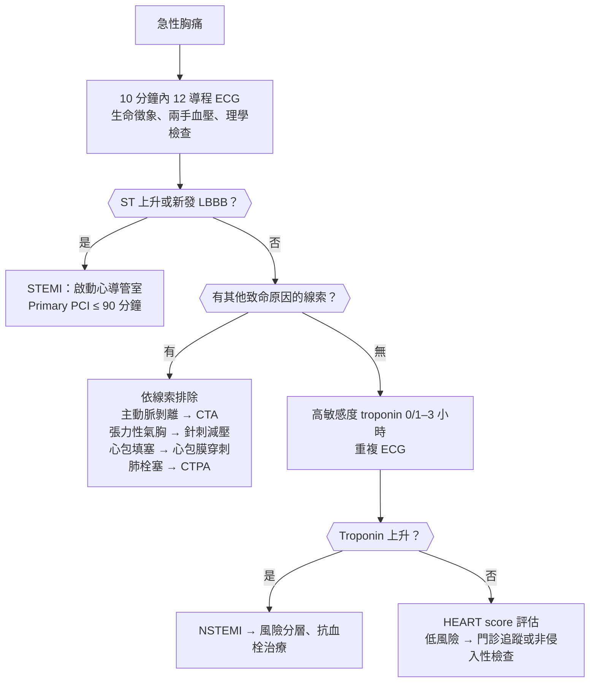
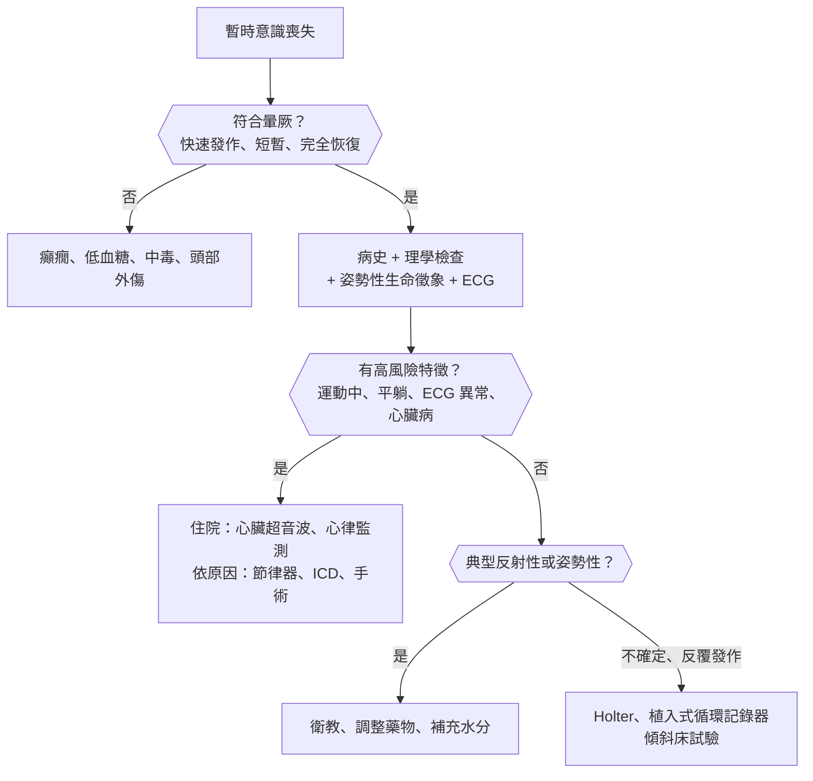
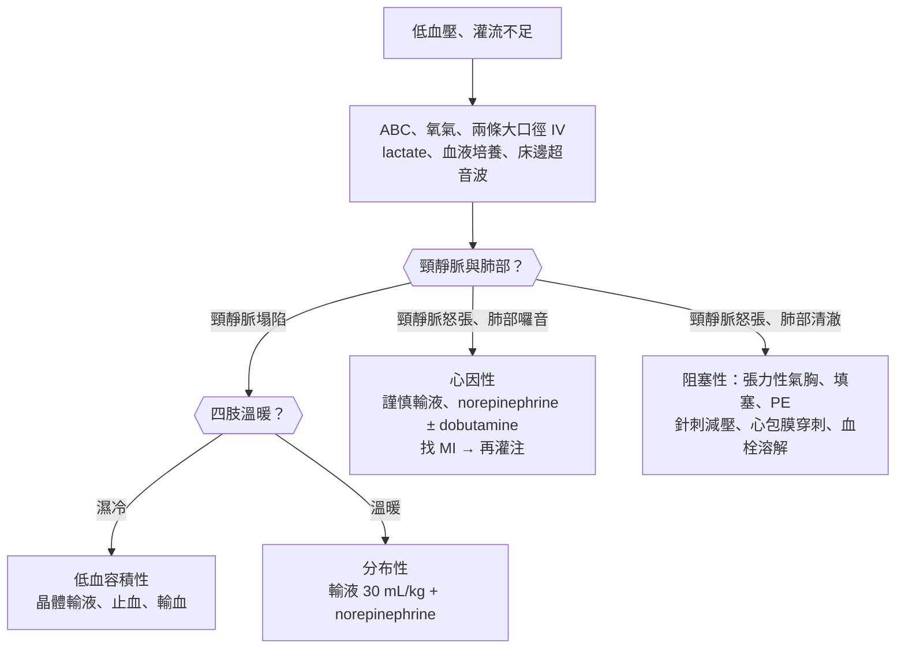

## 胸痛（Chest Pain）

### 急性胸痛（Acute Chest Pain）

#### 定義與分類

- **急性胸痛**：數分鐘至數天內新發生或性質改變的胸痛；第一步不是找「最可能」的診斷，而是先排除**會致命的原因**。
- **六大致命胸痛（must-not-miss）**：
    - **[[心臟內科#急性冠心症（ACS）|急性冠心症（ACS）]]**。
    - **[[心臟內科#主動脈剝離（Aortic Dissection）|主動脈剝離（aortic dissection）]]**。
    - **[[胸腔內科#肺栓塞（Pulmonary Embolism）|肺栓塞（pulmonary embolism, PE）]]**。
    - **張力性氣胸（tension pneumothorax）**。
    - **[[心臟內科#心包填塞（Cardiac Tamponade）|心包填塞（cardiac tamponade）]]**。
    - **食道破裂（Boerhaave syndrome）**。
- 疼痛性質的三分法：
    - **壓迫感、悶痛、緊縮感**（pressure / tightness）→ 心肌缺血。
    - **撕裂痛**（tearing）往背部放射 → 主動脈剝離。
    - **肋膜性疼痛**（pleuritic，深呼吸、咳嗽加劇）→ 肺栓塞、氣胸、肺炎、心包膜炎、肋膜炎。

#### Red flags

- **血行動力學不穩定**：低血壓（hypotension）、休克、意識改變（altered mental status）。
- **ECG 上 ST 上升**、新發生的 LBBB、心律不整。
- 冒冷汗（diaphoresis）、呼吸困難（dyspnea）、暈厥合併胸痛。
- **兩手血壓差 :red[> 20 mmHg]**、脈搏不對稱、新出現的主動脈瓣逆流雜音 → 主動脈剝離。
- 單側呼吸音消失 + 氣管偏移 + 低血壓 → 張力性氣胸。
- **Beck triad**（低血壓 + 頸靜脈怒張（JVD） + 心音遙遠（muffled heart sounds））→ 心包填塞。
- 劇烈嘔吐後胸痛 + 皮下氣腫（subcutaneous emphysema） → 食道破裂。

#### 鑑別診斷

| 系統 | 疾病 | 鑑別關鍵 |
|---|---|---|
| **心臟** | **ACS**、[[心臟內科#穩定型心絞痛（Stable Angina）\|穩定型心絞痛]]、[[心臟內科#Prinzmetal（Variant）Angina\|血管痙攣性心絞痛]]、[[心臟內科#急性心包膜炎（Acute Pericarditis）\|心包膜炎（pericarditis）]]、[[心臟內科#Myocarditis\|心肌炎（myocarditis）]]、[[心臟內科#Takotsubo Cardiomyopathy（Stress / Broken Heart Syndrome）\|Takotsubo]]、[[心臟內科#主動脈瓣狹窄（Aortic Stenosis, AS）\|主動脈瓣狹窄]]、[[心臟內科#肥厚型心肌病變（Hypertrophic Cardiomyopathy, HCM）\|HCM]] | 勞動誘發、休息或 NTG 緩解 → 心絞痛；前傾緩解 + 摩擦音 → 心包膜炎 |
| **血管** | **主動脈剝離**、**肺栓塞**、[[心臟內科#肺動脈高壓（Pulmonary Hypertension, PH）\|肺動脈高壓]] | 撕裂痛往背；突發呼吸困難 + 心搏過速（tachycardia）+ DVT 危險因子 → PE |
| **肺** | **張力性氣胸**、[[胸腔內科#氣胸（Pneumothorax）\|氣胸]]、[[胸腔內科#社區型肺炎（CAP）\|肺炎]]、肋膜炎、氣喘或 [[胸腔內科#慢性阻塞性肺病（COPD）\|COPD]] 急性發作 | 肋膜性疼痛、呼吸音不對稱、發燒 |
| **消化** | **食道破裂**、[[消化內科#胃食道逆流（GERD）\|GERD]]、[[消化內科#食道運動障礙\|食道痙攣]]、[[消化內科#消化性潰瘍（Peptic Ulcer Disease, PUD）\|消化性潰瘍]]、[[消化內科#急性胰臟炎（Acute Pancreatitis）\|胰臟炎]]、[[肝膽胰外科#急性膽囊炎（Acute Cholecystitis）\|膽囊炎]] | 與進食、平躺相關；吞嚥困難 |
| **胸壁** | 肋軟骨炎（costochondritis）、Tietze syndrome、肋骨骨折、肌肉拉傷、[[皮膚科#帶狀疱疹（Herpes Zoster / Shingles）\|帶狀疱疹]] | **按壓可重現疼痛**；單側皮節分布的水泡 |
| **精神** | [[精神科#恐慌症（Panic Disorder）\|恐慌發作（panic attack）]]、焦慮 | 排除器質性原因後才下診斷 |
| **藥物** | **Cocaine**、amphetamine（冠狀動脈痙攣、心肌梗塞、主動脈剝離） | 年輕人胸痛 → 問藥物史 |

#### 易混淆鑑別

:::compare[六大致命胸痛]
| | ACS | 主動脈剝離 | 肺栓塞 | 張力性氣胸 | 心包填塞 | 食道破裂 |
|---|---|---|---|---|---|---|
| 疼痛 | 壓迫感，放射至左臂、下巴 | **突發撕裂痛，往背部**轉移 | 肋膜性、突發 | 單側突發銳痛 | 悶痛或不明顯 | 劇烈嘔吐後胸痛、上腹痛 |
| 關鍵徵象 | 冒冷汗、S4 | **兩手血壓差、脈搏不對稱**、AR 雜音、神經學缺損 | 心搏過速、低血氧、**DVT 徵象** | **患側呼吸音消失**、氣管偏向對側、頸靜脈怒張 | **Beck triad**、**奇脈** | **皮下氣腫**、Hamman crunch |
| ECG | ST 上升或下降、T 波倒置 | 多正常（侵犯冠狀動脈時可似下壁 MI） | **竇性心搏過速最常見**、S1Q3T3、右心負荷 | 低電壓 | **低電壓、electrical alternans** | 非特異 |
| CXR | 多正常 | **縱膈腔變寬** | 多正常（Westermark、Hampton hump 少見） | **臨床診斷，不等 X 光** | 水瓶狀心影 | 縱膈腔氣腫、左側[[胸腔內科#肋膜積液（Pleural Effusion）\|肋膜積液]] |
| 確診 | ECG + troponin → 心導管 | **CT angiography**（不穩定 → TEE） | **CT 肺動脈攝影（CTPA）** | 臨床 | **心臟超音波** | 水溶性顯影劑食道攝影、CT |
| 立即處置 | 抗血小板、抗凝血、再灌注 | **控制心跳與血壓**；A 型 → 手術 | 抗凝血；休克 → 血栓溶解 | **針刺減壓** → 胸管 | **心包膜穿刺** | NPO、抗生素、手術 |
:::

:::compare[ST 上升的鑑別]
| | STEMI | 急性心包膜炎 | 早期再極化 | 左心室動脈瘤 | Brugada pattern |
|---|---|---|---|---|---|
| 分布 | 依冠狀動脈區域**局部** | **瀰漫性**（多個區域） | 胸前導程（V2–V5）為主 | 前壁 MI 後 | **V1–V2** |
| ST 形狀 | **凸起（convex）**、墓碑狀 | **凹陷（concave）** | 凹陷、J 點有切跡 | 持續上升 | **Coved**（下斜） |
| 對側 ST 下降 | **有**（reciprocal change） | 無（僅 aVR、V1 可下降） | 無 | 無 | 無 |
| PR 段 | 正常 | **PR 下降**（aVR PR 上升） | 正常 | 正常 | 正常 |
| 演變 | 數小時內變化、出現 Q 波 | 數天至數週分期演變 | 穩定不變 | 持續數週以上不變 | 可被發燒、Na 阻斷劑誘發 |
- 其他：LBBB 或心室節律器（用 Sgarbossa criteria）、[[腎臟內科#高血鉀（Hyperkalemia，K⁺ > 5.0 mEq/L）|高血鉀]]、Takotsubo、血管痙攣性心絞痛（短暫 ST 上升）。
:::

:::compare[STEMI、NSTEMI、不穩定型心絞痛]
| | STEMI | NSTEMI | 不穩定型心絞痛（UA） |
|---|---|---|---|
| ECG | **ST 上升**（或新發 LBBB、後壁 MI） | ST 下降、T 波倒置，或正常 | ST 下降、T 波倒置，或正常 |
| Troponin | **上升** | **上升** | **正常** |
| 病理 | 冠狀動脈完全阻塞、透壁梗塞 | 部分阻塞、心內膜下梗塞 | 部分阻塞、無心肌壞死 |
| 再灌注 | **Primary PCI（door-to-balloon :red[≤ 90 分鐘]）** 或血栓溶解劑 | 依風險分層決定侵入性治療時機 | 同 NSTEMI |
| 血栓溶解劑 | 可用 | **不用** | **不用** |
:::

#### 問診與理學檢查

- 疼痛特徵：OPQRST，特別問**發作方式**（突發 vs 漸進）、**誘發與緩解因素**（勞動、呼吸、姿勢、進食、按壓）、**放射**、持續時間。
- 典型心絞痛三要素：
    - **胸骨後**（retrosternal）壓迫感。
    - **勞動或情緒**誘發。
    - **休息或 NTG** 數分鐘內緩解。
    - 符合 3 項 → 典型；2 項 → 非典型；≤ 1 項 → 非心絞痛性胸痛。
- 危險因子：年齡、男性、糖尿病、高血壓、高血脂、吸菸、家族史、[[家庭醫學科#慢性腎臟病（CKD）|慢性腎臟病]]。
- **非典型表現**（無胸痛的 ACS）：**女性、老年人、糖尿病**（自主神經病變）→ 呼吸困難、疲倦（fatigue）、上腹痛、噁心。
- 理學檢查：
    - **兩手血壓**、四肢脈搏。
    - 頸靜脈（JVP）、心音（S3、S4、雜音、摩擦音）、肺部呼吸音。
    - 胸壁壓痛、皮疹、下肢水腫（edema）與 DVT 徵象。

#### 檢查流程

- **ECG：到院 :red[10 分鐘內]完成**；第一張無法診斷但症狀持續 → 每 15–30 分鐘重複。
    - 下壁 MI 加做**右側導程（V4R）**看右心室梗塞。
    - V1–V3 ST 下降 + R 波變高 → 懷疑**後壁 MI**，加做 V7–V9。
- **高敏感度 troponin**：到院時與 1–3 小時後各一次（看絕對值與變化量）；症狀 < 3 小時第一次可能還沒升高。
- **HEART score**（History、ECG、Age、Risk factors、Troponin，各 0–2 分）：
    - :red[0–3 分]：低風險（主要心臟事件約 1–2%）→ 可出院追蹤。
    - 4–6 分：中風險 → 留觀、進一步檢查。
    - 7–10 分：高風險 → 早期侵入性治療。
- 其他：CXR、CBC、電解質、腎功能、凝血功能；懷疑 PE → Wells score + D-dimer；懷疑剝離 → CTA。

#### 初步處置

- 監視器、氧氣（**SpO₂ < 90% 才給**）、靜脈留置針。
- 懷疑 ACS：
    - **Aspirin :red[160–325 mg] 嚼服**（排除主動脈剝離後）。
    - NTG 舌下（**禁忌：收縮壓 < 90 mmHg、右心室梗塞、24–48 小時內使用 PDE5 抑制劑**）。
    - 疼痛控制、抗凝血（heparin）、P2Y12 抑制劑；STEMI → 再灌注。
- 主動脈剝離：**先 IV β 阻斷劑**（esmolol、labetalol）把心跳降到 < 60、收縮壓降到 100–120 mmHg，**再加血管擴張劑**（否則反射性心搏過速）；A 型 → 緊急手術。
- 詳見 [[心臟內科#STEMI 處理|STEMI 處理]]、[[心血管外科#主動脈剝離（Aortic Dissection）|主動脈剝離的外科治療]]。

:::pitfall
胸痛病人懷疑 ACS → 未排除主動脈剝離就給 aspirin、heparin 或血栓溶解劑 → 剝離的主動脈大出血、心包填塞。剝離可延伸到右冠狀動脈而表現為下壁 STEMI；撕裂痛、兩手血壓差、縱膈腔變寬（widened mediastinum）時先做 CTA。
:::

:::pitfall
下壁 STEMI 合併右心室梗塞（V4R ST 上升、低血壓、頸靜脈怒張、肺部清澈）→ 依一般 MI 給 NTG、morphine 或利尿劑 → 前負荷下降，嚴重低血壓。右心室梗塞依賴前負荷，低血壓時先給輸液。
:::

:::pitfall
Cocaine 引起的胸痛 → 給單純 β 阻斷劑 → α 受體作用失去抵抗（unopposed α），冠狀動脈痙攣與高血壓惡化。先用 benzodiazepine、NTG、CCB。
:::

### 穩定或反覆胸痛（Stable / Recurrent Chest Pain）

#### 定義與評估重點

- 症狀穩定、反覆出現數週以上，與勞動相關 → 考慮**慢性冠狀動脈症候群（穩定型心絞痛）**。
- 評估順序：
    1. 依症狀（典型/非典型/非心絞痛）、年齡、性別估計**檢查前機率（pretest probability）**。
    2. 機率極低 → 不需檢查；中等 → 非侵入性檢查；很高或有高風險特徵 → 直接心導管。
- 新發、加重或休息時發作的心絞痛 = **不穩定型心絞痛**，依 [[心臟內科#急性冠心症（ACS）|ACS]] 處理。

#### 鑑別診斷

| 類別 | 疾病 | 鑑別關鍵 |
|---|---|---|
| 冠狀動脈 | **穩定型心絞痛**、**血管痙攣性心絞痛（[[心臟內科#Prinzmetal（Variant）Angina\|Prinzmetal]]）**、微血管性心絞痛（microvascular angina） | Prinzmetal：**休息時、清晨**發作，短暫 ST 上升，吸菸者；微血管性：女性、冠狀動脈攝影正常 |
| 結構性 | **[[心臟內科#主動脈瓣狹窄（Aortic Stenosis, AS）\|主動脈瓣狹窄]]**、**[[心臟內科#肥厚型心肌病變（Hypertrophic Cardiomyopathy, HCM）\|HCM]]**、肺動脈高壓 | 勞動時胸痛 + 暈厥 + 雜音 |
| 消化 | [[消化內科#胃食道逆流（GERD）\|GERD]]、食道痙攣、[[消化內科#消化性潰瘍（Peptic Ulcer Disease, PUD）\|消化性潰瘍]] | 與進食、平躺相關；PPI 有效 |
| 胸壁 | 肋軟骨炎 | 按壓可重現 |
| 精神 | 焦慮、[[精神科#恐慌症（Panic Disorder）\|恐慌症]] | 排除後才下診斷 |

#### 易混淆鑑別

:::compare[非侵入性檢查的選擇]
| 情境 | 首選檢查 | 理由 |
|---|---|---|
| **能運動 + 基礎 ECG 可判讀** | **運動心電圖（treadmill）** | 便宜、可評估運動耐受度 |
| 能運動 + **基礎 ECG 無法判讀** | **運動合併影像**（運動心臟超音波或心肌灌注掃描） | **LBBB、心室節律器、WPW、ST 下降 > 1 mm、LVH、使用 digoxin** 會干擾 ST 判讀 |
| **無法運動** | **藥物壓力影像**：dobutamine 心臟超音波，或 adenosine/regadenoson 心肌灌注掃描 | Adenosine **禁用於氣喘、二三度房室傳導阻滯** |
| 中低檢查前機率 | **冠狀動脈電腦斷層（CCTA）** | 陰性預測值高，可直接看冠狀動脈 |
| 高風險結果或症狀難以控制 | **冠狀動脈攝影** | 診斷 + 治療 |
- 運動心電圖陽性：**水平或下斜型 ST 下降 :red[≥ 1 mm]**；高風險：低運動量即出現 ST 下降、運動中血壓下降、ST 上升、持續心室心律不整。
- 運動試驗禁忌：急性 MI（2 天內）、不穩定型心絞痛、**有症狀的嚴重 AS**、未控制的心律不整、急性 PE、[[心臟內科#主動脈剝離（Aortic Dissection）|主動脈剝離]]、失代償心衰竭。
:::

:::compare[穩定型 vs 血管痙攣性 vs 微血管性心絞痛]
| | 穩定型心絞痛 | 血管痙攣性（Prinzmetal） | 微血管性 |
|---|---|---|---|
| 誘發 | **勞動、情緒** | **休息時、清晨**；吸菸、cocaine、triptan | 勞動或休息 |
| 發作時 ECG | ST 下降 | **短暫 ST 上升** | ST 下降 |
| 冠狀動脈攝影 | 固定狹窄 | 可正常；誘發試驗可見痙攣 | **正常** |
| 族群 | 中老年、多重危險因子 | 較年輕、**吸菸** | **女性** |
| 治療 | β 阻斷劑、NTG、aspirin、statin、必要時血管重建 | **CCB、硝酸鹽**；**避免單用 β 阻斷劑** | β 阻斷劑、CCB、危險因子控制 |
:::

#### 初步處置

- 所有人：**aspirin、statin**、危險因子控制、舌下 NTG 備用。
- 抗心絞痛：**β 阻斷劑**為一線，CCB、長效硝酸鹽、ranolazine 為二線。
- 血管重建（PCI 或 CABG）：藥物無法控制症狀、高風險解剖（左主幹、三條血管疾病合併 EF 下降）。
- 詳見 [[心臟內科#穩定型心絞痛（Stable Angina）|穩定型心絞痛]]、[[心血管外科#適應症（CABG 優於 PCI）|CABG 適應症]]。

:::exam
運動心電圖的考題常考「基礎 ECG 無法判讀」的情況（LBBB、節律器、WPW、digoxin、LVH）要改做合併影像的檢查，以及「無法運動」改做藥物壓力試驗；氣喘病人不能用 adenosine，改用 dobutamine。
:::

## 心律相關症狀（Rhythm-Related Symptoms）

### 心悸（Palpitations）

#### 定義與分類

- **心悸**：病人自覺心跳**快、重、不規則或漏跳**的不適感。
- 依原因分四大類：
    - **心律不整**：早期收縮（premature beats，最常見）、[[心臟內科#上心室心搏過速（SVT）|上心室心搏過速]]、心房顫動、心室心搏過速。
    - **竇性心搏過速（sinus tachycardia）**：發燒（fever）、貧血、脫水、疼痛、[[代謝內分泌科#甲狀腺機能亢進（Hyperthyroidism）|甲狀腺亢進]]、低血糖、懷孕、運動。
    - **藥物與物質**：咖啡因、酒精、尼古丁、擬交感藥物（感冒藥、β 致效劑）、甲狀腺素、cocaine、戒斷（酒精、β 阻斷劑）。
    - **精神**：焦慮、[[精神科#恐慌症（Panic Disorder）|恐慌發作]]（排除後才下診斷）。

#### Red flags

- 心悸合併**暈厥（syncope）**、胸痛（chest pain）、呼吸困難（dyspnea）。
- **運動中**發作。
- **猝死家族史**（< 40–50 歲）、已知結構性心臟病、曾 MI。
- 心跳 :red[> 150 次/分] 或寬 QRS 心搏過速。

#### 鑑別診斷

| 心電圖型態 | 規則 | 可能診斷 |
|---|---|---|
| **窄 QRS（< 120 ms）** | **規則** | 竇性心搏過速、[[心臟內科#AVNRT（AV Nodal Reentrant Tachycardia）\|AVNRT]]、[[心臟內科#AVRT（AV Reentrant Tachycardia）/ WPW Syndrome\|AVRT]]、[[心臟內科#Atrial Flutter\|心房撲動（atrial flutter）]]（2:1 傳導）、心房心搏過速 |
| 窄 QRS | **不規則** | **[[心臟內科#Atrial Fibrillation（AF）\|心房顫動（AF）]]**、心房撲動（不規則傳導）、**多源性心房心搏過速（MAT）**（≥ 3 種 P 波，見於 [[胸腔內科#慢性阻塞性肺病（COPD）\|COPD]]） |
| **寬 QRS（≥ 120 ms）** | 規則 | **[[心臟內科#Ventricular Tachycardia（VT）\|心室心搏過速（VT）]]**（預設）、SVT 合併束支傳導阻滯、逆向型 AVRT |
| 寬 QRS | 不規則 | **預激症候群合併 AF（pre-excited AF）**、多形性 VT、[[心臟內科#Torsades de Pointes（TdP）\|Torsades de pointes]]、AF 合併束支傳導阻滯 |

#### 易混淆鑑別

:::compare[規則的窄 QRS 心搏過速]
| | AVNRT | AVRT（正向型） | 心房撲動 2:1 | 心房心搏過速 |
|---|---|---|---|---|
| 機轉 | 房室結內**雙徑路**折返 | 經**副傳導路徑**的大折返 | 右心房大折返 | 心房異位病灶 |
| 族群 | **年輕女性最常見** | 年輕、WPW | 老年、心肺疾病 | 心臟病、digoxin 中毒 |
| 心跳 | 150–250 | 150–250 | **約 150**（心房 300） | 100–250 |
| P 波 | **看不到或 V1 假 r'**（short RP） | QRS 後的逆行 P 波（short RP） | **鋸齒狀 F 波**（II、III、aVF） | QRS 前不同形狀的 P 波（long RP） |
| Adenosine | **終止** | **終止** | 不終止，**暴露 F 波** | 多不終止，出現房室阻滯 |
| 根治 | 導管電燒 | 電燒副傳導路徑 | 電燒 cavotricuspid isthmus | 電燒 |
:::

:::compare[寬 QRS 心搏過速：VT vs SVT 合併差異傳導]
| 支持 VT 的線索 | 說明 |
|---|---|
| **結構性心臟病、曾 MI** | 有心肌梗塞病史的寬 QRS 心搏過速 **> 90% 是 VT** |
| **房室分離（AV dissociation）** | P 波與 QRS 各自獨立 |
| **Fusion beat、capture beat** | 房室分離的直接證據 |
| QRS 很寬 | RBBB 型 > 140 ms、LBBB 型 > 160 ms |
| **胸前導程同向（concordance）** | V1–V6 全部正向或全部負向 |
| 極端電軸（northwest axis） | −90° 至 ±180° |
- 原則：**寬 QRS 心搏過速一律先當 VT 處理**；血行動力學穩定不代表不是 VT。
- **不可給 verapamil**：若其實是 VT → 低血壓、心室顫動。
:::

#### 問診與理學檢查

- 發作方式：**突然開始、突然結束** → 折返性心律不整（AVNRT、AVRT）；漸進加速與減速 → 竇性心搏過速。
- **Vagal maneuver 可終止** → 房室結相關的折返。
- 頸部規則的**青蛙徵象（frog sign）**（頸靜脈快速搏動）→ AVNRT（心房與心室同時收縮）。
- 不規則的不規則（irregularly irregular）→ AF。
- 誘發情境：運動（兒茶酚胺敏感性 VT、長 QT type 1）、游泳（LQT1）、驚嚇或鬧鐘聲（LQT2）、睡眠中（LQT3、Brugada）。
- 理學檢查：甲狀腺、心雜音、心衰竭徵象、貧血。

#### 檢查流程

- 所有人：**12 導程 ECG**（發作時最有價值）、CBC、電解質（K、Mg、Ca）、**TSH**、血糖。
- 依發作頻率選擇監測工具：

| 發作頻率 | 監測工具 |
|---|---|
| 每天 | **Holter（24–48 小時）** |
| 每週至每月 | 事件記錄器、貼片式心電圖（14–30 天） |
| 罕見，或合併暈厥 | **植入式循環記錄器（implantable loop recorder）**（可達 3 年） |

- 結構性心臟病疑慮 → **心臟超音波**；運動誘發 → 運動心電圖。

#### 初步處置

::chart{id="tachycardia-acls"}

- **不穩定**（低血壓、意識改變、休克、缺血性胸痛、[[心臟內科#急性心衰竭（Acute Decompensated HF）|急性心衰竭]]）→ **同步電擊（synchronized cardioversion）**。
- **穩定、窄 QRS、規則**：
    1. **Vagal maneuver**（修正版 Valsalva、頸動脈竇按摩）。
    2. **Adenosine :red[6 mg] 快速 IV push** → 無效 → :red[12 mg]。
    3. β 阻斷劑或 CCB（diltiazem、verapamil）。
- **穩定、寬 QRS**：
    - 規則且單形 → 可試 adenosine；amiodarone（150 mg 10 分鐘以上）或 procainamide。
    - **不規則寬 QRS（懷疑 pre-excited AF）→ 避免所有房室結阻斷劑**（adenosine、β 阻斷劑、CCB、digoxin）→ procainamide、ibutilide 或電擊。
- AF 的心跳控制、節律控制與抗凝血，見 [[心臟內科#Atrial Fibrillation（AF）|心房顫動]]。

:::pitfall
WPW 病人發生 AF（不規則、寬窄不一的 QRS）→ 依一般 AF 給 diltiazem、β 阻斷劑、digoxin 或 adenosine → 房室結被阻斷，衝動全部經副傳導路徑傳到心室 → 心室速率更快，惡化成心室顫動。改用 procainamide 或直接電擊。
:::

### 心搏過緩（Bradycardia）

#### 定義與分類

- 心跳 :red[< 50–60 次/分]；**有症狀**（頭暈（dizziness）、暈厥、疲倦（fatigue）、低血壓、意識改變、心衰竭、胸痛（chest pain））才需要處理。
- 依位置分：
    - **竇房結功能異常**：竇性心搏過緩、竇性停頓、[[心臟內科#Sick Sinus Syndrome（SSS）|病竇症候群（SSS）]]（含 tachy-brady syndrome）。
    - **[[心臟內科#AV Block|房室傳導阻滯（AV block）]]**。

#### 鑑別診斷

| 類別 | 原因 |
|---|---|
| 生理性 | 運動員、睡眠、迷走神經張力高 |
| **藥物** | **β 阻斷劑、CCB（verapamil、diltiazem）、digoxin**、amiodarone、clonidine、ivabradine、acetylcholinesterase inhibitor |
| 電解質與代謝 | **[[腎臟內科#高血鉀（Hyperkalemia，K⁺ > 5.0 mEq/L）\|高血鉀]]**、**[[代謝內分泌科#甲狀腺機能低下（Hypothyroidism）\|甲狀腺功能低下]]**、低體溫 |
| 心臟 | **下壁 MI**（右冠狀動脈供應房室結）、傳導系統退化、[[心臟內科#Myocarditis\|心肌炎]]、浸潤性疾病（類澱粉、[[免疫風濕科#Sarcoidosis（類肉瘤病）\|類肉瘤病]]）、心臟手術後 |
| 感染 | **[[感染科#Borrelia burgdorferi（Lyme disease）\|Lyme disease]]**、Chagas disease、[[心臟內科#分類與好發\|感染性心內膜炎]]（主動脈根部膿瘍） |
| 神經 | **顱內壓上升（Cushing reflex：高血壓 + 心搏過緩 + 呼吸不規則）**、[[耳鼻喉科#阻塞性睡眠呼吸中止症（OSA）\|睡眠呼吸中止]] |

#### 易混淆鑑別

:::compare[房室傳導阻滯]
| | 一度 | 二度 Mobitz I（Wenckebach） | 二度 Mobitz II | 三度（完全） |
|---|---|---|---|---|
| ECG | PR :red[> 200 ms]，每個 P 都下傳 | **PR 逐漸延長**直到一個 P 不下傳 | **PR 固定**，突然一個 P 不下傳 | **P 與 QRS 完全無關（房室分離）** |
| 阻滯位置 | 房室結 | **房室結** | **His-Purkinje（結下）** | 結內或結下 |
| QRS | 窄 | 通常窄 | **常寬** | 窄（結內逸搏）或寬（心室逸搏） |
| 常見原因 | 藥物、迷走神經 | 藥物、**下壁 MI**、運動員 | **前壁 MI**、傳導系統退化 | 退化、MI、Lyme、藥物 |
| Atropine | 有效 | **有效** | **常無效** | 結下者無效 |
| 預後與處置 | 良性 | 多為良性，有症狀才處理 | **易進展成三度 → 節律器** | **節律器** |
- 2:1 傳導無法區分 Mobitz I 或 II：QRS 窄傾向結內，QRS 寬傾向結下。
:::

:::compare[藥物引起心搏過緩的解毒]
| 藥物 | 解毒或特殊處置 |
|---|---|
| β 阻斷劑 | **Glucagon**、高劑量 insulin |
| CCB | **Calcium**、高劑量 insulin（HIET）、脂肪乳劑 |
| Digoxin | **Digoxin Fab 抗體**；矯正低血鉀與[[腎臟內科#低血鎂（Hypomagnesemia）\|低血鎂]]（傳統上避免給鈣） |
| 高血鉀 | **Calcium gluconate** 穩定心肌膜 → insulin + glucose、β2 致效劑 |
| Clonidine、opioid | 支持療法；naloxone 對 clonidine 部分有效 |
:::

#### 問診與理學檢查

- 症狀與心跳的時間關係、暈厥前有無預兆。
- 用藥清單（含眼藥水 timolol）、甲狀腺症狀、蜱咬史或旅遊史。
- **大砲 a 波（cannon a wave）**：三度房室阻滯時心房對著關閉的三尖瓣收縮。
- 第一心音強弱不一（三度房室阻滯）。

#### 初步處置

::chart{id="bradycardia-acls"}

- **有症狀的心搏過緩**：
    1. **Atropine 1 mg IV**，每 3–5 分鐘重複，最多 :red[3 mg]。
    2. 無效 → **經皮節律（transcutaneous pacing）**，或 **dopamine 5–20 μg/kg/min**、**epinephrine 2–10 μg/min** 輸注。
    3. 準備**經靜脈暫時節律器**，找可逆原因。
- Atropine 無效的情況：**心臟移植後**（去神經）、結下阻滯（Mobitz II、寬 QRS 的三度阻滯）。
- 永久節律器適應症：有症狀的 SSS、**Mobitz II、三度房室阻滯**（不論症狀）、交替束支傳導阻滯。

:::pitfall
有症狀的心搏過緩 + 寬 QRS 的三度房室阻滯 → 反覆加量 atropine 等待效果 → 結下阻滯對 atropine 無反應，延誤節律器 → 心跳停止。Atropine 一次無效就準備經皮節律。
:::

### 暈厥（Syncope）

#### 定義與分類

- **暈厥**：**全腦灌流暫時不足**造成的意識喪失（loss of consciousness），特點是**發作快、時間短、自行完全恢復**。
- 不是暈厥的「暫時意識喪失」：[[神經內科#癲癇|癲癇]]、[[代謝內分泌科#Hypoglycemia|低血糖]]、[[神經外科#腦震盪（Concussion）|腦震盪]]、心因性假性暈厥、[[神經內科#暫時性腦缺血發作（TIA）|TIA]]（極少造成意識喪失）。
- 三大類：

| 類別 | 代表 | 特徵 |
|---|---|---|
| **反射性（reflex）**（最常見） | **血管迷走性（vasovagal）**、情境性（排尿、排便、咳嗽、吞嚥）、頸動脈竇過敏 | 誘發情境（久站、疼痛、看到血）、**前驅症狀**（噁心、冒汗、視線變暗） |
| **姿勢性低血壓（orthostatic hypotension）** | 脫水、出血、藥物（降壓藥、利尿劑、α 阻斷劑、硝酸鹽）、**自主神經失調**（糖尿病、[[神經內科#巴金森病（Parkinson's Disease, PD）\|Parkinson]]、MSA、類澱粉） | **站起後**數分鐘內發生 |
| **心因性（cardiac）**（最危險） | 心律不整（心搏過緩、VT、[[心臟內科#Torsades de Pointes（TdP）\|長 QT]]、Brugada、[[心臟內科#AVRT（AV Reentrant Tachycardia）/ WPW Syndrome\|WPW]]）、結構性（**[[心臟內科#主動脈瓣狹窄（Aortic Stenosis, AS）\|AS]]**、**[[心臟內科#肥厚型心肌病變（Hypertrophic Cardiomyopathy, HCM）\|HCM]]**、[[胸腔內科#肺栓塞（Pulmonary Embolism）\|PE]]、[[心臟內科#心包填塞（Cardiac Tamponade）\|心包填塞]]、[[心臟內科#主動脈剝離（Aortic Dissection）\|主動脈剝離]]、心房黏液瘤） | **運動中、平躺時、無前驅症狀**、心悸後暈厥 |

#### Red flags（傾向心因性）

- **運動中**暈厥（運動後的暈厥較常是反射性）。
- **平躺時**發作、**無前驅症狀（prodrome）**、發作前心悸或胸痛（chest pain）。
- **猝死家族史**、已知結構性心臟病或心衰竭。
- **ECG 異常**、心雜音、高齡。
- **San Francisco syncope rule（CHESS）**，有任一項 → 高風險：
    - **C**HF 病史。
    - **H**ematocrit :red[< 30%]。
    - **E**CG 異常。
    - **S**hortness of breath。
    - **S**ystolic BP < 90 mmHg（檢傷時）。

#### 易混淆鑑別

:::compare[暈厥的三大類]
| | 反射性（血管迷走性） | 姿勢性低血壓 | 心因性 |
|---|---|---|---|
| 族群 | **年輕人**最常見 | 老年、多重用藥、自主神經病變 | 老年、心臟病、猝死家族史 |
| 誘發 | 久站、悶熱、疼痛、情緒、看到血；排尿/咳嗽 | **由躺或坐到站起** | **運動中**、平躺、無明顯誘因 |
| 前驅症狀 | **有**：噁心、冒汗、臉色蒼白、視線變暗 | 頭暈、視線模糊 | **常無**；可有心悸、胸痛 |
| 恢復 | 快，但可疲倦 | 平躺後快速恢復 | 快 |
| 關鍵檢查 | 病史即可診斷；**傾斜床試驗（tilt-table）** | **姿勢性生命徵象** | **ECG**、心臟超音波、心律監測 |
| 預後 | 良好 | 依原因 | **死亡率高** |
:::

:::compare[暈厥 vs 癲癇]
| | 暈厥 | 全身性強直陣攣發作 |
|---|---|---|
| 誘發 | 久站、疼痛、姿勢改變 | 睡眠剝奪、閃光、停藥 |
| 前驅 | 噁心、冒汗、視線變暗 | **先兆（aura）**：怪味、似曾相識感 |
| 膚色 | **蒼白** | **發紺** |
| 抽動 | 可有**短暫（< 15 秒）、不規則**的肌躍 | **持續、節律性**的強直陣攣（> 30 秒） |
| 咬舌 | 少見（舌尖） | **舌頭側緣咬傷**（特異度高） |
| 尿失禁 | 可有 | 可有（**不能用來區分**） |
| 恢復 | **數秒至 1 分鐘內清醒**、定向力正常 | **發作後意識混亂（postictal confusion）** 數分鐘至數小時 |
| 檢驗 | — | 發作後 prolactin、CK 上升 |
:::

:::compare[暈厥時要看的 ECG 異常]
| ECG 發現 | 疾病 | 風險 |
|---|---|---|
| **V1–V2 coved ST 上升** | **Brugada syndrome** | 睡眠中 VF |
| **QTc 延長**（男 > 450、女 > 460 ms；:red[> 500 ms] 風險高） | 長 QT 症候群、藥物、低鉀低鎂低鈣 | [[心臟內科#Torsades de Pointes（TdP）\|Torsades de pointes]] |
| **Delta 波 + PR 短** | **WPW** | Pre-excited AF → VF |
| LVH + 側壁深窄 Q 波 | **HCM** | 運動中 VT/VF |
| V1–V3 T 波倒置、epsilon 波 | 致心律不整右心室心肌病變（ARVC） | VT |
| Mobitz II、三度阻滯、雙束支阻滯、竇性停頓 > 3 秒 | 傳導系統疾病 | 心搏停止 |
:::

#### 檢查流程

- **所有人**：詳細病史（目擊者描述）、理學檢查、**姿勢性生命徵象**、**12 導程 ECG**。
- **姿勢性低血壓**：站立 3 分鐘內**收縮壓下降 :red[≥ 20 mmHg] 或舒張壓下降 ≥ 10 mmHg**。
    - 心跳同時上升 → 傾向**容積不足**；心跳不升 → 傾向**自主神經失調**或藥物（β 阻斷劑）。
- **姿勢性心搏過速症候群（POTS）**：站立 10 分鐘內心跳上升 :red[≥ 30 次/分]（12–19 歲 ≥ 40），**無**姿勢性低血壓；年輕女性為主。
- 依懷疑方向：
    - 心雜音或心臟病 → **心臟超音波**（AS、HCM、心衰竭）。
    - 運動中暈厥 → 運動心電圖。
    - 反覆不明原因 → 長時間心律監測、**傾斜床試驗**。
    - **頸動脈竇按摩**（> 40 歲、無頸動脈雜音或近期中風）：心跳停頓 > 3 秒或收縮壓下降 > 50 mmHg → 頸動脈竇過敏。
- 檢驗依需要：Hb（出血）、血糖、**育齡女性驗孕**、電解質。
- **頭部影像與腦波不是常規檢查**（除非有神經學缺損或懷疑癲癇）。

#### 初步處置

- 反射性：衛教避免誘因、**反向加壓動作**（雙腿交叉、握拳）、增加水分與鹽分；頑固者 midodrine 或 fludrocortisone。
- 姿勢性低血壓：停用或減量相關藥物、緩慢起身、彈性襪、增加鹽水攝取；藥物 midodrine、fludrocortisone、droxidopa。
- 心因性：治療原因（節律器、ICD、瓣膜置換、HCM 治療）；住院監測。

:::pitfall
年輕人運動中暈厥 → 當成血管迷走性暈厥而沒有做 ECG 與心臟超音波 → 漏掉 HCM、長 QT、ARVC、冠狀動脈起源異常，下次可能猝死。運動中（而非運動後）暈厥一律評估心因性原因，並暫停劇烈運動。
:::

## 心臟理學檢查發現（Cardiac Physical Findings）

### 心雜音（Heart Murmurs）

#### 定義與分類

- 依時相分類：
    - **收縮期**：射血型（ejection，菱形）vs 全收縮期（holosystolic）。
    - **舒張期**：**一律視為病理性**。
    - **連續性**：跨過 S2，例如 PDA。
- 強度分級（Levine）：1/6 很微弱 → 3/6 中等 → **4/6 摸得到震顫（thrill）** → 6/6 聽診器離開胸壁仍聽得到。
- 需要心臟超音波的情況：**舒張期雜音**、連續性雜音、全收縮期雜音、**≥ 3/6**、有症狀、異常 S2、合併喀喇音（click）。

#### 鑑別診斷

| 雜音 | 位置與傳導 | 疾病與特徵 |
|---|---|---|
| **收縮期射血型** | **右上胸骨緣 → 頸動脈** | **[[心臟內科#主動脈瓣狹窄（Aortic Stenosis, AS）\|主動脈瓣狹窄（AS）]]**：越嚴重峰值越晚、S2 變弱 |
| 收縮期射血型 | 左下胸骨緣 | **[[心臟內科#肥厚型心肌病變（Hypertrophic Cardiomyopathy, HCM）\|HCM]]**：**Valsalva、站立時變大** |
| 收縮期射血型 | 左上胸骨緣 | 肺動脈瓣狹窄、**[[心血管外科#心房中隔缺損（ASD）\|ASD]]**（血流增加 + **S2 固定分裂**）、無害性雜音 |
| **全收縮期** | **心尖 → 腋下** | **[[心臟內科#二尖瓣閉鎖不全（Mitral Regurgitation, MR）\|二尖瓣閉鎖不全（MR）]]** |
| 全收縮期 | 左下胸骨緣 | **[[心臟內科#三尖瓣閉鎖不全（Tricuspid Regurgitation, TR）\|TR]]**（**吸氣變大**）、**[[心血管外科#心室中隔缺損（VSD）\|VSD]]**（粗糙、常有震顫） |
| 收縮中期喀喇音 + 收縮晚期雜音 | 心尖 | **二尖瓣脫垂（MVP）** |
| **舒張早期遞減型** | 左胸骨緣，**前傾吐氣時**最清楚 | **[[心臟內科#主動脈瓣閉鎖不全（Aortic Regurgitation, AR）\|主動脈瓣閉鎖不全（AR）]]**；肺動脈瓣逆流（Graham Steell） |
| **開瓣音 + 舒張中期隆隆聲** | 心尖，**左側臥、用鐘面** | **[[心臟內科#二尖瓣狹窄（Mitral Stenosis, MS）\|二尖瓣狹窄（MS）]]**；AR 的 Austin Flint 雜音 |
| **連續性機器聲** | 左上胸骨緣、鎖骨下 | **[[心血管外科#開放性動脈導管（PDA）\|PDA]]**、動靜脈瘻管、靜脈嗡嗡聲（venous hum） |

#### 易混淆鑑別

:::compare[動態聽診：改變雜音的動作]
| 動作 | 生理變化 | 變大 | 變小 |
|---|---|---|---|
| **吸氣** | 右心回流增加 | **右側雜音**（TR、PS）：Carvallo sign | 左側雜音 |
| **Valsalva、由蹲到站** | **前負荷下降** | **HCM**；MVP 喀喇音**提早**、雜音變長 | 大多數雜音（AS、MR、VSD、AR） |
| **蹲下、抬腿** | 前負荷與後負荷增加 | 大多數雜音 | **HCM**；MVP 喀喇音延後 |
| **握拳（handgrip）** | **後負荷增加** | **MR、VSD、AR**（逆流型） | **AS、HCM** |
| Amyl nitrite | 後負荷下降 | AS、HCM | MR、VSD、AR |
:::

:::compare[收縮期雜音：AS、HCM、MR、MVP]
| | AS | HCM | MR | MVP |
|---|---|---|---|---|
| 形態 | 菱形（crescendo-decrescendo） | 菱形 | **全收縮期** | **收縮中期喀喇音** + 收縮晚期雜音 |
| 位置 | 右上胸骨緣 → **頸動脈** | 左下胸骨緣，**不傳到頸動脈** | 心尖 → **腋下** | 心尖 |
| Valsalva/站立 | 變小 | **變大** | 變小 | 喀喇音提早、雜音變長 |
| 蹲下 | 變大 | **變小** | 變大 | 喀喇音延後 |
| 脈搏 | **Pulsus parvus et tardus**（弱且慢） | **雙峰脈（bisferiens）**、快速上升 | 正常 | 正常 |
| 族群 | 老年（退化）、二葉主動脈瓣（較年輕） | **年輕運動員猝死** | MI 後、MVP、風濕性 | 年輕女性、[[小兒科#馬凡氏症候群（Marfan Syndrome）\|Marfan]] |
:::

:::compare[舒張期雜音：AR vs MS]
| | AR | MS |
|---|---|---|
| 時相 | **舒張早期**、遞減 | **舒張中期**隆隆聲，前有**開瓣音** |
| 位置與姿勢 | 左胸骨緣，**坐起前傾、吐氣末** | 心尖，**左側臥、鐘面** |
| 相關徵象 | **脈壓變寬**、water-hammer pulse（Corrigan）、de Musset、Quincke、Duroziez、Traube、**Hill sign** | **S1 變大聲**、**S2–開瓣音間距越短越嚴重**、AF、咯血、聲音沙啞（Ortner） |
| 常見原因 | 主動脈根部擴大（Marfan、梅毒、剝離）、二葉瓣、心內膜炎 | **[[心血管外科#二尖瓣狹窄（Mitral Stenosis, MS）\|風濕性心臟病]]**（幾乎都是） |
:::

:::compare[兒童無害性雜音 vs 病理性雜音]
| | 無害性（例如 Still's murmur） | 病理性 |
|---|---|---|
| 時相 | **收縮期** | 舒張期、全收縮期、連續性（靜脈嗡嗡聲除外） |
| 強度 | ≤ 2/6，無震顫 | ≥ 3/6、有震顫 |
| 音質 | **樂音、振動感** | 粗糙 |
| 姿勢 | **站立或坐起時變小** | 不變或變大 |
| S2 | 正常分裂 | 固定分裂、單一 S2 |
| 其他 | 無症狀、生長正常 | 生長遲緩、發紺、餵食困難、喀喇音 |
- 詳見 [[小兒科#Functional Murmur（功能性心雜音）|功能性心雜音]]。
:::

#### 檢查流程

- **心臟超音波**是評估瓣膜疾病的首選。
- **嚴重 AS** 的標準：主動脈瓣面積 :red[< 1.0 cm²]、平均壓差 **≥ 40 mmHg**、最大流速 **≥ 4 m/s**。
    - 出現**心絞痛、暈厥、心衰竭**（平均存活約 5、3、2 年）→ **瓣膜置換**（SAVR 或 TAVI）。
- 心電圖（LVH、心房擴大、AF）、胸部 X 光（心影、肺鬱血）。
- 新出現的雜音 + 發燒 → **[[心臟內科#Modified Duke Criteria|感染性心內膜炎]]**：血液培養（≥ 3 套）+ 心臟超音波。

:::exam
動態聽診是常考題：Valsalva 或站立時變大的收縮期雜音只有 HCM（與 MVP 變長）；握拳增加後負荷，使逆流型雜音（MR、VSD、AR）變大、AS 與 HCM 變小；吸氣使右側雜音變大。
:::

### 異常心音、頸靜脈與脈搏（Abnormal Heart Sounds, JVP and Pulse）

#### 心音

| 發現 | 時機 | 意義 |
|---|---|---|
| **S1 變大聲** | — | **MS**、短 PR、心搏過速 |
| S1 變小聲 | — | MR、一度房室阻滯、嚴重心衰竭 |
| **S2 生理性分裂** | 吸氣時分裂 | 正常 |
| **S2 寬分裂** | 吸氣時更寬 | **RBBB**、肺動脈瓣狹窄 |
| **S2 固定分裂** | 不隨呼吸改變 | **ASD** |
| **S2 矛盾分裂** | **吐氣時**分裂 | **LBBB**、嚴重 AS、HCM、右心室節律 |
| P2 變大聲 | — | **[[心臟內科#肺動脈高壓（Pulmonary Hypertension, PH）\|肺動脈高壓]]** |
| **S3** | S2 之後（舒張早期） | **容積負荷**：心衰竭、MR；< 40 歲、孕婦、運動員可為正常 |
| **S4** | S1 之前（心房收縮） | **心室僵硬**：LVH、高血壓、AS、HCM、急性 MI；**AF 時不會有 S4** |
| 開瓣音（opening snap） | S2 後 | MS |
| 心包膜敲擊音（pericardial knock） | S2 後，比 S3 早、音調高 | **縮窄性心包膜炎** |
| 射血喀喇音（ejection click） | S1 後 | 二葉主動脈瓣、肺動脈瓣狹窄 |
| 收縮中期喀喇音 | 收縮中期 | MVP |
| 心包膜摩擦音 | 三個成分、刮擦聲 | 心包膜炎 |

#### 頸靜脈（JVP）

- 正常：胸骨角上方 **≤ 3 cm**（約等於中心靜脈壓 8 cmH₂O）。
- 波形：

| 發現 | 意義 |
|---|---|
| **a 波消失** | **AF** |
| **大砲 a 波（cannon a）** | **房室分離**：三度房室阻滯、VT |
| 巨大 a 波 | 三尖瓣狹窄、肺動脈瓣狹窄、肺動脈高壓 |
| **巨大 v 波** | **TR** |
| **y 下降陡峭**（Friedreich sign） | **縮窄性心包膜炎**、限制型心肌病變 |
| **y 下降消失** | **[[心臟內科#心包填塞（Cardiac Tamponade）\|心包填塞]]** |
| **Kussmaul sign**（吸氣時 JVP 上升） | **縮窄性心包膜炎**、右心室梗塞、限制型心肌病變 |
| 肝頸靜脈逆流（hepatojugular reflux） | 右心衰竭 |

#### 脈搏

| 脈搏 | 意義 |
|---|---|
| **Pulsus parvus et tardus**（弱、上升慢） | **嚴重 AS** |
| **Water-hammer / Corrigan pulse**（強、快速塌陷） | **AR**、高輸出狀態 |
| **雙峰脈（bisferiens）** | AR（合併 AS）、**HCM** |
| **奇脈（pulsus paradoxus）**：吸氣時收縮壓下降 :red[> 10 mmHg] | **心包填塞**、嚴重氣喘或 [[胸腔內科#慢性阻塞性肺病（COPD）\|COPD]]、大量 PE |
| **交替脈（pulsus alternans）** | **嚴重左心室衰竭** |
| 兩手脈搏或血壓不對稱 | [[心臟內科#主動脈剝離（Aortic Dissection）\|主動脈剝離]]、鎖骨下動脈狹窄、主動脈縮窄 |
| **橈股動脈延遲（radiofemoral delay）** | **[[心血管外科#主動脈縮窄（Coarctation of Aorta, CoA）\|主動脈縮窄]]** |

#### 易混淆鑑別

:::compare[心包填塞、縮窄性心包膜炎、限制型心肌病變]
| | 心包填塞 | 縮窄性心包膜炎 | 限制型心肌病變 |
|---|---|---|---|
| 奇脈 | **常見** | 少見 | 少見 |
| Kussmaul sign | 少見 | **常見** | 可有 |
| JVP y 下降 | **消失** | **陡峭** | 陡峭 |
| 額外心音 | — | **心包膜敲擊音** | S3、S4 |
| 影像 | **心包膜積液**、舒張期右心室塌陷 | **心包膜增厚或鈣化**、心室間相互依賴 | **心肌增厚**、**雙心房明顯擴大** |
| BNP | — | 正常或輕微上升 | **明顯上升** |
| 常見原因 | 惡性腫瘤、尿毒症、外傷、心臟手術、主動脈剝離 | **結核**（開發中國家）、心臟手術、放射線、病毒 | **[[血液腫瘤科#Primary Amyloidosis（AL Amyloidosis）\|類澱粉沉積]]**、[[免疫風濕科#Sarcoidosis（類肉瘤病）\|類肉瘤病]]、[[消化內科#Hemochromatosis（血色素沉著症）\|血色素沉著症]] |
| 治療 | **心包膜穿刺** | **心包膜切除** | 治療原病 |
- 詳見 [[心臟內科#縮窄性心包膜炎（Constrictive Pericarditis）|縮窄性心包膜炎]]、[[心臟內科#限制型心肌病變（Restrictive Cardiomyopathy, RCM）|限制型心肌病變]]。
:::

:::pitfall
心包填塞（低血壓、頸靜脈怒張（JVD））→ 當成心衰竭給利尿劑或硝酸鹽 → 前負荷下降，心輸出量崩潰。填塞時心室充填完全依賴靜脈回流，低血壓先給輸液並緊急心包膜穿刺。
:::

## 循環異常（Circulatory Abnormalities）

### 水腫（Edema）

#### 定義與分類

- **Starling 力量**失衡：靜水壓上升（心衰竭、靜脈阻塞、腎臟鈉滯留）、膠體滲透壓下降（低白蛋白）、微血管通透性增加（發炎、燒傷、敗血症）、淋巴回流受阻。
- **凹陷性（pitting）** vs **非凹陷性（non-pitting）**：非凹陷性見於**黏液水腫**（甲狀腺功能低下）、**淋巴水腫**、脂肪水腫。
- **雙側** vs **單側**：單側多為局部原因（靜脈、淋巴、發炎）。

#### Red flags

- **單側小腿腫痛**（DVT → PE 風險）。
- 水腫合併**呼吸困難（dyspnea）、端坐呼吸（orthopnea）**（心衰竭、肺水腫）。
- 快速發生的**臉部、嘴唇、喉頭水腫** → **[[免疫風濕科#血管性水腫（Angioedema）|血管性水腫]]（angioedema）**：過敏或 ACE 抑制劑。
- 紅腫熱痛快速擴散、劇痛不成比例 → **[[外科概論#壞死性筋膜炎（Necrotizing Fasciitis）|壞死性筋膜炎]]**。
- 外傷或手術後肢體緊繃劇痛、被動伸展痛 → **[[外科概論#Compartment Syndrome（四肢）|腔室症候群]]**。

#### 鑑別診斷

| 分布 | 原因 | 鑑別關鍵 |
|---|---|---|
| **雙側（全身性）** | **[[心臟內科#急性心衰竭（Acute Decompensated HF）\|心衰竭]]** | 頸靜脈怒張、S3、端坐呼吸、BNP 上升 |
| 雙側 | **[[消化內科#肝硬化（Liver Cirrhosis）\|肝硬化]]** | 腹水、蜘蛛痣、黃疸、低白蛋白 |
| 雙側 | **[[腎臟內科#Nephrotic Syndrome\|腎病症候群]]**、[[腎臟內科#急性腎絲球腎炎（AGN）\|急性腎絲球腎炎]]、CKD | **眼瞼水腫（晨起明顯）**、蛋白尿 |
| 雙側 | **藥物**：**dihydropyridine CCB（amlodipine）**、NSAID、類固醇、**pioglitazone**、minoxidil、gabapentin/pregabalin | 用藥後出現 |
| 雙側 | **[[心血管外科#慢性靜脈功能不全（Chronic Venous Insufficiency, CVI）\|慢性靜脈功能不全]]** | 下午加重、色素沉著（hemosiderin）、[[心血管外科#下肢靜脈曲張（Varicose Veins）\|靜脈曲張]]、鬱積性皮膚炎 |
| 雙側 | [[代謝內分泌科#甲狀腺機能低下（Hypothyroidism）\|甲狀腺功能低下]]、懷孕、[[產科#子癇前症（Preeclampsia）\|子癇前症]]、營養不良（kwashiorkor）、[[心臟內科#肺動脈高壓（Pulmonary Hypertension, PH）\|肺動脈高壓]] | 非凹陷（黏液水腫）；孕期 + 高血壓 + 蛋白尿 |
| **單側** | **[[心血管外科#深部靜脈栓塞（DVT）\|深部靜脈栓塞（DVT）]]**、[[皮膚科#蜂窩性組織炎（Cellulitis）與丹毒（Erysipelas）\|蜂窩性組織炎]]、**Baker cyst 破裂**、淋巴水腫、May-Thurner syndrome（左下肢） | Wells score、D-dimer、壓迫式超音波 |
| 局部 | 血管性水腫、過敏、昆蟲叮咬、上腔靜脈症候群（臉部與上肢） | 皮疹、癢、ACE 抑制劑使用 |

#### 易混淆鑑別

:::compare[全身性水腫：心、肝、腎]
| | 心衰竭 | 肝硬化 | 腎病症候群 |
|---|---|---|---|
| 水腫分布 | **下肢、薦骨**（臥床者） | 下肢 + **腹水為主** | **眼瞼、臉部（晨起）** → 全身 |
| 頸靜脈 | **怒張** | 正常或低 | 正常 |
| 其他徵象 | 端坐呼吸、S3、肺部囉音 | 黃疸、蜘蛛痣、脾腫大、扑翼樣震顫 | 泡沫尿、高血脂、易栓塞 |
| 白蛋白 | 正常 | **低**（合成減少） | **低**（尿中流失，< 3 g/dL） |
| 尿蛋白 | 微量 | 無 | **> 3.5 g/day** |
| 關鍵檢查 | **BNP、心臟超音波** | 肝功能、超音波、SAAG | **尿蛋白/肌酸酐比值**、腎臟切片 |
:::

:::compare[慢性下肢腫脹：靜脈、淋巴、脂肪、黏液水腫]
| | 慢性靜脈功能不全 | 淋巴水腫 | 脂肪水腫（lipedema） | 黏液水腫 |
|---|---|---|---|---|
| 凹陷 | **凹陷** | 早期凹陷，晚期**非凹陷** | **非凹陷** | **非凹陷** |
| 足背 | 可侵犯 | **侵犯足背、腳趾（Stemmer sign 陽性：無法捏起第二趾皮膚）** | **不侵犯足部**（踝部截斷） | 全身 |
| 分布 | 雙側或單側 | 常單側 | **雙側對稱**、女性 | 全身、臉部 |
| 皮膚 | **色素沉著**、鬱積性皮膚炎、內踝潰瘍 | 增厚、角化（象皮病） | 正常、易瘀青、觸痛 | 乾燥、粗糙 |
| 原因 | 靜脈瓣膜功能不全、DVT 後 | 癌症手術或放療後（乳癌腋下淋巴結清除）、絲蟲病 | 不明，荷爾蒙相關 | **甲狀腺功能低下** |
:::

#### 問診與理學檢查

- 時間（急性 vs 慢性）、單側或雙側、疼痛、晨起或傍晚加重。
- 呼吸困難、端坐呼吸、夜間陣發性呼吸困難（PND） → 心衰竭。
- 用藥清單（CCB 最常被忽略）、酒精、肝炎病史、泡沫尿、甲狀腺症狀、月經與懷孕。
- 理學檢查：頸靜脈、心肺聽診、腹水、肝臟、皮膚變化、單側小腿周徑差（> 3 cm 有意義）。

#### 檢查流程

- **雙側**：尿液試紙（蛋白尿（proteinuria））、白蛋白、肌酸酐、肝功能、TSH、**BNP** → 依結果做心臟超音波、腹部超音波、尿蛋白定量。
- **單側**：**Wells score**：
    - DVT 不太可能（≤ 1 分）→ **D-dimer** → 陰性可排除；陽性 → **壓迫式超音波**。
    - DVT 可能（≥ 2 分）→ 直接**壓迫式超音波**。
- DVT 確診 → 抗凝血（DOAC 為主）：有誘發因素者 :red[**3 個月**]；無誘發因素者至少 3 個月並評估延長。

#### 初步處置

- 治療原因；限鈉；抬高下肢；彈性襪（**先確認 ABI 正常**，[[心臟內科#周邊動脈疾病（Peripheral Artery Disease, PAD）|周邊動脈疾病]]者禁用）。
- 利尿劑：心衰竭、肝硬化、腎病症候群；**不適合**用於 CCB 引起的水腫或靜脈功能不全。

:::pitfall
吃 amlodipine 的高血壓病人出現雙側下肢水腫 → 加上利尿劑 → 水腫幾乎不改善，反而造成脫水與電解質異常。CCB 水腫是小動脈擴張造成的微血管靜水壓上升，處理是減量、換藥或合併 ACEi/ARB（擴張小靜脈）。
:::

### 血壓升高（Elevated Blood Pressure）

#### 定義與分類

- 高血壓（2017 ACC/AHA；台灣 2022 指引同樣採用）：**≥ 130/80 mmHg**；**≥ 140/90** 為第二期。
- 診斷需**多次測量**，並以居家血壓或 24 小時血壓確認：
    - **白袍高血壓**：診間高、居家正常。
    - **隱匿性高血壓**：診間正常、居家高（預後較差）。
    - 台灣居家量測「722」原則：連續 7 天、早晚 2 次、每次 2 遍。
- **高血壓危象（hypertensive crisis）**：血壓 :red[> 180/120 mmHg]，依有無急性標的器官損傷分為：
    - **高血壓急症（emergency）**：有急性器官損傷 → 住加護病房、IV 降壓藥。
    - **高血壓緊急狀態（urgency）**：無急性器官損傷 → 口服藥、門診追蹤。

#### Red flags（標的器官損傷）

- 腦：**高血壓腦病變**（頭痛（headache）、意識改變、抽搐、視乳突水腫）、[[神經內科#腦內出血（ICH）|腦出血]]、[[神經內科#缺血性中風急性處理|缺血性中風]]。
- 心：**[[心臟內科#急性冠心症（ACS）|急性冠心症]]**、**急性肺水腫**、**[[心臟內科#主動脈剝離（Aortic Dissection）|主動脈剝離]]**。
- 腎：急性腎損傷、血尿、蛋白尿（proteinuria）。
- 眼：視網膜出血、滲出、視乳突水腫。
- 孕婦：**[[產科#子癇前症（Preeclampsia）|子癇前症]]、子癇**。
- [[腎臟內科#血栓性微血管病變（Thrombotic Microangiopathy, TMA）|血栓性微血管病變]]（溶血、血小板低下）。

#### 鑑別診斷：續發性高血壓

- 篩檢時機：**< 30 歲**發病、**頑固性高血壓**（≥ 3 種藥物含利尿劑仍未控制）、突然惡化、低血鉀、標的器官損傷與病程不成比例。

| 原因 | 線索 | 篩檢 |
|---|---|---|
| **腎實質疾病** | 肌酸酐上升、蛋白尿、血尿 | 腎功能、尿液 |
| **[[腎臟內科#腎動脈狹窄（Renal Artery Stenosis）\|腎動脈狹窄]]** | **年輕女性（FMD）**或老年動脈硬化；**腹部雜音**、**反覆急性肺水腫（flash pulmonary edema）**、**ACEi 後肌酸酐上升 > 30%**、兩腎大小不對稱 | 腎動脈超音波、CTA、MRA |
| **[[代謝內分泌科#原發性醛固酮過多症（Primary Aldosteronism / Conn's Syndrome）\|原發性醛固酮過多症]]**（最常見的內分泌原因） | **低血鉀**（多數血鉀正常）、頑固性高血壓、[[代謝內分泌科#腎上腺偶發瘤（Adrenal Incidentaloma）\|腎上腺偶發瘤]] | **Aldosterone/renin 比值（ARR）** → 確認試驗 → CT → 腎上腺靜脈採樣 |
| **[[代謝內分泌科#嗜鉻細胞瘤（Pheochromocytoma）\|嗜鉻細胞瘤]]** | **陣發性頭痛、冒汗、心悸** + 高血壓 | **血漿游離 metanephrines** |
| **[[代謝內分泌科#庫欣氏症候群（Cushing's Syndrome）\|庫欣氏症候群]]** | 向心性肥胖、紫紋、月亮臉 | 1 mg dexamethasone 抑制試驗、24 小時尿液 cortisol |
| 甲狀腺疾病 | 亢進（收縮壓高、脈壓寬）、低下（舒張壓高） | TSH |
| **[[胸腔內科#阻塞性睡眠呼吸中止症（OSA）\|阻塞性睡眠呼吸中止]]** | 肥胖、打鼾、白天嗜睡、晨起頭痛 | 睡眠多項生理檢查 |
| **主動脈縮窄** | **年輕人**、上肢血壓 > 下肢、**橈股動脈延遲**、**肋骨切跡（rib notching）** | 心臟超音波、CTA |
| 藥物與物質 | **NSAID**、口服避孕藥、類固醇、感冒藥（decongestant）、cyclosporine、EPO、**甘草**、酒精、cocaine | 用藥史 |
| [[代謝內分泌科#原發性副甲狀腺機能亢進（Primary Hyperparathyroidism）\|原發性副甲狀腺亢進]] | 高血鈣 | 血鈣、PTH |

#### 易混淆鑑別

:::compare[高血壓急症 vs 緊急狀態]
| | 高血壓急症（emergency） | 高血壓緊急狀態（urgency） |
|---|---|---|
| 血壓 | 通常 > 180/120 | > 180/120 |
| 急性標的器官損傷 | **有** | **無** |
| 處置地點 | **加護病房** | 門診或急診短暫觀察 |
| 藥物 | **IV、可調整劑量** | **口服** |
| 降壓速度 | **第 1 小時降 MAP :red[≤ 25%]** → 之後 2–6 小時降到 160/100–110 → 24–48 小時內逐步到正常 | **24–48 小時內**逐步下降 |
| 例外 | 主動脈剝離、子癇前症、腦中風另有目標（見下表） | — |
:::

:::compare[高血壓急症：依情境的目標與藥物]
| 情境 | 降壓目標 | 首選藥物 | 避免 |
|---|---|---|---|
| **主動脈剝離** | **收縮壓 :red[< 120 mmHg]、心跳 < 60，第 1 小時內達成** | **Esmolol 或 labetalol 先給** → 再加 nicardipine 或 nitroprusside | 先給單純血管擴張劑（反射性心搏過速） |
| **急性肺水腫** | 快速改善症狀 | **Nitroglycerin**、loop 利尿劑 | β 阻斷劑（急性期） |
| **急性冠心症** | 改善缺血 | **Nitroglycerin**、β 阻斷劑 | Hydralazine（反射性心搏過速） |
| **子癇前症、子癇** | :red[**≥ 160/110**] **即治療** | **Labetalol、hydralazine、口服 nifedipine**；MgSO₄ 預防抽搐 | **ACEi/ARB**、nitroprusside |
| **嗜鉻細胞瘤、cocaine** | 依症狀 | **Phentolamine**（α 阻斷）、benzodiazepine（cocaine） | **單用 β 阻斷劑** |
| 缺血性中風（要打血栓溶解劑） | 打藥前 < 185/110，打藥後 24 小時 < 180/105 | Labetalol、nicardipine | — |
| 缺血性中風（不打血栓溶解劑） | > 220/120 才降，第一天降約 15% | Labetalol、nicardipine | 過度降壓 |
| 腦出血 | 收縮壓降到約 140 mmHg（避免 < 130） | Nicardipine、labetalol | — |
- 舌下 nifedipine 速效劑型**不再使用**（血壓驟降造成中風、心肌缺血）。
- Nitroprusside：長時間或腎功能不全 → **cyanide/thiocyanate 中毒**。
:::

#### 問診與理學檢查

- 正確測量：休息 5 分鐘、手臂與心臟同高、袖帶大小合適；**兩手都量**（相差 > 10–15 mmHg 要追查）。
- 頭痛、視力模糊（blurred vision）、胸痛（chest pain）、呼吸困難（dyspnea）、神經學症狀、尿量減少。
- 用藥順從性、突然停藥（**clonidine、β 阻斷劑**停藥反彈）、成藥與保健食品。
- 眼底鏡、心臟（S4、雜音）、腹部雜音、四肢脈搏（上下肢比較）。

#### 檢查流程

- 基本：電解質（K）、肌酸酐與 eGFR、血糖、血脂、**尿液分析（蛋白尿）**、**ECG**（LVH）。
- 危象：加上 CBC 與血液抹片、troponin、CXR、頭部影像（神經學症狀）、懷孕試驗。
- 懷疑續發性 → 依上表選擇篩檢。

#### 初步處置

- 一般高血壓：多數人目標 **< 130/80 mmHg**；生活型態調整（減鈉、DASH 飲食、減重、運動、限酒、戒菸）+ 一線藥物（ACEi/ARB、CCB、thiazide）。
- 詳見 [[心臟內科#高血壓藥物治療|高血壓藥物治療]]、[[心臟內科#高血壓危象（Hypertensive Crisis）|高血壓危象]]。

:::pitfall
懷疑嗜鉻細胞瘤的高血壓危象 → 先給 β 阻斷劑 → β2 血管擴張作用被阻斷而 α 收縮作用仍在，血壓反而飆升。嗜鉻細胞瘤要先 α 阻斷（phentolamine、術前 phenoxybenzamine），之後才可加 β 阻斷劑。
:::

:::pitfall
高血壓急症 → 為了「趕快降下來」在第 1 小時把血壓降到正常 → 長期高血壓病人的腦血流自動調節曲線右移，血壓驟降造成腦梗塞、心肌缺血、腎損傷。第 1 小時 MAP 只降 25%（主動脈剝離例外）。
:::

### 低血壓與休克（Hypotension / Shock）

#### 定義與分類

- **休克**：組織灌流不足以供應氧氣需求；常見指標：**MAP :red[< 65 mmHg]**、**lactate > 2 mmol/L**、尿量 < 0.5 mL/kg/h、意識改變、皮膚濕冷或花斑（mottling）。
- **Shock index**（心跳 ÷ 收縮壓）:red[**> 1**] → 提示休克，即使血壓還正常。
- 四大類：低血容積性、心因性、分布性、阻塞性。

#### 易混淆鑑別

:::compare[休克的血行動力學]
| | 低血容積性 | 心因性 | 分布性（敗血性） | 阻塞性 |
|---|---|---|---|---|
| 代表 | 出血、腹瀉、燒傷 | **MI**、[[心臟內科#Myocarditis\|心肌炎]]、嚴重瓣膜疾病、心律不整 | **[[外科概論#Sepsis 與 Septic Shock\|敗血症]]**、**[[免疫風濕科#過敏性休克（Anaphylaxis）\|過敏性休克]]**、**[[神經外科#神經性休克（Neurogenic Shock）\|神經性休克]]**、[[代謝內分泌科#腎上腺危象（Adrenal Crisis）\|腎上腺危象]] | **PE**、**心包填塞**、**張力性氣胸** |
| 心輸出量 | **↓** | **↓** | **↑（早期）** | **↓** |
| 全身血管阻力（SVR） | ↑ | ↑ | **↓** | ↑ |
| 中心靜脈壓（CVP） | **↓** | **↑** | ↓ 或正常 | **↑** |
| 肺微血管楔壓（PCWP） | ↓ | **↑** | ↓ 或正常 | PE：↓；填塞：**↑（舒張壓趨於相等）** |
| 混合靜脈血氧（SvO₂） | ↓ | ↓ | **↑** | ↓ |
| 四肢 | 濕冷 | **濕冷 + 肺鬱血** | **溫暖**（早期） | 濕冷、頸靜脈怒張 |
- **神經性休克**：SVR 下降 + **心搏過緩**（bradycardia）、四肢溫暖（交感神經中斷），見於 T6 以上[[神經外科#脊髓損傷（Spinal Cord Injury）|脊髓損傷]]。
:::

#### 初步處置

- **床邊超音波（RUSH）**：看心包膜積液、左右心室功能、IVC 大小與塌陷、氣胸、腹腔積液、[[心臟內科#腹主動脈瘤（Abdominal Aortic Aneurysm, AAA）|AAA]]。
- **敗血性休克**：
    - 3 小時內給 :red[**30 mL/kg**] **晶體輸液**。
    - 第 1 小時內給**廣效抗生素**（先抽血液培養）。
    - **Norepinephrine** 為第一線升壓劑，目標 **MAP ≥ 65 mmHg**；不足 → 加 vasopressin；仍不足 → hydrocortisone。
- **過敏性休克**：**Epinephrine :red[0.3–0.5 mg IM]（1 mg/mL）大腿前外側**，5–15 分鐘可重複；輸液；抗組織胺與類固醇為輔助。
- **心因性休克**：norepinephrine + 強心劑（dobutamine）；急性 MI → 緊急再灌注；必要時機械循環支持（IABP、ECMO）。
- **出血性休克**：止血、平衡輸血（血漿：血小板：紅血球接近 1:1:1）、tranexamic acid（受傷 3 小時內），詳見 [[外科概論#出血性休克|出血性休克]]。
- **腎上腺危象**：**hydrocortisone :red[100 mg] IV**（不必等檢驗結果）+ 輸液 + 葡萄糖。

:::pitfall
年輕外傷病人血壓正常 → 判斷沒有休克 → 漏掉代償中的出血（失血 15–30% 時主要只有心搏過速（tachycardia）、脈壓變窄）。服用 β 阻斷劑的老人連心搏過速也不會出現。看 shock index、lactate、皮膚灌流，不只看血壓。
:::

### 肢體缺血與跛行（Limb Ischemia / Claudication）

#### 定義與分類

- **間歇性跛行（intermittent claudication）**：走路走到固定距離出現肌肉痠痛，休息數分鐘即緩解。
    - 疼痛部位反映狹窄位置：**小腿**（股膕動脈，最常見）、大腿與臀部（主動脈髂動脈）。
    - **Leriche syndrome**：臀部跛行 + **股動脈脈搏消失** + **[[泌尿科#勃起功能障礙（Erectile Dysfunction, ED）|勃起功能障礙]]**（主動脈髂動脈阻塞）。
- **慢性威脅肢體缺血（CLTI）**：**休息痛**（夜間、腳垂下床緣緩解）、不癒合潰瘍、壞疽（gangrene）。
- **[[心臟內科#急性肢體缺血（Acute Limb Ischemia）|急性肢體缺血（ALI）]]**：2 週內突然發生的灌流減少，威脅肢體存活。

#### Red flags

- **6P**：Pain、Pallor、**Pulselessness**、Poikilothermia（冰冷）、**Paresthesia**、**Paralysis**；出現感覺或運動異常 → 肢體受威脅。
- 休息痛、組織缺損（潰瘍、壞疽）。
- [[代謝內分泌科#糖尿病足|糖尿病足]]合併感染。

#### 鑑別診斷

| 類別 | 疾病 | 鑑別關鍵 |
|---|---|---|
| 動脈 | **[[心臟內科#周邊動脈疾病（Peripheral Artery Disease, PAD）\|周邊動脈疾病（PAD）]]**、急性栓塞或血栓、**[[心血管外科#胸廓出口症候群（Thoracic Outlet Syndrome, TOS）\|胸廓出口症候群]]**（上肢）、Buerger disease（年輕吸菸男性） | 脈搏減弱、ABI 下降 |
| 神經 | **[[神經外科#腰椎管狹窄症（Lumbar Spinal Stenosis）\|腰椎管狹窄（神經性跛行）]]**、坐骨神經痛 | 脈搏正常、坐下或彎腰緩解 |
| 靜脈 | 靜脈性跛行（髂靜脈阻塞） | 腿脹、抬腿緩解 |
| 肌肉骨骼 | 膝或髖關節炎、[[外科概論#Compartment Syndrome（四肢）\|腔室症候群]]（慢性勞動性） | 關節壓痛、活動範圍受限 |
| 血管痙攣 | **雷諾氏現象（Raynaud phenomenon）** | 冷或情緒誘發，**白 → 藍 → 紅** |

#### 易混淆鑑別

:::compare[血管性跛行 vs 神經性跛行]
| | 血管性跛行（PAD） | 神經性跛行（腰椎管狹窄） |
|---|---|---|
| 誘發 | **走路固定距離** | **站立、走路、腰部伸展** |
| 緩解 | **站著休息**數分鐘即緩解 | **坐下或彎腰**（推購物車較舒服：shopping cart sign） |
| 疼痛位置 | **小腿**最常見 | 臀部、大腿往下放射，常雙側 |
| 騎腳踏車 | **也會痛** | **不痛**（前傾姿勢） |
| 脈搏 | **減弱或消失** | **正常** |
| 皮膚 | 冰冷、毛髮減少、指甲增厚、皮膚發亮 | 正常 |
| 檢查 | **ABI** | **腰椎 MRI** |
:::

:::compare[急性肢體缺血：栓塞 vs 血栓]
| | 栓塞（embolic） | 血栓（thrombotic） |
|---|---|---|
| 來源 | **AF**、心肌梗塞後心室血栓、動脈瘤 | 原有動脈硬化斑塊破裂、繞道血管阻塞 |
| 病史 | 無跛行病史 | **之前有跛行** |
| 發作 | **突然、嚴重**（缺乏側枝循環） | 較緩和（已有側枝循環） |
| 對側脈搏 | **正常** | **也減弱**（全身性 PAD） |
| 好發位置 | 動脈分叉處（**股動脈分叉最常見**） | 狹窄處 |
| 治療 | **Fogarty 導管取栓** | 導管溶栓、繞道或血管內治療 |
:::

:::compare[動脈性 vs 靜脈性腿部潰瘍]
| | 動脈性潰瘍 | 靜脈性潰瘍 |
|---|---|---|
| 位置 | **腳趾、足部、受壓處、外踝** | **內踝上方**（gaiter area） |
| 外觀 | **邊緣清楚如打洞**、基底蒼白、乾 | **邊緣不規則、淺**、滲液多、肉芽組織 |
| 疼痛 | **劇痛**，抬腿加劇 | 輕中度，抬腿緩解 |
| 周圍皮膚 | 冰冷、發亮、無毛 | **色素沉著**、水腫、鬱積性皮膚炎、脂肪皮膚硬化 |
| 脈搏 | 減弱或消失 | 正常 |
| 治療 | **血管重建** | **壓迫治療**（先確認 ABI ≥ 0.8） |
:::

:::compare[原發性 vs 續發性雷諾氏現象]
| | 原發性（Raynaud disease） | 續發性 |
|---|---|---|
| 族群 | 年輕女性 | 年紀較大才發病 |
| 嚴重度 | 輕、對稱 | **嚴重、不對稱**、可有**指尖潰瘍、壞死** |
| 甲襞微血管 | **正常** | **異常**（擴張、消失） |
| 抗核抗體 | 陰性 | **常陽性** |
| 相關疾病 | — | **[[免疫風濕科#全身性硬化症（Systemic Sclerosis, SSc）\|全身性硬化症]]**（> 90%）、[[免疫風濕科#全身性紅斑狼瘡（SLE）\|SLE]]、Sjögren、振動工具、β 阻斷劑 |
| 治療 | 保暖、避免誘因；**CCB（nifedipine）** | 治療原病 + CCB、PDE5 抑制劑、prostacyclin |
:::

#### 問診與理學檢查

- 跛行距離、疼痛部位、緩解方式、休息痛、傷口。
- 危險因子：**吸菸**（最強）、糖尿病、高血壓、高血脂、CKD。
- 理學檢查：四肢脈搏（股、膕、足背、脛後）、皮膚溫度與顏色、毛髮、傷口、**Buerger test**（抬腿蒼白、垂下潮紅）、腹部雜音。

#### 檢查流程

- **踝肱指數（ABI）** = 踝部收縮壓 ÷ 手臂收縮壓（取兩手較高者）：

| ABI | 解讀 |
|---|---|
| **> 1.40** | **血管鈣化無法壓迫**（糖尿病、CKD）→ 改測**趾肱指數（TBI < 0.70 異常）** |
| 1.00–1.40 | 正常 |
| 0.91–0.99 | 臨界 |
| **:red[≤ 0.90]** | **PAD** |
| < 0.40 | 嚴重缺血（休息痛、組織缺損） |

- ABI 正常但症狀典型 → **運動後 ABI**（下降 > 20% 有意義）。
- 計畫血管重建 → 雙功超音波、CTA、MRA 或血管攝影。
- 急性肢體缺血：臨床診斷為主，**不要因為影像延誤處置**；Rutherford 分級：
    - I（可存活）：無感覺或運動缺損。
    - IIa（輕度受威脅）：輕微感覺缺損 → 盡快血管重建。
    - IIb（立即受威脅）：感覺缺損 + 輕中度無力 → **緊急血管重建**。
    - III（不可逆）：麻痺、僵硬、無血流 → **截肢**。

#### 初步處置

- **慢性 PAD**：
    - **戒菸**、**抗血小板（aspirin 或 clopidogrel）**、**高強度 statin**、控制血壓與血糖。
    - **監督式運動訓練**（改善跛行距離最有效的非侵入性治療）。
    - **Cilostazol**（**心衰竭禁用**）。
    - 生活受限或 CLTI → 血管重建（血管內治療或繞道手術）。
- **急性肢體缺血**：**立即 heparin IV** → 依分級取栓、溶栓或繞道；血流恢復後注意**再灌注損傷**：**腔室症候群（筋膜切開）**、[[腎臟內科#高血鉀（Hyperkalemia，K⁺ > 5.0 mEq/L）|高血鉀]]、肌紅素尿、急性腎損傷。
- 詳見 [[心血管外科#急性肢體缺血（Acute Limb Ischemia, ALI）|急性肢體缺血的外科處置]]。

:::exam
ABI 的考題重點：≤ 0.90 診斷 PAD；> 1.40 代表血管鈣化（糖尿病、透析），ABI 不可信，要改測趾肱指數。血管性跛行站著休息就緩解、脈搏減弱；神經性跛行要坐下或彎腰才緩解、脈搏正常。
:::
