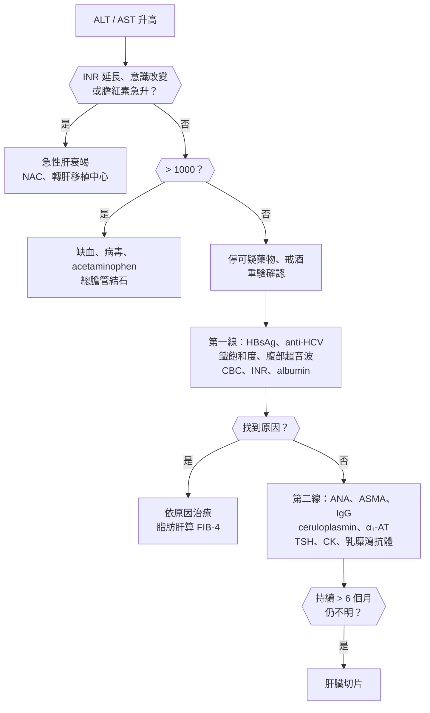
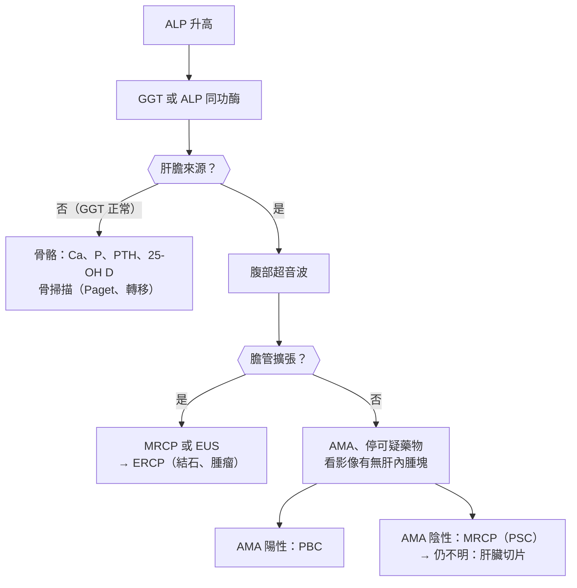
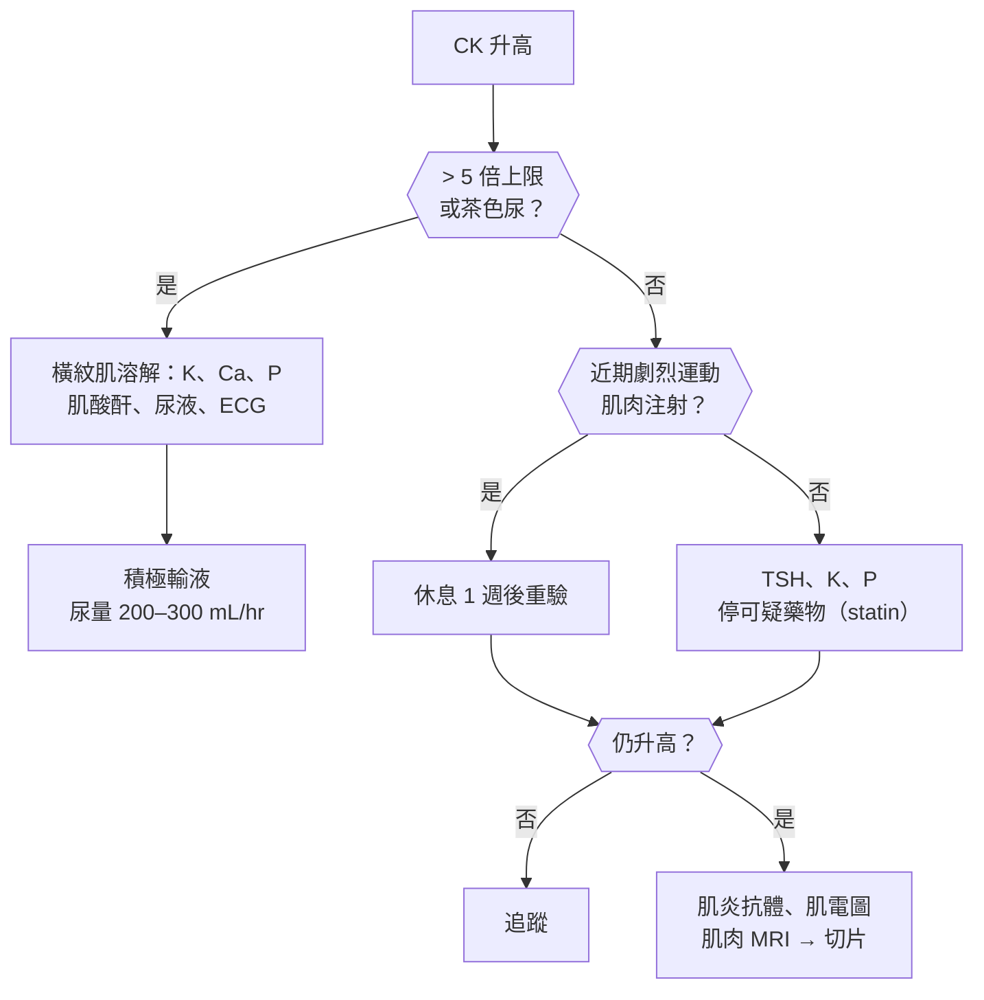

## 肝膽胰（Liver, Biliary and Pancreatic Tests）

### 轉胺酶升高（Elevated Aminotransferases）

#### 定義與分類

- **ALT（GPT）**：**主要在肝臟**，對肝細胞損傷較特異；**AST（GOT）**：**肝、心肌、骨骼肌、紅血球、腎**都有。
- **正常上限**：一般實驗室約 **40 U/L**；ACG 建議的健康上限更低：**男性 29–33、女性 19–25 U/L**。
- **依升高程度**：
    - **輕度（< 5 倍上限）**：**脂肪肝（MASLD，最常見）**、**酒精**、**慢性 B、C 型肝炎**、**藥物**、**自體免疫性肝炎**、**血色素沉著症**、**Wilson 病**、**α₁-antitrypsin 缺乏**、**乳糜瀉**、**甲狀腺疾病**、**肌肉來源（AST 為主）**。
    - **中度（5–15 倍）**：上述任一，加上**急性病毒性肝炎**。
    - **極高（> :red[1000] U/L 或 > 15 倍）**：**缺血性肝炎（休克肝）**、**急性病毒性肝炎（A、B、E）**、**藥物或毒物（acetaminophen 最常見）**、**總膽管結石（短暫、24–72 小時內快速下降）**、**自體免疫性肝炎急性發作**、**[[消化內科#Budd-Chiari Syndrome|Budd-Chiari]]**、**HSV 肝炎**。
- **R 值（區分型態）= （ALT ÷ ALT 上限）÷ （ALP ÷ ALP 上限）**：
    - **> 5：肝細胞型**；**< 2：膽汁滯留型**；**2–5：混合型**。
- **AST/ALT 比值**：
    - **:red[> 2]（AST 很少 > 300）→ 酒精性肝病**（pyridoxine 缺乏使 ALT 合成減少）。
    - **> 1 → 肝硬化**（任何原因）、**Wilson 病**、肌肉來源。
    - **< 1 → 脂肪肝、病毒性肝炎**。

#### Red flags

- **INR 延長、膽紅素上升、意識改變** → **[[消化內科#急性肝衰竭（Acute Liver Failure, ALF）|急性肝衰竭]]**（INR ≥ 1.5 + [[消化內科#肝性腦病變（Hepatic Encephalopathy）|肝性腦病變]]，無慢性肝病）。
- **acetaminophen 服用史**（含過量或長期大量 + 酒精、禁食）→ **N-acetylcysteine**。
- **轉胺酶快速下降但膽紅素與 INR 上升** → **:red[肝細胞大量壞死]**（不是好轉）。
- **發燒、右上腹痛、黃疸** → **[[消化內科#急性膽管炎（Cholangitis）|急性膽管炎]]**。
- **懷孕第三孕期** → **HELLP、妊娠急性脂肪肝**。
- **年輕人 + 溶血 + 神經精神症狀** → **Wilson 病（急性肝衰竭型）**。

#### 鑑別診斷

| 類別 | 疾病 | 鑑別關鍵 |
|---|---|---|
| **代謝** | **[[消化內科#非酒精性脂肪肝病（NAFLD）\|脂肪肝（MASLD）]]** | **肥胖、糖尿病、代謝症候群**、超音波亮肝、**ALT > AST** |
| **酒精** | **[[消化內科#酒精性肝病（Alcoholic Liver Disease）\|酒精性肝病]]** | **AST/ALT > 2、GGT 高、MCV 大** |
| **病毒** | **[[消化內科#病毒性肝炎 (Viral Hepatitis)\|B、C 型肝炎]]**（台灣最重要）、A、E 型、[[感染科#EBV（Infectious Mononucleosis）\|EBV]]、[[感染科#CMV\|CMV]]、HSV | **HBsAg、anti-HCV**；急性：anti-HAV IgM、HBc IgM |
| **藥物** | **[[消化內科#藥物性肝損傷（Drug-Induced Liver Injury, DILI）\|藥物性肝損傷]]**：**acetaminophen**、**抗結核藥（isoniazid、rifampin、pyrazinamide）**、**amoxicillin-clavulanate**、statin、**中草藥與保健食品** | **用藥時序**、停藥後改善 |
| **自體免疫** | **[[消化內科#自體免疫性肝炎（Autoimmune Hepatitis, AIH）\|自體免疫性肝炎]]** | **女性、IgG 高、ANA、抗平滑肌抗體** |
| **遺傳代謝** | **[[消化內科#Hemochromatosis（血色素沉著症）\|血色素沉著症]]**、**[[消化內科#Wilson's Disease\|Wilson 病]]**、α₁-antitrypsin 缺乏 | **鐵飽和度 > 45%**；**ceruloplasmin 低、K-F 環（< 40 歲）** |
| **缺血或血流** | **缺血性肝炎（休克、心衰竭）**、**Budd-Chiari** | **低血壓後 1–3 天 AST、ALT、LDH 極高、快速下降**；ALT/LDH < 1.5 |
| **膽道** | **[[肝膽胰外科#總膽管結石（Choledocholithiasis）\|總膽管結石]]** | **腹痛後短暫極高、快速下降** |
| **肝外** | **肌肉損傷（AST 為主、CK 高）**、**[[代謝內分泌科#甲狀腺機能低下（Hypothyroidism）\|甲狀腺低下]]**、甲狀腺亢進、**[[消化內科#Celiac Disease（乳糜瀉）\|乳糜瀉]]**、溶血、**劇烈運動** | **CK、TSH**；ALT 正常 |
| **妊娠** | **[[產科#妊娠期急性脂肪肝（Acute Fatty Liver of Pregnancy, AFLP）\|妊娠急性脂肪肝]]**、HELLP、**[[產科#妊娠期肝內膽汁淤積（Intrahepatic Cholestasis of Pregnancy, ICP）\|妊娠肝內膽汁淤積]]** | **懷孕週數**、血小板、血壓 |

#### 易混淆鑑別

:::compare[轉胺酶 > 1000 的四大原因]
| | 缺血性肝炎 | 急性病毒性肝炎 | Acetaminophen 中毒 | 總膽管結石 |
|---|---|---|---|---|
| 背景 | **休克、心衰竭、心跳停止、敗血症** | 接觸史、不潔飲食 | **過量或長期大量**（酒精、禁食加重） | **右上腹痛** |
| 高峰 | **1–3 天內達數千** | 數百到數千、**上升較慢** | **數千到上萬** | **數百到上千，24–72 小時快速下降** |
| 下降 | **很快（7–10 天恢復）** | 數週 | 依嚴重度 | **很快** |
| **LDH** | **極高（ALT/LDH < 1.5）** | 輕度 | 高 | 輕度 |
| 膽紅素 | 輕度上升 | **常明顯升高** | 依嚴重度 | **上升、ALP 隨後上升** |
| 確診 | 臨床（灌流不足病史） | **anti-HAV IgM、HBsAg、HBc IgM、anti-HEV** | **acetaminophen 濃度、用藥史** | **超音波、MRCP** |
:::

:::compare[脂肪肝 vs 酒精性肝病 vs 慢性 B 型肝炎]
| | 脂肪肝（MASLD） | 酒精性肝病 | 慢性 B 型肝炎 |
|---|---|---|---|
| 危險因子 | **肥胖、糖尿病、高血脂、高血壓** | **男性每天 > 30 g、女性 > 20 g 酒精** | **母子垂直感染（台灣）** |
| AST/ALT | **< 1** | **> 2** | < 1（肝硬化時 > 1） |
| 其他 | **超音波亮肝**、**FIB-4** 評估纖維化 | **GGT 高、MCV 大**、三酸甘油脂高 | **HBsAg 陽性**、HBV DNA、HBeAg |
| 治療 | **減重 7–10%**、運動、控制代謝因子、**resmetirom 或 GLP-1 RA（MASH 合併纖維化）** | **戒酒**；重度酒精性肝炎評估類固醇 | **抗病毒藥（entecavir、tenofovir）** |
:::

#### 問診與理學檢查

- **飲酒量**、**用藥（含中草藥、保健食品、抗結核藥、抗生素、acetaminophen）**、**B、C 型肝炎與家族史**、**輸血、靜脈藥癮、性行為、刺青**、**旅遊與不潔飲食**、代謝症候群、自體免疫病、**劇烈運動**。
- 症狀：倦怠、食慾不振、**黃疸、茶色尿、灰白便**、右上腹痛、搔癢。
- 理學檢查：**黃疸**、**[[消化系統主訴#肝腫大（Hepatomegaly）|肝腫大]]與觸痛**、**慢性肝病徵象（蜘蛛痣、手掌紅斑、男性女乳、脾腫大、腹水）**、**K-F 環**、BMI、**撲翼樣震顫**。

#### 檢查流程

- **第一線**：**肝功能全套（ALT、AST、ALP、GGT、膽紅素、albumin、INR）**、**CBC（血小板）**、**HBsAg、anti-HCV（陽性驗 HCV RNA）**、**鐵、TIBC、ferritin**、**腹部超音波**。
- **第二線**：**ANA、抗平滑肌抗體、IgG**、**ceruloplasmin**、**α₁-antitrypsin**、**TSH**、**CK**、**乳糜瀉抗體**。
- **纖維化評估**：**FIB-4（年齡、AST、ALT、血小板）**、**彈性超音波（FibroScan）**。
- **急性極高** → **anti-HAV IgM、HBsAg、anti-HBc IgM、anti-HEV、acetaminophen 濃度**、乳酸。

#### 初步處置

- **停用可疑藥物與保健食品、戒酒**；**輕度無症狀 → 數週後重驗**。
- **acetaminophen → N-acetylcysteine**（**:red[不用等濃度]**，越早越好）。
- **急性肝衰竭 → 加護病房、轉肝臟移植中心**。
- **脂肪肝 → 減重、運動、控制血糖血脂**；**B、C 肝 → 抗病毒治療**；**自體免疫性肝炎 → 類固醇 ± azathioprine**。
- **肝炎病毒帶原者**：**每 6 個月腹部超音波 + AFP**（肝癌篩檢）。

:::pitfall
休克病人轉胺酶 3000，被當成急性病毒性肝炎送隔離 → 缺血性肝炎在低血壓後 1–3 天出現，LDH 同時極高，矯正灌流後一週內快速下降。先回顧血壓與心臟功能，治療是恢復灌流。
:::

:::pitfall
轉胺酶從 2000 降到 300，以為肝炎好轉，但膽紅素與 INR 持續上升 → 剩餘的肝細胞不足，是急性肝衰竭惡化。判斷肝臟功能看 INR、膽紅素與意識，不看轉胺酶高低。
:::

:::exam
- R 值 = （ALT/上限）÷（ALP/上限）：> 5 肝細胞型、< 2 膽汁滯留型。
- AST/ALT > 2 → 酒精；脂肪肝、病毒性肝炎 ALT > AST。
- > 1000：缺血性肝炎（LDH 極高、快速下降）、急性病毒、acetaminophen、總膽管結石、AIH、Budd-Chiari。
- 第一線：HBsAg、anti-HCV、鐵飽和度、超音波；第二線：AIH 抗體與 IgG、ceruloplasmin、α₁-AT、TSH、CK、乳糜瀉。
- 肝功能看 INR、膽紅素、albumin，不看轉胺酶。
:::

### 鹼性磷酸酶升高（Elevated Alkaline Phosphatase）

#### 定義與分類

- **ALP 來源**：**肝膽（膽管上皮）**、**骨骼（成骨細胞）**、**胎盤（懷孕第三孕期）**、**腸道**（O、B 血型飯後）。
- **生理性升高**：**兒童與青少年（生長期，可達成人 2–3 倍）**、**懷孕**、更年期後。
- **先確認來源**：**GGT 或 5'-nucleotidase 同時升高 → 肝膽**；**GGT 正常 → 骨骼**（或胎盤）；也可驗 **ALP 同功酶**。
- **GGT 單獨升高**：**酒精**、**酵素誘導藥物（phenytoin、carbamazepine、barbiturate）**、脂肪肝、糖尿病、肥胖；**特異度低**。
- **肝膽來源**：
    - **肝外膽道阻塞**：**總膽管結石**、**胰頭癌**、**膽管癌**、**壺腹癌**、膽道狹窄。
    - **肝內膽汁滯留**：**原發性膽汁性膽管炎（PBC）**、**原發性硬化性膽管炎（PSC）**、**藥物（amoxicillin-clavulanate、類固醇、雌激素、chlorpromazine）**、**敗血症**、**TPN**、**妊娠肝內膽汁淤積**、**右心衰竭（鬱血肝）**。
    - **浸潤性病灶**：**肝轉移**、**淋巴瘤**、**類肉瘤病**、**結核**、**類澱粉沉積**、[[消化內科#肝膿瘍|肝膿瘍]]。
- **骨骼來源**：**Paget 骨病**、**骨轉移（成骨性：前列腺癌、乳癌）**、**骨折癒合**、**骨軟化症與佝僂病**、**副甲狀腺亢進**、**甲狀腺亢進**。

#### Red flags

- **黃疸 + 發燒 + 右上腹痛（Charcot 三徵）** → **[[消化內科#急性膽管炎（Cholangitis）|急性膽管炎]]**（加上**低血壓、意識改變 = Reynolds 五徵**）。
- **無痛性黃疸 + 體重減輕 + 可摸到的膽囊（Courvoisier sign）** → **胰頭癌、壺腹癌**。
- **ALP 極高（> 1000）**：**膽道阻塞、浸潤性病灶（轉移、淋巴瘤）、PBC、Paget 骨病**、敗血症。
- **骨痛 + 高血鈣 + ALP 高** → **骨轉移**、副甲狀腺亢進。
- **[[消化內科#發炎性腸道疾病（Inflammatory Bowel Disease, IBD）|潰瘍性結腸炎]]病人 ALP 上升** → **PSC**（膽管癌風險）。

#### 鑑別診斷

| 類別 | 疾病 | 鑑別關鍵 |
|---|---|---|
| **肝外阻塞** | **[[肝膽胰外科#總膽管結石（Choledocholithiasis）\|總膽管結石]]**、**[[消化內科#胰臟癌（Pancreatic Cancer）\|胰頭癌]]**、**[[肝膽胰外科#膽管癌（Cholangiocarcinoma）\|膽管癌]]**、**[[肝膽胰外科#壺腹周圍癌（Periampullary Cancer）\|壺腹癌]]** | **超音波膽管擴張**、膽紅素高 |
| **自體免疫膽道** | **[[消化內科#原發性膽汁性膽管炎（Primary Biliary Cholangitis, PBC）\|PBC]]**、**[[消化內科#原發性硬化性膽管炎（Primary Sclerosing Cholangitis, PSC）\|PSC]]** | **PBC：中年女性、搔癢、AMA**；**PSC：男性、潰瘍性結腸炎、MRCP 串珠狀** |
| **藥物與全身** | **藥物性膽汁滯留**、**敗血症**、**TPN**、**鬱血肝** | 用藥、感染、右心衰竭 |
| **浸潤** | **[[肝膽胰外科#肝轉移（Liver Metastasis）\|肝轉移]]**、淋巴瘤、**類肉瘤病**、結核、類澱粉 | **:red[ALP 高但膽紅素正常]**、影像有腫塊 |
| **妊娠** | **生理性（胎盤）**、**[[產科#妊娠期肝內膽汁淤積（Intrahepatic Cholestasis of Pregnancy, ICP）\|妊娠肝內膽汁淤積]]** | **ICP：搔癢（手掌腳掌）、膽酸 > 10** |
| **骨骼** | **[[骨科#Paget's disease of bone\|Paget 骨病]]**、**骨轉移**、**[[骨科#骨軟化症（Osteomalacia）/ 佝僂病（Rickets）\|骨軟化症]]**、**[[代謝內分泌科#原發性副甲狀腺機能亢進（Primary Hyperparathyroidism）\|副甲狀腺亢進]]**、骨折癒合 | **GGT 正常**、Ca、P、25-OH D、PTH、骨掃描 |
| **生理** | **兒童生長期**、**懷孕** | 年齡、懷孕 |

#### 易混淆鑑別

:::compare[PBC vs PSC]
| | 原發性膽汁性膽管炎（PBC） | 原發性硬化性膽管炎（PSC） |
|---|---|---|
| 族群 | **中年女性（90%）** | **年輕男性** |
| 受影響膽管 | **肝內小膽管** | **肝內與肝外大膽管** |
| 合併疾病 | **Sjögren、甲狀腺疾病、[[皮膚科#硬皮症（Scleroderma / Systemic Sclerosis）\|硬皮症]]（CREST）** | **潰瘍性結腸炎（70–80%）** |
| 抗體 | **AMA（> 90%）**、IgM 高 | **p-ANCA**（非特異） |
| 診斷 | **ALP 高 + AMA 陽性**（多不需切片） | **MRCP 或 ERCP：串珠狀（beading）狹窄** |
| 症狀 | **倦怠、搔癢**、黃色瘤、骨質疏鬆 | 搔癢、反覆膽管炎 |
| 癌症風險 | 肝癌（肝硬化後） | **膽管癌、大腸癌**（每年大腸鏡） |
| 治療 | **ursodeoxycholic acid（UDCA）**；反應不佳 → **PPAR 致效劑（elafibranor、seladelpar）**、fibrate | **無有效藥物**；狹窄 → ERCP 擴張；**肝移植** |
:::

:::compare[Courvoisier sign：無痛性黃疸 + 可摸到的膽囊]
| | 膽囊可摸到、無痛 | 膽囊萎縮、疼痛 |
|---|---|---|
| 原因 | **惡性阻塞（胰頭癌、壺腹癌、[[肝膽胰外科#遠端膽管癌（Distal Cholangiocarcinoma）\|遠端膽管癌]]）** | **總膽管結石** |
| 機轉 | 膽囊原本正常，阻塞後逐漸擴張 | **慢性膽囊炎使膽囊纖維化、無法擴張** |
| 下一步 | **腹部 CT（胰臟 protocol）、CA19-9、EUS** | **超音波、MRCP、ERCP 取石** |
:::

#### 問診與理學檢查

- **黃疸、搔癢、灰白便、茶色尿**、**右上腹痛與發燒**、**體重減輕**、**骨痛、骨折**。
- **用藥**、**懷孕**、**發炎性腸道疾病**、**自體免疫病**、**癌症病史**、年齡（生長期）。
- 理學檢查：**黃疸**、**膽囊觸診（Courvoisier）**、**Murphy sign**、肝腫大、**黃色瘤**、搔抓痕、骨壓痛、**頭圍增大與聽力下降（Paget）**。

#### 檢查流程

- **GGT（或 5'-nucleotidase、同功酶）**確認來源、**膽紅素**、**轉胺酶**、**腹部超音波**。
- 肝膽來源、膽管不擴張 → **AMA**、**MRCP**、[[免疫風濕科#IgG4-Related Disease（IgG4-RD）|IgG4]]、肝臟切片；膽管擴張 → **MRCP、EUS、ERCP**、**CA19-9**。
- 骨骼來源 → **Ca、P、PTH、25-OH D**、**骨掃描**、X 光、PSA（男性）。

#### 初步處置

- **膽管炎 → 抗生素 + 膽道引流（ERCP）**。
- **結石 → ERCP 取石 + 膽囊切除**；**腫瘤 → 分期、評估手術**。
- **PBC → UDCA**；**PSC → 監測膽管癌與大腸癌**、肝移植評估。
- **停用可疑藥物**；**骨骼原因依疾病治療**（Paget → bisphosphonate；維生素 D 缺乏 → 補充）。

:::pitfall
青少年健檢 ALP 是成人上限的兩倍，被安排一連串肝膽檢查 → 生長期的骨骼來源，GGT 正常就不必追。判讀 ALP 要考慮年齡、懷孕與 GGT。
:::

:::pitfall
潰瘍性結腸炎病人 ALP 緩慢升高、超音波正常，就當成藥物影響 → 想到 PSC，安排 MRCP；確診後要定期監測膽管癌，並每年做大腸鏡。
:::

:::exam
- ALP 來源：肝膽、骨、胎盤；GGT 正常 → 骨骼；GGT 單獨升高 → 酒精、酵素誘導藥物。
- 肝膽來源先做超音波：膽管擴張 → MRCP、ERCP；不擴張 → AMA（PBC）、MRCP（PSC）、藥物、浸潤性病灶。
- PBC：中年女性、AMA、UDCA；PSC：年輕男性、潰瘍性結腸炎、串珠狀、膽管癌。
- ALP 高、膽紅素正常 → 浸潤性病灶（轉移、淋巴瘤、肉芽腫）。
- Courvoisier sign：無痛性黃疸 + 可摸到膽囊 → 胰頭癌、壺腹癌。
:::

### 澱粉酶與脂肪酶升高（Elevated Amylase / Lipase）

#### 定義與分類

- **澱粉酶（amylase）**：來自**胰臟與唾液腺**；**發病 6–12 小時上升、3–5 天回到正常**；**特異度低**。
- **脂肪酶（lipase）**：**胰臟為主**；**4–8 小時上升、可持續 8–14 天**；**敏感度與特異度都較好（首選）**。
- **急性胰臟炎診斷（三項符合兩項）**：
    - **典型腹痛**（上腹痛、放射到背部）。
    - **澱粉酶或脂肪酶 > :red[3] 倍上限**。
    - **影像特徵**（CT、MRI、超音波）。
- **:red[酵素高低與嚴重度無關]**；**不需每天追蹤酵素**。
- **非胰臟炎的升高**：
    - **澱粉酶**：**唾液腺（[[感染科#腮腺炎（Mumps）|腮腺炎]]、手術）**、**巨澱粉酶血症（macroamylasemia）**、**腎衰竭（排泄減少）**、**子宮外孕破裂**、**卵巢腫瘤或囊腫**、**腸穿孔、腸缺血、[[消化內科#腸阻塞（Intestinal Obstruction）|腸阻塞]]**、**[[代謝內分泌科#DKA（Diabetic Ketoacidosis）|DKA]]**、**肺癌、卵巢癌**（腫瘤分泌）。
    - **脂肪酶**：**腎衰竭**、**腸穿孔、腸缺血**、**DKA**、**膽囊炎**、巨脂肪酶血症、**GLP-1 RA、DPP-4 抑制劑**（輕度）。
- **[[消化內科#慢性胰臟炎（Chronic Pancreatitis）|慢性胰臟炎]]與胰臟癌**：酵素**常正常**（實質已破壞）。

#### Red flags

- **酵素高 + 腹痛 + 低血壓、呼吸衰竭、腎衰竭** → **重症胰臟炎**（持續器官衰竭 > 48 小時）。
- **腹膜炎徵象 + 酵素輕度升高** → **腸穿孔、腸缺血**（不是胰臟炎）。
- **育齡女性下腹痛 + 澱粉酶高** → **子宮外孕破裂**。
- **三酸甘油脂 > 1000** 或**高血鈣** → 胰臟炎原因。
- **年長者第一次不明原因胰臟炎** → **胰臟腫瘤**（IPMN、胰臟癌）。

#### 鑑別診斷

| 類別 | 疾病 | 鑑別關鍵 |
|---|---|---|
| **急性胰臟炎** | **[[消化內科#急性胰臟炎（Acute Pancreatitis）\|急性胰臟炎]]**（**[[消化內科#膽結石（Cholelithiasis）\|膽結石]]、酒精最常見**；高三酸甘油脂、高血鈣、ERCP 後、藥物、腫瘤、外傷） | **> 3 倍、典型腹痛**、影像 |
| **其他急腹症** | **腸穿孔**、**腸缺血**、**腸阻塞**、**[[肝膽胰外科#急性膽囊炎（Acute Cholecystitis）\|膽囊炎]]**、**[[婦產主訴#急性骨盆腔痛（Acute Pelvic Pain）\|子宮外孕破裂]]** | **常 < 3 倍**、腹膜炎、CT 游離氣體、hCG |
| **唾液腺** | **腮腺炎**、[[耳鼻喉科#唾液腺結石（Sialolithiasis）\|唾液腺結石]]、手術 | **只有澱粉酶高（脂肪酶正常）**、腮腺腫大 |
| **排泄減少** | **腎衰竭** | **輕度（< 3 倍）**、eGFR 低 |
| **巨分子** | **巨澱粉酶血症** | **血中高、尿中低（澱粉酶清除率比 < 1%）**、無症狀 |
| **代謝與藥物** | **DKA**、**GLP-1 RA、DPP-4 抑制劑** | 臨床情境 |
| **腫瘤分泌** | 肺癌、卵巢癌、多發性骨髓瘤 | 持續升高、無腹痛 |

#### 易混淆鑑別

:::compare[澱粉酶 vs 脂肪酶]
| | 澱粉酶 | 脂肪酶 |
|---|---|---|
| 來源 | **胰臟、唾液腺**、卵巢、腸、肺 | **主要胰臟** |
| 上升 | 6–12 小時 | 4–8 小時 |
| 回到正常 | **3–5 天（就醫晚可能已正常）** | **8–14 天** |
| 特異度 | **低** | **較高（首選）** |
| 偽陽性 | 腮腺炎、巨澱粉酶血症、子宮外孕、腎衰竭 | 腎衰竭、腸缺血、DKA |
| **高三酸甘油脂** | **可能假性正常**（干擾檢驗） | 較不受影響 |
:::

:::compare[急性胰臟炎的嚴重度]
| 分級（修訂 Atlanta） | 定義 |
|---|---|
| **輕度** | **無器官衰竭、無局部或全身併發症** |
| **中重度** | **暫時性器官衰竭（< 48 小時）**或局部併發症（壞死、液體積聚） |
| **重度** | **持續性器官衰竭（> :red[48] 小時）** |
| 預測指標 | **BISAP**、**SIRS 持續**、**BUN 上升**、**Hct > 44%**、年齡、肥胖；**不看酵素高低** |
:::

#### 問診與理學檢查

- **腹痛位置與放射（背部）**、**飲酒**、**膽結石病史**、**用藥（azathioprine、valproate、thiazide、GLP-1 RA、didanosine）**、**近期 ERCP**、**家族史（高三酸甘油脂、遺傳性胰臟炎）**、**月經史（子宮外孕）**、腮腺腫痛。
- 理學檢查：**生命徵象**、**腹膜炎徵象**、**Cullen sign（臍周瘀青）、Grey Turner sign（腰側瘀青）**、黃疸、腮腺、**黃色瘤（高三酸甘油脂）**。

#### 檢查流程

- **脂肪酶**（首選）、**肝功能（ALT > 150 → 膽源性可能大）**、**三酸甘油脂、鈣**、**BUN、肌酸酐、Hct**、**CBC、血糖、乳酸**、**hCG（育齡女性）**。
- **腹部超音波（找膽結石）**；**診斷不確定或 48–72 小時無改善 → 顯影 CT**（**入院時不必常規 CT**）。
- 非胰臟炎時：**尿澱粉酶或澱粉酶清除率**（巨澱粉酶血症）、腎功能。

#### 初步處置

- **急性胰臟炎**：**乳酸林格氏液、適度輸液（避免過量）**、**止痛**、**早期由口進食（能耐受就吃）**；**膽源性 + 膽管炎 → 24 小時內 ERCP**；**膽源性 → 同次住院膽囊切除**。
- **不常規使用預防性抗生素**；**感染性壞死 → 抗生素 + 延後引流（step-up approach）**。
- 高三酸甘油脂 → **insulin 輸注、fibrate**；嚴重時血漿置換。
- **非胰臟炎原因** → 治療原病；**巨澱粉酶血症不需處理**。

:::pitfall
腹痛病人脂肪酶是上限的 2 倍，就診斷為胰臟炎並禁食觀察 → 腸缺血、腸穿孔、膽囊炎都會讓酵素輕度升高。未達 3 倍又有腹膜炎徵象，要做 CT 找其他急腹症。
:::

:::pitfall
胰臟炎住院每天驗澱粉酶，看到數值下降就以為病情好轉 → 酵素高低與嚴重度無關。追蹤生命徵象、器官功能（BUN、肌酸酐、氧合）與臨床症狀。
:::

:::exam
- 診斷：腹痛、酵素 > 3 倍、影像，三項符合兩項；脂肪酶較特異且持續較久。
- 酵素高低與嚴重度、預後無關；重度 = 持續器官衰竭 > 48 小時。
- 只有澱粉酶高：腮腺炎、巨澱粉酶血症（尿澱粉酶低）、子宮外孕。
- 原因：膽結石、酒精最常見；三酸甘油脂 > 1000、高血鈣、ERCP 後、藥物。
- 高三酸甘油脂可使澱粉酶假性正常。
:::

## 腎與代謝（Renal and Metabolic Tests）

### 肌酸酐升高（Elevated Creatinine / Reduced eGFR）

#### 定義與分類

- **肌酸酐（creatinine）**：**肌肉代謝產物**，經腎絲球過濾（少量腎小管分泌）；**受肌肉量影響**（老人、女性、截肢、營養不良 → 數值偏低、高估腎功能）。
- **eGFR**：**CKD-EPI 公式**（2021 版不含種族）；**急性變化時 eGFR 不準**（肌酸酐未達平衡）。
- **急性腎損傷（KDIGO）**：
    - **48 小時內上升 ≥ :red[0.3] mg/dL**，或
    - **7 天內上升到基準值 ≥ 1.5 倍**，或
    - **尿量 < 0.5 mL/kg/hr 持續 6 小時**。
- **慢性腎臟病（CKD）**：**eGFR < 60 或腎臟損傷證據（白蛋白尿、影像、病理）持續 > :red[3] 個月**；依 **G（eGFR）與 A（白蛋白尿）** 分期。
- **肌酸酐升高但 GFR 沒有真的下降**：
    - **抑制腎小管分泌**：**trimethoprim**、**cimetidine**、**dolutegravir**、cobicistat、**fenofibrate**。
    - **肌酸酐生成增加**：**大量肉類、肌酸補充品**、**肌肉量大**、橫紋肌溶解。
    - **檢驗干擾**：**酮體（Jaffe 法）**、cefoxitin。
- **ACEi、ARB、SGLT2 抑制劑開始後**：**肌酸酐上升 < :red[30]% 可接受**（血流動力學改變，長期保護腎臟）。

#### Red flags

- **高血鉀、嚴重酸中毒、肺水腫、尿毒症狀（心包膜炎、腦病變、出血）** → **緊急透析**（AEIOU）。
- **無尿** → **雙側阻塞**、**腎動脈阻塞**、**急進性腎絲球腎炎**、休克。
- **血尿 + 蛋白尿 + 紅血球圓柱 + 肌酸酐快速上升** → **急進性腎絲球腎炎**（ANCA、anti-GBM）。
- **咳血 + 腎衰竭** → **肺腎症候群**。
- **貧血 + 高血鈣 + 腎衰竭 + 骨痛** → **[[血液腫瘤科#多發性骨髓瘤（Multiple Myeloma）|多發性骨髓瘤]]**。

#### 鑑別診斷

| 類別 | 疾病 | 鑑別關鍵 |
|---|---|---|
| **假性升高** | **trimethoprim、cimetidine、dolutegravir**、肌酸補充品、大量肉類 | **cystatin C 正常**、BUN 不變 |
| **腎前性** | **[[腎臟內科#Prerenal AKI\|脫水、出血、心衰竭、肝腎症候群]]**、**NSAIDs、ACEi、ARB** | **BUN/Cr > 20**、**FENa < 1%** |
| **腎性** | **[[腎臟內科#急性腎小管壞死（ATN）\|ATN]]**（缺血、顯影劑、aminoglycoside）、**[[腎臟內科#急性間質性腎炎（AIN）\|急性間質性腎炎]]**、**[[腎臟內科#急性腎絲球腎炎（AGN）\|腎絲球腎炎]]**、血管炎、**膽固醇栓塞** | **尿沉渣**（顆粒圓柱、白血球圓柱、紅血球圓柱）、FENa > 2% |
| **腎後性** | **[[腎臟內科#Postrenal AKI\|攝護腺肥大、結石、腫瘤、神經性膀胱]]** | **超音波水腎**、餘尿量 |
| **慢性** | **[[腎臟內科#慢性腎臟病（CKD）\|CKD]]**（**糖尿病腎病變最常見**、高血壓、腎絲球腎炎、[[泌尿科#多囊腎（Polycystic Kidney Disease, PKD）\|多囊腎]]） | **腎臟縮小**、貧血、副甲狀腺亢進、**過去數值** |

#### 易混淆鑑別

:::compare[急性腎損傷 vs 慢性腎臟病]
| | AKI | CKD |
|---|---|---|
| **過去數值** | **最近正常** | **持續 > 3 個月異常** |
| **腎臟大小** | **正常或腫大** | **縮小、皮質變薄**（例外：**糖尿病、類澱粉、多囊腎、HIV 腎病**仍大） |
| 貧血 | 輕或無 | **正球性貧血（EPO 不足）** |
| 鈣磷 | 可正常 | **高磷、低鈣、PTH 高** |
| 症狀 | 急性 | 夜尿、癢、慢性倦怠 |
| 注意 | **CKD 上可以再發生 AKI（acute on chronic）** | |
:::

:::compare[BUN/Cr 比值]
| BUN/Cr | 想到 |
|---|---|
| **> 20** | **腎前性**、**[[消化系統主訴#上消化道出血（Upper GI Bleeding）\|上消化道出血]]**（血液蛋白被吸收）、**類固醇、tetracycline（分解代謝）**、**高蛋白飲食或管灌**、**腎後性（早期）** |
| **10–20** | **腎性（ATN 等）**、正常 |
| **BUN 低（< 10）** | **肝衰竭（尿素合成少）**、**營養不良**、**SIADH、懷孕**、大量輸液 |
:::

#### 問診與理學檢查

- **過去肌酸酐數值**、**尿量變化**、**脫水、出血、嘔吐腹瀉**、**用藥（NSAIDs、ACEi、ARB、利尿劑、顯影劑、aminoglycoside、vancomycin、PPI、trimethoprim、中草藥、含馬兜鈴酸藥物）**、**糖尿病、高血壓、家族腎病史**、**排尿困難（攝護腺）**、**血尿、泡泡尿、水腫**、**皮疹、關節痛、咳血**（血管炎）。
- 理學檢查：**體液狀態**、**血壓**、**膀胱脹（導尿測餘尿）**、**攝護腺**、皮疹、**網狀青斑（膽固醇栓塞）**、**心包膜摩擦音**、撲翼樣震顫。

#### 檢查流程

- **與過去數值比較**、**BUN、電解質、HCO₃⁻、Ca、P**、**CBC**。
- **尿液分析與沉渣**、**尿蛋白與肌酸酐比（UPCR）、白蛋白與肌酸酐比（UACR）**、**FENa（未用利尿劑）或 FEUrea（用利尿劑時 < 35% 腎前性）**。
- **腎臟超音波**（大小、水腎、皮質）。
- 依臨床：**ANCA、anti-GBM、補體、ANA**、**SPEP 與游離輕鏈**、**cystatin C**（懷疑假性升高）。
- 詳見[[腎泌尿系統主訴#少尿與急性腎損傷（Oliguria / Acute Kidney Injury）|少尿與急性腎損傷]]。

#### 初步處置

- **AKI**：**矯正體液（腎前性補液）**、**停用腎毒性藥物**、**解除阻塞（導尿）**、**依 eGFR 調整藥物劑量**、**避免顯影劑**；**透析適應症（AEIOU）**。
- **CKD**：**控制血壓（ACEi 或 ARB，有白蛋白尿時）**、**SGLT2 抑制劑（eGFR ≥ 20）**、**糖尿病合併白蛋白尿加 finerenone**、**控制血糖**、**避免 NSAIDs**、處理貧血與 CKD-MBD；**eGFR < 30 轉腎臟科、準備腎臟替代療法**。
- **台灣：CKD 盛行率高、透析發生率世界前列** → **初期慢性腎臟病照護與 Pre-ESRD 衛教計畫**。

:::pitfall
愛滋病人換成含 dolutegravir 的處方後肌酸酐從 0.9 升到 1.1，被認為腎毒性而停藥 → dolutegravir、trimethoprim、cimetidine 抑制肌酸酐的腎小管分泌，GFR 沒有真的下降。小幅、穩定的上升驗 cystatin C 確認。
:::

:::pitfall
糖尿病腎病變開始 ARB 後肌酸酐從 1.5 升到 1.8，馬上停藥 → 上升不到 30% 是預期中的腎絲球內壓下降，長期能保護腎臟，應該繼續使用並追蹤鉀與肌酸酐；超過 30% 才找[[腎臟內科#腎動脈狹窄（Renal Artery Stenosis）|腎動脈狹窄]]或脫水。
:::

:::exam
- KDIGO AKI：48 小時上升 ≥ 0.3、7 天內 ≥ 1.5 倍、尿量 < 0.5 mL/kg/hr × 6 小時。
- CKD：eGFR < 60 或腎損傷 > 3 個月；腎臟縮小（例外：糖尿病、類澱粉、多囊腎、HIV）。
- 假性升高：trimethoprim、cimetidine、dolutegravir（抑制分泌）、肌酸補充品。
- BUN/Cr > 20：腎前性、上消化道出血、類固醇；FENa < 1% 腎前性（用利尿劑看 FEUrea < 35%）。
- ACEi、ARB 開始後肌酸酐上升 < 30% 可接受。
:::

### 高尿酸血症（Hyperuricemia）

#### 定義與分類

- **高尿酸血症**：**> :red[7] mg/dL**（尿酸在體液中的飽和濃度約 6.8）；女性停經前因雌激素促進排泄而較低。
- **多數無症狀**，只有少部分發展成**痛風**或**尿酸結石**。
- **原因**：
    - **排泄減少（約 90%）**：**CKD**、**利尿劑（thiazide、loop）**、**低劑量 aspirin**、**酒精（乳酸競爭排泄）**、**cyclosporine、tacrolimus**、**pyrazinamide、ethambutol**、**酮酸中毒與乳酸中毒**、**[[小兒科#鉛中毒（Lead Poisoning）|鉛中毒]]**、**甲狀腺低下**、肥胖與胰島素阻抗、脫水。
    - **生成增加（約 10%）**：**腫瘤溶解症候群**、**骨髓增生性腫瘤、淋巴瘤、溶血**、**乾癬**、**高普林飲食（內臟、海鮮、肉湯）**、**果糖（含糖飲料）**、**酒精（啤酒含普林）**、**HGPRT 缺乏（Lesch-Nyhan）**、[[小兒科#肝醣儲積症（Glycogen Storage Diseases）|肝醣儲積症]]。
- **降尿酸的非痛風藥物**：**losartan**、**fenofibrate**、**SGLT2 抑制劑**、**atorvastatin**（輕度）。

#### Red flags

- **化療後尿酸急升 + 高鉀 + 高磷 + 低鈣 + AKI** → **腫瘤溶解症候群**。
- **尿酸極高 + 急性腎衰竭** → **急性尿酸腎病變**（尿酸/肌酸酐比 > 1）。
- **兒童高尿酸 + 自殘行為 + 發展遲緩** → **Lesch-Nyhan 症候群**。
- **開始 allopurinol 後皮疹、發燒** → **[[皮膚科#Stevens-Johnson Syndrome（SJS）/ Toxic Epidermal Necrolysis（TEN）|SJS/TEN]]、[[皮膚科#Drug Reaction with Eosinophilia and Systemic Symptoms（DRESS）|DRESS]]**（**HLA-B*5801**）。

#### 鑑別診斷

| 類別 | 疾病 | 鑑別關鍵 |
|---|---|---|
| **排泄減少** | **CKD**、**利尿劑、低劑量 aspirin**、**酒精**、**cyclosporine**、**pyrazinamide**、**鉛中毒** | **24 小時尿酸 < 600–800 mg**、用藥史 |
| **生成增加** | **[[血液腫瘤科#Tumor Lysis Syndrome（TLS）\|腫瘤溶解]]**、**骨髓增生性腫瘤**、**溶血**、**乾癬**、**飲食（普林、果糖、啤酒）** | **24 小時尿酸 > 800 mg**、CBC |
| **遺傳** | **Lesch-Nyhan（HGPRT 完全缺乏）**、Kelley-Seegmiller（部分缺乏）、肝醣儲積症 | **兒童、神經症狀** |
| **臨床後果** | **[[骨科#痛風性關節炎（Gout）\|痛風]]**、**痛風石**、**[[腎臟內科#腎結石（Nephrolithiasis）\|尿酸結石]]**、尿酸腎病變 | 關節炎、結石病史 |

#### 易混淆鑑別

:::compare[無症狀高尿酸血症 vs 痛風的降尿酸治療（ACR 2020）]
| 情境 | 是否給降尿酸藥 |
|---|---|
| **無症狀高尿酸血症** | **:red[一般不建議用藥]**（生活型態調整） |
| **痛風 + 痛風石、影像有骨侵蝕、或每年發作 ≥ 2 次** | **強烈建議開始** |
| **第一次發作 + CKD ≥ 3 期、尿酸 > 9、或尿酸結石** | 有條件建議開始 |
| **目標** | **尿酸 < :red[6] mg/dL**（痛風石 < 5） |
| **藥物** | **allopurinol 首選（從低劑量開始，逐步調高）**、febuxostat、benzbromarone（台灣常用、注意肝毒性）、probenecid |
| **開始時** | **預防性 colchicine（或 NSAIDs、低劑量類固醇）3–6 個月**；**發作中可開始**，不必等緩解 |
| **台灣** | **HLA-B*5801 帶原率高** → allopurinol 前**建議檢測**（陽性改用 febuxostat） |
:::

#### 問診與理學檢查

- **關節痛發作史**、**腎結石**、**飲食（內臟、海鮮、啤酒、含糖飲料）**、**飲酒**、**用藥（利尿劑、aspirin、cyclosporine、抗結核藥）**、**化療**、**乾癬**、**家族史**、代謝症候群。
- 理學檢查：**痛風石（耳廓、肘、手指、跟腱）**、關節腫脹、BMI、血壓、乾癬皮疹。

#### 檢查流程

- **腎功能**、**CBC**、**血糖、血脂**（代謝症候群）、尿液分析。
- 年輕、家族史、結石 → **24 小時尿酸**（區分排泄減少與生成增加）。
- 化療中 → **K、P、Ca、LDH、肌酸酐**（腫瘤溶解）。

#### 初步處置

- **生活型態**：**減重**、**減少內臟海鮮與肉湯**、**戒啤酒與烈酒**、**避免含糖飲料（果糖）**、多喝水；**低脂乳製品**、咖啡有益。
- **調整藥物**：**高血壓改用 losartan 或 CCB**（取代 thiazide），**高血脂可考慮 fenofibrate**。
- **腫瘤溶解預防**：**輸液 + allopurinol（中風險）或 rasburicase（高風險，:red[G6PD 缺乏禁用]）**。
- **痛風** → 依上表；詳見[[肌肉骨骼系統主訴#急性單關節炎（Acute Monoarthritis）|急性單關節炎]]。

:::pitfall
健檢尿酸 8.5、從未發作的病人直接開 allopurinol，一個月後出現全身皮疹與發燒 → 無症狀高尿酸血症一般不需用藥；若要用 allopurinol，台灣人 HLA-B*5801 帶原率高，用藥前先檢測並從低劑量開始。
:::

:::pitfall
淋巴瘤化療後尿酸 15、肌酸酐上升，給 rasburicase 後發生嚴重溶血 → G6PD 缺乏者使用 rasburicase 會造成溶血與變性血紅素血症。台灣 G6PD 缺乏不少見，用藥前要確認。
:::

:::exam
- > 7 mg/dL；90% 排泄減少（CKD、利尿劑、低劑量 aspirin、酒精、cyclosporine、pyrazinamide）。
- 無症狀高尿酸血症不用藥；痛風石、骨侵蝕、每年 ≥ 2 次發作 → 降尿酸，目標 < 6。
- Allopurinol：HLA-B*5801 → SJS/TEN；rasburicase：G6PD 缺乏禁用。
- losartan、fenofibrate、SGLT2 抑制劑能降尿酸。
- Lesch-Nyhan：HGPRT 缺乏、高尿酸、自殘、發展遲緩。
:::

### 血脂異常（Dyslipidemia）

#### 定義與分類

- **常用數值（mg/dL）**：
    - **LDL-C**：依心血管風險設定目標（見下表）；**≥ :red[190] → 想家族性高膽固醇血症**。
    - **三酸甘油脂（TG）**：**≥ 150 異常**；**≥ 500 → 胰臟炎風險**；**≥ :red[1000] 高風險**。
    - **HDL-C**：**男 < 40、女 < 50** 偏低。
    - **non-HDL-C = 總膽固醇 − HDL**（TG 高時比 LDL 準）。
    - **Lp(a)**：遺傳決定，**一生驗一次**；高 → 心血管風險增加。
- **原發性**：**家族性高膽固醇血症（FH，LDL 受體突變，體染色體顯性）**、**家族性合併高血脂**、**家族性高三酸甘油脂**、**lipoprotein lipase 缺乏（乳糜微粒血症）**。
- **續發性（先排除）**：
    - **高 LDL**：**甲狀腺低下**、**腎病症候群**、**膽汁滯留（PBC，lipoprotein X）**、**神經性厭食**、**藥物（類固醇、cyclosporine、thiazide、蛋白酶抑制劑）**。
    - **高 TG**：**糖尿病控制不良**、**肥胖與[[代謝內分泌科#代謝症候群（Metabolic Syndrome）|代謝症候群]]**、**酒精**、**CKD**、**懷孕**、**藥物（雌激素、tamoxifen、類固醇、β-blocker、retinoid、[[精神科#第二代抗精神病藥（Atypical Antipsychotics）|第二代抗精神病藥]]、蛋白酶抑制劑）**。

#### Red flags

- **TG ≥ 1000 + 腹痛** → **高三酸甘油脂性胰臟炎**。
- **LDL ≥ 190 或兒童 LDL ≥ 160** + **早發冠心病家族史（男 < 55、女 < 65）** → **FH**（**家族篩檢**）。
- **肌腱黃色瘤（跟腱、手背）**、**40 歲前角膜環** → FH。
- **發疹性黃色瘤、視網膜脂血症** → 嚴重高 TG。
- **statin 後肌痛 + CK 高 + 茶色尿** → 橫紋肌溶解。

#### 鑑別診斷

| 類別 | 疾病 | 鑑別關鍵 |
|---|---|---|
| **原發高 LDL** | **[[代謝內分泌科#Familial Hypercholesterolemia（FH）\|家族性高膽固醇血症]]** | **LDL ≥ 190、肌腱黃色瘤、早發冠心病家族史**、Dutch Lipid Clinic 分數 |
| **原發高 TG** | **家族性高三酸甘油脂**、**[[代謝內分泌科#Severe Hypertriglyceridemia\|乳糜微粒血症]]** | **TG > 1000**、發疹性黃色瘤、胰臟炎 |
| **續發高 LDL** | **[[代謝內分泌科#甲狀腺機能低下（Hypothyroidism）\|甲狀腺低下]]**、**[[腎臟內科#Nephrotic Syndrome\|腎病症候群]]**、**膽汁滯留** | **TSH**、**尿蛋白**、ALP |
| **續發高 TG** | **糖尿病**、**肥胖**、**酒精**、**CKD**、懷孕、**藥物** | **血糖、HbA1c**、飲酒、用藥 |

#### 易混淆鑑別

:::compare[台灣血脂治療目標（LDL-C，mg/dL）]
| 族群 | LDL-C 目標 |
|---|---|
| **[[心臟內科#急性冠心症（ACS）\|急性冠心症]]** | **< :red[55]** |
| **穩定冠心病**、**缺血性腦中風或 [[神經內科#暫時性腦缺血發作（TIA）\|TIA]]** | **< 70** |
| **糖尿病** | **< 100**；**合併冠心病 < 55** |
| **CKD 3a–5（未透析）** | **< 100** |
| **FH** | **< 100**（合併心血管疾病更低） |
| **一級預防一般族群** | 依風險評估，**生活型態優先** |
| **用藥順序** | **statin（最大耐受劑量）→ 加 ezetimibe → 加 PCSK9 抑制劑**（或 inclisiran） |
:::

:::compare[高三酸甘油脂的處置]
| TG（mg/dL） | 處置 |
|---|---|
| **150–499** | **生活型態**（減重、戒酒、減糖）、**控制糖尿病**；**降 LDL 為主**（statin）；心血管高風險可加 **icosapent ethyl** |
| **500–999** | **fibrate**（預防胰臟炎）、omega-3、嚴格限脂與戒酒 |
| **≥ 1000 或胰臟炎** | **極低脂飲食（< 15–20% 熱量）**；**胰臟炎時 insulin 輸注**、必要時**血漿置換** |
| **注意** | **statin + :red[gemfibrozil] 橫紋肌溶解風險高** → 合併時選 **fenofibrate** |
:::

#### 問診與理學檢查

- **心血管疾病與糖尿病史**、**早發冠心病家族史**、**飲食、運動、飲酒、抽菸**、**用藥**、**甲狀腺、腎病、肝病症狀**、懷孕、**statin 副作用史（肌痛）**。
- 理學檢查：**BMI、腰圍、血壓**、**肌腱黃色瘤（跟腱、手背伸肌腱）**、**眼瞼黃斑瘤（xanthelasma）**、**角膜環（arcus）**、**發疹性黃色瘤（臀部、四肢伸側）**、**周邊脈搏、頸動脈雜音**。

#### 檢查流程

- **空腹或非空腹血脂（TC、LDL-C、HDL-C、TG）**；**TG > 400 時 Friedewald 公式不準 → 直接測 LDL 或看 non-HDL**。
- **續發原因**：**TSH、血糖與 HbA1c、肝功能、肌酸酐、尿蛋白**。
- **Lp(a)**（一生一次）；FH → **家族篩檢**、基因檢測。
- 開始 statin 前：**ALT**、**CK（有肌肉症狀時）**。

#### 初步處置

- **生活型態**：**地中海飲食、減少飽和脂肪與反式脂肪**、**運動**、**減重**、**戒菸戒酒**。
- **依風險與目標使用 statin**；**未達標加 ezetimibe、PCSK9 抑制劑**；**懷孕禁用 statin**。
- **statin 肌肉症狀**：**CK < 4 倍上限 → 停藥後症狀消失再換低劑量或其他 statin**；**CK > 10 倍或橫紋肌溶解 → 停藥**。
- **治療續發原因**（甲狀腺低下補充 thyroxine 後血脂常改善）。

:::pitfall
LDL 220 的 35 歲男性被告知「少吃油就好」，沒有問家族史 → LDL ≥ 190 要想 FH，問早發冠心病家族史、找肌腱黃色瘤，盡早開始 statin，並篩檢一等親（包括孩子）。
:::

:::pitfall
新發現高膽固醇的倦怠、體重增加的中年女性直接開 statin，之後出現肌痛與 CK 升高 → 甲狀腺低下會造成高 LDL，也增加 statin 肌病變的風險。開始 statin 前先驗 TSH。
:::

:::exam
- LDL ≥ 190 → FH（肌腱黃色瘤、早發冠心病家族史）；家族篩檢。
- 續發高 LDL：甲狀腺低下、腎病症候群、膽汁滯留；高 TG：糖尿病、酒精、肥胖、藥物。
- TG ≥ 1000 → 胰臟炎；TG ≥ 500 → fibrate；statin + gemfibrozil → 橫紋肌溶解（用 fenofibrate）。
- 台灣：ACS LDL < 55、穩定冠心病 < 70、糖尿病 < 100；statin → ezetimibe → PCSK9 抑制劑。
- TG > 400 Friedewald 不準，看 non-HDL 或直接測 LDL。
:::

## 肌肉、蛋白與發炎（Muscle, Protein and Inflammation）

### 肌酸激酶升高（Elevated Creatine Kinase）

#### 定義與分類

- **CK（creatine kinase）**：主要在**骨骼肌（CK-MM）**、心肌（CK-MB）、腦（CK-BB）。
- **正常值受種族、性別、肌肉量、運動影響**：**非裔、男性、肌肉發達者較高**；**劇烈運動後可升高數倍到數十倍、持續數天**。
- **橫紋肌溶解（rhabdomyolysis）**：**CK > :red[5] 倍上限**（多 > 1000）+ 肌肉症狀；**CK > 5000 → 急性腎損傷風險增加**；典型三徵：**肌肉痛、無力、茶色尿**（僅約 10% 三者皆有）。
- **原因**：
    - **外傷與壓迫**：**壓砸傷**、**長時間臥地（跌倒、昏迷、中毒）**、**腔室症候群**、手術時間長、電擊傷。
    - **過度用力**：**劇烈運動（新手、熱環境）**、**癲癇重積**、**譫妄躁動**、**熱中暑**。
    - **藥物與毒物**：**statin（合併 gemfibrozil、CYP3A4 抑制劑：macrolide、azole、cyclosporine）**、**酒精**、**cocaine、amphetamine**、**colchicine**、**zidovudine**、**propofol infusion syndrome**、蛇毒與虎頭蜂螫傷。
    - **體溫相關症候群**：**惡性高熱**、**惡性抗精神病藥症候群（NMS）**、**血清素症候群**。
    - **感染**：**流感**、**[[感染科#COVID-19（SARS-CoV-2）|COVID-19]]**、柯薩奇病毒、**敗血症**、退伍軍人症。
    - **電解質與內分泌**：**低血鉀、低血磷**、**甲狀腺低下（CK 慢性輕中度升高）**、高滲透壓狀態、DKA。
    - **肌肉疾病**：**發炎性肌病（多發性肌炎、皮肌炎、免疫媒介壞死性肌病）**、**[[神經內科#肌肉失養症（Muscular Dystrophies）|肌肉失養症]]（Duchenne、Becker）**、**代謝性肌病（McArdle、CPT II 缺乏）**。
- **心臟**：**CK-MB** 已被 troponin 取代；CK-MB/總 CK < 5% 多為骨骼肌來源。

#### Red flags

- **:red[高血鉀]**（早期致死原因）、**低血鈣**（早期）→ **心律不整**。
- **急性腎損傷**（**肌紅素腎毒性**）、**代謝性酸中毒**。
- **肢體腫脹、劇痛、被動伸展痛** → **腔室症候群**（筋膜切開）。
- **發燒 + 僵硬 + 意識改變 + 自律神經不穩** → **NMS、惡性高熱、血清素症候群、熱中暑**。
- **[[血液腫瘤科#DIC（Disseminated Intravascular Coagulation）|DIC]]**。
- **反覆發作、運動誘發、家族史** → 代謝性肌病。

#### 鑑別診斷

| 類別 | 疾病 | 鑑別關鍵 |
|---|---|---|
| **生理** | **劇烈運動**、肌肉注射、[[復健科#肌電圖（EMG）\|肌電圖]]檢查 | **無症狀、數天內下降** |
| **外傷與壓迫** | **壓砸傷**、**長時間臥地**、**[[外科概論#Compartment Syndrome（四肢）\|腔室症候群]]** | 病史、肢體腫脹 |
| **藥物** | **statin（± gemfibrozil、CYP3A4 抑制劑）**、**酒精、cocaine**、colchicine、propofol | **用藥時序** |
| **體溫症候群** | **[[麻醉科#惡性高熱（Malignant Hyperthermia, MH）\|惡性高熱]]**、**[[精神科#惡性抗精神病藥症候群（Neuroleptic Malignant Syndrome, NMS）\|NMS]]**、**[[精神科#Serotonin Syndrome（血清素症候群）\|血清素症候群]]**、熱中暑 | **麻醉、抗精神病藥、serotonergic 藥物** |
| **感染** | **流感**、COVID-19、敗血症 | 發燒、呼吸道症狀 |
| **內分泌與電解質** | **[[代謝內分泌科#甲狀腺機能低下（Hypothyroidism）\|甲狀腺低下]]**、**低血鉀、低血磷** | **TSH**、K、P |
| **發炎性肌病** | **[[免疫風濕科#發炎性肌病（Inflammatory Myopathies）\|多發性肌炎、皮肌炎、壞死性肌病]]** | **近端對稱無力**、皮疹、**肌炎抗體（anti-Jo-1、anti-HMGCR）**、MRI、切片 |
| **遺傳性肌病** | **[[小兒科#Duchenne Muscular Dystrophy（DMD）\|Duchenne]]**、Becker、**McArdle**、CPT II 缺乏 | **兒童、Gowers sign**、運動誘發、家族史 |

#### 易混淆鑑別

:::compare[茶色尿：肌紅素尿 vs 血紅素尿 vs 血尿]
| | 肌紅素尿（橫紋肌溶解） | 血紅素尿（血管內溶血） | 血尿 |
|---|---|---|---|
| **尿試紙潛血** | **陽性** | **陽性** | 陽性 |
| **顯微鏡紅血球** | **無或很少** | **無或很少** | **多** |
| 血漿顏色 | **清澈（肌紅素小、快速排出）** | **粉紅色** | 清澈 |
| CK | **極高** | 正常 | 正常 |
| 其他 | 高 K、P、尿酸，低 Ca | **LDH 高、haptoglobin 低、間接膽紅素高** | 依原因 |
:::

:::compare[statin 相關肌肉症狀]
| 類型 | CK | 處置 |
|---|---|---|
| **肌痛（myalgia）** | **正常或 < 4 倍** | **停藥 2–4 週**，症狀消失後**換其他 statin 或低劑量、隔日給藥** |
| **肌病變（myopathy）** | **> 4–10 倍** | **停藥**、評估危險因子（甲狀腺低下、藥物交互作用） |
| **橫紋肌溶解** | **> 10 倍 + 腎損傷或茶色尿** | **停藥、積極輸液** |
| **免疫媒介壞死性肌病（anti-HMGCR）** | **停藥後持續升高、進行性無力** | **免疫抑制治療**（類固醇、IVIG） |
| **危險因子** | **高齡、女性、甲狀腺低下、CKD、高劑量、gemfibrozil、CYP3A4 抑制劑（simvastatin、atorvastatin、lovastatin）** | 改用 **rosuvastatin、pravastatin**（較少交互作用） |
:::

#### 問診與理學檢查

- **肌肉痛、無力（近端或全身）、茶色尿**、**發生前的運動、外傷、跌倒臥地時間**、**癲癇**、**用藥（statin、fibrate、抗精神病藥、serotonergic 藥物、colchicine、麻醉）**、**酒精與藥物濫用**、**感染症狀**、**家族史（運動不耐、麻醉併發症）**、皮疹。
- 理學檢查：**肌力（近端 vs 遠端）**、**肌肉壓痛與腫脹**、**腔室壓力（被動伸展痛）**、**體溫、僵硬、陣攣**、**皮疹（Gottron 丘疹、向陽疹）**、**壓迫部位皮膚**、體液狀態、甲狀腺。

#### 檢查流程

- **CK、肌酸酐、BUN、K、Ca、P、尿酸**、**尿液分析（潛血陽性、紅血球少）**、**ECG**、**乳酸、血液氣體**、**肝功能（AST 為主）**、凝血。
- 持續升高、無明顯原因 → **TSH**、**肌炎抗體（anti-Jo-1、anti-Mi-2、anti-HMGCR、anti-SRP 等）**、**肌電圖**、**肌肉 MRI**、**肌肉切片**、基因檢測。
- 皮肌炎、壞死性肌病 → **篩檢惡性腫瘤**。

#### 初步處置

- **橫紋肌溶解**：
    - **早期積極輸液（生理食鹽水或乳酸林格氏液）**，**目標尿量 :red[200–300] mL/hr**，直到 CK < 5000 且持續下降。
    - **處理高血鉀**；**:red[無症狀低血鈣不補]**（恢復期會反彈高血鈣，且鈣會沉積在受損肌肉）。
    - **碳酸氫鈉、mannitol 不常規使用**。
    - **嚴重高血鉀、酸中毒、少尿、體液過多 → 透析**。
    - **腔室症候群 → 筋膜切開術**。
- **停用肇因藥物**；**惡性高熱 → dantrolene**；**NMS → 停抗精神病藥、dantrolene、bromocriptine**。
- **發炎性肌病 → 類固醇 + 免疫抑制劑**。

:::pitfall
獨居老人跌倒後在地上躺了一整夜，送來時只處理髖部骨折 → 長時間臥地造成壓迫性橫紋肌溶解，可能合併高血鉀與急性腎損傷。這類病人要驗 CK、K、肌酸酐與尿液，並積極輸液。
:::

:::pitfall
尿液試紙潛血 3+，就安排膀胱鏡找血尿原因 → 顯微鏡下沒有紅血球，是肌紅素尿或血紅素尿。試紙潛血陽性要配合尿沉渣判讀，再驗 CK 與溶血指標。
:::

:::exam
- 橫紋肌溶解：CK > 5 倍；> 5000 → AKI；尿潛血陽性但紅血球少。
- 早期致死：高血鉀；治療：積極輸液、尿量 200–300 mL/hr；低血鈣無症狀不補。
- statin 危險：gemfibrozil、CYP3A4 抑制劑、甲狀腺低下；停藥後持續升高 → anti-HMGCR 壞死性肌病。
- 甲狀腺低下可使 CK 慢性升高。
- 惡性高熱、NMS → dantrolene；腔室症候群 → 筋膜切開。
:::

### 低白蛋白血症（Hypoalbuminemia）

#### 定義與分類

- **低白蛋白**：**albumin < :red[3.5] g/dL**；**< 2.5 嚴重**；**半衰期約 20 天**（急性變化反應慢）。
- **功能**：維持**膠體滲透壓**、**運輸藥物、鈣、膽紅素、荷爾蒙**。
- **四大機轉**：
    - **合成減少**：**肝硬化**、**嚴重營養不良（kwashiorkor）**、吸收不良。
    - **流失增加**：
        - **腎臟：腎病症候群（尿蛋白 > 3.5 g/day）**。
        - **腸道：蛋白流失性腸病（腸淋巴管擴張、[[消化內科#發炎性腸道疾病（Inflammatory Bowel Disease, IBD）|IBD]]、Ménétrier 病、右心衰竭、縮窄性心包膜炎）**。
        - **皮膚：大面積燒傷**、剝脫性皮膚炎。
        - 腹水大量引流。
    - **分佈改變與分解增加**：**急性發炎、敗血症、手術、外傷（負向急性期反應物）**、**微血管滲漏**。
    - **稀釋**：大量輸液、**懷孕**。
- **注意**：**albumin 主要反映發炎與疾病嚴重度，:red[不是好的營養指標]**；**營養評估看體重變化、進食量、肌肉量**。
- **臨床影響**：**總鈣偏低（要校正）**、**陰離子間隙偏低（要校正）**、**高蛋白結合率藥物游離濃度上升（phenytoin、warfarin）**。

#### Red flags

- **大量蛋白尿 + 水腫** → **腎病症候群**（**血栓、感染風險**；[[腎臟內科#腎靜脈血栓（Renal Vein Thrombosis）|腎靜脈血栓]]）。
- **腹水 + 黃疸 + INR 延長** → **失代償肝硬化**。
- **albumin 極低 + 腹瀉 + 尿蛋白正常** → **蛋白流失性腸病**。
- **住院病人 albumin 快速下降** → **敗血症、重症**（預後不良指標）。
- **兒童水腫、腹脹、皮膚與頭髮改變** → **kwashiorkor**。

#### 鑑別診斷

| 類別 | 疾病 | 鑑別關鍵 |
|---|---|---|
| **合成減少** | **[[消化內科#肝硬化（Liver Cirrhosis）\|肝硬化]]** | **INR 延長、血小板低**、腹水、肝病徵象 |
| **營養** | **嚴重營養不良**、[[消化內科#吸收不良（Malabsorption）\|吸收不良]] | **體重下降**、飲食史、脂肪便 |
| **腎臟流失** | **[[腎臟內科#Nephrotic Syndrome\|腎病症候群]]** | **尿蛋白 > 3.5 g/day（UPCR > 3.5）**、**高血脂** |
| **腸道流失** | **蛋白流失性腸病**（腸淋巴管擴張、IBD、**[[心臟內科#縮窄性心包膜炎（Constrictive Pericarditis）\|縮窄性心包膜炎]]**） | **尿蛋白正常、糞便 α₁-antitrypsin 清除率高** |
| **皮膚** | **大面積燒傷**、剝脫性皮膚炎 | 病史 |
| **發炎與重症** | **[[感染科#菌血症與敗血症\|敗血症]]**、手術、外傷、慢性發炎、惡性腫瘤 | **CRP 高** |
| **稀釋** | 大量輸液、懷孕 | 病史 |

#### 易混淆鑑別

:::compare[低白蛋白 + 水腫：從哪裡流失？]
| | 腎病症候群 | 肝硬化 | 蛋白流失性腸病 | 營養不良 |
|---|---|---|---|---|
| **尿蛋白** | **> 3.5 g/day** | 正常 | **正常** | 正常 |
| **INR** | 正常 | **延長** | 正常 | 正常或延長 |
| **膽固醇** | **高** | 低或正常 | **低** | **低** |
| 其他 | 高凝血、感染 | **腹水、脾腫大、血小板低** | **腹瀉、淋巴球低、IgG 低**、糞便 α₁-AT 高 | **體重下降**、其他營養素缺乏 |
:::

#### 問診與理學檢查

- **水腫、腹脹、泡泡尿**、**腹瀉、體重下降**、**飲酒與肝病史**、**飲食與吞嚥**、**燒傷**、**心臟病史（右心衰竭、心包膜炎）**、近期重症或手術。
- 理學檢查：**水腫（下肢、眼瞼、全身）**、**腹水**、**慢性肝病徵象**、**頸靜脈怒張（Kussmaul sign：縮窄性心包膜炎）**、**肌肉消耗**、**Muehrcke 線（指甲白色橫紋）**。

#### 檢查流程

- **肝功能、INR、CBC、CRP**、**尿液分析與 UPCR**、**血脂**、**腎功能**。
- **尿蛋白正常、肝功能正常 → 糞便 α₁-antitrypsin 清除率**、**心臟超音波**、內視鏡。
- 營養評估：**體重變化、進食量、肌肉量（握力）**、prealbumin（半衰期 2 天，但也受發炎影響）。

#### 初步處置

- **治療原因**：**腎病症候群 → 依病理（類固醇等）、ACEi 或 ARB、利尿劑**；**肝硬化 → 處理病因、限鈉、利尿劑**；**營養不良 → 營養支持（注意再餵食症候群）**。
- **補充白蛋白的適應症有限**：**大量腹水引流（> 5 L）後**、**[[肝膽胰外科#自發性細菌性腹膜炎（SBP）|自發性細菌性腹膜炎]]**、**[[消化內科#肝腎症候群（Hepatorenal Syndrome, HRS）|肝腎症候群]]**；**:red[單純低白蛋白不補]**。
- 蛋白流失性腸病 → **低脂、中鏈三酸甘油脂飲食**、治療原因。

:::pitfall
住院病人 albumin 2.3，每天輸注白蛋白「補營養」→ 低白蛋白多反映發炎與疾病嚴重度，輸注白蛋白不改善營養與預後，數天後就被分解。營養問題用腸道營養處理，白蛋白只用在 SBP、大量放腹水、肝腎症候群等適應症。
:::

:::pitfall
albumin 低、全身水腫、尿蛋白陰性、肝功能正常，找不到原因 → 想到蛋白流失性腸病與縮窄性心包膜炎（頸靜脈怒張、Kussmaul sign），驗糞便 α₁-antitrypsin 清除率並做心臟超音波。
:::

:::exam
- 四大機轉：合成減少（肝）、流失（腎、腸、皮膚）、發炎（負向急性期）、稀釋。
- 腎病症候群：尿蛋白 > 3.5 g/day、高血脂；腸道流失：尿蛋白正常、糞便 α₁-AT 高。
- 低白蛋白 → 總鈣、陰離子間隙要校正；phenytoin 游離濃度上升。
- albumin 不是好的營養指標；白蛋白輸注適應症：SBP、大量放腹水、肝腎症候群。
:::

### 發炎指標升高（Elevated CRP / ESR / Procalcitonin）

#### 定義與分類

- **CRP（C-reactive protein）**：**肝臟合成（IL-6 刺激）**；**6–8 小時開始上升、48 小時達高峰、半衰期約 19 小時**（反映**即時**變化）。
- **ESR（紅血球沉降速率）**：**間接反映纖維蛋白原與免疫球蛋白**；**變化慢（數天到數週）**。
    - **正常上限估算**：**男性 = 年齡 ÷ 2**、**女性 = （年齡 + 10）÷ 2**（mm/hr）。
    - **ESR 偏高（非發炎）**：**高齡、女性、懷孕、貧血、CKD、肥胖、高免疫球蛋白（骨髓瘤）**。
    - **ESR 偏低**：**紅血球增多、鐮刀型紅血球、球形紅血球、低纖維蛋白原、極度白血球增多**。
- **Procalcitonin（PCT）**：**細菌感染時升高（病毒感染時受干擾素抑制）**；用於**決定是否停用抗生素**（下呼吸道感染、敗血症）。
    - **偽陽性**：**大手術、外傷、燒傷、心因性休克、胰臟炎**、**甲狀腺髓質癌、[[胸腔內科#小細胞肺癌（SCLC，約 15%）|小細胞肺癌]]**、CKD。
- **ESR > :red[100] mm/hr**：**感染（骨髓炎、心內膜炎、結核）**、**惡性腫瘤（骨髓瘤、淋巴瘤、轉移）**、**巨細胞動脈炎、PMR**、**其他血管炎、自體免疫病**、腎病。

#### Red flags

- **50 歲以上 + 新的頭痛 + 下顎跛行 + 視力症狀 + ESR 或 CRP 高** → **巨細胞動脈炎**（**立即類固醇**，防失明）。
- **背痛 + 發燒 + ESR、CRP 高** → **脊椎骨髓炎、硬脊膜外膿瘍**。
- **ESR 極高 + 貧血 + 高血鈣 + 腎衰竭** → **多發性骨髓瘤**。
- **人工關節或植入物 + CRP 上升** → **植入物感染**。
- **CRP 極高 + 低血壓** → **敗血症**。

#### 鑑別診斷

| 類別 | 疾病 | 鑑別關鍵 |
|---|---|---|
| **感染** | **細菌感染（肺炎、尿路、骨髓炎、心內膜炎、膿瘍）**、結核 | **PCT 高**、發燒、局部症狀、培養 |
| **風濕與血管炎** | **[[神經內科#顳動脈炎（Giant Cell Arteritis, GCA）\|巨細胞動脈炎]]**、**[[免疫風濕科#風濕性多肌痛（Polymyalgia Rheumatica, PMR）\|PMR]]**、RA、**[[免疫風濕科#成人 Still's Disease（Adult-Onset Still's Disease, AOSD）\|成人 Still 病]]**、血管炎 | **年齡、肩髖帶痛、頭痛**、關節炎、自體抗體 |
| **惡性腫瘤** | **[[血液腫瘤科#多發性骨髓瘤（Multiple Myeloma）\|多發性骨髓瘤]]**、淋巴瘤、**腎細胞癌**、轉移 | **ESR 極高、CRP 不一定高**、體重下降、SPEP |
| **組織損傷** | **手術、外傷、燒傷**、**心肌梗塞、胰臟炎** | 病史 |
| **非發炎因素（ESR）** | **貧血、高齡、懷孕、CKD、肥胖** | **CRP 正常** |

#### 易混淆鑑別

:::compare[CRP vs ESR vs procalcitonin]
| | CRP | ESR | Procalcitonin |
|---|---|---|---|
| 反應速度 | **快（6–8 小時上升）、快速下降** | **慢（數天上升、數週下降）** | **快（4–6 小時）** |
| 特異度 | 發炎、感染、組織損傷 | **受貧血、年齡、免疫球蛋白影響** | **細菌感染較特異** |
| 典型用途 | **追蹤治療反應**、感染與發炎 | **GCA、PMR、骨髓炎追蹤**、骨髓瘤線索 | **決定是否停用抗生素** |
| **SLE** | **:red[常正常]（除非漿膜炎或感染）** | **高** | — |
:::

:::compare[SLE 發作 vs 合併感染]
| | SLE 發作 | 細菌感染 |
|---|---|---|
| CRP | **正常或輕度上升**（漿膜炎、關節炎例外） | **明顯上升** |
| Procalcitonin | 正常 | **上升** |
| 補體（C3、C4） | **下降** | 正常或上升 |
| anti-dsDNA | **上升** | 不變 |
| 白血球 | **常低** | 常高 |
:::

#### 問診與理學檢查

- **發燒、體重下降、夜間盜汗**、**頭痛、下顎跛行、視力症狀**、**肩髖帶痛與晨僵**、**關節痛、皮疹**、**背痛**、**植入物與近期手術**、局部感染症狀。
- 理學檢查：**顳動脈壓痛與脈搏減弱**、**關節**、**心雜音（心內膜炎）**、**脊椎叩痛**、淋巴結、皮疹、植入物部位。

#### 檢查流程

- **CBC、CRP、ESR**、**腎功能與肝功能**、**尿液分析**、**血液培養（發燒時）**。
- 依臨床：**procalcitonin**、**SPEP、游離輕鏈**、**ANA、RF、anti-CCP**、**顳動脈超音波或切片**、**影像（胸部 X 光、MRI）**。
- **ESR 高、CRP 正常** → 考慮**貧血、免疫球蛋白高（骨髓瘤）**、SLE。

#### 初步處置

- **治療原因**；**單純發炎指標高不代表要用抗生素**。
- **懷疑巨細胞動脈炎 → :red[先給高劑量類固醇]（prednisolone 40–60 mg）再安排切片**（2 週內切片仍有診斷價值）。
- **procalcitonin 引導**：**< 0.25 ng/mL 可不用或停用抗生素**（下呼吸道感染）；敗血症中**下降 ≥ 80% 或 < 0.5** 可考慮停用。

:::pitfall
72 歲女性新的太陽穴頭痛、咀嚼時下顎痠痛，ESR 85，安排兩週後的顳動脈切片再開始治療 → 巨細胞動脈炎可能突然造成不可逆失明。臨床懷疑就立即給類固醇，切片在用藥後兩週內仍可做。
:::

:::pitfall
狼瘡病人發燒、CRP 12 mg/dL，被當成 SLE 發作而增加類固醇 → SLE 發作時 CRP 通常不高，CRP 明顯上升要先想合併細菌感染，驗 procalcitonin、補體與培養。
:::

:::exam
- CRP 快速反應、追蹤治療；ESR 慢、受貧血、年齡、免疫球蛋白影響。
- ESR 上限：男 = 年齡/2、女 = （年齡 + 10）/2；> 100：感染、骨髓瘤、GCA/PMR、血管炎。
- SLE：ESR 高、CRP 正常；CRP 高 → 想感染。
- GCA：疑似就先給類固醇；procalcitonin 用於決定停用抗生素。
:::

### 鐵蛋白升高（Hyperferritinemia）

#### 定義與分類

- **鐵蛋白（ferritin）**：**反映體內鐵儲存**，但也是**急性期反應物**；**低 → 缺鐵（最特異）**；**高 → 不一定鐵過多**。
- **:red[先看運鐵蛋白飽和度]（transferrin saturation, TSAT = 血清鐵 ÷ TIBC）**：
    - **TSAT 正常或低（< 45%）→ 非鐵過多（最常見）**：**發炎與感染**、**代謝症候群與脂肪肝**、**酒精**、**肝細胞損傷**、**CKD**、**惡性腫瘤（淋巴瘤、腎細胞癌）**、**甲狀腺亢進**。
    - **TSAT > :red[45]%（反覆確認）→ 鐵過多**：
        - **遺傳性血色素沉著症（HFE C282Y 同型合子；台灣罕見，非 HFE 型亦少見）**。
        - **續發性**：**反覆輸血（地中海型貧血重型、[[血液腫瘤科#骨髓分化不良症候群（Myelodysplastic Syndromes, MDS）|MDS]]、[[血液腫瘤科#再生不良性貧血（Aplastic Anemia）|再生不良性貧血]]）**、**無效造血（地中海型貧血中間型）**、**長期口服或注射鐵劑**。
        - **慢性肝病**：酒精性、C 型肝炎、**遲發性皮膚紫質症**。
- **鐵蛋白極高（> :red[10,000] ng/mL）**：**噬血球症候群（HLH）**、**成人 Still 病**、**急性肝衰竭與缺血性肝炎**、**大量輸血**、**敗血症**、**COVID-19 重症**。

#### Red flags

- **發燒 + 脾腫大 + 血球低下 + 鐵蛋白極高 + 三酸甘油脂高、纖維蛋白原低** → **HLH**（死亡率高）。
- **反覆輸血病人鐵蛋白 > 1000** → **鐵沉積（心臟、肝、內分泌）**，需排鐵。
- **鐵過多 + 心衰竭、心律不整** → **心臟鐵沉積**（地中海型貧血主要死因）。
- **高燒 + 鮭魚色皮疹 + 關節炎 + 咽喉痛 + 鐵蛋白極高** → **成人 Still 病**。

#### 鑑別診斷

| 類別 | 疾病 | 鑑別關鍵 |
|---|---|---|
| **發炎（TSAT 正常）** | **感染、自體免疫、惡性腫瘤** | **CRP 高** |
| **代謝（TSAT 正常）** | **[[消化內科#非酒精性脂肪肝病（NAFLD）\|脂肪肝]]**、代謝症候群、**酒精** | **肥胖、ALT 輕度升高**；鐵蛋白多 < 1000 |
| **遺傳性鐵過多** | **[[消化內科#Hemochromatosis（血色素沉著症）\|血色素沉著症]]** | **TSAT > 45%**、**HFE 基因**、肝 MRI 鐵定量 |
| **輸血與無效造血** | **[[血液腫瘤科#地中海型貧血（Thalassemia）\|地中海型貧血]]**、MDS、再生不良性貧血 | **輸血史**、小球性貧血 |
| **極高** | **[[免疫風濕科#Macrophage Activation Syndrome / Hemophagocytic Lymphohistiocytosis（MAS / HLH）\|HLH]]**、**成人 Still 病**、急性肝損傷 | **> 10,000**、血球低下、肝脾腫大 |

#### 易混淆鑑別

:::compare[HLH vs 成人 Still 病 vs 敗血症]
| | HLH | 成人 Still 病 | 敗血症 |
|---|---|---|---|
| 發燒 | 持續高燒 | **每日一兩次尖峰熱** | 有 |
| 血球 | **低下（≥ 2 系）** | **白血球高（嗜中性球）** | 白血球高或低 |
| 鐵蛋白 | **極高（常 > 10,000）** | **極高**（糖化鐵蛋白 < 20%） | 中度 |
| 其他 | **三酸甘油脂高、纖維蛋白原低**、肝脾腫大、**骨髓噬血現象**、sIL-2R 高 | **鮭魚色皮疹、關節炎、咽喉痛** | **培養陽性**、PCT 高 |
| 誘因 | **[[感染科#EBV（Infectious Mononucleosis）\|EBV]] 等病毒感染、淋巴瘤、自體免疫（MAS）** | — | — |
| 評分 | **HLH-2004 標準、HScore** | Yamaguchi 標準 | Sepsis-3 |
| 治療 | **dexamethasone、etoposide**、治療誘因 | **類固醇、IL-1 抑制劑**、IL-6 抑制劑 | 抗生素、復甦 |
:::

#### 問診與理學檢查

- **輸血次數**、**鐵劑使用**、**飲酒**、**代謝症候群**、**肝病**、**家族史（地中海型貧血、血色素沉著症）**、**發燒、皮疹、關節痛**、體重下降。
- 理學檢查：**肝脾腫大**、**皮膚色素沉著（青銅色）**、**心衰竭徵象**、**性腺功能低下**、淋巴結、皮疹。

#### 檢查流程

- **TSAT（空腹血清鐵與 TIBC）**、**CRP**、**肝功能**、**CBC**。
- **TSAT > 45% → HFE 基因**、**肝臟 MRI（T2\*）鐵定量**、**心臟 MRI T2\***（輸血依賴）。
- **極高 → 三酸甘油脂、纖維蛋白原、sIL-2R、骨髓檢查**（HLH）。

#### 初步處置

- **非鐵過多 → 治療原因**（減重、戒酒、控制發炎）。
- **血色素沉著症 → 放血（phlebotomy）**，目標 **ferritin 50–100**。
- **輸血性鐵過多 → 排鐵劑（deferoxamine、deferasirox、deferiprone）**；**deferiprone 注意顆粒性白血球缺乏**。
- **HLH → 緊急轉血液科**。

:::pitfall
健檢鐵蛋白 650、ALT 輕度升高的肥胖男性被診斷為鐵過多並開始放血 → 代謝症候群與脂肪肝最常造成鐵蛋白升高，運鐵蛋白飽和度通常正常。先驗 TSAT，正常就不是鐵過多。
:::

:::pitfall
發燒兩週、血球下降、肝脾腫大的病人一直被當成敗血症換抗生素 → 鐵蛋白極高、三酸甘油脂高、纖維蛋白原低要想 HLH，延誤治療死亡率很高。
:::

:::exam
- 鐵蛋白是急性期反應物；高 → 先看 TSAT（> 45% 才是鐵過多）。
- 最常見：發炎、脂肪肝、酒精；鐵過多：輸血（地中海型貧血）、血色素沉著症（台灣罕見）。
- > 10,000：HLH、成人 Still 病；HLH：血球低下、TG 高、纖維蛋白原低、脾腫大。
- 血色素沉著症 → 放血；輸血性 → 排鐵劑。
:::

## 心肺標記（Cardiopulmonary Markers）

### 心肌旋轉蛋白升高（Elevated Troponin）

#### 定義與分類

- **心肌旋轉蛋白（cardiac troponin I 或 T）**：**心肌細胞損傷最敏感且特異的指標**；**高敏感度 troponin（hs-cTn）** 可測到很低濃度。
- **異常**：**> 第 :red[99] 百分位上限（URL）**；性別特異的上限更準。
- **心肌損傷（myocardial injury）**：troponin > 99 百分位；**急性**（有上升或下降 > 20%）或**慢性**（穩定升高）。
- **急性心肌梗塞（第四版全球定義）**：**急性心肌損傷（上升或下降）+ 缺血證據**（症狀、新 ECG 變化、新 Q 波、影像新出現的室壁運動異常、冠狀動脈血栓）。
    - **第 1 型**：**粥狀斑塊破裂或侵蝕 → 血栓**。
    - **第 2 型**：**氧氣供需失衡**（**心搏過速、低血壓、貧血、低血氧、冠狀動脈痙攣、[[心臟內科#高血壓危象（Hypertensive Crisis）|高血壓危象]]**）。
    - 第 3 型（猝死、來不及驗）、第 4 型（PCI 相關）、第 5 型（CABG 相關）。
- **非缺血性心肌損傷**：
    - **心臟**：**心肌炎**、**心包膜炎**、**心衰竭（急性與慢性）**、**Takotsubo**、**心臟挫傷**、**心律不整（快速）**、**電擊與心臟手術**、**化療（anthracycline、trastuzumab、免疫檢查點抑制劑）**、浸潤性心肌病（類澱粉）。
    - **心臟以外**：**肺栓塞**、**敗血症**、**CKD（慢性穩定升高）**、**中風、[[神經內科#蜘蛛膜下腔出血（SAH）|蜘蛛膜下腔出血]]**、**主動脈剝離**、**劇烈運動（馬拉松）**、**橫紋肌溶解（troponin T 可假性升高）**、重症。
- **動力學**：**3–4 小時內上升**（hs-cTn 更早）、**troponin T 可持續 10–14 天**；**再梗塞看 CK-MB 或 troponin 再上升 > 20%**。

#### Red flags

- **胸痛 + troponin 上升 + ECG ST 上升** → **STEMI**（**直接 PCI，:red[不要等 troponin]**）。
- **持續胸痛、血行動力學不穩、心律不整、心衰竭** → **極高風險 NSTE-ACS**（**2 小時內侵入性治療**）。
- **撕裂性胸痛延伸到背部 + 脈搏或血壓不對稱** → **主動脈剝離**（**:red[不可給抗凝血或血栓溶解劑]**）。
- **年輕人病毒感染後胸痛 + troponin 高 + 冠狀動脈正常** → **心肌炎**（**猛爆性 → 休克**）。
- **免疫檢查點抑制劑治療中 troponin 上升** → **免疫相關心肌炎**（死亡率高）。

#### 鑑別診斷

| 類別 | 疾病 | 鑑別關鍵 |
|---|---|---|
| **第 1 型心肌梗塞** | **[[心臟內科#急性冠心症（ACS）\|急性冠心症]]** | **缺血症狀 + 動態變化 + ECG 變化** |
| **第 2 型心肌梗塞** | **快速心律不整**、**貧血、低血氧、低血壓**、高血壓危象 | **有明確的供需失衡**、矯正後改善 |
| **心臟非缺血** | **[[心臟內科#Myocarditis\|心肌炎]]**、**[[心臟內科#急性心包膜炎（Acute Pericarditis）\|心包膜炎]]**、**[[心臟內科#Takotsubo Cardiomyopathy（Stress / Broken Heart Syndrome）\|Takotsubo]]**、**[[心臟內科#心衰竭（Heart Failure）\|心衰竭]]**、心臟挫傷、化療心毒性 | **心臟 MRI**、冠狀動脈正常 |
| **心臟以外** | **[[胸腔內科#肺栓塞（Pulmonary Embolism）\|肺栓塞]]**、**[[感染科#菌血症與敗血症\|敗血症]]**、**[[心臟內科#主動脈剝離（Aortic Dissection）\|主動脈剝離]]**、**中風、SAH** | 右心室擴大、感染、神經症狀 |
| **慢性穩定升高** | **[[腎臟內科#慢性腎臟病（CKD）\|CKD]]**、穩定心衰竭、**類澱粉沉積症**、左心室肥厚 | **連續測量變化 < 20%** |

#### 易混淆鑑別

:::compare[第 1 型 vs 第 2 型心肌梗塞 vs 非缺血性心肌損傷]
| | 第 1 型 MI | 第 2 型 MI | 非缺血性心肌損傷 |
|---|---|---|---|
| 機轉 | **斑塊破裂 → 冠狀動脈血栓** | **氧氣供需失衡** | 直接心肌傷害（發炎、壓力、毒性） |
| 缺血證據 | **有** | **有** | **無** |
| 情境 | 典型胸痛 | **敗血症、出血、快速 AF、低血氧** | **心肌炎、PE、CKD、SAH** |
| 治療 | **抗血小板、抗凝血、PCI** | **矯正失衡原因**（輸血、控制心跳） | **治療原因** |
:::

:::compare[hs-troponin 0/1 小時演算法（ESC）]
| 結果 | 意義 | 下一步 |
|---|---|---|
| **0 小時極低**（胸痛 > 3 小時）或 **0 小時低 + 1 小時無變化** | **排除（rule-out）** | 門診追蹤、評估其他胸痛原因 |
| **0 小時很高** 或 **1 小時明顯上升** | **納入（rule-in）** | **NSTE-ACS 治療、侵入性評估** |
| 介於兩者 | **觀察區** | **3 小時再驗**、心臟超音波 |
| **注意** | **切點依檢驗套組而不同**；**:red[胸痛 < 3 小時的單次低值不能排除]** | |
:::

#### 問診與理學檢查

- **胸痛性質、時間、放射、伴隨症狀（冒冷汗、喘、暈厥）**、**冠心病危險因子**、**近期感染**、**情緒壓力（Takotsubo）**、**外傷**、**化療與免疫治療**、**腎病**、**DVT 危險因子**、劇烈運動。
- 理學檢查：**生命徵象**、**雙臂血壓與脈搏**、**心雜音（新的 MR、VSD：機械併發症）**、**心包膜摩擦音**、**心衰竭徵象**、**下肢腫脹**。

#### 檢查流程

- **ECG（10 分鐘內）**、**連續 hs-troponin（0/1 或 0/2 小時）**、**CBC、腎功能、電解質**。
- **心臟超音波**（室壁運動、心包膜積液、右心室、主動脈根部）。
- 依臨床：**冠狀動脈攝影**、**CTPA**、**主動脈 CT**、**心臟 MRI（心肌炎、Takotsubo、MINOCA）**、BNP、D-dimer。
- 詳見[[心血管系統主訴#急性胸痛（Acute Chest Pain）|急性胸痛]]。

#### 初步處置

- **STEMI → 直接 PCI（90 分鐘內）或血栓溶解劑**。
- **NSTE-ACS → aspirin + P2Y12 抑制劑、抗凝血、statin**、依風險安排冠狀動脈攝影。
- **第 2 型 MI → 矯正原因**（**不常規給雙重抗血小板**）。
- **非缺血性 → 治療原因**；**不要只因 troponin 高就給抗凝血**（主動脈剝離、出血）。

:::pitfall
敗血性休克病人 troponin 輕度上升，被當成急性心肌梗塞開始雙重抗血小板與 heparin → 多為第 2 型心肌梗塞或非缺血性心肌損傷，處理是矯正休克與感染，抗血栓治療反而增加出血風險。
:::

:::pitfall
CKD 第 5 期病人來看胸悶，troponin 高於上限，就診斷急性心肌梗塞 → CKD 病人 troponin 常慢性穩定升高。要看連續數值的上升或下降（> 20%）並配合症狀與 ECG。
:::

:::exam
- 心肌梗塞 = 急性心肌損傷（上升或下降）+ 缺血證據；第 1 型斑塊破裂、第 2 型供需失衡。
- 非缺血：心肌炎、PE、敗血症、CKD、SAH、Takotsubo、主動脈剝離。
- hs-troponin 0/1 小時演算法；胸痛 < 3 小時單次低值不能排除。
- STEMI 不等 troponin；再梗塞看 CK-MB 或 troponin 再上升。
:::

### 利鈉胜肽升高（Elevated BNP / NT-proBNP）

#### 定義與分類

- **BNP 與 NT-proBNP**：**心室壁張力增加**時由心室肌分泌；**NT-proBNP 半衰期較長、數值較高**。
- **主要用途**：**排除心衰竭（陰性預測值高）**、預後評估、篩檢高風險族群。
- **排除心衰竭的切點（pg/mL）**：

| 情境 | BNP | NT-proBNP |
|---|---|---|
| **急性（急診喘）** | **< :red[100]** | **< :red[300]** |
| **非急性（門診）** | **< 35** | **< 125** |
| **急性納入（依年齡）** | — | **< 50 歲 > 450**、**50–75 歲 > 900**、**> 75 歲 > 1800** |

- **非心衰竭的升高**：
    - **心臟**：**急性冠心症**、**心房顫動**、**瓣膜疾病**、**心肌炎**、**左心室肥厚**。
    - **肺**：**肺栓塞**、**肺高壓**、**COPD 合併肺心症**、**ARDS**。
    - **其他**：**高齡**、**女性**、**CKD**、**敗血症**、**貧血**、**甲狀腺亢進**、**肝硬化**、蜘蛛膜下腔出血。
- **偏低（可能漏診）**：**:red[肥胖]（BMI > 30，切點約降一半）**、**急性肺水腫極早期**、**[[心臟內科#二尖瓣狹窄（Mitral Stenosis, MS）|二尖瓣狹窄]]**、**[[心臟內科#縮窄性心包膜炎（Constrictive Pericarditis）|縮窄性心包膜炎]]**、[[心臟內科#心包填塞（Cardiac Tamponade）|心包填塞]]。
- **ARNI（sacubitril/valsartan）**：**抑制 neprilysin → :red[BNP 升高]**（**NT-proBNP 不受影響**，用 ARNI 時追蹤 NT-proBNP）。

#### Red flags

- **NT-proBNP 極高 + 喘 + 低血氧 + 低血壓** → **急性心衰竭、心因性休克**。
- **BNP 高 + 右心室擴大 + 低血氧** → **肺栓塞**（風險分層的一部分）。
- **出院前 BNP 未下降** → **再住院風險高**。

#### 鑑別診斷

| 類別 | 疾病 | 鑑別關鍵 |
|---|---|---|
| **心衰竭** | **[[心臟內科#急性心衰竭（Acute Decompensated HF）\|急性心衰竭]]**、慢性心衰竭 | **心臟超音波（EF、舒張功能）**、肺水腫 |
| **其他心臟** | **急性冠心症**、**心房顫動**、瓣膜疾病、心肌炎 | **ECG、troponin** |
| **右心負荷** | **[[胸腔內科#肺栓塞（Pulmonary Embolism）\|肺栓塞]]**、**[[胸腔內科#肺高壓（Pulmonary Hypertension）\|肺高壓]]**、**[[胸腔內科#慢性阻塞性肺病（COPD）\|COPD 肺心症]]** | **右心室擴大**、CTPA |
| **非心臟** | **CKD**、**敗血症**、**高齡**、貧血、甲狀腺亢進、肝硬化 | 腎功能、感染 |

#### 易混淆鑑別

:::compare[BNP vs NT-proBNP]
| | BNP | NT-proBNP |
|---|---|---|
| 活性 | **有生物活性** | 無活性片段 |
| 半衰期 | **約 20 分鐘** | **約 60–120 分鐘** |
| 腎功能影響 | 較小 | **較大（腎臟排除）** |
| **ARNI（sacubitril）** | **升高（不可用來追蹤）** | **不受影響** |
| 急性排除切點 | < 100 | < 300 |
:::

#### 問診與理學檢查

- **喘、端坐呼吸、陣發性夜間呼吸困難、下肢水腫、體重增加**、**心臟病史**、**用藥（ARNI）**、**腎病**、**DVT 危險因子**、肺病。
- 理學檢查：**頸靜脈怒張**、**S3**、**肺部囉音**、**下肢水腫**、**肝頸靜脈逆流**、BMI。

#### 檢查流程

- **心臟超音波**、**胸部 X 光**、**ECG**、**腎功能**、troponin。
- 依臨床：CTPA、肺功能、甲狀腺功能。
- 詳見[[呼吸系統主訴#急性呼吸困難（Acute Dyspnea）|急性呼吸困難]]與[[心血管系統主訴#水腫（Edema）|水腫]]。

#### 初步處置

- **心衰竭 → 利尿劑**、**HFrEF 四大類藥物（ARNI 或 ACEi/ARB、β-blocker、MRA、SGLT2 抑制劑）**。
- **非心衰竭原因 → 治療原因**。
- **糖尿病、高血壓等高風險族群**：NT-proBNP 篩檢可早期發現心衰竭。

:::pitfall
肥胖的病人喘、腳腫，BNP 只有 80，就排除心衰竭 → 肥胖會讓 BNP 偏低（切點約減半），臨床懷疑時仍要做心臟超音波。
:::

:::pitfall
心衰竭病人改用 sacubitril/valsartan 後 BNP 上升，以為病情惡化而加強利尿 → sacubitril 抑制 neprilysin 使 BNP 分解減少；使用 ARNI 的病人改追 NT-proBNP。
:::

:::exam
- 排除心衰竭：急性 BNP < 100、NT-proBNP < 300；非急性 BNP < 35、NT-proBNP < 125。
- 偽陽性：高齡、CKD、AF、PE、肺高壓、敗血症；偽陰性：肥胖、二尖瓣狹窄、縮窄性心包膜炎。
- ARNI 使 BNP 升高，追蹤用 NT-proBNP。
:::

### D-dimer 升高（Elevated D-dimer）

#### 定義與分類

- **D-dimer**：**交聯纖維蛋白被纖維蛋白溶解（plasmin）分解的產物** → 代表**體內有血栓形成與溶解**。
- **特性**：**敏感度高（> 95%）、特異度低** → **:red[用來排除，不是用來診斷]**。
- **只用在低或中度臨床可能性**（**Wells 或 Geneva 評分**、**PERC**）；**:red[高臨床可能性 → 直接影像]**（D-dimer 陰性也不能排除）。
- **年齡校正切點**：**> 50 歲：年齡 × :red[10] µg/L（FEU）**（例：70 歲 → 700）。
- **YEARS 演算法（PE）**：**沒有 YEARS 項目（DVT 徵象、咳血、PE 是最可能診斷）→ 切點 1000**；有任一項 → 切點 500。
- **升高的原因**（非 VTE）：**高齡**、**懷孕**、**惡性腫瘤**、**感染、敗血症**、**手術、外傷**、**DIC**、**主動脈剝離**、**急性冠心症**、**肝病**、**COVID-19**、**住院病人**、**鐮刀型貧血**。

#### Red flags

- **D-dimer 極高 + 血小板低 + PT 延長 + 纖維蛋白原低** → **DIC**。
- **撕裂性胸背痛 + D-dimer 高** → **主動脈剝離**（D-dimer < 500 可幫助排除低風險者）。
- **低血壓 + 右心衰竭 + 疑似 PE** → **高風險 PE**（不必等 D-dimer，直接床邊超音波或 CTPA、考慮血栓溶解）。
- **接種腺病毒載體疫苗後 + 血小板低 + 血栓 + D-dimer 極高** → **VITT**（類似 [[血液腫瘤科#Heparin-Induced Thrombocytopenia（HIT）|HIT]]）。

#### 鑑別診斷

| 類別 | 疾病 | 鑑別關鍵 |
|---|---|---|
| **靜脈血栓** | **[[外科概論#深部靜脈栓塞（DVT）/ 肺栓塞（PE）\|DVT、PE]]** | **Wells 分數**、**下肢靜脈超音波、CTPA** |
| **消耗性凝血** | **[[血液腫瘤科#DIC（Disseminated Intravascular Coagulation）\|DIC]]** | **血小板低、PT 延長、纖維蛋白原低**、敗血症或癌症 |
| **動脈** | **[[心臟內科#主動脈剝離（Aortic Dissection）\|主動脈剝離]]**、急性冠心症、動脈血栓 | **CT 血管攝影** |
| **非血栓** | **高齡、懷孕、癌症、感染、手術、外傷、肝病** | 臨床情境 |

#### 易混淆鑑別

:::compare[疑似 PE 的評估流程]
| 臨床可能性 | 下一步 |
|---|---|
| **低（Wells ≤ 4 或臨床判斷）+ PERC 全部陰性** | **不需驗 D-dimer，排除** |
| **低或中** | **D-dimer（年齡校正或 YEARS）**：陰性 → 排除；陽性 → **CTPA** |
| **高（Wells > 4）** | **直接 CTPA**（不驗 D-dimer）；等待期間可先抗凝血 |
| **懷孕** | **YEARS 修訂版**、下肢超音波先做；CTPA 或 V/Q 掃描 |
| **不穩定（低血壓）** | **床邊心臟超音波**（右心室擴大）→ 考慮血栓溶解 |
:::

:::compare[PERC 規則（8 項全部符合才可排除）]
| 項目 |
|---|
| **年齡 < 50 歲** |
| **心跳 < 100** |
| **SpO₂ ≥ 95%** |
| **沒有咳血** |
| **沒有使用雌激素** |
| **沒有 DVT 或 PE 病史** |
| **沒有單側下肢腫脹** |
| **近 4 週沒有手術或外傷住院** |
:::

#### 問診與理學檢查

- **喘、胸痛、咳血、暈厥**、**單側腳腫痛**、**VTE 危險因子（手術、臥床、癌症、懷孕、雌激素、長途旅行、既往 VTE、易栓症）**、**撕裂性胸背痛**、出血與感染。
- 理學檢查：**心跳、SpO₂、血壓**、**下肢腫脹與壓痛（小腿圍差 > 3 cm）**、**雙臂血壓**、出血點。

#### 檢查流程

- **先評估臨床可能性（Wells、Geneva）**，再決定是否驗 D-dimer。
- **D-dimer 陽性** → **下肢靜脈超音波（DVT）**、**CTPA（PE）**；**腎衰竭或顯影劑過敏 → V/Q 掃描**。
- DIC 懷疑 → **血小板、PT、aPTT、纖維蛋白原**（ISTH DIC 分數）。
- 詳見[[呼吸系統主訴#急性呼吸困難（Acute Dyspnea）|急性呼吸困難]]。

#### 初步處置

- **VTE 確診 → 抗凝血（DOAC 首選；癌症、懷孕、腎衰竭依情況選 LMWH）**。
- **D-dimer 陽性但影像陰性 → 不需抗凝血**，找其他原因。
- **DIC → 治療原因**、依出血或血栓補充血品。

:::pitfall
住院中的 80 歲肺炎病人腳有點腫，驗 D-dimer 1500 就開始抗凝血 → 高齡、感染、住院本身都會讓 D-dimer 升高。D-dimer 只用來排除，陽性要以下肢超音波或 CTPA 確認。
:::

:::pitfall
臨床高度懷疑 PE（術後、單側腳腫、心搏過速、低血氧）的病人 D-dimer 陰性，就排除 PE → 高臨床可能性時 D-dimer 的陰性預測值不夠，應直接做 CTPA。
:::

:::exam
- D-dimer：敏感度高、特異度低 → 只用來排除，只用在低或中度臨床可能性。
- 年齡校正：> 50 歲用年齡 × 10；YEARS：無項目切點 1000。
- PERC 8 項全陰性 → 不需 D-dimer。
- 高臨床可能性 → 直接 CTPA；DIC：D-dimer 高、血小板低、纖維蛋白原低。
:::

## 腫瘤標記（Tumor Markers）

### 攝護腺特異抗原升高（Elevated PSA）

#### 定義與分類

- **PSA（prostate-specific antigen）**：**攝護腺上皮細胞分泌**；**器官特異、不是癌症特異**。
- **常用切點**：**> :red[4] ng/mL**（年齡特異：40–49 歲 > 2.5、50–59 > 3.5、60–69 > 4.5、70–79 > 6.5）；**> 10 癌症機率約 50% 以上**。
- **非癌症升高**：**良性攝護腺肥大（BPH）**、**攝護腺炎（急性可極高）**、**尿滯留**、**導尿、膀胱鏡、攝護腺切片、TURP**、**射精（24–48 小時）**、**長時間騎腳踏車**；**肛門指診影響很小**。
- **降低 PSA 的因素**：**5α-還原酶抑制劑（finasteride、dutasteride）使 PSA 降約 50%**（**:red[數值要乘以 2]**）、肥胖（血液稀釋）、抗雄性素。
- **輔助指標**：
    - **游離 PSA 比例（free/total）< :red[10–25]%** → 癌症機率較高。
    - **PSA 密度（PSA ÷ 攝護腺體積）> 0.15** → 癌症機率較高。
    - **PSA 速度（每年上升 > 0.75）**。
- **篩檢**：**55–69 歲與病人共同決策（USPSTF）**；**70 歲以上不常規篩檢**；**非洲裔、家族史、BRCA2 帶原者**可從 40–45 歲開始討論。
- **台灣**：**PSA 篩檢不在國健署公費篩檢項目**，由個人自費或健檢；台灣攝護腺癌**診斷時晚期比例較西方高**。

#### Red flags

- **PSA > 20–100 + 骨痛** → **骨轉移**（成骨性）。
- **PSA 上升 + 下肢無力、大小便失禁** → **脊髓壓迫**（緊急類固醇、放射治療或手術）。
- **PSA 極高 + 發燒 + 會陰痛 + 排尿困難** → **急性攝護腺炎**（**:red[不要按摩攝護腺、不要切片]**）。
- **肛門指診摸到硬結節** → **不論 PSA 都要進一步評估**。

#### 鑑別診斷

| 類別 | 疾病 | 鑑別關鍵 |
|---|---|---|
| **惡性** | **[[泌尿科#攝護腺癌（Prostate Cancer）\|攝護腺癌]]** | **肛門指診硬結節、游離 PSA 比例低、PSA 密度高、MRI PI-RADS ≥ 3** |
| **良性增生** | **[[泌尿科#良性攝護腺肥大（BPH）\|良性攝護腺肥大]]** | **攝護腺對稱腫大、LUTS、PSA 密度低** |
| **發炎** | **急性與慢性攝護腺炎** | **發燒、會陰痛、膿尿**；治療後 PSA 下降 |
| **操作與其他** | **導尿、膀胱鏡、切片、尿滯留、射精、騎車** | **時序**；重驗 |

#### 易混淆鑑別

:::compare[PSA 升高的判讀]
| 情境 | 判讀 |
|---|---|
| **第一次異常、無症狀** | **4–8 週後重驗**（避免射精、騎車 48 小時） |
| **合併[[腎臟內科#泌尿道感染（UTI）與腎盂腎炎\|泌尿道感染]]或攝護腺炎** | **先治療感染，6–8 週後重驗** |
| **使用 5α-還原酶抑制劑 6 個月以上** | **PSA × 2 再判讀**；用藥中 PSA 從最低點上升 → 要評估 |
| **重驗仍高** | **多參數 MRI（PI-RADS）** → **≥ 3 → MRI 導引切片** |
| **MRI 陰性** | 依 PSA 密度與游離比例決定是否切片或追蹤 |
:::

#### 問診與理學檢查

- **排尿症狀（LUTS）**、**發燒與會陰痛**、**骨痛、體重下降**、**下肢無力**、**用藥（5α-還原酶抑制劑）**、**近期導尿、膀胱鏡、射精、騎車**、**家族史（攝護腺癌、乳癌、卵巢癌、BRCA）**。
- 理學檢查：**肛門指診（大小、硬度、結節、壓痛）**、**膀胱脹**、**脊椎叩痛**、神經學檢查。

#### 檢查流程

- **重驗 PSA**、**尿液分析**、**游離 PSA**、腎功能。
- **多參數 MRI** → **切片（經會陰或經直腸，MRI 導引）**。
- 確診 → **Gleason 分數與 ISUP 分級**、**分期（PSMA PET、骨掃描、CT）**。

#### 初步處置

- **攝護腺炎 → 抗生素（急性 2–4 週、慢性 4–6 週 fluoroquinolone 或 TMP-SMX）**，之後重驗。
- **攝護腺癌 → 依風險：主動監測（低風險）、根除性攝護腺切除、放射治療、雄性素去除療法**。
- **脊髓壓迫 → 高劑量 dexamethasone + 緊急放射治療或手術**。

:::pitfall
急性攝護腺炎發燒、PSA 35，被安排攝護腺切片 → 發炎會使 PSA 大幅升高，切片可能引發敗血症。先治療感染，6–8 週後再驗 PSA。
:::

:::pitfall
服用 dutasteride 治療攝護腺肥大兩年的病人 PSA 3.2，被判讀為正常 → 5α-還原酶抑制劑使 PSA 下降約一半，實際相當於 6.4；用藥中 PSA 從最低點持續上升也要評估。
:::

:::exam
- PSA 器官特異、不是癌症特異；BPH、攝護腺炎、尿滯留、操作、射精都會升高；肛門指診影響很小。
- 5α-還原酶抑制劑使 PSA 降一半 → 乘以 2。
- 游離 PSA 比例低、PSA 密度 > 0.15 → 癌症機率高。
- 異常 → 重驗 → MRI（PI-RADS ≥ 3）→ 切片；急性攝護腺炎不切片。
- 篩檢：55–69 歲共同決策。
:::

### 其他腫瘤標記升高（Elevated Tumor Markers）

#### 定義與分類

- **腫瘤標記的主要用途**：**治療反應追蹤與復發監測**、**輔助診斷與預後**；**:red[多數不適合用來篩檢]**（敏感度與特異度不足）。
- **例外**：**AFP + 腹部超音波**用於**肝癌高風險族群監測**（台灣：**B、C 型肝炎帶原者、肝硬化每 6 個月**）。
- **常見標記與偽陽性**：

| 標記 | 主要癌症 | 偽陽性（非癌症） |
|---|---|---|
| **AFP** | **肝細胞癌**、**卵黃囊瘤**、**非精原細胞性生殖細胞瘤** | **懷孕**、**急慢性肝炎發作、肝硬化**、胎兒神經管缺陷（母血） |
| **CEA** | **大腸直腸癌（追蹤）**、胃癌、胰臟癌、肺癌、乳癌、**[[代謝內分泌科#甲狀腺癌\|甲狀腺髓質癌]]** | **抽菸**、**IBD**、**肝硬化**、**胰臟炎**、**甲狀腺低下**、腎衰竭 |
| **CA19-9** | **胰臟癌**、**膽道癌**、胃癌 | **膽道阻塞、膽管炎（可極高）**、胰臟炎、肝硬化；**Lewis 抗原陰性（5–10%）無法製造** |
| **CA-125** | **上皮性卵巢癌（漿液性）** | **子宮內膜異位症**、**月經、懷孕**、**骨盆腔發炎**、**子宮肌瘤**、**任何腹膜或肋膜刺激（腹水、肝硬化、心衰竭）** |
| **β-hCG** | **妊娠滋養層疾病**、**絨毛膜癌**、**睪丸癌**、卵巢生殖細胞瘤 | **懷孕**、**嗜異性抗體（heterophile）**、**停經後腦下垂體分泌**、大麻 |
| **LDH** | **淋巴瘤**、**生殖細胞瘤**、[[皮膚科#黑色素瘤（Melanoma）\|黑色素瘤]]（預後） | **溶血**、肝病、心肌梗塞、橫紋肌溶解 |
| **Calcitonin** | **甲狀腺髓質癌** | CKD、PPI、神經內分泌腫瘤 |
| **Chromogranin A** | **神經內分泌腫瘤** | **PPI（明顯升高）**、萎縮性胃炎、CKD |

#### Red flags

- **肝硬化病人 AFP 持續上升或 > 200** → **肝細胞癌**（多期 CT 或 MRI）。
- **年輕男性睪丸無痛腫塊 + AFP 或 hCG 高** → **睪丸癌**（**:red[不可經陰囊切片]**）。
- **停經後女性骨盆腔腫塊 + CA-125 高** → **卵巢癌**（轉婦癌專科）。
- **懷孕後或流產後 hCG 不降或上升** → **妊娠滋養層腫瘍**。
- **無痛黃疸 + CA19-9 高 + 體重減輕** → **胰頭癌、[[消化內科#膽管癌（Cholangiocarcinoma, CCA）|膽管癌]]**。

#### 鑑別診斷

| 類別 | 疾病 | 鑑別關鍵 |
|---|---|---|
| **肝** | **[[消化內科#肝細胞癌（Hepatocellular Carcinoma, HCC）\|肝細胞癌]]** | **AFP + 多期 CT 或 MRI（動脈期增強、靜脈期洗出）**，**不一定要切片** |
| **生殖細胞** | **[[泌尿科#睪丸癌（Testicular Cancer）\|睪丸癌]]**、**[[婦科#生殖細胞腫瘤（Germ Cell Tumors）\|卵巢生殖細胞瘤]]** | **AFP、hCG、LDH**；**純精原細胞瘤 AFP 正常** |
| **滋養層** | **[[產科#葡萄胎（Hydatidiform Mole）\|葡萄胎]]**、**[[產科#妊娠滋養層腫瘍（Gestational Trophoblastic Neoplasia, GTN）\|GTN、絨毛膜癌]]** | **hCG 極高**、超音波 |
| **卵巢** | **[[婦科#上皮性卵巢腫瘤（Epithelial Ovarian Tumors）\|上皮性卵巢癌]]** vs **[[婦科#子宮內膜異位症（Endometriosis）\|子宮內膜異位症]]** | **停經狀態**、超音波特徵、**ROMA、RMI** |
| **消化道** | **[[消化內科#大腸癌（Colorectal Cancer, CRC）\|大腸癌]]**、**[[消化內科#胰臟癌（Pancreatic Cancer）\|胰臟癌]]**、**[[消化內科#胃癌（Gastric Cancer）\|胃癌]]**、膽道癌 | **內視鏡、CT**；術前基準值與術後追蹤 |

#### 易混淆鑑別

:::compare[睪丸生殖細胞瘤的腫瘤標記]
| | 精原細胞瘤（純） | 胚胎癌 | 卵黃囊瘤 | 絨毛膜癌 | 畸胎瘤 |
|---|---|---|---|---|---|
| **AFP** | **:red[正常]（升高 → 不是純精原細胞瘤）** | 可升高 | **明顯升高** | 正常 | 正常 |
| **hCG** | **可輕度升高** | 可升高 | 正常 | **極高** | 正常 |
| LDH | 可升高（腫瘤量） | 可升高 | 可升高 | 可升高 | 正常 |
:::

:::compare[腫瘤標記使用原則]
| 原則 | 說明 |
|---|---|
| **不當作篩檢** | **健檢套餐的腫瘤標記偽陽性多**，導致不必要的檢查與焦慮（**AFP 用於肝癌高風險監測除外**） |
| **不單獨診斷** | 需影像、內視鏡或病理確認 |
| **術前驗基準值** | **術後下降到正常 → 追蹤上升代表復發**（CEA：大腸癌；CA-125：卵巢癌） |
| **同一實驗室追蹤** | 不同檢驗方法數值不能直接比較 |
| **偽陽性先排除** | 抽菸（CEA）、膽道阻塞（CA19-9）、月經與子宮內膜異位（CA-125）、肝炎發作（AFP） |
:::

#### 問診與理學檢查

- **為什麼驗（健檢、症狀、追蹤）**、**癌症病史與家族史**、**B、C 型肝炎**、**抽菸**、**月經與懷孕**、**黃疸、體重減輕、腹脹、排便習慣改變**、**睪丸腫塊**。
- 理學檢查：**肝腫大、腹水**、**淋巴結（Virchow 結節）**、**睪丸觸診**、**骨盆腔檢查**、**肛門指診**、黃疸。

#### 檢查流程

- **依標記對應的器官做影像或內視鏡**：AFP → **腹部超音波、多期 CT 或 MRI**；CEA → **大腸鏡、胸腹 CT**；CA19-9 → **胰臟 CT、MRCP、EUS**；CA-125 → **經陰道超音波**；hCG → **驗孕、骨盆腔超音波、睪丸超音波**。
- **找不到病灶 → 排除偽陽性原因、2–3 個月後重驗**；數值持續上升再擴大檢查。

#### 初步處置

- **確診癌症 → 依分期治療，腫瘤標記作為追蹤**。
- **健檢單一標記輕度升高、無症狀、影像正常 → 排除偽陽性因素後追蹤**，避免過度檢查。
- **台灣**：**B、C 型肝炎帶原者與肝硬化每 6 個月超音波 + AFP**；**國健署四癌篩檢（子宮頸、乳房、大腸、口腔）與肺癌低劑量 CT 都不使用腫瘤標記**。

:::pitfall
健檢 CEA 6.2 的抽菸者被安排胃鏡、大腸鏡、全身 CT 與 PET，結果都正常 → 抽菸本身就會讓 CEA 輕度升高。腫瘤標記不是篩檢工具，輕度升高先考慮偽陽性原因並重驗。
:::

:::pitfall
年輕女性 CA-125 是 120，被懷疑卵巢癌轉介手術 → 停經前女性的子宮內膜異位症、月經、骨盆腔發炎都會讓 CA-125 升高；要配合超音波特徵與停經狀態判讀。
:::

:::exam
- 腫瘤標記主要用於追蹤，不用於篩檢（AFP 監測肝癌高風險族群例外：每 6 個月超音波 + AFP）。
- CEA：抽菸、IBD；CA19-9：膽道阻塞、Lewis 陰性不製造；CA-125：子宮內膜異位、月經、腹水。
- 純精原細胞瘤 AFP 正常；絨毛膜癌 hCG 極高；卵黃囊瘤 AFP 高。
- hCG 偽陽性：嗜異性抗體、停經後腦下垂體。
:::
