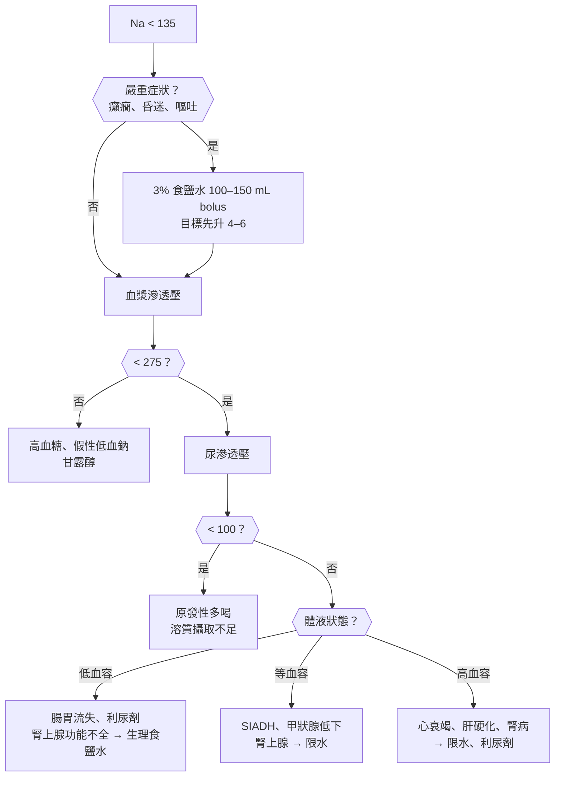
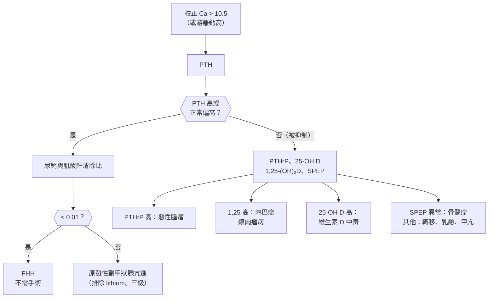
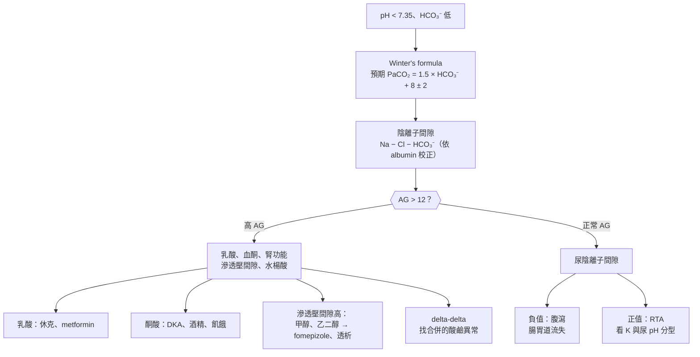

## 鈉與水（Sodium and Water）

### 低血鈉（Hyponatremia）

#### 定義與分類

- **低血鈉**：**Na < :red[135] mEq/L**；**< 125 中重度、< 120 嚴重**；住院病人**最常見**的電解質異常。
- **本質是水太多（相對於鈉）**，多數與 **ADH 作用**有關。
- **第一步：血漿滲透壓（Posm）**：
    - **高滲透壓（> 295）**：**高血糖**（**矯正 Na：血糖每高 100 mg/dL，Na + 1.6–2.4**）、**甘露醇**、顯影劑。
    - **等滲透壓（275–295）**：**假性低血鈉**：**高三酸甘油脂、高蛋白（骨髓瘤、IVIG）**；**TURP 後（glycine 灌洗）**。
    - **低滲透壓（< 275）**：**真正的低張性低血鈉** → 看**尿滲透壓**與**體液狀態**。
- **低張性低血鈉的分類**：
    - **尿滲透壓 < 100**（ADH 被適當抑制）：**原發性多喝（精神性）**、**啤酒狂飲症（beer potomania）**、**茶與吐司飲食**（溶質攝取太少）。
    - **尿滲透壓 > 100**（ADH 作用中）→ 依體液狀態：
        - **低血容**：**腸胃道流失（嘔吐、腹瀉）**、**利尿劑（thiazide 最常見）**、**腎上腺功能不全（原發性）**、**腦性鹽耗損**；尿 Na < 20（腎外）或 > 20（腎性）。
        - **高血容**：**心衰竭**、**肝硬化**、**腎病症候群**、**晚期腎病**（有效循環血量下降）。
        - **等血容**：**SIADH（最常見）**、**甲狀腺低下**、**續發性腎上腺功能不全（cortisol 缺乏）**、**運動相關（馬拉松）**、**MDMA**。
- **SIADH 原因**：**中樞神經（腦出血、腦膜炎、外傷）**、**肺部（肺炎、結核、[[胸腔內科#小細胞肺癌（SCLC，約 15%）|小細胞肺癌]]）**、**藥物（SSRI、carbamazepine、oxcarbazepine、cyclophosphamide、vincristine、opioid、NSAIDs、MDMA）**、**術後與疼痛、噁心**、HIV。

#### Red flags

- **嚴重症狀**：**嘔吐、癲癇、意識改變、呼吸窘迫（腦水腫、神經性肺水腫）** → **緊急 3% 高張食鹽水**。
- **急性（< 48 小時）**：術後、**馬拉松、MDMA**、原發性多喝、TURP → 腦水腫風險高。
- **慢性（> 48 小時或不明）矯正太快** → **[[神經內科#滲透性脫髓鞘症候群（Osmotic Demyelination Syndrome, ODS）|滲透壓性脫髓鞘症候群]]（ODS）**：**數天後構音障礙、吞嚥困難、四肢癱瘓、閉鎖症候群**。
- **ODS 高風險**：**Na < 105**、**酒精使用障礙**、**營養不良**、**低血鉀**、**肝病**、**thiazide 引起**。
- **低血壓、低血糖、高血鉀 + 低血鈉** → 腎上腺功能不全（危象）。

#### 鑑別診斷

| 類別 | 疾病 | 鑑別關鍵 |
|---|---|---|
| **非低張性** | **高血糖**、甘露醇；**假性（高三酸甘油脂、高蛋白）**、TURP | **血漿滲透壓正常或高** |
| **ADH 被抑制（尿滲透壓 < 100）** | **原發性多喝**、**啤酒狂飲症、茶與吐司** | 尿很稀 |
| **低血容** | **腸胃道流失**、**thiazide**、**[[代謝內分泌科#腎上腺功能不全（Adrenal Insufficiency）\|原發性腎上腺功能不全]]**、腦性鹽耗損 | **尿 Na（< 20 腎外、> 20 腎性）**、姿勢性低血壓 |
| **等血容** | **[[代謝內分泌科#抗利尿激素不當分泌症候群（SIADH）\|SIADH]]**、**[[代謝內分泌科#甲狀腺機能低下（Hypothyroidism）\|甲狀腺低下]]**、**續發性腎上腺功能不全**、運動、MDMA | **尿滲透壓 > 100、尿 Na > 30、尿酸低** |
| **高血容** | **[[心臟內科#心衰竭（Heart Failure）\|心衰竭]]**、**[[消化內科#肝硬化（Liver Cirrhosis）\|肝硬化]]**、**[[腎臟內科#Nephrotic Syndrome\|腎病症候群]]**、晚期腎病 | **水腫、腹水**、尿 Na < 20（腎病除外） |

#### 易混淆鑑別

:::compare[SIADH vs 腦性鹽耗損 vs thiazide 低血鈉]
| | SIADH | 腦性鹽耗損（CSW） | Thiazide |
|---|---|---|---|
| 背景 | 中樞、肺、藥物、術後 | **[[神經內科#蜘蛛膜下腔出血（SAH）\|蜘蛛膜下腔出血]]**、腦傷 | **老年瘦小女性**、開始用藥後數週 |
| 體液狀態 | **等血容** | **低血容（姿勢性低血壓、BUN/Cr 升高）** | 低到等血容 |
| 尿 Na | > 30 | **> 30（常很高）** | > 20 |
| 尿酸 | **低（< 4）** | 低（矯正後仍低） | 可低 |
| 治療 | **限水**、鹽錠、tolvaptan、urea | **:red[補鹽水（限水會惡化）]**、fludrocortisone | **停藥**、補鉀 |
| **注意** | — | **SAH 病人限水可能誘發腦血管痙攣** | **ODS 風險高（矯正易過快）** |
:::

:::compare[SIADH 的診斷標準]
| 必要條件 |
|---|
| **血漿滲透壓 < 275 mOsm/kg** |
| **尿滲透壓 > 100 mOsm/kg** |
| **臨床等血容** |
| **尿 Na > 30 mEq/L**（正常鹽與水攝取下） |
| **排除甲狀腺低下、腎上腺功能不全、近期利尿劑** |
| 支持：**尿酸 < 4 mg/dL**、BUN 低、**生理食鹽水輸注後 Na 不升反降** |
:::

:::compare[低血鈉的矯正速度]
| 情境 | 處置 | 速度上限 |
|---|---|---|
| **嚴重症狀（癲癇、昏迷、嘔吐）** | **3% 食鹽水 100–150 mL bolus（10–20 分鐘），可重複 2–3 次** | **先升 4–6 mEq/L** 即可緩解症狀 |
| **中度症狀或急性** | 3% 食鹽水 bolus 或持續輸注 | 同上 |
| **慢性無症狀** | 依原因：限水、停藥、補鹽 | **24 小時 ≤ :red[8–10] mEq/L**（ODS 高風險 **≤ 6–8**） |
| **矯正過快** | **D5W ± desmopressin 重新拉低** | — |
| 注意 | **低血容者補液後 ADH 被抑制 → 大量排尿 → :red[Na 突然快速上升]**（尿量 > 100 mL/hr 要警覺） | |
:::

#### 問診與理學檢查

- **症狀（頭痛、噁心、嘔吐、意識、癲癇、跌倒）**、**發生速度**、**飲水量**、飲酒與飲食、**嘔吐腹瀉**。
- **用藥（thiazide、SSRI、carbamazepine、oxcarbazepine、MDMA、opioid、化療）**、術後、肺部與神經疾病、癌症、心肝腎病。
- 理學檢查：**體液狀態（頸靜脈、皮膚、黏膜、姿勢性血壓、水腫、腹水）**、意識、神經學、甲狀腺、色素沉著（Addison）。

#### 檢查流程

- **血漿滲透壓、尿滲透壓、尿 Na**（同時抽）、**血糖、BUN、肌酸酐、K、尿酸**。
- **TSH、清晨 cortisol**（等血容時必驗）。
- 依臨床：胸部 X 光、頭部影像、血脂、蛋白。
- **嚴重低血鈉治療中每 2–4 小時追蹤 Na**、記錄尿量。

#### 初步處置

- **嚴重症狀 → 3% 食鹽水 bolus**（見上表）。
- **低血容 → 生理食鹽水**（注意矯正過快）。
- **SIADH → 限水（< 800–1000 mL/day）** → 不足時 **鹽錠 + loop 利尿劑**、**口服 urea**、**tolvaptan**（**肝病避免、注意矯正過快**）；治療原因。
- **高血容 → 限水限鹽、loop 利尿劑**、治療原病。
- **停用致病藥物**；**矯正低血鉀也會提升 Na**（計入矯正速度）。

:::pitfall
慢性低血鈉 110 的酗酒病人，補了生理食鹽水加補鉀，一天內 Na 升到 124 → 數天後出現構音障礙、吞嚥困難與四肢無力（滲透壓性脫髓鞘症候群）。慢性低血鈉 24 小時上升不超過 8 mEq/L，高風險者更低；矯正過快要用 D5W 與 desmopressin 拉回。
:::

:::pitfall
SIADH 的病人被當成脫水打生理食鹽水 → 腎臟把鹽排掉、水留下，Na 反而下降。等血容、尿滲透壓高、尿 Na > 30 時想 SIADH，治療是限水而不是補鹽水。
:::

:::exam
- 第一步：血漿滲透壓；高 → 高血糖（血糖每 100 Na + 1.6）；正常 → 假性（三酸甘油脂、蛋白）。
- 低張性：尿滲透壓 < 100 → 原發性多喝、啤酒狂飲；> 100 → 依體液狀態。
- SIADH：等血容、尿滲透壓 > 100、尿 Na > 30、尿酸低 → 限水、鹽錠、tolvaptan；排除甲狀腺與腎上腺。
- 嚴重症狀 → 3% 食鹽水 100–150 mL bolus；慢性 24 小時 ≤ 8–10（高風險 ≤ 6–8）→ ODS。
- 腦性鹽耗損：SAH、低血容 → 補鹽，不能限水。
:::

### 高血鈉（Hypernatremia）

#### 定義與分類

- **高血鈉**：**Na > :red[145] mEq/L**；本質是**水太少**（相對於鈉）。
- **正常人只要口渴機制正常、能喝到水，就很難持續高血鈉** → 高危族群：**老人（口渴感下降）、臥床或失智、嬰兒、插管或意識不清**、無法取得水。
- **原因**：
    - **水流失（最常見）**：
        - **腎外**：**不感性流失（發燒、喘、燒燙傷）**、**腹瀉（滲透性，乳果糖）**、嘔吐；**尿液少而濃（尿滲透壓 > 600–800）**。
        - **腎性**：**尿崩症（中樞性、腎因性）**、**滲透性利尿（高血糖、甘露醇、尿素）**、**loop 利尿劑**、**阻塞解除後**。
    - **鈉攝取過多（少見）**：**高張食鹽水、碳酸氫鈉**、海水溺水、**奶粉沖太濃（嬰兒）**、原發性醛固酮症（輕度）。
- **住院後才出現的高血鈉**：多為**醫源性**（給水不足、利尿、高張溶液、管灌高蛋白）。

#### Red flags

- **意識改變、躁動、肌躍、癲癇、昏迷**。
- **急性（< 48 小時）嚴重高血鈉** → **腦皺縮 → 硬腦膜下或蜘蛛膜下出血**。
- **慢性高血鈉矯正太快** → **腦水腫、癲癇**（尤其兒童）。
- **大量稀尿（> 3 L/day、尿滲透壓 < 300）** → 尿崩症（**腦部手術、頭部外傷後**）。
- **嬰兒高血鈉脫水**（皮膚麵團感、躁動、高聲哭）。

#### 鑑別診斷

| 類別 | 疾病 | 鑑別關鍵 |
|---|---|---|
| **腎外水流失** | **不感性流失**、**滲透性腹瀉**、嘔吐 | **尿少、尿滲透壓 > 600** |
| **中樞性尿崩症** | **[[代謝內分泌科#尿崩症（Diabetes Insipidus, DI）\|中樞性尿崩症]]**（術後、外傷、腫瘤） | **尿滲透壓 < 300、desmopressin 有反應** |
| **腎因性尿崩症** | **[[腎臟內科#腎性尿崩症（Nephrogenic Diabetes Insipidus）\|腎因性尿崩症]]**（**[[精神科#Lithium\|lithium]]**、高血鈣、低血鉀） | **desmopressin 無反應** |
| **滲透性利尿** | **高血糖**、甘露醇、高蛋白管灌、阻塞解除後 | **尿滲透壓 300–600、尿量多** |
| **鈉過多** | 高張食鹽水、碳酸氫鈉、奶粉過濃、[[代謝內分泌科#原發性醛固酮過多症（Primary Aldosteronism / Conn's Syndrome）\|原發性醛固酮症]] | **體液過多、尿 Na 高** |

#### 易混淆鑑別

:::compare[高血鈉時的尿滲透壓判讀]
| 尿滲透壓 | 意義 | 原因 |
|---|---|---|
| **> 600–800** | **腎臟濃縮正常 → 腎外流失或攝取不足** | 不感性流失、腹瀉、口渴不足 |
| **300–600** | **部分濃縮或滲透性利尿** | **高血糖、甘露醇、尿素、利尿劑**、部分尿崩症 |
| **< 300** | **尿崩症** | **給 desmopressin：尿滲透壓上升 > 50% → 中樞性；不升 → 腎因性** |
:::

:::compare[自由水缺乏量與矯正]
| 項目 | 內容 |
|---|---|
| **自由水缺乏量** | **總體水 × （Na ÷ 140 − 1）**；總體水 = 體重 × 0.6（男）、0.5（女、老年男）、0.45（老年女） |
| **矯正速度（慢性）** | **24 小時下降 ≤ :red[10–12] mEq/L**（約 0.5 mEq/L/hr） |
| **急性（< 48 小時、確定時間）** | 可較快（1–2 mEq/L/hr） |
| **液體選擇** | **口服或管灌水（首選）**、**D5W**；低血容休克 → 先生理食鹽水恢復灌流 |
| **另外要算** | **持續流失**（尿量、不感性流失） |
:::

#### 問診與理學檢查

- **飲水能力與口渴**、意識、**尿量**、發燒、腹瀉嘔吐、**用藥（lithium、利尿劑、乳果糖、高張溶液）**、腦部手術或外傷、糖尿病、管灌內容。
- 理學檢查：**體液狀態**、**意識與神經學（肌躍、反射亢進）**、體重變化。

#### 檢查流程

- **血漿與尿滲透壓、尿 Na、尿量**、**血糖**、**BUN、肌酸酐、K、Ca**。
- 稀尿多尿 → **desmopressin 試驗**（見[[內分泌系統主訴#多尿與口渴（Polyuria / Polydipsia）|多尿與口渴]]）。
- 中樞性尿崩症 → 腦部 MRI。

#### 初步處置

- **低血容或休克 → 先生理食鹽水**恢復血流，再補自由水。
- **補自由水（口服、管灌或 D5W）**，依缺乏量與持續流失計算；**每 4–6 小時追蹤 Na**。
- **中樞性尿崩症 → desmopressin**；**腎因性 → 停 lithium、thiazide、低鹽飲食、amiloride（lithium）**。
- **鈉過多 → 停止來源、D5W ± loop 利尿劑**；腎衰竭 → 透析。
- **預防**：臥床老人與插管病人**規律給水**。

:::pitfall
長照機構送來的失智老人 Na 165，急診一天內用大量 D5W 降到 145 → 慢性高血鈉時腦細胞已產生滲透物質適應，矯正過快會造成腦水腫與癲癇。慢性高血鈉 24 小時下降不超過 10–12 mEq/L。
:::

:::pitfall
腦下垂體術後的病人一直排大量清澈的尿，被當成術中輸液太多 → 中樞性尿崩症，若病人無法自己喝水，Na 會快速升高。術後追蹤尿量、尿比重與 Na，尿崩症給 desmopressin。
:::

:::exam
- 高血鈉 = 水太少；高危：老人、嬰兒、意識不清、插管。
- 尿滲透壓 > 600 → 腎外流失；< 300 → 尿崩症（desmopressin 反應區分中樞或腎因）；300–600 → 滲透性利尿。
- 自由水缺乏量 = 總體水 × （Na/140 − 1）；慢性 24 小時 ≤ 10–12。
- Lithium → 腎因性尿崩症 → amiloride。
:::

## 鉀（Potassium）

### 低血鉀（Hypokalemia）

#### 定義與分類

- **低血鉀**：**K < :red[3.5] mEq/L**；**< 2.5 嚴重**。
- **三大機轉**：
    - **攝取不足**（少單獨造成，合併其他原因）：飢餓、[[精神科#神經性厭食症（Anorexia Nervosa, AN）|神經性厭食]]、酗酒。
    - **細胞內移（transcellular shift）**：**insulin**、**β₂ 致效劑（albuterol）**、**鹼中毒**、**甲狀腺毒性週期性麻痺（亞洲男性）**、**家族性週期性麻痺**、**再餵食症候群**、**B₁₂ 治療後**、低體溫。
    - **流失**：
        - **腸胃道**：**腹瀉（伴代謝性酸中毒）**、**嘔吐（腎臟流失為主，伴代謝性鹼中毒）**、瀉劑。
        - **腎臟**：**利尿劑（loop、thiazide）**、**高醛固酮（原發性醛固酮症、腎動脈狹窄）**、**[[代謝內分泌科#庫欣氏症候群（Cushing's Syndrome）|Cushing]]**、**甘草**、**Liddle**、**Bartter、Gitelman**、**RTA（第 1、2 型）**、**低血鎂**、**amphotericin B**、**DKA 治療中**。
- **低血鎂會使低血鉀難以矯正**（腎小管 ROMK 鉀流失增加）。

#### Red flags

- **K < 2.5**、**ECG 變化**（**U 波、T 波平坦、ST 下降、QT（QU）延長**）、**心律不整**（尤其**合併 digoxin、心肌缺血、心衰竭**）。
- **肌肉無力、麻痺、呼吸肌無力**、**橫紋肌溶解**、腸阻塞（麻痺性）。
- **突發四肢無力的年輕亞洲男性** → **甲狀腺毒性週期性麻痺**（補鉀要少，**反彈性高血鉀**）。
- **高血壓 + 低血鉀** → 原發性醛固酮症等。
- **DKA 病人 K < 3.3** → 先補鉀再給 insulin。

#### 鑑別診斷

| 類別 | 疾病 | 鑑別關鍵 |
|---|---|---|
| **細胞內移** | **insulin、β₂ 致效劑**、鹼中毒、**甲狀腺毒性週期性麻痺**、家族性週期性麻痺、**再餵食症候群** | **尿 K 低**、急性發作、總體鉀正常 |
| **腸胃道流失** | **腹瀉**、瀉劑、腸瘻管 | **尿 K < 20 mEq/day（或 UKCR < 13 mEq/g）、代謝性酸中毒** |
| **嘔吐** | 嘔吐、鼻胃管抽吸 | **代謝性鹼中毒、尿 Cl 低** |
| **腎臟流失 + 高血壓** | **[[代謝內分泌科#原發性醛固酮過多症（Primary Aldosteronism / Conn's Syndrome）\|原發性醛固酮症]]**、**[[腎臟內科#腎動脈狹窄（Renal Artery Stenosis）\|腎動脈狹窄]]**、**Cushing**、**甘草**、**Liddle** | **renin 與 aldosterone** |
| **腎臟流失 + 血壓正常** | **利尿劑**、**[[腎臟內科#Bartter vs. Gitelman vs. Liddle Syndrome\|Bartter、Gitelman]]**、**[[腎臟內科#腎小管性酸中毒（Renal Tubular Acidosis, RTA）\|RTA 第 1、2 型]]**、**[[腎臟內科#低血鎂（Hypomagnesemia）\|低血鎂]]**、藥物（amphotericin B、aminoglycoside、cisplatin） | **酸鹼、尿 Cl、尿 Ca、血 Mg** |

#### 易混淆鑑別

:::compare[Bartter vs Gitelman vs Liddle]
| | Bartter | Gitelman | Liddle |
|---|---|---|---|
| 缺陷部位 | **亨利氏環升支粗段（NKCC2 等）** | **遠曲小管（NCC）** | **集尿管 ENaC 過度活化（功能獲得）** |
| 類似藥物 | **loop 利尿劑** | **thiazide** | — |
| 血壓 | **正常或低** | 正常或低 | **高** |
| 低血鉀 + 代謝性鹼中毒 | 有 | 有 | 有 |
| **尿鈣** | **高** | **低** | 正常 |
| **血鎂** | 正常或低 | **低** | 正常 |
| renin、aldosterone | **高** | 高 | **都低** |
| 年齡 | **嬰幼兒** | **青少年、成人** | 年輕人 |
| 治療 | NSAIDs、補鉀、amiloride | **補鉀與補鎂** | **amiloride 或 triamterene**（spironolactone 無效） |
:::

:::compare[低血鉀合併的酸鹼狀態]
| 酸鹼 | 想到 |
|---|---|
| **代謝性酸中毒** | **腹瀉**、**RTA 第 1、2 型**、DKA（治療中）、carbonic anhydrase 抑制劑 |
| **代謝性鹼中毒 + 尿 Cl 低（< 20）** | **嘔吐、鼻胃管**、過去用過利尿劑 |
| **代謝性鹼中毒 + 尿 Cl 高 + 高血壓** | **醛固酮過多、Cushing、甘草、Liddle** |
| **代謝性鹼中毒 + 尿 Cl 高 + 血壓正常** | **正在用利尿劑**、**Bartter、Gitelman** |
:::

#### 問診與理學檢查

- **嘔吐、腹瀉、瀉劑或利尿劑使用**（暗中使用：飲食障礙、減重）、**甘草（中藥）**、**用藥（insulin、albuterol、amphotericin B）**、酒精、飲食。
- **無力、麻痺發作（發作性 → 週期性麻痺）**、心悸、多尿、**甲狀腺症狀**、**高血壓史**。
- 理學檢查：**血壓**、肌力、反射、甲狀腺、體液狀態、Cushing 徵象。

#### 檢查流程

- **ECG**、**Mg**、**酸鹼（血液氣體或 HCO₃⁻）**、腎功能、血糖。
- **尿 K（UKCR 或 TTKG）**：**尿 K 低 → 腸胃道或細胞內移**；**高 → 腎臟流失**。
- 腎臟流失 → **血壓、尿 Cl、renin、aldosterone**；尿鈣（Bartter vs Gitelman）。
- 週期性麻痺 → **TSH、free T4**。

#### 初步處置

- **補鉀**：
    - **口服 KCl 為首選**（安全、吸收好）；**每 10 mEq 約升 0.1 mEq/L**（總缺乏量常很大：K 3.0 約缺 200–400 mEq）。
    - **IV KCl**：**嚴重、心律不整、無法口服**；**周邊 ≤ 10 mEq/hr**、**中心靜脈 ≤ 20 mEq/hr**（監測下可較快）；**:red[用生理食鹽水稀釋，不用葡萄糖水]**（會誘發 insulin 讓 K 再下降）。
    - **代謝性酸中毒時用 KHCO₃ 或 K citrate**（如 RTA）；鹼中毒時用 **KCl**。
- **:red[同時補鎂]**（低血鎂不矯正，鉀補不上來）。
- **細胞內移（週期性麻痺）**：**小量補鉀（避免:red[反彈性高血鉀]）**；甲狀腺毒性 → **非選擇性 β-blocker（propranolol）**。
- 治療原因：停利尿劑或改保鉀利尿劑、治療醛固酮過多。

:::pitfall
低血鉀補了好幾天都補不上來 → 常是合併低血鎂，鎂不足使腎臟持續流失鉀。補鉀前後都要驗鎂並一起補。
:::

:::pitfall
年輕男性半夜突然四肢無力、K 1.9，大量 IV 補鉀 → 甲狀腺毒性週期性麻痺是鉀移入細胞而非總量不足，恢復時鉀會移出，造成反彈性高血鉀。這類病人只給少量鉀，並加用 propranolol、驗甲狀腺功能。
:::

:::exam
- ECG：U 波、T 波平坦、ST 下降、QU 延長；digoxin 毒性加重。
- 尿 K 低 → 腸胃道或細胞內移；高 → 腎臟流失。
- 低血鉀 + 酸中毒 → 腹瀉、RTA 1、2；+ 鹼中毒尿 Cl 低 → 嘔吐；+ 高血壓 → 醛固酮過多、甘草、Liddle。
- Gitelman：低尿鈣、低鎂（像 thiazide）；Bartter：高尿鈣（像 loop）；Liddle：renin 與 aldosterone 都低 → amiloride。
- 補鉀：口服 KCl 首選；周邊 IV ≤ 10 mEq/hr、用生理食鹽水稀釋；先補鎂。
:::

### 高血鉀（Hyperkalemia）

#### 定義與分類

- **高血鉀**：**K > :red[5.0–5.5] mEq/L**；**≥ 6.5 或有 ECG 變化 → 緊急**。
- **假性高血鉀（先排除）**：**溶血（抽血困難、細針、運送延遲）**、**握拳與止血帶過久**、**白血球或血小板極高**、家族性假性高血鉀；**ECG 正常、病人無危險因子時要重抽**。
- **三大機轉**：
    - **細胞外移**：**代謝性酸中毒（無機酸）**、**insulin 缺乏（DKA、高血糖）**、**組織破壞（橫紋肌溶解、腫瘤溶解、溶血、燒傷、壓砸傷）**、**β-blocker**、**digoxin 中毒**、**succinylcholine**、高滲透壓、高血鉀週期性麻痺。
    - **排泄減少（最常見）**：
        - **腎衰竭（AKI、CKD 晚期）**。
        - **醛固酮作用不足**：**ACEi、ARB、spironolactone、eplerenone**、**finerenone**、**amiloride、triamterene、TMP（trimethoprim）**、**NSAIDs**、**calcineurin 抑制劑（cyclosporine、tacrolimus）**、**heparin**、**第 4 型 RTA（低腎素低醛固酮：糖尿病）**、**腎上腺功能不全**。
    - **攝取過多**（腎功能正常很少單獨造成）：**鉀鹽代鹽**、**大量輸血**、**香蕉、楊桃（腎病禁止）**、中藥、**IV KCl 錯誤**。

#### Red flags

- **ECG 變化**：**T 波高尖 → PR 延長、P 波消失 → QRS 增寬 → 正弦波 → 心室顫動或心搏停止**（**:red[ECG 與數值不一定相關]**）。
- **K ≥ 6.5**、**快速上升**、**肌肉無力或麻痺**。
- **腎衰竭 + 高血鉀 + 酸中毒 + 體液過多** → 緊急透析。
- **橫紋肌溶解、腫瘤溶解症候群**。
- **洗腎病人漏洗**。

#### 鑑別診斷

| 類別 | 疾病 | 鑑別關鍵 |
|---|---|---|
| **假性** | 溶血、止血帶、**白血球或血小板極高** | **ECG 正常、重抽正常**（血漿檢體） |
| **細胞外移** | 酸中毒、**[[代謝內分泌科#DKA（Diabetic Ketoacidosis）\|DKA]]**、**橫紋肌溶解**、**[[血液腫瘤科#Tumor Lysis Syndrome（TLS）\|腫瘤溶解]]**、溶血、**digoxin 中毒**、**succinylcholine**、β-blocker | 急性、組織破壞 |
| **腎衰竭** | **AKI**、**[[腎臟內科#慢性腎臟病（CKD）\|CKD 晚期]]** | **eGFR**（通常 < 15–20 才自發高血鉀） |
| **醛固酮不足（藥物）** | **ACEi、ARB、MRA**、**amiloride、TMP**、**NSAIDs**、**calcineurin 抑制劑**、heparin | **用藥**、合併 CKD 與糖尿病 |
| **醛固酮不足（疾病）** | **[[腎臟內科#腎小管性酸中毒（Renal Tubular Acidosis, RTA）\|第 4 型 RTA]]**、**[[代謝內分泌科#腎上腺功能不全（Adrenal Insufficiency）\|原發性腎上腺功能不全]]**、[[代謝內分泌科#先天性腎上腺增生（Congenital Adrenal Hyperplasia, CAH）\|CAH]] | **高血鉀 + 非 AG 酸中毒**、低血鈉 |
| **攝取** | **代鹽**、輸血、**楊桃**、IV 錯誤 | 飲食史 |

#### 易混淆鑑別

:::compare[高血鉀的緊急處置（三步驟）]
| 步驟 | 藥物 | 起效 | 持續 | 重點 |
|---|---|---|---|---|
| **1. 穩定心肌膜** | **calcium gluconate 10% 10–30 mL IV（或 calcium chloride）** | **1–3 分鐘** | 30–60 分鐘 | **:red[有 ECG 變化就先給]**；**不降 K**；可重複；**digoxin 中毒時謹慎** |
| **2. 移入細胞** | **regular insulin 10 U IV + 葡萄糖 25 g**（血糖 < 250 時） | 15–30 分鐘 | 4–6 小時 | 降 0.5–1.2；**注意低血糖**（腎衰竭更容易） |
|  | **albuterol 10–20 mg 噴霧** | 30 分鐘 | 2 小時 | 降 0.5–1；與 insulin 加成 |
|  | **sodium bicarbonate** | — | — | **只在合併代謝性酸中毒時** |
| **3. 排出體外** | **loop 利尿劑**（有尿量時）、**鉀結合劑（patiromer、sodium zirconium cyclosilicate、SPS）**、**[[腎臟內科#血液透析（Hemodialysis, HD）\|血液透析]]（最確實）** | 數小時 | — | **透析：腎衰竭、頑固、危及生命** |
| **其他** | **停用致病藥物**、低鉀飲食、治療原因 | | | **心電圖監測、1–2 小時後重驗** |
:::

:::compare[高血鉀 ECG 變化的進程]
| K（約） | ECG |
|---|---|
| **5.5–6.5** | **T 波高尖、窄基底（帳篷狀）** |
| **6.5–7.5** | **PR 延長、P 波變平消失** |
| **7–8** | **QRS 增寬**、束支傳導阻滯、心搏過緩 |
| **> 8** | **正弦波（sine wave）→ 心室顫動、心搏停止** |
| **注意** | **ECG 與數值相關性差**；慢性腎病可耐受較高 K；任何 ECG 變化都要緊急處理 |
:::

#### 問診與理學檢查

- **腎病史、透析、尿量**、**用藥（ACEi、ARB、MRA、NSAIDs、TMP、heparin、digoxin、calcineurin 抑制劑）**、**代鹽、楊桃、中藥**、肌肉損傷、化療、糖尿病。
- 無力、心悸、麻痺。
- 理學檢查：**心律**、肌力、體液狀態、Addison 徵象。

#### 檢查流程

- **立即 ECG**、**重複 K（排除溶血；必要時血漿或血氣機）**。
- **腎功能、血糖、酸鹼**、CK、尿酸、磷、LDH（組織破壞）、digoxin 濃度、**CBC（白血球、血小板）**。
- 慢性或原因不明 → **renin、aldosterone、cortisol**、尿 K。

#### 初步處置

::chart{id="hyperkalemia-management"}

- 見上方三步驟表。
- **慢性管理**：**低鉀飲食**（避免代鹽、楊桃、高鉀蔬果）、**停用或減少致病藥物**、**loop 或 thiazide 利尿劑**、**新型鉀結合劑**（讓病人可繼續使用 RAAS 抑制劑）、矯正酸中毒（bicarbonate）、第 4 型 RTA → fludrocortisone（無高血壓、心衰竭時）。

:::pitfall
高血鉀合併 QRS 增寬，先開 insulin 與鉀結合劑、等鈣到了再給 → 鈣是唯一能立即保護心肌的藥。有 ECG 變化就先給 calcium gluconate，再降鉀。
:::

:::pitfall
抽血困難、檢體溶血的 K 6.8，在 ECG 正常、病人沒有危險因子的情況下就給一連串降鉀治療 → 可能造成低血糖與低血鉀。先看 ECG 並重抽確認（避免止血帶過久與握拳）。
:::

:::exam
- 先排除假性高血鉀（溶血、止血帶、白血球或血小板極高）。
- ECG：T 波高尖 → PR 延長、P 消失 → QRS 增寬 → 正弦波 → VF。
- 處置：calcium gluconate（穩定心肌、不降 K）→ insulin + 葡萄糖、albuterol → 利尿劑、鉀結合劑、透析。
- 藥物：ACEi、ARB、MRA、amiloride、TMP、NSAIDs、calcineurin 抑制劑、heparin。
- 第 4 型 RTA：糖尿病、高血鉀 + 非 AG 酸中毒；台灣：腎病病人禁吃楊桃、代鹽。
:::

## 鈣、磷、鎂（Calcium, Phosphate, Magnesium）

### 高血鈣（Hypercalcemia）

#### 定義與分類

- **高血鈣**：**校正 Ca > :red[10.5] mg/dL**；**> 12 中度、> 14 嚴重（高鈣危象）**。
- **校正鈣 = 測得 Ca + 0.8 × （4 − albumin）**；**游離鈣（ionized Ca）最準確**（albumin 異常、酸鹼異常時）。
- **原因**：
    - **門診最常見：原發性副甲狀腺機能亢進**（**副甲狀腺腺瘤**；輕度、慢性、無症狀）。
    - **住院最常見：惡性腫瘤**（**嚴重、快速、症狀明顯**）：
        - **PTHrP（體液性）**：**鱗狀細胞癌（肺、頭頸、食道）**、腎細胞癌、乳癌、卵巢癌。
        - **溶骨性轉移**：**乳癌**、**多發性骨髓瘤**。
        - **1,25-(OH)₂D 增加**：**淋巴瘤**。
    - **維生素 D 相關**：**維生素 D 過量**、**肉芽腫疾病（類肉瘤病、結核）**。
    - **藥物**：**thiazide**、**lithium**、**鈣片與制酸劑（乳鹼症候群）**、**維生素 A**、theophylline。
    - **其他**：**甲狀腺亢進**、**長期臥床（骨質吸收）**、**腎上腺功能不全**、**家族性低尿鈣高血鈣症（FHH）**、**三級副甲狀腺亢進（洗腎）**、橫紋肌溶解恢復期。
- **PTH 是第一步**：**PTH 高或正常偏高 → PTH 依賴性**；**PTH 被抑制（低）→ 非 PTH 依賴性**。

#### Red flags

- **Ca > 14**、**意識改變、嗜睡、昏迷**、**脫水、急性腎損傷**。
- **ECG：QT 縮短**、心律不整、心搏過緩；**digoxin 病人**更危險。
- **快速上升、合併體重減輕、骨痛、貧血** → 惡性腫瘤、骨髓瘤。
- **[[消化內科#急性胰臟炎（Acute Pancreatitis）|急性胰臟炎]]**、**消化性潰瘍**。

#### 鑑別診斷

| 類別 | 疾病 | 鑑別關鍵 |
|---|---|---|
| **PTH 高或正常偏高** | **[[代謝內分泌科#原發性副甲狀腺機能亢進（Primary Hyperparathyroidism）\|原發性副甲狀腺亢進]]**、**三級副甲狀腺亢進**、**lithium** | **磷低或正常**、尿鈣高、慢性輕度 |
|  | **FHH（家族性低尿鈣高血鈣症）** | **尿鈣與肌酸酐清除比 :red[< 0.01]**、家族史、**不需手術** |
| **PTH 低 + PTHrP 高** | **惡性腫瘤體液性高血鈣**（鱗狀細胞癌、腎癌） | 腫瘤病史、快速 |
| **PTH 低 + 1,25-(OH)₂D 高** | **淋巴瘤**、**[[胸腔內科#結節病（Sarcoidosis）\|類肉瘤病]]**、結核 | 肺門淋巴結、**類固醇有效** |
| **PTH 低 + 25-OH D 高** | **維生素 D 中毒** | 補充品史 |
| **PTH 低 + 其他** | **[[血液腫瘤科#多發性骨髓瘤（Multiple Myeloma）\|多發性骨髓瘤]]**、溶骨性轉移、**乳鹼症候群**、**thiazide**、甲狀腺亢進、臥床、維生素 A | **SPEP、免疫固定電泳、游離輕鏈**；骨掃描 |

#### 易混淆鑑別

:::compare[原發性副甲狀腺亢進 vs 惡性腫瘤高血鈣]
| | 原發性副甲狀腺亢進 | 惡性腫瘤 |
|---|---|---|
| 場合 | **門診、健檢偶然發現** | **住院、已知癌症** |
| Ca | **輕度（< 12）、長期穩定** | **常 > 13、快速上升** |
| 症狀 | 多無症狀；**骨質疏鬆、[[腎臟內科#腎結石（Nephrolithiasis）\|腎結石]]**、「stones, bones, groans, moans」 | **意識改變、脫水、AKI** |
| **PTH** | **高或不適當正常** | **被抑制** |
| 磷 | 低或正常 | 依機轉（PTHrP 時低） |
| 預後 | 好 | **差（體液性高血鈣常為晚期）** |
:::

:::compare[高血鈣的急性處置]
| 治療 | 機轉 | 起效 | 重點 |
|---|---|---|---|
| **大量生理食鹽水** | **補充容積、促進尿鈣排出** | 數小時 | **:red[第一步]**；200–300 mL/hr，**維持尿量 100–150 mL/hr**；注意心衰竭 |
| **calcitonin** | 抑制骨吸收、增加尿鈣 | **4–6 小時（最快）** | **:red[48 小時後失效]（快速耐受）**；銜接用 |
| **bisphosphonate（zoledronic acid）** | 抑制蝕骨細胞 | **2–4 天** | **惡性腫瘤高血鈣的主力**；腎功能調整 |
| **denosumab** | RANKL 單株抗體 | 數天 | **腎功能差、bisphosphonate 無效**時 |
| **類固醇** | 減少 1,25-(OH)₂D | 數天 | **淋巴瘤、肉芽腫、維生素 D 中毒** |
| **血液透析** | 直接移除 | 立即 | **嚴重 + 腎衰竭或心衰竭（無法大量補液）** |
| **loop 利尿劑** | — | — | **只在補足水分後、體液過多時**；不常規使用 |
| **避免** | **thiazide、鈣片、維生素 D、lithium**、臥床 | | |
:::

#### 問診與理學檢查

- **症狀：「骨（bones）、結石（stones）、腹痛（groans）、精神症狀（moans）」**：**骨痛、骨折**、**腎結石、多尿口渴**、**便秘、噁心、胰臟炎、潰瘍**、**倦怠、憂鬱、意識混亂**。
- **癌症病史、體重減輕、抽菸**、**用藥（thiazide、lithium、鈣片、維生素 D、維生素 A）**、家族史（FHH、MEN）。
- 理學檢查：**體液狀態**、意識、**淋巴結、乳房、肺**、骨壓痛、頸部腫塊（副甲狀腺癌少見）。

#### 檢查流程

- **校正鈣或游離鈣、PTH**、**磷、Mg、腎功能、albumin**、**ECG**。
- **PTH 低 → PTHrP、25-OH D、1,25-(OH)₂D、SPEP、游離輕鏈**、TSH、胸部 X 光、乳房檢查。
- 原發性副甲狀腺亢進 → **24 小時尿鈣、DXA、腎臟超音波**；手術前 **sestamibi 掃描或頸部超音波定位**。

#### 初步處置

- **Ca > 14 或有症狀 → 生理食鹽水 + calcitonin + zoledronic acid**（見上表）；**停用升鈣藥物**、鼓勵活動。
- **原發性副甲狀腺亢進的手術適應症**：**有症狀**，或無症狀但符合：**Ca 高於上限 > 1 mg/dL**、**骨質疏鬆（T ≤ −2.5）或椎體骨折**、**eGFR < 60**、**腎結石或高尿鈣**、**年齡 < 50 歲**。
- **不手術者**：**cinacalcet**、bisphosphonate（骨質疏鬆）、充分飲水、避免 thiazide 與 lithium。
- 惡性腫瘤 → 治療原病；**[[代謝內分泌科#高鈣危象（Hypercalcemic Crisis）處理|高鈣危象]]**照上述處理。

:::pitfall
高血鈣病人一來就給 furosemide「把鈣排掉」→ 高血鈣病人多半嚴重脫水，先用利尿劑會使脫水與腎功能更差。第一步是大量生理食鹽水，loop 利尿劑只用在補足水分後出現體液過多時。
:::

:::pitfall
輕度高血鈣、PTH 偏高的年輕人直接安排副甲狀腺切除 → FHH 也會 PTH 正常或偏高，手術無效。手術前先算尿鈣與肌酸酐清除比（< 0.01 想 FHH）並問家族史。
:::

:::exam
- 校正鈣 = Ca + 0.8 × （4 − albumin）。
- 門診最常見：原發性副甲狀腺亢進；住院最常見：惡性腫瘤（PTHrP：鱗狀細胞癌；溶骨：乳癌、骨髓瘤；1,25-D：淋巴瘤）。
- 第一步驗 PTH；PTH 高 + 尿鈣清除比 < 0.01 → FHH。
- 急性處置：生理食鹽水 → calcitonin（最快、48 小時失效）→ zoledronic acid（主力）；類固醇用在淋巴瘤、肉芽腫；ECG：QT 縮短。
- 手術適應症：Ca 高於上限 > 1、骨鬆、eGFR < 60、結石、< 50 歲。
:::

### 低血鈣（Hypocalcemia）

#### 定義與分類

- **低血鈣**：**校正 Ca < :red[8.5] mg/dL** 或**游離鈣 < 1.1 mmol/L**；**先校正 albumin**（**低白蛋白造成的假性低血鈣最常見**）。
- **鹼中毒**（過度換氣）→ **游離鈣下降**（總鈣正常）→ 手腳麻、抽筋。
- **原因**：
    - **PTH 低（副甲狀腺機能低下）**：**甲狀腺或副甲狀腺術後（最常見）**、**頸部放射治療**、**自體免疫（APS-1）**、**DiGeorge 症候群**、**浸潤（血色素沉著、Wilson）**、**低血鎂（PTH 分泌與作用都受抑制）**、**高血鎂**。
    - **PTH 高（續發性）**：
        - **維生素 D 缺乏或作用不足**：**營養、日照不足、[[消化內科#吸收不良（Malabsorption）|吸收不良]]**、**CKD（1α 羥化不足）**、肝病、**anticonvulsant**、**維生素 D 依賴性佝僂病**。
        - **PTH 阻抗**：**假性副甲狀腺機能低下**（**Albright 遺傳性骨失養症：短四、五掌骨、矮小、圓臉**）。
        - **鈣從循環移除**：**急性胰臟炎（皂化）**、**高血磷（橫紋肌溶解、腫瘤溶解、CKD、含磷灌腸）**、**飢餓骨症候群（副甲狀腺切除後）**、**成骨性轉移（前列腺癌）**、**大量輸血（citrate）**、**bisphosphonate、denosumab**、**foscarnet**、敗血症。

#### Red flags

- **手足搐搦（tetany）**、**[[麻醉科#喉痙攣（Laryngospasm）|喉痙攣]]**、**支氣管痙攣**、**癲癇**。
- **ECG：QT 延長** → 多形性心室頻脈（torsades）；**心衰竭（心肌收縮下降）**。
- **甲狀腺或副甲狀腺術後** 24–72 小時、**大量輸血**、**腫瘤溶解**、**胰臟炎**。
- **denosumab 用於 CKD 病人**（嚴重低血鈣）。

#### 鑑別診斷

| 類別 | 疾病 | 鑑別關鍵 |
|---|---|---|
| **假性** | **低白蛋白** | **校正鈣或游離鈣正常** |
| **PTH 低、磷高** | **[[代謝內分泌科#副甲狀腺機能低下（Hypoparathyroidism）\|副甲狀腺機能低下]]**（**術後**、自體免疫、DiGeorge、浸潤） | **頸部手術史**、低鎂要排除 |
| **PTH 高、磷高** | **[[代謝內分泌科#假性副甲狀腺機能低下（Pseudohypoparathyroidism）\|假性副甲狀腺機能低下]]**、**[[腎臟內科#腎性骨病變（CKD-MBD）\|CKD]]**、**高磷負荷（橫紋肌溶解、腫瘤溶解）** | **外觀（AHO）**、腎功能、CK、尿酸 |
| **PTH 高、磷低** | **[[代謝內分泌科#骨軟化症與佝僂病（Osteomalacia / Rickets）\|維生素 D 缺乏]]**、吸收不良、**飢餓骨症候群** | **25-OH D 低**、ALP 高 |
| **低鎂** | **[[腎臟內科#低血鎂（Hypomagnesemia）\|低血鎂]]**（酒精、PPI、利尿劑、腹瀉） | **PTH 不適當地低**、補鎂後恢復 |
| **其他** | **[[消化內科#急性胰臟炎（Acute Pancreatitis）\|急性胰臟炎]]**、**大量輸血**、成骨性轉移、**bisphosphonate、denosumab**、敗血症 | 臨床情境 |

#### 易混淆鑑別

:::compare[Chvostek sign vs Trousseau sign]
| | Chvostek sign | Trousseau sign |
|---|---|---|
| 方法 | **輕敲耳前顏面神經** | **血壓計壓脈帶加壓到收縮壓以上 3 分鐘** |
| 陽性 | **同側嘴角、鼻翼、眼周抽動** | **腕部屈曲、掌指關節屈曲、手指伸直併攏（助產士手）** |
| 敏感度與特異度 | **約 10–25% 正常人也陽性**、不敏感 | **較敏感且特異** |
:::

:::compare[低血鈣的治療]
| 情境 | 處置 | 重點 |
|---|---|---|
| **有症狀（tetany、癲癇、QT 延長）或 Ca < 7.5** | **calcium gluconate 10% 10–20 mL IV（10 分鐘以上）** → **持續輸注**（0.5–1.5 mg/kg/hr 元素鈣） | **心電圖監測**；**calcium chloride 刺激性強（中心靜脈）**；**:red[不和碳酸氫鈉同管]（沉澱）**；digoxin 病人小心 |
| **同時** | **先補鎂**（低鎂時） | 鎂不補，鈣補不上 |
| **慢性無症狀** | **口服鈣（carbonate、citrate）+ 活性維生素 D（calcitriol）** | 副甲狀腺低下：**目標 Ca 8.0–8.5（低正常）**，避免高尿鈣與結石；可用 thiazide、rhPTH |
| **維生素 D 缺乏** | **cholecalciferol 或 ergocalciferol** + 鈣 | 追蹤 25-OH D |
| **高血磷時** | **先降磷**；Ca × P > 60–70 補鈣有轉移性鈣化風險 | 腫瘤溶解無症狀低血鈣不補 |
:::

#### 問診與理學檢查

- **口周與手腳麻木刺痛、肌肉抽筋、手足搐搦**、**喉部緊縮、喘鳴**、癲癇、心悸、**慢性：白內障、基底核鈣化、皮膚乾、牙齒發育不良**。
- **頸部手術或放射治療**、**腎病、肝病、吸收不良、日照與飲食**、**酒精**（低鎂）、**用藥（PPI、利尿劑、anticonvulsant、bisphosphonate、denosumab、foscarnet）**、家族史、**輸血**。
- 理學檢查：**Chvostek、Trousseau sign**、**頸部手術疤痕**、**AHO 外觀（短第 4、5 掌骨）**、喘鳴。

#### 檢查流程

- **白蛋白校正或游離鈣**、**Mg、磷、PTH**、**肌酸酐**、**25-OH D**、ALP、**ECG**。
- 依臨床：**amylase、lipase**、CK、尿酸、**1,25-(OH)₂D**。

#### 初步處置

- 見上表；**先找並矯正低血鎂**。
- **甲狀腺或副甲狀腺術後**：**追蹤 Ca 與 PTH**（術後 PTH 低 → 預防性給鈣與 calcitriol）。

:::pitfall
甲狀腺全切除後的病人隔天抱怨嘴唇與手指發麻，被當成焦慮 → 術後副甲狀腺受傷或被切除造成低血鈣，可能進展到喉痙攣。頸部手術後的口周麻木要驗鈣，並檢查 Chvostek 與 Trousseau sign。
:::

:::pitfall
酗酒病人低血鈣，連續數天 IV 補鈣仍然很低 → 合併低血鎂，PTH 分泌與作用都被抑制。低血鈣、低血鉀補不上來時都要驗鎂並先補鎂。
:::

:::exam
- 先校正 albumin；鹼中毒（過度換氣）→ 游離鈣低。
- 最常見原因：甲狀腺或副甲狀腺術後；PTH 低 + 磷高 → 副甲狀腺低下；PTH 高 + 磷高 → 假性副甲狀腺低下（AHO 短第 4、5 掌骨）、CKD；PTH 高 + 磷低 → 維生素 D 缺乏。
- 低血鎂 → PTH 分泌與作用受抑制 → 先補鎂。
- Trousseau sign 比 Chvostek 特異；ECG：QT 延長。
- 急性：calcium gluconate IV，不和碳酸氫鈉同管。
:::

### 磷異常（Phosphate Disorders）

#### 定義與分類

- **正常血磷**：**2.5–4.5 mg/dL**（兒童較高）。
- **低血磷（< 2.5；< 1.0 嚴重）**：
    - **細胞內移**：**再餵食症候群（refeeding syndrome，最重要）**、**DKA 治療中（insulin）**、**呼吸性鹼中毒**、**飢餓骨症候群**。
    - **攝取或吸收減少**：**營養不良、酒精**、**含鋁或鎂的制酸劑、磷結合劑**、慢性腹瀉。
    - **腎臟流失**：**原發性副甲狀腺亢進**、**Fanconi 症候群（tenofovir、ifosfamide、骨髓瘤）**、**FGF23 過多（X 連鎖低血磷佝僂病、腫瘤誘發[[骨科#骨軟化症（Osteomalacia）/ 佝僂病（Rickets）|骨軟化]]症）**、**靜脈鐵劑（ferric carboxymaltose）**、腎移植後。
- **高血磷（> 4.5）**：
    - **腎功能下降（最常見：CKD、AKI）**。
    - **細胞釋出**：**腫瘤溶解症候群**、**橫紋肌溶解**、溶血、**乳酸與酮酸中毒**。
    - **攝取增加**：**含磷灌腸（Fleet）、含磷腸道準備**、維生素 D 中毒。
    - **腎小管再吸收增加**：**副甲狀腺低下**、[[代謝內分泌科#肢端肥大症（Acromegaly）/ 巨人症（Gigantism）|肢端肥大症]]、bisphosphonate。
    - **假性**：溶血、高蛋白血症、高血脂。

#### Red flags

- **嚴重低血磷（< 1.0）**：**呼吸肌無力（脫離呼吸器失敗）**、**心肌收縮下降**、**橫紋肌溶解**、**溶血**、白血球與血小板功能下降、**意識改變、癲癇**。
- **再餵食症候群**：**長期營養不良（神經性厭食、酒精、長期禁食）:red[開始餵食後 2–5 天]** → **低磷、低鉀、低鎂、維生素 B₁ 缺乏、體液過多、心衰竭**。
- **高血磷 + 低血鈣**（腫瘤溶解、橫紋肌溶解）→ **急性腎損傷**、**轉移性鈣化**。
- **含磷灌腸用於腎功能不全或老人** → **急性磷酸鹽腎病變**。

#### 鑑別診斷

| 類別 | 疾病 | 鑑別關鍵 |
|---|---|---|
| **低磷：細胞內移** | **再餵食症候群**、**DKA 治療中**、呼吸性鹼中毒、飢餓骨 | **營養不良後開始餵食**、尿磷低 |
| **低磷：攝取不足** | **酒精**、營養不良、**制酸劑或磷結合劑** | 尿磷低 |
| **低磷：腎臟流失** | **原發性副甲狀腺亢進**、**Fanconi（tenofovir）**、**FGF23（XLH、腫瘤誘發骨軟化症）**、靜脈鐵劑 | **尿磷高（FEPO₄ > 5%）** |
| **高磷：腎衰竭** | **[[腎臟內科#腎性骨病變（CKD-MBD）\|CKD]]**、AKI | eGFR、PTH |
| **高磷：細胞釋出** | **[[血液腫瘤科#Tumor Lysis Syndrome（TLS）\|腫瘤溶解]]**、**橫紋肌溶解**、溶血 | **K、尿酸、CK、LDH** |
| **高磷：攝取或再吸收** | **含磷灌腸**、維生素 D 中毒、**[[代謝內分泌科#副甲狀腺機能低下（Hypoparathyroidism）\|副甲狀腺低下]]** | **病史、Ca 低、PTH 低** |

#### 易混淆鑑別

:::compare[再餵食症候群的預防與處置]
| 項目 | 內容 |
|---|---|
| **高風險** | **BMI < 16**、**近 3–6 個月體重下降 > 15%**、**10 天以上幾乎沒進食**、**餵食前已有低 K、P、Mg**；**神經性厭食、慢性酗酒、癌症、術後長期禁食** |
| **機轉** | **進食 → insulin 分泌 → 磷、鉀、鎂移入細胞**、葡萄糖代謝消耗 **thiamine** |
| **預防** | **熱量從低開始（10–20 kcal/kg/day，極高風險 5–10）、3–7 天緩慢增加**；**:red[餵食前先補 thiamine]** |
| **監測** | **前 3–5 天每天驗 P、K、Mg**、體液與心電圖 |
| **處置** | **補磷（口服或 IV）、補鉀、補鎂**；嚴重時暫降熱量 |
:::

#### 問診與理學檢查

- **營養狀態與進食史**、**酒精**、**近期開始餵食或 DKA 治療**、**用藥（制酸劑、磷結合劑、tenofovir、靜脈鐵劑、含磷灌腸）**、**腎病**、化療、肌肉損傷、骨痛與骨折（骨軟化）。
- 理學檢查：**肌力、呼吸型態**、心衰竭徵象、BMI、低血鈣徵象（高磷時）。

#### 檢查流程

- **P、Ca、Mg、K、腎功能**、**PTH、25-OH D**。
- 低磷 → **尿磷（FEPO₄）**區分腎性與非腎性；腎性 → 尿糖、尿胺基酸（Fanconi）、**FGF23**。
- 高磷 → **CK、尿酸、LDH**、腎功能。

#### 初步處置

- **低血磷**：
    - **輕中度（1.0–2.5）→ 口服磷**（會腹瀉）。
    - **嚴重（< 1.0）或有症狀 → IV 磷酸鉀或磷酸鈉**（**注意高血鈣時沉澱、高血鉀時用鈉鹽**）。
    - **DKA 不常規補磷**，**< 1.0 或心肺功能受影響才補**。
- **高血磷**：
    - **急性**：**生理食鹽水（腎功能正常時）**、**透析（腎衰竭、合併嚴重低血鈣）**。
    - **慢性（CKD）**：**限磷飲食（加工食品、可樂、乳製品）**、**隨餐服用磷結合劑（calcium carbonate、sevelamer、lanthanum、ferric citrate）**、透析。

:::pitfall
神經性厭食的病人住院後直接給足量營養，第三天出現心衰竭、呼吸衰竭與意識改變 → 再餵食症候群，低磷是核心。高風險病人熱量從低開始，前幾天每天驗磷、鉀、鎂，並先補 thiamine。
:::

:::pitfall
老人或腎功能不全病人做大腸鏡前用含磷灌腸或含磷瀉劑 → 高血磷、低血鈣與急性磷酸鹽腎病變。這類病人改用 PEG 腸道準備。
:::

:::exam
- 再餵食症候群：營養不良開始餵食 2–5 天 → 低磷、低鉀、低鎂、thiamine 缺乏；熱量從 10–20 kcal/kg/day 開始。
- 嚴重低磷：呼吸肌無力（脫離呼吸器失敗）、溶血、橫紋肌溶解。
- 腎臟流失：原發性副甲狀腺亢進、Fanconi（tenofovir）、FGF23（XLH、腫瘤誘發骨軟化症）。
- 高磷：CKD 最常見；腫瘤溶解、橫紋肌溶解；含磷灌腸；CKD → 限磷 + 隨餐磷結合劑。
:::

### 鎂異常（Magnesium Disorders）

#### 定義與分類

- **正常血鎂**：**1.7–2.4 mg/dL**（約 0.7–1.0 mmol/L）；**血清值不反映總體鎂**（多在骨與細胞內）。
- **低血鎂（< 1.7）**：
    - **腸胃道流失**：**慢性腹瀉、吸收不良、[[胃小腸外科#短腸症候群（Short Bowel Syndrome）|短腸症候群]]**、**PPI 長期使用**、**急性胰臟炎**、**酒精**（攝取少 + 腎流失）、營養不良、再餵食。
    - **腎臟流失**：**loop 與 thiazide 利尿劑**、**aminoglycoside、amphotericin B、cisplatin、calcineurin 抑制劑、foscarnet、pentamidine**、**EGFR 抑制劑（cetuximab）**、**Gitelman**、高血鈣、**DKA 治療中**、酒精。
- **低血鎂的後果**：**低血鉀（腎臟流失，補不上）**、**低血鈣（PTH 分泌與作用受抑制）**、**心律不整（torsades）**。
- **高血鎂（> 2.4）**：**幾乎都是腎衰竭 + 鎂攝取**（**含鎂制酸劑、瀉劑（氧化鎂）、灌腸**）、**子癇前症用 MgSO₄**、腫瘤溶解、腎上腺功能不全。

#### Red flags

- **低血鎂**：**[[心臟內科#Torsades de Pointes（TdP）|torsades de pointes]]**、**心室心律不整（尤其用 digoxin）**、**癲癇、手足搐搦**、**頑固性低血鉀與低血鈣**。
- **高血鎂（依濃度，mg/dL）**：
    - **4–6：噁心、潮紅、頭痛、深部肌腱反射減弱**。
    - **6–10：嗜睡、反射消失、低血壓、心搏過緩、低血鈣**。
    - **> 10–12：呼吸麻痺、完全房室傳導阻滯、心搏停止**。
- **子癇前症使用 MgSO₄** 的產婦 → **每小時檢查膝反射、呼吸速率、尿量**。
- **老人或 CKD 病人長期使用氧化鎂軟便**。

#### 鑑別診斷

| 類別 | 疾病 | 鑑別關鍵 |
|---|---|---|
| **低鎂：腸胃道** | **慢性腹瀉、吸收不良**、**PPI**、**[[消化內科#急性胰臟炎（Acute Pancreatitis）\|胰臟炎]]**、**酒精** | **24 小時尿鎂 < 10–30 mg 或 FEMg < 2%** |
| **低鎂：腎臟** | **利尿劑**、**腎毒性藥物（aminoglycoside、amphotericin B、cisplatin、calcineurin 抑制劑）**、**[[腎臟內科#Bartter vs. Gitelman vs. Liddle Syndrome\|Gitelman]]**、DKA 治療中 | **FEMg > 2–4%** |
| **高鎂：腎衰竭 + 攝取** | **CKD + 氧化鎂、含鎂制酸劑或瀉劑** | **eGFR、用藥** |
| **高鎂：醫源性** | **[[產科#子癇前症（Preeclampsia）\|子癇前症]]的 MgSO₄** | **反射消失、呼吸抑制** |

#### 易混淆鑑別

:::compare[低血鎂 vs 高血鎂的處置]
| | 低血鎂 | 高血鎂 |
|---|---|---|
| 輕度 | **口服鎂**（會腹瀉）；**PPI 相關 → 停藥或換藥** | **停止鎂來源**、補液 |
| 嚴重或有症狀 | **MgSO₄ IV（1–2 g，torsades 時 2 g 推注）** | **calcium gluconate IV（拮抗心臟與神經肌肉作用）** |
| 其他 | **腎功能差時減量**；**同時補鉀與鈣**；Gitelman 長期補鎂 | **生理食鹽水 + loop 利尿劑**（腎功能正常）；**血液透析**（腎衰竭）；**呼吸抑制 → 插管** |
:::

#### 問診與理學檢查

- **低鎂**：**腹瀉、酒精、營養**、**用藥（PPI、利尿劑、腎毒性藥、cetuximab）**、**肌肉抽筋、震顫、手足搐搦**、心悸、癲癇。
- **高鎂**：**腎病**、**氧化鎂、制酸劑、灌腸**、**MgSO₄ 使用**、無力、嗜睡。
- 理學檢查：**深部肌腱反射**（低鎂亢進、高鎂減弱或消失）、Chvostek 與 Trousseau、**呼吸速率**、血壓、心律。

#### 檢查流程

- **Mg、K、Ca、磷、腎功能**、**ECG（QT、心律）**。
- 低鎂原因不明 → **24 小時尿鎂或 FEMg**。

#### 初步處置

- 見上表。
- **低血鉀、低血鈣補不上來 → 先補鎂**。
- **子癇前症使用 MgSO₄**：**每小時評估膝反射、呼吸 > 12、尿量 > 25–30 mL/hr**；**反射消失或呼吸抑制 → :red[停藥 + calcium gluconate]**。

:::pitfall
慢性腎病老人長期每天吃好幾顆氧化鎂通便，漸進嗜睡、低血壓、心搏過緩 → 高血鎂。腎功能不全病人避免長期使用含鎂軟便劑與制酸劑，治療用 calcium gluconate 與透析。
:::

:::pitfall
長期使用 PPI 的病人反覆出現低血鉀、低血鈣與抽筋，一直補鉀補鈣 → PPI 造成腸道鎂吸收減少，低鎂才是根源。驗鎂，停用或換掉 PPI 並補鎂。
:::

:::exam
- 低鎂 → 頑固性低鉀（腎流失）、低鈣（PTH 受抑制）、torsades → MgSO₄ 2 g IV。
- 原因：腹瀉、酒精、PPI、利尿劑、aminoglycoside、amphotericin B、cisplatin、calcineurin 抑制劑、Gitelman；FEMg < 2% 腸胃道、> 2–4% 腎臟。
- 高鎂：腎衰竭 + 含鎂藥物；MgSO₄ 毒性：反射消失 → 呼吸抑制 → 心搏停止；解藥 calcium gluconate。
:::

## 酸鹼（Acid-Base）

### 代謝性酸中毒（Metabolic Acidosis）

#### 定義與分類

- **代謝性酸中毒**：**HCO₃⁻ < :red[22] mEq/L**、**pH < 7.35**（單純型）；**pH < 7.1–7.2 或 HCO₃⁻ < 10 嚴重**。
- **判讀步驟**（每份血液氣體都照做）：
    - **1. 酸血症或鹼血症**：pH。
    - **2. 原發異常**：看 **PaCO₂ 與 HCO₃⁻ 的方向**。
    - **3. 代償是否適當**：**代謝性酸中毒 → Winter's formula：預期 PaCO₂ = :red[1.5 × HCO₃⁻ + 8 ± 2]**；實際 PaCO₂ 較高 → 合併呼吸性酸中毒；較低 → 合併呼吸性鹼中毒。
    - **4. 陰離子間隙（AG）= Na − （Cl + HCO₃⁻）**，正常約 **12 ± 2**；**albumin 每降 1 g/dL，AG 正常值降約 2.5**。
    - **5. 高 AG 時算 delta-delta：ΔAG ÷ ΔHCO₃⁻**：**< 1 → 合併正常 AG 酸中毒**；**> 2 → 合併代謝性鹼中毒**。
- **高 AG 代謝性酸中毒**（加入未測量的酸）：
    - **乳酸中毒**：**休克、敗血症（第 A 型，組織缺氧）**；**metformin、肝衰竭、癲癇後、惡性腫瘤、thiamine 缺乏、linezolid（第 B 型）**；**D-乳酸（短腸症候群）**。
    - **酮酸中毒**：**DKA**、**酒精性酮酸中毒**、**飢餓**；**SGLT2 抑制劑 → 正常血糖 DKA**。
    - **腎衰竭（尿毒症）**：通常 **eGFR < 15–20** 才出現高 AG。
    - **中毒**：**甲醇、乙二醇**、**水楊酸（aspirin）**、**acetaminophen 長期使用（pyroglutamic acid、5-oxoproline）**、propylene glycol、**鐵劑、isoniazid**、toluene（早期）。
    - **口訣 GOLDMARK**：**G**lycols（乙二醇、丙二醇）、**O**xoproline、**L**-lactate、**D**-lactate、**M**ethanol、**A**spirin、**R**enal failure、**K**etoacidosis。
- **正常 AG（高氯性）代謝性酸中毒**（流失 HCO₃⁻ 或腎臟無法排酸）：
    - **腸胃道流失**：**腹瀉（最常見）**、**胰臟或膽道瘻管**、**輸尿管與腸道吻合（ureterosigmoidostomy）**。
    - **腎臟**：**RTA（第 1、2、4 型）**、**carbonic anhydrase 抑制劑（acetazolamide、topiramate）**、**早期腎衰竭**。
    - **其他**：**大量生理食鹽水輸注（稀釋性）**、**DKA 治療恢復期**、toluene（後期）、[[外科概論#靜脈營養（Parenteral Nutrition，TPN）|TPN]]。
- **尿陰離子間隙（UAG）= 尿 Na + 尿 K − 尿 Cl**：**:red[負值] → 尿 NH₄⁺ 排出正常 → 腸胃道流失**；**正值 → 腎臟排酸不足 → RTA**（口訣：「腸胃負（neGUTive）」）。

#### Red flags

- **pH < 7.1**、**休克、乳酸 > 4 mmol/L**、**意識改變**、**Kussmaul 呼吸**。
- **:red[滲透壓間隙 > 10–20 + 高 AG]** → **甲醇或乙二醇中毒**（**視力模糊、「雪花」視野 → 甲醇**；**腰痛、血尿、草酸鈣結晶、AKI → 乙二醇**）。
- **呼吸性鹼中毒 + 高 AG 代謝性酸中毒** → **水楊酸中毒**（耳鳴、嘔吐、發燒、意識改變）。
- **正常血糖但病人用 SGLT2 抑制劑**、噁心嘔吐 → **正常血糖 DKA**（要驗酮體）。
- **PaCO₂ 高於 Winter's 預期** → 呼吸肌疲乏，**即將呼吸衰竭**。

#### 鑑別診斷

| 類別 | 疾病 | 鑑別關鍵 |
|---|---|---|
| **高 AG：乳酸** | **敗血症、休克**、**metformin**、肝衰竭、癲癇後、**thiamine 缺乏** | **乳酸 > 2–4** |
| **高 AG：酮酸** | **[[代謝內分泌科#DKA（Diabetic Ketoacidosis）\|DKA]]**（含 SGLT2i 正常血糖 DKA）、**酒精性酮酸中毒**、飢餓 | **血酮（β-hydroxybutyrate）**、血糖 |
| **高 AG：中毒** | **甲醇、乙二醇**、**水楊酸**、**acetaminophen（5-oxoproline）**、propylene glycol | **滲透壓間隙**、水楊酸濃度、病史 |
| **高 AG：腎衰竭** | **晚期 [[腎臟內科#慢性腎臟病（CKD）\|CKD]]**、AKI | **eGFR < 15–20** |
| **正常 AG：腸胃道** | **[[消化系統主訴#慢性腹瀉（Chronic Diarrhea）\|腹瀉]]**、瘻管、輸尿管腸道吻合 | **UAG 負值** |
| **正常 AG：腎臟** | **[[腎臟內科#腎小管性酸中毒（Renal Tubular Acidosis, RTA）\|RTA]]**、**acetazolamide、topiramate**、早期 CKD | **UAG 正值**、K 與尿 pH |
| **正常 AG：其他** | **大量生理食鹽水**、DKA 恢復期 | 輸液史 |

#### 易混淆鑑別

:::compare[腎小管性酸中毒（RTA）的分型]
| | 第 1 型（遠端） | 第 2 型（近端） | 第 4 型（低醛固酮） |
|---|---|---|---|
| 缺陷 | **遠端小管排 H⁺ 不足** | **近端小管 HCO₃⁻ 再吸收不足** | **醛固酮缺乏或阻抗** |
| **血 K** | **低** | **低** | **高** |
| **尿 pH** | **> 5.5（無法酸化）** | **< 5.5**（HCO₃⁻ 低於閾值後可酸化） | **< 5.5** |
| HCO₃⁻ | 可很低（< 10） | 12–20 | 通常 > 17 |
| 合併 | **腎結石、腎鈣化** | **Fanconi 症候群（糖尿、胺基酸尿、低磷）**、骨軟化 | **糖尿病腎病變（最常見）**、藥物 |
| 原因 | **Sjögren、RA**、amphotericin B、lithium、高尿鈣 | **[[血液腫瘤科#多發性骨髓瘤（Multiple Myeloma）\|多發性骨髓瘤]]（輕鏈）**、**tenofovir、ifosfamide**、acetazolamide | **糖尿病**、**ACEi、ARB、spironolactone、TMP、NSAIDs、calcineurin 抑制劑**、heparin |
| 治療 | **鹼劑（K citrate）**、補鉀 | **大量鹼劑 + 補鉀**、thiazide | **限鉀、loop 利尿劑**、**fludrocortisone**、停藥 |
:::

:::compare[甲醇 vs 乙二醇 vs 水楊酸中毒]
| | 甲醇 | 乙二醇 | 水楊酸 |
|---|---|---|---|
| 來源 | **假酒、工業酒精**、擋風玻璃清潔液 | **防凍劑**（甜味） | **aspirin**、痠痛藥膏（水楊酸甲酯） |
| 酸鹼 | **高 AG + 滲透壓間隙高** | **高 AG + 滲透壓間隙高** | **呼吸性鹼中毒 + 高 AG 代謝性酸中毒** |
| 特徵 | **視力模糊、雪花視野、失明**、**基底核（殼核）壞死** | **腰痛、血尿、草酸鈣結晶尿、AKI**、低血鈣 | **耳鳴**、噁心嘔吐、發燒、**非心因性肺水腫**、意識改變 |
| 毒性代謝物 | **甲酸（formic acid）** | **草酸、乙醇酸** | 水楊酸本身 |
| 治療 | **:red[fomepizole]（或乙醇）**、**血液透析**、folate | **fomepizole**、**血液透析**、thiamine 與 pyridoxine | **碳酸氫鈉鹼化尿液**、**補充葡萄糖**、**血液透析（濃度高、意識改變、腎衰竭、肺水腫）**；**插管要維持過度換氣** |
:::

:::compare[碳酸氫鈉的使用時機]
| 情境 | 是否給 |
|---|---|
| **正常 AG 酸中毒（腹瀉、RTA）** | **給（流失的就是 HCO₃⁻）**；慢性 RTA 用口服鹼劑 |
| **CKD 慢性酸中毒（HCO₃⁻ < 22）** | **口服補充**（延緩腎功能惡化、保護骨骼） |
| **乳酸中毒、DKA** | **一般不給**；**:red[pH < 6.9–7.0] 才考慮**；治療原因（休克、insulin）才是根本 |
| **水楊酸、三環抗憂鬱劑中毒（QRS 增寬）** | **給**（鹼化尿液與血液、穩定心臟鈉通道） |
| **高血鉀合併代謝性酸中毒** | 給 |
| **副作用** | **高血鈉、體液過多、低血鈣（游離鈣下降）、低血鉀、細胞內酸化、CO₂ 增加（換氣不足者）** |
:::

#### 問診與理學檢查

- **症狀**：**喘（Kussmaul 深快呼吸）**、噁心嘔吐、腹痛、意識改變、倦怠。
- **糖尿病與用藥（insulin、SGLT2 抑制劑、metformin）**、**飲酒與營養**、**腹瀉**、**腎病**、**藥物或毒物（aspirin、假酒、防凍劑、acetaminophen、acetazolamide、topiramate）**、**感染與休克徵象**、**自體免疫（Sjögren）**。
- 理學檢查：**生命徵象（休克）**、**呼吸型態**、**意識**、**體液狀態**、**酮味（水果味）**、**視力與眼底**（甲醇）、腹部。

#### 檢查流程

- **動脈或靜脈血液氣體、電解質（Na、K、Cl、HCO₃⁻）、BUN、肌酸酐、血糖、albumin**。
- 高 AG → **乳酸、β-hydroxybutyrate**、**血漿滲透壓（算滲透壓間隙 = 測得 − 計算值；計算值 = 2 × Na + 血糖/18 + BUN/2.8）**、**水楊酸與 acetaminophen 濃度**、**乙醇濃度**。
- 正常 AG → **尿 Na、K、Cl（UAG）**、**尿 pH**、血 K。

#### 初步處置

- **治療原因**：**休克 → 輸液、升壓劑、抗生素（敗血症）**；**DKA → 輸液、insulin、補鉀**；**酒精性酮酸中毒 → 葡萄糖輸液 + thiamine**；腎衰竭 → 透析。
- **甲醇、乙二醇 → fomepizole + 血液透析**（**嚴重酸中毒、視力症狀、腎衰竭、濃度高**）。
- **metformin 相關乳酸中毒 → 停藥、透析（嚴重時）**。
- **碳酸氫鈉**：見上表。
- **呼吸代償不足**的病人（PaCO₂ 偏高）若需插管：**呼吸器設定要維持原本的過度換氣**，否則 pH 會驟降。

:::pitfall
DKA 病人 pH 7.15，急診先打一劑碳酸氫鈉「矯正酸中毒」→ 會加重低血鉀、使細胞內與腦脊髓液反向酸化，且不改善預後。DKA 與乳酸中毒治療原因，pH 極低（< 6.9–7.0）才考慮碳酸氫鈉。
:::

:::pitfall
酸中毒病人的 AG 是 12，被判斷為正常 AG → 若 albumin 只有 2 g/dL，校正後的 AG 相當於 17，其實是高 AG 酸中毒。低白蛋白（肝硬化、腎病、營養不良）要校正 AG，以免漏掉乳酸或酮酸中毒。
:::

:::exam
- Winter's formula：預期 PaCO₂ = 1.5 × HCO₃⁻ + 8 ± 2。
- AG = Na − （Cl + HCO₃⁻），正常 12；albumin 每降 1，AG 正常值降 2.5；delta-delta < 1 合併正常 AG 酸中毒、> 2 合併代謝性鹼中毒。
- 高 AG：GOLDMARK（乙二醇、5-oxoproline、乳酸、甲醇、aspirin、腎衰竭、酮酸）；滲透壓間隙高 → 甲醇、乙二醇 → fomepizole、透析。
- 正常 AG：UAG 負值 → 腹瀉；正值 → RTA；第 1 型低 K、尿 pH > 5.5、結石；第 2 型 Fanconi；第 4 型高 K、糖尿病。
- 水楊酸：呼吸性鹼中毒 + 高 AG 代謝性酸中毒、耳鳴 → 鹼化尿液、透析。
:::

### 代謝性鹼中毒（Metabolic Alkalosis）

#### 定義與分類

- **代謝性鹼中毒**：**HCO₃⁻ > :red[26–28] mEq/L**、**pH > 7.45**。
- **預期代償**：**PaCO₂ 上升 0.7 × ΔHCO₃⁻（約 0.6–0.75）**，**很少超過 55 mmHg**。
- **兩個階段**：
    - **產生**：**H⁺ 流失（嘔吐、腎臟）**、**HCO₃⁻ 增加（鹼劑、乳鹼症候群、大量輸血 citrate）**、**容積收縮（contraction alkalosis）**。
    - **維持**：腎臟無法排出多餘 HCO₃⁻ → **容積不足、氯缺乏、低血鉀、醛固酮過多**。
- **依尿 Cl 分類**：
    - **尿 Cl < :red[20]（生理食鹽水有效，chloride-responsive）**：**嘔吐、鼻胃管抽吸**、**過去用過利尿劑（已停藥）**、**高碳酸血症後（post-hypercapnia）**、**絨毛狀腺瘤**、**先天性失氯性腹瀉**、囊腫纖維化。
    - **尿 Cl > 20（生理食鹽水無效，chloride-resistant）**：
        - **高血壓**：**原發性醛固酮症**、**[[腎臟內科#腎動脈狹窄（Renal Artery Stenosis）|腎動脈狹窄]]**、**腎素分泌腫瘤**、**Cushing**、**甘草（licorice）**、**Liddle**、**[[代謝內分泌科#先天性腎上腺增生（Congenital Adrenal Hyperplasia, CAH）|CAH]]（11β- 或 17α-hydroxylase 缺乏）**。
        - **血壓正常或低**：**正在使用利尿劑**、**Bartter、Gitelman**、**嚴重低血鉀**、低血鎂。
    - **鹼劑負荷**：**乳鹼症候群**、**大量輸血**、**碳酸氫鈉**，合併腎功能下降時更容易持續。

#### Red flags

- **pH > 7.55–7.6**：**心律不整**、**癲癇**、意識改變、**換氣不足（低血氧）**。
- **游離鈣下降 → 手足搐搦**；**低血鉀**。
- **嘔吐病人 + 代謝性鹼中毒** → **幽門狹窄（嬰兒）**、胃出口阻塞、**[[精神科#神經性暴食症（Bulimia Nervosa, BN）|暴食症]]（暗中催吐）**。
- **COPD 病人插管後過度換氣** → **高碳酸血症後代謝性鹼中毒**。

#### 鑑別診斷

| 類別 | 疾病 | 鑑別關鍵 |
|---|---|---|
| **尿 Cl 低** | **嘔吐、鼻胃管**、**[[小兒科#肥厚性幽門狹窄（Hypertrophic Pyloric Stenosis）\|嬰兒肥厚性幽門狹窄]]**、**暴食症**、利尿劑停藥後、高碳酸血症後 | **生理食鹽水 + KCl 有效** |
| **尿 Cl 高 + 高血壓** | **[[代謝內分泌科#原發性醛固酮過多症（Primary Aldosteronism / Conn's Syndrome）\|原發性醛固酮症]]**、**腎動脈狹窄**、**Cushing**、**甘草**、**Liddle**、CAH | **renin、aldosterone** |
| **尿 Cl 高 + 血壓正常** | **正在用利尿劑**、**[[腎臟內科#Bartter vs. Gitelman vs. Liddle Syndrome\|Bartter、Gitelman]]**、嚴重低血鉀、低血鎂 | **尿液利尿劑篩檢**、尿鈣、血鎂 |
| **鹼劑負荷** | **乳鹼症候群**、大量輸血、碳酸氫鈉 | **高血鈣 + 鹼中毒 + AKI**（乳鹼） |

#### 易混淆鑑別

:::compare[依 renin 與 aldosterone 區分高血壓 + 低血鉀 + 代謝性鹼中毒]
| renin | aldosterone | 想到 |
|---|---|---|
| **低** | **高** | **原發性醛固酮症**（**aldosterone/renin 比值高**） |
| **高** | **高** | **腎動脈狹窄**、**腎素分泌腫瘤**、惡性高血壓、利尿劑 |
| **低** | **低** | **Liddle**、**甘草（抑制 11β-HSD2）**、**Cushing**、**CAH（11β、17α）**、外源性礦物皮質素 |
:::

:::compare[暴食症暗中催吐 vs 暗中使用利尿劑]
| | 暗中催吐 | 暗中使用利尿劑 |
|---|---|---|
| 酸鹼與 K | 代謝性鹼中毒、低血鉀 | 代謝性鹼中毒、低血鉀 |
| **尿 Cl** | **低（< 20）** | **高（用藥期間）、低（停藥後）** |
| 其他線索 | **手背繭（Russell sign）**、**牙齒酸蝕**、**唾液腺腫大**、amylase 高 | **尿液利尿劑篩檢陽性** |
| 鑑別對象 | — | **Bartter、Gitelman**（尿 Cl 持續高、篩檢陰性） |
:::

#### 問診與理學檢查

- **嘔吐（含暗中催吐）**、**鼻胃管**、**利尿劑與瀉劑**、**甘草（中藥、喉糖）**、**鈣片與制酸劑**、**輸血**、**高血壓史**、**近期呼吸器使用**。
- 症狀：**肌肉抽筋、無力、手足搐搦**、心悸、意識混亂。
- 理學檢查：**血壓**、**體液狀態**、**Cushing 徵象**、**Russell sign、牙齒酸蝕、唾液腺腫大**、嬰兒上腹部「橄欖」腫塊。

#### 檢查流程

- **血液氣體、電解質、Mg、Ca、腎功能**。
- **尿 Cl**（**:red[比尿 Na 準確]：鹼中毒時 HCO₃⁻ 被排出會帶出 Na**）。
- 尿 Cl 高 + 高血壓 → **renin、aldosterone**、cortisol；血壓正常 → **尿液利尿劑篩檢、尿鈣、Mg**。

#### 初步處置

- **尿 Cl 低 → 生理食鹽水 + KCl**；**停止鼻胃管抽吸或加 PPI**；治療嘔吐原因。
- **尿 Cl 高 → 治療原因**：**醛固酮症 → spironolactone 或手術**、**Liddle → amiloride**、**停用甘草**、利尿劑減量或加保鉀利尿劑；**補鉀與鎂**。
- **體液過多但鹼中毒嚴重（心衰竭利尿後）** → **acetazolamide**。
- **極嚴重（pH > 7.6）且其他方式無效** → **稀釋鹽酸（HCl）經中心靜脈**或**低碳酸氫根透析**。

:::pitfall
嘔吐造成代謝性鹼中毒的病人，用尿 Na 判斷容積：尿 Na 40 所以「容積足夠」→ 鹼中毒時腎臟排出 HCO₃⁻ 會帶走 Na，尿 Na 不可靠；尿 Cl < 20 才代表容積與氯不足，需要生理食鹽水。
:::

:::pitfall
年輕女性低血鉀、代謝性鹼中毒、血壓正常，直接診斷 Gitelman 或 Bartter → 先排除暗中催吐（尿 Cl 低、Russell sign、牙齒酸蝕）與暗中使用利尿劑（尿液篩檢）。
:::

:::exam
- 預期代償：PaCO₂ 上升 0.7 × ΔHCO₃⁻，很少 > 55。
- 尿 Cl < 20（生理食鹽水有效）：嘔吐、鼻胃管、利尿劑停藥後、高碳酸血症後；> 20（無效）：醛固酮過多、Cushing、甘草、Liddle、Bartter、Gitelman、正在用利尿劑。
- renin 低 + aldosterone 高 → 原發性醛固酮症；兩者都低 → Liddle、甘草、Cushing、CAH。
- 嘔吐 → 低氯低鉀代謝性鹼中毒 + 反常性酸尿；嬰兒幽門狹窄。
- 尿 Cl 比尿 Na 準確。
:::

### 呼吸性酸鹼異常（Respiratory Acidosis / Alkalosis）

#### 定義與分類

- **呼吸性酸中毒**：**PaCO₂ > :red[45] mmHg**、pH < 7.35；本質是**肺泡換氣不足**。
- **呼吸性鹼中毒**：**PaCO₂ < :red[35] mmHg**、pH > 7.45；本質是**過度換氣**。
- **代償（每 PaCO₂ 變化 10 mmHg 的 HCO₃⁻ 變化）**：見下表。

| 異常 | 急性 | 慢性（3–5 天後） |
|---|---|---|
| **呼吸性酸中毒** | **HCO₃⁻ + 1** | **HCO₃⁻ + 3.5（3–4）** |
| **呼吸性鹼中毒** | **HCO₃⁻ − 2** | **HCO₃⁻ − 4–5** |

- **急性呼吸性酸中毒 pH 變化**：**PaCO₂ 每升 10，pH 降約 0.08**（慢性約 0.03）。
- **呼吸性酸中毒原因**（依呼吸系統的層次）：
    - **中樞驅動減弱**：**[[精神科#鴉片類（Opioids）|鴉片類]]、benzodiazepine、酒精、麻醉藥**、**腦幹病灶**、**[[胸腔內科#肥胖低通氣症候群（Obesity Hypoventilation Syndrome, OHS）|肥胖低換氣症候群]]**、**COPD 給太多氧氣**、嚴重甲狀腺低下。
    - **神經肌肉**：**Guillain-Barré**、**重症肌無力**、**[[神經內科#肌萎縮側索硬化症（ALS）|ALS]]**、**高位脊髓損傷**、肉毒桿菌、**低血鉀與低血磷**、有機磷中毒。
    - **胸壁**：**嚴重脊柱側彎**、**連枷胸**、**肥胖**。
    - **肺與呼吸道**：**COPD（最常見慢性）**、**[[胸腔內科#急性氣喘發作處理|嚴重氣喘發作]]**、上呼吸道阻塞、**嚴重肺炎或肺水腫（晚期）**、**氣胸**。
- **呼吸性鹼中毒原因**：
    - **低血氧刺激**：**肺栓塞**、肺炎、**氣喘（早期）**、**肺水腫**、高海拔、間質性肺病。
    - **中樞刺激**：**焦慮與恐慌（過度換氣症候群）**、**疼痛**、**發燒**、**敗血症（早期）**、**水楊酸中毒**、**[[消化內科#急性肝衰竭（Acute Liver Failure, ALF）|肝衰竭]]**、**懷孕（progesterone）**、中樞神經病灶。
    - **醫源性**：**呼吸器設定過度換氣**。

#### Red flags

- **急性高碳酸血症 + 意識改變（CO₂ narcosis）**、**pH < 7.25**、**呼吸淺慢**、**呼吸肌疲乏（矛盾呼吸、胸腹不同步）**。
- **氣喘發作時 PaCO₂「正常」（40）** → **:red[已呼吸肌疲乏，即將呼吸衰竭]**（應該是低 PaCO₂）。
- **呼吸性鹼中毒 + 低血氧** → **肺栓塞**、肺炎、肺水腫（**不能直接歸為焦慮**）。
- **呼吸性鹼中毒 + 發燒、低血壓** → **早期敗血症**。
- **呼吸性鹼中毒 + 高 AG 代謝性酸中毒** → **水楊酸中毒**。

#### 鑑別診斷

| 類別 | 疾病 | 鑑別關鍵 |
|---|---|---|
| **酸中毒：中樞** | **鴉片類、benzodiazepine**、酒精、腦幹病灶、**肥胖低換氣** | **呼吸慢淺**、瞳孔、**A-a gradient 正常** |
| **酸中毒：神經肌肉** | **[[神經內科#Guillain-Barré Syndrome（GBS）\|Guillain-Barré]]**、**[[神經內科#重症肌無力（Myasthenia Gravis, MG）\|重症肌無力]]**、ALS、脊髓損傷 | **FVC < 15–20 mL/kg、NIF**、A-a gradient 正常 |
| **酸中毒：肺** | **[[胸腔內科#慢性阻塞性肺病（COPD）\|COPD]]**、**嚴重氣喘**、上呼吸道阻塞、嚴重肺水腫 | **A-a gradient 增加**、喘鳴 |
| **鹼中毒：低血氧** | **[[胸腔內科#肺栓塞（Pulmonary Embolism）\|肺栓塞]]**、肺炎、早期氣喘、肺水腫、高海拔 | **PaO₂ 低、A-a gradient 增加** |
| **鹼中毒：中樞** | **焦慮、疼痛、發燒、敗血症**、**水楊酸**、**肝衰竭**、懷孕 | **PaO₂ 正常**、臨床情境 |

#### 易混淆鑑別

:::compare[A-a gradient 區分低換氣的原因]
| 項目 | 內容 |
|---|---|
| **公式** | **PAO₂ = FiO₂ × （760 − 47） − PaCO₂ ÷ 0.8**；**A-a gradient = PAO₂ − PaO₂** |
| **正常** | **約 :red[年齡 ÷ 4 + 4]**（室內空氣下 < 15–20） |
| **正常 A-a gradient + 高 PaCO₂** | **單純低換氣（肺本身正常）**：**藥物、中樞、神經肌肉、胸壁** |
| **A-a gradient 增加** | **肺本身有問題**：**V/Q 不配合（COPD、氣喘、肺栓塞、肺炎）**、**分流（ARDS、肺水腫、肺動靜脈畸形）**、**擴散障礙（間質性肺病）** |
:::

:::compare[過度換氣症候群 vs 肺栓塞]
| | 過度換氣症候群（焦慮） | 肺栓塞 |
|---|---|---|
| 背景 | **焦慮、恐慌、壓力事件**；年輕 | **DVT 危險因子（術後、臥床、癌症、口服避孕藥、懷孕）** |
| 症狀 | **口周與手指麻、手足搐搦**、胸悶、頭暈 | **突發喘、肋膜性胸痛、咳血、心搏過速**、暈厥 |
| **PaO₂ / SpO₂** | **正常** | **常下降**（可正常） |
| **A-a gradient** | **正常** | **增加** |
| 處置 | **安撫、放慢呼吸**；**不建議紙袋回吸（可能低血氧）** | **Wells score → D-dimer 或 CTPA**、抗凝血 |
| 原則 | **:red[排除器質性疾病後才診斷]** | — |
:::

#### 問診與理學檢查

- **呼吸困難、意識改變、頭痛（高碳酸血症）**、**口周與手指麻木（低碳酸血症）**。
- **用藥（鴉片類、benzodiazepine、aspirin）**、**肺病史（COPD、氣喘）**、**神經肌肉疾病**、**打鼾與白天嗜睡（肥胖低換氣、睡眠呼吸中止）**、**DVT 危險因子**、焦慮、懷孕、肝病。
- 理學檢查：**呼吸速率與型態**、**意識**、**瞳孔（鴉片類針尖瞳孔）**、**輔助呼吸肌、矛盾呼吸**、**喘鳴與呼吸音**、**撲翼樣震顫（高碳酸血症）**、BMI、神經學（無力）。

#### 檢查流程

- **動脈血液氣體**（**PaCO₂、pH、PaO₂、A-a gradient**）、**電解質（HCO₃⁻ 判斷急慢性）**。
- **胸部 X 光**、依臨床：**CTPA**、**肺功能（FVC、NIF）**、**毒物篩檢**、**TSH**、睡眠檢查。
- **判斷急性或慢性**：HCO₃⁻ 代償程度、pH 變化幅度、病史。

#### 初步處置

- **呼吸性酸中毒**：
    - **治療原因**：**鴉片類 → naloxone**、**benzodiazepine → flumazenil（慎用，慢性使用者可能誘發癲癇）**、**氣喘或 COPD → 支氣管擴張劑、類固醇**。
    - **COPD 急性惡化 → 控制性氧療（目標 SpO₂ :red[88–92%]）**、**非侵襲性正壓呼吸器（[[胸腔內科#非侵入性正壓通氣（NPPV / NIV）|NIV]]/BiPAP）**；**NIV 失敗、意識差、無法保護呼吸道 → 插管**。
    - **慢性高碳酸血症插管後:red[不要把 PaCO₂ 一下降到正常]** → **高碳酸血症後代謝性鹼中毒**（目標回到病人平常的 PaCO₂）。
    - **肥胖低換氣、神經肌肉疾病 → 夜間 NIV**。
- **呼吸性鹼中毒**：**治療原因（低血氧、敗血症、疼痛、發燒、水楊酸）**；**焦慮 → 安撫、放慢呼吸**；**呼吸器 → 降低呼吸速率或潮氣容積**。

:::pitfall
COPD 急性惡化病人 SpO₂ 82%，給高流量氧氣到 SpO₂ 100%，半小時後病人變得嗜睡 → 高濃度氧氣使 V/Q 不配合惡化（Haldane 效應、低氧性肺血管收縮被解除），CO₂ 上升導致 CO₂ narcosis。慢性高碳酸血症的病人氧氣目標 SpO₂ 88–92%，給氧後追蹤血液氣體。
:::

:::pitfall
年輕女性喘、手指發麻，血液氣體是呼吸性鹼中毒，就診斷為過度換氣症候群 → 漏掉肺栓塞（口服避孕藥、長途飛行）。過度換氣症候群是排除診斷：低血氧或 A-a gradient 增加就要往器質性原因找。
:::

:::exam
- 代償：呼吸性酸中毒急性 HCO₃⁻ + 1、慢性 + 3.5（每 10 mmHg）；呼吸性鹼中毒急性 − 2、慢性 − 4–5。
- A-a gradient 正常 + 高 PaCO₂ → 中樞、神經肌肉、胸壁；增加 → 肺本身。
- 氣喘發作 PaCO₂「正常」→ 呼吸肌疲乏、即將衰竭。
- COPD：氧氣目標 SpO₂ 88–92%、NIV；插管後不要過度換氣。
- 呼吸性鹼中毒：肺栓塞、敗血症、水楊酸、肝衰竭、懷孕；過度換氣症候群是排除診斷。
:::
