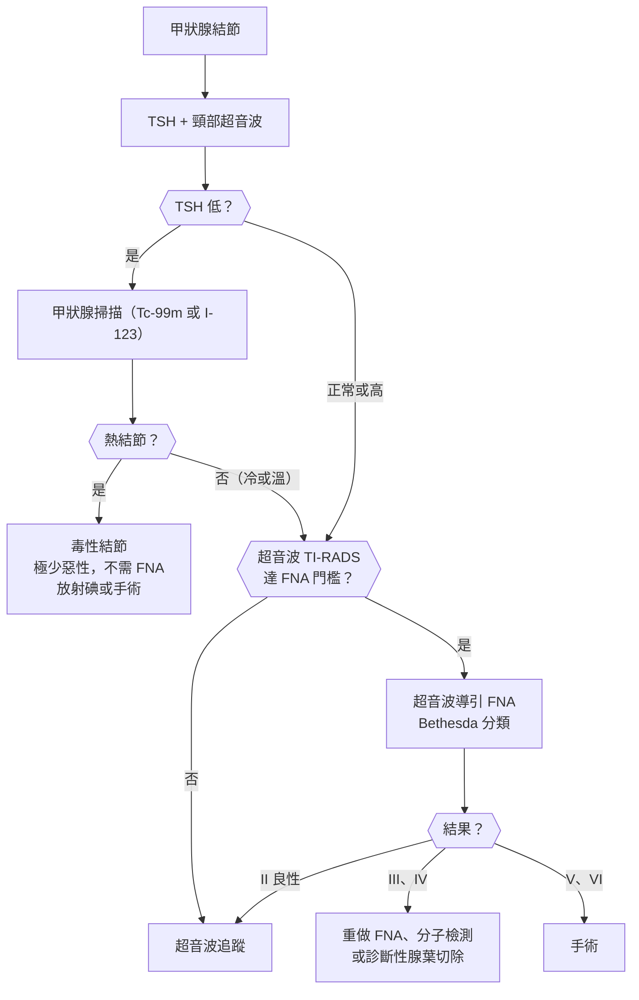
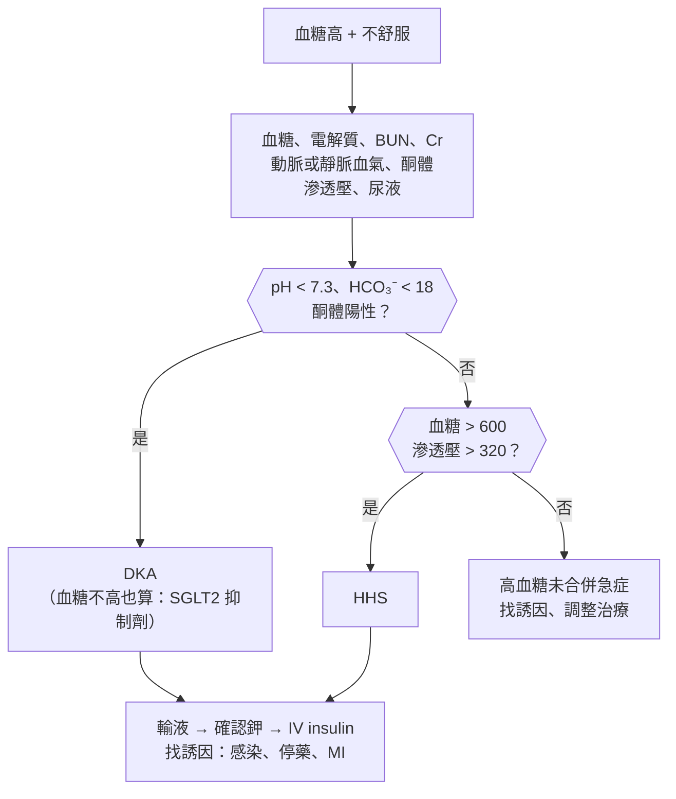
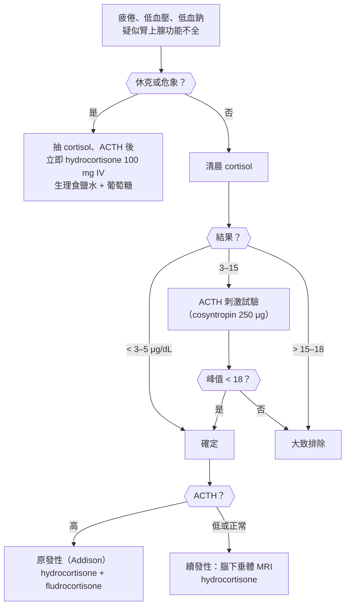

## 甲狀腺（Thyroid）

### 甲狀腺腫大與結節（Goiter / Thyroid Nodule）

#### 定義與分類

- **甲狀腺腫（goiter）**：甲狀腺整體腫大；依功能分為**亢進、正常、低下**，依型態分為**瀰漫性**與**結節性**。
    - **瀰漫性**：**Graves 病**、**[[代謝內分泌科#Hashimoto's Thyroiditis|橋本氏甲狀腺炎]]**、碘缺乏、青春期或懷孕的生理性腫大。
    - **結節性**：**多結節性甲狀腺腫**、**毒性結節**、甲狀腺癌。
- **甲狀腺結節（thyroid nodule）**：**觸診盛行率約 5%、超音波可達 50–60%**（隨年齡增加）；**約 :red[5–15%] 為惡性**。
- **惡性風險較高**：**男性**、**< 20 歲或 > 70 歲**、**兒童時期頸部放射線暴露**、**家族史（甲狀腺髓質癌、[[內分泌外科#MEN 2A|MEN 2]]）**、**快速長大**、**硬、固定**、**聲音沙啞**、**頸部淋巴結**。
- **甲狀腺癌分型**：
    - **[[內分泌外科#甲狀腺惡性腫瘤|乳突癌（papillary）]]**：**最常見（約 85%）**、**淋巴轉移**、預後最好；**放射線暴露**。
    - **濾泡癌（follicular）**：**血行轉移（骨、肺）**；需看**包膜或血管侵犯**才能診斷 → **細針抽吸無法區分良惡性**。
    - **[[內分泌外科#MEN 2A|髓質癌（medullary）]]**：**C 細胞、calcitonin、CEA**；**RET 突變、MEN 2**。
    - **未分化癌（anaplastic）**：**老人、快速長大、壓迫氣管**，預後極差。

#### Red flags

- **快速長大、硬、固定**的頸部腫塊、**聲音沙啞（喉返神經侵犯）**、吞嚥困難、**呼吸困難或喘鳴**。
- **頸部淋巴結腫大**。
- **兒童時期頭頸部放射線暴露**。
- **家族史：甲狀腺髓質癌、MEN 2、嗜鉻細胞瘤**。
- **老人頸部腫塊數週內快速長大** → 未分化癌或淋巴瘤（**橋本氏甲狀腺炎 → 甲狀腺淋巴瘤**）。
- **甲狀腺腫 + 平躺或舉手時臉部漲紅（Pemberton sign）** → 胸骨下甲狀腺腫壓迫上腔靜脈。
- **頸部前方痛 + 發燒 + 甲狀腺壓痛** → 亞急性甲狀腺炎或急性化膿性甲狀腺炎。

#### 鑑別診斷

| 類別 | 疾病 | 鑑別關鍵 |
|---|---|---|
| **瀰漫性甲狀腺腫** | **[[代謝內分泌科#Graves' Disease\|Graves 病]]**、**橋本氏甲狀腺炎**、碘缺乏、生理性 | **TSH**、抗體 |
| **結節性** | **多結節性甲狀腺腫**、**毒性結節**、膠質結節、**囊腫**、**[[代謝內分泌科#甲狀腺結節\|甲狀腺結節]]** | **TSH 低 → 掃描找熱結節** |
| **惡性** | **[[代謝內分泌科#甲狀腺癌\|乳突癌、濾泡癌、髓質癌、未分化癌]]**、**甲狀腺淋巴瘤**、轉移 | **超音波特徵、FNA** |
| **發炎** | **[[代謝內分泌科#Subacute（de Quervain's）Thyroiditis\|亞急性甲狀腺炎]]**、急性化膿性甲狀腺炎、[[免疫風濕科#IgG4-Related Disease（IgG4-RD）\|Riedel 甲狀腺炎]]（**木頭般硬、IgG4**） | **頸前痛、壓痛** |
| **非甲狀腺頸部腫塊** | **[[耳鼻喉科#小兒頸部腫塊\|甲狀舌管囊腫]]**、淋巴結、副甲狀腺腫瘤、喉部腫瘤 | **是否隨吞嚥移動** |

#### 易混淆鑑別

:::compare[甲狀腺結節的超音波特徵（惡性風險）]
| 特徵 | 偏良性 | 偏惡性 |
|---|---|---|
| 成分 | **純囊性、海綿狀** | **實心** |
| 迴音 | 等迴音、高迴音 | **極低迴音（比頸部肌肉還暗）** |
| 形狀 | 寬大於高 | **高大於寬（taller-than-wide）** |
| 邊緣 | 平滑 | **不規則、浸潤、甲狀腺外侵犯** |
| 鈣化 | 無、**大鈣化伴後方陰影（彗星尾徵象 → 膠質）** | **微鈣化（砂粒體，乳突癌）** |
| 血流 | 周邊 | 內部雜亂 |
| **FNA 門檻（ACR TI-RADS）** | **TR3（輕度可疑）≥ 2.5 cm** | **TR4 ≥ 1.5 cm、TR5（高度可疑）≥ 1 cm** |
:::

:::compare[甲狀腺癌四型比較]
| | 乳突癌 | 濾泡癌 | 髓質癌 | 未分化癌 |
|---|---|---|---|---|
| 比例 | **~85%** | ~10% | ~2–4% | ~1% |
| 細胞來源 | 濾泡細胞 | 濾泡細胞 | **濾泡旁 C 細胞** | 濾泡細胞（去分化） |
| 年齡 | 20–50 歲、**女性** | 40–60 歲、**碘缺乏區** | 任何（家族性較年輕） | **> 60 歲** |
| 轉移 | **淋巴** | **血行（骨、肺）** | 淋巴、血行 | 局部侵犯快 |
| 病理 | **砂粒體、毛玻璃核（Orphan Annie eye）、核溝** | **包膜或血管侵犯**（FNA 無法診斷） | **類澱粉沉積** | 去分化 |
| 腫瘤標記 | **thyroglobulin（術後追蹤）** | thyroglobulin | **calcitonin、CEA** | — |
| 相關 | **放射線暴露**、RET/PTC、**BRAF** | RAS | **RET（MEN 2A、2B）** | p53 |
| 治療 | **手術 ± 放射碘** | 手術 + 放射碘 | **全切除 + 頸部廓清**（放射碘無效）；**術前排除嗜鉻細胞瘤** | 緩和、標靶 |
| 預後 | **最好（10 年 > 90%）** | 好 | 中等 | **極差（數月）** |
:::

:::compare[Bethesda 細胞學分類（FNA）]
| 分類 | 結果 | 惡性風險 | 處置 |
|---|---|---|---|
| **I** | 檢體不足 | — | **重做 FNA**（超音波導引） |
| **II** | **良性** | **0–3%** | **追蹤超音波** |
| **III** | 意義不明的非典型（AUS） | 10–30% | 重做 FNA、**分子檢測**或手術 |
| **IV** | **濾泡性腫瘤** | 25–40% | **分子檢測或腺葉切除（診斷性）** |
| **V** | 疑似惡性 | 50–75% | 手術 |
| **VI** | **惡性** | 97–99% | **手術** |
:::

#### 問診與理學檢查

- 腫塊**出現時間、變化速度**、疼痛、**壓迫症狀（吞嚥困難、呼吸困難、沙啞）**。
- **甲狀腺功能症狀**（心悸、怕熱、體重變化）、**放射線暴露**、**家族史**、碘攝取。
- 理學檢查：
    - **吞嚥時觸診**（甲狀腺隨吞嚥移動）、大小、質地、壓痛、單一或多發、**固定與否**。
    - **頸部淋巴結**、氣管偏移、**Pemberton sign**、聲音。
    - 甲狀腺功能徵象：心跳、手抖、反射、**眼徵（Graves）**。

#### 檢查流程

- **:red[第一步：TSH]**；**TSH 低 → 甲狀腺掃描**（熱結節幾乎不是癌，**不需 FNA**）。
- **頸部超音波**：所有結節（含觸診發現或影像偶然發現）。
- **FNA**：依超音波風險與大小決定。
- **calcitonin**：家族史或懷疑髓質癌；**髓質癌術前驗 metanephrine**（排除嗜鉻細胞瘤）與 RET。
- **不要常規驗 thyroglobulin 來診斷結節**（它是術後追蹤標記）。

#### 初步處置

- **良性結節**：**超音波追蹤**（12–24 個月）；有壓迫症狀或美觀 → 手術或射頻燒灼。
- **甲狀腺癌**：
    - 分化型（乳突、濾泡）→ **腺葉或全切除**；**中高風險 → 放射碘**；**TSH 抑制治療**；**thyroglobulin 追蹤復發**。
    - 髓質癌 → **全切除 + 中央頸部廓清**；**RET 帶因的家族成員預防性切除**。
- **毒性結節**：放射碘、手術或射頻燒灼。

:::pitfall
甲狀腺結節的病人先做了 FNA，結果是濾泡性腫瘤，才發現 TSH 很低 → 其實是熱結節（毒性腺瘤），幾乎不會是癌，FNA 還常被誤判為濾泡性腫瘤。結節的第一步是 TSH，TSH 低先做甲狀腺掃描。
:::

:::pitfall
甲狀腺髓質癌直接開刀，沒有先排除嗜鉻細胞瘤 → MEN 2 病人麻醉中發生高血壓危象。髓質癌術前一定要驗血漿或尿液 metanephrine 與 RET。
:::

:::exam
- 結節第一步：TSH；TSH 低 → 掃描，熱結節不需 FNA。
- 惡性超音波特徵：實心、極低迴音、高大於寬、不規則邊緣、微鈣化。
- 乳突癌最常見、淋巴轉移、砂粒體、預後最好；濾泡癌血行轉移、FNA 無法診斷；髓質癌 calcitonin、RET、MEN 2；未分化癌老人快速長大。
- 橋本氏甲狀腺炎 → 甲狀腺淋巴瘤風險。
:::

### 甲狀腺毒症（Thyrotoxicosis）

#### 定義與分類

- **甲狀腺毒症（thyrotoxicosis）**：血中甲狀腺荷爾蒙過多造成的臨床狀態。
- **甲狀腺機能亢進（hyperthyroidism）**：甲狀腺**製造**過多荷爾蒙 → **放射碘攝取率（RAIU）高**。
    - **[[代謝內分泌科#Graves' Disease|Graves 病]]**：**最常見（60–80%）**；**TSH 受體刺激抗體（TRAb）**；**瀰漫性甲狀腺腫 + [[眼科#甲狀腺眼病（Thyroid Eye Disease / Graves' Ophthalmopathy）|眼病變]] + 脛前黏液水腫**。
    - **毒性多結節性甲狀腺腫**（老人）、**毒性腺瘤**。
    - 少見：**TSH 分泌腺瘤（TSH 不低）**、**hCG 介導（妊娠劇吐、[[產科#葡萄胎（Hydatidiform Mole）|葡萄胎]]）**。
- **非甲狀腺機能亢進的甲狀腺毒症**（**RAIU 低**）：
    - **甲狀腺炎（破壞性，荷爾蒙漏出）**：**亞急性（疼痛）**、**無痛性**、**產後甲狀腺炎**、**amiodarone（第 2 型）**、免疫檢查點抑制劑。
    - **外源性**：**甲狀腺素過量、減肥藥**（**thyroglobulin 低**）。
    - 卵巢甲狀腺腫（struma ovarii）。
- **症狀**：**怕熱、多汗、心悸、體重減輕（食慾增加）、手抖、焦慮、失眠、腹瀉、月經量少、近端肌無力**；**老人可只有心房顫動、體重減輕、倦怠（淡漠型）**。

#### Red flags

- **[[代謝內分泌科#甲狀腺風暴（Thyroid Storm）|甲狀腺風暴（thyroid storm）]]**：**高燒、心跳極快、心衰竭、躁動或意識改變、黃疸、嘔吐腹瀉** → 死亡率 10–30%；誘因：**感染、手術、生產、放射碘、停藥、碘顯影劑**。
- **新發心房顫動**（尤其年輕人或無心臟病者）。
- **亞洲年輕男性 + 突發四肢無力 + 低血鉀** → **[[神經系統主訴#肌肉無力（Weakness）|甲狀腺毒性週期性麻痺]]**。
- **Graves 眼病變 + 視力下降、色覺異常** → **視神經壓迫**，緊急治療。
- **服用抗甲狀腺藥物 + 發燒、喉嚨痛** → **顆粒性白血球缺乏**。
- **懷孕**（藥物選擇不同）。

#### 鑑別診斷

| 類別 | 疾病 | 鑑別關鍵 |
|---|---|---|
| **製造過多（RAIU 高）** | **[[代謝內分泌科#Graves' Disease\|Graves 病]]**、**毒性多結節性甲狀腺腫**、**毒性腺瘤**、TSH 腺瘤、hCG 介導 | **TRAb**、掃描型態 |
| **甲狀腺炎（RAIU 低）** | **[[代謝內分泌科#Subacute（de Quervain's）Thyroiditis\|亞急性甲狀腺炎]]**、**[[代謝內分泌科#Painless（Silent）Thyroiditis\|無痛性甲狀腺炎]]**、**產後甲狀腺炎**、amiodarone、免疫檢查點抑制劑 | **頸痛、ESR**、產後 1 年內 |
| **外源性** | **甲狀腺素過量**、減肥藥 | **thyroglobulin 低**、甲狀腺不大 |
| **類似甲狀腺毒症** | **焦慮與恐慌**、**[[代謝內分泌科#嗜鉻細胞瘤（Pheochromocytoma）\|嗜鉻細胞瘤]]**、興奮劑、更年期、戒斷、**惡性腫瘤（體重減輕）** | **TSH 正常** |

#### 易混淆鑑別

:::compare[甲狀腺毒症的原因比較]
| | Graves 病 | 毒性多結節或腺瘤 | 亞急性甲狀腺炎 | 無痛性或產後甲狀腺炎 | 外源性 |
|---|---|---|---|---|---|
| 甲狀腺 | **瀰漫腫大、可有血管雜音** | **結節** | **壓痛、硬** | 正常或輕度腫大 | **不大** |
| 疼痛 | 無 | 無 | **頸前痛、放射到耳**、病毒感染後 | 無 | 無 |
| 特殊表現 | **眼病變、脛前黏液水腫、杵狀指（acropachy）** | 老人、心房顫動 | 發燒 | **產後 1 年內**；之後常低下 | 減肥、誤服 |
| **RAIU／掃描** | **高、瀰漫** | **高、局部（熱結節）** | **低** | **低** | **低** |
| 抗體 | **TRAb（+）** | 陰性 | 陰性 | **anti-TPO（+）** | 陰性 |
| ESR | 正常 | 正常 | **↑↑** | 正常 | 正常 |
| **Thyroglobulin** | ↑ | ↑ | ↑ | ↑ | **↓** |
| 治療 | **抗甲狀腺藥物、放射碘、手術** | **放射碘、手術** | **NSAIDs、類固醇、β-blocker**（不用抗甲狀腺藥物） | **β-blocker**、追蹤 | 停藥 |
:::

:::compare[抗甲狀腺藥物：methimazole vs PTU]
| | Methimazole | Propylthiouracil（PTU） |
|---|---|---|
| 機轉 | 抑制甲狀腺過氧化酶 | 抑制過氧化酶 + **抑制周邊 T4 → T3** |
| 使用時機 | **首選（每天一次）** | **懷孕第一孕期**、**甲狀腺風暴**、methimazole 過敏 |
| 致畸胎 | **第一孕期：皮膚發育不全、食道與後鼻孔閉鎖** | 較少 |
| 肝毒性 | 膽汁滯留型 | **猛爆性肝炎（黑框警語）** |
| 共同副作用 | **顆粒性白血球缺乏（約 0.2–0.5%，前 3 個月多）** → 發燒喉嚨痛立即停藥驗 CBC；皮疹、關節痛、ANCA 血管炎（PTU 較多） | |
:::

:::compare[甲狀腺風暴的處置順序]
| 順序 | 藥物 | 目的 |
|---|---|---|
| **1** | **β-blocker（propranolol）** | **控制心跳與交感症狀**；也抑制 T4 → T3 |
| **2** | **PTU（或 methimazole）** | **阻斷新荷爾蒙合成** |
| **3** | **碘劑（Lugol 液、SSKI）—— 給抗甲狀腺藥物後至少 :red[1 小時]** | **阻斷荷爾蒙釋放**（先給碘會變成原料） |
| **4** | **類固醇（hydrocortisone）** | **抑制 T4 → T3**、處理相對腎上腺功能不全 |
| 支持 | **降溫（acetaminophen，避免 aspirin）**、輸液、治療誘因 | aspirin 會增加游離甲狀腺素 |
:::

#### 問診與理學檢查

- 症狀與時間、**頸前痛**、**最近懷孕或生產**、病毒感染、**用藥（amiodarone、甲狀腺素、減肥藥、碘顯影劑、lithium、免疫治療）**、家族史。
- **眼睛**：異物感、突眼、複視、視力。
- 理學檢查：
    - **心跳與心律**（心房顫動）、血壓（**脈壓變寬**）、體溫、體重。
    - **甲狀腺大小、結節、壓痛、血管雜音**。
    - **眼徵**：眼瞼退縮、**lid lag**、突眼、眼球運動。
    - **細微手抖、反射亢進**、近端肌力、皮膚溫濕、**脛前黏液水腫**。

#### 檢查流程

- **TSH（首選篩檢）** + **free T4**（± total T3）；**T3 型甲狀腺毒症**：TSH 低、free T4 正常、T3 高。
- **TRAb**（Graves 診斷首選）；不確定 → **放射碘攝取率與掃描**（**懷孕禁用**）。
- 甲狀腺炎 → **ESR、CRP**；外源性 → **thyroglobulin**。
- **治療前與治療中：CBC、肝功能**。
- **次臨床甲狀腺機能亢進**：TSH 低、free T4 正常 → 老人與骨鬆風險高者考慮治療（心房顫動、骨質流失）。

#### 初步處置

- **症狀控制：β-blocker（propranolol）**，所有原因都適用。
- **Graves 病**：
    - **抗甲狀腺藥物（methimazole）12–18 個月**，約一半會復發。
    - **放射碘**：**懷孕與哺乳禁忌**、**中重度活動性眼病變可能惡化**（合併類固醇預防）；之後多變成低下。
    - **手術**：大甲狀腺腫、壓迫、懷疑惡性、懷孕中藥物無法控制（第二孕期）。
- **甲狀腺炎**：**不用抗甲狀腺藥物**（沒有過度製造）；β-blocker、亞急性 → NSAIDs 或類固醇。
- **懷孕**：**第一孕期 PTU、之後改 methimazole**；目標 free T4 在正常上限。

:::pitfall
亞急性甲狀腺炎的病人 TSH 低、free T4 高，被當成 Graves 病開了 methimazole → 甲狀腺炎是荷爾蒙漏出、不是過度製造，抗甲狀腺藥物無效，之後進入低下期反而更嚴重。開抗甲狀腺藥物前先確認原因（TRAb、頸痛、ESR、攝取率）。
:::

:::pitfall
吃 methimazole 的病人發燒、喉嚨痛，被當成感冒開藥並繼續服用 → 顆粒性白血球缺乏可快速進展成敗血症。開抗甲狀腺藥物時要衛教：發燒或喉嚨痛立即停藥並驗 CBC。
:::

:::exam
- Graves：TRAb、瀰漫性攝取高、眼病變、脛前黏液水腫；甲狀腺炎：攝取率低、thyroglobulin 高；外源性：thyroglobulin 低。
- 亞急性甲狀腺炎：病毒後頸前痛、ESR 高 → NSAIDs，不用抗甲狀腺藥物。
- PTU：第一孕期、甲狀腺風暴；methimazole：首選、第一孕期致畸胎；兩者都可能顆粒性白血球缺乏。
- 甲狀腺風暴：β-blocker → PTU → 1 小時後碘 → 類固醇；避免 aspirin。
- 亞洲男性 + 低血鉀麻痺 → 甲狀腺毒性週期性麻痺。
:::

### 甲狀腺功能低下（Hypothyroidism）

#### 定義與分類

- **原發性（> 95%）**：**TSH 高**、free T4 低。
    - **[[代謝內分泌科#Hashimoto's Thyroiditis|橋本氏甲狀腺炎]]**：**碘充足地區最常見**；**anti-TPO 抗體**；中年女性。
    - **醫源性**：**放射碘、甲狀腺切除、頸部放射治療**。
    - **藥物**：**amiodarone、lithium**、免疫檢查點抑制劑、tyrosine kinase 抑制劑、**interferon-α**。
    - **碘缺乏**（全球最常見）、甲狀腺炎的低下期、**先天性（新生兒篩檢）**。
- **中樞性（續發性）**：**TSH 低或「不適當正常」**、free T4 低 → **[[代謝內分泌科#腦下垂體功能低下（Hypopituitarism）|腦下垂體或下視丘病變]]**（腫瘤、手術、放射、[[產科#Sheehan Syndrome|Sheehan 症候群]]）。
- **次臨床甲狀腺功能低下**：**TSH 高、free T4 正常**。
- **症狀**：**怕冷、疲倦、體重增加、便秘、皮膚乾、掉髮、眉毛外 1/3 稀疏、聲音沙啞、月經過多、憂鬱、記憶力差、肌肉痛**；**反射放鬆期延遲**、**心跳慢**、**非凹陷性水腫（黏液水腫）**。
- **檢驗異常**：**高膽固醇**、**低血鈉**、**CK 升高**、**貧血（巨球性或正球性）**、高泌乳素。

#### Red flags

- **[[代謝內分泌科#黏液水腫昏迷（Myxedema Coma）|黏液水腫昏迷（myxedema coma）]]**：**老人、冬天、感染或鎮靜藥誘發** → **意識改變、低體溫、心跳慢、低血鈉、低血糖、二氧化碳滯留**；死亡率高。
- **心包膜積液、心衰竭**。
- **懷孕或準備懷孕**（胎兒神經發育）→ 需積極治療。
- **TSH 不高但 free T4 低** → **中樞性**，**先評估腎上腺功能**再補甲狀腺素。
- **新生兒篩檢異常** → 先天性甲狀腺低下，**2 週內治療**避免智能障礙。

#### 鑑別診斷

| 類別 | 疾病 | 鑑別關鍵 |
|---|---|---|
| **原發性** | **橋本氏甲狀腺炎**、放射碘或手術後、**藥物（amiodarone、lithium）**、碘缺乏或過量、甲狀腺炎低下期、[[小兒科#先天性甲狀腺低下（Congenital Hypothyroidism）\|先天性]] | **TSH 高**、**anti-TPO** |
| **中樞性** | **[[代謝內分泌科#腦下垂體腫瘤\|腦下垂體腫瘤]]**、**Sheehan 症候群**、[[代謝內分泌科#腦下垂體中風（Pituitary Apoplexy）\|腦下垂體中風]]、放射治療、淋巴球性腦下垂體炎 | **TSH 低或正常 + free T4 低**、其他腦下垂體荷爾蒙缺乏 |
| **非甲狀腺疾病（sick euthyroid）** | **重症、飢餓** | **T3 低、reverse T3 高**，TSH 正常或低；恢復期 TSH 可短暫升高 |
| **類似症狀** | **憂鬱**、**貧血**、**OSA**、慢性疲勞、腎上腺功能不全、**[[腎臟內科#Nephrotic Syndrome\|腎病症候群]]**（水腫） | TSH 正常 |
| **檢驗干擾** | **biotin（保健品）**干擾免疫分析、TSH 異嗜性抗體、**恢復期** | 臨床不符時重驗 |

#### 易混淆鑑別

:::compare[甲狀腺功能檢查的判讀]
| TSH | free T4 | 判讀 |
|---|---|---|
| **↑** | **↓** | **原發性甲狀腺功能低下** |
| **↑** | 正常 | **次臨床甲狀腺功能低下** |
| **↓** | **↑** | **原發性甲狀腺毒症** |
| **↓** | 正常 | **次臨床甲狀腺機能亢進**、**T3 型甲狀腺毒症**（驗 T3） |
| **↓ 或正常** | **↓** | **中樞性甲狀腺功能低下**、**非甲狀腺疾病** |
| **正常或 ↑** | **↑** | **TSH 分泌腺瘤**、**甲狀腺荷爾蒙抗性**、**服藥順從性差（服藥前突然補吃）** |
:::

:::compare[黏液水腫昏迷 vs 甲狀腺風暴]
| | 黏液水腫昏迷 | 甲狀腺風暴 |
|---|---|---|
| 意識 | **嗜睡到昏迷** | **躁動、譫妄到昏迷** |
| 體溫 | **低體溫** | **高燒** |
| 心跳 | **慢** | **極快、心房顫動** |
| 呼吸 | **低換氣、CO₂ 滯留** | 呼吸快 |
| 電解質與血糖 | **低血鈉、低血糖** | 高血糖 |
| 治療 | **IV levothyroxine（± T3）+ 先給 hydrocortisone**（排除腎上腺功能不全前）、保溫、呼吸支持 | **β-blocker、PTU、碘劑、類固醇** |
:::

#### 問診與理學檢查

- 症狀、病程、**頸部手術或放射碘史**、**用藥（amiodarone、lithium、免疫治療）**、**產後**、**懷孕計畫**、家族自體免疫疾病。
- **中樞性的線索**：頭痛、視野缺損、產後大出血後無法哺乳、月經停止、其他荷爾蒙缺乏。
- 理學檢查：**甲狀腺（大小、質地）**、**心跳慢**、**深部肌腱反射放鬆期延遲**、皮膚乾冷、**非凹陷性水腫**、聲音、眉毛、體溫。

#### 檢查流程

- **TSH（首選）+ free T4**；**anti-TPO**（確認橋本氏、預測次臨床進展）。
- **TSH 不高、free T4 低 → 中樞性** → **腦下垂體 MRI、清晨 cortisol、其他腦下垂體荷爾蒙**。
- 相關檢查：**血脂、血鈉、CK、CBC**。
- **住院重症病人不要常規驗甲狀腺功能**（非甲狀腺疾病干擾）。
- 甲狀腺腫大或結節 → 超音波。

#### 初步處置

- **levothyroxine**：
    - **年輕健康者：全劑量（約 1.6 μg/kg/day）**；**老人或冠心症：低劑量開始（25–50 μg）慢慢增加**。
    - **空腹服用**（早餐前 30–60 分鐘）；**與鐵劑、鈣片、PPI、制酸劑間隔 4 小時**。
    - **:red[6–8 週]後重驗 TSH** 調整劑量（半衰期 7 天）。
    - **懷孕：劑量增加約 :red[25–30%]**（確定懷孕就多補，每 4 週追蹤 TSH）。
- **中樞性**：**以 free T4 調整劑量（不看 TSH）**；**:red[先補 hydrocortisone 再補甲狀腺素]**。
- **次臨床**：**TSH > 10、懷孕或計畫懷孕、有症狀、anti-TPO 陽性** → 考慮治療。
- **黏液水腫昏迷**：**加護病房、IV levothyroxine、hydrocortisone**、被動保溫、呼吸支持、治療誘因。

:::pitfall
腦下垂體腫瘤術後的病人 free T4 低，直接補甲狀腺素 → 甲狀腺素加速 cortisol 代謝，若同時有腎上腺功能不全會誘發腎上腺危象。中樞性甲狀腺功能低下要先評估並補充 cortisol，再補甲狀腺素。
:::

:::pitfall
病人吃了 levothyroxine，TSH 一直降不下來，就不斷加量 → 原因常是和早餐、咖啡、鐵劑、鈣片、PPI 一起吃造成吸收不良，或服藥順從性差。加量前先確認服藥方式。
:::

:::exam
- 原發性：TSH 高、free T4 低；橋本氏：anti-TPO；中樞性：TSH 不高 + free T4 低 → 先補 cortisol。
- 老人與冠心症低劑量開始；6–8 週重驗 TSH；懷孕劑量增加 25–30%。
- 黏液水腫昏迷：低體溫、心跳慢、低血鈉、CO₂ 滯留 → IV levothyroxine + hydrocortisone。
- 甲狀腺低下：高膽固醇、低血鈉、CK 高、反射放鬆延遲。
- Amiodarone、lithium 會造成甲狀腺低下（amiodarone 也會亢進）。
:::

## 血糖（Glucose）

### 高血糖（Hyperglycemia）

#### 定義與分類

- **糖尿病診斷（符合任一，無症狀者需重複確認）**：
    - **空腹血糖 :red[≥ 126 mg/dL]**（空腹 ≥ 8 小時）。
    - **75 g OGTT 2 小時 ≥ 200 mg/dL**。
    - **HbA1c :red[≥ 6.5%]**。
    - **典型症狀（多吃、多喝、多尿、體重減輕）+ 隨機血糖 ≥ 200 mg/dL**（不需重複）。
- **糖尿病前期**：空腹 100–125（空腹血糖偏高）、OGTT 2 小時 140–199（葡萄糖耐受不良）、HbA1c 5.7–6.4%。
- **分型**：
    - **第 1 型**：**自體免疫 β 細胞破壞**、絕對缺乏 insulin、**易 DKA**；**抗 GAD、IA-2、ZnT8 抗體**、**C-peptide 低**。
    - **第 2 型**：**胰島素阻抗 + 相對分泌不足**；**佔 > 90%**；肥胖、家族史。
    - **LADA（成人潛伏性自體免疫糖尿病）**：成人發病、初期像第 2 型、抗體陽性、**較快需要 insulin**。
    - **MODY**：**年輕、非肥胖、三代家族史、體染色體顯性**；GCK（輕度空腹高血糖不需治療）、HNF1A（**sulfonylurea 很有效**）。
    - **[[產科#妊娠糖尿病（Gestational Diabetes Mellitus, GDM）|妊娠糖尿病]]**、**次發性**（胰臟疾病、Cushing、肢端肥大症、嗜鉻細胞瘤、類固醇、抗精神病藥）。
- **高血糖急症**：
    - **DKA（糖尿病酮酸中毒）**：**酮體 + 陰離子間隙代謝性酸中毒**；第 1 型多、數小時到 1 天。
    - **[[代謝內分泌科#HHS（Hyperosmolar Hyperglycemic State）|HHS（高血糖高滲透壓狀態）]]**：**血糖極高（> 600）、高滲透壓（> 320）、嚴重脫水、意識改變**、無明顯酸中毒；**老人第 2 型**、數天。
    - **正常血糖 DKA**：**SGLT2 抑制劑**、懷孕、飢餓 → 血糖 < 250 仍可 DKA。

#### Red flags

- **噁心嘔吐、腹痛、Kussmaul 呼吸（深快）、呼吸有水果味、意識改變** → DKA。
- **老人嚴重脫水、意識改變、局部神經症狀、癲癇** → HHS。
- **使用 SGLT2 抑制劑 + 噁心腹痛倦怠，血糖不太高** → **正常血糖 DKA**。
- **年輕瘦的人新發糖尿病、體重快速減輕、酮尿** → 第 1 型，需 insulin。
- **糖尿病 + 發燒或感染**：壞死性筋膜炎、惡性外耳炎、**白黴菌病**、**[[泌尿科#氣腫性腎盂腎炎（Emphysematous Pyelonephritis）|氣腫性腎盂腎炎]]與膽囊炎**、糖尿病足。
- **新發糖尿病 + 上腹痛、體重減輕、> 50 歲** → **胰臟癌**。

#### 鑑別診斷

| 類別 | 疾病 | 鑑別關鍵 |
|---|---|---|
| **原發性** | **[[家庭醫學科#糖尿病（Diabetes Mellitus）\|第 2 型]]**、**第 1 型**、LADA、MODY | **年齡、BMI、抗體、C-peptide、家族史** |
| **高血糖急症** | **[[代謝內分泌科#DKA（Diabetic Ketoacidosis）\|DKA]]**、**HHS**、正常血糖 DKA | 酸中毒、滲透壓 |
| **內分泌** | **[[代謝內分泌科#庫欣氏症候群（Cushing's Syndrome）\|Cushing]]**、**[[代謝內分泌科#肢端肥大症（Acromegaly）/ 巨人症（Gigantism）\|肢端肥大症]]**、**[[代謝內分泌科#嗜鉻細胞瘤（Pheochromocytoma）\|嗜鉻細胞瘤]]**、[[代謝內分泌科#甲狀腺機能亢進（Hyperthyroidism）\|甲狀腺機能亢進]]、升糖素瘤、體抑素瘤 | 其他荷爾蒙徵象 |
| **胰臟** | **[[消化內科#慢性胰臟炎（Chronic Pancreatitis）\|慢性胰臟炎]]**、**[[消化內科#胰臟癌（Pancreatic Cancer）\|胰臟癌]]**、胰臟切除、**[[消化內科#Hemochromatosis（血色素沉著症）\|血色素沉著症]]**、囊腫性纖維化 | 脂肪便、體重減輕、皮膚古銅 |
| **藥物** | **類固醇**、**第二代抗精神病藥（olanzapine、clozapine）**、thiazide、**免疫檢查點抑制劑（猛爆性第 1 型）**、tacrolimus、protease inhibitor、niacin | 用藥時間 |
| **妊娠** | **[[產科#妊娠糖尿病（Gestational Diabetes Mellitus, GDM）\|妊娠糖尿病]]** | 懷孕 24–28 週篩檢 |
| **壓力性** | 重症、感染、心肌梗塞、中風 | **HbA1c 正常** |

#### 易混淆鑑別

:::compare[第 1 型 vs 第 2 型 vs LADA vs MODY]
| | 第 1 型 | 第 2 型 | LADA | MODY |
|---|---|---|---|---|
| 發病年齡 | **兒童青少年**（任何年齡） | **成人**（兒童肥胖增加） | **> 30 歲** | **< 25 歲** |
| 體型 | 瘦 | **肥胖** | 多不胖 | 不胖 |
| 機轉 | **自體免疫破壞** | **胰島素阻抗** | 慢速自體免疫 | **單基因（體染色體顯性）** |
| 抗體 | **陽性** | 陰性 | **陽性** | 陰性 |
| C-peptide | **低** | 正常或高 | 逐漸下降 | 正常 |
| DKA | **常見** | 少 | 晚期可能 | 少 |
| 家族史 | 少 | 常見 | 少 | **三代** |
| 治療 | **insulin** | 生活調整、metformin… | **較快需要 insulin** | GCK：不需；**HNF1A：sulfonylurea** |
:::

:::compare[DKA vs HHS]
| | DKA | HHS |
|---|---|---|
| 族群 | **第 1 型**、年輕 | **第 2 型、老人** |
| 發展 | **數小時到 1 天** | **數天到數週** |
| 血糖 | > 250（SGLT2 抑制劑可正常） | **> 600** |
| pH／HCO₃⁻ | **< 7.3／< 18** | **> 7.3／> 18** |
| 酮體 | **明顯（β-hydroxybutyrate）** | 少 |
| 滲透壓 | 可升高 | **> 320 mOsm/kg** |
| 陰離子間隙 | **↑** | 正常或輕度 ↑ |
| 意識 | 依嚴重度 | **常改變** |
| 脫水 | 約 5–6 L | **約 9 L，更嚴重** |
| 死亡率 | < 1–5% | **10–20%** |
:::

:::compare[DKA 與 HHS 的治療重點]
| 步驟 | 重點 |
|---|---|
| **1. 輸液（最重要）** | **生理食鹽水 1–1.5 L 第一小時**，再依矯正鈉調整；**血糖 < 250（HHS < 300）→ 加入葡萄糖**，繼續 insulin 直到酮體消失 |
| **2. 鉀（給 insulin 前先確認）** | **K :red[< 3.3] → 先補鉀、暫緩 insulin**；3.3–5.3 → 輸液中加鉀；> 5.3 → 先不補、每 2 小時追蹤 |
| **3. Insulin** | **regular insulin IV :red[0.1 U/kg/hr]**（可先 bolus 0.1 U/kg）；目標血糖每小時降 50–75 |
| **4. 碳酸氫鈉** | **只在 pH < 6.9–7.0** 考慮 |
| **5. 磷** | 常規不補；< 1.0 或心肺功能差才補 |
| **緩解** | **陰離子間隙正常、HCO₃⁻ ≥ 15–18、pH > 7.3** → 改皮下 insulin，**IV insulin 與皮下重疊 1–2 小時** |
| 監測 | 血糖每小時、電解質每 2–4 小時；**兒童注意腦水腫**（矯正太快） |
:::

#### 問診與理學檢查

- **多吃、多喝、多尿、體重減輕**、視力模糊、**反覆感染（泌尿道、皮膚、黴菌）**、傷口不易癒合、手腳麻木。
- **家族史**、懷孕史（巨嬰、妊娠糖尿病）、**用藥**、酒精、胰臟炎病史。
- 急症：**噁心嘔吐、腹痛、意識、最近感染或停用 insulin、SGLT2 抑制劑**。
- 理學檢查：**BMI、腰圍**、血壓、**黑色棘皮症**、**脫水程度**、Kussmaul 呼吸、意識、**足部（單絲感覺、脈搏、潰瘍）**、眼底、Cushing 或肢端肥大徵象。

#### 檢查流程

- 診斷：**空腹血糖、HbA1c、OGTT**；**HbA1c 不可靠**：**貧血、血紅素病變、懷孕、慢性腎病、近期輸血**。
- 分型：**抗 GAD 抗體、C-peptide**（年輕、瘦、快速需要 insulin）。
- 新診斷第 2 型：**眼底、尿液白蛋白與肌酸酐比值（UACR）、eGFR、血脂、足部檢查**。
- 急症：**血清酮體（β-hydroxybutyrate，比尿酮準確）**、**矯正血鈉**（血糖每高 100，鈉 + 1.6）、找誘因（**感染、心肌梗塞、胰臟炎、停藥**）。

#### 初步處置

- **第 2 型**：**生活調整 + metformin**（腎功能 eGFR < 30 禁用）；**合併動脈硬化心血管疾病 → [[代謝內分泌科#GLP-1 Receptor Agonists（注射為主）|GLP-1 受體致效劑]]或 SGLT2 抑制劑**；**心衰竭或慢性腎病 → SGLT2 抑制劑**；肥胖 → GLP-1 受體致效劑、tirzepatide。
- **第 1 型**：**基礎 + 餐前 insulin**、或胰島素幫浦。
- **控制目標（一般成人）**：**HbA1c :red[< 7%]**；老人、低血糖風險高 → 放寬到 7.5–8%。
- **台灣**：**糖尿病共同照護網**、全民健保 **Pay-for-Performance**。
- **DKA／HHS**：見上表與下圖；**治療誘因**。

::chart{id="dka-hhs-management"}

- **手術或急性病（sick day）**：**SGLT2 抑制劑術前停 3–4 天**、metformin 在顯影劑或脫水時暫停。

:::pitfall
用 SGLT2 抑制劑的病人噁心嘔吐、腹痛，血糖只有 200 左右，被當成腸胃炎 → 正常血糖 DKA，延誤補液與 insulin。服用 SGLT2 抑制劑的病人不舒服時，即使血糖不高也要驗酮體與血氣。
:::

:::pitfall
DKA 病人一到院就打 insulin，沒有先看鉀 → insulin 讓鉀進入細胞，原本 3.0 的鉀掉到危險程度造成心律不整。鉀 < 3.3 先補鉀、暫緩 insulin。
:::

:::exam
- 診斷：空腹 ≥ 126、OGTT 2 小時 ≥ 200、HbA1c ≥ 6.5%、症狀 + 隨機 ≥ 200。
- DKA：pH < 7.3、HCO₃⁻ < 18、酮體；HHS：血糖 > 600、滲透壓 > 320、老人、死亡率較高。
- 治療順序：輸液 → 鉀（< 3.3 先補）→ insulin 0.1 U/kg/hr → 血糖 < 250 加葡萄糖；pH < 6.9 才給碳酸氫鈉。
- SGLT2 抑制劑 → 正常血糖 DKA；免疫檢查點抑制劑 → 猛爆性第 1 型。
- HbA1c 不可靠：貧血、血紅素病變、懷孕、慢性腎病。
:::

### 低血糖（Hypoglycemia）

#### 定義與分類

- **Whipple 三要素**：**低血糖症狀** + **血糖低（< 55 mg/dL，非糖尿病者）** + **補充葡萄糖後症狀緩解**。
- **糖尿病病人的分級**：
    - **第 1 級**：**< 70 mg/dL**（警戒值）。
    - **第 2 級**：**< 54 mg/dL**（具臨床意義）。
    - **第 3 級**：**需他人協助**的嚴重低血糖（意識改變）。
- **症狀**：
    - **自主神經（交感）**：**心悸、手抖、出汗、飢餓、焦慮**。
    - **神經醣缺乏**：**意識混亂、行為異常、局部神經缺損（可像中風）、癲癇、昏迷**。
    - **低血糖無感（hypoglycemia unawareness）**：反覆低血糖、長期糖尿病、**β-blocker** → 沒有警訊直接昏迷。
- **糖尿病病人**：**insulin、sulfonylurea（glibenclamide 最久）**、**腎功能惡化**（藥物清除下降）、**沒進食、運動、喝酒**。
- **非糖尿病病人**：
    - **看起來生病**：**藥物、酒精、敗血症、肝衰竭、腎衰竭、腎上腺功能不全、飢餓**、非胰島細胞腫瘤（**IGF-2**）。
    - **看起來健康**：**[[內分泌外科#Insulinoma|胰島素瘤（insulinoma）]]**、**人為注射 insulin 或偷服 sulfonylurea**、**胃繞道術後（餐後）**、自體免疫（insulin 抗體）。
- **反應性（餐後）低血糖**：**胃切除或胃繞道術後（傾倒症候群晚期）**。

#### Red flags

- **意識改變、癲癇、局部神經缺損** → 立即治療。
- **長效 sulfonylurea 或長效 insulin 造成的低血糖** → **可反覆數十小時**，需住院觀察。
- **非糖尿病者的低血糖** → 要找原因（**發作當下抽血**）。
- **低血糖 + 低血壓 + 低血鈉高血鉀** → 腎上腺功能不全。
- **酒精使用者 + 低血糖** → 先給 thiamine。
- **新生兒低血糖**（糖尿病母親、早產、小於胎齡）。

#### 鑑別診斷

| 類別 | 疾病 | 鑑別關鍵 |
|---|---|---|
| **糖尿病藥物** | **insulin**、**sulfonylurea**、glinide；**合併腎功能惡化、未進食、酒精** | 用藥史 |
| **其他藥物** | **酒精**、**quinolone**、pentamidine、**β-blocker（掩蓋症狀）**、quinine、salicylate | 用藥史 |
| **重症** | **敗血症**、**肝衰竭**、**腎衰竭**、心衰竭、**飢餓與神經性厭食症** | 病容 |
| **荷爾蒙缺乏** | **[[代謝內分泌科#腎上腺功能不全（Adrenal Insufficiency）\|腎上腺功能不全]]**、生長激素缺乏、腦下垂體低下 | **cortisol** |
| **內源性高胰島素** | **胰島素瘤**、**sulfonylurea 偷服**、胃繞道後、胰島細胞增生、**insulin 自體免疫（methimazole、硫基藥物）** | **insulin、C-peptide、proinsulin** |
| **外源性 insulin** | **人為（Munchausen）**、他人投藥（**代理型、虐待**） | **insulin 高、C-peptide 低** |
| **非胰島細胞腫瘤** | 大型間質腫瘤、肝癌（**IGF-2**） | insulin 低、IGF-2 高 |
| **新生兒與兒童** | [[小兒科#新生兒低血糖\|新生兒低血糖]]、先天性高胰島素症、代謝異常（醣原儲積症） | 年齡 |

#### 易混淆鑑別

:::compare[低血糖發作時的抽血判讀（非糖尿病者）]
| | Insulin | C-peptide | Proinsulin | β-hydroxybutyrate | Sulfonylurea 篩檢 |
|---|---|---|---|---|---|
| **胰島素瘤** | **↑** | **↑** | **↑** | **↓** | 陰性 |
| **Sulfonylurea 偷服** | **↑** | **↑** | **↑** | ↓ | **陽性** |
| **外源性 insulin 注射** | **↑↑** | **↓** | **↓** | ↓ | 陰性 |
| **Insulin 自體免疫** | **↑↑（抗體干擾）** | ↑ | ↑ | ↓ | 陰性（**insulin 抗體陽性**） |
| **非胰島素媒介（飢餓、IGF-2、腎上腺）** | **↓** | **↓** | ↓ | **↑**（IGF-2 時 ↓） | 陰性 |
:::

:::compare[胰島素瘤的重點]
| 項目 | 內容 |
|---|---|
| 特徵 | **最常見的功能性胰臟神經內分泌腫瘤**；**90% 良性、90% 單發、90% < 2 cm**（90% 規則） |
| 表現 | **空腹或運動後低血糖**、Whipple 三要素、常為了避免症狀**頻繁進食而體重增加** |
| 診斷 | **72 小時監測禁食試驗**：低血糖時 insulin、C-peptide、proinsulin 不適當升高 |
| 定位 | CT、MRI、**內視鏡超音波（最敏感）**、GLP-1 受體 PET |
| 相關 | **[[內分泌外科#MEN 1\|MEN 1]]**（副甲狀腺、腦下垂體、胰臟） |
| 治療 | **手術切除**；無法手術 → diazoxide、somatostatin 類似物、everolimus |
:::

#### 問診與理學檢查

- 症狀與**發作時機（空腹或餐後）**、**是否測到低血糖**、補充糖分後是否改善、頻率。
- **糖尿病藥物、劑量與最近調整**、進食、運動、**喝酒**、腎功能變化。
- 非糖尿病者：**家人是否有糖尿病藥物**（誤用或刻意）、醫療相關工作、胃手術史、體重變化、其他疾病。
- 理學檢查：意識與神經學、**生命徵象**、病容、肝病徵象、色素沉著（Addison）、腫瘤。

#### 檢查流程

- **立即測指尖血糖**（但要以靜脈血確認）。
- **非糖尿病者：低血糖發作當下（給葡萄糖前）抽血**：**血糖、insulin、C-peptide、proinsulin、β-hydroxybutyrate、sulfonylurea 篩檢、insulin 抗體**；之後給 **glucagon 1 mg IV 看血糖反應**（上升 > 25 → insulin 媒介）。
- 無法自然抓到發作 → **72 小時禁食試驗**（住院）。
- 依臨床：**清晨 cortisol**、肝腎功能、IGF-2。

#### 初步處置

- **意識清醒可進食**：**:red[15–20 g] 快速碳水化合物**（果汁、方糖、葡萄糖片）→ **15 分鐘後再測**，仍 < 70 再給一次；之後吃正餐或點心（**15-15 法則**）。
- **意識不清或無法吞嚥**：**50% 葡萄糖 IV（成人 25–50 mL）**；**無 IV → glucagon 1 mg IM 或鼻噴 glucagon**。
    - **酒精使用者先給 thiamine**。
    - **glucagon 對肝醣耗竭（酒精、飢餓、肝衰竭）效果差**。
- **Sulfonylurea 造成的低血糖**：**:red[住院觀察]**（**可持續 24–72 小時**）、持續葡萄糖輸注；**反覆 → octreotide**（抑制 insulin 分泌）。
- **調整糖尿病治療**：降低劑量、**改用低血糖風險低的藥物**（metformin、DPP-4 抑制劑、GLP-1 受體致效劑、SGLT2 抑制劑）、**老人放寬目標**、衛教與連續血糖監測。

:::pitfall
吃 sulfonylurea 的老人低血糖，打了一支 50% 葡萄糖醒過來就讓他回家 → 長效 sulfonylurea 作用可持續一兩天，回家後再次低血糖昏迷。Sulfonylurea 造成的低血糖要住院觀察，持續輸注葡萄糖，必要時用 octreotide。
:::

:::pitfall
老人突然半側無力、講話不清，直接走中風流程，沒有測血糖 → 低血糖也可以造成局部神經缺損，給葡萄糖就恢復。所有急性神經症狀都要先測血糖。
:::

:::exam
- Whipple 三要素；糖尿病低血糖分級：< 70、< 54、需他人協助。
- 胰島素瘤：insulin、C-peptide、proinsulin 都高；外源性 insulin：insulin 高、C-peptide 低；sulfonylurea：像胰島素瘤但篩檢陽性。
- 72 小時禁食試驗；胰島素瘤 90% 良性單發，MEN 1。
- 15-15 法則；意識不清 → IV 50% 葡萄糖或 glucagon；sulfonylurea → 住院、octreotide。
- β-blocker 掩蓋低血糖症狀（出汗除外）。
:::

## 腎上腺（Adrenal）

### 內分泌性高血壓（Endocrine Hypertension）

#### 定義與分類

- **次發性高血壓**約佔 **5–10%**（**難治型高血壓中更高**）；內分泌原因中**原發性醛固酮症最常見**。
- **[[內分泌外科#Conn's Syndrome（原發性醛固酮過多症, Primary Aldosteronism）|原發性醛固酮症（primary aldosteronism）]]**：
    - **高血壓 + 低血鉀（只有約 1/3 有）+ 代謝性鹼中毒**；**腎素（renin）被抑制**。
    - **雙側腎上腺增生（約 60%）**、**單側腺瘤（Conn 症候群，約 35%）**。
    - **心血管與腎臟損傷比同血壓的原發性高血壓更嚴重**（心房顫動、中風）。
- **[[代謝內分泌科#嗜鉻細胞瘤（Pheochromocytoma）|嗜鉻細胞瘤／副神經節瘤]]**：**陣發性頭痛、心悸、出汗 + 高血壓**；**10% 規則已過時**（約 30–40% 有遺傳突變）。
- **Cushing 症候群**：高血壓 + 中心型肥胖、紫紋、高血糖；見[[#Cushing 樣外觀（Cushingoid Features）|Cushing 樣外觀]]。
- **其他**：**甲狀腺機能亢進（收縮壓高、脈壓寬）**、**甲狀腺機能低下（舒張壓高）**、**原發性副甲狀腺機能亢進**、**肢端肥大症**、**先天性腎上腺增生（11β-、17α-羥化酶缺乏）**、**假性醛固酮症（甘草、[[腎臟內科#Bartter vs. Gitelman vs. Liddle Syndrome|Liddle 症候群]]）**。
- **非內分泌的次發性高血壓**：**[[腎臟內科#腎動脈狹窄（Renal Artery Stenosis）|腎動脈狹窄]]**、**腎實質疾病**、**OSA**、**主動脈縮窄**、藥物（NSAIDs、口服避孕藥、類固醇、興奮劑、calcineurin 抑制劑）。

#### Red flags

- **陣發性頭痛 + 心悸 + 出汗 + 高血壓（尤其麻醉、運動、腹壓、特定藥物誘發）** → 嗜鉻細胞瘤；**未診斷者手術或使用 β-blocker、metoclopramide、類固醇可誘發危象**。
- **高血壓 + 自發性或利尿劑誘發的低血鉀** → 原發性醛固酮症。
- **< 30 歲發病**、**難治型高血壓（3 種藥含利尿劑仍控制不良）**、**突然惡化**、**高血壓急症**。
- **[[代謝內分泌科#腎上腺偶發瘤（Adrenal Incidentaloma）|腎上腺偶發瘤]] + 高血壓**。
- **年輕人中風 + 高血壓 + 低血鉀**。
- **ACEi／ARB 後肌酸酐急升 > 30%、腹部血管雜音、反覆急性肺水腫（flash pulmonary edema）** → 腎動脈狹窄。

#### 鑑別診斷

| 類別 | 疾病 | 鑑別關鍵 |
|---|---|---|
| **礦物皮質酮過多** | **原發性醛固酮症**、CAH（11β-、17α-羥化酶）、**甘草**、**Liddle 症候群**、表觀礦物皮質酮過多、**Cushing（大量 cortisol）** | **低血鉀、鹼中毒**；**aldosterone 與 renin** |
| **兒茶酚胺過多** | **[[代謝內分泌科#嗜鉻細胞瘤（Pheochromocytoma）\|嗜鉻細胞瘤]]**、副神經節瘤；**興奮劑、可樂寧戒斷** | **陣發性**、metanephrine |
| **糖皮質酮過多** | **[[代謝內分泌科#庫欣氏症候群（Cushing's Syndrome）\|Cushing 症候群]]** | 外觀 |
| **其他內分泌** | 甲狀腺機能亢進或低下、**[[代謝內分泌科#原發性副甲狀腺機能亢進（Primary Hyperparathyroidism）\|副甲狀腺機能亢進]]**、**[[代謝內分泌科#肢端肥大症（Acromegaly）/ 巨人症（Gigantism）\|肢端肥大症]]** | TSH、Ca、IGF-1 |
| **腎與血管** | **腎動脈狹窄**（老人動脈硬化、**年輕女性纖維肌性發育不良**）、**腎實質疾病**、**[[心血管外科#主動脈縮窄（Coarctation of Aorta, CoA）\|主動脈縮窄]]** | **上下肢血壓差**、腹部雜音、肌酸酐 |
| **其他** | **[[胸腔內科#阻塞性睡眠呼吸中止症（OSA）\|OSA]]**、**藥物**、酒精 | 打鼾、用藥 |

#### 易混淆鑑別

:::compare[低血鉀合併高血壓：用 renin 與 aldosterone 區分]
| | Renin | Aldosterone | 疾病 |
|---|---|---|---|
| **原發性醛固酮症** | **↓** | **↑** | Conn 腺瘤、雙側增生 |
| **次發性醛固酮症** | **↑** | **↑** | **腎動脈狹窄**、**利尿劑**、腎素瘤、惡性高血壓 |
| **非醛固酮的礦物皮質酮過多** | **↓** | **↓** | **甘草**、**Liddle 症候群**、**Cushing**、CAH（11β-、17α-） |
:::

:::compare[原發性醛固酮症 vs 嗜鉻細胞瘤 vs Cushing 症候群]
| | 原發性醛固酮症 | 嗜鉻細胞瘤 | Cushing 症候群 |
|---|---|---|---|
| 血壓 | **持續、難治** | **陣發性或持續**、**姿勢性低血壓** | 持續 |
| 特徵 | **低血鉀（1/3）、肌無力、多尿、代謝性鹼中毒** | **頭痛、心悸、出汗（三聯）**、蒼白、焦慮、高血糖 | **中心型肥胖、紫紋、近端無力、易瘀青、高血糖** |
| 篩檢 | **醛固酮／腎素比值（ARR）**（先矯正低血鉀） | **血漿游離 metanephrine** 或 24 小時尿液分餾 metanephrine | **24 小時尿液游離 cortisol、深夜唾液 cortisol、1 mg dexamethasone 抑制試驗**（任兩項） |
| 確認 | **鹽水負荷試驗或 captopril 試驗** → CT → **腎上腺靜脈取樣（區分單側或雙側）** | **CT 或 MRI**（MRI T2 亮）、MIBG、PET | ACTH → 定位 |
| 治療 | **單側 → 腹腔鏡腎上腺切除**；**雙側 → spironolactone、eplerenone** | **術前先 α-blocker（phenoxybenzamine）10–14 天 → 再加 β-blocker** → 手術 | 依病因 |
:::

#### 問診與理學檢查

- **發病年齡、血壓控制情形、用藥數量**、陣發性症狀、**肌無力或多尿（低血鉀）**、打鼾。
- **用藥**：NSAIDs、口服避孕藥、類固醇、**甘草（中藥常見）**、興奮劑、減肥藥、**可樂寧停藥**。
- **家族史**：早發高血壓或中風、**嗜鉻細胞瘤、MEN 2、VHL、[[小兒科#Neurofibromatosis Type 1（NF1, von Recklinghausen Disease）|NF1]]**。
- 理學檢查：**雙上肢與下肢血壓**、**腹部雜音**、**Cushing 徵象**、甲狀腺、**咖啡牛奶斑與神經纖維瘤（NF1）**、BMI、頸圍。

#### 檢查流程

- **誰要篩原發性醛固酮症**：**難治型高血壓**、**高血壓 + 低血鉀（自發或利尿劑誘發）**、**高血壓 + 腎上腺偶發瘤**、**高血壓 + OSA**、**早發高血壓或年輕中風家族史**、**持續 > 150/100**；（新指引建議**所有高血壓至少篩一次**）。
- **ARR**：早上抽血、**先補鉀**；**spironolactone、eplerenone 要停 4–6 週**；ACEi、ARB、利尿劑會使 renin 上升造成偽陰性。
- **嗜鉻細胞瘤**：**血漿游離 metanephrine**（坐姿或平躺 30 分鐘後抽）；**三環抗鬱劑、levodopa、acetaminophen 可造成偽陽性**。
- 基本：電解質、肌酸酐、尿液、TSH、血糖、血脂、ECG。
- 腎動脈狹窄 → **腎動脈超音波、CTA 或 MRA**。

#### 初步處置

- 原發性醛固酮症：**單側 → 手術**（血壓與低血鉀可明顯改善）；**雙側 → 礦物皮質酮受體拮抗劑（spironolactone，男性女乳 → eplerenone）**。
- **嗜鉻細胞瘤**：**:red[先 α-blocker]**（phenoxybenzamine 或 doxazosin），**足夠後才加 β-blocker**（避免 α 作用失去對抗 → 高血壓危象）；**高鹽飲食與補液**擴張血容積；腹腔鏡切除；**終身追蹤 + 基因檢測**。
- 腎動脈狹窄：**動脈硬化性 → 藥物治療為主**；**纖維肌性發育不良 → 血管成形術效果好**。

:::pitfall
高血壓合併低血鉀的病人補鉀、加藥，從來沒想到要驗 aldosterone 與 renin → 原發性醛固酮症延誤，心血管與腎臟傷害比一般高血壓更嚴重；單側腺瘤是可以開刀治好的。高血壓合併低血鉀、難治型或年輕人，都要篩檢 ARR。
:::

:::pitfall
懷疑嗜鉻細胞瘤的病人心跳快，先給了 propranolol → α 受體失去對抗，血壓急升成高血壓危象。嗜鉻細胞瘤要先用足 α-blocker，再加 β-blocker。
:::

:::exam
- 原發性醛固酮症：最常見內分泌性高血壓；低 renin、高 aldosterone；ARR 篩檢 → 確認試驗 → CT → 腎上腺靜脈取樣；單側手術、雙側 spironolactone。
- Renin 高 + aldosterone 高 → 腎動脈狹窄、利尿劑；兩者都低 → 甘草、Liddle、Cushing。
- 嗜鉻細胞瘤：頭痛、心悸、出汗；血漿游離 metanephrine；先 α 後 β。
- 上下肢血壓差 → 主動脈縮窄；年輕女性腎動脈狹窄 → 纖維肌性發育不良。
:::

### Cushing 樣外觀（Cushingoid Features）

#### 定義與分類

- **Cushing 症候群**：長期**糖皮質酮過多**的臨床表現。
- **最常見原因：外源性類固醇（醫源性）**。
- **內源性**：
    - **ACTH 依賴性（約 80%）**：
        - **[[代謝內分泌科#Cushing's Disease|Cushing 病（腦下垂體 ACTH 腺瘤）]]**：**內源性最常見（約 70%）**、女性多。
        - **異位 ACTH**：**小細胞肺癌**、類癌（支氣管）、胸腺瘤、胰臟神經內分泌腫瘤 → **進展快、低血鉀明顯、色素沉著、Cushing 外觀不一定明顯**。
    - **ACTH 非依賴性（約 20%）**：**腎上腺腺瘤**、腎上腺癌（**合併雄性素過多 → 男性化**）、雙側腎上腺增生。
- **最有區別力的特徵**（一般肥胖較少見）：**容易瘀青**、**臉部多血（plethora）**、**近端肌無力**、**寬（> 1 cm）紫紅色皮膚紋路**；兒童 → **體重增加但身高生長變慢**。
- **其他**：**滿月臉、水牛肩、鎖骨上脂肪墊**、中心型肥胖、**高血壓、高血糖、骨質疏鬆**、痤瘡、多毛、月經異常、憂鬱或精神病、**反覆感染**、腎結石、**低血鉀（尤其異位 ACTH）**。
- **假性 Cushing（pseudo-Cushing）**：**酗酒、重度憂鬱、嚴重肥胖、控制不良糖尿病**、懷孕 → cortisol 可輕度升高。

#### Red flags

- **快速進展（數週到數月）、嚴重低血鉀、色素沉著、體重減輕而非增加** → **異位 ACTH（小細胞肺癌）**。
- **男性化徵象（女性）+ 快速 Cushing** → **腎上腺癌**。
- **嚴重高血壓、高血糖、感染、精神病、骨折**。
- **長期使用類固醇的病人突然停藥** → **腎上腺危象**。
- **兒童生長停滯 + 體重增加** → Cushing（而非單純肥胖）。

#### 鑑別診斷

| 類別 | 疾病 | 鑑別關鍵 |
|---|---|---|
| **外源性** | **口服、注射、吸入、外用、關節內類固醇**、**中草藥或偏方摻類固醇** | **ACTH 低、cortisol 低**（合成類固醇不被測到） |
| **ACTH 依賴性** | **[[代謝內分泌科#Cushing's Disease\|Cushing 病]]**、**異位 ACTH（[[胸腔內科#肺癌（Lung Cancer）\|小細胞肺癌]]、類癌）** | **ACTH 正常或高** |
| **ACTH 非依賴性** | **腎上腺腺瘤**、**腎上腺癌**、雙側腎上腺增生 | **ACTH 低**、腎上腺影像 |
| **假性 Cushing** | **酗酒、憂鬱**、嚴重肥胖、控制不良糖尿病、懷孕 | 原因解除後恢復 |
| **類似外觀** | **單純肥胖**、**[[生殖內分泌科#多囊性卵巢症候群（PCOS）\|PCOS]]**、**代謝症候群**、甲狀腺機能低下、HIV 脂肪分布異常 | **沒有瘀青、近端無力、寬紫紋** |

#### 易混淆鑑別

:::compare[Cushing 症候群的診斷流程]
| 步驟 | 檢查 | 判讀 |
|---|---|---|
| **0. 排除外源性** | 詳細問類固醇（含外用、吸入、注射、中藥） | — |
| **1. 篩檢（任兩項異常）** | **1 mg 夜間 dexamethasone 抑制試驗**（隔天早上 cortisol **:red[> 1.8 μg/dL]** 異常）、**24 小時尿液游離 cortisol（2 次）**、**深夜唾液 cortisol（2 次）** | 確認有 Cushing 症候群 |
| **2. ACTH** | 早上血漿 ACTH | **低（< 5 pg/mL）→ 腎上腺**；**正常或高 → ACTH 依賴性** |
| **3a. 腎上腺** | **腎上腺 CT** | 腺瘤、癌、增生 |
| **3b. ACTH 依賴性** | **腦下垂體 MRI**、**高劑量 dexamethasone 抑制試驗**、CRH 或 desmopressin 刺激 | 腦下垂體：**可被高劑量抑制、對 CRH 有反應** |
| **4. 仍不確定** | **岩下竇取樣（IPSS）**：中樞／周邊 ACTH 比值 **≥ 2（CRH 後 ≥ 3）** → 腦下垂體 | 腦下垂體 MRI 常看不到小腺瘤 |
| **異位 ACTH 定位** | 胸部 CT、**Ga-68 DOTATATE PET** | — |
:::

:::compare[Cushing 病 vs 異位 ACTH vs 腎上腺腺瘤]
| | Cushing 病 | 異位 ACTH | 腎上腺腺瘤 |
|---|---|---|---|
| ACTH | **正常或輕度 ↑** | **↑↑** | **↓** |
| 病程 | 數年 | **快（數週到數月）** | 數年 |
| 低血鉀 | 少 | **常見、嚴重** | 少 |
| 色素沉著 | 少 | **常見** | **無** |
| 高劑量 dexamethasone | **可抑制** | 不能抑制 | 不能抑制 |
| 治療 | **經蝶竇手術** | 切除腫瘤；藥物抑制 cortisol | **腹腔鏡腎上腺切除** |
| **術後** | **需補充類固醇（對側或正常腦下垂體被抑制）** | | **需補充類固醇數月到一年** |
:::

#### 問診與理學檢查

- **所有形式的類固醇使用**（口服、吸入、外用、注射、**關節注射、中藥、減肥藥**）。
- 症狀時間與進展速度、體重變化、**容易瘀青、近端無力（爬樓梯、從椅子站起）**、月經、情緒、骨折、感染。
- 抽菸（肺癌）、酒精、憂鬱。
- 理學檢查：**寬紫紋（> 1 cm）**、**瘀青**、**近端肌力**、臉部多血、滿月臉、水牛肩、**鎖骨上脂肪墊**、血壓、**色素沉著**、多毛與男性化、水腫。

#### 檢查流程

- 見上表；**篩檢前先排除外源性類固醇**。
- **口服避孕藥（雌激素）會使 cortisol 結合球蛋白上升** → dexamethasone 試驗偽陽性 → 停藥 6 週或用尿液、唾液檢查。
- 輕度異常、懷疑假性 Cushing → 處理酒精與憂鬱後重驗、dexamethasone-CRH 試驗。
- 合併症評估：**血糖、血脂、電解質（鉀）、骨密度**。

#### 初步處置

- **外源性**：**逐漸減量**（長期使用者驟停 → 腎上腺危象）。
- **Cushing 病**：**經蝶竇手術**；失敗 → 再手術、放射治療、藥物（**ketoconazole、osilodrostat、metyrapone 抑制 cortisol 合成**；pasireotide；mifepristone 阻斷受體）、雙側腎上腺切除（**→ Nelson 症候群**）。
- 腎上腺腺瘤：**腹腔鏡腎上腺切除**；**術後補充類固醇**直到對側恢復。
- 處理合併症：血壓、血糖、骨鬆、**感染預防**（[[感染科#Pneumocystis jirovecii（PJP）|PJP]]）、血栓預防。

:::pitfall
肥胖、高血壓、糖尿病的病人一律驗 Cushing，篩檢陽性就直接找腫瘤 → 酗酒、憂鬱、嚴重肥胖、口服避孕藥都可造成偽陽性。只對有特異性表現（瘀青、近端無力、寬紫紋、臉部多血）的人篩檢，並用兩種不同的試驗確認。
:::

:::pitfall
吃了半年「調理身體」中藥的病人出現滿月臉、水牛肩，驗血 cortisol 很低，被當成腎上腺功能不全 → 其實是中藥摻類固醇造成的外源性 Cushing，合成類固醇在 cortisol 檢驗測不到，且突然停藥可能引發腎上腺危象。要詳細問所有藥物與偏方。
:::

:::exam
- 最常見原因：外源性類固醇；內源性最常見：Cushing 病（腦下垂體）。
- 篩檢：1 mg dexamethasone、24 小時尿液游離 cortisol、深夜唾液 cortisol（任兩項）。
- ACTH 低 → 腎上腺；ACTH 高 → 腦下垂體或異位；高劑量 dexamethasone 可抑制 → 腦下垂體；IPSS 確認。
- 異位 ACTH：小細胞肺癌、快速、嚴重低血鉀、色素沉著。
- 雙側腎上腺切除後 → Nelson 症候群（色素沉著、腦下垂體腫瘤長大）。
:::

### 腎上腺功能不全（Adrenal Insufficiency）

#### 定義與分類

- **原發性（Addison 病）**：**腎上腺本身破壞** → **cortisol 與 aldosterone 都缺乏**、**ACTH 高**。
    - **自體免疫（已開發國家最常見）**、**結核（開發中國家）**、**轉移癌**、**腎上腺出血（抗凝血、敗血症：[[感染科#N. meningitidis（腦膜炎雙球菌）|Waterhouse-Friderichsen]]）**、HIV 與 CMV、**先天性腎上腺增生**、腎上腺白質失養症（年輕男性 + 神經症狀）、藥物（ketoconazole、免疫檢查點抑制劑）。
    - 特徵：**色素沉著（ACTH 高）**、**高血鉀**、**嗜鹽**、**姿勢性低血壓**。
- **續發性（腦下垂體）與三級（下視丘）**：**ACTH 低** → **只有 cortisol 缺乏**（**aldosterone 由腎素調控，保留**）。
    - **最常見原因：長期外源性類固醇突然停用**、**腦下垂體腫瘤或手術**、**Sheehan 症候群**、腦下垂體中風、**免疫檢查點抑制劑（腦下垂體炎）**、opioid。
    - **沒有色素沉著、沒有高血鉀**；低血鈉（SIADH 樣）仍可發生。
- **症狀**：**疲倦、無力、食慾差、體重減輕、噁心嘔吐、腹痛、姿勢性頭暈、肌肉關節痛**；**低血鈉（約 90%）、高血鉀（原發性）、低血糖、嗜酸性球增多**。

#### Red flags

- **[[代謝內分泌科#腎上腺危象（Adrenal Crisis）|腎上腺危象（adrenal crisis）]]**：**休克（對升壓劑反應差）、嚴重腹痛、嘔吐、發燒、意識改變** → **立即 hydrocortisone，不要等檢驗結果**。
- **長期類固醇使用者手術、感染、外傷、停藥**。
- **敗血症（腦膜炎雙球菌）+ 紫斑 + 休克** → 雙側腎上腺出血。
- **抗凝血病人 + 腹部或背痛 + 低血壓** → 腎上腺出血。
- **產後大出血 + 無法哺乳 + 無力** → Sheehan 症候群。
- **年輕男性 + Addison + 神經退化** → 腎上腺白質失養症。

#### 鑑別診斷

| 類別 | 疾病 | 鑑別關鍵 |
|---|---|---|
| **原發性** | **自體免疫 Addison**（自體免疫多腺體症候群）、**結核**、轉移、**腎上腺出血**、[[代謝內分泌科#先天性腎上腺增生（Congenital Adrenal Hyperplasia, CAH）\|CAH]]、HIV、腎上腺白質失養症 | **ACTH 高、色素沉著、高血鉀** |
| **續發性** | **外源性類固醇停用**、**[[代謝內分泌科#腦下垂體腫瘤\|腦下垂體腫瘤]]**、**Sheehan**、**[[代謝內分泌科#腦下垂體中風（Pituitary Apoplexy）\|腦下垂體中風]]**、腦下垂體炎、opioid | **ACTH 低、無色素沉著** |
| **危象誘因** | 感染、手術、外傷、**停藥**、**甲狀腺素補充（中樞性低下）**、腸胃炎（吸收不良） | 病史 |
| **類似表現** | **敗血症**、**憂鬱**、**神經性厭食症**、**惡性腫瘤**、腸胃道疾病、**SIADH**、甲狀腺功能低下 | cortisol 正常 |

#### 易混淆鑑別

:::compare[原發性 vs 續發性腎上腺功能不全]
| | 原發性（Addison） | 續發性（腦下垂體） |
|---|---|---|
| ACTH | **↑** | **↓ 或不適當正常** |
| Cortisol | ↓ | ↓ |
| Aldosterone | **↓** | **正常** |
| 色素沉著 | **有（皮膚皺褶、疤痕、手掌紋、牙齦）** | **無（可蒼白）** |
| 高血鉀 | **有** | **無** |
| 低血鈉 | 有 | 有 |
| 嗜鹽、姿勢性低血壓 | **明顯** | 較輕 |
| 其他荷爾蒙 | 可合併其他自體免疫（甲狀腺、第 1 型糖尿病、白斑） | **可合併 TSH、LH／FSH、GH 缺乏** |
| 治療 | **hydrocortisone + fludrocortisone** | **hydrocortisone**（不需 fludrocortisone） |
:::

:::compare[壓力劑量（stress dose）原則]
| 情境 | 處置 |
|---|---|
| **輕微疾病（發燒 > 38°C）** | **口服劑量加倍或三倍**（sick day rule），持續到好轉 |
| **嘔吐無法口服** | **肌肉注射 hydrocortisone 100 mg**、就醫 |
| **小手術** | 當天加倍 |
| **大手術** | **hydrocortisone 100 mg IV 麻醉誘導前**，之後 **50 mg q6h（或 200 mg/day 持續輸注）**，逐步減量 |
| **腎上腺危象** | **hydrocortisone 100 mg IV bolus** → **200 mg/day**；**生理食鹽水 1 L 快速輸注**、補葡萄糖 |
:::

#### 問診與理學檢查

- 症狀與時間、**類固醇使用史（含吸入、外用、注射、中藥）與停藥時間**、腦下垂體疾病、頭痛與視野、**產後出血**、結核、癌症、抗凝血。
- 自體免疫疾病（甲狀腺、第 1 型糖尿病、白斑、惡性貧血）、**嗜鹽**。
- 理學檢查：**姿勢性血壓**、**色素沉著（手掌紋、牙齦、疤痕、乳暈）**、白斑、體重、腋毛與陰毛（女性，腎上腺雄性素）。

#### 檢查流程

- **清晨（8 點）cortisol**：**:red[< 3–5 μg/dL] → 幾乎確定**；**:red[> 15–18] → 大致排除**；中間值 → 刺激試驗。
- **ACTH 刺激試驗（cosyntropin 250 μg）**：30 或 60 分鐘 cortisol **< 18 μg/dL（新檢驗法約 14–15）** → 腎上腺功能不全；**新發的續發性（< 4–6 週）可能偽正常**。
- **ACTH**：區分原發或續發；原發 → **renin 高、aldosterone 低**、**21-羥化酶抗體**、**腎上腺 CT**（結核鈣化、出血、轉移）。
- 續發 → **腦下垂體 MRI**、其他腦下垂體荷爾蒙。
- **危象時：先抽 cortisol 與 ACTH，立即給 hydrocortisone，不等結果**（dexamethasone 不干擾 cortisol 檢驗，但 hydrocortisone 會）。

#### 初步處置

- **腎上腺危象**：**:red[立即 hydrocortisone 100 mg IV]**、**生理食鹽水 + 葡萄糖**、找誘因（感染）。
- **長期替代**：**hydrocortisone 15–25 mg/day 分 2–3 次（早上劑量最大）**；**原發性加 fludrocortisone 0.05–0.1 mg**（依血壓、鉀、renin 調整）。
- **衛教**：**sick day rule**、**緊急注射包**、**醫療識別手環**。
- **中樞性甲狀腺低下合併時：先補 hydrocortisone 再補甲狀腺素**。
- **長期類固醇使用者停藥要逐步減量**；使用 > 3 週（prednisolone ≥ 20 mg）者視為腎上腺抑制。

:::pitfall
長期吃類固醇的病人入院手術，病歷沒注意到用藥，術後頑固性低血壓、升壓劑無效 → 腎上腺危象。術前一定要問類固醇使用史，給予壓力劑量。
:::

:::pitfall
懷疑腎上腺危象的休克病人，等清晨 cortisol 和 ACTH 刺激試驗結果再決定治療 → 延誤可致命。先抽血，再立即給 hydrocortisone；需要之後做刺激試驗，可先改用 dexamethasone（不干擾 cortisol 檢驗）。
:::

:::exam
- 原發性：ACTH 高、色素沉著、高血鉀、aldosterone 低 → hydrocortisone + fludrocortisone；續發性：無色素沉著、無高血鉀。
- 最常見續發性原因：外源性類固醇停用。
- 清晨 cortisol < 3–5 確定、> 15–18 排除；ACTH 刺激試驗 < 18 異常。
- 危象：立即 hydrocortisone 100 mg IV + 生理食鹽水，不等結果。
- Waterhouse-Friderichsen：腦膜炎雙球菌敗血症 → 雙側腎上腺出血。
:::

## 腦下垂體與其他（Pituitary and Others）

### 多尿與口渴（Polyuria / Polydipsia）

#### 定義與分類

- **多尿（polyuria）**：成人尿量 **:red[> 3 L/day]**（或 > 40–50 mL/kg/day）；**和頻尿（次數多、量少）不同**。
- **溶質利尿（尿滲透壓 > 300）**：**高血糖（最常見）**、**甘露醇**、**高蛋白管灌**、**阻塞解除後利尿**、急性腎損傷恢復期。
- **水利尿（尿滲透壓 < 300，常 < 100）**：
    - **[[代謝內分泌科#尿崩症（Diabetes Insipidus, DI）|中樞性尿崩症（central DI）]]**：**ADH 分泌不足** → **頭部外傷、腦下垂體手術、腫瘤（顱咽管瘤、生殖細胞瘤）、浸潤性疾病（Langerhans 細胞組織球增生症、[[免疫風濕科#Sarcoidosis（類肉瘤病）|類肉瘤病]]）**、特發性。
    - **[[腎臟內科#腎性尿崩症（Nephrogenic Diabetes Insipidus）|腎因性尿崩症（nephrogenic DI）]]**：**腎臟對 ADH 無反應** → **lithium（最常見後天原因）**、**高血鈣**、**低血鉀**、慢性腎病、阻塞解除、遺傳（X 性聯 V2 受體）。
    - **原發性多喝（primary polydipsia）**：**精神疾病（思覺失調症）**、下視丘病變（口渴中樞） → 喝太多，**血鈉偏低**。
    - **妊娠尿崩症**：胎盤分泌 vasopressinase。

#### Red flags

- **高血鈉 + 意識改變**（無法喝水的老人、嬰兒）。
- **突然發生的大量多尿（每小時 > 250 mL）+ 腦下垂體手術或頭部外傷後** → 中樞性尿崩症。
- **頭痛、視野缺損、其他荷爾蒙缺乏** → 鞍區腫瘤。
- **兒童多尿 + 生長遲緩 + 頭痛** → 顱咽管瘤。
- **多尿 + 體重減輕 + 高血糖** → 新發糖尿病或 DKA。
- **原發性多喝 + 低血鈉 + 癲癇** → 水中毒。

#### 鑑別診斷

| 類別 | 疾病 | 鑑別關鍵 |
|---|---|---|
| **溶質利尿** | **高血糖**、甘露醇、高蛋白管灌、尿素、阻塞解除 | **尿滲透壓 > 300**、血糖 |
| **中樞性尿崩症** | **[[代謝內分泌科#尿崩症（Diabetes Insipidus, DI）\|中樞性尿崩症]]**（外傷、手術、[[神經外科#腦下垂體腫瘤（Pituitary Tumors）\|鞍區腫瘤]]、浸潤性） | **血鈉偏高、desmopressin 有反應** |
| **腎因性尿崩症** | **[[腎臟內科#腎性尿崩症（Nephrogenic Diabetes Insipidus）\|腎因性尿崩症]]**（**[[精神科#Lithium\|lithium]]**、高血鈣、低血鉀、遺傳） | **desmopressin 無反應** |
| **原發性多喝** | 心因性多喝、下視丘病變、藥物（口乾：抗膽鹼、phenothiazine） | **血鈉偏低**、濃縮能力保留 |
| **類似多尿** | **頻尿**（泌尿道感染、攝護腺肥大、膀胱過動）、夜尿（心衰竭） | 總尿量正常 |

#### 易混淆鑑別

:::compare[中樞性尿崩症 vs 腎因性尿崩症 vs 原發性多喝]
| | 中樞性尿崩症 | 腎因性尿崩症 | 原發性多喝 |
|---|---|---|---|
| 機轉 | **ADH 不足** | **腎臟對 ADH 無反應** | **喝太多** |
| 血鈉 | **正常偏高** | **正常偏高** | **正常偏低** |
| 尿滲透壓 | 低 | 低 | 低 |
| **限水後尿滲透壓** | **不上升** | **不上升** | **上升** |
| **給 desmopressin 後** | **上升 > 50%** | **不上升（< 10%）** | 已濃縮，變化小 |
| **Copeptin（ADH 替代指標）** | **低** | **高（基礎值 > 21 pmol/L）** | 刺激後低 |
| 治療 | **desmopressin** | **停 lithium、矯正鈣鉀、thiazide、低鹽低蛋白、NSAIDs**；lithium → amiloride | **限水**、處理精神疾病 |
:::

#### 問診與理學檢查

- **24 小時尿量**、夜尿、**口渴程度與偏好冰水（中樞性）**、發生速度。
- **頭部外傷、腦部手術**、頭痛、視野、月經或性功能改變、**lithium、利尿劑**、精神病史、糖尿病症狀。
- 理學檢查：**體液狀態**、意識、**視野**、神經學檢查、皮膚與骨骼（Langerhans 細胞組織球增生症）。

#### 檢查流程

- **確認多尿（24 小時尿量 > 3 L）**。
- **血糖、血鈉、血鈣、血鉀、肌酸酐、血與尿滲透壓**。
- **尿滲透壓 > 300 → 溶質利尿**；**< 300 → 水利尿** → **限水試驗**（監測體重與血鈉，**血鈉 > 145 或體重下降 > 3–5% 停止**）→ **desmopressin 試驗**；或 **高張食鹽水刺激 copeptin**。
- 中樞性 → **腦下垂體 MRI（後葉亮點消失、柄增粗）**、前葉荷爾蒙。

#### 初步處置

- **中樞性尿崩症**：**desmopressin（鼻噴、口服、注射）**；**注意低血鈉**（口渴才喝水、定期驗鈉）。
- **腎因性尿崩症**：處理原因；**thiazide（矛盾性減少尿量）**、低鹽低蛋白飲食、NSAIDs；**lithium 引起 → amiloride**。
- 原發性多喝：限水、行為治療。
- **手術後三相反應**：**尿崩症 → SIADH（第 5–10 天）→ 永久尿崩症**，要追蹤血鈉。

:::pitfall
腦下垂體手術後的病人頭幾天多尿，給了 desmopressin；一週後仍照原劑量 → 進入三相反應的 SIADH 期，嚴重低血鈉。術後要每天追蹤血鈉與尿量，依階段調整。
:::

:::pitfall
多尿的病人直接開 desmopressin 試試看 → 若是原發性多喝，病人繼續大量喝水，desmopressin 讓腎臟無法排水，造成嚴重低血鈉與癲癇。先確認類型（血鈉、限水試驗或 copeptin），再給 desmopressin。
:::

:::exam
- 多尿 > 3 L/day；尿滲透壓 > 300 → 溶質利尿（高血糖最常見）；< 300 → 水利尿。
- 限水後不濃縮 + desmopressin 有反應 → 中樞性；無反應 → 腎因性；限水後能濃縮 → 原發性多喝。
- 腎因性最常見後天原因：lithium（→ amiloride）；高血鈣、低血鉀；thiazide 可減少尿量。
- 術後三相反應：DI → SIADH → 永久 DI。
:::

### 泌乳與泌乳素過高（Galactorrhea / Hyperprolactinemia）

#### 定義與分類

- **溢乳（galactorrhea）**：**非懷孕、非哺乳期**的乳汁分泌；**雙側、多孔、乳白色**。
- **泌乳素過高的表現**：
    - **女性**：**溢乳、月經不規則或無月經、不孕**（抑制 GnRH）。
    - **男性**：**性慾下降、勃起功能障礙、不孕、女乳症**；**常較晚發現 → 腫瘤較大（頭痛、視野缺損）**。
    - **長期 → 骨質疏鬆**。
- **原因**：
    - **生理性**：**懷孕（最常見要先排除）**、哺乳、乳頭刺激、壓力、睡眠、運動。
    - **藥物（最常見病理原因之一）**：**抗精神病藥（risperidone、haloperidol、sulpiride）**、**metoclopramide、domperidone**、三環抗鬱劑、SSRI、verapamil、opioid、雌激素。
    - **[[代謝內分泌科#Prolactinoma|泌乳素瘤（prolactinoma）]]**：**最常見的功能性腦下垂體腺瘤**；**微腺瘤（< 1 cm）、巨腺瘤（≥ 1 cm）**。
    - **柄效應（stalk effect）**：**非功能性腫瘤壓迫腦下垂體柄** → 多巴胺無法抑制 → 泌乳素**中度升高（通常 < 100–150 ng/mL）**。
    - **甲狀腺功能低下**（TRH 刺激）、**慢性腎病**（清除下降）、肝硬化、胸壁刺激（帶狀疱疹、手術、乳頭環）。
    - **巨泌乳素（macroprolactin）**：無生物活性的大分子，**無症狀的實驗室升高**。

#### Red flags

- **頭痛、視野缺損（雙顳側偏盲）、複視** → 巨腺瘤。
- **突然劇烈頭痛 + 視力下降 + 眼肌麻痺** → **腦下垂體中風**。
- **其他腦下垂體荷爾蒙缺乏**（腎上腺、甲狀腺）。
- **單側、單孔、血性乳頭分泌物** → **乳癌或管內乳突瘤**（不是溢乳，要做乳房影像）。
- **巨大腫瘤但泌乳素只輕度升高** → **柄效應**或**鉤效應（hook effect）**。

#### 鑑別診斷

| 類別 | 疾病 | 鑑別關鍵 |
|---|---|---|
| **生理** | **懷孕**、哺乳、乳頭刺激、壓力 | **驗懷孕** |
| **藥物** | **抗精神病藥、metoclopramide、domperidone**、TCA、SSRI、verapamil、opioid | 用藥 → 停藥 72 小時後重驗 |
| **腦下垂體** | **泌乳素瘤**、**柄效應（[[代謝內分泌科#腦下垂體腫瘤\|非功能性腺瘤]]、顱咽管瘤、類肉瘤病）**、肢端肥大症（共同分泌） | **泌乳素濃度**、MRI |
| **全身性** | **[[代謝內分泌科#甲狀腺機能低下（Hypothyroidism）\|甲狀腺機能低下]]**、**慢性腎病**、肝硬化、**[[生殖內分泌科#多囊性卵巢症候群（PCOS）\|PCOS]]**（輕度） | TSH、肌酸酐 |
| **胸壁** | 帶狀疱疹、胸部手術或外傷、乳頭環 | 病史 |
| **實驗室** | **巨泌乳素**、**鉤效應** | **PEG 沉澱**；**稀釋檢體重驗** |
| **非溢乳的乳頭分泌物** | **乳癌、管內乳突瘤**、乳管擴張 | **單側、單孔、血性** → 乳房影像 |

#### 易混淆鑑別

:::compare[泌乳素升高的程度與原因]
| 泌乳素濃度 | 常見原因 |
|---|---|
| **< 100 ng/mL** | **藥物**、**柄效應**、**甲狀腺低下**、**微腺瘤**、腎衰竭、巨泌乳素 |
| **100–200 ng/mL** | 泌乳素瘤（微或巨）、**risperidone 可到此範圍** |
| **:red[> 200–250 ng/mL]** | **幾乎都是泌乳素瘤（巨腺瘤）** |
| **巨大腫瘤 + 泌乳素輕度升高** | **柄效應（非功能性腫瘤）**或**鉤效應（稀釋後重驗）** |
:::

:::compare[泌乳素瘤 vs 非功能性腦下垂體巨腺瘤（柄效應）]
| | 泌乳素瘤 | 非功能性巨腺瘤 |
|---|---|---|
| 泌乳素 | **與腫瘤大小成正比，巨腺瘤常 > 250** | **輕度升高（< 100–150）** |
| 治療首選 | **多巴胺致效劑（cabergoline）**——**:red[即使巨腺瘤、視野缺損也先用藥]** | **手術（經蝶竇）** |
| 藥物反應 | **腫瘤縮小、泌乳素下降** | 泌乳素下降但**腫瘤不縮** |
:::

#### 問診與理學檢查

- **月經史、懷孕可能**、性功能、不孕、**溢乳性質（雙側、多孔、乳白 vs 單側血性）**。
- **用藥（抗精神病藥、止吐藥、胃藥）**、甲狀腺症狀、腎病、胸壁手術或帶狀疱疹。
- **頭痛、視野、複視**、其他荷爾蒙缺乏症狀。
- 理學檢查：**乳房與乳頭分泌物**、**對坐視野檢查**、甲狀腺、男性女乳與睪丸大小。

#### 檢查流程

- **懷孕試驗**（育齡女性第一步）、**泌乳素**（輕度升高 → 重驗、靜坐休息後抽）、**TSH、肌酸酐、肝功能**。
- 藥物引起 → **停藥 72 小時後重驗**（不能停藥時直接 MRI 排除腫瘤）。
- 無藥物或其他原因 → **腦下垂體 MRI**。
- 巨腺瘤 → **視野檢查**、**其他前葉荷爾蒙**（cortisol、free T4、IGF-1、LH／FSH、性荷爾蒙）。
- 無症狀的升高 → **巨泌乳素**。

#### 初步處置

- **泌乳素瘤**：**cabergoline（首選，副作用少）**或 bromocriptine；**懷孕時 bromocriptine 較多安全資料**、確定懷孕可停藥（微腺瘤）；**高劑量 cabergoline → 心臟瓣膜病變**（帕金森劑量）。
- 手術：藥物無效或不耐受、腦下垂體中風、腫瘤造成腦脊髓液漏。
- 無症狀微腺瘤：可觀察。
- **抗精神病藥引起** → 換成 **aripiprazole**（部分致效劑）或減量、或加低劑量 aripiprazole；**不要自行停抗精神病藥**。
- **停經後或無月經者 → 補充性荷爾蒙**（骨質保護）。

:::pitfall
泌乳素瘤合併視野缺損，直接安排經蝶竇手術 → 泌乳素瘤即使是巨腺瘤、壓到視交叉，多巴胺致效劑通常也能快速縮小腫瘤並恢復視野，是第一線治療。先確認泌乳素濃度，泌乳素瘤先用 cabergoline。
:::

:::pitfall
大型腦下垂體腫瘤的泌乳素只有 60，被判斷為非功能性腫瘤開刀 → 可能是鉤效應（泌乳素極高使檢驗飽和，結果反而偏低）。巨大腫瘤配上泌乳素輕度升高，要請檢驗室稀釋檢體重驗。
:::

:::exam
- 泌乳素升高第一步：懷孕試驗；藥物（抗精神病藥、metoclopramide）、甲狀腺低下、腎衰竭。
- 泌乳素瘤：最常見功能性腺瘤；> 200–250 幾乎確定；首選 cabergoline（巨腺瘤也是）。
- 柄效應：非功能性巨腺瘤 + 泌乳素 < 100–150 → 手術；鉤效應 → 稀釋重驗。
- 男性泌乳素瘤常較晚發現、腫瘤較大。
- 單側單孔血性分泌物 → 乳癌或管內乳突瘤，不是溢乳。
:::

### 男性女乳症（Gynecomastia）

#### 定義與分類

- **[[乳房外科#男性女乳症（Gynecomastia）|男性女乳症（gynecomastia）]]**：男性**乳腺組織**增生，乳暈下方**可觸及的橡皮狀或硬的圓盤狀組織（> 0.5 cm）**；**雌激素與雄性素比例上升**。
- **假性女乳症（pseudogynecomastia）**：**只有脂肪**（肥胖），沒有乳腺組織。
- **生理性（三個高峰）**：
    - **新生兒**（母體雌激素）。
    - **青春期（最常見，可達 50–60%）**：**6 個月到 :red[2 年]內多自行消退**。
    - **老年**：睪固酮下降、脂肪增加（芳香化酶）。
- **病理性**：
    - **藥物（約 25%）**：**spironolactone（最典型）**、**抗雄性素（bicalutamide、finasteride）**、**GnRH 致效劑**、**ketoconazole**、cimetidine、digoxin、**大麻**、**酒精**、**合成類固醇（停用後）**、抗精神病藥（泌乳素）、**HIV 藥物（efavirenz）**、calcium channel blocker。
    - **性腺功能低下**：**[[小兒科#Klinefelter Syndrome（47,XXY）|Klinefelter 症候群]]**、睪丸炎（腮腺炎）、睪丸外傷。
    - **腫瘤**：**[[泌尿科#睪丸癌（Testicular Cancer）|睪丸腫瘤]]（Leydig 細胞瘤、hCG 分泌的生殖細胞瘤）**、**腎上腺腫瘤**、**肺癌（hCG）**。
    - **全身性**：**肝硬化**、**慢性腎病（洗腎）**、**甲狀腺機能亢進**、**營養不良恢復期（refeeding gynecomastia）**。
    - 特發性（約 25%）。

#### Red flags

- **單側、硬、固定、偏離乳頭、皮膚凹陷、乳頭內縮或分泌物、腋下淋巴結** → **男性乳癌**（Klinefelter 風險高 20–50 倍、BRCA2）。
- **快速增大、疼痛、成人新發且無藥物原因** → 找腫瘤（睪丸、腎上腺、hCG）。
- **睪丸腫塊或不對稱**。
- **青春期女乳症 > 2 年、> 4–5 cm** 或合併**小睪丸、身材高、學習障礙** → Klinefelter。
- **男性化不足、性慾下降、勃起功能障礙** → 性腺功能低下。

#### 鑑別診斷

| 類別 | 疾病 | 鑑別關鍵 |
|---|---|---|
| **生理性** | 新生兒、**青春期**、老年 | 年齡、對稱、軟、會消退 |
| **藥物與物質** | **spironolactone**、抗雄性素、GnRH 致效劑、ketoconazole、cimetidine、digoxin、**大麻、酒精、合成類固醇** | 用藥時間 |
| **雄性素不足** | **[[小兒科#Klinefelter Syndrome（47,XXY）\|Klinefelter 症候群]]**、原發或續發性性腺功能低下、**高泌乳素** | **小睪丸**、LH、testosterone |
| **雌激素過多或 hCG** | **睪丸腫瘤**（Leydig、生殖細胞瘤）、**腎上腺腫瘤**、**肺癌（hCG）**、[[消化內科#肝硬化（Liver Cirrhosis）\|肝硬化]]、**[[代謝內分泌科#甲狀腺機能亢進（Hyperthyroidism）\|甲狀腺機能亢進]]** | **hCG、estradiol、睪丸超音波** |
| **全身性** | **慢性腎病**、營養不良恢復期 | 病史 |
| **非女乳症** | **假性女乳症（脂肪）**、**[[乳房外科#男性乳癌\|男性乳癌]]**、脂肪瘤、皮樣囊腫 | **硬、偏心、單側** → 乳房影像 |

#### 易混淆鑑別

:::compare[男性女乳症 vs 假性女乳症 vs 男性乳癌]
| | 男性女乳症 | 假性女乳症 | 男性乳癌 |
|---|---|---|---|
| 組織 | **乳腺組織** | **脂肪** | 腫瘤 |
| 觸診 | **乳暈正下方、對稱、橡皮狀圓盤**、可有壓痛 | **軟、無圓盤狀組織**（拇指與食指夾捏時沒有阻力） | **偏心（不在乳頭正下方）、硬、固定** |
| 側別 | **常雙側**（可不對稱） | 雙側 | **單側** |
| 其他 | 青春期、藥物 | 肥胖 | **皮膚凹陷、乳頭內縮、血性分泌物、腋下淋巴結** |
| 處置 | 依原因 | 減重 | **乳房攝影或超音波、切片** |
:::

#### 問診與理學檢查

- **年齡、發生時間與速度**、**疼痛**、單側或雙側。
- **完整用藥與物質**（含保健品、**健身補充品、合成類固醇**、大麻、酒精）。
- **性慾、勃起、鬍鬚與體毛、刮鬍頻率**、生育、肝腎甲狀腺症狀、體重變化。
- 理學檢查：
    - **乳房**：組織大小（> 0.5 cm）、位置（中心或偏心）、硬度、**乳頭與皮膚**、腋下淋巴結。
    - **睪丸（大小、對稱、腫塊）**、第二性徵、身高與四肢比例（Klinefelter）。
    - 肝病徵象、甲狀腺。

#### 檢查流程

- **青春期、輕度、睪丸正常 → 觀察 6 個月**，不需檢查。
- 成人新發且非藥物 → **早上 total testosterone、LH、FSH、estradiol、hCG、TSH、肝腎功能**、泌乳素。
- **hCG 高或睪丸異常 → 睪丸超音波**；睪丸正常 → 胸部與腹部影像（hCG 分泌腫瘤）。
- **estradiol 高、LH 低** → 睪丸或腎上腺腫瘤 → 睪丸超音波、腎上腺 CT。
- **懷疑乳癌 → 乳房攝影或超音波、切片**。
- Klinefelter 懷疑 → **染色體檢查**。

#### 初步處置

- **生理性與青春期**：**衛教與觀察**（多於 2 年內消退）。
- **停用或更換致病藥物**：**spironolactone → eplerenone**。
- **早期（< 1 年）、疼痛明顯** → **tamoxifen**（抗雌激素）可減輕；**超過 1 年已纖維化 → 藥物無效，考慮手術**（抽脂 + 乳腺切除）。
- **攝護腺癌抗雄性素治療前** → 預防性 tamoxifen 或乳房放射治療。
- 治療原因：性腺功能低下（睪固酮補充）、腫瘤切除、甲狀腺機能亢進。

:::pitfall
男性單側乳房硬塊被當成女乳症觀察 → 男性乳癌常因此延誤。偏離乳頭、硬、固定、皮膚凹陷或血性分泌物時，要做乳房影像與切片；Klinefelter 症候群與 BRCA2 帶因者風險特別高。
:::

:::pitfall
年輕男性新發女乳症，只問了藥物就讓他觀察，沒有摸睪丸 → 漏掉睪丸的 Leydig 細胞瘤或分泌 hCG 的生殖細胞瘤。成人新發的女乳症一定要做睪丸檢查，並驗 hCG、estradiol、testosterone、LH。
:::

:::exam
- 青春期女乳症最常見、多 2 年內消退；假性女乳症只有脂肪。
- 藥物：spironolactone（→ eplerenone）、抗雄性素、ketoconazole、cimetidine、digoxin、大麻、酒精。
- Klinefelter：小睪丸、高個子、LH 與 FSH 高、乳癌風險上升。
- hCG 高 → 睪丸生殖細胞瘤或肺癌；estradiol 高 + LH 低 → 睪丸或腎上腺腫瘤。
- 早期疼痛 → tamoxifen；> 1 年纖維化 → 手術。
:::
