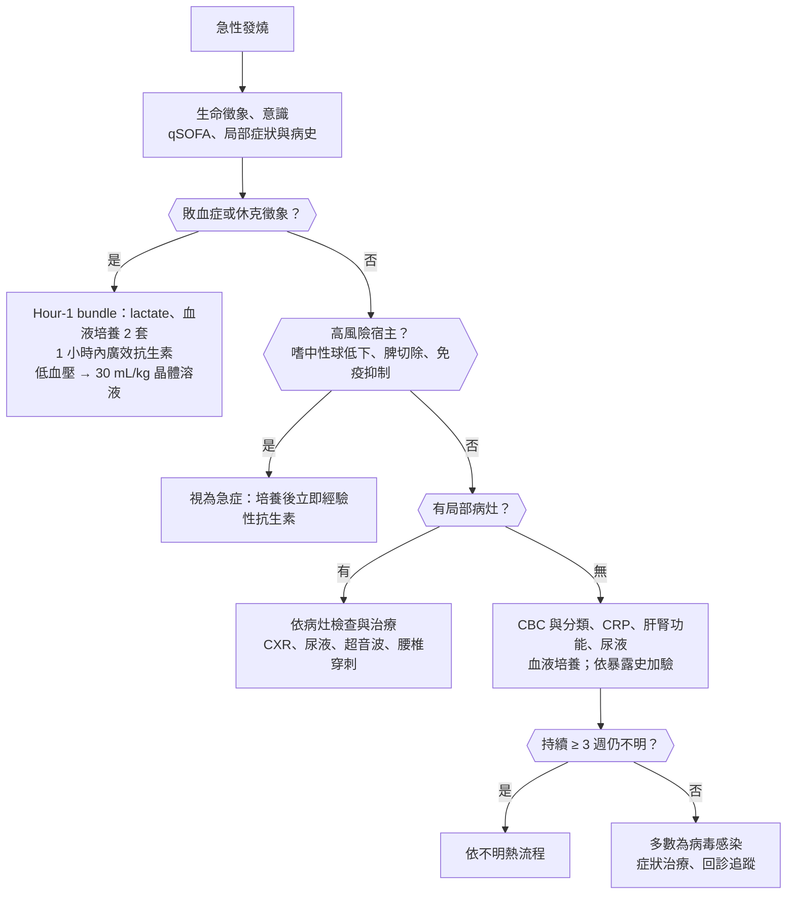
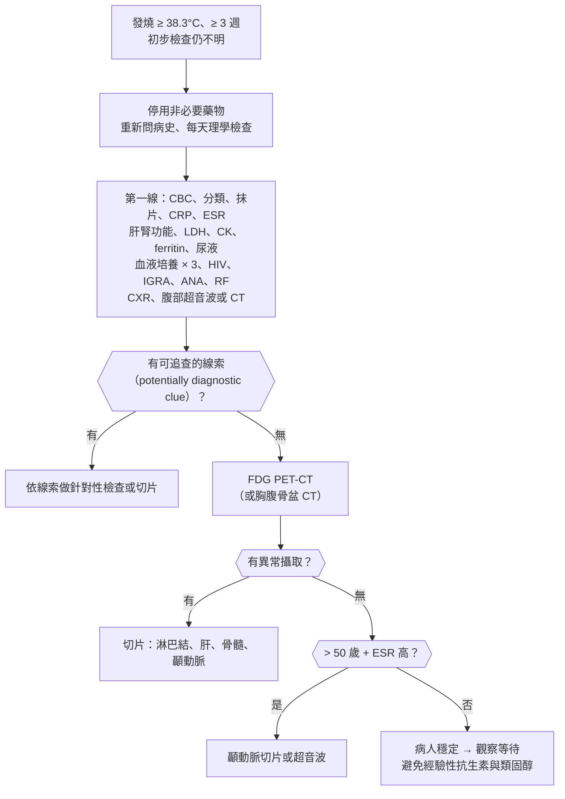
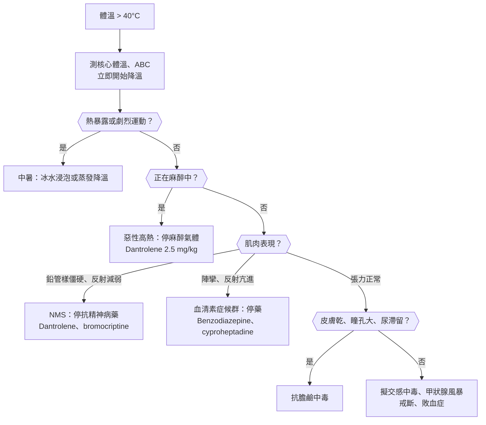
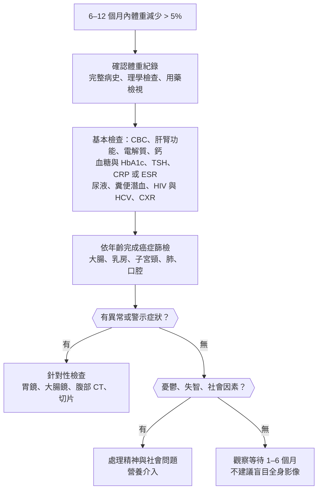
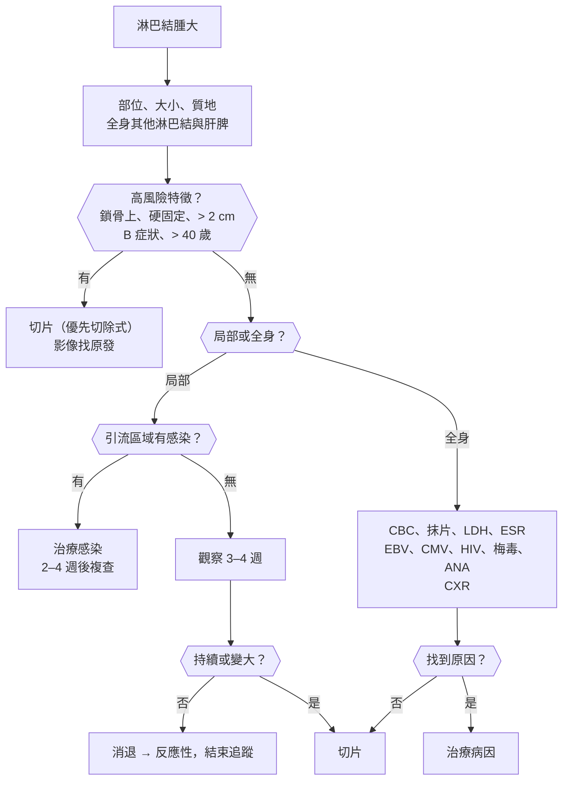

## 發燒（Fever）

### 急性發燒（Acute Fever）

#### 定義與分類

- **發燒（fever）**：下視丘體溫設定點上調；核心體溫 **:red[≥ 38.3°C 單次]或 ≥ 38.0°C 持續 1 小時**。
    - 機制：外源性致熱原（LPS 等）→ 巨噬細胞釋放 **IL-1、IL-6、TNF-α** → 下視丘 **PGE₂↑** → 設定點上調。
    - 測量部位：肛溫、耳溫最接近核心體溫；口溫約低 0.5°C、腋溫約低 1°C。
- **高體溫（hyperthermia）**：設定點**不變**，產熱過多或散熱不足（中暑、藥物）→ **退燒藥無效**，要物理降溫；見[[#高體溫症候群（Hyperthermia Syndromes）|高體溫症候群]]。
- 熱型（fever pattern）：
    - **持續熱（continuous）**：一天內波動 < 1°C → 傷寒（typhoid fever）、大葉性肺炎。
    - **弛張熱（remittent）**：波動 > 1°C、不降到正常 → 多數感染、膿瘍。
    - **間歇熱（intermittent）**：一天內有降到正常 → 瘧疾、膿瘍、敗血症、淋巴瘤。
    - **日發熱（quotidian）**：每天一次高峰 → [[免疫風濕科#成人 Still's Disease（Adult-Onset Still's Disease, AOSD）|成人 Still's disease]]（每天傍晚高燒、退燒時疹子消失）。
    - **週期熱**：三日瘧（*P. malariae*，每 72 小時）、間日瘧（*P. vivax*／*P. ovale*，每 48 小時）；**Pel-Ebstein fever**（數天到數週交替）→ [[血液腫瘤科#Hodgkin Lymphoma（HL）|Hodgkin lymphoma]]。
- **相對心搏過緩（relative bradycardia, Faget sign）**：體溫每升 1°C 心跳應增加約 10 次；高燒卻心跳不快 → **傷寒**、Legionella、鸚鵡熱（psittacosis）、Q fever、**藥物熱**、病人正在使用 β 阻斷劑。

#### Red flags

- **敗血症（sepsis）徵象**：意識改變（altered mental status）、低血壓、呼吸急促、皮膚花斑（mottling）、尿量減少；**qSOFA ≥ 2 項**（:red[RR ≥ 22/min、SBP ≤ 100 mmHg]、意識改變）。
- **嗜中性球低下**（化療後、免疫抑制）→ 見[[#嗜中性球低下發燒（Febrile Neutropenia）|嗜中性球低下發燒]]。
- **頸部僵硬（neck stiffness）、頭痛、意識改變** → [[神經內科#細菌性腦膜炎|細菌性腦膜炎]]。
- **瘀點／紫斑（petechiae / purpura）**：腦膜炎雙球菌血症、DIC、立克次體病、[[血液腫瘤科#血栓性血小板低下紫斑症（Thrombotic Thrombocytopenic Purpura, TTP）|TTP]]。
- **脾臟切除後（asplenia）**：莢膜菌（*S. pneumoniae*、*H. influenzae*、*N. meningitidis*）→ 猛爆性敗血症（OPSI）。
- 新出現的心雜音 + 栓塞徵象 → [[心臟內科#感染性心內膜炎（Infective Endocarditis, IE）|感染性心內膜炎]]。
- 旅遊史（瘧疾流行區）、劇烈腹痛、[[皮膚科#壞死性筋膜炎（Necrotizing Fasciitis）|壞死性筋膜炎]]（皮膚疼痛遠超過外觀）、體溫 > 41°C。
- 老人、糖尿病、類固醇使用者：**可能不發燒**，只表現意識改變、跌倒、食慾差。

#### 鑑別診斷

| 類別 | 疾病 | 鑑別關鍵 |
|---|---|---|
| **呼吸道** | 上呼吸道感染、[[耳鼻喉科#鼻竇炎（Rhinosinusitis）\|鼻竇炎]]、流感、[[胸腔內科#社區型肺炎（CAP）\|肺炎]]、[[感染科#Mycobacterium tuberculosis（結核病）\|結核]]、[[胸腔內科#肺膿瘍（Lung Abscess）\|肺膿瘍]] | 咳嗽、痰、呼吸音；流感季節、群聚 |
| **泌尿道** | [[腎臟內科#泌尿道感染（UTI）與腎盂腎炎\|腎盂腎炎]]、[[泌尿科#前列腺炎（Prostatitis）\|前列腺炎]]、[[泌尿科#腎膿瘍（Renal / Perinephric Abscess）\|腎膿瘍]] | 肋脊角叩痛（CVA knocking pain）、膿尿；男性 → 肛診看攝護腺壓痛 |
| **腹部** | [[肝膽胰外科#急性膽管炎（Acute Cholangitis）\|膽管炎]]、[[肝膽胰外科#細菌性肝膿瘍（Pyogenic Liver Abscess）\|肝膿瘍]]、[[大腸直腸外科#闌尾炎（Appendicitis）\|闌尾炎]]、[[大腸直腸外科#憩室炎（Diverticulitis）\|憩室炎]]、[[肝膽胰外科#自發性細菌性腹膜炎（SBP）\|自發性細菌性腹膜炎]]（SBP）、*[[感染科#C. difficile（Pseudomembranous colitis，偽膜性大腸炎）\|C. difficile]]* 腸炎 | 黃疸 + 右上腹痛 + 發燒（Charcot triad）；**台灣糖尿病人 → Klebsiella 肝膿瘍** |
| **皮膚軟組織** | [[皮膚科#蜂窩性組織炎（Cellulitis）與丹毒（Erysipelas）\|蜂窩性組織炎]]（cellulitis）、**壞死性筋膜炎（necrotizing fasciitis）**、褥瘡感染、[[大腸直腸外科#肛門膿瘍（Perianal/Anorectal Abscess）\|肛門膿瘍]] | 疼痛不成比例、捻髮音、皮膚變色 → 緊急清創 |
| **中樞神經** | 細菌性腦膜炎、腦炎、[[神經內科#腦膿瘍（Brain Abscess）\|腦膿瘍]] | 頸部僵硬、意識改變、局部神經學缺損 |
| **心血管** | 感染性心內膜炎、導管相關血流感染（CRBSI） | 新雜音、人工瓣膜、靜脈藥癮、中心靜脈導管 |
| **骨關節** | [[骨科#化膿性關節炎（Septic Arthritis）\|化膿性關節炎]]、[[骨科#急性骨髓炎（Acute Osteomyelitis）\|骨髓炎]]、[[神經外科#脊椎硬膜外膿瘍（Spinal Epidural Abscess）\|脊椎硬膜外膿瘍]] | 單一關節紅腫熱痛；背痛 + 發燒 + 神經學缺損 |
| **病毒與地方性感染** | [[感染科#EBV（Infectious Mononucleosis）\|EBV]]、[[感染科#CMV\|CMV]]、急性 [[感染科#HIV / AIDS\|HIV]]、[[感染科#登革熱（Dengue）\|登革熱]]、[[感染科#Rickettsia & related\|恙蟲病]]、[[感染科#Leptospira interrogans（鉤端螺旋體病）\|鉤端螺旋體病]] | 見[[#旅遊後發燒（Fever in Returned Travelers）\|旅遊後發燒]] |
| **非感染：發炎** | [[免疫風濕科#全身性紅斑狼瘡（SLE）\|SLE]]、成人 Still's disease、[[免疫風濕科#血管炎（Vasculitis）\|血管炎]]、痛風發作、[[消化內科#急性胰臟炎（Acute Pancreatitis）\|胰臟炎]]、[[消化內科#發炎性腸道疾病（Inflammatory Bowel Disease, IBD）\|IBD]] | 多器官、皮疹、關節痛 |
| **非感染：血栓與組織損傷** | [[胸腔內科#肺栓塞（Pulmonary Embolism）\|肺栓塞]]、[[心血管外科#深部靜脈栓塞（DVT）\|DVT]]、血腫吸收、心肌梗塞後、術後 48 小時內 | 低度燒（通常 < 38.5°C） |
| **非感染：內分泌與藥物** | [[代謝內分泌科#甲狀腺風暴（Thyroid Storm）\|甲狀腺風暴]]、[[代謝內分泌科#腎上腺功能不全（Adrenal Insufficiency）\|腎上腺危象]]、**藥物熱**、[[血液腫瘤科#輸血反應\|輸血反應]]、[[精神科#酒精戒斷（Alcohol Withdrawal）\|酒精戒斷]] | 心跳過快不成比例；新藥 7–10 天後發燒 |
| **腫瘤** | [[血液腫瘤科#Hodgkin Lymphoma（HL）\|淋巴瘤]]、[[血液腫瘤科#急性白血病（Acute Leukemia）\|白血病]]、[[泌尿科#腎細胞癌（Renal Cell Carcinoma, RCC）\|腎細胞癌]]、[[肝膽胰外科#肝細胞癌（Hepatocellular Carcinoma, HCC）\|肝癌]]、腫瘤溶解 | 體重減輕、盜汗、淋巴結腫大 |

#### 易混淆鑑別

:::compare[感染 vs 非感染性發燒]
| | 細菌感染 | 病毒感染 | 非感染性發炎（自體免疫、腫瘤） | 藥物熱 |
|---|---|---|---|---|
| 病程 | 急性、有局部病灶 | 急性、自限（多 < 7 天） | 亞急性到慢性 | 用藥後 **7–10 天**出現 |
| 病人外觀 | 可很不舒服（toxic） | 不一定 | 慢性病容 | **外觀相對良好**（與體溫不相稱） |
| 白血球 | **↑、左移（left shift）** | 正常或↓、淋巴球↑ | 正常或↑ | 正常，可有**嗜酸性球增加** |
| CRP / PCT | **PCT 明顯上升** | PCT 正常 | CRP↑，**PCT 多正常** | PCT 正常 |
| 其他線索 | 培養陽性 | 肝指數輕度上升、非典型淋巴球 | 自體抗體、ferritin↑ | **相對心搏過緩**、皮疹；停藥 **:red[48–72 小時]內退燒** |
:::

:::compare[發燒合併皮疹]
| 皮疹 | 代表疾病 | 關鍵 |
|---|---|---|
| **瘀點、紫斑** | 腦膜炎雙球菌血症、[[感染科#Rickettsia & related\|Rocky Mountain spotted fever]]、登革熱、感染性心內膜炎、DIC | **緊急**；先給抗生素再做腰椎穿刺 |
| 斑丘疹（maculopapular） | [[感染科#麻疹（Measles）\|麻疹]]、[[感染科#德國麻疹（Rubella）\|德國麻疹]]、急性 HIV、[[感染科#Treponema pallidum（Syphilis，梅毒）\|二期梅毒]]（**含手掌腳底**）、**藥物疹**、登革熱（white islands in a sea of red） | 疫苗史、性行為、新藥 |
| 水泡 | 水痘、帶狀疱疹、手足口病 | 不同時期病灶並存 → 水痘 |
| 瀰漫性紅疹 + 脫皮 | **中毒性休克症候群（TSS）**、猩紅熱、[[小兒科#川崎病（Kawasaki Disease）\|川崎病]]、[[皮膚科#葡萄球菌燙傷樣皮膚症候群（SSSS, Staphylococcal Scalded Skin Syndrome）\|SSSS]] | 低血壓 + 多器官 → TSS |
| 焦痂（eschar） | **恙蟲病** | 腋下、鼠蹊、腰帶處等隱密部位要找 |
| 鮭魚色、隨發燒出現 | 成人 Still's disease | 退燒時消失、Koebner 現象 |
| 嚴重皮疹 + 嗜酸性球 + 肝炎 | [[皮膚科#Drug Reaction with Eosinophilia and Systemic Symptoms（DRESS）\|DRESS]] | 用藥後 **2–8 週**、臉部水腫、淋巴結腫大 |
| 環狀紅斑、靶形 | [[皮膚科#多形性紅斑（Erythema Multiforme, EM）\|多形性紅斑]]（HSV、黴漿菌）、萊姆病（erythema migrans） | |
:::

:::compare[發炎指標的解讀]
| | CRP | Procalcitonin（PCT） | ESR | Ferritin |
|---|---|---|---|---|
| 反應速度 | 6–8 小時上升、48 小時高峰 | **2–4 小時**上升、6–24 小時高峰 | 慢（數天），恢復也慢 | 急性期反應物 |
| 主要用途 | 發炎有無、追蹤治療 | **區分細菌與非細菌**、決定停抗生素時機 | 慢性發炎（[[神經內科#顳動脈炎（Giant Cell Arteritis, GCA）\|GCA]]、[[免疫風濕科#風濕性多肌痛（Polymyalgia Rheumatica, PMR）\|PMR]]、骨髓炎） | **> :red[1000–10,000]** → Still's、[[免疫風濕科#Macrophage Activation Syndrome / Hemophagocytic Lymphohistiocytosis（MAS / HLH）\|HLH]] |
| 偽陽性 | 任何組織損傷 | 手術、外傷、燒傷、心因性休克、甲狀腺髓質癌 | 貧血、懷孕、老化、高球蛋白（[[血液腫瘤科#多發性骨髓瘤（Multiple Myeloma）\|多發性骨髓瘤]]） | 肝病、鐵過多 |
:::

#### 問診與理學檢查

- 時間：發燒多久、熱型、最高溫、有無畏寒（chills）或**寒顫（rigors，菌血症指標）**。
- 定位症狀逐系統問：咳嗽、頻尿、腹痛、腹瀉、頭痛、關節痛、皮疹、傷口。
- **暴露史**：
    - 旅遊、接觸動物、職業、野外活動（恙蟲病、鉤端螺旋體病）。
    - 生食、疫區、性行為、靜脈藥癮、生病接觸者。
- 宿主因素：**糖尿病、[[消化內科#肝硬化（Liver Cirrhosis）|肝硬化]]、洗腎、免疫抑制（類固醇、化療、生物製劑）、HIV、脾臟切除**。
- 留置物：中心靜脈導管、尿管、人工瓣膜、人工關節、心律調節器。
- 用藥史：新藥（藥物熱、DRESS）、抗精神病藥、血清素藥物。
- 理學檢查重點：
    - 生命徵象、意識、**皮膚**（瘀點、焦痂、傷口、注射痕跡）、口咽、**淋巴結**、頸部僵硬。
    - 心雜音、肺部、腹部壓痛、**肋脊角叩痛**、關節、**導管出入口**、會陰與肛門（老人、臥床者的褥瘡）。
    - 指甲下片狀出血（splinter hemorrhage）、Janeway lesion、Osler node、Roth spot → 心內膜炎。

#### 檢查流程

- **血液培養**：抗生素**之前**、兩個不同部位各一套（每套需氧 + 厭氧），每瓶成人 8–10 mL；有中心靜脈導管 → 導管與周邊各一套。
    - 只長一瓶 CoNS、*Corynebacterium*、*Bacillus* → 多為污染；*S. aureus*、*Candida* **一定不是污染**。
- 依病灶：CXR、尿液分析與培養、腹部超音波或 CT、腰椎穿刺（有局部神經學缺損、意識改變、免疫低下 → **先做頭部 CT**）。

#### 初步處置

- **退燒藥**：Acetaminophen（首選）、NSAIDs；退燒是為了舒適，**不會改變感染預後**，也**不能用退燒反應判斷是細菌或病毒**。
    - 懷疑**登革熱** → **避免 NSAIDs 與 aspirin**（出血、血小板低下）；兒童病毒感染避免 aspirin（Reye syndrome）。
- 敗血症：**1 小時內**給廣效抗生素、輸液，MAP < 65 mmHg → **Norepinephrine 首選**；詳見[[感染科#菌血症與敗血症|菌血症與敗血症]]。
- 抗生素依可能病灶選擇；找到病原後**降階（de-escalation）**。
- 不要在沒有細菌感染證據時「保險起見」給抗生素：會掩蓋診斷、造成抗藥性與 *C. difficile*。

:::pitfall
老人、糖尿病、肝硬化、長期類固醇或洗腎病人感染時可能**不發燒、白血球正常**，只表現意識改變、跌倒、食慾差或血糖失控。這類病人沒發燒不能排除敗血症，要看呼吸速率、血壓、乳酸與意識。
:::

:::pitfall
懷疑細菌性腦膜炎時，為了等頭部 CT 或腰椎穿刺而延後抗生素 → 預後變差。正確順序：血液培養 → **立即給 dexamethasone 與經驗性抗生素** → 再做 CT 與腰椎穿刺；抗生素開始後幾小時內腦脊髓液的細胞數與生化仍有診斷價值。
:::

:::exam
- 高燒但心跳相對慢 → 想到傷寒、Legionella、Q fever、藥物熱。
- 發燒 + 新雜音 + 靜脈藥癮 → 右側（三尖瓣）心內膜炎，*S. aureus*。
- 台灣糖尿病人發燒 + 肝膿瘍 → *Klebsiella pneumoniae*，注意轉移性眼內炎（endophthalmitis）與腦膜炎。
:::

### 不明熱（Fever of Unknown Origin, FUO）

#### 定義與分類

- **經典定義（Petersdorf，Durack 修訂）**：
    - 體溫 **:red[≥ 38.3°C]、多次測量**。
    - 持續 **:red[≥ 3 週]**。
    - 經過**住院 3 天或門診 3 次**（或 1 週的合理檢查）仍無法診斷。
- 四種類型：

| 類型 | 定義 | 常見原因 |
|---|---|---|
| **經典型（classic）** | 如上 | 感染、腫瘤、非感染性發炎 |
| **院內型（nosocomial）** | 住院時沒有發燒、住院後發燒，檢查 3 天仍不明 | *[[感染科#C. difficile（Pseudomembranous colitis，偽膜性大腸炎）\|C. difficile]]*、**藥物熱**、[[耳鼻喉科#鼻竇炎（Rhinosinusitis）\|鼻竇炎]]（鼻胃管）、導管感染、**[[胸腔內科#肺栓塞（Pulmonary Embolism）\|肺栓塞]]**、無結石膽囊炎 |
| **嗜中性球低下型** | ANC < 500，檢查 3 天仍不明 | **侵襲性黴菌**（Aspergillus、Candida）、肛周感染 |
| **HIV 相關** | HIV 病人門診 > 4 週或住院 > 3 天 | **MAC**、TB、[[感染科#CMV\|CMV]]、[[感染科#Pneumocystis jirovecii（PJP）\|PJP]]、隱球菌、淋巴瘤 |

- 經典型 FUO 的原因（四大類）：
    - **感染**：**結核（尤其肺外、粟粒性）**、心內膜炎（培養陰性）、**腹內與骨盆腔膿瘍**、骨髓炎、CMV、[[感染科#EBV（Infectious Mononucleosis）|EBV]]、HIV、Q fever、布氏桿菌（brucellosis）、傷寒。
    - **腫瘤**：**淋巴瘤（最常見）**、白血病、[[血液腫瘤科#骨髓分化不良症候群（Myelodysplastic Syndromes, MDS）|MDS]]、**腎細胞癌**、肝癌、轉移性腫瘤、心房黏液瘤（atrial myxoma）。
    - **非感染性發炎疾病（NIID）**：**成人 Still's disease（年輕人）**、**[[神經內科#顳動脈炎（Giant Cell Arteritis, GCA）|巨細胞動脈炎（GCA）]] 與 [[免疫風濕科#風濕性多肌痛（Polymyalgia Rheumatica, PMR）|風濕性多肌痛]]（老人）**、SLE、[[免疫風濕科#中血管炎（Medium-vessel Vasculitis）|結節性多動脈炎]]、[[免疫風濕科#Sarcoidosis（類肉瘤病）|類肉瘤病]]、IBD、Kikuchi disease。
    - **其他**：**藥物熱**、[[心血管外科#深部靜脈栓塞（DVT）|DVT]] 與肺栓塞、[[代謝內分泌科#Subacute（de Quervain's）Thyroiditis|亞急性甲狀腺炎]]、詐病（factitious fever）、週期熱症候群（FMF）、血腫、肝硬化。
    - **約 :red[20–50%] 最後仍找不到原因**；找不到原因者**多數預後良好**，常自行緩解。

#### Red flags

- 體重減輕、盜汗（B 症狀）、淋巴結或肝脾腫大 → 淋巴瘤、結核。
- 老人 + 新頭痛、顳動脈壓痛、**下顎跛行（jaw claudication）**、視力模糊 → **GCA，可致失明，立即類固醇**。
- 血球低下、肝功能異常、**ferritin 極高**、三酸甘油酯↑、纖維蛋白原↓ → [[免疫風濕科#Macrophage Activation Syndrome / Hemophagocytic Lymphohistiocytosis（MAS / HLH）|噬血症候群（HLH）]]。
- 新雜音、栓塞現象 → 培養陰性心內膜炎（HACEK、Coxiella、Bartonella）。
- 免疫低下、嗜中性球低下 → 侵襲性黴菌，不能等待觀察。

#### 鑑別診斷

| 類別 | 疾病 | 鑑別關鍵 |
|---|---|---|
| **感染** | **[[感染科#肺外結核\|肺外結核]]**、培養陰性心內膜炎、膿瘍（肝、脾、腎周、骨盆、**腰大肌**）、骨髓炎、牙周膿瘍、鼻竇炎、[[泌尿科#前列腺炎（Prostatitis）\|前列腺炎]] | 結核：IGRA 可陰性 → **組織切片**（肝、骨髓、淋巴結）+ 培養 |
| | 病毒（CMV、EBV、HIV）、Q fever、布氏桿菌、[[感染科#Rickettsia & related\|立克次體]]、[[感染科#Toxoplasma gondii\|弓漿蟲]]、組織漿菌、瘧疾、內臟利什曼原蟲（kala-azar） | 動物接觸（羊、未消毒乳品）、旅遊史 |
| **腫瘤** | **淋巴瘤**、白血病、MDS、[[血液腫瘤科#多發性骨髓瘤（Multiple Myeloma）\|多發性骨髓瘤]]（少見）、**腎細胞癌**、肝癌、[[胃小腸外科#胃癌（Gastric Cancer）\|胃癌]]、[[大腸直腸外科#大腸直腸癌（Colorectal Cancer, CRC）\|大腸癌]]、[[肝膽胰外科#胰臟導管腺癌（Pancreatic Ductal Adenocarcinoma, PDAC）\|胰臟癌]]、心房黏液瘤 | **Naprosyn test**：腫瘤熱對 naproxen 反應明顯（非特異） |
| **非感染性發炎** | 成人 Still's、GCA／PMR、[[免疫風濕科#全身性紅斑狼瘡（SLE）\|SLE]]、血管炎、類肉瘤病、[[消化內科#發炎性腸道疾病（Inflammatory Bowel Disease, IBD）\|IBD（Crohn）]]、Kikuchi disease、[[免疫風濕科#Behçet's Disease\|Behçet]] | 自體抗體、ESR 極高、組織切片 |
| **其他** | 藥物熱、肺栓塞、亞急性甲狀腺炎、[[代謝內分泌科#腎上腺功能不全（Adrenal Insufficiency）\|腎上腺功能不全]]、詐病、週期熱、中樞性發燒（腦傷後） | 停藥試驗；詐病：體溫與心跳不相稱、無日夜變化 |

#### 易混淆鑑別

:::compare[依年齡想原因]
| | 年輕成人 | 中年 | 老人（> 65 歲） |
|---|---|---|---|
| 感染 | EBV、CMV、急性 HIV、結核 | 結核、心內膜炎、膿瘍 | **結核、膿瘍、心內膜炎** |
| 腫瘤 | 淋巴瘤 | 淋巴瘤、腎細胞癌、肝癌 | **淋巴瘤、實體腫瘤（大腸、胃）、MDS** |
| 發炎 | **成人 Still's**、SLE、Kikuchi | 類肉瘤病、血管炎 | **GCA / PMR（老人 FUO 最常見的發炎原因）** |
:::

:::compare[成人 Still's disease、HLH、淋巴瘤]
| | 成人 Still's disease | 噬血症候群（HLH） | 淋巴瘤 |
|---|---|---|---|
| 發燒 | **每天一次高峰（quotidian）、≥ 39°C** | 持續高燒 | 不規則、Pel-Ebstein、B 症狀 |
| 皮疹 | **鮭魚色、隨發燒出現** | 不定 | 搔癢（Hodgkin） |
| 血球 | **白血球↑（> 10,000，嗜中性球 > 80%）** | **全血球低下（≥ 2 系）** | 不定 |
| Ferritin | **極高**；**糖化 ferritin < 20%** 較特異 | **極高（> 10,000 強烈懷疑）** | 可上升 |
| 其他 | 關節炎、喉嚨痛、**RF 與 ANA 陰性** | **TG↑、纖維蛋白原↓**、肝脾腫大、骨髓見噬血現象、sIL-2R↑ | **淋巴結切片確診** |
| 關係 | 診斷前要**排除感染與淋巴瘤**（排除性診斷，Yamaguchi criteria） | 可由感染（EBV）、淋巴瘤、Still's（MAS）誘發 | 可誘發 HLH |
:::

:::compare[GCA vs PMR]
| | 巨細胞動脈炎（GCA） | 風濕性多肌痛（PMR） |
|---|---|---|
| 年齡 | **> 50 歲** | **> 50 歲** |
| 症狀 | **新頭痛、顳動脈壓痛、下顎跛行、視力喪失**、FUO | **肩頸與骨盆帶疼痛與晨僵**、無力感不明顯 |
| 共病 | 約 **50%** 合併 PMR | 約 15–20% 合併 GCA |
| ESR / CRP | 極高（ESR 常 > 50–100） | 高 |
| 確診 | **顳動脈切片**、顳動脈超音波（halo sign） | 臨床診斷 |
| 類固醇劑量 | **高劑量（prednisolone 40–60 mg/d）；視力症狀 → IV pulse**，**不等切片** | **低劑量（12.5–25 mg/d）**，反應極快 |
:::

#### 問診與理學檢查

- **病史要反覆重問**：旅遊、動物（貓 → Bartonella；羊 → Q fever、布氏桿菌）、職業、性行為、輸血、家族史（週期熱）、所有用藥（含中草藥、保健食品）。
- **體溫要在醫護人員見證下測量**：排除詐病、確認熱型；同時測心跳。
- 理學檢查**每天重做**：新出現的雜音、皮疹、淋巴結、肝脾腫大、顳動脈、甲狀腺壓痛、牙齒與鼻竇、睪丸與攝護腺、指甲、眼底（Roth spot、脈絡膜結核結節）。

#### 檢查流程

- **FDG PET-CT**：目前 FUO 第二線的首選影像，找到病灶的機率高，並能指引切片位置。
- **骨髓切片**：血球低下時價值高（淋巴瘤、白血病、MDS、結核、HLH、利什曼原蟲）。
- 肝切片：肝指數（尤其 ALP）上升 → 肉芽腫性肝炎（結核、類肉瘤病、Q fever）。
- 心臟超音波：懷疑心內膜炎、心房黏液瘤。

#### 初步處置

- 病人穩定時，**不要經驗性給抗生素或類固醇**：會讓培養與切片失準、掩蓋淋巴瘤（類固醇使淋巴瘤暫時消退）。
- 例外，要立即經驗性治療：
    - **疑似 GCA**（視力威脅）→ 立即高劑量類固醇，切片在 2 週內做仍有診斷價值。
    - 嗜中性球低下、敗血症、疑似粟粒性結核且病況惡化、疑似培養陰性心內膜炎合併併發症。
- 找不到原因而病人穩定 → 定期追蹤；多數在數週到數月內自行緩解。

:::pitfall
FUO 病人在診斷前給類固醇「試試看」→ 淋巴瘤暫時縮小、切片看不到典型病理；結核惡化成播散性。類固醇只在 GCA 等有明確證據、或排除感染與淋巴瘤後才給。
:::

:::exam
- FUO 三大類：感染（結核最重要）、腫瘤（淋巴瘤最常見）、非感染性發炎（老人 GCA、年輕人 Still's）。
- 成人 Still's：quotidian fever + 鮭魚色皮疹 + 關節炎 + 白血球升高 + ferritin 極高，RF、ANA 陰性。
- 腫瘤熱常見於淋巴瘤、腎細胞癌、肝癌；腎細胞癌三主徵是血尿、腰痛、腹部腫塊（同時出現 < 10%）。
:::

### 嗜中性球低下發燒（Febrile Neutropenia）

#### 定義與分類

- **定義**：
    - **ANC :red[< 500/μL]**，或預期 48 小時內會降到 < 500。
    - 加上體溫**單次 ≥ 38.3°C，或 ≥ 38.0°C 持續 1 小時**。
- **腫瘤急症**：化療後嗜中性球最低點（nadir）通常在**第 :red[7–14 天]**；感染進展極快，**發炎反應不明顯**（沒有膿、肺炎在 X 光上看不出浸潤）。
- 常見病原：
    - **革蘭氏陰性菌**：*[[感染科#Pseudomonas aeruginosa|Pseudomonas aeruginosa]]*、*E. coli*、*Klebsiella* → **死亡率高，經驗性抗生素一定要涵蓋**。
    - **革蘭氏陽性菌**（目前分離最多）：CoNS（導管）、*S. aureus*、viridans streptococci（黏膜炎）。
    - **黴菌**：嗜中性球低下 > 7 天 → *[[感染科#Candida|Candida]]*、*[[感染科#Aspergillus|Aspergillus]]*。
- 感染來源：皮膚軟組織與導管、肺、消化道（黏膜炎、**嗜中性球低下性腸炎 neutropenic enterocolitis／typhlitis**）、肛周。

#### Red flags

- 低血壓、意識改變、呼吸衰竭、乳酸上升 → 敗血性休克。
- **右下腹痛 + 腹瀉 + 發燒** → 嗜中性球低下性腸炎（盲腸壁增厚，CT 診斷）。
- 導管出入口紅腫或沿隧道蜂窩性組織炎、嚴重黏膜炎。
- 肺部浸潤、**鼻竇疼痛或上顎黑色焦痂（[[感染科#Mucormycosis|毛黴菌]] mucormycosis）**、皮膚結節（侵襲性黴菌）。

#### 鑑別診斷

| 來源 | 疾病 | 鑑別關鍵 |
|---|---|---|
| **血流與導管** | 導管相關血流感染、菌血症 | 導管與周邊血液培養的陽性時間差 > 2 小時 → 導管感染 |
| **肺** | 細菌性肺炎、**侵襲性麴菌症**、[[感染科#Pneumocystis jirovecii（PJP）\|PJP]]、病毒 | 胸部 CT：**halo sign**（麴菌早期）、air crescent sign（恢復期） |
| **消化道** | 黏膜炎、嗜中性球低下性腸炎、*[[感染科#C. difficile（Pseudomembranous colitis，偽膜性大腸炎）\|C. difficile]]*、肛周膿瘍 | **禁止肛診與肛溫** |
| **皮膚** | 蜂窩性組織炎、**壞疽性臁瘡（ecthyma gangrenosum，Pseudomonas）** | 中心壞死的黑色潰瘍 |
| **鼻竇與中樞** | 侵襲性黴菌鼻竇炎、腦膜炎 | 糖尿病酮酸血症 + 嗜中性球低下 → 毛黴菌 |
| **非感染** | 腫瘤熱、藥物熱、輸血反應、[[血液腫瘤科#Tumor Lysis Syndrome（TLS）\|腫瘤溶解症候群]]、血栓 | 排除感染後才考慮 |

#### 易混淆鑑別

:::compare[低風險 vs 高風險嗜中性球低下發燒]
| | 低風險 | 高風險 |
|---|---|---|
| 評估工具 | **MASCC score :red[≥ 21]** | MASCC < 21 |
| 預期嗜中性球低下時間 | **< 7 天** | **≥ 7 天**、ANC ≤ 100 |
| 典型病人 | 實體腫瘤、門診化療、無共病 | **血液腫瘤（急性白血病誘導化療）、[[血液腫瘤科#造血幹細胞移植（HSCT）\|造血幹細胞移植]]** |
| 臨床狀態 | 生命徵象穩定、能口服 | 低血壓、肺炎、腹痛、神經學變化、肝腎功能異常、新發導管感染 |
| 抗生素 | **口服 ciprofloxacin + amoxicillin-clavulanate**，可門診（須能密切追蹤） | **住院 IV 抗綠膿桿菌 β-lactam** |
:::

:::compare[何時加 Vancomycin、何時加抗黴菌藥]
| | 加 Vancomycin（涵蓋 MRSA） | 加經驗性抗黴菌藥 |
|---|---|---|
| 時機 | **一開始就有適應症才加**，不常規使用 | 廣效抗生素 **:red[4–7 天]**後仍發燒、預期嗜中性球低下 > 7 天 |
| 適應症 | 血行動力學不穩定、**懷疑導管感染**、皮膚軟組織感染、肺炎、MRSA 移生、血液培養長革蘭氏陽性球菌、嚴重黏膜炎 | 胸部 CT 有黴菌型態、galactomannan 或 β-D-glucan 陽性 |
| 停藥 | 48–72 小時培養沒有革蘭氏陽性菌 → 停 | |
| 藥物 | Vancomycin（或 linezolid、daptomycin） | Echinocandin（caspofungin）、liposomal amphotericin B；懷疑麴菌 → **voriconazole** |
:::

#### 問診與理學檢查

- 化療日期與藥物（推估 nadir）、是否使用預防性抗生素或 G-CSF、過去培養結果與抗藥菌移生。
- 理學檢查：**口腔黏膜、導管出入口與隧道、肛周（只看不做肛診）、皮膚、鼻竇、肺部、右下腹**。

#### 檢查流程

::chart{id="febrile-neutropenia"}

- 檢查：CBC 與分類、肝腎功能、乳酸、**血液培養 ≥ 2 套（導管每個管腔 + 周邊）**、尿液分析與培養、CXR；依症狀加痰液、糞便 *C. difficile*、胸部 CT。
- **抗生素不要等檢查結果**：到院 **:red[60 分鐘內]**給第一劑。

#### 初步處置

- **經驗性抗綠膿桿菌 β-lactam 單一藥物**：**Cefepime**、**Piperacillin-tazobactam**、**Meropenem**（產 ESBL 菌移生、嚴重敗血症時）。
- 青黴素過敏：Aztreonam + vancomycin，或依過敏程度選 carbapenem。
- 有適應症才加 vancomycin；培養陽性 → 依藥敏調整；不明熱 4–7 天 → 加抗黴菌藥。
- **G-CSF**：不常規用於已發生的嗜中性球低下發燒；高風險病人（敗血症、ANC < 100、預期長期低下）可考慮。預防性 G-CSF 用於發生率 > 20% 的化療處方。
- 停抗生素：退燒 ≥ 48 小時且 ANC 回升 > 500；培養陰性而臨床穩定者可在退燒後提早停藥。

:::pitfall
嗜中性球低下的病人用直腸溫度計、做肛診或給塞劑 → 黏膜破損、細菌入血。體溫改測耳溫或口溫，肛周只用看的。
:::

:::exam
- 嗜中性球低下發燒第一線：IV cefepime 或 piperacillin-tazobactam（抗綠膿桿菌），1 小時內給。
- 化療後發燒 + 胸部 CT halo sign → 侵襲性麴菌症 → voriconazole。
- 右下腹痛 + 嗜中性球低下 → typhlitis，保守治療（禁食、廣效抗生素涵蓋厭氧菌），穿孔才手術。
:::

### 旅遊後發燒（Fever in Returned Travelers）

#### 定義與分類

- 旅遊回國後發燒：**先排除瘧疾**，再依**潛伏期、去過的地區、暴露活動**縮小範圍。
- 依潛伏期分類：

| 潛伏期 | 疾病 |
|---|---|
| **< :red[10 天]** | **登革熱**（3–14 天，多 4–7 天）、屈公病（chikungunya）、茲卡、立克次體病、流感、[[家庭醫學科#旅行者腹瀉\|旅行者腹瀉]]、鉤端螺旋體病（2–26 天） |
| **10–21 天** | **瘧疾**（*P. falciparum* 多 < 1 個月）、**傷寒**、鉤端螺旋體病、急性 HIV、Q fever、布氏桿菌、[[感染科#日本腦炎（Japanese Encephalitis）\|日本腦炎]] |
| **> 21 天** | **瘧疾（*P. vivax / ovale* 可數月後復發）**、結核、A／B／E 型肝炎、**[[肝膽胰外科#阿米巴性肝膿瘍（Amoebic Liver Abscess）\|阿米巴肝膿瘍]]**、血吸蟲、HIV、內臟利什曼原蟲 |

- 地區：
    - **撒哈拉以南非洲 → 惡性瘧（*P. falciparum*）最重要**。
    - **東南亞 → 登革熱最常見**，其次瘧疾、恙蟲病、傷寒、鉤端螺旋體病。
    - 南亞 → 傷寒（多重抗藥）、登革熱。
- **台灣本土**的重要發燒病：
    - 登革熱：南部（台南、高雄）夏秋季，埃及斑蚊、白線斑蚊。
    - [[感染科#Rickettsia & related|恙蟲病]]：花東、澎湖、金門、離島，草叢活動，恙蟎傳播。
    - [[感染科#Leptospira interrogans（鉤端螺旋體病）|鉤端螺旋體病]]：**颱風、淹水後**，接觸鼠尿污染的水。
    - Q fever：接觸羊、牛。
    - 漢他病毒：鼠類排泄物。

#### Red flags

- **任何**從瘧疾流行區回來的發燒 → 當天做瘧疾抹片；**惡性瘧可在 24 小時內惡化**。
- 嚴重瘧疾：意識改變（腦性瘧疾）、**寄生蟲血症 > 5%**、低血糖、腎衰竭、ARDS、嚴重貧血、黃疸、休克。
- **登革熱警示徵象（warning signs）**：
    - 腹痛或壓痛、持續嘔吐、黏膜出血、嗜睡或躁動、肝腫大 > 2 cm。
    - 體液蓄積（腹水、肋膜積液）。
    - **血比容上升同時血小板快速下降**。
- 出血熱徵象（伊波拉等）：發燒 + 出血 + 21 天內去過疫區 → 隔離、通報。

#### 鑑別診斷

| 疾病 | 暴露與地區 | 臨床特徵 | 確診 | 治療 |
|---|---|---|---|---|
| **[[感染科#Plasmodium（瘧疾）\|瘧疾]]** | 非洲、東南亞、南美；蚊（Anopheles） | 週期性寒顫高燒、**脾腫大、血小板↓**、溶血、黃疸 | **厚薄血片 × 3（間隔 12–24 小時）**、快速抗原 | 嚴重 → **IV artesunate**；非嚴重 → ACT（artemether-lumefantrine）；vivax / ovale 加 **primaquine**（先驗 G6PD） |
| **登革熱** | 東南亞、台灣南部；斑蚊（Aedes） | 高燒、**後眼窩痛**、肌肉骨頭痛（breakbone fever）、皮疹、**白血球與血小板↓** | **NS1 抗原（前 5 天）**、IgM、PCR | 支持療法、輸液；**避免 NSAIDs 與 aspirin** |
| **恙蟲病** | 草叢、離島、花東；恙蟎 | **焦痂**、淋巴結腫大、皮疹、肝指數↑ | IFA 抗體、PCR | **Doxycycline**（孕婦、兒童 → azithromycin） |
| **鉤端螺旋體病** | 淹水、農業、泛舟 | **結膜充血（conjunctival suffusion）**、**小腿肌肉壓痛**、雙相病程 | 抗體（MAT）、PCR | Doxycycline；重症 → **Penicillin G** 或 ceftriaxone |
| **傷寒** | 南亞、不潔飲食 | **階梯式上升的發燒**、相對心搏過緩、**玫瑰疹**、腹痛、便秘或腹瀉、肝脾腫大 | **血液培養**（第一週最高）、骨髓培養（最敏感） | **Ceftriaxone** 或 azithromycin |
| **屈公病** | 東南亞、非洲 | 高燒 + **劇烈、對稱的多關節痛**（可持續數月） | PCR、IgM | 支持療法 |
| **急性 HIV** | 性行為、靜脈藥癮 | 類單核球症、皮疹、口腔潰瘍 | **HIV Ag/Ab combo**、HIV RNA | 抗反轉錄病毒治療 |
| **阿米巴肝膿瘍** | 熱帶，數月後發病 | 發燒 + 右上腹痛，**多為單一、右葉** | 超音波或 CT + 血清抗體 | **Metronidazole** + 腸腔藥物（paromomycin） |

#### 易混淆鑑別

:::compare[登革熱、瘧疾、恙蟲病、鉤端螺旋體病]
| | 登革熱 | 瘧疾 | 恙蟲病 | 鉤端螺旋體病 |
|---|---|---|---|---|
| 特徵表現 | 後眼窩痛、全身痠痛、**退燒時進入危險期** | 週期性寒顫、脾腫大 | **焦痂**、局部淋巴結腫大 | **結膜充血、小腿壓痛** |
| 白血球 | **↓** | 正常或↓ | 正常或↓ | **↑（嗜中性球）** |
| 血小板 | **↓↓** | **↓** | ↓ | ↓ |
| 肝腎 | 肝指數↑ | 溶血、黃疸、腎衰竭（惡性瘧） | 肝指數↑ | **Weil disease：黃疸 + 急性腎損傷 + 出血** |
| 治療 | 支持療法 | Artemisinin 類 | **Doxycycline** | Doxycycline / Penicillin |
:::

:::compare[登革熱的三個病程期]
| | 發燒期（febrile） | 危險期（critical） | 恢復期（recovery） |
|---|---|---|---|
| 時間 | 第 1–3 天 | **退燒前後 24–48 小時**（多第 3–7 天） | 之後 2–3 天 |
| 表現 | 高燒、頭痛、肌肉痛、皮疹 | **血漿滲漏**：腹水、肋膜積液、血比容↑、休克（登革休克症候群）、出血 | 體液回收（注意**輸液過量 → 肺水腫**）、恢復期皮疹（white islands） |
| 重點 | NS1 抗原陽性 | **退燒不代表好轉**，要監測血比容、血小板、尿量 | 停止輸液、觀察心衰竭 |
:::

#### 問診與理學檢查

- 去過的國家與地區（都市或鄉村）、停留時間、**回國日期與發燒日期**（推算潛伏期）。
- 預防：旅遊前疫苗（A 型肝炎、傷寒、黃熱病）、**[[家庭醫學科#瘧疾預防|瘧疾預防藥]]是否按時服用**（預防藥不能完全排除瘧疾）。
- 暴露：蚊蟲叮咬、淡水游泳（血吸蟲、鉤端螺旋體）、動物咬傷、生食、性行為、醫療處置。
- 理學檢查：**焦痂**、皮疹、黃疸、結膜、淋巴結、**肝脾腫大**、小腿壓痛。

#### 檢查流程

- 第一線：CBC 與分類、抹片、肝腎功能、血液培養、尿液、CXR。
- **瘧疾流行區回國 → 立即厚薄血片**；陰性時 12–24 小時後重複，**共 3 次**才排除。
- 依暴露與地區：登革熱 NS1／IgM、恙蟲病與鉤端螺旋體抗體、HIV、肝炎血清學。
- 許多是**法定傳染病**（登革熱、瘧疾、恙蟲病、鉤端螺旋體病、傷寒）→ 依規定通報疾管署；見[[家庭醫學科#傳染病通報|傳染病通報]]。

#### 初步處置

- 嚴重瘧疾 → **IV artesunate**，加護病房；監測血糖（quinine 與瘧疾本身都會低血糖）。
- 登革熱：口服或靜脈輸液維持循環，**不用 NSAIDs、aspirin、肌肉注射**；警示徵象 → 住院。
- 恙蟲病、立克次體、鉤端螺旋體病**懷疑就給 doxycycline**，不等抗體結果（抗體要 1–2 週才上升）。

:::pitfall
登革熱病人退燒了就以為好轉讓他回家 → 正好進入危險期，血漿滲漏造成休克。退燒前後 24–48 小時要追蹤血比容、血小板、血壓與尿量；警示徵象出現就住院。
:::

:::exam
- 東南亞回國、發燒、後眼窩痛、白血球與血小板低 → 登革熱，驗 NS1，避免 NSAIDs。
- 金門或花東草叢活動、發燒、腋下焦痂 → 恙蟲病 → doxycycline。
- 颱風淹水後、發燒、結膜充血、小腿痛、黃疸、腎衰竭 → 鉤端螺旋體病（Weil disease）。
:::

## 體溫異常（Temperature Disorders）

### 高體溫症候群（Hyperthermia Syndromes）

#### 定義與分類

- **高體溫（hyperthermia）**：體溫設定點**正常**，但**產熱過多或散熱失敗** → 體溫可 > 40–41°C；**退燒藥無效**。
- 環境性：
    - **熱衰竭（heat exhaustion）**：核心體溫 **< 40°C**、**意識正常**，疲倦、頭暈、噁心、大量出汗 → 移到陰涼處、補充水分電解質。
    - **中暑（heat stroke）**：**核心體溫 :red[> 40°C] + 中樞神經功能異常**（意識改變、抽搐、昏迷）→ 多器官衰竭、[[血液腫瘤科#DIC（Disseminated Intravascular Coagulation）|DIC]]、橫紋肌溶解。
        - **典型（classic）**：老人、慢性病、熱浪、獨居、用藥（抗膽鹼、利尿劑），**皮膚多乾燥無汗**。
        - **運動型（exertional）**：年輕人、軍人、運動員，**可仍有出汗**，**橫紋肌溶解、急性腎損傷**較常見。
- 藥物與毒物性：
    - [[麻醉科#惡性高熱（Malignant Hyperthermia, MH）|惡性高熱（MH）]]、[[精神科#惡性抗精神病藥症候群（Neuroleptic Malignant Syndrome, NMS）|惡性抗精神病藥症候群（NMS）]]、[[精神科#Serotonin Syndrome（血清素症候群）|血清素症候群]]。
    - 抗膽鹼中毒（anticholinergic toxicity）、擬交感中毒（cocaine、amphetamine、MDMA）、水楊酸中毒（salicylate）。
- 內分泌：[[代謝內分泌科#甲狀腺風暴（Thyroid Storm）|甲狀腺風暴]]、[[代謝內分泌科#嗜鉻細胞瘤（Pheochromocytoma）|嗜鉻細胞瘤危象]]。
- 戒斷：**酒精戒斷譫妄（delirium tremens）**、benzodiazepine 戒斷、**Parkinson 病人突然停用 levodopa**（parkinsonism-hyperpyrexia syndrome，表現類似 NMS）。
- 中樞：下視丘出血或腦幹損傷（中樞性發燒）。

#### Red flags

- 體溫 > 40°C 合併意識改變 → **中暑或藥物性高體溫，每分鐘都在造成器官損傷，先降溫再檢查**。
- **肌肉僵硬** + 高體溫 → NMS、MH、血清素症候群（重症）。
- 橫紋肌溶解（CK↑、茶色尿）、[[腎臟內科#高血鉀（Hyperkalemia，K⁺ > 5.0 mEq/L）|高血鉀]]、DIC、肝衰竭、急性腎損傷。
- 麻醉中 **ETCO₂ 突然上升**（最早徵象）、咬肌僵硬（masseter rigidity）、心搏過速 → MH。

#### 鑑別診斷

| 類別 | 疾病 | 鑑別關鍵 |
|---|---|---|
| **環境** | 熱衰竭、**中暑** | 熱暴露、運動；中暑一定有中樞神經異常 |
| **麻醉** | **惡性高熱** | 吸入性麻醉劑 + **succinylcholine**；**RYR1**（體染色體顯性） |
| **抗精神病藥** | **NMS** | 用藥數天到數週、**鉛管樣僵硬**、反射**減弱**、CK 極高 |
| **血清素藥物** | **血清素症候群** | 加藥後 **24 小時內**、**反射亢進與陣攣（clonus）**、腹瀉 |
| **中毒** | 抗膽鹼（antihistamine、TCA、atropine）、擬交感（cocaine、amphetamine）、水楊酸 | 抗膽鹼 → **皮膚乾**；擬交感 → **大量出汗**；水楊酸 → 耳鳴、呼吸鹼中毒 + 代謝性酸中毒 |
| **內分泌** | 甲狀腺風暴、嗜鉻細胞瘤危象 | 甲狀腺腫、突眼、心房顫動；陣發性高血壓 + 頭痛 + 心悸 + 冒汗 |
| **戒斷** | 酒精戒斷譫妄、停 levodopa | 停酒 **48–96 小時**；Parkinson 病人停藥 |
| **感染** | 敗血症、腦膜炎、腦炎 | 有感染源；**中暑與敗血症常無法立刻區分 → 降溫同時做培養** |

#### 易混淆鑑別

:::compare[NMS、血清素症候群、惡性高熱、抗膽鹼中毒]
| | NMS | 血清素症候群 | 惡性高熱（MH） | 抗膽鹼中毒 |
|---|---|---|---|---|
| 誘因 | **抗精神病藥**（haloperidol 最常見）、停多巴胺藥 | **SSRI + MAOI、tramadol、linezolid、meperidine、triptan** | **吸入性麻醉劑、succinylcholine** | Antihistamine、TCA、atropine、曼陀羅 |
| 發生速度 | **慢：1–3 天**（用藥後數天到數週） | **快：數小時（< :red[24 小時]）** | **極快：麻醉中數分鐘到數小時** | 快 |
| 肌肉 | **鉛管樣僵硬（lead-pipe rigidity）** | **陣攣（clonus）、反射亢進**，下肢比上肢明顯 | **全身僵硬、咬肌僵硬** | 正常 |
| 反射 | **減弱（bradyreflexia）** | **亢進** | 減弱 | 正常 |
| 瞳孔 | 正常 | **放大** | 正常 | **放大**（blind as a bat） |
| 皮膚與腸胃 | 出汗 | **出汗、腹瀉、腸音亢進** | 出汗 | **皮膚乾紅、腸音減少、尿滯留** |
| 檢驗 | **CK 極高**、白血球↑ | CK 可正常 | **ETCO₂↑、高血鉀**、混合性酸中毒、CK↑ | |
| 解藥 | **Dantrolene、bromocriptine**、停藥 | **Cyproheptadine**、benzodiazepine | **Dantrolene :red[2.5 mg/kg] IV**，停麻醉氣體 | **Physostigmine** |
| 消退 | 慢（7–10 天；長效針劑更久） | **24 小時內** | 治療後 | 數小時到數天 |
:::

:::compare[中暑 vs 熱衰竭]
| | 熱衰竭 | 中暑 |
|---|---|---|
| 核心體溫 | **< 40°C** | **> 40°C** |
| 意識 | **正常**（可頭暈、虛弱） | **異常**：混亂、抽搐、昏迷 |
| 出汗 | 大量出汗 | 典型：無汗；運動型：可有汗 |
| 器官損傷 | 無 | 肝衰竭、急性腎損傷、DIC、橫紋肌溶解 |
| 處置 | 陰涼處、口服或靜脈補水 | **立即積極降溫**：冰水浸泡（運動型）、蒸發降溫（典型） |
:::

:::compare[發燒 vs 高體溫]
| | 發燒 | 高體溫 |
|---|---|---|
| 機制 | 細胞激素 → PGE₂ → **設定點上調** | 設定點**正常**，產熱 > 散熱 |
| 體溫 | 多 < 41°C | 可 > 41°C |
| 皮膚 | 發燒上升期畏寒、皮膚冷 | 熱、乾（中暑）或濕（擬交感） |
| 退燒藥 | **有效** | **無效** |
| 治療 | 退燒藥、治療病因 | **物理降溫**、解藥、停藥 |
:::

#### 問診與理學檢查

- 環境與活動、**所有用藥**（抗精神病藥、抗憂鬱藥、新加的藥、藥物交互作用）、毒品、酒精、最近麻醉手術。
- 理學檢查：**核心體溫（肛溫）**、意識、**肌肉張力、反射與陣攣**、瞳孔、**皮膚乾濕**、腸音、膀胱、甲狀腺。

#### 檢查流程

- 檢驗：CBC、電解質、肝腎功能、**CK、尿液肌紅素**、凝血功能（DIC）、血糖、動脈血氣、乳酸、TSH 與 free T4、毒物篩檢、血液培養。

#### 初步處置

- **降溫是第一優先**：
    - 運動型中暑 → **冰水浸泡（cold water immersion）最有效**，目標 **30 分鐘內**降到 < 39°C。
    - 典型中暑 → **蒸發降溫**（噴溫水 + 電扇）、冰袋放頸部腋下鼠蹊。
    - 核心體溫降到 **:red[38.5–39°C] 停止積極降溫**，避免矯枉過正成低體溫。
    - **退燒藥（acetaminophen、NSAIDs）無效**，且可能加重肝腎損傷；dantrolene 對中暑無效。
- 寒顫或躁動 → **benzodiazepine**；避免抗精神病藥（降低癲癇閾值、加重高體溫）。
- 橫紋肌溶解 → 積極輸液、維持尿量；監測高血鉀。
- 藥物性：停用致病藥物，給特異解藥（見上表）。

:::pitfall
NMS 與血清素症候群混淆：兩者都會發燒、意識改變、自主神經不穩。關鍵看**發生速度與神經肌肉表現**：NMS 慢、鉛管樣僵硬、反射減弱；血清素症候群快、陣攣與反射亢進。血清素症候群給 bromocriptine（血清素作用）會惡化。
:::

:::exam
- 精神科病人用 haloperidol 後數天：高燒、鉛管樣僵硬、意識改變、CK 極高 → NMS。
- 憂鬱症病人加 tramadol 或 linezolid 後數小時：躁動、腹瀉、瞳孔放大、下肢陣攣 → 血清素症候群。
- 麻醉中 ETCO₂ 上升 + 心搏過速 + 咬肌僵硬 → 惡性高熱 → dantrolene。
:::

### 低體溫（Hypothermia）

#### 定義與分類

- **核心體溫 :red[< 35°C]**；要用**低溫專用溫度計**或食道、膀胱溫度。

| 分級 | 核心體溫 | 表現 |
|---|---|---|
| **輕度** | **32–35°C** | **顫抖（shivering）**、心搏過速、呼吸急促、意識混亂、構音不清、**冷利尿（cold diuresis）** |
| **中度** | **28–32°C** | **顫抖停止**、意識下降、**心搏過緩**、心房顫動、**Osborn（J）wave** |
| **重度** | **< 28°C** | 昏迷、瞳孔固定放大、反射消失、低血壓、**心室顫動（VF）風險高** |
| 極重度 | < 24°C | 心搏停止（asystole）、看似死亡 |

- 原因：
    - **環境暴露**：寒流、冷水浸泡、山難、獨居老人。
    - **產熱減少**：[[代謝內分泌科#甲狀腺機能低下（Hypothyroidism）|甲狀腺功能低下]]（[[代謝內分泌科#黏液水腫昏迷（Myxedema Coma）|黏液水腫昏迷]]）、[[代謝內分泌科#腎上腺功能不全（Adrenal Insufficiency）|腎上腺功能不全]]、[[代謝內分泌科#腦下垂體功能低下（Hypopituitarism）|腦下垂體功能低下]]、**低血糖**、營養不良。
    - **散熱增加**：酒精（血管擴張）、燒燙傷、剝脫性皮膚炎、大量冷輸液。
    - **體溫調節障礙**：中風、[[神經外科#脊髓損傷（Spinal Cord Injury）|脊髓損傷]]、[[神經內科#Wernicke-Korsakoff Syndrome|Wernicke]]、藥物（鎮靜劑、抗精神病藥）、**敗血症（低體溫是預後差的指標）**。

#### Red flags

- 顫抖停止 → 已進入中度以上。
- 心律不整（心搏過緩、AF、VF）；**粗暴搬動可誘發 VF**。
- 低體溫合併外傷、溺水、**[[腎臟內科#高血鉀（Hyperkalemia，K⁺ > 5.0 mEq/L）|高血鉀]]（> 10–12 mmol/L 表示預後極差）**。
- 不明原因的低體溫 → 想到敗血症、低血糖、甲狀腺與腎上腺功能低下。

#### 鑑別診斷

| 類別 | 疾病 | 鑑別關鍵 |
|---|---|---|
| **環境** | 意外低體溫、冷水浸泡、溺水 | 暴露史 |
| **內分泌** | 黏液水腫昏迷、[[代謝內分泌科#腎上腺危象（Adrenal Crisis）\|腎上腺危象]]、垂體功能低下、**低血糖** | 甲狀腺手術疤痕、皮膚黏液水腫、色素沉著、低血鈉 |
| **感染** | **敗血症**（老人、新生兒） | 有感染源；低體溫比發燒預後差 |
| **中毒** | 酒精、鎮靜安眠藥、鴉片類、一氧化碳 | 瞳孔、呼吸、毒物篩檢 |
| **神經** | 中風、下視丘病變、脊髓損傷、Wernicke encephalopathy | 局部神經學缺損；眼肌麻痺 + 共濟失調 + 意識混亂 |
| **皮膚與營養** | 燒燙傷、剝脫性皮膚炎、[[精神科#神經性厭食症（Anorexia Nervosa, AN）\|神經性厭食症]] | |

#### 易混淆鑑別

:::compare[低體溫的 ECG 變化]
| 核心體溫 | ECG 表現 |
|---|---|
| 輕度（32–35°C） | 竇性心搏過速（顫抖期）、顫抖造成基線干擾 |
| 中度（28–32°C） | **竇性心搏過緩**、PR、QRS、**QT 延長**、**Osborn（J）wave**（QRS 末端的正向凸起，在 V2–V5 最明顯）、**心房顫動** |
| 重度（< 28°C） | 交界性節律、**VF**；< 20°C → **asystole** |
- Osborn wave 也見於[[腎臟內科#高血鈣（Hypercalcemia，Ca²⁺ > 10.5 mg/dL）|高血鈣]]、腦傷、Brugada（不是低體溫專屬）。
:::

#### 問診與理學檢查

- 暴露時間、環境、酒精與藥物、慢性病（甲狀腺、糖尿病、腎上腺）、外傷。
- 理學檢查：核心體溫、意識、**頸動脈脈搏至少摸 :red[60 秒]**（心跳極慢）、凍傷、外傷、甲狀腺。

#### 檢查流程

- 血糖、電解質（**鉀**）、動脈血氣、CBC、凝血功能、CK、乳酸、肝腎功能、TSH 與 free T4、cortisol、酒精與毒物篩檢、血液培養。
- **凝血功能在 37°C 下檢驗會正常**，但病人體內實際凝血功能變差（酵素在低溫下作用慢）。
- 持續心電監測。

#### 初步處置

- **小心搬動**、保持水平，避免誘發 VF；移除濕衣物、隔絕寒冷。
- 依分級回溫：
    - **輕度 → 被動外部回溫（passive external rewarming）**：保暖毯、溫暖環境，靠病人自己產熱。
    - **中度 → 主動外部回溫（active external rewarming）**：加熱毯（forced-air warming）、溫熱靜脈輸液（40–42°C）、加溫加濕氧氣。
    - **重度或心搏停止 → 主動內部回溫（active core rewarming）**：**ECMO 或心肺繞道（首選）**、溫熱腹膜或胸腔灌洗。
- **後降現象（afterdrop）**：回溫時周邊冷血回流 → 核心體溫再下降、心律不整。
- 心搏停止：
    - **「回溫之前不算死亡」（not dead until warm and dead）**：持續 CPR 直到核心體溫 > 32–35°C。
    - **< 30°C**：電擊與藥物效果差；傳統建議電擊最多 3 次、**暫不給 epinephrine 等藥物**，直到 > 30°C；30–35°C 給藥間隔加倍。
- 治療原因：低血糖 → 葡萄糖；懷疑 Wernicke → **thiamine**；黏液水腫 → IV levothyroxine + hydrocortisone；腎上腺 → hydrocortisone；敗血症 → 抗生素。

:::pitfall
用一般體溫計（最低刻度 34–35°C）量不到真正的核心體溫，以為只是輕度低體溫。懷疑低體溫要用低溫專用溫度計或食道、膀胱溫度。
:::

:::exam
- 中度低體溫的特徵：顫抖停止、心搏過緩、Osborn（J）wave。
- 低體溫心搏停止：持續 CPR 與回溫，「not dead until warm and dead」；ECMO 是重度低體溫回溫首選。
:::

## 體重與營養（Weight and Nutrition）

### 非預期體重減輕（Unintentional Weight Loss）

#### 定義與分類

- **非預期體重減輕（unintentional weight loss）**：**:red[6–12 個月內減少 > 5%]** 體重，且不是刻意減重。
    - 老人 1 個月內減少 > 2%、或 3 個月內 > 5% 也需評估。
- 原因（依常見度）：
    - **惡性腫瘤**（約 1/3，**消化道最多**：胃、大腸、胰臟、肝；肺癌、淋巴瘤、攝護腺癌）。
    - **非腫瘤性消化道疾病**：消化性潰瘍、吸收不良、[[消化內科#發炎性腸道疾病（Inflammatory Bowel Disease, IBD）|IBD]]、[[消化內科#慢性胰臟炎（Chronic Pancreatitis）|慢性胰臟炎]]、[[復健科#吞嚥障礙（Dysphagia）|吞嚥困難]]、牙齒問題。
    - **精神疾病**：**鬱症（老人最常見的可逆原因之一）**、焦慮、[[精神科#神經性厭食症（Anorexia Nervosa, AN）|神經性厭食症]]、[[精神科#神經性暴食症（Bulimia Nervosa, BN）|暴食症]]、酒精與物質使用。
    - **內分泌**：[[代謝內分泌科#甲狀腺機能亢進（Hyperthyroidism）|甲狀腺功能亢進]]、[[代謝內分泌科#糖尿病（Diabetes Mellitus）|控制不良的糖尿病]]、腎上腺功能不全、嗜鉻細胞瘤。
    - **慢性感染**：結核、HIV、心內膜炎、寄生蟲、黴菌。
    - **慢性器官衰竭**：[[心臟內科#心衰竭（Heart Failure）|心衰竭（心臟惡病質）]]、[[胸腔內科#慢性阻塞性肺病（COPD）|COPD]]、[[腎臟內科#慢性腎臟病（CKD）|CKD]]、[[消化內科#肝硬化（Liver Cirrhosis）|肝硬化]]。
    - **神經與老年**：失智、Parkinson、中風後吞嚥困難、[[家庭醫學科#肌少症（Sarcopenia）|肌少症]]。
    - **風濕**：RA、SLE、血管炎、PMR。
    - **藥物**：metformin、GLP-1 RA、topiramate、SSRI（初期）、digoxin、levothyroxine 過量、化療、[[家庭醫學科#多重用藥（Polypharmacy）|多重用藥]]。
    - **社會因素**：貧窮、獨居、行動不便、無法自行準備食物。
    - **約 :red[25%] 找不到原因**。
- **老人體重減輕的 9D**：dementia（失智）、depression（憂鬱）、disease（疾病）、dysphagia（吞嚥困難）、dysgeusia（味覺改變）、diarrhea（腹瀉）、drugs（藥物）、dentition（牙齒）、dysfunction（功能障礙）。

#### Red flags

- **年齡 > 50 歲**、吸菸、B 症狀（發燒、盜汗）、淋巴結腫大、腹部腫塊。
- 消化道警示：**吞嚥困難、黑便或血便、[[血液腫瘤科#缺鐵性貧血（Iron Deficiency Anemia, IDA）|缺鐵性貧血]]、排便習慣改變**、持續嘔吐。
- 咳嗽、咳血 → 肺癌、結核。
- **BMI < 18.5**、6 個月內減少 > 10%、低白蛋白、**再餵食症候群（refeeding syndrome）風險**。

#### 鑑別診斷

| 類別 | 疾病 | 鑑別關鍵 |
|---|---|---|
| **腫瘤** | [[胃小腸外科#胃癌（Gastric Cancer）\|胃癌]]、[[大腸直腸外科#大腸直腸癌（Colorectal Cancer, CRC）\|大腸癌]]、[[肝膽胰外科#胰臟導管腺癌（Pancreatic Ductal Adenocarcinoma, PDAC）\|胰臟癌]]、[[肝膽胰外科#肝細胞癌（Hepatocellular Carcinoma, HCC）\|肝癌]]、[[胸腔內科#肺癌（Lung Cancer）\|肺癌]]、[[血液腫瘤科#Non-Hodgkin Lymphoma（NHL）\|淋巴瘤]]、[[泌尿科#攝護腺癌（Prostate Cancer）\|攝護腺癌]]、[[耳鼻喉科#鼻咽癌（Nasopharyngeal Carcinoma, NPC）\|鼻咽癌]] | 年齡、警示症狀、缺鐵性貧血、癌症篩檢紀錄 |
| **消化道** | [[消化內科#消化性潰瘍（Peptic Ulcer Disease, PUD）\|消化性潰瘍]]、[[消化內科#吸收不良（Malabsorption）\|吸收不良]]、[[消化內科#Celiac Disease（乳糜瀉）\|乳糜瀉]]、IBD、慢性胰臟炎、[[消化內科#食道運動障礙\|食道弛緩不能]]、腸系膜缺血（飯後腹痛 → 怕吃） | 脂肪便（steatorrhea）、腹瀉、吞嚥困難、飯後痛 |
| **內分泌** | **甲狀腺功能亢進**、**糖尿病**、[[代謝內分泌科#腎上腺功能不全（Adrenal Insufficiency）\|腎上腺功能不全]]、[[代謝內分泌科#嗜鉻細胞瘤（Pheochromocytoma）\|嗜鉻細胞瘤]]、[[代謝內分泌科#高鈣血症的鑑別與處理\|高血鈣]] | **食慾增加卻變瘦** → 甲亢、糖尿病、吸收不良、嗜鉻細胞瘤 |
| **感染** | [[感染科#Mycobacterium tuberculosis（結核病）\|結核]]、[[感染科#HIV / AIDS\|HIV]]、心內膜炎、腸道寄生蟲 | 發燒、盜汗、咳嗽、高風險行為 |
| **器官衰竭** | 心衰竭、COPD、CKD、肝硬化 | 已知病史；**水腫可掩蓋肌肉流失** |
| **精神** | [[精神科#鬱症（Depressive Disorders）\|鬱症]]、焦慮、厭食症、暴食症、[[精神科#酒精（Alcohol）\|酒精]]、安非他命 | 食慾減退、失眠、興趣喪失；年輕女性 + 身體意象扭曲 → 厭食症 |
| **神經與老年** | [[精神科#失智症（Major Neurocognitive Disorder）\|失智症]]、Parkinson、中風、肌少症 | 吞嚥困難、忘記進食、功能退化 |
| **風濕** | [[免疫風濕科#類風濕性關節炎（Rheumatoid Arthritis, RA）\|RA]]、SLE、血管炎、PMR | 關節痛、ESR↑ |

#### 易混淆鑑別

:::compare[食慾增加 vs 食慾減退的體重減輕]
| | 食慾增加（或正常） | 食慾減退 |
|---|---|---|
| 機制 | 熱量消耗增加或流失 | 攝取減少 |
| 疾病 | **甲狀腺功能亢進**、**控制不良的糖尿病（尿糖流失）**、**吸收不良**（乳糜瀉、胰臟功能不全）、嗜鉻細胞瘤、腸道寄生蟲、劇烈運動 | 腫瘤、鬱症、慢性感染、器官衰竭、腎上腺功能不全、藥物、失智 |
| 首要檢查 | TSH、血糖與 HbA1c、糞便脂肪 | 依年齡與警示症狀做腫瘤評估、憂鬱篩檢 |
:::

:::compare[惡病質、飢餓、肌少症]
| | 惡病質（cachexia） | 飢餓（starvation） | 肌少症（sarcopenia） |
|---|---|---|---|
| 原因 | 慢性疾病（癌症、心衰竭、COPD、CKD）的**發炎反應** | 熱量攝取不足 | 老化、活動量少 |
| 流失 | **肌肉 + 脂肪** | **先脂肪**、後肌肉 | **肌肉為主**，體重可不變 |
| 發炎指標 | **CRP↑**、IL-6、TNF-α | 正常 | 正常或輕度上升 |
| 對營養補充的反應 | **差**（單靠吃無法逆轉） | **好** | 需要阻力運動 + 蛋白質 |
| 癌症惡病質定義 | 6 個月內體重減少 > 5%，或 BMI < 20 且減少 > 2% | | |
:::

:::compare[營養評估的血清蛋白]
| | 白蛋白（albumin） | 前白蛋白（prealbumin，transthyretin） | 運鐵蛋白（transferrin） |
|---|---|---|---|
| 半衰期 | **約 :red[20 天]** | **約 :red[2–3 天]** | 約 8–10 天 |
| 用途 | 長期營養狀態、預後 | **短期營養療效追蹤** | 中期 |
| 限制 | 發炎、肝病、腎病症候群、體液過多都會降低 | 發炎時下降、腎衰竭時上升 | 缺鐵時上升 |
- 這些都是**負性急性期反應物**，發炎時下降，不能單獨作為營養不良的指標。
:::

#### 問診與理學檢查

- **先確認真的有體重減輕**：拿以前的紀錄比較（病人自述不可靠）、確認時間長短與減少多少。
- 食慾、進食量、吞嚥、牙齒、腸胃症狀、排便習慣、發燒盜汗、咳嗽、尿多口渴、心悸怕熱。
- 情緒與睡眠（憂鬱篩檢 PHQ-2）、認知、獨居與經濟狀況、酒精與藥物。
- 理學檢查：BMI、肌肉量（顳肌、四肢）、口腔與牙齒、甲狀腺、**淋巴結（含 Virchow node）**、乳房、肺、腹部腫塊與肝腫大、**肛診**、攝護腺、皮膚。

#### 檢查流程

- 基本檢查全部正常 → 罹患癌症的機率很低；**觀察等待比盲目全身 CT 或 PET 更合理**。
- 有吞嚥困難 → 胃鏡；缺鐵性貧血 → 胃鏡 + 大腸鏡；腹痛或肝指數異常 → 腹部超音波或 CT。

#### 初步處置

- 治療病因；停用或減少可能造成食慾減退的藥物。
- 營養介入：少量多餐、高熱量高蛋白補充品、處理牙齒與吞嚥問題、營養師評估。
- 食慾刺激劑：**Megestrol acetate**（癌症與 HIV 惡病質；副作用：**血栓**、腎上腺抑制）、**mirtazapine**（合併憂鬱與失眠者）、dronabinol。
- **再餵食症候群（refeeding syndrome）**：
    - 長期飢餓後重新進食 → insulin 分泌 → 磷、鉀、鎂進入細胞 → **[[腎臟內科#低血磷（Hypophosphatemia）|低血磷]]（最典型）**、低血鉀、[[腎臟內科#低血鎂（Hypomagnesemia）|低血鎂]]、**thiamine 缺乏**。
    - 後果：心衰竭、心律不整、呼吸衰竭、橫紋肌溶解、**[[神經內科#Wernicke-Korsakoff Syndrome|Wernicke]] encephalopathy**。
    - 預防：高風險者從 **:red[10–20 kcal/kg/day]** 開始緩慢增加、**餵食前先補 thiamine**、每天監測磷鉀鎂。

:::pitfall
長期營養不良或酒癮病人直接給葡萄糖點滴或全量餵食 → 低血磷造成心衰竭與呼吸衰竭，或 thiamine 被耗盡而誘發 Wernicke encephalopathy。給糖之前先給 thiamine，熱量從低劑量開始。
:::

:::exam
- 體重減輕 + 食慾增加 + 心悸怕熱 → 甲狀腺功能亢進；+ 多尿口渴 → 糖尿病。
- 老人體重減輕最常見的原因：腫瘤、憂鬱、非腫瘤性消化道疾病；約 1/4 找不到原因。
- 再餵食症候群最典型的電解質異常：低血磷。
:::

### 體重增加與肥胖（Weight Gain / Obesity）

#### 定義與分類

- **肥胖（obesity）**：

| BMI | 台灣（國健署） | WHO |
|---|---|---|
| 過輕 | < 18.5 | < 18.5 |
| 正常 | 18.5–23.9 | 18.5–24.9 |
| 過重 | **24–26.9** | 25–29.9 |
| 肥胖 | **:red[≥ 27]** | ≥ 30 |

- **腰圍（中心型肥胖）**：台灣 **:red[男 ≥ 90 cm、女 ≥ 80 cm]**；腹部脂肪比 BMI 更能預測心血管風險。
- **體重快速增加（數天到數週）→ 多是水分**，不是脂肪：心衰竭、肝硬化、腎病症候群、腎衰竭、甲狀腺功能低下（黏液水腫）、藥物（calcium channel blocker 水腫、TZD）。
- **續發性肥胖**的原因：
    - **內分泌**：[[代謝內分泌科#甲狀腺機能低下（Hypothyroidism）|甲狀腺功能低下]]（多為輕度增加，以水分為主）、[[代謝內分泌科#庫欣氏症候群（Cushing's Syndrome）|Cushing 症候群]]、[[生殖內分泌科#多囊性卵巢症候群（PCOS）|PCOS]]、生長激素缺乏、[[代謝內分泌科#Insulinoma|胰島素瘤]]（頻繁進食避免低血糖）、性腺功能低下。
    - **下視丘性**：腫瘤（[[代謝內分泌科#腦下垂體腫瘤|顱咽管瘤]] craniopharyngioma）、手術、放射治療後。
    - **藥物**：**抗精神病藥（olanzapine、clozapine 最明顯）**、mirtazapine、TCA、lithium、valproate、gabapentin、**類固醇**、insulin、sulfonylurea、TZD、β 阻斷劑、荷爾蒙避孕藥（影響小）。
    - **遺傳**：[[小兒科#Prader-Willi Syndrome|Prader-Willi syndrome]]（貪食、肌肉張力低、智能障礙、性腺功能低下）、MC4R 突變、Bardet-Biedl syndrome。
    - **行為與其他**：戒菸後、睡眠不足、[[精神科#暴食症（Binge Eating Disorder, BED）|暴食症]]、鬱症（非典型：食慾增加、嗜睡）、活動量減少。

#### Red flags

- 快速體重增加 + 水腫、呼吸困難、端坐呼吸 → 心衰竭或腎病症候群。
- **紫紅色寬條紋（> 1 cm）、近端肌肉無力、易瘀青、皮膚變薄** → Cushing 症候群。
- 頭痛、視野缺損 + 肥胖 → 下視丘或腦下垂體腫瘤；年輕肥胖女性 + 頭痛 + 視乳頭水腫 → **特發性顱內高壓（[[神經內科#特發性顱內壓升高（Idiopathic Intracranial Hypertension, IIH）|IIH]]）**。
- 打鼾、日間嗜睡 → [[胸腔內科#阻塞性睡眠呼吸中止症（OSA）|OSA]]；極度肥胖 + 日間高碳酸血症 → 肥胖換氣不足症候群（[[胸腔內科#肥胖低通氣症候群（Obesity Hypoventilation Syndrome, OHS）|OHS]]）。

#### 鑑別診斷

| 類別 | 疾病 | 鑑別關鍵 |
|---|---|---|
| **水分滯留** | [[心臟內科#心衰竭（Heart Failure）\|心衰竭]]、[[消化內科#肝硬化（Liver Cirrhosis）\|肝硬化]]、[[腎臟內科#Nephrotic Syndrome\|腎病症候群]]、[[腎臟內科#慢性腎臟病（CKD）\|CKD]] | **數天到數週內增加**、水腫、腹水 |
| **內分泌** | 甲狀腺功能低下、**Cushing 症候群**、PCOS、生長激素缺乏、胰島素瘤 | Cushing：近端肌無力、紫紋；PCOS：月經不規則、多毛、痤瘡 |
| **下視丘與遺傳** | 顱咽管瘤、Prader-Willi syndrome | 兒童期開始、身材矮小、發育遲緩 |
| **藥物** | 抗精神病藥、抗憂鬱藥、抗癲癇藥、類固醇、insulin、sulfonylurea、TZD | 時序與用藥相關 |
| **精神與行為** | 暴食症、非典型鬱症、戒菸、睡眠不足 | 飲食型態、情緒 |
| **原發性肥胖** | 熱量攝取 > 消耗 | 排除以上之後 |

#### 易混淆鑑別

:::compare[Cushing 症候群 vs 單純肥胖]
| | Cushing 症候群 | 單純（原發性）肥胖 |
|---|---|---|
| 脂肪分布 | **中心型**、月亮臉、水牛肩、**鎖骨上脂肪墊** | 全身性或中心型 |
| 四肢 | **四肢細、近端肌肉萎縮無力**（蹲下站起困難） | 四肢也粗壯 |
| 皮膚 | **紫紅色寬條紋（> 1 cm）**、皮膚薄、**易瘀青** | 白色或粉紅細紋 |
| 生長（兒童） | **身高生長減緩**、體重增加 | **身高通常偏高**（營養過剩促進生長） |
| 其他 | 高血壓、高血糖、低血鉀、骨質疏鬆、感染 | 代謝症候群 |
| 篩檢 | **1 mg overnight DST（隔天早上 cortisol > 1.8 μg/dL 為異常）**、24 小時尿液游離 cortisol、深夜唾液 cortisol（擇二） | 不需要 |
:::

:::compare[體重增加的內分泌原因]
| | 甲狀腺功能低下 | Cushing 症候群 | PCOS | 胰島素瘤 |
|---|---|---|---|---|
| 體重增加程度 | **輕度**（多為水分與黏液性水腫） | 中重度、中心型 | 中度、中心型 | 中度（為了避免低血糖而進食） |
| 典型症狀 | 怕冷、便秘、皮膚乾、聲音沙啞、心搏過緩、反射遲緩 | 紫紋、近端肌無力、易瘀青 | **月經稀少、多毛、痤瘡**、不孕 | **Whipple triad**（低血糖症狀 + 血糖低 + 給糖改善） |
| 篩檢 | **TSH↑、free T4↓** | DST、UFC、唾液 cortisol | LH/FSH 比↑、睾固酮↑、超音波多囊卵巢 | **72 小時禁食試驗**：低血糖時 insulin、C-peptide 不被抑制 |
:::

#### 問診與理學檢查

- 體重變化的時間軸（從小肥胖 vs 成人後才增加 vs 數週內快速增加）、飲食與活動、睡眠、情緒、戒菸、**用藥史**。
- 月經、多毛、怕冷、肌力、打鼾與日間嗜睡、頭痛視力。
- 理學檢查：BMI、**腰圍**、血壓、脂肪分布、皮膚紋路顏色與寬度、**[[皮膚科#黑色棘皮症（Acanthosis Nigricans）|黑色棘皮症]]（acanthosis nigricans → 胰島素阻抗）**、甲狀腺、水腫、近端肌力、視野。

#### 檢查流程

- 所有肥胖者：空腹血糖或 HbA1c、血脂、肝功能（[[消化內科#非酒精性脂肪肝病（NAFLD）|脂肪肝]]）、血壓、TSH。
- 臨床懷疑才做：Cushing 篩檢（有特異性徵象才做，**不對所有肥胖者常規篩檢**）、PCOS 評估、睡眠多項生理檢查（OSA）。
- 評估代謝症候群與心血管風險；見[[代謝內分泌科#代謝症候群（Metabolic Syndrome）|代謝症候群]]。

#### 初步處置

- **生活型態**是所有治療的基礎：每天減少 500–750 kcal、每週 **≥ 150 分鐘**中等強度運動、行為治療；目標 6 個月內減重 **5–10%**。
- **藥物**：**GLP-1 RA（semaglutide）**、tirzepatide、orlistat、naltrexone/bupropion。
    - 台灣核准適應症（食藥署仿單）：:red[BMI ≥ 30，或 ≥ 27 合併至少一項體重相關共病]（高血壓、第二型糖尿病、血脂異常等）。
    - 台灣指引：國健署《成人肥胖防治實證指引》BMI ≥ 27 可考慮藥物；台灣肥胖醫學會 2026 年指引：BMI ≥ 27 合併共病可直接用藥，24–26.9 合併共病且生活型態介入無效時可共同決策。
    - 註：美國 FDA 與仿單相同（≥ 30，或 ≥ 27 + 共病）；亞洲人在相同 BMI 下代謝風險較高，台灣指引門檻因此較低。
- **減重手術**（台灣：**:red[BMI ≥ 37.5，或 ≥ 32.5 合併共病]**）：sleeve gastrectomy（最常做）、Roux-en-Y gastric bypass。
    - 註：美國傳統標準為 BMI ≥ 40，或 ≥ 35 合併共病；2022 ASMBS/IFSO 已下修為 ≥ 35，或 30–34.9 合併代謝疾病。
- 續發性原因 → 治療病因、調整藥物（例如 olanzapine 換成 aripiprazole）。
- 詳見[[代謝內分泌科#肥胖治療|肥胖治療]]。

:::pitfall
病人一週內體重增加 3 公斤被當成飲食問題，叫他少吃多運動 → 錯過心衰竭、腎病症候群或肝硬化腹水。短期快速增加的體重幾乎都是水分，先看水腫、頸靜脈、腹水與尿蛋白。
:::

:::exam
- 肥胖 + 紫紅色寬條紋 + 近端肌無力 + 高血壓 + 低血鉀 → Cushing 症候群，先做 1 mg 隔夜 dexamethasone 抑制試驗。
- 兒童肥胖合併身材矮小 → 想內分泌原因（Cushing、甲狀腺功能低下）；單純肥胖的兒童通常偏高。
:::

## 全身性不適（Constitutional Symptoms）

### 疲倦（Fatigue）

#### 定義與分類

- **疲倦（fatigue）**：持續的精疲力竭感、做事能力下降，休息後不易恢復。要與以下區分：
    - **無力（weakness）**：肌力真的下降 → 神經肌肉疾病；見神經主訴。
    - **嗜睡（sleepiness, somnolence）**：想睡、容易睡著 → 睡眠障礙。
    - **運動時呼吸困難（dyspnea on exertion）**：心肺疾病。
- 依時間：
    - **急性（< 1 個月）**：感染（病毒、EBV）、睡眠不足、急性壓力。
    - **持續性（1–6 個月）**、**慢性（> 6 個月）**。
- 原因：
    - **精神**：**鬱症、焦慮（基層最常見）**、壓力、身體症狀障礙。
    - **睡眠**：睡眠不足、**OSA**、失眠、嗜睡症、輪班工作。
    - **血液**：[[血液腫瘤科#貧血（Anemia）|貧血]]（缺鐵最常見）。
    - **內分泌代謝**：**甲狀腺功能低下**、糖尿病、腎上腺功能不全、高血鈣、[[腎臟內科#低血鈉（Hyponatremia，Na⁺ < 135 mEq/L）|低血鈉]]、[[腎臟內科#低血鉀（Hypokalemia，K⁺ < 3.5 mEq/L）|低血鉀]]、性腺功能低下、維生素 D 或 B12 缺乏。
    - **感染**：EBV（感染後疲倦可持續數月）、肝炎、HIV、結核、**[[感染科#COVID-19（SARS-CoV-2）|COVID-19]] 後（long COVID）**、心內膜炎。
    - **器官疾病**：[[心臟內科#心衰竭（Heart Failure）|心衰竭]]、[[胸腔內科#慢性阻塞性肺病（COPD）|COPD]]、CKD、肝病、腫瘤。
    - **風濕**：RA、SLE、Sjögren、[[免疫風濕科#Fibromyalgia（纖維肌痛症）|纖維肌痛症]]、PMR。
    - **神經**：[[神經內科#多發性硬化症（Multiple Sclerosis, MS）|多發性硬化症]]、Parkinson、重症肌無力（疲勞性無力）、中風後。
    - **藥物與物質**：β 阻斷劑、抗組織胺、benzodiazepine、鴉片類、抗憂鬱藥、抗癲癇藥、酒精、咖啡因戒斷。
    - **肌痛性腦脊髓炎／慢性疲勞症候群（ME/CFS）**：排除性診斷。

#### Red flags

- 體重減輕、發燒、盜汗、淋巴結腫大 → 腫瘤、慢性感染。
- **客觀的肌力下降**、複視、吞嚥困難 → 神經肌肉疾病。
- 呼吸困難、胸痛、水腫 → 心肺疾病。
- 黑便、月經過多、蒼白 → 貧血與出血來源。
- **自殺意念** → 立即評估。

#### 鑑別診斷

| 類別 | 疾病 | 鑑別關鍵 |
|---|---|---|
| **精神** | [[精神科#鬱症（Depressive Disorders）\|鬱症]]、[[精神科#廣泛性焦慮症（Generalized Anxiety Disorder, GAD）\|焦慮症]]、[[精神科#身體症狀障礙（Somatic Symptom Disorder）\|身體症狀障礙]] | 情緒低落、興趣喪失、**早上最累**、睡眠障礙 |
| **睡眠** | [[胸腔內科#阻塞性睡眠呼吸中止症（OSA）\|OSA]]、[[精神科#失眠症（Insomnia Disorder）\|失眠]]、[[精神科#嗜睡症（Narcolepsy）\|嗜睡症]] | 打鼾、目擊呼吸中止、Epworth 嗜睡量表 |
| **血液** | [[血液腫瘤科#缺鐵性貧血（Iron Deficiency Anemia, IDA）\|缺鐵性貧血]]、[[血液腫瘤科#巨球性貧血（Megaloblastic Anemia）\|B12 缺乏]]、[[血液腫瘤科#骨髓分化不良症候群（Myelodysplastic Syndromes, MDS）\|MDS]] | 蒼白、運動時喘、異食症（pica） |
| **內分泌** | [[代謝內分泌科#甲狀腺機能低下（Hypothyroidism）\|甲狀腺功能低下]]、[[代謝內分泌科#腎上腺功能不全（Adrenal Insufficiency）\|腎上腺功能不全]]、糖尿病、[[代謝內分泌科#原發性副甲狀腺機能亢進（Primary Hyperparathyroidism）\|高血鈣]] | 怕冷便秘；**色素沉著 + 低血鈉 + 高血鉀** → Addison |
| **感染** | [[感染科#EBV（Infectious Mononucleosis）\|EBV]]、[[消化內科#病毒性肝炎 (Viral Hepatitis)\|病毒性肝炎]]、HIV、結核 | 發燒、淋巴結、肝指數 |
| **器官** | 心衰竭、CKD、[[消化內科#肝硬化（Liver Cirrhosis）\|肝硬化]]、COPD、腫瘤 | 已知病史、運動耐受度下降 |
| **風濕** | [[免疫風濕科#全身性紅斑狼瘡（SLE）\|SLE]]、[[免疫風濕科#Sjögren's Syndrome（乾燥症候群）\|Sjögren]]、纖維肌痛症、[[免疫風濕科#風濕性多肌痛（Polymyalgia Rheumatica, PMR）\|PMR]] | 關節痛、皮疹、口乾眼乾、**多處壓痛點** |
| **神經肌肉** | [[神經內科#重症肌無力（Myasthenia Gravis, MG）\|重症肌無力]]、多發性硬化症、Parkinson | **越用越無力**、眼瞼下垂、複視 |
| **藥物** | β 阻斷劑、鎮靜劑、抗組織胺、statin（肌肉病變） | 時序 |

#### 易混淆鑑別

:::compare[疲倦、無力、嗜睡]
| | 疲倦（fatigue） | 無力（weakness） | 嗜睡（sleepiness） |
|---|---|---|---|
| 病人描述 | 「沒力氣」「很累」「提不起勁」 | 「舉不起來」「爬樓梯困難」 | 「一直想睡」「開會時睡著」 |
| 客觀肌力 | **正常** | **下降** | 正常 |
| 休息 | 不易恢復 | 重症肌無力 → **休息後改善** | 小睡可短暫改善 |
| 代表疾病 | 鬱症、貧血、甲狀腺、慢性病 | 肌病變、神經病變、重症肌無力、低血鉀 | OSA、嗜睡症、睡眠不足 |
:::

:::compare[心因性 vs 器質性疲倦]
| | 心因性（鬱症、焦慮） | 器質性 |
|---|---|---|
| 一天中的變化 | **早上起床就累**，活動後反而好一點 | **越活動越累**，傍晚最嚴重 |
| 發作 | 與生活壓力相關、漸進 | 可有明確開始時間 |
| 伴隨 | 失眠、情緒低落、注意力差、多重身體症狀 | 體重減輕、發燒、客觀異常徵象 |
| 檢查 | 基本檢查正常 | 常有檢驗異常 |
:::

:::compare[慢性疲勞症候群（ME/CFS）vs 纖維肌痛症]
| | ME/CFS | 纖維肌痛症 |
|---|---|---|
| 核心症狀 | 疲倦 **> 6 個月**、**活動後病情惡化（post-exertional malaise）**、睡眠無法恢復精神 | **全身慢性廣泛性疼痛 > 3 個月** |
| 其他 | 認知障礙（brain fog）或姿勢性不耐（orthostatic intolerance） | 疲倦、睡眠障礙、認知症狀、多處壓痛 |
| 常見族群 | 女性、病毒感染後 | **女性 30–50 歲** |
| 治療 | 活動調節（pacing）、症狀治療；**不建議強迫漸進式運動** | **規律有氧運動**、CBT、duloxetine、pregabalin、amitriptyline |
| 共同點 | 排除性診斷，檢驗正常 | 排除性診斷，檢驗正常 |
:::

#### 問診與理學檢查

- 確認是疲倦、無力還是嗜睡；時間長短、一天中的變化、對日常功能的影響。
- 睡眠（時數、打鼾、輪班）、情緒（**PHQ-2：情緒低落、失去興趣**）、壓力、物質使用、用藥。
- 系統回顧：體重、發燒盜汗、出血、怕冷怕熱、多尿、關節痛、皮疹、呼吸困難。
- 理學檢查：蒼白、甲狀腺、淋巴結、心肺、肝脾、**客觀肌力與疲勞測試**、壓痛點、情緒與精神狀態。

#### 檢查流程

- 病史與理學檢查無特殊發現 → **有限度的基本檢查**：CBC、血糖、電解質（鈉、鉀、鈣）、肝腎功能、**TSH**、ESR 或 CRP、尿液；依情況加鐵蛋白（ferritin）、B12、HIV、肝炎、懷孕試驗。
- 基本檢查正常 → **不建議廣泛檢查**（自體抗體、影像）；追蹤 1–2 個月並處理睡眠與情緒。
- 懷疑 OSA → 睡眠多項生理檢查；懷疑 Addison → 早上 cortisol 與 ACTH 刺激試驗。

#### 初步處置

- 治療病因（貧血、甲狀腺、OSA、鬱症）、檢視並調整用藥。
- 睡眠衛生、規律運動（ME/CFS 例外，要循序調節）、限制酒精與咖啡因。
- 鬱症 → 抗憂鬱藥與心理治療。
- 慢性疲勞無明確原因 → 承認症狀的真實性、設定功能性目標、定期追蹤。

:::pitfall
疲倦病人一開始就做大量檢查（腫瘤標記、自體抗體、全身影像）→ 偽陽性帶來更多不必要的檢查與焦慮。病史與理學檢查正常時，基本檢查找到原因的機率不高，鬱症與睡眠問題反而最常被忽略。
:::

### 夜間盜汗（Night Sweats）

#### 定義與分類

- **夜間盜汗（night sweats）**：睡眠中大量出汗，**濕透衣物或床單需要更換**；只是覺得熱或微汗不算。
- **B 症狀（B symptoms）**：**發燒 > 38°C**、**夜間盜汗**、**6 個月內體重減輕 > 10%** → 淋巴瘤分期的預後因子（Ann Arbor 加註 B）。
- 原因：
    - **感染**：**結核（典型）**、HIV、心內膜炎、膿瘍、骨髓炎、布氏桿菌、黴菌。
    - **腫瘤**：**淋巴瘤**、白血病、腎細胞癌、[[血液腫瘤科#骨髓增生性腫瘤（Myeloproliferative Neoplasms, MPN）|骨髓增生性腫瘤]]、類癌。
    - **內分泌**：**更年期熱潮紅（最常見）**、甲狀腺功能亢進、**夜間低血糖**（insulin、sulfonylurea）、嗜鉻細胞瘤、類癌症候群、男性睪固酮低下（雄性素阻斷治療後）。
    - **藥物**：**抗憂鬱藥（SSRI、venlafaxine）**、退燒藥（燒退時出汗）、tamoxifen、aromatase inhibitor、GnRH agonist、類固醇。
    - **其他**：**GERD**、OSA、酒精與藥物戒斷、焦慮、自主神經病變、肥胖、環境過熱。

#### Red flags

- 合併**發燒、體重減輕、淋巴結腫大或肝脾腫大** → 淋巴瘤、結核。
- 咳嗽 > 2–3 週、咳血 → 肺結核。
- 高風險性行為、靜脈藥癮 → HIV。

#### 鑑別診斷

| 類別 | 疾病 | 鑑別關鍵 |
|---|---|---|
| **感染** | [[感染科#Mycobacterium tuberculosis（結核病）\|結核]]、[[感染科#HIV / AIDS\|HIV]]、[[心臟內科#感染性心內膜炎（Infective Endocarditis, IE）\|心內膜炎]]、膿瘍 | 咳嗽、發燒、高風險行為、新雜音 |
| **腫瘤** | [[血液腫瘤科#Hodgkin Lymphoma（HL）\|Hodgkin lymphoma]]、[[血液腫瘤科#Non-Hodgkin Lymphoma（NHL）\|NHL]]、[[血液腫瘤科#慢性白血病\|白血病]]、腎細胞癌 | B 症狀、淋巴結、脾腫大 |
| **內分泌** | 更年期、[[代謝內分泌科#甲狀腺機能亢進（Hyperthyroidism）\|甲狀腺功能亢進]]、[[代謝內分泌科#Hypoglycemia\|夜間低血糖]]、[[代謝內分泌科#嗜鉻細胞瘤（Pheochromocytoma）\|嗜鉻細胞瘤]]、[[代謝內分泌科#Carcinoid Syndrome\|類癌症候群]] | 熱潮紅 + 月經變化；夜間惡夢、早上頭痛 → 低血糖；臉潮紅 + 腹瀉 → 類癌 |
| **藥物** | SSRI、SNRI、tamoxifen、雄性素阻斷治療 | 時序 |
| **其他** | [[消化內科#胃食道逆流（GERD）\|GERD]]、[[胸腔內科#阻塞性睡眠呼吸中止症（OSA）\|OSA]]、焦慮、[[精神科#酒精戒斷（Alcohol Withdrawal）\|酒精戒斷]] | 夜間火燒心、打鼾 |

#### 易混淆鑑別

:::compare[盜汗：結核 vs 淋巴瘤 vs 更年期]
| | 結核 | 淋巴瘤 | 更年期熱潮紅 |
|---|---|---|---|
| 伴隨症狀 | **慢性咳嗽、咳血**、午後低燒 | **無痛淋巴結腫大**、脾腫大、搔癢、**飲酒後淋巴結痛（Hodgkin）** | 陣發性上半身發熱、臉紅，數分鐘緩解；**月經不規則或停經** |
| 發燒 | 低度、午後 | 不規則、Pel-Ebstein | 無 |
| 體重減輕 | 有 | 有（B 症狀） | 無 |
| 檢查 | CXR、痰液抗酸菌染色與培養、IGRA | CBC、LDH、**淋巴結切除切片**、CT 或 PET | FSH↑（不一定需要） |
:::

#### 問診與理學檢查

- 盜汗的嚴重度（是否換衣服床單）、頻率、伴隨發燒或體重減輕。
- 結核接觸史、HIV 風險、月經與停經、用藥、飲酒、打鼾、火燒心。
- 理學檢查：體溫、**全身淋巴結**、肝脾、心雜音、甲狀腺。

#### 檢查流程

- 基本：CBC 與分類、ESR 或 CRP、TSH、血糖、肝腎功能、LDH、HIV、**CXR**、IGRA 或結核菌素試驗。
- 有淋巴結腫大或 B 症狀 → 胸腹骨盆 CT 或 PET-CT、**淋巴結切除切片**。
- 基本檢查正常、沒有其他症狀 → 嚴重疾病機率低，處理更年期、藥物、GERD 等常見原因並追蹤。

#### 初步處置

- 治療病因；更年期 → 荷爾蒙治療（無禁忌者）、SSRI 或 SNRI、gabapentin。
- 藥物引起 → 評估換藥或減量。

:::exam
- B 症狀：發燒 > 38°C、夜間盜汗、6 個月內體重減輕 > 10%；搔癢不是 B 症狀。
- 夜間盜汗 + 慢性咳嗽 + 體重減輕 → 肺結核。
:::

### 淋巴結腫大（Lymphadenopathy）

#### 定義與分類

- **淋巴結腫大（lymphadenopathy）**：大小或質地異常；一般成人 **> :red[1 cm]** 視為腫大，例外：
    - **鎖骨上 > 0.5 cm、肱骨內上髁（epitrochlear）> 0.5 cm 即異常**。
    - 鼠蹊 > 1.5 cm 才異常（常有反應性腫大）。
- 分類：
    - **局部（localized）**：只有一個區域 → 看引流區域的病灶。
    - **全身（generalized）**：**≥ 2 個不相鄰的區域** → 全身性疾病（感染、自體免疫、淋巴瘤、藥物）。
- 依部位對應的引流與原因：

| 部位 | 引流 | 常見原因 |
|---|---|---|
| **頸部前方、下頜下** | 頭頸、口咽 | 上呼吸道感染、牙周炎、**EBV**、**頭頸癌、鼻咽癌** |
| **頸部後方** | 頭皮、頸部皮膚 | **EBV**、[[感染科#德國麻疹（Rubella）\|德國麻疹]]、頭皮感染、結核、淋巴瘤 |
| **耳前、耳後** | 眼瞼、結膜、頭皮 | [[眼科#結膜炎\|結膜炎]]（Parinaud oculoglandular syndrome）、德國麻疹（耳後、枕部） |
| **左鎖骨上（Virchow node）** | **胸腔、腹腔（經胸管）** | **胃癌（Troisier sign）**、其他腹腔與骨盆腔腫瘤 |
| **右鎖骨上** | 縱膈、肺、食道 | **肺癌**、[[消化內科#食道癌\|食道癌]]、淋巴瘤 |
| **腋下** | 上肢、胸壁、乳房 | **乳癌**、上肢感染、**貓抓病**、[[皮膚科#黑色素瘤（Melanoma）\|黑色素瘤]] |
| **肱骨內上髁** | 前臂、手 | 手部感染、淋巴瘤、二期[[感染科#Treponema pallidum（Syphilis，梅毒）\|梅毒]]、類肉瘤病 |
| **鼠蹊** | 下肢、外生殖器、會陰、肛門 | 下肢感染、**性病（梅毒、軟性下疳、性病性淋巴肉芽腫 LGV、生殖器疱疹）**、[[大腸直腸外科#肛門癌（Anal Cancer）\|肛門癌]]、[[婦科#外陰癌（Vulvar Cancer）\|外陰癌]]、黑色素瘤 |
| **臍周（Sister Mary Joseph nodule）** | 腹腔與骨盆腔 | **胃癌**、卵巢癌、胰臟癌轉移 |

- 依原因（**MIAMI**）：
    - **M**alignancy：淋巴瘤、白血病、轉移癌。
    - **I**nfection：細菌、病毒（EBV、CMV、HIV）、結核、貓抓病、弓漿蟲、梅毒、恙蟲病。
    - **A**utoimmune：SLE、RA、Sjögren、Still's disease、[[皮膚科#皮肌炎（Dermatomyositis）|皮肌炎]]。
    - **M**iscellaneous：**Kikuchi disease（組織球性壞死性淋巴結炎）**、類肉瘤病、**Castleman disease**、[[免疫風濕科#IgG4-Related Disease（IgG4-RD）|IgG4 相關疾病]]、川崎病。
    - **I**atrogenic：**藥物（phenytoin、carbamazepine、allopurinol → DRESS）**、血清病。

#### Red flags

- **年齡 > 40 歲**（惡性比例明顯增加）。
- **鎖骨上淋巴結（任何大小都要切片）**。
- 質地**硬、固定、無痛**、大小 > 2 cm、持續 > 4–6 週或持續變大。
- **B 症狀**、肝脾腫大、血球異常。
- 吸菸、喝酒、嚼檳榔 + 頸部無痛腫塊 → 頭頸癌；台灣**鼻咽癌**：頸部上方腫塊 + 單側中耳積液 + 鼻涕帶血。

#### 鑑別診斷

| 類別 | 疾病 | 鑑別關鍵 |
|---|---|---|
| **細菌** | 化膿性淋巴結炎（*S. aureus*、*Strep.*）、貓抓病（*Bartonella henselae*）、[[感染科#Mycobacterium tuberculosis（結核病）\|結核性淋巴結炎（scrofula）]]、[[感染科#Nontuberculous Mycobacteria（NTM）\|NTM]]（兒童）、梅毒、恙蟲病 | 紅腫熱痛、波動感；結核 → **頸部、無痛、可形成廔管（cold abscess）** |
| **病毒** | **[[感染科#EBV（Infectious Mononucleosis）\|EBV 傳染性單核球症]]**、[[感染科#CMV\|CMV]]、**急性 [[感染科#HIV / AIDS\|HIV]]**、德國麻疹、[[感染科#麻疹（Measles）\|麻疹]] | 咽喉炎 + 頸部後方淋巴結 + 脾腫大 + 非典型淋巴球 → EBV |
| **寄生蟲** | [[感染科#Toxoplasma gondii\|弓漿蟲]] | 頸部後方、無症狀或類單核球症；接觸貓砂、生肉 |
| **自體免疫** | [[免疫風濕科#全身性紅斑狼瘡（SLE）\|SLE]]、[[免疫風濕科#類風濕性關節炎（Rheumatoid Arthritis, RA）\|RA]]、[[免疫風濕科#Sjögren's Syndrome（乾燥症候群）\|Sjögren]]、成人 Still's | 多系統症狀；Sjögren → 淋巴瘤風險↑（MALT） |
| **血液腫瘤** | [[血液腫瘤科#Hodgkin Lymphoma（HL）\|Hodgkin]]、[[血液腫瘤科#Non-Hodgkin Lymphoma（NHL）\|NHL]]、[[血液腫瘤科#慢性白血病\|CLL]]、[[血液腫瘤科#急性白血病（Acute Leukemia）\|急性白血病]] | 橡膠樣、無痛、B 症狀；CLL → 老人、淋巴球持續↑、smudge cells |
| **轉移癌** | 頭頸癌、[[耳鼻喉科#鼻咽癌（Nasopharyngeal Carcinoma, NPC）\|鼻咽癌]]、[[胃小腸外科#胃癌（Gastric Cancer）\|胃癌]]、[[胸腔內科#肺癌（Lung Cancer）\|肺癌]]、乳癌、黑色素瘤 | **硬、固定**；依部位找原發 |
| **其他** | Kikuchi disease、[[免疫風濕科#Sarcoidosis（類肉瘤病）\|類肉瘤病]]、Castleman disease、IgG4-RD、[[小兒科#川崎病（Kawasaki Disease）\|川崎病]]、[[皮膚科#Drug Reaction with Eosinophilia and Systemic Symptoms（DRESS）\|DRESS]]、[[代謝內分泌科#甲狀腺機能亢進（Hyperthyroidism）\|Graves disease]] | Kikuchi：**年輕亞洲女性、頸部壓痛性淋巴結、發燒、白血球↓**；類肉瘤病：**雙側肺門淋巴結腫大** |

#### 易混淆鑑別

:::compare[良性 vs 惡性淋巴結]
| | 反應性（良性） | 淋巴瘤 | 轉移癌 |
|---|---|---|---|
| 大小 | 多 < 1–2 cm | 常 > 2 cm | 不定 |
| 質地 | **軟、有彈性** | **橡膠樣（rubbery）** | **硬如石（stony hard）** |
| 活動度 | 可活動 | 可活動或融合成團 | **固定、與周圍沾黏** |
| 壓痛 | **有**（發炎快速撐大包膜） | 多無痛 | 無痛 |
| 病程 | 2–4 週內消退 | 持續變大 | 持續變大 |
| 年齡 | 兒童、年輕人 | 任何年齡 | **> 40 歲** |
- 壓痛不能排除惡性（腫瘤內出血或壞死也會痛），無痛也不代表惡性。
:::

:::compare[EBV、CMV、急性 HIV、弓漿蟲（類單核球症）]
| | EBV | CMV | 急性 HIV | 弓漿蟲 |
|---|---|---|---|---|
| 咽喉炎 | **明顯**（滲出性） | 輕或無 | 有，**口腔潰瘍** | 少 |
| 淋巴結 | **頸部後方**、全身 | 少 | 全身 | **頸部後方** |
| 脾腫大 | **常見（避免接觸性運動 3–4 週）** | 有 | 可有 | 少 |
| 皮疹 | **給 ampicillin 或 amoxicillin 後出疹** | 少 | **斑丘疹** | 少 |
| 確診 | **Monospot（heterophile antibody）**、VCA IgM | CMV IgM、PCR | **HIV Ag/Ab combo**、HIV RNA（抗體可能尚未出現） | IgM、IgG avidity |
:::

:::compare[Kikuchi disease vs 淋巴瘤 vs 結核性淋巴結炎 vs SLE]
| | Kikuchi disease | 淋巴瘤 | 結核性淋巴結炎 | SLE |
|---|---|---|---|---|
| 族群 | **年輕亞洲女性** | 任何 | 任何；台灣仍常見 | 年輕女性 |
| 部位 | **頸部、單側、有壓痛** | 頸部、縱膈，多區域 | **頸部**、無痛、可化膿形成廔管 | 全身 |
| 全身症狀 | 發燒、疲倦 | B 症狀 | 低燒、盜汗、體重減輕 | 皮疹、關節炎、腎炎 |
| 血液 | **白血球↓**、ESR↑、LDH↑ | 不定 | 正常 | 血球低下、ANA、anti-dsDNA |
| 病理 | **組織球性壞死性淋巴結炎，無嗜中性球** | 單株淋巴細胞增生 | **乾酪樣肉芽腫**、抗酸菌 | |
| 病程 | **自限（1–4 個月）**，少數之後發生 SLE | 進展 | 抗結核藥 6 個月以上 | 慢性 |
:::

#### 問診與理學檢查

- 部位、大小、多久、變化速度、疼痛；**引流區域**有無感染或腫瘤（皮膚、口腔、乳房、生殖器）。
- 全身症狀（發燒、盜汗、體重減輕、搔癢）、旅遊、動物（**貓 → 貓抓病、弓漿蟲**）、性行為、結核接觸、用藥。
- 理學檢查：**所有淋巴結區域**（頸部、鎖骨上、腋下、肱骨內上髁、鼠蹊）、大小（量測記錄）、質地、活動度、壓痛；**肝脾**、口咽、皮膚、乳房、睪丸。

#### 檢查流程

- **切除式切片（excisional biopsy）**：淋巴瘤診斷的標準（需要完整的淋巴結結構來分型）；細針抽吸（FNA）適合轉移癌與結核，**不足以診斷淋巴瘤**。
- 頸部腫塊懷疑頭頸癌 → **先由耳鼻喉科做內視鏡找原發，再做 FNA**；不要直接切除式切片（可能造成腫瘤散播、影響後續治療）；見[[耳鼻喉科#成人頸部腫塊|成人頸部腫塊]]。
- 影像：頸部超音波（形狀、血流、門部結構）、CT、PET-CT（淋巴瘤分期）。

#### 初步處置

- 局部、低風險、無引流區域病灶 → **觀察 3–4 週**；**不要經驗性給類固醇**（掩蓋淋巴瘤與結核）。
- 引流區域感染 → 抗生素，追蹤消退情形。
- 貓抓病多為自限；嚴重或免疫低下 → azithromycin。

:::pitfall
頸部淋巴結腫大給類固醇「消腫」→ 淋巴瘤暫時縮小、病理判讀困難，結核惡化。原因不明的淋巴結腫大在切片前不給類固醇。
:::

:::exam
- 左鎖骨上淋巴結（Virchow node）→ 胃癌等腹腔腫瘤；Sister Mary Joseph nodule（臍周）→ 胃癌、卵巢癌。
- 淋巴瘤診斷要做切除式切片，FNA 不夠。
- 年輕女性、頸部有壓痛的淋巴結、發燒、白血球低 → Kikuchi disease，自限。
- EBV 傳染性單核球症給 amoxicillin 會出現皮疹；有脾腫大要避免接觸性運動。
:::
