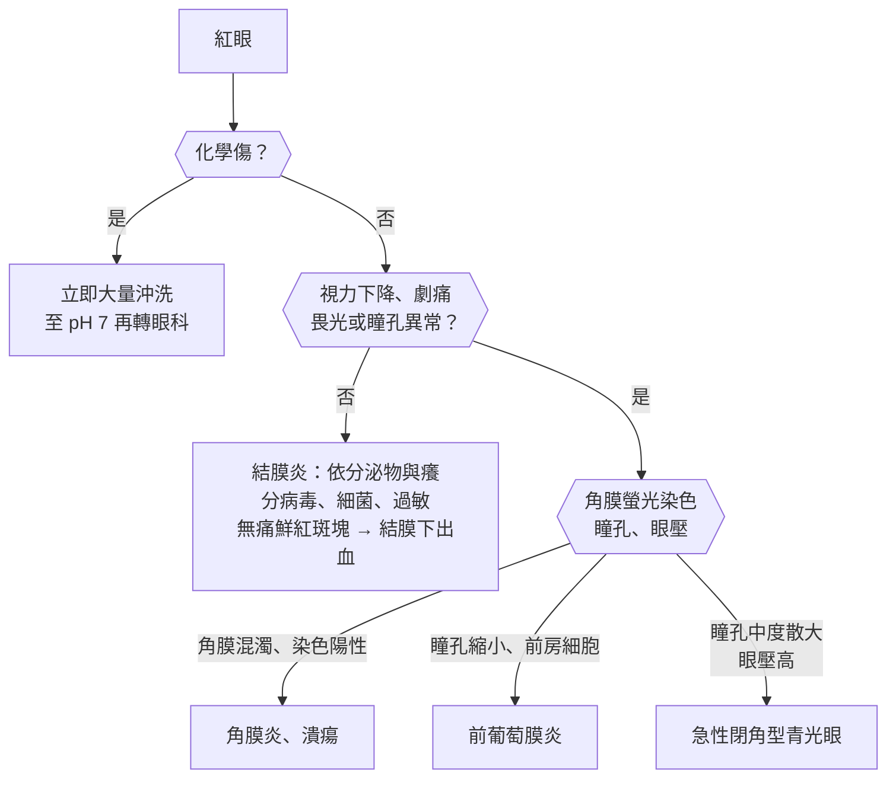
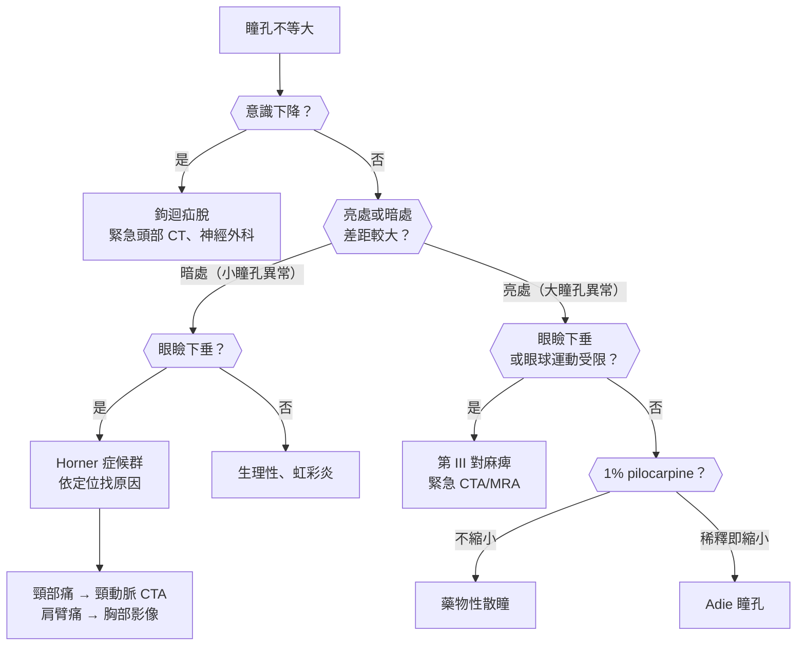
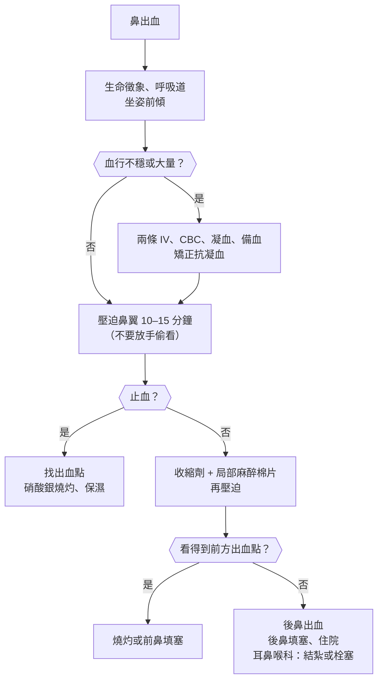
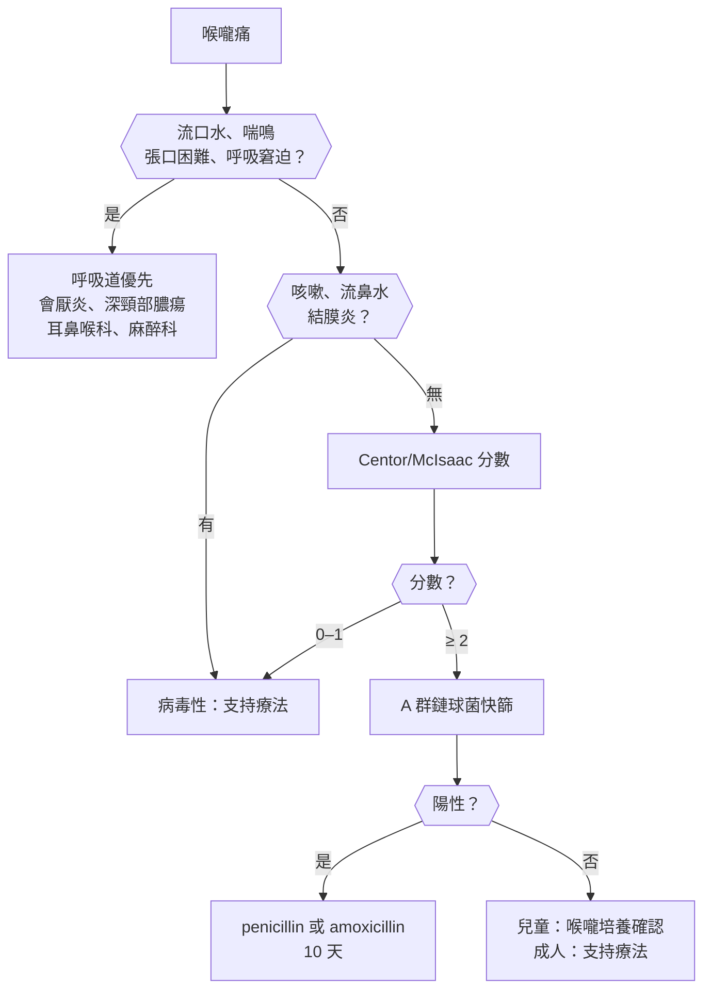
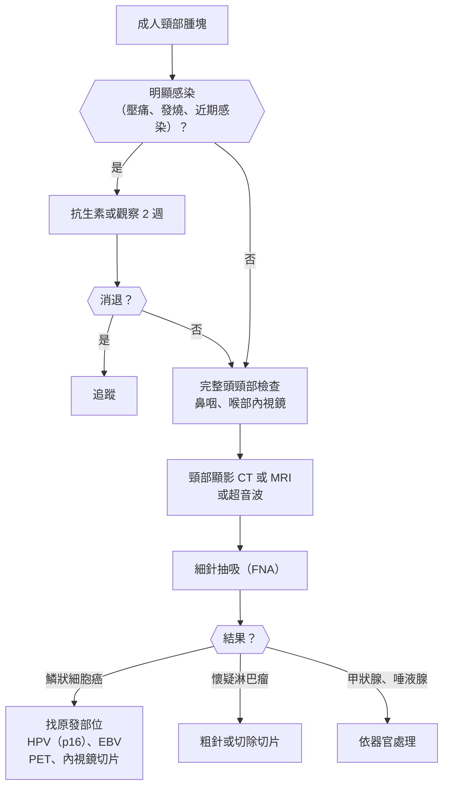

## 眼（Eye）

### 紅眼（Red Eye）

#### 定義與分類

- **紅眼（red eye）**：結膜、鞏膜或睫狀體周圍充血；**先分「良性」與「威脅視力」**。
- **充血型態**：
    - **結膜充血（conjunctival injection）**：**周邊較紅、往角膜方向變淡**、血管可隨結膜移動 → 結膜炎。
    - **睫狀充血（ciliary flush）**：**角膜周圍一圈紫紅色** → **角膜炎、虹彩炎（前葡萄膜炎）、急性閉角型青光眼**，都屬**威脅視力**。
    - **結膜下出血**：**邊界清楚的鮮紅色斑塊**、無痛、視力正常。
- **良性**：結膜炎（病毒、細菌、過敏）、結膜下出血、上鞏膜炎、乾眼症、瞼緣炎、翼狀胬肉發炎。
- **威脅視力**：**角膜炎（含角膜潰瘍）**、**急性閉角型青光眼**、**前葡萄膜炎**、**鞏膜炎**、**眼內炎**、**化學傷**、穿透傷。

#### Red flags

- **:red[視力下降]**（最重要的區分點）。
- **中度到劇烈眼痛**（結膜炎只有異物感或癢，不會真的痛）、**畏光**。
- **睫狀充血**、**角膜混濁或白點**、**瞳孔異常**（中度散大固定 → 青光眼；縮小 → 虹彩炎）。
- **戴隱形眼鏡 + 紅痛** → **角膜潰瘍（綠膿桿菌、棘阿米巴）**，**:red[當天轉診]**。
- **頭痛、噁心嘔吐、看燈有光暈**、瞳孔中度散大 → **急性閉角型青光眼**。
- **化學物質噴到眼睛** → **立即大量沖洗**，不等檢查。
- **眼睛手術或外傷後紅痛、視力下降** → 眼內炎、穿透傷。
- **[[眼科#新生兒結膜炎（Ophthalmia Neonatorum）|新生兒結膜炎]]**、**帶狀疱疹侵犯鼻尖（Hutchinson sign）**。

#### 鑑別診斷

| 類別 | 疾病 | 鑑別關鍵 |
|---|---|---|
| **結膜** | **[[眼科#結膜炎\|結膜炎]]**（[[眼科#流行性角結膜炎（Epidemic Keratoconjunctivitis, EKC）\|病毒]]、細菌、過敏、[[眼科#春季角結膜炎（Vernal Keratoconjunctivitis, VKC）\|春季角結膜炎]]）、**結膜下出血**、[[眼科#翼狀胬肉（Pterygium）\|翼狀胬肉]] | **視力正常、無真正疼痛**、分泌物性質 |
| **角膜** | **[[眼科#角膜炎（Keratitis）\|角膜炎]]**（[[眼科#細菌性角膜潰瘍\|細菌性潰瘍]]、[[眼科#HSV 角膜炎\|HSV 樹枝狀]]、黴菌、棘阿米巴）、[[眼科#角膜異物與磨損\|角膜磨損與異物]]、**[[眼科#淚膜與乾眼症\|乾眼症]]** | **螢光染色**、隱形眼鏡、外傷 |
| **前房與虹彩** | **[[眼科#前葡萄膜炎\|前葡萄膜炎]]**、**[[眼科#急性隅角閉鎖青光眼（Acute Angle-Closure Glaucoma）\|急性閉角型青光眼]]**、前房積血 | 睫狀充血、**瞳孔、眼壓** |
| **鞏膜** | [[眼科#上鞏膜炎與鞏膜炎\|上鞏膜炎、鞏膜炎]] | **鞏膜炎劇痛、壓痛、深紫色**、自體免疫疾病 |
| **眼瞼與淚器** | 瞼緣炎、[[眼科#麥粒腫（Hordeolum / Stye）\|麥粒腫]]、[[眼科#急性淚囊炎（Acute Dacryocystitis）\|急性淚囊炎]]、倒睫 | 眼瞼紅腫、內眥腫 |
| **眼內與眼眶** | 眼內炎、**[[眼科#眼眶蜂窩組織炎\|眼眶蜂窩組織炎]]**、**[[眼科#頸動脈海綿竇瘻管（Carotid-Cavernous Fistula, CCF）\|頸動脈海綿竇瘻管]]**、[[眼科#甲狀腺眼病（Thyroid Eye Disease / Graves' Ophthalmopathy）\|甲狀腺眼病]] | 突眼、眼球運動受限、**搏動性突眼與血管雜音** |
| **外傷** | **[[眼科#化學燒傷\|化學傷]]**、[[眼科#鈍傷\|鈍傷]]、穿透傷 | 病史 |

#### 易混淆鑑別

:::compare[結膜炎：病毒 vs 細菌 vs 過敏]
| | 病毒性 | 細菌性 | 過敏性 |
|---|---|---|---|
| 病原或原因 | **腺病毒**（流行性角結膜炎）、腸病毒（急性出血性結膜炎） | 金黃色葡萄球菌、肺炎鏈球菌、流感嗜血桿菌；**淋病雙球菌（超急性）** | 花粉、塵蟎 |
| 分泌物 | **水樣** | **膿性、早上眼睛黏住** | **水樣、黏絲狀** |
| 主要症狀 | 異物感、**先一眼再傳到另一眼** | 黏、紅 | **癢（最典型）** |
| 伴隨 | **耳前淋巴結腫大**、上呼吸道感染、**濾泡** | — | 過敏性鼻炎、**乳突（papillae）**、結膜水腫 |
| 傳染性 | **極高（2 週）** | 中 | 無 |
| 治療 | **支持療法、冷敷、人工淚液、勤洗手**；**不要用類固醇** | **抗生素眼藥**；淋病 → **全身性 ceftriaxone** | 抗組織胺/肥大細胞穩定劑眼藥、冷敷 |
:::

:::compare[威脅視力的紅眼：角膜炎 vs 前葡萄膜炎 vs 急性閉角型青光眼]
| | 角膜炎 | 前葡萄膜炎（虹彩炎） | 急性閉角型青光眼 |
|---|---|---|---|
| 視力 | ↓ | ↓（輕到中） | **↓↓、看燈有光暈** |
| 疼痛 | **異物感、劇痛** | **深部痛、畏光明顯** | **劇痛 + 頭痛、噁心嘔吐** |
| 角膜 | **混濁、白點、螢光染色陽性** | 透明（**角膜後沉澱物 KP**） | **霧狀水腫** |
| 瞳孔 | 正常或縮小 | **縮小、不規則（後粘連）** | **中度散大、對光反應消失** |
| 前房 | 可有前房積膿 | **細胞與閃輝（flare）**、前房積膿 | **淺** |
| 眼壓 | 正常 | 正常或低（可升高） | **↑↑（:red[> 40–50 mmHg]）**、眼球摸起來硬 |
| 相關 | **隱形眼鏡**、外傷、HSV | **[[眼科#HLA-B27 相關（強直性脊椎炎等）\|HLA-B27]]（僵直性脊椎炎）**、[[眼科#Behçet Disease\|Behçet]]、[[免疫風濕科#Sarcoidosis（類肉瘤病）\|類肉瘤病]]、JIA | **遠視、老人、女性、亞洲人**；**暗處、抗膽鹼藥、散瞳劑** |
| 處置 | 刮取培養、**頻繁抗生素眼藥** | **類固醇眼藥 + 散瞳劑** | **降眼壓藥 → 雷射虹膜切開術** |
:::

:::compare[上鞏膜炎 vs 鞏膜炎]
| | 上鞏膜炎 | 鞏膜炎 |
|---|---|---|
| 疼痛 | 輕微不適 | **劇烈、夜間痛醒、放射到臉** |
| 顏色 | 鮮紅、局部 | **深紫藍色** |
| 血管 | **滴 phenylephrine 後變白** | 不變白 |
| 相關疾病 | 多特發性 | **RA（最常見）、ANCA 血管炎**、SLE |
| 處置 | 人工淚液、NSAIDs 眼藥 | **全身性 NSAIDs、類固醇、免疫抑制劑**；可致穿孔 |
:::

#### 問診與理學檢查

- **視力、疼痛程度、畏光**、分泌物、癢、單眼或雙眼、發作速度。
- **隱形眼鏡**（配戴過夜？游泳？）、外傷、化學物、眼部手術、接觸病人（流行性角結膜炎）。
- 全身疾病：**關節痛與背痛（HLA-B27）**、口腔與生殖器潰瘍（Behçet）、皮疹、性行為史。
- 理學檢查：
    - **視力（每位紅眼病人都要測）**。
    - **充血型態**、**角膜透明度**、**瞳孔大小與反應**、前房深度（側照）。
    - **螢光染色**（角膜上皮缺損、**樹枝狀 → HSV**）。
    - 翻眼瞼找異物、耳前淋巴結、眼壓（指觸或眼壓計）。

#### 檢查流程

- **威脅視力的紅眼 → 當天轉眼科**（裂隙燈、眼壓、散瞳檢查）。
- 角膜潰瘍 → **刮取培養**（細菌、黴菌、棘阿米巴）。
- 反覆前葡萄膜炎 → **HLA-B27**、薦髂關節 X 光、胸部 X 光（類肉瘤病、結核）、梅毒血清。
- 超急性膿性結膜炎 → 分泌物革蘭氏染色、淋病與披衣菌 NAAT。

#### 初步處置

- **化學傷**：**:red[立即大量沖洗（至少 15–30 分鐘、2 L 以上）]**，**鹼性比酸性更嚴重**（穿透深）。
- **病毒性結膜炎**：支持療法、**避免共用毛巾、勤洗手、停課停工**。
- **細菌性結膜炎**：抗生素眼藥；**隱形眼鏡配戴者 → 涵蓋綠膿桿菌（fluoroquinolone）**、停戴。
- **角膜潰瘍**：**不可包眼**、頻繁抗生素眼藥。
- **HSV 角膜炎**：**抗病毒（ganciclovir 眼膠或口服 acyclovir）**；**:red[禁用類固醇眼藥]**（上皮型會惡化）。
- **急性閉角型青光眼**：見下圖與[[眼科#急性 PACG 處理|急性 PACG 處理]]。

::chart{id="acute-angle-closure"}

- **結膜下出血**：自行吸收（1–2 週）；反覆 → 查血壓、凝血功能。

:::pitfall
紅眼病人一律開含類固醇的抗生素眼藥 → HSV 角膜炎惡化成角膜潰瘍穿孔、黴菌角膜炎擴散、長期使用造成青光眼與白內障。沒有裂隙燈檢查前不要開類固醇眼藥。
:::

:::pitfall
戴隱形眼鏡的病人眼睛紅痛，當成結膜炎開一般抗生素並讓他繼續戴 → 綠膿桿菌角膜潰瘍可在 24–48 小時內穿孔。隱形眼鏡配戴者紅痛要停戴、用涵蓋綠膿桿菌的眼藥，並當天轉眼科。
:::

:::exam
- 視力下降、劇痛、畏光、睫狀充血、瞳孔異常 → 威脅視力，轉眼科。
- 病毒性：水樣、耳前淋巴結、濾泡、腺病毒；細菌性：膿性；過敏性：癢、乳突。
- 前葡萄膜炎：瞳孔縮小、畏光、HLA-B27 → 類固醇 + 散瞳劑；急性閉角型青光眼：瞳孔中度散大、眼壓高。
- HSV 角膜炎：樹枝狀螢光染色、禁類固醇；化學傷：先沖洗，鹼比酸嚴重。
:::

### 急性視力喪失（Acute Vision Loss）

#### 定義與分類

- **急性視力喪失**：數分鐘到數天內的視力下降；先分**單眼或雙眼**、**暫時或持續**、**有無疼痛**。
- **單眼、無痛、突然**：
    - **視網膜中央動脈阻塞（CRAO）**：**眼中風**，**櫻桃紅斑**；**黃金時間極短**。
    - **視網膜中央靜脈阻塞（CRVO）**：**「血與雷」眼底（廣泛出血）**。
    - **視網膜剝離**：**閃光、飛蚊增加、黑幕遮蔽**。
    - **玻璃體出血**（糖尿病增殖性視網膜病變）。
    - **前部缺血性視神經病變（AION）**：動脈炎性（**GCA**）或非動脈炎性。
- **單眼、疼痛**：**視神經炎**（**眼球轉動痛**、年輕女性、MS）、**急性閉角型青光眼**、角膜炎、眼內炎。
- **暫時性單眼視力喪失（一過性黑矇，amaurosis fugax）**：數分鐘恢復 → **頸動脈栓塞**，等同 [[神經內科#暫時性腦缺血發作（TIA）|TIA]]。
- **雙眼**：**枕葉中風**（同側偏盲）、**腦下垂體中風**（雙顳側偏盲）、**PRES**、毒物（甲醇）、**IIH 晚期**、功能性。

#### Red flags

- **所有突發性無痛單眼視力喪失 → :red[當作中風處理]**（CRAO、amaurosis fugax 都是）。
- **> 50 歲 + 頭痛、下顎跛行、頭皮壓痛、ESR 高** → **GCA**，**另一眼數天內可失明** → 立即類固醇。
- **閃光 + 飛蚊突然增加 + 視野黑幕** → 視網膜剝離，**黃斑部未剝離前手術**。
- **雙眼視力喪失 + 頭痛 + 高血壓或懷孕** → PRES、子癇；**+ 酒精、代謝性酸中毒** → 甲醇中毒。
- **劇烈頭痛 + 雙顳側偏盲 + 眼肌麻痺** → 腦下垂體中風。

#### 鑑別診斷

| 類別 | 疾病 | 鑑別關鍵 |
|---|---|---|
| **視網膜血管** | **[[眼科#視網膜中央動脈阻塞（CRAO）\|CRAO]]**、**[[眼科#視網膜中央靜脈阻塞（CRVO）\|CRVO]]**、分支阻塞、**一過性黑矇** | **櫻桃紅斑** vs **大量出血** |
| **視網膜與玻璃體** | **[[眼科#視網膜剝離（Retinal Detachment）\|視網膜剝離]]**、**玻璃體出血**、[[眼科#老年性黃斑部退化（Age-related Macular Degeneration, AMD）\|濕性黃斑部退化]] | 閃光飛蚊、糖尿病、**直線變彎曲** |
| **視神經** | **[[眼科#視神經炎（Optic Neuritis）\|視神經炎]]**、**[[眼科#前部缺血性視神經病變（AION）\|AION]]**（**[[神經內科#顳動脈炎（Giant Cell Arteritis, GCA）\|GCA]]**） | **RAPD**、眼球轉動痛、視盤水腫 |
| **前段** | [[眼科#急性隅角閉鎖青光眼（Acute Angle-Closure Glaucoma）\|急性閉角型青光眼]]、角膜炎、前房積血、眼內炎 | 紅、痛 |
| **中樞** | **[[神經內科#腦血管供應\|枕葉中風]]**、[[代謝內分泌科#腦下垂體中風（Pituitary Apoplexy）\|腦下垂體中風]]、**PRES**、[[眼科#特發性顱內壓增高（IIH / Pseudotumor Cerebri）\|IIH]] | **雙眼、視野缺損型態**、眼底可正常 |
| **毒物與其他** | **甲醇**、ethambutol、功能性視力喪失 | 病史 |

#### 易混淆鑑別

:::compare[CRAO vs CRVO vs 視網膜剝離 vs 玻璃體出血]
| | CRAO | CRVO | 視網膜剝離 | 玻璃體出血 |
|---|---|---|---|---|
| 發作 | **突然、無痛、嚴重** | 突然或數天、無痛 | **閃光、飛蚊 → 黑幕從周邊往中間** | 突然、**紅色或黑色雲霧** |
| 眼底 | **蒼白視網膜 + 櫻桃紅斑**、血管呈車廂狀 | **「血與雷」：廣泛火焰狀出血、靜脈擴張迂曲、棉絮斑** | **灰色隆起的視網膜**、裂孔 | **看不清楚眼底** |
| RAPD | **有** | 有（缺血型） | 大範圍時有 | 無或輕 |
| 原因 | **頸動脈或心臟栓塞**、GCA | **高血壓、糖尿病**、青光眼、高凝 | **高度近視**、外傷、白內障手術後 | **糖尿病增殖性病變**、視網膜裂孔、外傷 |
| 處置 | **中風評估（頸動脈超音波、心臟超音波、MRI）**、排除 GCA；黃金時間內考慮血栓溶解 | 抗 VEGF 注射、雷射（新生血管） | **緊急手術** | 超音波排除剝離、雷射、玻璃體切除 |
:::

:::compare[視神經炎 vs 動脈炎性 AION vs 非動脈炎性 AION]
| | 視神經炎 | 動脈炎性 AION（GCA） | 非動脈炎性 AION |
|---|---|---|---|
| 年齡 | **20–45 歲、女性** | **> 50（多 > 70）** | 50–70 |
| 疼痛 | **眼球轉動痛** | 頭痛、下顎跛行 | **無痛** |
| 視力 | 數天內下降，**多會恢復** | **極嚴重、雙眼風險** | 中度，常**早上醒來發現** |
| 視盤 | **2/3 正常（球後）**、1/3 水腫 | **蒼白水腫（chalky white）** | **水腫、擁擠的小視盤（disc at risk）** |
| 色覺 | **明顯下降（紅色變淡）** | ↓ | ↓ |
| 檢查 | **MRI（MS 病灶）**、AQP4、MOG 抗體 | **ESR、CRP、顳動脈切片** | 危險因子（**糖尿病、高血壓、OSA、PDE5 抑制劑**） |
| 治療 | **IV methylprednisolone**（加速恢復、延緩 MS）；**口服低劑量類固醇單用會增加復發** | **立即高劑量類固醇**，不等切片 | 控制危險因子 |
:::

:::compare[視野缺損與病灶位置]
| 視野缺損 | 病灶位置 | 常見原因 |
|---|---|---|
| **單眼全盲** | 視網膜或視神經 | CRAO、視神經炎、AION |
| **雙顳側偏盲** | **視交叉** | **腦下垂體腫瘤**、顱咽管瘤 |
| **同側偏盲** | **視徑、外側膝狀體、視放射、枕葉** | 中風、腫瘤 |
| **同側上象限盲（pie in the sky）** | **顳葉（Meyer 環）** | 中風、腫瘤 |
| **同側下象限盲（pie on the floor）** | **頂葉** | 中風 |
| **同側偏盲 + 黃斑保留** | **枕葉**（大腦後動脈） | **後循環中風** |
| **中心暗點** | 黃斑或視神經 | 視神經炎、AMD |
:::

#### 問診與理學檢查

- **單眼或雙眼**（遮一眼測試）、**發生速度**、暫時或持續、疼痛、**閃光飛蚊**、視野缺損位置。
- **頭痛、下顎跛行、頭皮壓痛、肩膀痛**（GCA）；神經症狀；心血管危險因子、心房顫動。
- 理學檢查：
    - **視力**、**色覺**、**RAPD（擺動手電筒試驗）**、**對坐視野檢查**。
    - **眼底鏡**（櫻桃紅斑、出血、視盤水腫）、眼壓。
    - **顳動脈**、頸動脈雜音、心律、神經學檢查。

#### 檢查流程

- **突發無痛單眼視力喪失 → 立即眼科 + 中風流程**。
- > 50 歲 → **ESR、CRP**（GCA）。
- CRAO 或一過性黑矇 → **頸動脈超音波或 CTA、ECG、心臟超音波、腦部 MRI**（約 1/4 合併無症狀腦梗塞）。
- 視神經炎 → **腦部與眼眶 MRI**、AQP4 與 MOG 抗體。
- 雙眼或視野缺損 → **腦部 MRI**。
- 眼底看不清楚 → **眼部超音波**（視網膜剝離）。

#### 初步處置

- **CRAO**：**轉中風中心**（部分中心在 4.5 小時內給予血栓溶解）；次級預防同缺血性中風。
- **GCA**：**:red[立即高劑量類固醇]**（視力喪失者 IV methylprednisolone），**不等切片結果**。
- **視網膜剝離**：避免劇烈活動、**緊急轉視網膜科手術**。
- **視神經炎**：IV methylprednisolone；評估 MS。
- **甲醇中毒**：**fomepizole**、血液透析。

:::pitfall
老人單眼突然看不見、幾分鐘後恢復，因為已經好了就讓他回家 → 一過性黑矇等同 TIA，短期內中風風險高。要當作 TIA 做頸動脈與心臟評估，並依中風次級預防處理。
:::

:::pitfall
70 歲病人單眼 AION，以為是血管硬化的非動脈炎性，沒有驗 ESR 或問頭痛與下顎跛行 → GCA 數天內另一眼也失明。50 歲以上 AION 都要排除 GCA，懷疑時立即類固醇。
:::

:::exam
- CRAO：櫻桃紅斑、車廂狀血流 → 中風評估；CRVO：血與雷；視網膜剝離：閃光飛蚊黑幕、高度近視。
- 一過性黑矇 = 頸動脈 TIA。
- 視神經炎：年輕女性、眼球轉動痛、RAPD、色覺下降 → IV methylprednisolone、MRI；口服低劑量類固醇單用會增加復發。
- 雙顳側偏盲 → 視交叉；上象限盲 → 顳葉；同側偏盲黃斑保留 → 枕葉。
:::

### 慢性視力模糊（Gradual Vision Loss）

#### 定義與分類

- **漸進性視力下降**：數月到數年。
- **最常見原因**：
    - **屈光不正**（近視、遠視、散光、**老花眼**）→ **針孔試驗可改善**。
    - **白內障**：**全球失明第一名**、可逆；**眩光、夜間開車困難**、近視度數增加（核性）。
    - **青光眼（開放型）**：**周邊視野先喪失、中心視力最後才受影響**、**無症狀** → **不可逆失明第一名**。
    - **老年性黃斑部退化（AMD）**：**中心視力喪失、直線變彎曲（Amsler grid）**。
    - **糖尿病視網膜病變**：工作年齡人口失明主因；**黃斑部水腫**是視力下降主因。
- **兒童**：**弱視**（斜視、屈光參差）、**先天性白內障（白瞳）**、**視網膜母細胞瘤（白瞳）**、早產兒視網膜病變。
- **台灣特殊**：**高度近視盛行**（青少年）→ **近視性黃斑病變、[[眼科#視網膜剝離（Retinal Detachment）|視網膜剝離]]、青光眼**風險。

#### Red flags

- **視力突然加速惡化**、**單眼直線扭曲變形** → 濕性 AMD（新生血管），抗 VEGF 越早越好。
- **兒童白瞳（leukocoria）**：照片紅眼反射一眼白 → **視網膜母細胞瘤**、先天性白內障。
- **兒童斜視、歪頭看東西** → 弱視（**8 歲前治療**）。
- **合併頭痛、視盤水腫或視野缺損** → 腦瘤、IIH。
- **服用 ethambutol、hydroxychloroquine、amiodarone** → 藥物毒性。

#### 鑑別診斷

| 類別 | 疾病 | 鑑別關鍵 |
|---|---|---|
| **屈光** | **[[眼科#屈光不正分類\|近視、遠視、散光、老花]]** | **針孔試驗改善** |
| **水晶體** | **[[眼科#白內障（Cataract）\|白內障]]** | **紅反射變暗**、眩光 |
| **視神經** | **[[眼科#原發性隅角開放型青光眼（POAG）\|開放型青光眼]]**、壓迫性視神經病變（腫瘤）、**藥物（ethambutol）**、營養（B₁₂）、遺傳 | **杯盤比增大**、周邊視野 |
| **視網膜** | **[[眼科#老年性黃斑部退化（Age-related Macular Degeneration, AMD）\|AMD]]**、**[[眼科#糖尿病視網膜病變（Diabetic Retinopathy, DR）\|糖尿病視網膜病變]]**、[[眼科#近視相關\|近視性黃斑病變]]、**hydroxychloroquine 視網膜病變**、視網膜色素病變 | 中心或周邊、眼底 |
| **角膜** | [[眼科#圓錐角膜（Keratoconus）\|圓錐角膜]]、[[眼科#角膜變性\|角膜變性]]、乾眼症 | 不規則散光 |
| **兒童** | **[[眼科#弱視（Amblyopia）\|弱視]]**、先天性白內障、**[[眼科#視網膜母細胞瘤（Retinoblastoma）\|視網膜母細胞瘤]]**、[[眼科#早產兒視網膜病變（Retinopathy of Prematurity, ROP）\|ROP]]、[[眼科#先天性青光眼\|先天性青光眼]] | **白瞳**、斜視、大眼角膜 |
| **中樞** | 腦下垂體腫瘤（雙顳側偏盲，**漸進**）、IIH | 視野 |

#### 易混淆鑑別

:::compare[白內障 vs 開放型青光眼 vs AMD vs 糖尿病視網膜病變]
| | 白內障 | 開放型青光眼 | AMD | 糖尿病視網膜病變 |
|---|---|---|---|---|
| 視力型態 | **整體模糊、眩光、夜間差** | **周邊視野先缺損（隧道視野）**，晚期才影響中心 | **中心暗點、直線扭曲** | **黃斑水腫 → 中心模糊**；出血 → 突然 |
| 症狀 | 漸進 | **早期無症狀** | 閱讀、認臉困難 | 早期無症狀 |
| 檢查 | **紅反射變暗**、裂隙燈 | **眼壓（可正常）、杯盤比 > 0.6、視野、OCT** | **玻璃膜疣（drusen）**、Amsler grid、OCT | **微血管瘤、點狀出血、硬性滲出、棉絮斑、新生血管** |
| 可逆 | **可（手術）** | **不可逆** | 濕性部分可穩定 | 早期治療可預防 |
| 治療 | **超音波乳化術 + 人工水晶體** | **前列腺素類似物（第一線）**、β-blocker、雷射、手術 | **濕性 → 抗 VEGF 注射**；乾性 → 抗氧化維生素（AREDS2）、戒菸 | **控制血糖血壓**；黃斑水腫 → 抗 VEGF；增殖性 → **全視網膜雷射** |
:::

:::compare[糖尿病視網膜病變分期與篩檢]
| 分期 | 眼底 | 處置 |
|---|---|---|
| **非增殖性（NPDR）** | **微血管瘤（最早）**、點狀出血、硬性滲出、棉絮斑 | 依嚴重度追蹤 |
| **嚴重 NPDR（4-2-1 規則）** | 4 象限出血、2 象限靜脈串珠、1 象限 IRMA | 考慮雷射 |
| **增殖性（PDR）** | **新生血管**、玻璃體出血、牽引性剝離 | **全視網膜雷射、抗 VEGF** |
| **黃斑水腫（任何分期）** | 黃斑增厚、硬性滲出 | **抗 VEGF**（視力下降主因） |
| **篩檢時機** | **第 2 型：:red[診斷時]**；**第 1 型：診斷後 :red[5 年]**；**懷孕：每孕期** | 之後**每年**散瞳眼底檢查 |
:::

#### 問診與理學檢查

- **遠看或近看模糊**、眩光、夜間、**直線扭曲**、視野、單眼或雙眼、進展速度。
- **糖尿病、高血壓**、高度近視、**類固醇**（白內障、青光眼）、**hydroxychloroquine**、ethambutol、家族青光眼史。
- 理學檢查：**視力（含針孔）**、紅反射、**Amsler grid**、眼底（杯盤比、黃斑、出血）、眼壓、對坐視野。

#### 檢查流程

- **針孔試驗改善 → 屈光問題** → 驗光。
- **散瞳眼底檢查**、**眼壓**、**視野檢查**、**OCT（光學同調斷層掃描）**：青光眼與黃斑疾病。
- 糖尿病 → **每年散瞳眼底篩檢**（或眼底攝影）。
- **hydroxychloroquine**：基準眼科檢查，**使用 5 年後每年篩檢**。
- 兒童：**視力篩檢**（台灣學齡前視力篩檢）、紅反射。

#### 初步處置

- 屈光：配鏡、隱形眼鏡、[[眼科#屈光手術|屈光手術]]。
- **兒童近視控制**：**戶外活動每天 2 小時**、**低濃度 atropine**、角膜塑型片；**用眼 30 分鐘休息 10 分鐘**。
- 白內障：**影響生活時手術**。
- 開放型青光眼：**前列腺素類似物**（latanoprost）第一線；**目標是降低眼壓**（即使眼壓正常的青光眼也要降）。
- 濕性 AMD：**抗 VEGF 眼內注射**；乾性：AREDS2 配方、**戒菸**。
- 弱視：**矯正屈光、遮蓋健眼**或 atropine 壓抑健眼，**越早越好**。

:::pitfall
病人眼壓正常就排除青光眼 → 台灣與東亞的開放型青光眼有相當比例是正常眼壓青光眼。要看視神經杯盤比、視野與 OCT，而不是只看眼壓。
:::

:::pitfall
糖尿病病人視力還很好，就沒有安排眼底檢查 → 糖尿病視網膜病變早期完全沒有症狀，等到視力下降時常已是黃斑水腫或增殖性病變。第 2 型糖尿病診斷時就要檢查，之後每年追蹤。
:::

:::exam
- 針孔試驗改善 → 屈光不正。
- 白內障：可逆失明第一名；青光眼：不可逆失明第一名、周邊視野先喪失；AMD：中心暗點、直線扭曲 → 濕性抗 VEGF。
- 糖尿病視網膜病變：微血管瘤最早；黃斑水腫是視力下降主因；第 2 型診斷時篩檢、第 1 型 5 年後。
- 白瞳 → 視網膜母細胞瘤；弱視 → 8 歲前遮蓋健眼。
:::

### 複視與眼球運動異常（Diplopia）

#### 定義與分類

- **先遮一眼**：
    - **單眼複視（遮住患眼後消失，遮健眼仍存在）**：**眼睛本身的光學問題**（散光、白內障、角膜病變、乾眼）→ **不是神經問題**。
    - **雙眼複視（遮任一眼就消失）**：**眼位不正** → 腦神經、神經肌肉接合處、眼外肌、眼眶。
- **水平複視**：第 VI 對腦神經（外展）、內直肌、核間性眼肌麻痺（INO）。
- **垂直複視**：**第 IV 對（滑車）**、第 III 對、眼眶（甲狀腺眼病、骨折）、skew deviation（腦幹）。
- **常見原因**：
    - **微血管性（糖尿病、高血壓）**：第 III、IV、VI 對單獨麻痺，**3 個月內自行恢復**。
    - **動脈瘤**：**後交通動脈瘤 → 第 III 對麻痺 + 瞳孔散大**。
    - **重症肌無力**：**波動性、疲勞性**，**瞳孔不受影響**。
    - **甲狀腺眼病**：**下直肌**最常受影響（上看受限）。
    - **顱內壓升高**：第 VI 對麻痺（**假性定位徵象**）。

#### Red flags

- **第 III 對麻痺 + 瞳孔散大** → **:red[後交通動脈瘤]**，**緊急 CTA**（可能破裂成 [[神經內科#蜘蛛膜下腔出血（SAH）|SAH]]）。
- **突發複視 + 頭痛 + 意識改變或其他神經缺損** → 中風、SAH、**腦下垂體中風**。
- **多條腦神經（III、IV、V1、V2、VI）+ Horner** → **海綿竇病變**（血栓、腫瘤、頸動脈海綿竇瘻管）。
- **> 50 歲 + 頭痛 + 下顎跛行** → GCA。
- **眼皮下垂 + 吞嚥困難 + 呼吸無力** → 重症肌無力危象、[[感染科#C. botulinum（Botulism，肉毒桿菌）|肉毒桿菌中毒]]。
- **眼眶外傷 + 上看受限 + 眼眶下緣麻木** → **眼眶底骨折、下直肌夾陷**（兒童可合併心跳慢、嘔吐）。

#### 鑑別診斷

| 類別 | 疾病 | 鑑別關鍵 |
|---|---|---|
| **單眼複視** | 散光、[[眼科#白內障（Cataract）\|白內障]]、[[眼科#圓錐角膜（Keratoconus）\|圓錐角膜]]、乾眼症、水晶體脫位 | **遮患眼消失、針孔改善** |
| **腦神經麻痺** | **[[眼科#CN III（動眼神經）麻痺\|第 III 對]]**、**[[眼科#CN IV（滑車神經）麻痺\|第 IV 對]]**、**[[眼科#CN VI（外展神經）麻痺\|第 VI 對]]** | 眼位、瞳孔 |
| **腦幹** | **核間性眼肌麻痺（INO，MS）**、skew deviation、中風、[[神經內科#Wernicke-Korsakoff Syndrome\|Wernicke 腦病變]] | **患側內收不能 + 對側外展眼振** |
| **神經肌肉接合處** | **[[神經內科#重症肌無力（Myasthenia Gravis, MG）\|重症肌無力]]**、**肉毒桿菌中毒** | **波動、疲勞、瞳孔正常**；肉毒 → 瞳孔散大 |
| **眼外肌與眼眶** | **[[眼科#甲狀腺眼病（Thyroid Eye Disease / Graves' Ophthalmopathy）\|甲狀腺眼病]]**、**眼眶底骨折**、[[眼科#眼眶蜂窩組織炎\|眼眶蜂窩組織炎]]、[[眼科#眼眶腫瘤\|眼眶腫瘤]]、眼眶發炎 | **突眼、眼瞼退縮**、外傷 |
| **海綿竇與顱底** | 海綿竇血栓、**[[眼科#頸動脈海綿竇瘻管（Carotid-Cavernous Fistula, CCF）\|頸動脈海綿竇瘻管]]**、[[耳鼻喉科#鼻咽癌（Nasopharyngeal Carcinoma, NPC）\|鼻咽癌]]侵犯顱底、[[代謝內分泌科#腦下垂體中風（Pituitary Apoplexy）\|腦下垂體中風]] | **多條腦神經** |
| **顱內壓** | [[眼科#特發性顱內壓增高（IIH / Pseudotumor Cerebri）\|IIH]]、腫瘤、水腦 | **第 VI 對（假性定位）**、視盤水腫 |
| **其他** | **[[神經內科#顳動脈炎（Giant Cell Arteritis, GCA）\|GCA]]**、[[神經內科#Guillain-Barré Syndrome（GBS）\|Miller Fisher]] 症候群、失代償的斜視 | 頭痛、運動失調 |

#### 易混淆鑑別

:::compare[第 III、IV、VI 對腦神經麻痺]
| | 第 III 對（動眼） | 第 IV 對（滑車） | 第 VI 對（外展） |
|---|---|---|---|
| 支配 | 上直肌、下直肌、內直肌、下斜肌、**提上眼瞼肌、瞳孔括約肌** | **上斜肌**（往內下看） | **外直肌**（往外看） |
| 眼位 | **往下往外（down and out）** | 患眼**上斜**、**頭歪向健側**代償 | **患眼內斜** |
| 複視 | 水平 + 垂直 | **垂直、下樓梯或閱讀時最明顯** | **水平、看遠與看向患側時加重** |
| 其他 | **眼瞼下垂、瞳孔散大（壓迫性）** | — | — |
| 常見原因 | **微血管（瞳孔保留）**、**後交通動脈瘤（瞳孔散大）**、鉤迴疝脫 | **頭部外傷（最常見）**、先天性、微血管 | **微血管**、**顱內壓升高**、腫瘤、外傷 |
:::

:::compare[第 III 對麻痺：壓迫性 vs 微血管性]
| | 壓迫性（動脈瘤、疝脫） | 微血管性（糖尿病、高血壓） |
|---|---|---|
| 瞳孔 | **散大、對光反應差**（瞳孔纖維在神經外圍） | **保留**（缺血影響神經中心） |
| 疼痛 | **劇烈頭痛** | 可有眼眶痛 |
| 病程 | 進行性 | **3 個月內自行恢復** |
| 處置 | **緊急 CTA 或 MRA** | 控制危險因子、追蹤 |
:::

:::compare[重症肌無力 vs 甲狀腺眼病 vs 第 III 對麻痺]
| | 重症肌無力 | 甲狀腺眼病 | 第 III 對麻痺 |
|---|---|---|---|
| 眼瞼 | **下垂、波動、傍晚加重** | **眼瞼退縮、凝視時眼瞼遲落（lid lag）** | **下垂** |
| 突眼 | 無 | **有** | 無 |
| 瞳孔 | **正常** | 正常 | 散大（壓迫性） |
| 型態 | **不符合單一神經**、疲勞性 | **限制性（下直肌、內直肌）** | 符合神經支配 |
| 檢查 | **冰敷試驗**、AChR 抗體、重複神經刺激、單纖維肌電圖 | **TSH、TRAb**、眼眶 CT（肌腹增粗、肌腱不受影響） | MRI、CTA |
:::

#### 問診與理學檢查

- **遮一眼複視是否消失**（單眼 vs 雙眼）、**水平或垂直**、哪個方向看最嚴重、**波動性**、發作速度。
- 頭痛、眼痛、外傷、**糖尿病、高血壓**、甲狀腺、MS、癌症、**吞嚥與四肢無力**。
- 理學檢查：
    - **九個方向眼球運動**、**遮蓋試驗**、頭部姿勢。
    - **瞳孔**（大小、對光反應）、**眼瞼下垂或退縮**、**突眼**。
    - **持續上看 1 分鐘（疲勞測試）**、冰敷試驗。
    - 其他腦神經（V1、V2 → 海綿竇）、神經學檢查、眼底（視盤水腫）。

#### 檢查流程

- **第 III 對麻痺合併瞳孔散大或疼痛 → 緊急 CTA 或 MRA**。
- 單獨第 IV 或 VI 對麻痺、> 50 歲、有血管危險因子 → 可先觀察，**3 個月未恢復或有其他神經徵象 → MRI**；**年輕人一律影像**。
- **> 50 歲 → ESR、CRP**（GCA）。
- 懷疑重症肌無力 → **AChR 抗體、MuSK 抗體、重複神經刺激、胸部 CT（胸腺瘤）**。
- 甲狀腺眼病 → **TSH、free T4、TRAb**、眼眶 CT 或 MRI。

#### 初步處置

- 單眼複視 → 眼科（驗光、白內障）。
- 微血管性麻痺 → 控制血糖血壓、**暫時遮一眼或稜鏡**緩解複視、追蹤。
- 動脈瘤 → **神經外科或介入治療**。
- 重症肌無力 → pyridostigmine、免疫治療。
- 甲狀腺眼病 → **戒菸**、控制甲狀腺功能、硒、中重度活動期 → **IV 類固醇**、teprotumumab；**放射碘可能惡化**（合併類固醇預防）。

:::pitfall
糖尿病病人第 III 對麻痺，以為是微血管性就觀察 → 漏掉瞳孔散大的後交通動脈瘤，數天後破裂成 SAH。第 III 對麻痺一定要檢查瞳孔；瞳孔散大、劇烈頭痛或部分麻痺時都要做血管影像。
:::

:::pitfall
眼皮下垂、複視時好時壞的病人，因為腦部 MRI 正常就被說是壓力或眼睛疲勞 → 眼型重症肌無力被延誤，進展成全身型甚至危象。複視或眼瞼下垂有波動性、傍晚加重時，要做冰敷試驗與抗體檢查。
:::

:::exam
- 單眼複視 → 眼睛光學問題；雙眼複視 → 眼位不正。
- 第 III 對：down and out、下垂、瞳孔散大 → 後交通動脈瘤；瞳孔保留 → 微血管。
- 第 IV 對：垂直複視、下樓梯、頭歪向健側，外傷最常見；第 VI 對：內斜、顱內壓升高的假性定位徵象。
- INO：患側內收不能 + 對側外展眼振 → MS（年輕人）。
- 重症肌無力：瞳孔正常、波動、冰敷試驗。
:::

### 瞳孔不等大（Anisocoria）

#### 定義與分類

- **瞳孔不等大（anisocoria）**：兩側瞳孔直徑差 **> 0.5–1 mm**；**生理性約 20% 人口有（差距 < 1 mm、亮暗處差距相同）**。
- **判斷哪一眼異常**：
    - **:red[暗處差距變大 → 小的那眼異常]**（無法放大）→ **Horner 症候群**、生理性。
    - **亮處差距變大 → 大的那眼異常**（無法縮小）→ **第 III 對麻痺**、**Adie 瞳孔**、**藥物性散瞳**、虹彩外傷、**急性閉角型青光眼**。
- **Horner 症候群**：**眼瞼下垂（輕）+ 瞳孔縮小 + 無汗** → 交感神經路徑受損；**三級神經元**：
    - **第一級（中樞）**：下視丘 → 脊髓 C8–T2：**延腦外側中風（Wallenberg）**、脊髓病變。
    - **第二級（節前）**：脊髓 → 上頸神經節：**Pancoast 腫瘤**、胸部手術、頸部外傷。
    - **第三級（節後）**：上頸神經節 → 眼：**頸動脈剝離**、海綿竇病變、叢集性頭痛。
- **Adie 強直性瞳孔**：年輕女性、**單側散大、對光反應差但近距離反應存在（光近分離）**、**深部肌腱反射消失（Holmes-Adie）**。
- **Argyll Robertson 瞳孔**：**雙側小、不規則、光近分離** → **神經性梅毒**。
- **相對性傳入瞳孔障礙（RAPD，Marcus Gunn 瞳孔）**：**不造成瞳孔不等大**；擺動手電筒時患眼「放大」→ 視神經或嚴重視網膜病變。

#### Red flags

- **大瞳孔 + 眼瞼下垂 + 眼球運動受限（down and out）+ 頭痛** → **動脈瘤壓迫第 III 對**。
- **意識下降 + 單側瞳孔散大** → **鉤迴疝脫**，神經外科急症。
- **新發 Horner + 頸部或臉部疼痛** → **頸動脈剝離**（中風風險）。
- **Horner + 肩膀與手臂內側痛、吸菸** → **Pancoast 腫瘤**。
- **Horner + 對側身體痛溫覺喪失、眩暈、吞嚥困難** → 延腦外側中風。
- **兒童新發 Horner** → **神經母細胞瘤**。
- **紅痛眼 + 中度散大固定瞳孔** → 急性閉角型青光眼。

#### 鑑別診斷

| 類別 | 疾病 | 鑑別關鍵 |
|---|---|---|
| **生理性** | 生理性瞳孔不等大 | **差距 < 1 mm、亮暗處相同**、無其他症狀 |
| **小瞳孔異常** | **Horner 症候群**、虹彩炎（**後粘連**）、**藥物（pilocarpine、鴉片類單側接觸）**、Argyll Robertson | **暗處差距變大** |
| **大瞳孔異常** | **[[眼科#CN III（動眼神經）麻痺\|第 III 對麻痺]]**、**Adie 瞳孔**、**藥物性散瞳**（atropine、scopolamine 貼片、cyclopentolate、**曼陀羅**）、虹彩外傷、**[[眼科#急性隅角閉鎖青光眼（Acute Angle-Closure Glaucoma）\|急性閉角型青光眼]]** | **亮處差距變大** |
| **Horner 原因** | **[[神經內科#Wallenberg Syndrome（延腦外側症候群）\|延腦外側症候群]]**、**[[胸腔外科#Pancoast tumor\|Pancoast 腫瘤]]**、**頸動脈剝離**、[[神經內科#叢集性頭痛（Cluster Headache）\|叢集性頭痛]]、頸部手術與外傷、[[小兒外科#Neuroblastoma（神經母細胞瘤）\|神經母細胞瘤]] | 伴隨症狀 |
| **神經梅毒** | **[[神經內科#Neurosyphilis\|Argyll Robertson 瞳孔]]** | 雙側、**光近分離** |

#### 易混淆鑑別

:::compare[瞳孔不等大的鑑別]
| | Horner | 第 III 對麻痺 | Adie 瞳孔 | 藥物性散瞳 |
|---|---|---|---|---|
| 異常的眼 | **小** | **大** | **大** | **大** |
| 差距明顯處 | **暗處** | 亮處 | 亮處 | 亮處 |
| 眼瞼 | **輕度下垂（1–2 mm）** | **明顯下垂** | 正常 | 正常 |
| 眼球運動 | 正常 | **down and out** | 正常 | 正常 |
| 光反應 | 存在（放大慢：dilation lag） | 消失或差 | **差，近距離反應存在（光近分離）** | **完全消失** |
| 1% pilocarpine | — | **縮小** | **0.1% 稀釋即縮小（去神經過敏）** | **不縮小** |
| 確認試驗 | **apraclonidine 使 Horner 眼放大（反轉）**、cocaine 眼藥不放大 | CTA/MRA | 稀釋 pilocarpine | 病史 |
:::

:::compare[Horner 症候群的定位]
| 神經元 | 路徑 | 常見原因 | 線索 |
|---|---|---|---|
| **第一級（中樞）** | 下視丘 → 腦幹 → 脊髓 C8–T2 | **延腦外側中風**、MS、[[神經內科#脊髓空洞症（Syringomyelia）\|脊髓空洞症]] | **其他腦幹或脊髓徵象**；半身無汗 |
| **第二級（節前）** | 脊髓 → 肺尖 → 上頸神經節 | **Pancoast 腫瘤**、胸腔手術、頸部外傷、**甲狀腺腫瘤** | **肩臂痛、尺側麻**；臉部無汗 |
| **第三級（節後）** | 頸動脈周圍 → 海綿竇 → 眼 | **頸動脈剝離**、海綿竇病變、**叢集性頭痛** | **頸痛、頭痛**；**通常無汗不明顯**（汗腺纖維隨外頸動脈走） |
:::

#### 問診與理學檢查

- 發現時間（**看舊照片**）、頭痛、頸部痛、外傷、眼痛紅、視力、複視、**眼藥水或貼片（暈車貼片）**、接觸植物（曼陀羅）。
- 吸菸、癌症史、頸部手術或中心靜脈導管。
- 理學檢查：
    - **亮處與暗處的瞳孔大小**、光反應、**近距離反應**、擺動手電筒（RAPD）。
    - **眼瞼下垂程度**、眼球運動、出汗。
    - 頸部、肺尖、神經學檢查、深部肌腱反射（Adie）。

#### 檢查流程

- **新發疼痛性 Horner → 頸部與頭部 CTA 或 MRA**（頸動脈剝離）。
- Horner 合併肩臂症狀或吸菸 → **胸部 CT**（肺尖）。
- 兒童 Horner → 頸胸腹影像、尿液兒茶酚胺代謝物（神經母細胞瘤）。
- 雙側光近分離 → **RPR、TPPA**，必要時腰椎穿刺。

#### 初步處置

- 依原因處理：頸動脈剝離 → **抗血小板或抗凝血**；動脈瘤 → 介入或手術；Pancoast → 腫瘤治療。
- 藥物性散瞳 → 停止接觸，數小時到數天恢復；衛教**暈車貼片（scopolamine）貼後要洗手**。
- Adie 瞳孔 → 良性，畏光可戴太陽眼鏡、低濃度 pilocarpine。

:::pitfall
年輕人推拿後頸痛、一邊眼皮稍微下垂、瞳孔較小，以為是疲勞 → 漏掉頸動脈剝離的 Horner 症候群，之後中風。新發疼痛性 Horner 要緊急做頸部血管影像。
:::

:::pitfall
病人一眼瞳孔放大、其他都正常，急著做腦部影像 → 其實是貼暈車貼片後揉眼睛、或點了散瞳劑。單純大瞳孔、眼瞼與眼球運動正常時，先問藥物接觸並做 1% pilocarpine 試驗（藥物性散瞳不會縮小）。
:::

:::exam
- 暗處差距大 → 小瞳孔異常（Horner）；亮處差距大 → 大瞳孔異常（第 III 對、Adie、藥物）。
- Horner：輕度下垂 + 縮瞳 + 無汗；apraclonidine 反轉；頸動脈剝離、Pancoast、Wallenberg。
- Adie：光近分離、反射消失、稀釋 pilocarpine 縮小；藥物性散瞳：pilocarpine 不縮小。
- Argyll Robertson：雙側小、光近分離 → 神經梅毒。
- RAPD 不造成瞳孔不等大。
:::

### 眼瞼與眼眶腫脹（Eyelid / Periorbital Swelling）

#### 定義與分類

- **眼瞼局部腫塊**：
    - **麥粒腫（hordeolum）**：**急性、紅腫痛**、瞼緣腺體細菌感染（金黃色葡萄球菌）。
    - **霰粒腫（chalazion）**：**慢性、無痛硬塊**、瞼板腺阻塞的肉芽腫；**反覆同位置 → 切片排除皮脂腺癌**。
    - 黃色瘤（**內眥上方黃色斑塊**，血脂）、[[皮膚科#基底細胞癌（Basal Cell Carcinoma, BCC）|基底細胞癌]]（**下眼瞼最常見**）。
- **眼瞼瀰漫性腫脹**：
    - **眼眶周圍（隔膜前）蜂窩組織炎**：眼眶隔膜前，**眼球運動與視力正常**。
    - **眼眶（隔膜後）蜂窩組織炎**：**突眼、眼球運動痛與受限、視力下降** → 急症；**最常見來自篩竇炎**。
    - **過敏**、**血管性水腫**、**接觸性皮膚炎**（眼藥、化妝品）。
    - **全身性水腫**：**腎病症候群（早上眼瞼腫）**、心衰竭、甲狀腺機能低下。
    - **皮肌炎**（紫紅色）、**甲狀腺眼病**、旋毛蟲。
- **內眥腫痛**：**急性淚囊炎**；**新生兒淚流不止** → 先天性鼻淚管阻塞。

#### Red flags

- **突眼、眼球運動痛或受限、複視、視力下降、RAPD** → **:red[眼眶蜂窩組織炎]**，可致失明、海綿竇血栓、[[神經內科#腦膿瘍（Brain Abscess）|腦膿瘍]]。
- **雙側眼眶症狀 + 頭痛 + 多條腦神經麻痺 + 發燒** → **海綿竇血栓**。
- **[[代謝內分泌科#DKA（Diabetic Ketoacidosis）|糖尿病酮酸中毒]]或免疫低下 + 鼻竇炎 + 臉部黑色壞死** → **[[感染科#Mucormycosis|白黴菌病（mucormycosis）]]**，緊急清創。
- **快速擴散、皮膚紫黑** → 壞死性筋膜炎。
- **眼瞼腫 + 眼睛紅 + 呼吸困難** → 過敏性休克。
- **反覆霰粒腫、睫毛脫落、瞼緣破壞** → **皮脂腺癌**、基底細胞癌。

#### 鑑別診斷

| 類別 | 疾病 | 鑑別關鍵 |
|---|---|---|
| **眼瞼腺體** | **[[眼科#麥粒腫（Hordeolum / Stye）\|麥粒腫]]**、**[[眼科#霰粒腫（Chalazion）\|霰粒腫]]**、瞼緣炎 | 急性痛 vs 慢性無痛 |
| **感染** | **眼眶周圍蜂窩組織炎**、**[[眼科#眼眶蜂窩組織炎\|眼眶蜂窩組織炎]]**、**[[眼科#急性淚囊炎（Acute Dacryocystitis）\|急性淚囊炎]]**、[[皮膚科#帶狀疱疹（Herpes Zoster / Shingles）\|眼部帶狀疱疹]]、**[[耳鼻喉科#黴菌性鼻竇炎（Fungal Rhinosinusitis）\|白黴菌病]]** | **突眼與眼球運動**、內眥 |
| **過敏與皮膚** | [[免疫風濕科#血管性水腫（Angioedema）\|血管性水腫]]、[[皮膚科#接觸性皮膚炎（Contact Dermatitis）\|接觸性皮膚炎]]、昆蟲叮咬 | **癢、雙側、無發燒** |
| **全身性水腫** | **[[腎臟內科#Nephrotic Syndrome\|腎病症候群]]**、心衰竭、[[代謝內分泌科#甲狀腺機能低下（Hypothyroidism）\|甲狀腺機能低下]] | **早上明顯、雙側**、尿蛋白 |
| **眼眶** | **[[眼科#甲狀腺眼病（Thyroid Eye Disease / Graves' Ophthalmopathy）\|甲狀腺眼病]]**、[[眼科#眼眶腫瘤\|眼眶腫瘤]]（兒童：橫紋肌肉瘤）、特發性眼眶發炎、**[[眼科#頸動脈海綿竇瘻管（Carotid-Cavernous Fistula, CCF）\|頸動脈海綿竇瘻管]]** | 突眼、無痛或痛 |
| **其他** | [[皮膚科#皮肌炎（Dermatomyositis）\|皮肌炎]]（向陽性紅斑）、旋毛蟲、**基底細胞癌**、**皮脂腺癌** | 紫紅色、近端無力 |

#### 易混淆鑑別

:::compare[眼眶周圍（隔膜前）vs 眼眶（隔膜後）蜂窩組織炎]
| | 眼眶周圍蜂窩組織炎 | 眼眶蜂窩組織炎 |
|---|---|---|
| 位置 | **眼眶隔膜前** | **眼眶隔膜後** |
| 族群 | 兒童較多 | 兒童與成人 |
| 來源 | 皮膚外傷、昆蟲叮咬、麥粒腫 | **篩竇炎（最常見）** |
| 眼瞼 | 紅腫 | 紅腫 |
| **突眼** | **無** | **有** |
| **眼球運動** | **正常、不痛** | **疼痛、受限、複視** |
| **視力與 RAPD** | **正常** | **可下降、RAPD** |
| 檢查 | 臨床 | **眼眶與鼻竇 CT（顯影）**：骨膜下膿瘍 |
| 處置 | **口服抗生素**（amoxicillin-clavulanate） | **住院 IV 抗生素**（含抗 MRSA）；膿瘍或視力受損 → **手術引流** |
:::

:::compare[麥粒腫 vs 霰粒腫]
| | 麥粒腫 | 霰粒腫 |
|---|---|---|
| 病理 | **急性細菌感染**（金黃色葡萄球菌） | **慢性肉芽腫**（瞼板腺阻塞） |
| 疼痛 | **紅腫痛** | **無痛**、硬 |
| 病程 | 數天 | 數週到數月 |
| 治療 | **熱敷**、眼瞼清潔；必要時抗生素、切開引流 | 熱敷；不消 → **切開刮除**或病灶內類固醇 |
| 注意 | — | **反覆同一位置 → 切片排除皮脂腺癌** |
:::

#### 問診與理學檢查

- 單側或雙側、**疼痛**、發燒、**視力、複視、眼球轉動痛**、鼻竇炎症狀、外傷或叮咬、過敏史、眼藥化妝品。
- 糖尿病（控制差、DKA）、免疫抑制；全身水腫、泡泡尿、甲狀腺症狀。
- 理學檢查：**視力、RAPD、眼球運動、突眼**、眼瞼外翻檢查、內眥壓痛、鼻腔（黑色痂皮 → 白黴菌）、**其他腦神經**、生命徵象。

#### 檢查流程

- **突眼、眼球運動受限或痛、視力下降、雙側、或治療 24–48 小時無改善 → 眼眶與鼻竇顯影 CT**。
- 海綿竇血栓 → **MRI + MRV**。
- 懷疑白黴菌 → **鼻內視鏡切片**、緊急耳鼻喉科。
- 全身性水腫 → **尿液檢查、白蛋白、腎功能**、TSH。
- 慢性或反覆眼瞼腫塊 → **切片**。

#### 初步處置

- 麥粒腫與霰粒腫：**熱敷每天數次**、眼瞼清潔。
- 眼眶周圍蜂窩組織炎：**口服抗生素**，24–48 小時追蹤。
- **眼眶蜂窩組織炎**：**住院 IV 抗生素**（vancomycin + ceftriaxone ± 厭氧菌涵蓋）、**鼻充血劑與鼻內類固醇**；**骨膜下膿瘍、視力下降 → 手術**。
- 白黴菌病：**緊急手術清創 + amphotericin B**、矯正酸中毒。
- 急性淚囊炎：抗生素；**不要在急性期沖洗淚管**；之後淚囊鼻腔吻合術。

:::pitfall
兒童眼瞼紅腫被當成眼眶周圍蜂窩組織炎開口服抗生素，沒有檢查眼球運動與視力 → 漏掉來自篩竇炎的眼眶蜂窩組織炎與骨膜下膿瘍。每次都要評估突眼、眼球運動、視力與 RAPD，有異常就做 CT。
:::

:::pitfall
糖尿病控制很差的病人鼻竇炎合併臉頰腫痛，當成一般鼻竇炎 → 白黴菌病在數天內侵犯眼眶與腦部。DKA 或免疫低下合併鼻竇炎與臉部壞死、黑色痂皮，要緊急內視鏡切片與清創。
:::

:::exam
- 眼眶蜂窩組織炎：突眼、眼球運動痛與受限、視力下降；最常見來源篩竇炎 → 住院 IV 抗生素、CT。
- 麥粒腫：急性痛、感染；霰粒腫：慢性無痛肉芽腫，反覆 → 排除皮脂腺癌。
- 早上雙側眼瞼腫 → 腎病症候群。
- DKA + 鼻竇炎 + 黑色壞死 → 白黴菌病 → 清創 + amphotericin B。
:::

## 耳（Ear）

### 耳痛與耳漏（Otalgia / Otorrhea）

#### 定義與分類

- **原發性耳痛（耳朵本身）**：
    - **外耳**：**外耳炎（游泳者耳，綠膿桿菌）**、耳垢栓塞、異物、**耳廓軟骨膜炎**、帶狀疱疹（Ramsay Hunt）、**惡性外耳炎**。
    - **中耳**：**急性中耳炎（AOM）**、積液性中耳炎、**急性乳突炎**、耳咽管功能障礙、氣壓性中耳炎（飛行、潛水）。
- **轉移性耳痛（耳朵檢查正常）**：**成人約一半**；
    - 經 **V、VII、IX、X 對腦神經與 C2–C3**：**顳顎關節障礙**、牙痛、**咽喉炎與扁桃腺周圍膿瘍**、**咽喉與下咽癌**、頸椎。
    - **成人單側耳痛 + 耳鏡正常 + 抽菸喝酒 → 一定要排除頭頸部癌症**。
- **耳漏（otorrhea）**：
    - 外耳炎、**中耳炎鼓膜破裂**、**慢性中耳炎**、**膽脂瘤（惡臭）**。
    - **外傷後清澈耳漏** → **腦脊髓液耳漏（[[神經外科#顱底骨折|顱底骨折]]）**。

#### Red flags

- **糖尿病老人 + 外耳炎劇痛 + 外耳道肉芽組織 + 顏面神經麻痺** → **惡性外耳炎（顱底骨髓炎，綠膿桿菌）**。
- **耳後紅腫、壓痛、耳廓被推向前外** → **急性乳突炎**。
- **中耳炎合併頭痛、嘔吐、意識改變、頸部僵硬、癲癇** → 顱內併發症（腦膜炎、腦膿瘍、乙狀竇血栓）。
- **顏面神經麻痺**（中耳炎、膽脂瘤、帶狀疱疹、腫瘤）。
- **成人單側積液性中耳炎** → **:red[鼻咽癌]**（台灣特別重要）。
- **長期惡臭耳漏 + 鼓膜上方袋狀凹陷或白色珍珠樣** → 膽脂瘤。
- **頭部外傷 + 耳漏或耳後瘀青（Battle sign）** → 顱底骨折。

#### 鑑別診斷

| 類別 | 疾病 | 鑑別關鍵 |
|---|---|---|
| **外耳** | **[[耳鼻喉科#外耳疾病\|外耳炎]]**、**惡性外耳炎**、耳垢栓塞、**[[耳鼻喉科#耳部異物\|耳部異物]]**、耳廓軟骨膜炎、**[[神經系統主訴#顏面神經麻痺（Facial Palsy）\|Ramsay Hunt 症候群]]** | **拉耳廓或壓耳屏痛**、耳道腫脹 |
| **中耳** | **[[耳鼻喉科#急性中耳炎（Acute Otitis Media, AOM）\|急性中耳炎]]**、**[[耳鼻喉科#積液性中耳炎（Otitis Media with Effusion, OME）\|積液性中耳炎]]**、[[耳鼻喉科#慢性中耳炎（Chronic Otitis Media, COM）\|慢性中耳炎]]、**[[耳鼻喉科#膽脂瘤（Cholesteatoma）\|膽脂瘤]]**、急性乳突炎 | **鼓膜外觀與活動度** |
| **轉移痛：口與顎** | **顳顎關節障礙**、牙齒問題、[[耳鼻喉科#唾液腺非腫瘤性疾病\|腮腺炎]] | **張口痛、咀嚼痛**、耳鏡正常 |
| **轉移痛：咽喉** | **[[耳鼻喉科#急性咽扁桃腺炎（Acute Pharyngotonsillitis）\|咽扁桃腺炎]]**、**[[耳鼻喉科#扁桃腺周圍膿瘍（Peritonsillar Abscess, PTA / Quinsy）\|扁桃腺周圍膿瘍]]**、**[[耳鼻喉科#喉癌（Laryngeal Cancer）\|喉癌]]、[[耳鼻喉科#下咽癌（Hypopharyngeal Cancer）\|下咽癌]]、[[耳鼻喉科#口咽癌（Oropharyngeal Cancer）\|口咽癌]]** | **吞嚥痛**、抽菸喝酒 |
| **轉移痛：其他** | **[[耳鼻喉科#鼻咽癌（Nasopharyngeal Carcinoma, NPC）\|鼻咽癌]]**、[[神經外科#三叉神經痛（Trigeminal Neuralgia）\|三叉神經痛]]、舌咽神經痛、頸椎病變、**[[神經內科#顳動脈炎（Giant Cell Arteritis, GCA）\|GCA]]**、心絞痛（罕見） | 耳鏡正常 |

#### 易混淆鑑別

:::compare[外耳炎 vs 急性中耳炎 vs 惡性外耳炎]
| | 外耳炎 | 急性中耳炎 | 惡性外耳炎 |
|---|---|---|---|
| 族群 | **游泳、挖耳朵**、濕熱 | **6 個月–2 歲兒童最多**、上呼吸道感染後 | **老年糖尿病**、免疫低下 |
| 病原 | **綠膿桿菌、金黃色葡萄球菌**、黴菌 | **肺炎鏈球菌、流感嗜血桿菌（不可分型）、[[感染科#Moraxella catarrhalis\|Moraxella catarrhalis]]** | **綠膿桿菌** |
| 疼痛 | **拉耳廓、壓耳屏痛** | 深部痛、兒童拉耳朵、哭鬧 | **劇痛、夜間加重** |
| 耳道 | **腫脹、紅、分泌物** | 正常 | **底部肉芽組織**（骨軟骨交界） |
| 鼓膜 | 看不清楚或正常 | **膨出、紅、活動度下降**、液面 | 可正常 |
| 全身 | 少 | 發燒 | **顏面神經麻痺、其他腦神經** |
| 治療 | **抗生素耳滴（含類固醇）**、清潔耳道、保持乾燥 | **觀察或 amoxicillin（高劑量）** | **住院 IV 抗綠膿桿菌抗生素（ciprofloxacin、ceftazidime）**、控制血糖、CT 或 MRI |
:::

:::compare[急性中耳炎 vs 積液性中耳炎 vs 膽脂瘤]
| | 急性中耳炎 | 積液性中耳炎 | 膽脂瘤 |
|---|---|---|---|
| 症狀 | **急性耳痛、發燒** | **無痛、悶塞感、聽力下降** | **慢性惡臭耳漏、聽力下降** |
| 鼓膜 | **膨出、紅** | **內陷或正常位置、可見液面或氣泡**、**活動度下降** | **鬆弛部袋狀凹陷、白色珍珠樣角化物、穿孔** |
| 鼓室圖 | **B 型（平坦）** | **B 型** | 依情況 |
| 聽力 | 傳導性 | **傳導性** | 傳導性（侵蝕聽小骨）→ 可混合 |
| 併發症 | 鼓膜破裂、乳突炎、腦膜炎 | **兒童語言發展遲緩** | **骨質侵蝕 → 顏面神經麻痺、迷路瘻管（眩暈）、顱內** |
| 治療 | **觀察或 amoxicillin** | **觀察 3 個月** → 持續或聽力差 → **中耳通氣管** | **手術切除（乳突切除術）** |
| 成人單側 | 少見 | **→ 排除鼻咽癌** | — |
:::

:::compare[急性中耳炎何時給抗生素（AAP）]
| 年齡 | 嚴重（中重度耳痛、耳痛 ≥ 48 小時或 ≥ 39°C）或耳漏 | 非嚴重、雙側 | 非嚴重、單側 |
|---|---|---|---|
| **< 6 個月** | 抗生素 | 抗生素 | 抗生素 |
| **6–23 個月** | 抗生素 | **抗生素** | **抗生素或觀察 48–72 小時** |
| **≥ 24 個月** | 抗生素 | **抗生素或觀察** | **抗生素或觀察** |
| **首選** | **高劑量 amoxicillin（:red[80–90 mg/kg/day]）**；30 天內用過 amoxicillin、合併結膜炎 → **amoxicillin-clavulanate** | | |
:::

#### 問診與理學檢查

- 耳痛性質、**耳漏（顏色、氣味、清澈）**、聽力、耳鳴、眩暈、發燒、**游泳或挖耳**、飛行潛水、外傷。
- **吞嚥痛、聲音沙啞、張口痛、牙痛**、抽菸喝酒檳榔、**體重減輕**、頸部腫塊。
- 糖尿病、免疫抑制。
- 理學檢查：
    - **拉耳廓與壓耳屏**、耳後（乳突）。
    - **耳鏡**：耳道、**鼓膜顏色、位置、透明度**、**氣動耳鏡看活動度**。
    - **音叉試驗**、**顏面神經**。
    - **耳鏡正常時一定要檢查**：**顳顎關節、牙齒、口咽、頸部、鼻咽（內視鏡）**。

#### 檢查流程

- 典型外耳炎與中耳炎 → **臨床診斷**。
- **鼓室圖**：積液性中耳炎（B 型）。
- **惡性外耳炎、乳突炎、膽脂瘤** → **顳骨 CT**（骨質侵蝕）、MRI（顱內）；惡性外耳炎追蹤 **ESR**。
- **成人單側積液性中耳炎或耳鏡正常的持續耳痛 → 鼻咽內視鏡 + EBV 抗體（VCA IgA、EBNA1 IgA）**。
- 清澈耳漏外傷後 → **β2-transferrin**（腦脊髓液）。

#### 初步處置

- 外耳炎：**清潔耳道、抗生素耳滴**（ciprofloxacin 或 ofloxacin，**鼓膜破裂時避免耳毒性的 aminoglycoside 耳滴**）、耳道嚴重腫脹 → 放置耳棉條（wick）；**保持乾燥、不要挖耳**。
- 急性中耳炎：**止痛**（acetaminophen、ibuprofen）＋依上表觀察或抗生素（療程 < 2 歲 10 天、≥ 2 歲 5–7 天）；**反覆發作（6 個月 3 次或 1 年 4 次）→ 通氣管**。
- 積液性中耳炎：**觀察 3 個月**；**不建議抗生素、類固醇、抗組織胺、去鼻充血劑**。
- 急性乳突炎：**IV 抗生素**、CT、必要時乳突切除。
- **肺炎鏈球菌疫苗、流感疫苗**可降低兒童中耳炎。

:::pitfall
中年男性單側耳悶、聽力下降，耳鏡看到積液就當成中耳炎開藥 → 漏掉鼻咽癌（腫瘤阻塞耳咽管）。台灣成人單側積液性中耳炎一定要做鼻咽內視鏡，並問頸部腫塊、鼻涕帶血與 EBV 抗體。
:::

:::pitfall
糖尿病老人外耳炎反覆治療不好，一直換耳滴 → 惡性外耳炎（顱底骨髓炎）進展到顏面神經麻痺。糖尿病病人外耳炎劇痛、耳道底部有肉芽組織時，要做 CT 並住院 IV 抗綠膿桿菌治療。
:::

:::exam
- 外耳炎：拉耳廓痛、綠膿桿菌、游泳；惡性外耳炎：糖尿病老人、肉芽組織、顏面神經麻痺。
- 急性中耳炎：肺炎鏈球菌、不可分型流感嗜血桿菌、Moraxella；高劑量 amoxicillin。
- 積液性中耳炎：觀察 3 個月 → 通氣管；成人單側 → 排除鼻咽癌。
- 膽脂瘤：惡臭耳漏、鬆弛部、骨質侵蝕 → 手術。
- 成人耳痛耳鏡正常 → 想轉移痛（顳顎關節、牙、咽喉癌）。
:::

### 聽力喪失（Hearing Loss）

#### 定義與分類

- **傳導性（conductive）**：外耳或中耳的聲音傳導障礙 → **耳垢、中耳積液、鼓膜穿孔、耳硬化症、膽脂瘤**。
- **感音神經性（sensorineural, SNHL）**：耳蝸或聽神經 → **老年性、噪音性、突發性、耳毒性藥物、梅尼爾氏病、聽神經瘤、先天性**。
- **混合性**：兩者都有。
- **突發性感音神經性聽損（SSNHL）**：**:red[72 小時]內**、**連續 3 個頻率下降 :red[≥ 30 dB]**；**耳科急症**，多為特發性。
- **老年性聽損（presbycusis）**：**雙側對稱、高頻先下降**；**聽得到聲音但聽不清楚（尤其吵雜環境）**；**與失智風險相關**。
- **噪音性聽損**：**4 kHz 凹陷（notch）**；職業病（台灣勞工健檢）。
- **耳毒性藥物**：**aminoglycoside、cisplatin、loop diuretic（高劑量 IV）、aspirin（可逆）、quinine**。
- **新生兒聽力篩檢**：台灣**全面公費新生兒聽力篩檢**；[[感染科#CMV|先天性 CMV]] 是非遺傳性感音性聽損最常見原因。

#### Red flags

- **突發單側聽力下降** → SSNHL，**盡早（2 週內，越早越好）類固醇**。
- **單側漸進性感音性聽損 + 耳鳴 + 平衡差** → **聽神經瘤**（MRI）。
- **聽力下降 + 眩暈 + 局部神經缺損** → **AICA 中風**（突發聽損合併眩暈可能是後循環中風）。
- **單側傳導性聽損（成人）** → 鼻咽癌（積液性中耳炎）。
- **外傷後聽損 + 眩暈** → [[耳鼻喉科#外淋巴瘻管（Perilymphatic Fistula）|外淋巴瘻管]]、顳骨骨折。
- **兒童語言發展遲緩** → 聽力評估。

#### 鑑別診斷

| 類別 | 疾病 | 鑑別關鍵 |
|---|---|---|
| **傳導性：外耳** | **耳垢栓塞**、異物、外耳炎、外耳道閉鎖 | 耳鏡 |
| **傳導性：中耳** | **[[耳鼻喉科#積液性中耳炎（Otitis Media with Effusion, OME）\|積液性中耳炎]]**、[[耳鼻喉科#急性中耳炎（Acute Otitis Media, AOM）\|急性中耳炎]]、**鼓膜穿孔**、**[[耳鼻喉科#耳硬化症（Otosclerosis）\|耳硬化症]]**、**[[耳鼻喉科#膽脂瘤（Cholesteatoma）\|膽脂瘤]]**、聽小骨脫離 | 鼓膜、鼓室圖 |
| **感音性：急性** | **[[耳鼻喉科#突發性感音性聽損（Sudden SNHL, SSNHL）\|突發性聽損]]**、**AICA 中風**、迷路炎、外淋巴瘻管、**[[耳鼻喉科#梅尼爾氏病（Ménière's Disease）\|梅尼爾氏病]]**、外傷 | **72 小時內**、眩暈 |
| **感音性：漸進** | **[[耳鼻喉科#老年性聽損（Presbycusis）\|老年性]]**、**[[耳鼻喉科#噪音性聽損（Noise-Induced Hearing Loss, NIHL）\|噪音性]]**、**[[耳鼻喉科#聽神經瘤（Vestibular Schwannoma / Acoustic Neuroma）\|聽神經瘤]]**、**[[耳鼻喉科#先天性感音性聽損與耳毒性藥物\|耳毒性藥物]]**、自體免疫內耳病、梅毒 | **對稱 vs 不對稱** |
| **先天性** | **先天性 CMV**、**GJB2 基因**、德國麻疹、Pendred、Alport、Waardenburg | 新生兒篩檢 |

#### 易混淆鑑別

:::compare[音叉試驗（512 Hz）]
| | Weber（放額頭中央） | Rinne（乳突 vs 耳前） |
|---|---|---|
| **正常** | 正中 | **氣導 > 骨導（陽性）** |
| **左耳傳導性** | **偏向左（患側）** | **左耳骨導 > 氣導（陰性）** |
| **左耳感音性** | **偏向右（健側）** | **左耳氣導 > 骨導（陽性，但兩者都減弱）** |
:::

:::compare[傳導性 vs 感音神經性聽損]
| | 傳導性 | 感音神經性 |
|---|---|---|
| 部位 | 外耳、中耳 | **耳蝸、聽神經** |
| 純音聽力 | **氣導下降、骨導正常（氣骨導差）** | **氣導、骨導同時下降** |
| 語音辨識 | 好（放大音量就聽得清楚） | **差（聽得到聽不清楚）** |
| 鼓室圖 | 常異常（B、C 型；耳硬化症 As 型） | **A 型** |
| 治療 | **多可手術或藥物矯正** | **助聽器、人工電子耳**；SSNHL → 類固醇 |
:::

:::compare[老年性 vs 噪音性 vs 聽神經瘤 vs 梅尼爾氏病]
| | 老年性 | 噪音性 | 聽神經瘤 | 梅尼爾氏病 |
|---|---|---|---|---|
| 側別 | **雙側對稱** | 雙側 | **單側** | **單側（多）** |
| 頻率 | **高頻先下降、斜坡型** | **4 kHz 凹陷** | 高頻 | **低頻先下降、波動** |
| 伴隨 | 吵雜環境聽不清楚 | 耳鳴 | **耳鳴、平衡差、晚期顏面麻木（V）** | **發作性眩暈（20 分鐘–12 小時）、耳鳴、耳脹** |
| 檢查 | 純音聽力 | **職業史** | **MRI（含顯影）** | 純音聽力（低頻）、排除其他 |
| 處置 | **助聽器**、溝通策略 | **防護、遠離噪音** | 觀察、放射手術、手術 | **低鹽飲食**、利尿劑、betahistine |
:::

#### 問診與理學檢查

- **單側或雙側**、**發生速度**（突然、漸進、波動）、耳鳴、眩暈、耳漏、耳痛、耳脹。
- **噪音暴露**（職業、演唱會、耳機）、**耳毒性藥物**、頭部外傷、潛水、家族史、上呼吸道感染。
- 理學檢查：**耳鏡**、**Weber、Rinne**、**手指摩擦或耳語測試**、顏面神經與三叉神經（角膜反射）、小腦測試、**眼振、HINTS（合併眩暈時）**。

#### 檢查流程

- **純音聽力檢查（PTA）**、**語音辨識**、**鼓室圖**。
- **不對稱的感音性聽損、單側耳鳴、SSNHL → 內耳道 MRI（顯影）**排除聽神經瘤。
- 突發聽損合併眩暈與神經徵象 → **腦部 MRI（後循環中風）**。
- 依臨床：**梅毒血清**、自體免疫、甲狀腺、血糖。
- 新生兒：**耳聲傳射（OAE）、自動聽性腦幹反應（AABR）**；未通過 → 3 個月內診斷、**6 個月內介入**。

#### 初步處置

- **SSNHL**：**全身性類固醇（越早越好，2 週內）**；無效或禁忌 → **鼓室內類固醇注射**；高壓氧（輔助）。
- 耳垢：**軟化劑**、沖洗或耳鼻喉科清除（**鼓膜穿孔時不可沖洗**）。
- **助聽器**：老年性聽損盡早配戴（可能降低失智風險）。
- **人工電子耳**：重度到極重度感音性聽損、助聽器效果不佳；兒童越早越好。
- 耳硬化症：**鐙骨手術**或助聽器。
- 預防：**噪音防護**、避免耳毒性藥物或監測（aminoglycoside 血中濃度）。

:::pitfall
突發單側聽力下降被當成「耳朵塞住」或感冒，開了去鼻充血劑讓病人回家 → 錯過 SSNHL 的類固醇治療時機。突然聽不到要做音叉試驗：Weber 偏向健側就是感音性，應盡早給類固醇並安排聽力檢查。
:::

:::pitfall
單側耳鳴、聽力慢慢變差的中年人，被當成老年性聽損配助聽器 → 漏掉聽神經瘤。老年性聽損是雙側對稱；不對稱的感音性聽損要做內耳道 MRI。
:::

:::exam
- Weber 偏患側 → 傳導性；偏健側 → 感音性；Rinne 陰性（骨導 > 氣導）→ 傳導性。
- 老年性：雙側高頻；噪音性：4 kHz 凹陷；梅尼爾氏病：低頻波動 + 眩暈 + 耳鳴 + 耳脹。
- SSNHL：72 小時內、連續 3 頻率 ≥ 30 dB → 盡早類固醇；不對稱 → MRI 排除聽神經瘤。
- 耳毒性：aminoglycoside、cisplatin、loop 利尿劑、aspirin（可逆）。
- 先天性 CMV：非遺傳性感音性聽損最常見原因。
:::

### 耳鳴（Tinnitus）

#### 定義與分類

- **耳鳴（tinnitus）**：沒有外在聲源時聽到聲音。
- **主觀性（最常見）**：只有病人聽得到；**多合併感音性聽損**（老年性、噪音性）→ 大腦對聽覺輸入減少的代償。
- **客觀性**：檢查者也可聽到（聽診器）。
- **搏動性耳鳴（pulsatile tinnitus）**：**與心跳同步** → **要找血管原因**：
    - **IIH（年輕肥胖女性）**、**硬腦膜動靜脈瘻管**、**頸動脈狹窄或剝離**、**副神經節瘤（鼓室球瘤）**、乙狀竇憩室、高輸出狀態（貧血、甲狀腺機能亢進、懷孕）。
- **肌陣攣性**：**喀喀聲**（中耳肌或軟顎肌陣攣）。
- **單側持續耳鳴** → 聽神經瘤。

#### Red flags

- **:red[搏動性耳鳴]** → 影像評估。
- **單側耳鳴 + 不對稱聽損** → 聽神經瘤。
- **耳鳴 + 突發聽損** → SSNHL。
- **耳鳴 + 頭痛 + 視力模糊 + 肥胖女性** → IIH。
- **鼓膜後方紅色搏動性腫塊** → 副神經節瘤。
- **耳鳴造成嚴重困擾、失眠、憂鬱、自殺意念**。

#### 鑑別診斷

| 類別 | 疾病 | 鑑別關鍵 |
|---|---|---|
| **聽損相關（主觀）** | **[[耳鼻喉科#老年性聽損（Presbycusis）\|老年性]]**、**[[耳鼻喉科#噪音性聽損（Noise-Induced Hearing Loss, NIHL）\|噪音性]]**、[[耳鼻喉科#突發性感音性聽損（Sudden SNHL, SSNHL）\|突發性聽損]]、**[[耳鼻喉科#梅尼爾氏病（Ménière's Disease）\|梅尼爾氏病]]**、**[[耳鼻喉科#聽神經瘤（Vestibular Schwannoma / Acoustic Neuroma）\|聽神經瘤]]** | **聽力檢查**、側別 |
| **外耳與中耳** | 耳垢、**[[耳鼻喉科#積液性中耳炎（Otitis Media with Effusion, OME）\|積液性中耳炎]]**、[[耳鼻喉科#耳硬化症（Otosclerosis）\|耳硬化症]]、耳咽管功能障礙 | 耳鏡、傳導性聽損 |
| **搏動性（血管）** | **[[眼科#特發性顱內壓增高（IIH / Pseudotumor Cerebri）\|IIH]]**、硬腦膜動靜脈瘻管、**頸動脈狹窄或剝離**、**副神經節瘤**、乙狀竇異常、高輸出狀態 | **與心跳同步**、頸部雜音 |
| **藥物** | **aspirin（高劑量）**、aminoglycoside、loop 利尿劑、quinine、NSAIDs | 用藥 |
| **其他** | **顳顎關節障礙**、頸椎、顎肌陣攣、焦慮與憂鬱、[[代謝內分泌科#甲狀腺機能亢進（Hyperthyroidism）\|甲狀腺機能亢進]]、貧血 | 咀嚼、肌肉 |

#### 易混淆鑑別

:::compare[主觀性非搏動性 vs 搏動性耳鳴]
| | 非搏動性（主觀） | 搏動性 |
|---|---|---|
| 聲音 | **嗡嗡、嘶嘶、高頻音** | **與心跳同步的咻咻聲** |
| 常見原因 | **感音性聽損**（老年、噪音） | **血管性**（IIH、硬腦膜動靜脈瘻管、頸動脈病變、副神經節瘤） |
| 壓頸靜脈 | 不變 | **靜脈性 → 壓同側頸靜脈後消失** |
| 檢查 | **聽力檢查**；不對稱 → MRI | **CTA/MRA/MRV**、顳骨 CT、眼底（IIH） |
| 處置 | 聽損處理、聲音治療、CBT | **依原因（介入、手術、減重）** |
:::

#### 問診與理學檢查

- **單側或雙側**、**搏動性或持續**、音調、聽力變化、眩暈、耳脹、**噪音暴露**、**用藥**。
- 頭痛、視力模糊（IIH）、頸部痛、焦慮失眠、對生活的影響（**耳鳴障礙量表**）。
- 理學檢查：**耳鏡（鼓膜後紅色腫塊）**、音叉、**頸部與耳周聽診**、**壓同側頸靜脈**、眼底、顳顎關節。

#### 檢查流程

- **純音聽力檢查**（所有持續耳鳴）。
- **單側或不對稱 → 內耳道 MRI**。
- **搏動性 → CTA/MRA/MRV、顳骨 CT**，依臨床加**腰椎穿刺開放壓（IIH）**。
- 依臨床：CBC、TSH。

#### 初步處置

- **衛教**：多數良性、會習慣；處理聽損（**助聽器常同時改善耳鳴**）。
- **聲音治療**（背景音、白噪音）、**耳鳴再訓練治療（TRT）**、**CBT（證據最好）**。
- 處理失眠、焦慮、憂鬱。
- **避免噪音**、停用耳毒性藥物。
- **沒有藥物能有效治療耳鳴本身**（銀杏、抗焦慮藥效果不佳）。

:::pitfall
年輕肥胖女性說耳朵聽到心跳聲、頭痛，被當成焦慮或壓力性耳鳴 → 其實是 IIH，視盤水腫持續可能失明。搏動性耳鳴要做眼底檢查與血管影像。
:::

:::pitfall
單側耳鳴被當成一般老化，只給衛教 → 漏掉聽神經瘤。單側或不對稱的耳鳴與聽損，要做聽力檢查與內耳道 MRI。
:::

:::exam
- 主觀性耳鳴最常見原因：感音性聽損；助聽器、聲音治療、CBT。
- 搏動性耳鳴 → 血管原因（IIH、硬腦膜動靜脈瘻管、頸動脈、副神經節瘤）→ 影像。
- 單側耳鳴 + 不對稱聽損 → 聽神經瘤 → MRI。
- 鼓膜後紅色搏動腫塊 → 鼓室球瘤（副神經節瘤）。
:::

## 鼻（Nose）

### 鼻塞與流鼻水（Nasal Obstruction / Rhinorrhea）

#### 定義與分類

- **鼻炎（rhinitis）**：鼻塞、流鼻水、打噴嚏、鼻癢中 ≥ 2 項。
    - **過敏性鼻炎**：**打噴嚏、鼻癢、水樣鼻涕**、眼癢；常合併氣喘、異位性皮膚炎；**台灣盛行率高（塵蟎最常見）**。
    - **非過敏性**：**血管運動性**（溫度、氣味誘發）、**藥物性（反彈性鼻炎：去鼻充血噴劑使用 :red[> 3–5 天]）**、荷爾蒙（懷孕）、老年性、藥物（**α-blocker、PDE5 抑制劑、口服避孕藥、ACE 抑制劑、NSAIDs**）。
    - **感染性**：**病毒性上呼吸道感染（最常見）**。
- **鼻竇炎（rhinosinusitis）**：**膿性鼻涕 + 鼻塞或臉部壓痛 + 嗅覺下降**；**急性 < 4 週、慢性 ≥ 12 週**。
    - **急性細菌性鼻竇炎**：症狀 **:red[≥ 10 天]不改善**、**嚴重（高燒 ≥ 39°C + 膿涕 ≥ 3 天）**、或**先改善後又惡化（雙相）**。
    - **慢性鼻竇炎**：**合併或不合併鼻息肉**；**阿斯匹靈加重呼吸道疾病（AERD）：氣喘 + 鼻息肉 + aspirin 不耐**。
- **結構性**：鼻中隔彎曲、**鼻息肉**、鼻甲肥大、**腺樣體肥大（兒童）**、**異物（兒童單側惡臭鼻涕）**。
- **腫瘤**：**鼻咽癌**、鼻竇腫瘤、**倒生性乳突瘤**、**青少年鼻咽血管纖維瘤（青春期男性 + 反覆流鼻血）**。

#### Red flags

- **單側**鼻塞、**單側血絲鼻涕**、**單側耳悶**、**頸部腫塊**、**複視或臉部麻木** → **鼻咽癌**或鼻竇腫瘤。
- **鼻竇炎 + 眼眶腫脹、複視、視力下降** → 眼眶併發症。
- **鼻竇炎 + 劇烈頭痛、意識改變、額部腫脹（Pott puffy tumor）** → 顱內併發症。
- **糖尿病酮酸中毒或免疫低下 + 黑色痂皮** → **白黴菌病**。
- **兒童單側惡臭鼻涕** → 鼻腔異物（**鈕扣電池 → 緊急取出**）。
- **頭部外傷後清澈水樣鼻涕、低頭時增加** → 腦脊髓液鼻漏。
- **鼻中隔穿孔 + 鞍鼻** → 肉芽腫性多血管炎（GPA）、古柯鹼、[[免疫風濕科#Relapsing Polychondritis（復發性多軟骨炎）|復發性多軟骨炎]]。

#### 鑑別診斷

| 類別 | 疾病 | 鑑別關鍵 |
|---|---|---|
| **感染** | **病毒性上呼吸道感染**、**[[耳鼻喉科#鼻竇炎（Rhinosinusitis）\|急性細菌性鼻竇炎]]**、[[耳鼻喉科#黴菌性鼻竇炎（Fungal Rhinosinusitis）\|黴菌性鼻竇炎]] | **病程 10 天、雙相** |
| **過敏與非過敏** | **[[耳鼻喉科#過敏性鼻炎（Allergic Rhinitis）\|過敏性鼻炎]]**、血管運動性、**藥物性（反彈性）**、荷爾蒙 | **癢、噴嚏、季節性** |
| **慢性鼻竇炎** | **慢性鼻竇炎 ± [[耳鼻喉科#鼻息肉（Nasal Polyps）\|鼻息肉]]**、**AERD**、**[[小兒科#囊腫性纖維化（Cystic Fibrosis, CF）\|囊腫性纖維化]]（兒童鼻息肉）** | ≥ 12 週、**兒童鼻息肉 → 驗汗液氯** |
| **結構** | **[[耳鼻喉科#鼻中隔疾病\|鼻中隔彎曲]]**、鼻甲肥大、**[[耳鼻喉科#腺樣體肥大（Adenoid Hypertrophy）\|腺樣體肥大]]**、**[[耳鼻喉科#鼻部異物\|鼻腔異物]]**、後鼻孔閉鎖（新生兒） | 固定單側 |
| **腫瘤** | **[[耳鼻喉科#鼻咽癌（Nasopharyngeal Carcinoma, NPC）\|鼻咽癌]]**、[[耳鼻喉科#鼻腔/鼻竇惡性腫瘤\|鼻竇惡性腫瘤]]、**[[耳鼻喉科#倒生性乳突瘤（Inverted Papilloma）\|倒生性乳突瘤]]**、**[[耳鼻喉科#鼻血管纖維瘤（Juvenile Nasopharyngeal Angiofibroma, JNA）\|青少年鼻咽血管纖維瘤]]** | **單側、出血**、頸部腫塊 |
| **全身性** | **[[免疫風濕科#ANCA 相關血管炎（AAV）\|GPA、EGPA]]**、類肉瘤病、[[代謝內分泌科#甲狀腺機能低下（Hypothyroidism）\|甲狀腺機能低下]]、懷孕 | 鼻中隔穿孔、氣喘 + 嗜酸性球 |

#### 易混淆鑑別

:::compare[過敏性鼻炎 vs 病毒性感冒 vs 急性細菌性鼻竇炎]
| | 過敏性鼻炎 | 病毒性上呼吸道感染 | 急性細菌性鼻竇炎 |
|---|---|---|---|
| 主要症狀 | **噴嚏、鼻癢、水樣鼻涕、眼癢** | 喉嚨痛 → 鼻塞流鼻水 → 咳嗽 | **膿涕、鼻塞、臉部痛、嗅覺下降** |
| 發燒 | 無 | 低燒 | **可高燒** |
| 病程 | **反覆、季節性或常年**、接觸過敏原 | **7–10 天緩解** | **≥ 10 天不改善、雙相惡化、或嚴重** |
| 理學 | **鼻黏膜蒼白水腫**、**過敏性黑眼圈**、**鼻樑橫紋（過敏性敬禮）** | 鼻黏膜紅 | **中鼻道膿液**、臉部壓痛 |
| 治療 | **鼻內類固醇（最有效）**、第二代抗組織胺、避開過敏原、減敏治療 | 支持療法 | **amoxicillin-clavulanate**（多數也可先觀察）、鼻沖洗、鼻內類固醇 |
| **黃綠鼻涕** | — | **病毒也會有，不代表細菌** | — |
:::

:::compare[鼻咽癌的表現（台灣重要）]
| 表現 | 機轉 |
|---|---|
| **頸部腫塊（最常見的首發表現）** | **上頸部（第 II 區）淋巴結轉移** |
| **單側耳悶、聽力下降（積液性中耳炎）** | 腫瘤阻塞**耳咽管開口**（Rosenmüller 窩） |
| **鼻涕帶血、單側鼻塞** | 腫瘤出血 |
| **複視（第 VI 對最常見）、臉部麻木（V）** | **顱底侵犯** |
| **危險因子** | **EBV**、**華南人與台灣人**、**醃製食物（鹹魚，亞硝胺）**、家族史 |
| **篩檢與診斷** | **EBV VCA IgA、EBNA1 IgA**、**血漿 EBV DNA**、**鼻咽內視鏡切片** |
| **治療** | **放射治療（主要）± 化療**；**放療後副作用：口乾、中耳積液、牙齒、頸部纖維化、甲狀腺機能低下** |
:::

#### 問診與理學檢查

- **單側或雙側**、鼻涕性質（水樣、膿、**血絲**）、**持續時間**、季節性、噴嚏鼻癢、嗅覺、臉部痛、耳悶、頸部腫塊、複視、臉部麻木。
- 過敏史、氣喘、**aspirin 過敏**、**去鼻充血噴劑使用天數**、用藥、外傷、職業、抽菸。
- 理學檢查：**前鼻鏡（黏膜顏色、鼻甲、鼻中隔、息肉）**、臉部壓痛、**耳鏡（積液）**、**頸部淋巴結**、腦神經（V、VI）、眼眶。

#### 檢查流程

- 急性鼻竇炎與過敏性鼻炎 → **臨床診斷，不需要常規影像**。
- **鼻內視鏡**：慢性症狀、單側、懷疑腫瘤或息肉。
- **鼻竇 CT**：慢性鼻竇炎手術前、懷疑併發症；**併發症 → 顯影 CT 或 MRI**。
- 過敏性鼻炎 → **過敏原檢測（皮膚試驗、特異性 IgE）**（考慮減敏或確認時）。
- 懷疑鼻咽癌 → **EBV 抗體、鼻咽內視鏡切片**。
- 懷疑腦脊髓液鼻漏 → **β2-transferrin**。

#### 初步處置

- 過敏性鼻炎：**鼻內類固醇（第一線）**、第二代口服或鼻內抗組織胺、leukotriene 拮抗劑（合併氣喘）、**避開塵蟎**、**減敏治療（舌下或皮下）**。
- 病毒性上呼吸道感染：**支持療法、鹽水沖洗**；**不用抗生素**。
- 急性細菌性鼻竇炎：**符合條件才給 amoxicillin-clavulanate**（5–10 天）；鼻內類固醇、鹽水沖洗。
- 藥物性鼻炎：**停用去鼻充血噴劑**，改鼻內類固醇。
- 慢性鼻竇炎：**鼻沖洗 + 鼻內類固醇**；合併息肉 → 短期口服類固醇、**生物製劑（dupilumab）**、**內視鏡鼻竇手術**。

:::pitfall
病人用去鼻充血噴劑（oxymetazoline）好幾週，鼻塞越來越嚴重，又開更多噴劑 → 藥物性（反彈性）鼻炎。去鼻充血噴劑最多連續 3–5 天；已經依賴的病人要停用並改鼻內類固醇。
:::

:::pitfall
黃綠色鼻涕就開抗生素 → 病毒性感冒的鼻涕也會變黃綠，抗生素沒有幫助且增加抗藥性。細菌性鼻竇炎看病程：≥ 10 天不改善、先好又變壞、或高燒膿涕 ≥ 3 天。
:::

:::exam
- 過敏性鼻炎：鼻黏膜蒼白、塵蟎 → 鼻內類固醇第一線。
- 急性細菌性鼻竇炎：≥ 10 天、雙相、嚴重 → amoxicillin-clavulanate；黃綠鼻涕不代表細菌。
- 反彈性鼻炎：去鼻充血噴劑 > 3–5 天。
- AERD：氣喘 + 鼻息肉 + aspirin 不耐；兒童鼻息肉 → 囊腫性纖維化。
- 鼻咽癌：頸部腫塊、單側中耳積液、血絲鼻涕、第 VI 對麻痺；EBV。
:::

### 流鼻血（Epistaxis）

#### 定義與分類

- **前鼻出血（> 90%）**：**[[耳鼻喉科#鼻腔血供|Kiesselbach 區]]（Little 區）**——鼻中隔前下方的血管叢；**兒童與年輕人**，多可壓迫止血。
- **後鼻出血（約 5–10%）**：**蝶顎動脈**；**老人、高血壓、動脈硬化、抗凝血**；**出血量大、往喉嚨流、雙側**，壓迫鼻翼無法止血。
- **原因**：
    - **局部**：**挖鼻孔（最常見）**、**乾燥（冬天、冷氣）**、上呼吸道感染、過敏性鼻炎、**鼻內類固醇使用不當**、外傷、鼻中隔彎曲、**腫瘤**。
    - **全身**：**抗凝血與抗血小板藥物**、**凝血異常（血友病、von Willebrand 病）**、**血小板低下**、肝病、**遺傳性出血性微血管擴張症（HHT）**、白血病。
    - **高血壓**：與鼻出血相關，但**多不是直接原因**；出血時血壓高常是疼痛焦慮所致。

#### Red flags

- **生命徵象不穩、大量出血、吞下大量血液（嘔吐咖啡色或黑便）**。
- **後鼻出血**：壓迫 15 分鐘無效、雙側出血、血往喉嚨流。
- **青春期男性 + 反覆單側鼻出血 + 鼻塞** → **青少年鼻咽血管纖維瘤**（**:red[禁止切片]**，大出血）。
- **單側反覆出血 + 單側鼻塞 + 頸部腫塊 + 耳悶** → **鼻咽癌**、鼻竇腫瘤。
- **反覆鼻出血 + 皮膚黏膜微血管擴張 + 家族史** → HHT（合併肺、腦動靜脈畸形）。
- **合併瘀青、牙齦出血、月經過多** → 凝血或血小板異常。

#### 鑑別診斷

| 類別 | 疾病 | 鑑別關鍵 |
|---|---|---|
| **局部** | **挖鼻孔、乾燥、上呼吸道感染**、[[耳鼻喉科#過敏性鼻炎（Allergic Rhinitis）\|過敏性鼻炎]]、[[耳鼻喉科#鼻外傷與嗅覺障礙\|外傷]]、[[耳鼻喉科#鼻中隔疾病\|鼻中隔彎曲或穿孔]]、[[耳鼻喉科#鼻部異物\|異物]] | **前鼻出血**、兒童 |
| **腫瘤** | **[[耳鼻喉科#鼻血管纖維瘤（Juvenile Nasopharyngeal Angiofibroma, JNA）\|青少年鼻咽血管纖維瘤]]**、**[[耳鼻喉科#鼻咽癌（Nasopharyngeal Carcinoma, NPC）\|鼻咽癌]]**、[[耳鼻喉科#鼻腔/鼻竇惡性腫瘤\|鼻竇惡性腫瘤]]、[[耳鼻喉科#倒生性乳突瘤（Inverted Papilloma）\|倒生性乳突瘤]] | **單側反覆**、鼻塞 |
| **藥物** | **warfarin、DOAC、抗血小板**、NSAIDs、鼻內類固醇、**古柯鹼** | 用藥史 |
| **凝血與血液** | **[[血液腫瘤科#血友病（Hemophilia）\|血友病]]**、**von Willebrand 病**、[[血液腫瘤科#免疫性血小板低下紫斑症（Immune Thrombocytopenia, ITP）\|ITP]]、白血病、肝病 | **其他出血**、家族史 |
| **血管** | **HHT（Osler-Weber-Rendu）**、動脈瘤（外傷後） | 微血管擴張 |

#### 易混淆鑑別

:::compare[前鼻出血 vs 後鼻出血]
| | 前鼻出血 | 後鼻出血 |
|---|---|---|
| 比例 | **> 90%** | 5–10% |
| 來源 | **Kiesselbach 區**（前篩、上唇、蝶顎、大顎動脈分支） | **蝶顎動脈** |
| 族群 | **兒童、年輕人** | **老人、高血壓、抗凝血** |
| 出血 | 單側、從鼻孔流出 | **大量、雙側、往喉嚨流** |
| 前鼻鏡 | **可看到出血點** | 看不到出血點 |
| 處置 | **壓迫鼻翼 10–15 分鐘** → 收縮劑 → **燒灼** → 前鼻填塞 | **後鼻填塞（Foley 氣球或雙氣球導管）、住院**；**蝶顎動脈結紮或栓塞** |
:::

#### 問診與理學檢查

- **側別、出血量、持續時間、頻率**、血往前流或往喉嚨流、外傷、挖鼻孔。
- **抗凝血與抗血小板藥物**、NSAIDs、保健食品（銀杏、魚油）、鼻噴劑、酒精、肝病。
- **其他出血**（瘀青、牙齦、月經、手術後出血）、**家族出血史**、微血管擴張。
- 理學檢查：**生命徵象**、**前鼻鏡（Kiesselbach 區）**、口咽（後方流血）、皮膚與嘴唇微血管擴張、頸部淋巴結。

#### 檢查流程

- **單純前鼻出血不需常規抽血**。
- 大量、反覆、或服用抗凝血劑 → **CBC、PT/INR、aPTT**、血型與交叉試驗。
- 反覆單側、青少年男性、懷疑腫瘤 → **鼻內視鏡**、**顯影 CT 或 MRI**（**青少年鼻咽血管纖維瘤不可切片**）。

#### 初步處置

- **姿勢**：**坐直、身體前傾**（避免吞血與誤吸）；**不要仰頭**。
- **壓迫鼻翼軟骨處（不是鼻骨）:red[10–15 分鐘]**，期間不要放開檢查。
- **局部收縮劑**（oxymetazoline 或 epinephrine 棉片）+ 局部麻醉。
- **燒灼**：**硝酸銀**，只燒一側鼻中隔（**兩側同時燒 → 鼻中隔穿孔**）。
- **填塞**：前鼻填塞（可吸收或膨脹海綿）；**後鼻填塞者住院監測（低血氧、迷走反射）**；填塞 > 48 小時可考慮預防性抗生素（**毒性休克症候群**風險）。
- 抗凝血劑：依出血嚴重度與栓塞風險決定是否停藥或反轉。
- **預防**：**加濕、凡士林或鹽水噴劑保濕**、剪指甲、不挖鼻孔、正確使用鼻內類固醇（**噴向外側、避開鼻中隔**）。

:::pitfall
鼻出血的病人被教導仰頭、捏鼻樑 → 血流進喉嚨造成嘔吐與誤吸，壓錯位置也止不了血。要坐直前傾，捏住鼻翼軟骨處持續 10–15 分鐘。
:::

:::pitfall
青春期男孩反覆單側流鼻血、鼻塞，在門診直接切片鼻腔腫塊 → 青少年鼻咽血管纖維瘤血流極豐富，切片可能大出血。這個族群要先做顯影影像，不要切片。
:::

:::exam
- 前鼻出血 > 90%、Kiesselbach 區；後鼻出血：蝶顎動脈、老人、大量 → 後鼻填塞住院。
- 處置：坐直前傾、壓迫鼻翼 10–15 分鐘 → 收縮劑 → 燒灼（單側）→ 填塞。
- 青少年男性反覆單側鼻出血 → 青少年鼻咽血管纖維瘤，禁止切片。
- HHT：反覆鼻出血 + 微血管擴張 + 家族史 + 肺腦動靜脈畸形。
:::

## 口咽與頸部（Mouth, Throat and Neck）

### 喉嚨痛（Sore Throat）

#### 定義與分類

- **咽喉炎（pharyngitis）**：**病毒最常見（成人 > 85%、兒童 70%）**。
- **A 群鏈球菌（GAS）咽炎**：**5–15 歲**最常見；**發燒、扁桃腺滲出物、頸前淋巴結腫痛、沒有咳嗽** → 用 **Centor/McIsaac 分數**決定是否快篩。
    - **治療目的**：**預防風濕熱**、化膿性併發症、縮短病程與傳染。
- **其他病原**：
    - **EBV 傳染性單核球症**：青少年、**疲倦、後頸淋巴結、脾腫大、非典型淋巴球**；**給 amoxicillin 會出疹**。
    - **腸病毒**：**咽峽炎（herpangina，軟顎小水疱潰瘍）**、手足口病。
    - **腺病毒**：咽結膜熱（發燒 + 咽炎 + 結膜炎，游泳池）。
    - **急性 HIV**、淋病（口交）、白喉（偽膜，罕見）、念珠菌。
- **深頸部感染與上呼吸道急症**：**扁桃腺周圍膿瘍**、**咽後膿瘍**、**Ludwig 咽峽炎**、**急性會厭炎**、**Lemierre 症候群**。
- **非感染**：胃食道逆流（喉咽逆流）、過敏性鼻炎的鼻涕倒流、乾燥、抽菸、**甲狀腺炎（亞急性，前頸痛）**、**頸動脈痛**、心絞痛、**腫瘤（持續 > 3 週）**。

#### Red flags（上呼吸道危險徵象）

- **流口水、無法吞口水、吸氣性喘鳴、三腳架姿勢、聲音悶（hot potato voice）** → 會厭炎、深頸部膿瘍。
- **張口困難（trismus）+ 懸壅垂偏移 + 單側扁桃腺上方腫脹** → **扁桃腺周圍膿瘍**。
- **頸部僵硬、無法後仰、兒童發燒流口水** → 咽後膿瘍。
- **口底腫脹、舌頭上抬、雙側下顎下腫脹（牙齒感染後）** → Ludwig 咽峽炎。
- **咽炎後 1 週 + 發燒 + 單側頸部腫痛（內頸靜脈）+ 肺部多處膿瘍** → **Lemierre 症候群（Fusobacterium）**。
- **喉嚨痛很嚴重但口咽檢查幾乎正常** → **會厭炎**。
- **持續 > 3 週、單側、吞嚥痛、耳痛、體重減輕、頸部腫塊、抽菸喝酒** → 頭頸部癌症。

#### 鑑別診斷

| 類別 | 疾病 | 鑑別關鍵 |
|---|---|---|
| **病毒** | **病毒性咽炎**（鼻病毒、冠狀病毒、流感）、**[[耳鼻喉科#EBV 傳染性單核球症（Infectious Mononucleosis）\|EBV]]**、**腸病毒（咽峽炎）**、腺病毒、[[感染科#HIV / AIDS\|急性 HIV]] | **咳嗽、流鼻水、結膜炎** → 病毒 |
| **細菌** | **[[耳鼻喉科#急性咽扁桃腺炎（Acute Pharyngotonsillitis）\|A 群鏈球菌]]**、C/G 群鏈球菌、淋病、白喉、黴漿菌 | Centor、快篩 |
| **深頸部** | **[[耳鼻喉科#扁桃腺周圍膿瘍（Peritonsillar Abscess, PTA / Quinsy）\|扁桃腺周圍膿瘍]]**、**[[耳鼻喉科#咽後膿瘍（Retropharyngeal Abscess）\|咽後膿瘍]]**、**[[耳鼻喉科#路德維希氏咽峽炎（Ludwig's Angina）\|Ludwig 咽峽炎]]**、Lemierre 症候群 | **張口困難、懸壅垂偏移、頸部僵硬** |
| **喉部** | **[[耳鼻喉科#急性會厭炎（Acute Epiglottitis / Supraglottitis）\|急性會厭炎]]**、[[耳鼻喉科#急性喉炎（Acute Laryngitis）\|急性喉炎]] | **口咽正常但極痛、流口水** |
| **非感染** | 喉咽逆流、鼻涕倒流、**[[代謝內分泌科#Subacute（de Quervain's）Thyroiditis\|亞急性甲狀腺炎]]**、頸動脈剝離、心絞痛 | 前頸痛 → 甲狀腺 |
| **腫瘤** | **[[耳鼻喉科#口咽癌（Oropharyngeal Cancer）\|口咽癌]]**、[[耳鼻喉科#下咽癌（Hypopharyngeal Cancer）\|下咽癌]]、[[耳鼻喉科#喉癌（Laryngeal Cancer）\|喉癌]]、淋巴瘤 | **> 3 週、單側** |

#### 易混淆鑑別

:::compare[Centor/McIsaac 分數]
| 項目 | 分數 |
|---|---|
| **發燒 > 38°C** | +1 |
| **沒有咳嗽** | +1 |
| **頸前淋巴結腫痛** | +1 |
| **扁桃腺腫大或滲出物** | +1 |
| **年齡 3–14 歲** | +1 |
| **年齡 15–44 歲** | 0 |
| **年齡 ≥ 45 歲** | −1 |
| **判讀** | **0–1 分：不檢查不治療**；**2–3 分：快篩，陽性才治療**；**≥ 4 分：快篩（或經驗性治療）** |
:::

:::compare[A 群鏈球菌咽炎 vs EBV 單核球症 vs 病毒性咽炎]
| | A 群鏈球菌 | EBV 單核球症 | 一般病毒性 |
|---|---|---|---|
| 年齡 | **5–15 歲** | **15–25 歲** | 任何 |
| 咳嗽、流鼻水 | **無** | 少 | **有** |
| 扁桃腺 | **滲出物** | **灰白色滲出物、明顯腫大** | 紅 |
| 淋巴結 | **頸前、壓痛** | **後頸部 + 全身** | 輕 |
| 其他 | **軟顎瘀點、猩紅熱疹** | **極度疲倦、脾腫大、肝功能上升**、眼瞼水腫 | 結膜炎（腺病毒） |
| 檢查 | **快篩、喉嚨培養** | **非典型淋巴球 > 10%、異嗜性抗體（Monospot）、EBV VCA IgM** | — |
| 治療 | **penicillin V 或 amoxicillin 10 天**；過敏 → cephalexin、clindamycin、azithromycin | **支持療法**；**避免接觸性運動 3–4 週（脾破裂）**；**勿給 amoxicillin（皮疹）** | 支持療法 |
:::

:::compare[扁桃腺周圍膿瘍 vs 咽後膿瘍 vs 會厭炎 vs Ludwig 咽峽炎]
| | 扁桃腺周圍膿瘍 | 咽後膿瘍 | 急性會厭炎 | Ludwig 咽峽炎 |
|---|---|---|---|---|
| 族群 | **青少年、年輕成人** | **< 5 歲兒童**（成人：外傷、異物） | **成人**（疫苗後兒童少見） | 成人、**牙齒感染（下顎第二、三大臼齒）** |
| 特徵 | **張口困難、懸壅垂偏向健側、單側扁桃腺上方膨出**、hot potato voice | **頸部僵硬、不願後仰**、流口水、斜頸 | **流口水、三腳架姿勢、喘鳴**、口咽可正常 | **口底腫硬、舌頭上抬、雙側下顎下腫** |
| 影像 | 臨床、口內超音波、CT | **頸部側面 X 光：椎前軟組織增厚**、CT | **側面 X 光：拇指徵象（thumb sign）**；**不要壓舌、不要激怒** | CT |
| 處置 | **針吸或切開引流 + 抗生素** | **IV 抗生素 ± 手術引流** | **確保呼吸道（手術室準備）**、IV ceftriaxone ± vancomycin | **呼吸道優先**、IV 抗生素、引流 |
:::

#### 問診與理學檢查

- 發燒、**咳嗽與流鼻水（有 → 病毒）**、**吞嚥痛與吞口水能力**、**流口水**、**聲音改變**、**張口困難**、呼吸困難、病程。
- 接觸史（家人鏈球菌、學校腸病毒）、性行為史、牙痛、抽菸喝酒、體重減輕。
- 理學檢查：
    - **生命徵象、呼吸窘迫、姿勢**。
    - **口咽**（滲出物、扁桃腺對稱、**懸壅垂位置**、軟顎小水疱、偽膜）、**張口程度**。
    - **頸部淋巴結（前或後）**、頸部活動度、口底、**脾臟**、皮疹。
    - **懷疑會厭炎時不要用壓舌板**，避免誘發呼吸道阻塞。

#### 檢查流程

- **A 群鏈球菌快篩**：特異性高；**兒童陰性 → 喉嚨培養確認**（成人不需要）。
- 懷疑 EBV → **CBC 與抹片、Monospot、肝功能**。
- 深頸部感染 → **頸部顯影 CT**。
- 會厭炎 → **在可插管的環境下做軟式喉鏡**；側面 X 光只在穩定時。
- 持續 > 3 週 → **喉鏡**、頸部超音波或 CT。

#### 初步處置

- 病毒性：**止痛（acetaminophen、ibuprofen）**、含片、補充水分；**不用抗生素**。
- **A 群鏈球菌**：**penicillin V 或 amoxicillin :red[10 天]**（**症狀出現 :red[9 天]內治療可預防風濕熱**）。
- **扁桃腺周圍膿瘍**：**引流 + 抗生素**（amoxicillin-clavulanate 或 clindamycin）；**反覆發作 → 扁桃腺切除**。
- **會厭炎**：**:red[不要讓病人平躺、不要壓舌]**；**呼吸道準備（困難插管、環甲膜切開備用）**、IV 抗生素、類固醇。
- **扁桃腺切除適應症（Paradise 準則）**：**1 年 ≥ 7 次、或 2 年各 ≥ 5 次、或 3 年各 ≥ 3 次**；**睡眠呼吸障礙**。

:::pitfall
成人喉嚨痛到不能吞口水、聲音悶，看口咽卻只有輕微紅，被當成一般咽炎讓他回家 → 急性會厭炎可在數小時內呼吸道阻塞。喉嚨痛的嚴重度與口咽外觀不相稱時，要用軟式喉鏡看會厭。
:::

:::pitfall
青少年喉嚨痛、扁桃腺滲出物，沒有快篩就開 amoxicillin → 若是 EBV 單核球症，九成以上會出現全身斑丘疹，被誤認為藥物過敏。先評估 Centor 分數與快篩；後頸淋巴結、脾腫大、極度疲倦時想 EBV。
:::

:::exam
- Centor：發燒、無咳嗽、頸前淋巴結、扁桃腺滲出；McIsaac 加年齡；≥ 2 分快篩。
- A 群鏈球菌：penicillin 或 amoxicillin 10 天，預防風濕熱（腎絲球腎炎無法預防）。
- EBV：後頸淋巴結、脾腫大、非典型淋巴球、amoxicillin 出疹、避免接觸性運動。
- 扁桃腺周圍膿瘍：張口困難、懸壅垂偏向健側；會厭炎：拇指徵象、不壓舌；咽後膿瘍：兒童、椎前軟組織增厚。
- Lemierre：Fusobacterium、內頸靜脈血栓性靜脈炎、肺部膿瘍。
:::

### 聲音沙啞（Hoarseness）

#### 定義與分類

- **聲音沙啞（hoarseness, dysphonia）**：音質、音調、音量改變。
- **急性（< 2 週）**：**病毒性急性喉炎（最常見）**、**用聲過度**、喉咽逆流、吸入性傷害、外傷。
- **慢性**：
    - **良性聲帶病變**：**聲帶結節**（**雙側**、前 1/3 與中 1/3 交界、**老師與歌手**、兒童）、**聲帶息肉**（**單側**、用力發聲或出血後）、**Reinke 水腫（抽菸、甲狀腺機能低下）**、接觸性肉芽腫（**插管後、逆流，聲帶後方**）、**喉乳突瘤（HPV 6、11）**。
    - **聲帶麻痺**：**喉返神經**受損 → **甲狀腺手術、肺癌（左側較長，繞主動脈弓）、[[消化內科#食道癌|食道癌]]、縱膈腫瘤、[[心臟內科#主動脈瘤（Aortic Aneurysm）|主動脈瘤]]（Ortner 症候群）**、[[心臟內科#二尖瓣狹窄（Mitral Stenosis, MS）|二尖瓣狹窄]]左心房擴大。
    - **喉癌**：**抽菸**（最重要）、喝酒；**聲門上型 → 早期淋巴轉移**；**聲門型 → 早期就沙啞、預後較好**。
    - **神經性**：Parkinson、ALS、重症肌無力、**痙攣性發聲障礙**。
    - **全身性**：**甲狀腺機能低下**、RA（環杓關節）、**吸入型類固醇（念珠菌喉炎）**。

#### Red flags

- **沙啞 :red[> 2–4 週]（尤其抽菸者）** → **喉鏡**排除喉癌。
- **合併吞嚥痛、吞嚥困難、耳痛、咳血、頸部腫塊、體重減輕** → 惡性腫瘤。
- **呼吸困難、喘鳴** → 呼吸道阻塞（雙側聲帶麻痺、腫瘤、會厭炎）。
- **甲狀腺或胸腔手術後** → 喉返神經損傷。
- **突然沙啞 + 胸痛或背痛** → 主動脈剝離或動脈瘤。
- **兒童反覆沙啞 + 喘鳴** → 喉乳突瘤。

#### 鑑別診斷

| 類別 | 疾病 | 鑑別關鍵 |
|---|---|---|
| **發炎與感染** | **[[耳鼻喉科#急性喉炎（Acute Laryngitis）\|急性喉炎]]**、**喉咽逆流**、念珠菌喉炎（吸入型類固醇）、[[耳鼻喉科#哮吼（Croup / Laryngotracheobronchitis）\|哮吼]]（兒童） | **急性、上呼吸道感染後** |
| **良性病變** | **[[耳鼻喉科#聲帶結節（Vocal Nodules）\|聲帶結節]]**、**[[耳鼻喉科#聲帶息肉（Vocal Polyp）\|聲帶息肉]]**、**[[耳鼻喉科#Reinke's edema（聲帶水腫/多發性息肉樣變性）\|Reinke 水腫]]**、[[耳鼻喉科#接觸性肉芽腫（Contact Granuloma）\|接觸性肉芽腫]]、**[[耳鼻喉科#喉乳突瘤（Laryngeal Papillomatosis）\|喉乳突瘤]]**、聲帶囊腫 | **用聲、抽菸、插管、HPV** |
| **癌前與惡性** | **[[耳鼻喉科#喉部白斑（Leukoplakia）\|喉部白斑]]**、**[[耳鼻喉科#喉癌（Laryngeal Cancer）\|喉癌]]**、[[耳鼻喉科#下咽癌（Hypopharyngeal Cancer）\|下咽癌]] | **抽菸、> 2–4 週** |
| **神經** | **[[耳鼻喉科#聲帶麻痺（Vocal Cord Paralysis）\|聲帶麻痺]]**（甲狀腺手術、**[[胸腔內科#肺癌（Lung Cancer）\|肺癌]]**、食道癌、主動脈瘤）、[[神經內科#巴金森病（Parkinson's Disease, PD）\|Parkinson]]、[[神經內科#肌萎縮側索硬化症（ALS）\|ALS]]、[[神經內科#重症肌無力（Myasthenia Gravis, MG）\|重症肌無力]]、痙攣性發聲障礙 | **氣音、嗆咳**、神經徵象 |
| **全身性** | **[[代謝內分泌科#甲狀腺機能低下（Hypothyroidism）\|甲狀腺機能低下]]**、RA、類澱粉沉積、肢端肥大症 | 全身症狀 |
| **功能性** | 肌肉緊張性發聲障礙、心因性失聲 | 喉鏡正常、咳嗽聲正常 |

#### 易混淆鑑別

:::compare[聲帶結節 vs 聲帶息肉 vs Reinke 水腫 vs 喉癌]
| | 聲帶結節 | 聲帶息肉 | Reinke 水腫 | 喉癌（聲門型） |
|---|---|---|---|---|
| 側別 | **雙側對稱** | **單側** | 雙側 | 單側 |
| 位置 | **前 1/3 與中 1/3 交界** | 游離緣 | 整條聲帶 | 聲帶 |
| 族群 | **老師、歌手、兒童（男孩）** | 用聲過度、出血後 | **中年女性、抽菸** | **抽菸、喝酒、老年男性** |
| 外觀 | 小、對稱的結節 | 有蒂或廣基的透明或出血性腫物 | **水腫、低沉聲音** | **白斑、潰瘍、外生性腫物** |
| 治療 | **發聲治療（語言治療）為主** | **顯微手術切除** | **戒菸**、手術 | **放療或手術**（早期保留發聲） |
:::

:::compare[單側 vs 雙側聲帶麻痺]
| | 單側 | 雙側 |
|---|---|---|
| 聲音 | **氣音、聲音弱** | 可接近正常 |
| 呼吸 | 正常 | **喘鳴、呼吸困難（聲帶停在中線）** |
| 吞嚥 | **嗆咳、誤吸** | 嗆咳 |
| 原因 | **左側 > 右側**；甲狀腺手術、**肺癌、食道癌、縱膈腫瘤、主動脈瘤**、特發性 | **甲狀腺全切除**、插管、腦幹病變 |
| 處置 | **找原因（頸胸部 CT：顱底到主動脈弓）**、聲帶注射填充、甲狀軟骨成形術 | **呼吸道優先（氣切）** |
:::

#### 問診與理學檢查

- **病程（急性或 > 2–4 週）**、發生經過（上呼吸道感染、用聲、手術、插管）、**職業用聲**。
- **抽菸、喝酒**、**胃食道逆流**、吸入型類固醇、甲狀腺症狀。
- 吞嚥困難、吞嚥痛、耳痛、咳血、體重減輕、頸部腫塊、**呼吸困難或喘鳴**。
- 理學檢查：**聽聲音性質**（氣音 → 麻痺；粗糙 → 病變）、**頸部腫塊與甲狀腺**、呼吸音、神經學檢查。

#### 檢查流程

- **喉鏡（軟式或硬式）**：**沙啞 > 2–4 週**、或任何 red flags、**抽菸者**、手術後 → **不要在喉鏡前給經驗性逆流或類固醇治療**。
- **頻閃喉鏡（stroboscopy）**：評估聲帶黏膜波動（良性病變、早期癌）。
- 聲帶麻痺 → **顯影 CT：從顱底到主動脈弓**（含甲狀腺、縱膈、肺尖）。
- 可疑病變 → **切片**。
- 依臨床：TSH。

#### 初步處置

- 急性喉炎：**聲音休息（但不要耳語，耳語更傷聲帶）**、**補充水分、蒸氣吸入**、處理病因；**不需抗生素**。
- 聲帶結節：**發聲治療**；息肉 → 手術。
- 喉咽逆流：生活調整、PPI（有逆流症狀時）。
- **吸入型類固醇使用者 → 使用後漱口**。
- **戒菸**。
- 喉癌：依分期**放射治療或手術**（早期聲門癌預後佳）。

:::pitfall
抽菸的中年男性聲音沙啞 2 個月，一直被當成喉炎或逆流開藥 → 延誤喉癌診斷。沙啞超過 2–4 週，特別是抽菸者，要做喉鏡，而不是持續經驗性治療。
:::

:::pitfall
甲狀腺手術後聲音變成氣音，以為是插管造成的暫時沙啞，沒有安排喉鏡 → 漏掉喉返神經損傷，病人反覆誤吸。術後聲音改變要做喉鏡確認聲帶活動。
:::

:::exam
- 沙啞 > 2–4 週或抽菸者 → 喉鏡（不要先經驗性治療）。
- 聲帶結節：雙側、前中 1/3 交界、老師歌手 → 發聲治療；息肉：單側 → 手術。
- 左喉返神經較長（繞主動脈弓）→ 肺癌、主動脈瘤、左心房擴大；麻痺 → CT 顱底到主動脈弓。
- 聲門型喉癌早期沙啞、預後好；聲門上型早期淋巴轉移。
- 喉乳突瘤：HPV 6、11。
:::

### 口腔病灶（Oral Ulcers / Lesions）

#### 定義與分類

- **口腔潰瘍**：
    - **復發性阿弗他口瘡（aphthous ulcer）**：**最常見**；**圓形、黃白色底、紅暈、非角化黏膜（頰、唇內、舌下）**、**1–2 週自癒**。
    - **病毒**：**HSV**（**角化黏膜：牙齦、硬顎、唇紅**；成群小水疱 → 潰瘍）、**腸病毒（咽峽炎、手足口病）**、帶狀疱疹（單側）。
    - **全身性疾病**：**Behçet 病**（**口腔 + 生殖器潰瘍 + 葡萄膜炎**）、**SLE（無痛硬顎潰瘍）**、**IBD**、乳糜瀉、**週期性發燒（PFAPA）**、周期性嗜中性球低下。
    - **藥物**：**methotrexate**、NSAIDs、化療（黏膜炎）、**SJS**。
    - **營養**：**B₁₂、葉酸、鐵、鋅缺乏**。
    - **感染**：**梅毒（一期硬下疳無痛、二期黏膜斑）**、結核、HIV。
    - **外傷**：咬傷、假牙。
    - **惡性**：**口腔癌（鱗狀細胞癌）**：**不癒合 > 2–3 週**、硬、邊緣隆起。
- **白色病灶**：
    - **口腔念珠菌（鵝口瘡）**：**可刮除**的白色斑塊、底下紅；**吸入型類固醇、抗生素、糖尿病、免疫低下（HIV）、假牙**。
    - **白斑（leukoplakia）**：**無法刮除**、**癌前病變**。
    - **口腔扁平苔蘚**：**白色網狀（Wickham 紋）**、雙側頰黏膜；糜爛型有癌變風險。
    - **毛狀白斑（oral hairy leukoplakia）**：**舌側緣**、**EBV、HIV**、無法刮除、良性。
- **紅色病灶**：**紅斑（erythroplakia）**：**惡性風險比白斑更高**。
- **台灣特殊**：**檳榔**（**口腔癌、口腔黏膜下纖維化 → 張口困難**）；**國健署 30 歲以上嚼檳榔或吸菸者，每 2 年一次口腔黏膜檢查**。

#### Red flags

- **潰瘍 :red[> 2–3 週]不癒合**、**硬、邊緣隆起、無痛**、出血 → **口腔癌**，切片。
- **紅斑或紅白混合斑**。
- **檳榔、抽菸、喝酒**史。
- **張口困難逐漸加重**（黏膜下纖維化、腫瘤侵犯）。
- **頸部腫塊、耳痛、舌頭麻木或活動受限**。
- **口腔潰瘍 + 生殖器潰瘍 + 眼睛紅** → Behçet。
- **廣泛黏膜糜爛 + 皮膚水疱 + 新藥** → SJS/TEN；**慢性口腔糜爛** → 天疱瘡。
- **嚴重鵝口瘡（成人、無明顯誘因）** → 驗 HIV、血糖。

#### 鑑別診斷

| 類別 | 疾病 | 鑑別關鍵 |
|---|---|---|
| **潰瘍：常見** | **阿弗他口瘡**、外傷性潰瘍、**[[皮膚科#單純疱疹（Herpes Simplex）\|HSV]]**、腸病毒、**化療黏膜炎** | **位置（角化或非角化）、病程** |
| **潰瘍：全身性** | **[[免疫風濕科#Behçet's Disease\|Behçet 病]]**、**[[免疫風濕科#全身性紅斑狼瘡（SLE）\|SLE]]**、**[[消化內科#發炎性腸道疾病（Inflammatory Bowel Disease, IBD）\|IBD]]**、[[消化內科#Celiac Disease（乳糜瀉）\|乳糜瀉]]、[[血液腫瘤科#維生素 B₁₂（Cobalamin）缺乏\|B₁₂ 缺乏]]、[[皮膚科#天疱瘡（Pemphigus）\|天疱瘡]]、[[皮膚科#Stevens-Johnson Syndrome（SJS）/ Toxic Epidermal Necrolysis（TEN）\|SJS]] | 其他系統症狀 |
| **潰瘍：感染** | **[[皮膚科#梅毒（Syphilis）\|梅毒]]**、結核、[[感染科#HIV / AIDS\|HIV]]、深部黴菌 | 性行為史、無痛 |
| **白色病灶** | **[[感染科#Candida\|口腔念珠菌]]**、**[[耳鼻喉科#口腔癌（Oral Cavity Cancer）\|白斑]]**、**[[皮膚科#扁平苔蘚（Lichen Planus）\|口腔扁平苔蘚]]**、毛狀白斑、**口腔黏膜下纖維化** | **可否刮除** |
| **惡性** | **[[耳鼻喉科#口腔癌（Oral Cavity Cancer）\|口腔癌]]**、[[耳鼻喉科#口咽癌（Oropharyngeal Cancer）\|口咽癌]]、淋巴瘤、[[皮膚科#卡波西肉瘤（Kaposi Sarcoma）\|卡波西肉瘤]]（HIV，硬顎紫色） | **不癒合、硬、紅斑** |
| **其他** | [[耳鼻喉科#蛤蟆腫（Ranula）\|蛤蟆腫]]、黏液囊腫、[[耳鼻喉科#唾液腺結石（Sialolithiasis）\|唾液腺結石]]、地圖舌、黑毛舌 | 位置、外觀 |

#### 易混淆鑑別

:::compare[阿弗他口瘡 vs HSV vs Behçet vs 口腔癌]
| | 阿弗他口瘡 | 復發性 HSV | Behçet 病 | 口腔癌 |
|---|---|---|---|---|
| 位置 | **非角化黏膜（頰、唇內、舌下、口底）** | **角化黏膜（牙齦、硬顎）、唇紅緣** | 口腔任何處 | **舌側緣（最常見）、頰黏膜（台灣檳榔）**、口底 |
| 外觀 | **圓形、黃白底、紅暈** | **成群小水疱 → 小潰瘍** | 類似阿弗他但**多發、較大、反覆** | **硬、邊緣隆起、不規則、紅白斑** |
| 疼痛 | **痛** | 痛、前驅刺痛 | 痛 | **早期常無痛** |
| 病程 | **1–2 週自癒** | 7–10 天 | **每年 ≥ 3 次** | **> 2–3 週不癒合** |
| 伴隨 | — | 發燒（初次） | **生殖器潰瘍、葡萄膜炎、針刺反應（pathergy）**、血栓 | **頸部淋巴結**、耳痛 |
| 治療 | **外用類固醇**、止痛 | acyclovir、valacyclovir | **colchicine**、類固醇、免疫抑制劑 | **手術 ± 放化療** |
:::

:::compare[口腔白色病灶]
| | 鵝口瘡（念珠菌） | 白斑 | 口腔扁平苔蘚 | 毛狀白斑 |
|---|---|---|---|---|
| 可否刮除 | **可以，底下紅** | **不行** | 不行 | **不行** |
| 外觀 | 白色乳酪狀斑塊 | **均質白色斑塊** | **白色網狀（Wickham 紋）、雙側頰黏膜** | **舌側緣、毛狀皺褶** |
| 原因 | **吸入型類固醇、抗生素、糖尿病、HIV、假牙** | **檳榔、抽菸**、特發性 | 自體免疫、C 型肝炎、藥物 | **EBV（HIV 病人）** |
| 惡性風險 | 無 | **癌前病變（需切片）** | 糜爛型有風險 | 無（但提示免疫低下） |
| 處置 | **nystatin 漱口、clotrimazole 含錠**；嚴重或食道 → fluconazole | **切片、戒檳榔菸**、切除 | 外用類固醇、追蹤 | 治療 HIV |
:::

:::compare[口腔癌的台灣重點]
| 項目 | 內容 |
|---|---|
| **危險因子** | **檳榔（第一級致癌物）**、**抽菸、喝酒**（三者協同）、HPV（口咽癌）、口腔衛生差 |
| **癌前病變** | **白斑、紅斑（風險最高）、口腔黏膜下纖維化**、糜爛型扁平苔蘚 |
| **好發部位** | **頰黏膜（嚼檳榔）、舌側緣**、牙齦 |
| **篩檢** | **國健署：:red[30 歲]以上有嚼檳榔（含已戒）或吸菸者，每 :red[2 年] 1 次口腔黏膜檢查** |
| **轉移** | 頸部淋巴結（第 I–III 區） |
| **治療** | **手術為主**（廣泛切除 + 頸部廓清）± 放化療 |
:::

#### 問診與理學檢查

- **潰瘍數量、位置、大小、持續時間、復發頻率**、疼痛、前驅症狀。
- **檳榔、抽菸、喝酒**、假牙、用藥（methotrexate、吸入型類固醇、抗生素、新藥）。
- **生殖器潰瘍、眼睛紅、關節痛、腹瀉、皮疹**、性行為史、HIV 風險、體重減輕。
- 理學檢查：**整個口腔（舌側緣、口底、頰黏膜、牙齦、硬軟顎）**、**觸診潰瘍是否硬**、**可否刮除**、**張口程度**、**頸部淋巴結**、皮膚與生殖器。

#### 檢查流程

- **不癒合 > 2–3 週、紅斑、白斑、硬塊 → 切片**。
- 反覆潰瘍 → **CBC、ferritin、B₁₂、葉酸**、依臨床加乳糜瀉抗體、HLA-B51（Behçet 相關，非診斷）。
- 懷疑 HSV → 刮取 PCR；梅毒 → **RPR、TPPA**。
- 鵝口瘡 → 臨床診斷；成人無誘因 → **HIV、血糖**。
- 口腔癌確診 → **頭頸部 MRI 或 CT、胸部 CT**、PET。

#### 初步處置

- 阿弗他口瘡：**外用類固醇（triamcinolone 口內膏）**、止痛漱口液、避免刺激食物；反覆嚴重 → colchicine。
- HSV：**acyclovir 或 valacyclovir**。
- 鵝口瘡：**nystatin 或 clotrimazole**；**吸入型類固醇使用後漱口**；假牙清潔。
- **戒檳榔、戒菸**（台灣戒檳班、戒菸門診）。
- 口腔癌：轉耳鼻喉科或口腔外科。

:::pitfall
嚼檳榔的病人頰黏膜潰瘍 1 個月，一直擦口內膏 → 延誤口腔癌診斷。口腔潰瘍超過 2–3 週不癒合、摸起來硬，或嚼檳榔、抽菸的人出現紅白斑，要直接切片。
:::

:::pitfall
用吸入型類固醇的氣喘病人口腔白斑、聲音沙啞，以為是感冒 → 其實是口腔與喉部念珠菌感染。衛教使用後漱口，必要時加用吸藥輔助器（spacer），並治療念珠菌。
:::

:::exam
- 阿弗他：非角化黏膜、1–2 週自癒；HSV：角化黏膜（牙齦、硬顎）。
- Behçet：口腔 + 生殖器潰瘍 + 葡萄膜炎、pathergy、HLA-B51 → colchicine。
- 鵝口瘡可刮除；白斑不可刮除、癌前；紅斑惡性風險最高；毛狀白斑：EBV、HIV。
- 台灣口腔癌：檳榔、頰黏膜；30 歲以上嚼檳榔或吸菸者每 2 年口腔黏膜篩檢。
- 口腔黏膜下纖維化：檳榔、張口困難、癌前。
:::

### 頸部腫塊（Neck Mass）

#### 定義與分類

- **依年齡的經驗法則**：
    - **兒童**：**發炎性 > 先天性 > 腫瘤**（**90% 良性**）。
    - **年輕成人**：發炎性、先天性、**淋巴瘤**、甲狀腺。
    - **> 40 歲**：**持續 > 2–3 週的頸部腫塊，:red[未證實前視為惡性]（多為頭頸部鱗狀細胞癌轉移）**。
- **依位置**：
    - **中線**：**甲狀舌管囊腫（吞嚥或伸舌時上移）**、**甲狀腺結節**、皮樣囊腫、喉部腫瘤、氣管前淋巴結（Delphian）。
    - **側頸前三角**：**鰓裂囊腫（胸鎖乳突肌前緣）**、**淋巴結**（反應性、轉移、淋巴瘤、結核）、**頸動脈體瘤（左右可動、上下不動、搏動）**、唾液腺（下顎下腺）。
    - **側頸後三角**：**淋巴結（鼻咽癌、淋巴瘤、EBV）**、**囊狀水瘤（淋巴管畸形，嬰兒）**、神經鞘瘤。
    - **鎖骨上**：**左側 Virchow 淋巴結（腹部與胸部惡性腫瘤，胃癌）**、右側（肺、食道、縱膈）→ **高度懷疑惡性**。
    - **腮腺區**：**多形性腺瘤（最常見唾液腺腫瘤）**、**Warthin 瘤（抽菸男性、雙側）**、腮腺炎。
- **兒童特殊**：**[[小兒科#川崎病（Kawasaki Disease）|川崎病]]（單側頸淋巴結 > 1.5 cm）**、**貓抓病**、**非結核分枝桿菌（紫色無痛、兒童）**、Kikuchi 病、**先天性肌性斜頸（嬰兒胸鎖乳突肌腫塊）**。

#### Red flags

- **成人（> 40 歲）、持續 > 2–3 週**、**硬、固定、無痛、> 1.5–2 cm**。
- **抽菸、喝酒、檳榔**、**HPV（口咽癌，年輕非菸者也可能）**。
- **聲音沙啞、吞嚥困難、吞嚥痛、耳痛、鼻涕帶血、單側耳悶、體重減輕** → 頭頸部癌症、鼻咽癌。
- **鎖骨上淋巴結**。
- **B 症狀**（發燒、盜汗、體重減輕）→ 淋巴瘤、結核。
- **快速長大**、皮膚潰瘍或沾黏、**顏面神經麻痺（腮腺腫塊）** → 惡性唾液腺腫瘤。
- **呼吸道壓迫**、喘鳴。

#### 鑑別診斷

| 類別 | 疾病 | 鑑別關鍵 |
|---|---|---|
| **發炎與感染** | **反應性淋巴結**（上呼吸道感染、牙齒）、**化膿性淋巴結炎**、**[[耳鼻喉科#EBV 傳染性單核球症（Infectious Mononucleosis）\|EBV]]**、**結核性淋巴結炎（scrofula）**、非結核分枝桿菌、**貓抓病**、**Kikuchi 病**、[[耳鼻喉科#深層頸部感染（Deep Neck Space Infections）\|深頸部膿瘍]]、[[耳鼻喉科#唾液腺炎（Sialadenitis）\|唾液腺炎]] | **壓痛、發燒、< 2 週** |
| **先天性** | **[[耳鼻喉科#小兒頸部腫塊\|甲狀舌管囊腫、鰓裂囊腫、囊狀水瘤]]**、皮樣囊腫、**[[小兒外科#先天性肌性斜頸（Congenital Muscular Torticollis）\|先天性肌性斜頸]]** | **位置、從小就有、感染後變大** |
| **甲狀腺** | **[[代謝內分泌科#甲狀腺結節\|甲狀腺結節]]**、甲狀腺腫、**[[代謝內分泌科#甲狀腺癌\|甲狀腺癌]]** | **隨吞嚥移動** |
| **轉移性鱗狀細胞癌** | **[[耳鼻喉科#口腔癌（Oral Cavity Cancer）\|口腔癌]]**、**[[耳鼻喉科#口咽癌（Oropharyngeal Cancer）\|口咽癌（HPV）]]**、**[[耳鼻喉科#下咽癌（Hypopharyngeal Cancer）\|下咽癌]]**、**[[耳鼻喉科#喉癌（Laryngeal Cancer）\|喉癌]]**、**[[耳鼻喉科#鼻咽癌（Nasopharyngeal Carcinoma, NPC）\|鼻咽癌（非角化癌）]]** | **成人、硬、無痛**、菸酒檳榔 |
| **其他惡性** | **淋巴瘤**、**[[耳鼻喉科#惡性腫瘤\|惡性唾液腺腫瘤]]**、甲狀腺癌、**鎖骨上轉移（胃、肺、食道）**、皮膚癌轉移 | **橡皮狀**、B 症狀 |
| **唾液腺良性** | **[[耳鼻喉科#良性腫瘤\|多形性腺瘤、Warthin 瘤]]**、[[耳鼻喉科#唾液腺結石（Sialolithiasis）\|唾液腺結石]] | 腮腺或下顎下區 |
| **血管與神經** | **頸動脈體瘤**、神經鞘瘤、血管畸形、頸動脈瘤 | **搏動、側向可動上下不動** |

#### 易混淆鑑別

:::compare[兒童先天性頸部腫塊]
| | 甲狀舌管囊腫 | 鰓裂囊腫（第二鰓裂） | 囊狀水瘤（淋巴管畸形） | 皮樣囊腫 |
|---|---|---|---|---|
| 位置 | **中線、舌骨附近** | **側頸、胸鎖乳突肌前緣（中下 1/3 或上 1/3）** | **後三角**、鎖骨上 | 中線、皮下 |
| 特徵 | **吞嚥或伸舌時上移** | 上呼吸道感染後腫大、可有瘻管開口 | **柔軟、可透光**、出生時或 2 歲前 | 不隨伸舌移動 |
| 注意 | **術前確認有正常甲狀腺**（可能是唯一的甲狀腺組織） | 反覆感染 | **Turner、[[小兒科#唐氏症（Down Syndrome, Trisomy 21）\|唐氏症]]**；可壓迫呼吸道 | — |
| 手術 | **Sistrunk 手術（含舌骨中段）** | 完整切除含瘻管 | 硬化治療、手術 | 切除 |
:::

:::compare[良性 vs 惡性頸部淋巴結]
| | 反應性（良性） | 轉移性 | 淋巴瘤 | 結核性 |
|---|---|---|---|---|
| 年齡 | 兒童、年輕人 | **> 40 歲** | 年輕人（Hodgkin）、老人（NHL） | 任何、**台灣仍常見** |
| 質地 | **軟、可動** | **硬、固定** | **橡皮狀** | **融合、可化膿形成瘻管** |
| 壓痛 | **有** | **無** | 無（Hodgkin 喝酒後痛） | 少 |
| 大小與病程 | **< 1–1.5 cm、< 2–4 週消退** | 持續變大 | 持續變大 | 數週到數月 |
| 伴隨 | 上呼吸道感染 | **菸酒檳榔、耳痛、沙啞、吞嚥困難** | **B 症狀**、癢、肝脾腫大 | 發燒、盜汗、肺結核 |
| 檢查 | 觀察 2 週 | **細針抽吸（FNA）**、完整頭頸部檢查 | **切除切片（core 或完整淋巴結）** | **FNA：抗酸菌染色、培養、PCR**、IGRA |
:::

:::compare[唾液腺腫瘤：位置與惡性比例（「越小越壞」）]
| 腺體 | 腫瘤中惡性比例 | 最常見良性 | 最常見惡性 |
|---|---|---|---|
| **腮腺** | **約 20–25%** | **多形性腺瘤**、Warthin 瘤 | **黏液表皮樣癌** |
| **下顎下腺** | 約 40–50% | 多形性腺瘤 | 腺樣囊狀癌 |
| **舌下腺與小唾液腺** | **> 70–80%** | — | **腺樣囊狀癌（沿神經侵犯）** |
:::

#### 問診與理學檢查

- **年齡、出現時間、變化速度**、疼痛、發燒、最近感染或牙痛、**接觸貓**、結核接觸史。
- **菸、酒、檳榔、HPV 風險**（口交）、**頭頸部症狀**（沙啞、吞嚥困難、耳痛、鼻涕帶血、耳悶）、**B 症狀**、放射線暴露（甲狀腺）。
- 理學檢查：
    - **位置（分區）、大小、質地、活動度、壓痛**、隨吞嚥或伸舌移動、搏動、透光。
    - **完整頭頸部檢查**：**口腔、口咽、扁桃腺、舌根（觸診）、鼻咽與喉部（內視鏡）**、甲狀腺、皮膚與頭皮。
    - 其他淋巴結區、肝脾。

#### 檢查流程

- **成人不明原因頸部腫塊**：**:red[不要一開始就切除切片]**（若為鱗狀細胞癌會汙染術野）→ **先 FNA**。
- **超音波**：甲狀腺、兒童、引導 FNA；**CT 或 MRI**：頭頸部癌症分期。
- **FNA 鱗狀細胞癌 → p16（HPV 口咽癌）、EBV（鼻咽癌）**、PET 找原發。
- 淋巴瘤 → **切除或粗針切片**（需完整結構）。
- 結核 → FNA 抗酸菌與培養、胸部 X 光。

#### 初步處置

- 兒童反應性淋巴結：**觀察 2–4 週**；化膿 → 抗生素、引流。
- **不建議**對無感染證據的成人頸部腫塊**反覆給抗生素拖延**。
- 先天性囊腫：感染控制後**完整切除**。
- 頭頸部癌症：多專科團隊（手術、放療、化療）。

:::pitfall
50 歲抽菸喝酒的男性頸部無痛硬塊，連續開了好幾輪抗生素觀察 → 延誤頭頸部癌症診斷。成人持續 2–3 週以上、沒有明顯感染證據的頸部腫塊，要做完整頭頸部檢查、影像與 FNA。
:::

:::pitfall
成人頸部腫塊直接切除切片，病理是鱗狀細胞癌 → 汙染術野、影響後續頸部廓清與預後。先做 FNA；懷疑淋巴瘤需要組織結構時才做切除或粗針切片。
:::

:::exam
- > 40 歲持續頸部腫塊 → 未證實前視為惡性（鱗狀細胞癌轉移）→ FNA，不先切除。
- 甲狀舌管囊腫：中線、伸舌上移 → Sistrunk（含舌骨中段）；鰓裂囊腫：胸鎖乳突肌前緣。
- 左鎖骨上 Virchow 淋巴結 → 胃癌；後三角淋巴結 → 鼻咽癌。
- 唾液腺：越小越惡性；腮腺最常見多形性腺瘤；Warthin：抽菸男性、雙側。
- 頸動脈體瘤：左右可動、上下不動、搏動；FNA 鱗狀細胞癌 → p16、EBV。
:::
