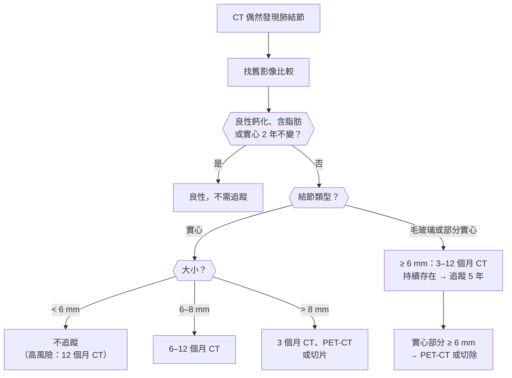
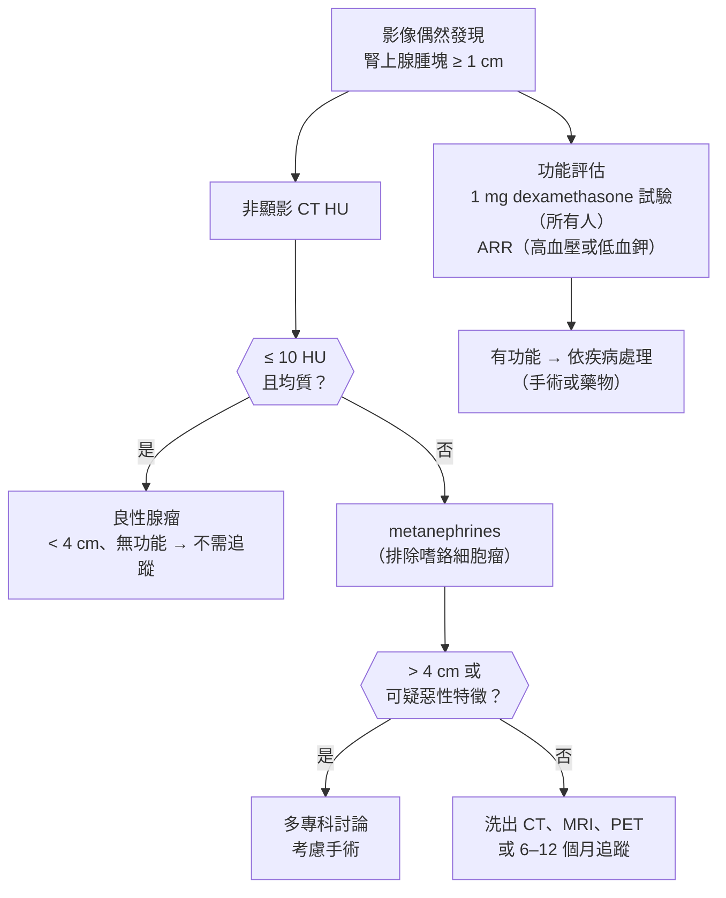

## 胸部（Chest）

### 肺結節（Pulmonary Nodule）

#### 定義與分類

- **[[胸腔內科#孤立性肺結節（Solitary Pulmonary Nodule, SPN）|肺結節]]**：**直徑 ≤ :red[3] cm** 的圓形或不規則陰影，周圍被肺實質包圍；**> 3 cm 稱為腫塊（mass）**，惡性機率高。
- **依密度**：
    - **實心（solid）**：最常見；**倍增時間 20–400 天**。
    - **純毛玻璃（pure ground-glass nodule, GGN）**：**原位腺癌、微侵襲腺癌**、局部發炎或出血；**長很慢**。
    - **部分實心（part-solid）**：**:red[惡性機率最高]**；實心部分大小與侵襲程度相關。
- **適用的追蹤準則**：
    - **偶然發現（≥ 35 歲、無癌症病史、免疫正常）→ Fleischner Society 2017**。
    - **低劑量 CT 篩檢發現 → Lung-RADS**。
    - **已知癌症（排除轉移）、免疫不全（感染）、< 35 歲 → 不適用**，依臨床決定。
- **惡性風險因子**：
    - **病人**：**年齡大**、**抽菸**、**肺癌家族史**、**石綿暴露**、**肺氣腫或肺纖維化**、**過去癌症**。
    - **結節**：**大小**、**邊緣不規則或毛刺狀（spiculation）**、**上葉**、**部分實心**、**持續長大**。
- **良性特徵**：
    - **良性鈣化**：**中央、瀰漫、層狀、爆米花狀（popcorn，錯構瘤）**。
    - **含脂肪** → **錯構瘤（hamartoma）**。
    - **實心結節 2 年不變**（毛玻璃結節要追 5 年）。
    - 肺裂旁結節（淋巴結）。
- **台灣特點**：
    - **不抽菸女性肺腺癌比例高**，常以**毛玻璃結節**表現。
    - **結核肉芽腫**常見。
    - **國健署肺癌低劑量 CT 公費篩檢（每 2 年 1 次）**：
        - **家族史**：父母、子女或兄弟姊妹曾確診肺癌的 **45–74 歲男性、40–74 歲女性**。
        - **重度吸菸**：**50–74 歲、吸菸 ≥ :red[20] 包-年**，且仍在吸菸或戒菸未滿 15 年（114 年起由 30 包-年下修）。

#### Red flags

- **結節持續長大**（實心結節倍增、毛玻璃結節出現實心部分）。
- **毛刺狀邊緣**、**> 8 mm 實心結節** + **抽菸**。
- **部分實心結節的實心部分 ≥ 6 mm**。
- **咳血、體重減輕、[[五官主訴#聲音沙啞（Hoarseness）|聲音沙啞]]、上腔靜脈症候群、骨痛**。
- **肺門或縱膈腔淋巴結腫大**。

#### 鑑別診斷

| 類別 | 疾病 | 鑑別關鍵 |
|---|---|---|
| **惡性** | **[[胸腔內科#肺癌（Lung Cancer）\|原發性肺癌]]**（腺癌最常見）、**[[胸腔外科#肺類癌（Carcinoid tumor）\|類癌]]**、**轉移** | **毛刺狀、長大、部分實心**；轉移：**多發、下葉周邊、已知癌症** |
| **感染肉芽腫** | **[[胸腔內科#肺結核（Pulmonary Tuberculosis）\|結核]]**、**非結核分枝桿菌**、黴菌（隱球菌、麴菌） | **鈣化**、上葉、衛星病灶、**長期穩定** |
| **良性腫瘤** | **[[胸腔外科#肺錯構瘤（Hamartoma）\|錯構瘤]]** | **爆米花狀鈣化、含脂肪** |
| **發炎** | 機化性肺炎、**類風濕結節**、**[[免疫風濕科#Sarcoidosis（類肉瘤病）\|類肉瘤病]]**、肉芽腫性血管炎 | **短期內消失或變化**、自體免疫病 |
| **血管** | **肺動靜脈畸形**、肺梗塞 | **供應與引流血管**（遺傳性出血性微血管擴張症） |
| **其他** | **肺內淋巴結**、圓形肺擴張不全、黏液栓 | **肺裂旁、三角形**；與肋膜增厚相連 |

#### 易混淆鑑別

:::compare[Fleischner 2017：偶然發現的單一實心結節]
| 大小 | 低風險病人 | 高風險病人 |
|---|---|---|
| **< 6 mm** | **不需常規追蹤** | **12 個月追蹤 CT 可考慮** |
| **6–8 mm** | **6–12 個月 CT**，再考慮 18–24 個月 | **6–12 個月 CT** → **18–24 個月 CT** |
| **> :red[8] mm** | **3 個月 CT、PET-CT 或切片** | **3 個月 CT、PET-CT 或切片** |
| **多發實心** | < 6 mm：不追蹤；6–8 mm：3–6 個月 CT | 依最可疑的結節 |
:::

:::compare[Fleischner 2017：毛玻璃與部分實心結節]
| 類型 | 處置 |
|---|---|
| **純毛玻璃 < 6 mm** | **不需常規追蹤** |
| **純毛玻璃 ≥ 6 mm** | **6–12 個月 CT 確認持續存在** → **每 2 年追蹤到滿 :red[5] 年** |
| **部分實心 < 6 mm** | 不需常規追蹤 |
| **部分實心 ≥ 6 mm** | **3–6 個月 CT**；持續存在且**實心部分 < 6 mm → 每年追蹤 5 年**；**實心部分 ≥ 6 mm → 高度懷疑，PET-CT 或切除** |
| **原則** | **毛玻璃結節長得慢，追蹤要久**；**:red[PET-CT 對毛玻璃結節不敏感]** |
:::

:::compare[切片方式的選擇]
| 方式 | 適合 | 缺點 |
|---|---|---|
| **CT 導引經皮穿刺** | **周邊結節** | **氣胸（約 15–25%）** |
| **支氣管鏡（EBUS、導航支氣管鏡）** | **中央結節**、同時做**縱膈腔淋巴結分期** | 周邊小結節陽性率較低 |
| **手術切除（[[胸腔外科#VATS\|VATS]] 楔狀切除）** | **高度懷疑、可手術者**：診斷與治療一次完成 | 侵入性 |
| **PET-CT** | **> 8 mm 實心結節**的良惡性評估與分期 | **偽陽性：感染、:red[結核（台灣多）]**；**偽陰性：毛玻璃、類癌、< 8 mm** |
:::

#### 問診與理學檢查

- **抽菸（包-年）**、**二手菸、烹飪油煙**、**職業暴露（石綿、氡）**、**肺癌家族史**、**過去癌症**、**結核病史或接觸史**、**旅遊與黴菌暴露**、自體免疫病。
- **咳嗽、咳血、體重減輕、聲音沙啞、骨痛**。
- **:red[找舊影像比較]**（最有價值的一步）。
- 理學檢查：**鎖骨上淋巴結**、[[呼吸系統主訴#杵狀指（Digital Clubbing）|杵狀指]]、呼吸音、Horner 症候群。

#### 檢查流程

- **薄切 CT（1 mm）**評估密度與邊緣；**找舊影像**。
- **> 8 mm 實心** → **PET-CT**、**切片（經皮或支氣管鏡）**或**手術**。
- 惡性機率估計：**Brock（PanCan）模型**、Mayo 模型。

#### 初步處置

- **依 Fleischner 或 Lung-RADS 追蹤**；**向病人說明追蹤計畫**，避免過度檢查與焦慮，也避免失聯。
- **戒菸**。
- **高度懷疑且可手術 → 手術切除（肺葉或肺節切除 + 淋巴結取樣）**；不能手術 → **立體定位放射治療（SBRT）**。
- 已知癌症或免疫不全者 → 依臨床（轉移、感染）處理。

:::pitfall
6 mm 的毛玻璃結節追蹤一年沒有變化，就告訴病人「是良性的、不用再追」→ 毛玻璃結節可能是原位或微侵襲腺癌，倍增時間可達數年。純毛玻璃結節 ≥ 6 mm 要追蹤到 5 年，出現實心部分就要積極處理。
:::

:::pitfall
台灣病人 1.5 cm 結節 PET-CT 攝取很高，直接當成肺癌安排大範圍切除 → 結核與黴菌等肉芽腫在台灣常見，也會讓 PET 攝取升高。手術前盡量取得組織診斷，或以楔狀切除做冰凍切片再決定術式。
:::

:::exam
- 結節 ≤ 3 cm；> 3 cm 為腫塊。
- 良性：中央、瀰漫、層狀、爆米花鈣化、含脂肪（錯構瘤）、實心 2 年不變。
- Fleischner：實心 < 6 mm 不追、6–8 mm 6–12 個月、> 8 mm 3 個月 CT、PET 或切片；毛玻璃 ≥ 6 mm 追 5 年。
- 部分實心惡性機率最高；PET 對毛玻璃與 < 8 mm 不敏感，結核偽陽性。
- 台灣 LDCT：家族史（男 45–74、女 40–74）、重度吸菸（50–74、≥ 20 包-年、戒菸未滿 15 年），每 2 年一次。
:::

### 縱膈腔腫塊（Mediastinal Mass）

#### 定義與分類

- **[[胸腔外科#縱膈腔分區|縱膈腔分區]]**（側面胸部 X 光或 CT）：**前、中、後**縱膈腔（國際胸腺惡性腫瘤協會 ITMIG 改稱前、內臟、椎旁）。
- **前縱膈腔（最常見、成人）**：口訣 **4T**：
    - **Thymoma（胸腺瘤，成人前縱膈腔最常見）**、胸腺增生、胸腺囊腫。
    - **Teratoma 與其他生殖細胞瘤**（**年輕男性**：精原細胞瘤、非精原細胞瘤）。
    - **Thyroid（胸骨後甲狀腺腫）**、副甲狀腺腺瘤。
    - **Terrible lymphoma（淋巴瘤：Hodgkin、原發縱膈腔大 B 細胞淋巴瘤）**。
- **中縱膈腔（內臟）**：**淋巴結腫大（淋巴瘤、轉移、[[免疫風濕科#Sarcoidosis（類肉瘤病）|類肉瘤病]]、結核）**、**支氣管源性囊腫**、**心包膜囊腫**、食道病灶、**[[心血管外科#主動脈瘤（Aortic Aneurysm）|主動脈瘤]]**。
- **後縱膈腔（椎旁）**：**神經源性腫瘤（神經鞘瘤、神經纖維瘤；兒童：[[小兒外科#Neuroblastoma（神經母細胞瘤）|神經母細胞瘤]]）**、**髓外造血**、脊椎病灶。
- **兒童**：**神經源性腫瘤**（後）與**淋巴瘤**（前）最常見。

#### Red flags

- **前縱膈腔腫塊 + 全身麻醉或鎮靜** → **氣管或心臟大血管受壓、:red[呼吸道塌陷]**（**仰躺喘、端坐呼吸**時特別危險）。
- **上腔靜脈症候群**（臉與上肢腫、頸靜脈怒張、胸壁靜脈擴張）→ 淋巴瘤、肺癌。
- **快速長大、B 症狀（發燒、夜間盜汗、體重減輕）** → **淋巴瘤**。
- **年輕男性前縱膈腔腫塊 + AFP 或 hCG 高** → **非精原細胞生殖細胞瘤**。
- **眼皮下垂、複視、肌肉易疲勞** → **[[神經內科#重症肌無力（Myasthenia Gravis, MG）|重症肌無力]]（胸腺瘤）**。

#### 鑑別診斷

| 位置 | 疾病 | 鑑別關鍵 |
|---|---|---|
| **前** | **胸腺瘤** | **40–60 歲、重症肌無力（30–50%）**、純紅血球再生不良、低丙球蛋白血症 |
| **前** | **生殖細胞瘤**（畸胎瘤、精原細胞瘤、非精原細胞瘤） | **年輕男性**；**畸胎瘤含脂肪、鈣化、牙齒**；**AFP、hCG** |
| **前** | **胸骨後甲狀腺腫** | **與頸部甲狀腺相連**、CT 高密度 |
| **前** | **[[血液腫瘤科#淋巴瘤（Lymphoma）\|淋巴瘤]]** | **年輕人、B 症狀、快速長大**、其他淋巴結 |
| **中** | **淋巴結腫大**（**淋巴瘤、肺癌轉移、類肉瘤病、結核**）、**支氣管源性囊腫**、**心包膜囊腫**、**主動脈瘤** | **CT 密度（囊腫為水密度）**、顯影 |
| **後** | **神經源性腫瘤**、髓外造血 | **與神經孔相連、椎間孔擴大**；**兒童神經母細胞瘤（尿 VMA、HVA）** |

#### 易混淆鑑別

:::compare[胸腺瘤 vs 淋巴瘤 vs 生殖細胞瘤（前縱膈腔）]
| | 胸腺瘤 | 淋巴瘤 | 生殖細胞瘤 |
|---|---|---|---|
| 年齡 | **40–60 歲** | **年輕人（Hodgkin 20–30 歲）** | **20–40 歲男性** |
| 伴隨 | **重症肌無力**、純紅血球再生不良、低丙球蛋白 | **B 症狀**、其他淋巴結、**飲酒後淋巴結痛（Hodgkin）** | 睪丸檢查（通常正常） |
| 影像 | **邊界清楚、均質**；侵襲性會沾黏 | **多個淋巴結融合**、包覆血管 | **畸胎瘤：脂肪、鈣化、囊腫**；精原細胞瘤：均質大腫塊 |
| 腫瘤標記 | — | **LDH 高** | **AFP（非精原）、hCG** |
| 診斷 | **典型影像 + 可切除 → 直接手術（避免切片種植）** | **切片（粗針或手術）** | **腫瘤標記 + 切片** |
| 治療 | **手術切除（± 放射治療）** | **化學治療 ± 放射治療** | **化學治療（cisplatin 為主）** ± 殘餘腫瘤切除 |
:::

#### 問診與理學檢查

- **胸痛、咳嗽、喘（尤其仰躺時）、吞嚥困難、聲音沙啞**、**臉部腫脹**、**B 症狀**、**肌肉易疲勞、眼皮下垂**、甲狀腺腫大。
- 理學檢查：**上腔靜脈症候群徵象**、**頸部與鎖骨上淋巴結**、**甲狀腺**、**睪丸**、**Horner 症候群**（後縱膈腔）、眼皮下垂與易疲勞試驗。

#### 檢查流程

- **胸部顯影 CT**（位置、密度、脂肪、鈣化、囊性、侵犯）；**MRI**（囊腫、神經源性腫瘤與脊髓關係）。
- **AFP、β-hCG、LDH**（:red[年輕男性前縱膈腔必驗]）、**抗乙醯膽鹼受體抗體**、**TSH**、CBC。
- **切片**：**淋巴瘤、生殖細胞瘤 → 粗針或手術切片**；**典型可切除的胸腺瘤 → 直接手術**。
- **全身麻醉前評估呼吸道受壓**（CT、肺功能流量-容積曲線、坐姿下局部麻醉切片）。

#### 初步處置

- **依診斷治療**（見上表）。
- **呼吸道受壓的病人**：**避免全身麻醉與肌肉鬆弛劑**；必要時**保留自主呼吸、坐姿**、預備**體外循環或 ECMO**。
- **上腔靜脈症候群**：**抬高頭部、類固醇（淋巴瘤取得組織後）、支架**、治療原因。
- **胸腺瘤合併重症肌無力 → 術前控制肌無力**，避免術後肌無力危象。

:::pitfall
前縱膈腔大腫塊的年輕病人在全身麻醉下做切片，誘導後無法通氣 → 肌肉鬆弛後腫塊壓迫氣管與大血管。前縱膈腔腫塊麻醉前要評估呼吸道受壓（仰躺症狀、CT 氣管直徑），盡量在局部麻醉、坐姿下取得組織。
:::

:::pitfall
年輕男性前縱膈腔腫塊被當成淋巴瘤送去切片，沒驗腫瘤標記 → 生殖細胞瘤在 AFP 或 hCG 明顯升高時可以直接開始化學治療。前縱膈腔腫塊的年輕男性一定要驗 AFP、hCG、LDH 並檢查睪丸。
:::

:::exam
- 前縱膈腔 4T：胸腺瘤（成人最常見）、畸胎瘤與生殖細胞瘤、甲狀腺、淋巴瘤；後縱膈腔：神經源性腫瘤。
- 胸腺瘤：重症肌無力、純紅血球再生不良、低丙球蛋白；可切除者直接手術。
- 年輕男性前縱膈腔：AFP、hCG、LDH；精原細胞瘤 AFP 正常。
- 前縱膈腔腫塊全身麻醉 → 呼吸道塌陷。
:::

### 冠狀動脈鈣化（Coronary Artery Calcification）

#### 定義與分類

- **冠狀動脈鈣化**：**粥狀動脈硬化斑塊的標記**；可在**冠狀動脈鈣化分數 CT（CAC score）**，或**胸部 CT（含低劑量肺癌篩檢）**偶然看到。
- **Agatston 分數**：
    - **0**：**10 年內心血管事件風險很低**（「保護性」陰性）。
    - **1–99**：輕度。
    - **100–299**：中度 → **建議 statin**。
    - **≥ 300（或 ≥ 75 百分位）**：**高風險**，相當於已有冠心病的等級。
- **用途**：**中度風險（10 年 ASCVD 風險 7.5–20%）、是否用 statin 猶豫不決時**重新分層。
- **:red[鈣化 ≠ 狹窄]**：鈣化代表斑塊負擔，**不代表有阻塞**；**沒有鈣化不排除非鈣化斑塊**（年輕、抽菸者）。

#### Red flags

- **偶然發現廣泛鈣化 + 運動時胸悶或喘** → **評估穩定型冠心病**（壓力測試、冠狀動脈 CT 血管攝影）。
- **年輕人（< 40 歲）有鈣化** → **家族性高膽固醇血症**、糖尿病、CKD。
- **主動脈瓣鈣化 + 心雜音** → **[[心血管外科#主動脈瓣狹窄（Aortic Stenosis, AS）|主動脈瓣狹窄]]**。

#### 鑑別診斷

| 情境 | 意義 | 處置 |
|---|---|---|
| **無症狀、CAC 0** | 低風險 | **中度風險者可延後 statin**（糖尿病、抽菸、家族史、FH 除外） |
| **無症狀、CAC 1–99** | 輕度斑塊 | **55 歲以上傾向用 statin**、控制風險因子 |
| **無症狀、CAC ≥ 100** | 中高度斑塊 | **statin**、考慮 aspirin（出血風險低者） |
| **有症狀** | 不能用鈣化分數排除 | **依[[心血管系統主訴#穩定或反覆胸痛（Stable / Recurrent Chest Pain）\|穩定或反覆胸痛]]流程** |

#### 易混淆鑑別

:::compare[冠狀動脈鈣化分數 vs 冠狀動脈 CT 血管攝影]
| | 鈣化分數 CT | 冠狀動脈 CT 血管攝影（CCTA） |
|---|---|---|
| 顯影劑 | **不用** | **需要（碘顯影劑）** |
| 輻射 | 低（約 1 mSv） | 較高 |
| 看到什麼 | **鈣化斑塊量** | **狹窄程度、非鈣化斑塊** |
| 對象 | **無症狀、中度風險，決定是否用 statin** | **有症狀、懷疑冠心病** |
| 限制 | **不評估狹窄**；年輕人非鈣化斑塊漏掉 | **嚴重鈣化時狹窄程度高估**、心律不整影響品質 |
:::

#### 問診與理學檢查

- **胸悶、運動耐受度、喘**、**心血管風險因子（高血壓、糖尿病、血脂、抽菸、家族史、CKD）**、**目前用藥（statin、aspirin）**。
- 理學檢查：**血壓**、**心雜音**、**周邊脈搏**、**黃色瘤**。

#### 檢查流程

- **血脂、HbA1c、腎功能**、**10 年 ASCVD 風險評估**。
- **無症狀 → :red[不需常規壓力測試或心導管]**。
- **有症狀 → 壓力測試或 CCTA**。

#### 初步處置

- **依 CAC 調整 statin 與 aspirin 決策**、**控制風險因子**、**戒菸**、運動。
- **statin 會讓斑塊鈣化增加（斑塊穩定化）** → **不需追蹤鈣化分數**判斷療效。

:::pitfall
低劑量肺癌篩檢 CT 偶然看到冠狀動脈鈣化，報告沒提、醫師也沒處理 → 胸部 CT 上的冠狀動脈鈣化同樣代表動脈硬化負擔。看到就應評估心血管風險、考慮 statin，而不是只處理肺結節。
:::

:::pitfall
無症狀的病人鈣化分數 400，直接安排心導管 → 鈣化代表斑塊負擔而非狹窄，無症狀者心導管與支架不改善預後。重點是積極控制風險因子與 statin，有症狀才評估缺血。
:::

:::exam
- CAC 0 → 低風險，中度風險者可延後 statin；≥ 100 → statin；≥ 300 高風險。
- 鈣化 ≠ 狹窄；無症狀不常規做壓力測試或心導管。
- 用途：中度風險、statin 決策猶豫時。
- statin 使鈣化增加，不用來追蹤療效。
:::

## 頭頸（Head and Neck）

### 甲狀腺偶發結節（Thyroid Incidentaloma）

#### 定義與分類

- **甲狀腺偶發結節**：**頸動脈超音波、頸胸部 CT、MRI 或 PET** 時偶然看到的甲狀腺結節。
- **盛行率很高**：**超音波可在 50–60% 的成人看到結節**；**惡性約 5–10%**，多為**預後很好的[[代謝內分泌科#甲狀腺癌|乳突癌]]**。
- **依發現方式的惡性風險**：
    - **PET 局部攝取（focal FDG uptake）**：**惡性約 :red[30–35]%** → **一定要超音波 ± 細針抽吸**。
    - **PET 瀰漫性攝取**：多為**橋本氏甲狀腺炎**。
    - **CT 或 MRI 偶發**：**依年齡與大小決定是否做超音波**（ACR 建議：**< 35 歲 ≥ 1 cm、≥ 35 歲 ≥ 1.5 cm**，或有可疑特徵如侵犯周圍組織、異常淋巴結 → 超音波）。
    - **超音波偶發**：**依超音波特徵（ATA 型態或 TI-RADS）**決定細針抽吸。
- **台灣**：**頸部超音波普及**，偶發甲狀腺結節與小乳突癌大量被發現 → **過度診斷**議題（韓國篩檢後甲狀腺癌發生率暴增、死亡率不變的經驗）。

#### Red flags

- **快速長大**、**聲音沙啞（喉返神經侵犯）**、**吞嚥或呼吸困難**、**固定硬塊**。
- **頸部淋巴結腫大**。
- **兒童或青少年的結節**（惡性比例較高）、**頭頸部放射線暴露史**、**家族史（甲狀腺髓質癌、MEN2）**。
- **超音波高度可疑特徵**：**低迴音實心 + 不規則邊緣、微鈣化、高大於寬（taller-than-wide）、甲狀腺外侵犯**。

#### 鑑別診斷

| 類別 | 疾病 | 鑑別關鍵 |
|---|---|---|
| **良性** | **膠質結節、增生結節**、**囊腫**、**橋本氏甲狀腺炎的假結節**、濾泡腺瘤、**毒性結節（熱結節）** | **海綿狀（spongiform）、純囊腫**；**TSH 低 → 掃描** |
| **惡性** | **乳突癌（最常見）**、**濾泡癌**、**髓質癌**、未分化癌、淋巴瘤、轉移 | **超音波高度可疑特徵**、細針抽吸 |

#### 易混淆鑑別

:::compare[ATA 超音波型態與細針抽吸門檻]
| 型態 | 特徵 | 惡性機率 | 細針抽吸門檻 |
|---|---|---|---|
| **高度懷疑** | **低迴音實心 + 不規則邊緣、微鈣化、高大於寬、邊緣鈣化中斷、甲狀腺外侵犯** | **> 70–90%** | **≥ :red[1] cm** |
| **中度懷疑** | 低迴音實心、邊緣平滑 | 10–20% | **≥ 1 cm** |
| **低度懷疑** | 等或高迴音實心、或部分囊性有偏心實心 | 5–10% | **≥ 1.5 cm** |
| **極低度懷疑** | **海綿狀**、部分囊性無可疑特徵 | < 3% | **≥ 2 cm 或觀察** |
| **良性** | **純囊腫** | < 1% | **不需抽吸**（症狀時可引流） |
:::

#### 問診與理學檢查

- **頸部放射線暴露**、**家族史（甲狀腺癌、MEN2）**、**甲狀腺功能症狀**、**聲音沙啞、吞嚥困難**、**長大速度**。
- 理學檢查：**結節大小、硬度、活動度**、**頸部淋巴結**、聲音。

#### 檢查流程

- **TSH（第一步）**：**低 → 甲狀腺掃描（:red[熱結節幾乎都是良性]，不需抽吸）**；**正常或高 → 頸部超音波**。
- **超音波 → 依型態與大小細針抽吸** → **Bethesda 分類**。
- **髓質癌懷疑（家族史）→ calcitonin、RET 基因**。
- 詳見[[內分泌系統主訴#甲狀腺腫大與結節（Goiter / Thyroid Nodule）|甲狀腺腫大與結節]]。

#### 初步處置

- **未達抽吸門檻 → 依型態超音波追蹤**（高度懷疑 12–24 個月；低度 12–24 個月；極低度可不追或 ≥ 24 個月）。
- **低風險微小乳突癌（< 1 cm、無淋巴結轉移與侵犯）**：**積極監測（active surveillance）是可選項之一**，與手術一起和病人討論。
- **惡性 → 手術（甲狀腺葉切除或全切除）± 放射碘**。

:::pitfall
頸動脈超音波看到 6 mm 甲狀腺結節，馬上安排細針抽吸 → 小於 1 cm 的結節即使是乳突癌，預後也極好，常規抽吸造成過度診斷與手術。依超音波型態與大小決定，未達門檻就追蹤。
:::

:::pitfall
PET-CT 分期時看到甲狀腺局部攝取，被當成發炎而略過 → PET 局部攝取的甲狀腺結節約三分之一是惡性，要安排超音波與細針抽吸；瀰漫性攝取才多為橋本氏甲狀腺炎。
:::

:::exam
- 甲狀腺結節很常見，惡性 5–10%；PET 局部攝取惡性約 30–35% → 超音波 + FNA。
- 第一步 TSH：低 → 掃描，熱結節不抽。
- ATA：高度與中度懷疑 ≥ 1 cm 抽、低度 ≥ 1.5 cm、極低度 ≥ 2 cm 或觀察、純囊腫不抽。
- 微小乳突癌可積極監測；過度診斷。
:::

### 腦下垂體偶發瘤（Pituitary Incidentaloma）

#### 定義與分類

- **腦下垂體偶發瘤**：因其他原因做**腦部 CT 或 MRI** 偶然發現的腦下垂體病灶；**MRI 約 10% 可見**（多為微腺瘤）。
- **依大小**：**微腺瘤（microadenoma）< :red[1] cm**；**巨腺瘤（macroadenoma）≥ 1 cm**；**≥ 4 cm 為巨大腺瘤**。
- **病灶種類**：
    - **腦下垂體腺瘤（最常見）**：無功能腺瘤、**泌乳素瘤**、生長激素瘤、ACTH 腺瘤（Cushing 病）、TSH 腺瘤。
    - **Rathke 裂囊腫**、**顱咽管瘤（兒童與老人，鈣化、囊性）**、**腦膜瘤**、**生殖細胞瘤**、轉移（乳癌、肺癌）、**淋巴球性垂體炎（產後、免疫檢查點抑制劑）**、**生理性增大（懷孕、青春期、原發性甲狀腺低下）**。
- **評估三問題**：
    - **有沒有分泌過多？**（所有大小都要評估）
    - **有沒有[[代謝內分泌科#腦下垂體功能低下（Hypopituitarism）|腦下垂體功能低下]]？**（巨腺瘤）
    - **有沒有壓迫視神經交叉？**（巨腺瘤靠近視交叉 → 視野檢查）

#### Red flags

- **突發劇烈頭痛 + 視力下降或複視 + 意識改變 + 低血壓** → **[[代謝內分泌科#腦下垂體中風（Pituitary Apoplexy）|腦下垂體中風]]（pituitary apoplexy）**（**緊急類固醇**）。
- **雙顳側半盲**、視力下降 → **視交叉受壓**。
- **低血鈉、低血壓、倦怠** → **續發性腎上腺功能不全**（先補 cortisol 再補甲狀腺素）。
- **巨腺瘤 + 泌乳素只有中度升高** → **鉤效應（hook effect）或垂體柄效應**。

#### 鑑別診斷

| 類別 | 疾病 | 鑑別關鍵 |
|---|---|---|
| **分泌性腺瘤** | **[[代謝內分泌科#Prolactinoma\|泌乳素瘤]]**、**生長激素瘤（肢端肥大）**、**[[代謝內分泌科#Cushing's Disease\|Cushing 病]]**、TSH 腺瘤 | **prolactin、IGF-1、1 mg dexamethasone 抑制試驗**、臨床徵象 |
| **無功能腺瘤** | **[[代謝內分泌科#腦下垂體腫瘤\|無功能腺瘤]]** | **荷爾蒙正常或低下**、**泌乳素輕度升高（垂體柄效應，多 < 100 ng/mL）** |
| **囊性** | **Rathke 裂囊腫**、**[[神經外科#腦下垂體腫瘤（Pituitary Tumors）\|顱咽管瘤]]** | **囊腫無顯影**；顱咽管瘤**鈣化、兒童** |
| **其他** | **腦膜瘤**、生殖細胞瘤、轉移、**淋巴球性垂體炎** | **[[代謝內分泌科#尿崩症（Diabetes Insipidus, DI）\|尿崩症]]（腺瘤少見）**、產後、免疫治療 |
| **生理增大** | **懷孕**、青春期、**原發性甲狀腺低下（TRH 刺激增生）** | **TSH 高**、懷孕 |

#### 易混淆鑑別

:::compare[泌乳素升高 + 腦下垂體腫瘤：泌乳素瘤 vs 垂體柄效應]
| | 泌乳素瘤 | 垂體柄效應（無功能巨腺瘤等） |
|---|---|---|
| prolactin | **與腫瘤大小相關：巨腺瘤常 > 200–250 ng/mL** | **輕度升高（多 < 100 ng/mL）** |
| 機轉 | 腫瘤分泌 | **壓迫垂體柄 → dopamine 抑制解除** |
| 治療 | **cabergoline（首選，縮小腫瘤）**，即使有視野缺損 | **手術（經鼻蝶竇）**；cabergoline 只降泌乳素、腫瘤不縮 |
| **陷阱** | **:red[鉤效應]：泌乳素極高時檢驗假性偏低 → 要求稀釋後重測** | — |
:::

:::compare[腦下垂體偶發瘤的追蹤與手術適應症]
| 項目 | 內容 |
|---|---|
| **微腺瘤（無功能）** | **1 年後 MRI**，不變則**每 1–2 年**追蹤，3 年後拉長；**不需常規視野或功能低下評估** |
| **巨腺瘤（無功能）** | **6 個月 MRI**，之後**每年**；**視野與腦下垂體功能評估**，定期重複 |
| **手術適應症** | **視野缺損**、**壓迫視神經交叉或其他神經**、**腦下垂體中風**、**分泌過多（泌乳素瘤除外）**、**持續長大**、**接近視交叉且打算懷孕** |
| **泌乳素瘤** | **藥物（cabergoline）為第一線** |
:::

#### 問診與理學檢查

- **頭痛、視力或視野改變、複視**、**月經異常、泌乳、性慾下降、勃起功能障礙**、**肢端肥大徵象（手腳變大、戒指變緊、打鼾）**、**Cushing 徵象**、**倦怠、怕冷、體重變化**、**多尿多喝**、**懷孕與產後**、**用藥（抗精神病藥、metoclopramide → 泌乳素高）**。
- 理學檢查：**視野（對照法）**、**眼球運動**、**肢端肥大與 Cushing 外觀**、泌乳、第二性徵。

#### 檢查流程

- **所有偶發瘤**：**prolactin**、**IGF-1**、**有 Cushing 徵象 → 1 mg dexamethasone 抑制試驗等**。
- **巨腺瘤**：加上**清晨 cortisol、ACTH、free T4、TSH、LH、FSH、testosterone 或 estradiol**；**靠近視交叉 → 正式視野檢查**。
- **腦下垂體 MRI（顯影、薄切）**。

#### 初步處置

- **無功能、無壓迫 → 依上表 MRI 追蹤**。
- **功能低下 → 補充荷爾蒙**（**:red[先 hydrocortisone，再 thyroxine]**）。
- **泌乳素瘤 → cabergoline**；**其他分泌性腺瘤與壓迫 → 經鼻蝶竇手術**。
- **腦下垂體中風 → 高劑量 hydrocortisone**、神經外科評估減壓。

:::pitfall
腦下垂體巨腺瘤合併中樞性甲狀腺低下與腎上腺功能不全，先開了 thyroxine → 甲狀腺素增加 cortisol 代謝，可能誘發[[代謝內分泌科#腎上腺危象（Adrenal Crisis）|腎上腺危象]]。腦下垂體功能低下要先補 hydrocortisone，再補甲狀腺素。
:::

:::pitfall
3 cm 巨腺瘤、泌乳素 60 ng/mL，被當成無功能腺瘤安排手術 → 泌乳素極高時可能因鉤效應測出假性偏低。巨腺瘤的泌乳素要請檢驗室稀釋後重測，若是泌乳素瘤，cabergoline 就能縮小腫瘤。
:::

:::exam
- 微腺瘤 < 1 cm、巨腺瘤 ≥ 1 cm。
- 三問題：分泌過多（prolactin、IGF-1、Cushing 篩檢）、功能低下（巨腺瘤）、視交叉受壓（視野）。
- 泌乳素 < 100 → 垂體柄效應；巨腺瘤泌乳素不高 → 鉤效應，稀釋重測。
- 泌乳素瘤 → cabergoline；其他有症狀 → 經鼻蝶竇手術；腦下垂體中風 → 類固醇。
- 功能低下：先 hydrocortisone 再 thyroxine。
:::

### 無症狀顱內病灶（Incidental Brain Findings）

#### 定義與分類

- 腦部 MRI 或 CT 常見的偶然發現：
    - **未破裂顱內動脈瘤**：**成人盛行率約 :red[3]%**；**危險因子：抽菸、高血壓、女性、家族史（≥ 2 位一等親）、[[腎臟內科#體染色體顯性多囊腎（ADPKD）|體染色體顯性多囊腎]]、結締組織疾病（Ehlers-Danlos）**。
    - **腦膜瘤**：**最常見的偶發腦腫瘤**；**中老年女性**；多數生長緩慢。
    - **白質高訊號（white matter hyperintensities）**：**小血管疾病**，與**年齡、高血壓、糖尿病、抽菸**相關；**增加中風、失智、跌倒風險**。
    - **無症狀腔隙性梗塞（silent infarct）**、**微出血（microbleeds）**。
    - **蛛網膜囊腫**、**松果體囊腫**、**Chiari 第 1 型畸形**、**海綿狀血管瘤**、**發育性靜脈異常**、**空蝶鞍**。
- **原則**：**區分需要追蹤或治療的病灶，避免不必要的檢查與焦慮**。

#### Red flags

- **動脈瘤 + 突發劇烈頭痛（雷擊樣頭痛）** → **破裂，[[神經內科#蜘蛛膜下腔出血（SAH）|蜘蛛膜下腔出血]]**。
- **動脈瘤 + [[眼科#CN III（動眼神經）麻痺|動眼神經麻痺]]（瞳孔放大）** → **:red[後交通動脈瘤]長大或即將破裂**。
- **腦膜瘤 + 癲癇、局部神經缺損、水腫** → 需治療。
- **白質病變 + 快速認知退化** → 評估其他原因（脫髓鞘、血管炎、CADASIL）。

#### 鑑別診斷

| 發現 | 下一步 | 鑑別關鍵 |
|---|---|---|
| **[[神經外科#腦血管畸形（Cerebrovascular Malformations）\|未破裂動脈瘤]]** | **神經血管專科評估**、控制血壓、戒菸 | **大小、位置（後循環較易破）、形狀、長大**；**PHASES 分數** |
| **[[神經外科#腦膜瘤（Meningioma）\|腦膜瘤]]** | **小、無症狀 → MRI 3–6 個月後追蹤，再每年** | **硬腦膜尾徵（dural tail）**、均勻顯影 |
| **白質高訊號、腔隙梗塞** | **控制血管風險因子** | **[[神經內科#CADASIL\|CADASIL]]**（年輕、偏頭痛、家族史、顳極病灶）、多發性硬化（垂直於腦室） |
| **微出血** | 依分佈：**深部 → 高血壓**；**腦葉 → 類澱粉血管病變** | 抗凝血與抗血小板決策需考量 |
| **蛛網膜囊腫、松果體囊腫** | 多不需追蹤 | 典型影像 |
| **Chiari 第 1 型** | **無症狀不手術** | 咳嗽性頭痛、[[神經內科#脊髓空洞症（Syringomyelia）\|脊髓空洞症]] |

#### 易混淆鑑別

:::compare[未破裂顱內動脈瘤：治療還是觀察？]
| 傾向治療 | 傾向觀察 |
|---|---|
| **≥ 7 mm**（尤其年輕） | **< 7 mm、前循環**、年長 |
| **後循環（基底動脈尖端）、後交通動脈** | 海綿竇段內頸動脈 |
| **追蹤中長大**、形狀不規則（子囊） | 穩定、形狀規則 |
| **有症狀（動眼神經麻痺）** | 無症狀 |
| **曾有其他動脈瘤破裂、家族史** | 預期壽命短、手術風險高 |
| **治療方式**：**血管內線圈栓塞、血流導向支架、開顱夾閉** | **觀察**：**戒菸、控制血壓**、定期 MRA 或 CTA |
:::

#### 問診與理學檢查

- **頭痛型態**、**神經學症狀**、**癲癇**、**認知變化**、**高血壓、抽菸、糖尿病**、**家族史（動脈瘤、多囊腎、CADASIL）**、**抗凝血藥物**。
- 理學檢查：**血壓**、**神經學檢查（瞳孔、腦神經、肌力、步態）**、認知。

#### 檢查流程

- **動脈瘤 → MRA 或 CTA**（必要時 DSA）；**多囊腎病人與 ≥ 2 位一等親有動脈瘤者可篩檢**。
- **腦膜瘤 → 顯影 MRI**。
- **白質病變 → 血管風險因子評估**（血壓、血糖、血脂）；非典型分佈 → 進一步檢查。

#### 初步處置

- **動脈瘤**：**戒菸、控制血壓**、**避免興奮劑**；依上表決定治療或追蹤。
- **腦膜瘤**：**觀察**；**長大、有症狀 → 手術或立體定位放射手術**。
- **小血管疾病**：**控制血壓（最重要）**、糖尿病、血脂、戒菸、運動。
- **向病人清楚說明「哪些不需要處理」**，減少焦慮與重複檢查。

:::pitfall
健檢 MRI 發現 3 mm 前循環未破裂動脈瘤，病人很焦慮，醫師立即安排栓塞 → 小型前循環動脈瘤的破裂風險很低，治療本身有併發症風險。依大小、位置、形狀與病人因素（PHASES）和神經血管專科共同決定，觀察期間戒菸與控制血壓。
:::

:::pitfall
老年人 MRI 報告「多發白質高訊號」，被告知「只是老化」就不處理 → 白質高訊號代表小血管疾病，與中風、失智、跌倒風險相關。應積極控制血壓與其他血管危險因子。
:::

:::exam
- 未破裂動脈瘤盛行率約 3%；危險因子：抽菸、高血壓、多囊腎、家族史。
- 傾向治療：≥ 7 mm、後循環、長大、有症狀；動眼神經麻痺（瞳孔放大）→ 後交通動脈瘤。
- 腦膜瘤：最常見偶發腦腫瘤、硬腦膜尾徵；小而無症狀 → 觀察。
- 白質高訊號 → 小血管疾病 → 控制血壓。
:::

## 腹部（Abdomen）

### 腎上腺偶發瘤（Adrenal Incidentaloma）

#### 定義與分類

- **[[代謝內分泌科#腎上腺偶發瘤（Adrenal Incidentaloma）|腎上腺偶發瘤]]**：**≥ 1 cm**、因其他原因做影像時偶然發現的腎上腺腫塊；**CT 盛行率約 2–4%，隨年齡增加（70 歲以上可達 10%）**。
- **組成**：
    - **無功能腺瘤（最常見，約 80%）**。
    - **輕度自主性 cortisol 分泌（MACS，過去稱亞臨床 Cushing）**：**最常見的功能性**，與**高血壓、糖尿病、骨質疏鬆、心血管疾病**相關。
    - **嗜鉻細胞瘤**（約 5%）、**原發性醛固酮症（醛固酮瘤）**、**Cushing 症候群**。
    - **腎上腺皮質癌**（罕見，**多 > 4 cm**）、**轉移**（肺、乳、腎、黑色素瘤；**已知癌症者常見**）。
    - **髓脂瘤（myelolipoma，含大量脂肪）**、**囊腫**、**出血**、**感染（結核、組織胞漿菌）**、節細胞神經瘤。
- **評估兩問題**：**有沒有功能（分泌荷爾蒙）？** **是良性還是惡性？**
- **影像判斷良性（ESE 2023）**：
    - **非顯影 CT ≤ :red[10] HU（富含脂質腺瘤）** 且均質 → **良性腺瘤**。
    - **> 10 HU（不確定）** → **顯影洗出 CT**、**化學位移 MRI**、**FDG-PET**，或 **6–12 個月後影像追蹤**。
    - **惡性特徵**：**> 4 cm**、**不均質、邊緣不規則、壞死、鈣化**、**快速長大**。

#### Red flags

- **陣發性頭痛、心悸、冒汗、高血壓（或血壓劇烈波動）** → **嗜鉻細胞瘤**；**手術、切片、顯影劑、麻醉、β-blocker 單用可誘發危象**。
- **> 4 cm、不均質、快速長大、合併雄性素過多（女性多毛、男性化）** → **腎上腺皮質癌**。
- **雙側病灶 + 低血壓、低血鈉、高血鉀** → **[[代謝內分泌科#腎上腺功能不全（Adrenal Insufficiency）|腎上腺功能不全]]**（出血、結核、轉移）。
- **已知癌症病人的新腎上腺病灶** → 轉移。

#### 鑑別診斷

| 類別 | 疾病 | 鑑別關鍵 |
|---|---|---|
| **無功能良性** | **無功能腺瘤**、**髓脂瘤**、囊腫 | **≤ 10 HU 均質**；髓脂瘤**大量巨觀脂肪** |
| **cortisol** | **輕度自主性 cortisol 分泌（MACS）**、**[[代謝內分泌科#庫欣氏症候群（Cushing's Syndrome）\|Cushing 症候群]]** | **1 mg dexamethasone 抑制試驗**：**≤ 1.8 µg/dL 排除**、**1.9–5.0 MACS**、**> 5.0 cortisol 過多** |
| **兒茶酚胺** | **[[代謝內分泌科#嗜鉻細胞瘤（Pheochromocytoma）\|嗜鉻細胞瘤]]** | **血漿游離或尿液分餾 metanephrines**；**> 10 HU、MRI T2 亮** |
| **醛固酮** | **[[代謝內分泌科#原發性醛固酮過多症（Primary Aldosteronism / Conn's Syndrome）\|原發性醛固酮症]]** | **高血壓或低血鉀 → aldosterone/renin 比值** |
| **惡性** | **[[內分泌外科#腎上腺皮質癌（Adrenocortical Carcinoma, ACC）\|腎上腺皮質癌]]**、**轉移** | **> 4 cm、> 20 HU、不均質、長大**；已知癌症 |
| **雙側** | **轉移**、**出血（抗凝血、敗血症）**、**結核**、**[[代謝內分泌科#先天性腎上腺增生（Congenital Adrenal Hyperplasia, CAH）\|CAH]]**、雙側增生 | **評估腎上腺功能不全**、17-OHP |

#### 易混淆鑑別

:::compare[腎上腺偶發瘤的功能評估（ESE 2023）]
| 檢查 | 對象 | 判讀 |
|---|---|---|
| **1 mg dexamethasone 抑制試驗** | **所有病人** | **≤ 1.8 µg/dL 排除**；**1.9–5.0 → MACS**（篩檢高血壓、糖尿病、骨質疏鬆）；**> 5.0 → 進一步確認 Cushing** |
| **血漿游離或尿液分餾 metanephrines** | **非顯影 CT > :red[10] HU 者**（≤ 10 HU 可免） | **> 3–4 倍上限 → 嗜鉻細胞瘤**；**切片或手術前一定先排除** |
| **aldosterone/renin 比值** | **高血壓或低血鉀者** | 陽性 → 確認試驗、**腎上腺靜脈取樣** |
| **性荷爾蒙前驅物（DHEA-S 等）** | **懷疑皮質癌**（大、不確定、雄性素過多） | 升高支持皮質癌 |
:::

:::compare[腎上腺腺瘤 vs 嗜鉻細胞瘤 vs 腎上腺皮質癌]
| | 腺瘤 | 嗜鉻細胞瘤 | 腎上腺皮質癌 |
|---|---|---|---|
| 大小 | **常 < 3 cm** | 不定 | **常 > 4–6 cm** |
| 非顯影 CT | **≤ 10 HU** | **> 10 HU** | **> 20 HU** |
| 顯影洗出 | **快（絕對洗出 > 60%）** | 不定 | **慢** |
| MRI | **化學位移訊號下降** | **T2 很亮（燈泡徵）** | 不均質、壞死 |
| 其他 | 多無功能 | **高血壓危象、metanephrines** | **cortisol 與雄性素同時過多、快速長大** |
:::

#### 問診與理學檢查

- **高血壓（發病年齡、頑固性）**、**低血鉀**、**陣發性頭痛心悸冒汗**、**體重增加、糖尿病、骨質疏鬆、易瘀青**、**多毛或男性化**、**癌症病史**、**抗凝血藥物**、**家族史（MEN2、VHL、神經纖維瘤病）**。
- 理學檢查：**血壓（含姿勢性變化）**、**Cushing 徵象（滿月臉、水牛肩、紫紋、近端肌無力）**、**多毛**、色素沉著。

#### 檢查流程

- **非顯影 CT HU 值**、大小、均質性。
- **1 mg dexamethasone 抑制試驗**（全部）、**metanephrines（> 10 HU）**、**ARR（高血壓或低血鉀）**、**DHEA-S（懷疑皮質癌）**。
- **雙側病灶 → 加驗 cortisol 與 ACTH（腎上腺功能不全）、17-OHP（CAH）**。
- **切片**：**很少需要**；**只在已知肺外癌症、懷疑轉移且結果會改變治療時**；**:red[切片前必須排除嗜鉻細胞瘤]**。

#### 初步處置

- **良性（≤ 10 HU）、< 4 cm、無功能 → 不需影像或功能追蹤**（ESE 2023）。
- **有功能 → 手術（嗜鉻細胞瘤、Cushing、單側醛固酮瘤）**；**MACS → 治療合併症**，有相關合併症時個別化考慮手術。
- **嗜鉻細胞瘤術前：先 α-blocker（phenoxybenzamine 或 doxazosin）10–14 天，再加 β-blocker**、充分補液。
- **惡性或 > 4 cm 不確定 → 手術（多專科討論）**。

:::pitfall
腎上腺腫塊 3 cm、15 HU，直接安排 CT 導引切片 → 若是嗜鉻細胞瘤，切片可能誘發致命的高血壓危象；而且切片很難區分腺瘤與皮質癌。腎上腺腫塊切片前一定要排除嗜鉻細胞瘤，切片只用在懷疑轉移且會改變治療時。
:::

:::pitfall
高血壓病人偶然發現 2 cm 腎上腺腺瘤（8 HU），認為是無功能就不處理 → 所有腎上腺偶發瘤都要做 1 mg dexamethasone 抑制試驗；合併高血壓或低血鉀還要驗 aldosterone/renin 比值，原發性醛固酮症可能藉手術治癒。
:::

:::exam
- 兩問題：功能？良惡性？
- ≤ 10 HU 均質 → 良性腺瘤；> 4 cm、不均質、長大 → 皮質癌。
- 所有人：1 mg DST（≤ 1.8 排除、1.9–5 MACS）；> 10 HU：metanephrines；高血壓或低血鉀：ARR。
- 切片前必須排除嗜鉻細胞瘤；切片只用在疑似轉移。
- 嗜鉻細胞瘤：先 α-blocker 再 β-blocker。
:::

### 肝臟偶發病灶（Incidental Liver Lesion）

#### 定義與分類

- **常見於腹部超音波（台灣健檢普及）或 CT**；**多數是良性**。
- **第一個問題：有沒有[[消化內科#肝硬化（Liver Cirrhosis）|肝硬化]]或慢性 B、C 型肝炎？** → **有：任何新結節都要排除肝細胞癌**；**沒有：多為良性**。
- **常見良性**：
    - **單純肝囊腫**：**最常見**；無回音、薄壁、後方回音增強；**不需追蹤**。
    - **血管瘤（hemangioma）**：**最常見的良性實心腫瘤**；超音波**高回音、邊界清楚**；**顯影：周邊結節狀不連續增強 → 向心性填滿**。
    - **局部結節增生（FNH）**：**年輕女性**；**中央疤痕**、**動脈期均勻增強**；**:red[無惡性潛能]、不會出血**；**hepatobiliary 期（gadoxetate MRI）呈等或高訊號**。
    - **肝細胞腺瘤**：**年輕女性 + 口服避孕藥**、**同化類固醇**、**[[小兒科#肝醣儲積症（Glycogen Storage Diseases）|肝醣儲積症]]**、肥胖；**出血與破裂、惡性轉變（β-catenin 型、男性）**風險。
    - **局部脂肪浸潤或脂肪豁免區**：膽囊窩旁、鐮狀韌帶旁；**沒有占位效應**。
- **惡性**：**肝細胞癌**、**轉移（最常見的肝臟惡性腫瘤，多發）**、肝內膽管癌。
- **感染**：**肝膿瘍**（發燒；台灣**克雷伯氏菌**、**糖尿病**）、阿米巴、包蟲。

#### Red flags

- **肝硬化或 B、C 肝帶原者的新結節** → **肝細胞癌**。
- **多發實心病灶 + 體重減輕** → **轉移**（找原發）。
- **腺瘤 > 5 cm、男性、口服避孕藥持續** → **出血、破裂、惡性轉變**。
- **年輕女性突發右上腹痛 + 低血壓** → **腺瘤破裂出血**。
- **發燒、右上腹痛 + 低回音病灶** → **肝膿瘍**（**克雷伯氏菌可合併眼內炎**）。

#### 鑑別診斷

| 類別 | 疾病 | 鑑別關鍵 |
|---|---|---|
| **囊性** | **[[肝膽胰外科#肝囊腫\|單純肝囊腫]]**、多囊肝、膽道囊腺瘤、**包蟲囊腫** | **無回音、薄壁**；**內有分隔、壁結節 → 囊性腫瘤** |
| **良性實心** | **[[肝膽胰外科#肝臟良性腫瘤\|血管瘤、FNH、肝細胞腺瘤]]** | **顯影型態**（見下表） |
| **惡性** | **[[消化內科#肝細胞癌（Hepatocellular Carcinoma, HCC）\|肝細胞癌]]**、**[[肝膽胰外科#肝轉移（Liver Metastasis）\|轉移]]**、**[[肝膽胰外科#肝內膽管癌（Intrahepatic Cholangiocarcinoma, ICC）\|肝內膽管癌]]** | **肝硬化 + 動脈期增強 + 洗出**；轉移**多發、環狀增強** |
| **感染** | **[[肝膽胰外科#肝膿瘍（Liver Abscess）\|肝膿瘍]]**、阿米巴 | **發燒**、白血球高 |
| **假病灶** | **局部脂肪浸潤、脂肪豁免區** | **典型位置、無占位效應**、血管穿過 |

#### 易混淆鑑別

:::compare[肝臟實心病灶的顯影型態]
| | 血管瘤 | FNH | 肝細胞腺瘤 | 肝細胞癌 | 轉移 |
|---|---|---|---|---|---|
| 族群 | 任何年齡、女性多 | **年輕女性** | **年輕女性 + 口服避孕藥** | **肝硬化、B、C 肝** | **已知癌症** |
| 動脈期 | **周邊結節狀不連續增強** | **均勻強烈增強** | 增強 | **增強（APHE）** | **環狀增強**（大腸癌） |
| 門脈與延遲期 | **向心性填滿** | 等密度；**中央疤痕延遲增強** | 不定 | **洗出（washout）+ 包膜** | 洗出 |
| 肝膽期（gadoxetate） | 低 | **等或高** | **低（多數）** | 低 | 低 |
| 處置 | **不需追蹤** | **不需治療**（不必停避孕藥） | **停避孕藥、減重**；**> 5 cm 或男性 → 切除** | **治療**（LI-RADS 5 免切片） | 找原發 |
:::

#### 問診與理學檢查

- **B、C 型肝炎與肝硬化**、**飲酒**、**口服避孕藥與同化類固醇**、**癌症病史**、**體重減輕**、**發燒與腹痛**、**糖尿病**、**旅遊與接觸動物（包蟲、阿米巴）**。
- 理學檢查：**肝腫大**、**慢性肝病徵象**、黃疸、淋巴結。

#### 檢查流程

- **超音波看到的實心病灶 → 多期顯影 CT 或 MRI**（**gadoxetate MRI 鑑別 FNH 與腺瘤**）；**顯影超音波**也可。
- **肝硬化或 B、C 肝 → AFP + 多期影像（LI-RADS）**；**典型影像可診斷肝細胞癌，不需切片**。
- **非典型、懷疑轉移 → 找原發（內視鏡、腫瘤標記）、切片**。
- **肝功能、B、C 肝標記**。

#### 初步處置

- **單純囊腫、血管瘤、FNH → 不需治療或追蹤**（症狀明顯的大病灶例外）。
- **腺瘤 → 停用口服避孕藥、減重**；**> 5 cm、男性、β-catenin 型、出血 → 切除或栓塞**；**懷孕前評估**。
- **肝細胞癌 → 依 BCLC 分期治療**。
- **肝膿瘍 → 抗生素 + 引流**；克雷伯氏菌 → **眼科檢查**。

:::pitfall
健檢超音波發現 2 cm 高回音肝臟病灶，報告寫「疑似血管瘤」就結案，但病人其實是 B 型肝炎帶原者 → 慢性 B、C 肝或肝硬化病人的新結節，不能只靠超音波下良性結論，要做多期顯影 CT 或 MRI 排除肝細胞癌。
:::

:::pitfall
年輕女性 FNH 被要求停用口服避孕藥並安排手術切除 → FNH 沒有惡性潛能也很少出血，不需要治療或停藥；需要停藥、可能需要切除的是肝細胞腺瘤，兩者用 gadoxetate MRI 區分。
:::

:::exam
- 第一問題：有沒有肝硬化或 B、C 肝？有 → 排除肝細胞癌。
- 血管瘤：周邊結節狀不連續增強、向心性填滿，不需追蹤。
- FNH：年輕女性、中央疤痕、無惡性潛能；腺瘤：口服避孕藥、出血與惡性轉變，> 5 cm 切除。
- 肝細胞癌：動脈期增強 + 洗出，典型影像不需切片。
- 轉移是最常見的肝臟惡性腫瘤。
:::

### 腎臟偶發腫塊（Incidental Renal Mass）

#### 定義與分類

- **囊性病灶**（最常見）：依 **Bosniak 分類（2019 版）**決定處置。
- **實心顯影腫塊**：**:red[腎細胞癌，除非證明不是]**（**小腎腫塊 ≤ 4 cm 約 20% 是良性**）。
- **良性實心**：
    - **血管肌肉脂肪瘤（angiomyolipoma, AML）**：**巨觀脂肪（CT < −10 HU）**；**結節性硬化症（雙側、多發）**；**> 4 cm 出血風險增加**。
    - **嗜酸細胞瘤（oncocytoma）**：影像難與腎細胞癌區分（中央疤痕不可靠）。
- **其他**：**腎盂泌尿上皮癌**、淋巴瘤、轉移、**感染（[[泌尿科#腎膿瘍（Renal / Perinephric Abscess）|腎膿瘍]]、[[泌尿科#黃色肉芽腫性腎盂腎炎（Xanthogranulomatous Pyelonephritis）|黃色肉芽腫性腎盂腎炎]]）**、**梗塞**。
- **腎細胞癌危險因子**：**抽菸**、**肥胖**、**高血壓**、**長期透析（後天性囊腫性腎病）**、**von Hippel-Lindau**、**結節性硬化症**。

#### Red flags

- **實心顯影腫塊**、**Bosniak III、IV**。
- **血尿、腰痛、可摸到的腹部腫塊**（典型三徵，現已少見）。
- **腎靜脈或下腔靜脈腫瘤血栓**、**左側精索靜脈曲張（新發、平躺不消）**。
- **副腫瘤症候群**：**[[血液異常#紅血球增多（Polycythemia / Erythrocytosis）|紅血球增多]]（EPO）**、**高血鈣（PTHrP）**、**Stauffer 症候群（肝功能異常、無轉移）**。
- **AML > 4 cm 或突發腰痛 + 低血壓** → **出血（Wunderlich 症候群）**。

#### 鑑別診斷

| 類別 | 疾病 | 鑑別關鍵 |
|---|---|---|
| **單純囊腫** | **Bosniak I、II** | **薄壁、無顯影、無分隔或少量** |
| **複雜囊腫** | **Bosniak IIF、III、IV** | **分隔增厚、壁結節、顯影** |
| **惡性實心** | **[[泌尿科#腎細胞癌（Renal Cell Carcinoma, RCC）\|腎細胞癌]]**（clear cell 最常見）、泌尿上皮癌 | **顯影增強（> 15–20 HU）** |
| **良性實心** | **血管肌肉脂肪瘤**、嗜酸細胞瘤 | **AML：巨觀脂肪**；嗜酸細胞瘤需切片或切除 |
| **其他** | **腎膿瘍**、淋巴瘤、轉移、梗塞 | **發燒**、多發、其他病灶 |
| **多發囊腫** | **[[泌尿科#多囊腎（Polycystic Kidney Disease, PKD）\|多囊腎]]**、後天性囊腫性腎病（透析） | **腎臟腫大、家族史**；透析年數 |

#### 易混淆鑑別

:::compare[Bosniak 分類（2019）]
| 分類 | 特徵 | 惡性機率 | 處置 |
|---|---|---|---|
| **I** | **單純囊腫：薄壁平滑、水密度、無分隔** | ~0% | **不需追蹤** |
| **II** | 少量薄分隔、細鈣化、均質高密度囊腫（< 3 cm） | ~0% | **不需追蹤** |
| **IIF** | 較多薄分隔、輕度增厚、> 3 cm 高密度 | 約 5–10% | **追蹤（6 個月、12 個月，之後每年至 5 年）** |
| **III** | **增厚不規則的壁或分隔、有顯影** | **約 50%** | **手術或主動監測** |
| **IV** | **顯影的實心成分（壁結節）** | **約 :red[90]%** | **手術** |
:::

#### 問診與理學檢查

- **血尿、腰痛、體重減輕、發燒**、**抽菸、肥胖、高血壓、透析**、**家族史（VHL、結節性硬化症、多囊腎）**、**皮膚病灶**（結節性硬化症的臉部血管纖維瘤、灰葉斑）。
- 理學檢查：**腹部腫塊**、**精索靜脈曲張**、**下肢水腫（下腔靜脈阻塞）**、皮膚。

#### 檢查流程

- **多期顯影 CT 或 MRI（腎臟 protocol）**：顯影程度、脂肪、囊腫特徵。
- **腎功能（考慮腎元保留手術）**、**尿液分析**、CBC、Ca。
- **切片**：**影像不確定、考慮主動監測或消融、懷疑淋巴瘤或轉移時**。
- 腎細胞癌 → **胸部 CT** 分期。

#### 初步處置

- **Bosniak I、II → 不需追蹤**；**IIF → 影像追蹤**；**III、IV → 手術（或主動監測）**。
- **小腎腫塊（≤ 4 cm）**：**部分腎切除（首選，保留腎功能）**、**高齡或合併症多 → 主動監測或消融**。
- **AML**：**< 4 cm 無症狀 → 追蹤**；**> 4 cm、出血、懷孕考量 → 選擇性栓塞、部分腎切除**；**結節性硬化症 → everolimus**。

:::pitfall
2.5 cm 實心顯影腎臟腫塊，因為「可能是良性」就安排每年超音波 → 實心顯影的腎臟腫塊要當成腎細胞癌處理，至少要多期影像評估並與泌尿科討論部分腎切除、切片或主動監測，不能只用超音波隨意追蹤。
:::

:::pitfall
Bosniak I 的單純腎囊腫被安排每半年追蹤 → 單純囊腫惡性機率近乎零，不需追蹤；只有 IIF 以上才需要影像追蹤或處置。
:::

:::exam
- 實心顯影腎臟腫塊 → 腎細胞癌，除非證明不是；小腎腫塊約 20% 良性。
- Bosniak I、II 不追；IIF 追蹤；III 約 50% 惡性；IV 約 90% → 手術。
- AML：巨觀脂肪、結節性硬化症、> 4 cm 出血 → 栓塞；everolimus。
- 腎細胞癌副腫瘤：紅血球增多、高血鈣、Stauffer；左側精索靜脈曲張。
:::

### 胰臟囊性病灶（Pancreatic Cystic Lesion）

#### 定義與分類

- **[[消化內科#胰臟囊性腫瘤（Pancreatic Cystic Neoplasms）|胰臟囊腫]]很常見**：**MRI 盛行率可達 10–20%，隨年齡增加**；多數是良性或低惡性潛能。
- **種類**：
    - **偽囊腫（pseudocyst）**：**[[消化內科#急性胰臟炎（Acute Pancreatitis）|胰臟炎病史]]**；**無上皮**；**囊液澱粉酶極高**。
    - **漿液性囊腺瘤（serous cystadenoma, SCA）**：**老年女性**；**蜂巢狀微囊、中央疤痕與日出狀鈣化**；**幾乎都是良性**。
    - **黏液性囊性腫瘤（MCN）**：**中年女性（幾乎只見於女性）**、**胰體尾**、**卵巢樣基質**、**不與胰管相通**；**有惡性潛能 → 切除**。
    - **胰管內乳突狀黏液性腫瘤（IPMN）**：**老年男性多**、**與胰管相通**；**主胰管型（惡性風險高）**、**分支胰管型（風險較低）**、混合型。
    - **實質性假乳突狀腫瘤（SPN）**：**年輕女性**；實心與囊性混合；**低度惡性 → 切除**。
    - **囊性神經內分泌腫瘤**、**胰臟癌囊性變**。
- **:red[黏液性（MCN、IPMN）]才是需要監測或手術的重點**。

#### Red flags

- **高危徵象（high-risk stigmata，Fukuoka）**：
    - **胰頭囊腫合併阻塞性黃疸**。
    - **顯影的壁結節 ≥ :red[5] mm**。
    - **主胰管 ≥ :red[10] mm**。
- **令人擔心的特徵（worrisome features）**：
    - **囊腫 ≥ 3 cm**、**顯影壁結節 < 5 mm**、**囊壁增厚顯影**。
    - **主胰管 5–9 mm**、**主胰管突然變窄合併遠端萎縮**。
    - **淋巴結腫大**、**CA19-9 升高**、**囊腫長大 ≥ 2.5 mm/年**。
    - **新發糖尿病**、**急性胰臟炎（IPMN 所致）**。

#### 鑑別診斷

| 類別 | 疾病 | 鑑別關鍵 |
|---|---|---|
| **非腫瘤** | **偽囊腫**、單純囊腫、淋巴上皮囊腫 | **胰臟炎病史**、囊液**澱粉酶極高**、CEA 低 |
| **漿液性** | **漿液性囊腺瘤** | **老年女性、微囊蜂巢、中央疤痕**；**CEA 低** |
| **黏液性** | **黏液性囊性腫瘤（MCN）**、**IPMN** | **囊液 CEA > 192 ng/mL、葡萄糖低**；IPMN **與胰管相通** |
| **實心囊性** | **SPN**、囊性神經內分泌腫瘤、**[[消化內科#胰臟癌（Pancreatic Cancer）\|胰臟癌]]** | **年輕女性（SPN）**、實心成分 |

#### 易混淆鑑別

:::compare[胰臟囊性病灶的四種主要類型]
| | 偽囊腫 | 漿液性囊腺瘤 | MCN | IPMN |
|---|---|---|---|---|
| 族群 | **胰臟炎病史** | **老年女性** | **中年女性** | **老年男性多** |
| 位置 | 任何 | 胰頭多 | **胰體尾** | **胰頭多**、可多發 |
| 與胰管相通 | 可 | 否 | **否** | **是** |
| 影像 | 單房、厚壁、周圍發炎 | **微囊蜂巢、中央疤痕、日出狀鈣化** | 單房或少房、**周邊蛋殼鈣化** | **主胰管或分支擴張** |
| 囊液 | **澱粉酶極高** | **CEA 低** | **CEA 高、黏液** | **CEA 高、黏液**、澱粉酶高 |
| 惡性潛能 | 無 | **幾乎無** | **有** | **主胰管型高、分支型低** |
| 處置 | 有症狀 → **內視鏡引流** | **無症狀觀察** | **切除** | **主胰管型切除**；**分支型依特徵監測** |
:::

#### 問診與理學檢查

- **胰臟炎病史**、**腹痛、黃疸、體重減輕、新發糖尿病、脂肪便**、**飲酒**、**家族史（胰臟癌、遺傳症候群）**。
- 理學檢查：黃疸、腹部腫塊。

#### 檢查流程

- **MRI + MRCP（首選）**：囊腫特徵、與胰管關係、主胰管直徑、壁結節。
- **令人擔心的特徵或高危徵象 → EUS ± 細針抽吸（囊液 CEA、葡萄糖、細胞學、澱粉酶）**。
- **CA19-9**、血糖或 HbA1c。

#### 初步處置

- **高危徵象 → 手術（可手術者）**。
- **令人擔心的特徵 → EUS 評估**，多專科討論。
- **無特徵的分支型 IPMN → 依大小 MRI 監測**（< 1 cm 間隔較長；1–2 cm 每年；2–3 cm 每 6–12 個月）。
- **MCN、SPN → 切除**；**漿液性囊腺瘤 → 無症狀觀察**。
- **無法手術或預期壽命短 → 停止監測**。

:::pitfall
70 歲女性 4 cm 胰頭囊腫，影像為微囊蜂巢狀並有中央疤痕，被安排 Whipple 手術 → 漿液性囊腺瘤幾乎都是良性，無症狀可以觀察。胰臟手術併發症高，先依影像與 EUS 確認囊腫類型。
:::

:::pitfall
分支型 IPMN 追蹤數年都只看囊腫大小，沒注意主胰管已擴張到 8 mm → 主胰管擴張是令人擔心的特徵，≥ 10 mm 是高危徵象。追蹤時要同時評估主胰管直徑、壁結節、CA19-9 與新發糖尿病。
:::

:::exam
- 偽囊腫：胰臟炎、澱粉酶高；漿液性：老年女性、蜂巢與中央疤痕、良性；MCN：中年女性、胰體尾、不相通 → 切除；IPMN：老年男性、與胰管相通。
- 黏液性囊液 CEA > 192、葡萄糖低。
- 高危徵象：胰頭囊腫 + 黃疸、壁結節 ≥ 5 mm、主胰管 ≥ 10 mm → 手術。
- 令人擔心特徵：≥ 3 cm、主胰管 5–9 mm、壁增厚、CA19-9 高、長大 → EUS。
:::

### 膽囊息肉（Gallbladder Polyp）

#### 定義與分類

- **腹部超音波常見**（成人約 5%）；**附著於膽囊壁、不隨姿勢移動、無聲影**（與[[消化內科#膽結石（Cholelithiasis）|膽結石]]區分）。
- **種類**：
    - **膽固醇息肉（假性息肉，最常見，約 60–70%）**：**多 < 10 mm、多發**；無惡性潛能。
    - **發炎性息肉**、**膽囊腺肌症（adenomyomatosis，彗星尾假影）**。
    - **腺瘤（真性息肉）**：有惡性潛能，與**大小**相關。
    - **膽囊癌**。
- **惡性風險因子**：
    - **大小 ≥ :red[10] mm（最重要）**。
    - **年齡 > 50–60 歲**、**[[消化內科#原發性硬化性膽管炎（Primary Sclerosing Cholangitis, PSC）|原發性硬化性膽管炎]]**、**印度裔**、**無柄（sessile）或局部膽囊壁增厚 > 4 mm**。
    - **單一息肉**、**追蹤中長大**。

#### Red flags

- **≥ 10 mm**、**快速長大（2 年內 ≥ 2–4 mm）**、**無柄或寬基底**、**膽囊壁增厚**、**血流訊號**、**PSC**。
- **膽囊腫塊侵犯肝臟、淋巴結腫大** → **膽囊癌**。

#### 鑑別診斷

| 類別 | 疾病 | 鑑別關鍵 |
|---|---|---|
| **假性息肉** | **膽固醇息肉**、發炎性息肉 | **小、多發、有柄**、高回音點 |
| **良性壁增厚** | **膽囊腺肌症** | **彗星尾假影、Rokitansky-Aschoff 竇** |
| **膽結石** | 膽結石、膽泥 | **隨姿勢移動、有聲影** |
| **腫瘤** | **腺瘤**、**[[肝膽胰外科#膽囊癌（Gallbladder Cancer）\|膽囊癌]]** | **≥ 10 mm、單一、無柄、壁增厚、長大** |

#### 易混淆鑑別

:::compare[膽囊息肉的處置（依 ESGAR 2022 與台灣常用原則）]
| 情境 | 處置 |
|---|---|
| **≥ 10 mm** | **膽囊切除**（可手術者） |
| **6–9 mm + 惡性風險因子** | **膽囊切除** |
| **6–9 mm、無風險因子** | **超音波追蹤（6 個月、1 年、2 年）**；**長大 ≥ 2–4 mm → 切除** |
| **≤ 5 mm、無風險因子** | **不需追蹤** |
| **有症狀（膽絞痛）或合併膽結石** | **膽囊切除** |
| **追蹤中變小或消失** | **停止追蹤**（多為膽固醇息肉） |
:::

#### 問診與理學檢查

- **右上腹痛、膽絞痛**、**PSC 或 IBD**、年齡、族裔。
- 理學檢查：通常正常；Murphy sign。

#### 檢查流程

- **腹部超音波（空腹）**：大小、數量、柄、壁厚、血流；**內視鏡超音波或顯影超音波**協助區分。
- **懷疑膽囊癌 → 顯影 CT 或 MRI 分期**。

#### 初步處置

- 依上表。
- **疑似膽囊癌 → 不做腹腔鏡下膽囊穿刺**，**轉肝膽外科（擴大膽囊切除）**。

:::pitfall
健檢超音波 4 mm 膽囊息肉，每半年追蹤持續好幾年 → ≤ 5 mm 且無風險因子的息肉多為膽固醇息肉，不需追蹤；追蹤資源應放在 6–9 mm 或有風險因子者。
:::

:::pitfall
膽囊壁局部增厚合併 12 mm 無柄息肉，安排一般腹腔鏡膽囊切除，術中弄破膽囊 → 疑似膽囊癌時膽汁外漏會造成腹膜種植。術前以影像評估，懷疑惡性就由肝膽外科以腫瘤手術原則處理。
:::

:::exam
- 膽固醇息肉最常見、多 < 10 mm、無惡性潛能。
- ≥ 10 mm → 膽囊切除；6–9 mm + 風險因子（> 50–60 歲、PSC、印度裔、無柄）→ 切除；≤ 5 mm 不追。
- 與膽結石區分：息肉不隨姿勢移動、無聲影；腺肌症：彗星尾假影。
:::

### 腹主動脈瘤（Incidental Abdominal Aortic Aneurysm）

#### 定義與分類

- **腹主動脈瘤（AAA）**：**腹主動脈直徑 ≥ :red[3.0] cm**（或比正常段大 1.5 倍）；**多在腎動脈下方**。
- **危險因子**：**抽菸（最重要）**、**男性**、**年齡 > 65 歲**、**家族史**、**動脈硬化、高血壓**；**:red[糖尿病反而是保護因子]**。
- **破裂風險與大小相關**：**< 5.5 cm 每年 < 1%**；**≥ 6 cm 每年 10% 以上**；**女性在較小直徑就破裂**。
- **篩檢（USPSTF）**：**65–75 歲曾抽菸的男性 → 一次腹部超音波**；台灣**無公費篩檢**。

#### Red flags

- **腹痛或背痛 + 低血壓 + 搏動性腹部腫塊** → **破裂（死亡率極高）**。
- **有症狀（腹痛、背痛、壓痛）的未破裂 AAA** → **緊急修補**。
- **長大 > 1 cm/年 或 6 個月內 > 0.5 cm**。
- **男性 ≥ 5.5 cm、女性 ≥ 5.0 cm**。

#### 鑑別診斷

| 情境 | 意義 | 處置 |
|---|---|---|
| **3.0–3.9 cm** | 小型 | **每 3 年超音波** |
| **4.0–4.9 cm** | 中型 | **每 12 個月超音波** |
| **5.0–5.4 cm** | 大型 | **每 3–6 個月追蹤**、轉血管外科評估 |
| **男 ≥ :red[5.5] cm、女 ≥ :red[5.0] cm、快速長大、有症狀** | 修補適應症 | **[[心血管外科#腹主動脈瘤（Abdominal Aortic Aneurysm, AAA）\|血管內支架（EVAR）或開腹修補]]** |
| **胸主動脈擴張** | 另一套標準 | 見[[心血管外科#胸主動脈瘤（Thoracic Aortic Aneurysm, TAA）\|胸主動脈瘤]] |

#### 易混淆鑑別

:::compare[EVAR vs 開腹修補]
| | 血管內支架（EVAR） | 開腹修補 |
|---|---|---|
| 手術死亡率 | **較低** | 較高 |
| 恢復 | **快** | 慢 |
| 長期 | **需終身影像追蹤**（內漏、移位）、再介入率較高 | 耐久、追蹤需求低 |
| 解剖限制 | **需要合適的瘤頸與髂動脈** | 無 |
| 適合 | **高齡、合併症多、解剖合適** | **年輕、解剖不合適** |
:::

#### 問診與理學檢查

- **腹痛、背痛**、**抽菸**、**家族史**、**心血管疾病**、**[[心臟內科#周邊動脈疾病（Peripheral Artery Disease, PAD）|周邊動脈疾病]]**。
- 理學檢查：**搏動性腹部腫塊**（肥胖者難摸到）、**血壓**、**周邊脈搏**、**股動脈與膕動脈瘤**（約 10% 合併）。

#### 檢查流程

- **腹部超音波**（篩檢與追蹤）；**CT 血管攝影**（修補前評估、有症狀）。
- **合併其他部位動脈瘤** → 膕動脈超音波。
- 心血管風險評估。

#### 初步處置

- **戒菸（最重要的可改變因子）**、**控制血壓**、**statin、aspirin（合併動脈硬化疾病）**。
- **依大小追蹤**；**達修補標準 → 血管外科**。
- **破裂 → 允許性低血壓、緊急修補**。

:::pitfall
CT 偶然發現 4.5 cm 腹主動脈瘤，報告沒有被追蹤，兩年後破裂 → 偶發動脈瘤要明確安排追蹤時程並告知病人，同時戒菸與控制血壓。
:::

:::pitfall
5.2 cm 腹主動脈瘤的女性被告知「5.5 cm 才需要開刀」→ 女性在較小直徑就破裂，修補門檻是 5.0 cm。
:::

:::exam
- AAA ≥ 3.0 cm；抽菸最重要；糖尿病是保護因子。
- 追蹤：3.0–3.9 每 3 年、4.0–4.9 每年、5.0–5.4 每 3–6 個月。
- 修補：男 ≥ 5.5、女 ≥ 5.0、長大 > 1 cm/年、有症狀。
- USPSTF：65–75 歲曾抽菸男性一次超音波篩檢。
:::

## 骨骼（Bone）

### 骨骼偶發病灶（Incidental Bone Lesion）

#### 定義與分類

- **X 光、CT、MRI 常偶然看到骨骼病灶**；**第一步：病人年齡與病灶的侵襲性特徵**。
- **年齡**：
    - **> 40 歲的溶骨性病灶** → **:red[先想轉移與多發性骨髓瘤]**（最常見的惡性骨病灶）。
    - **兒童與年輕人** → 多為良性（**非骨化性纖維瘤、單純骨囊腫、纖維性發育不良**）；少數原發骨惡性腫瘤（骨肉瘤、Ewing 肉瘤）。
- **侵襲性（惡性）特徵**：
    - **寬移行區（邊界不清）**、**蟲蝕狀或浸潤性破壞**。
    - **骨膜反應：日光放射狀（sunburst）、洋蔥皮狀、Codman 三角**。
    - **皮質破壞**、**軟組織腫塊**、**快速長大**、**疼痛（尤其夜間痛、休息痛）**。
- **良性特徵**：**窄移行區、硬化邊緣**、**無骨膜反應或為實心骨膜反應**、**多年不變**。
- **「不要碰」病灶（don't touch lesions）**：影像典型、**不需切片或追蹤**：
    - **骨島（enostosis）**：**緻密硬化、邊緣呈刷狀（brush border）**。
    - **非骨化性纖維瘤**：**兒童長骨幹骺端偏心、皮質下、硬化邊緣**。
    - **椎體血管瘤**：**縱向條紋（燈芯絨狀、斑點狀）**。
    - **內生軟骨瘤**（無痛、典型軟骨基質鈣化「環與弧」）。
    - **纖維性發育不良（毛玻璃樣）**、**骨梗塞**、**單純骨囊腫（落葉徵）**。

#### Red flags

- **> 40 歲的溶骨性病灶**、**多發病灶**。
- **疼痛（夜間、休息時）**、**病理性骨折**、**軟組織腫塊**。
- **長骨內生軟骨瘤合併疼痛、骨內膜侵蝕 > 2/3 皮質、> 5 cm** → **軟骨肉瘤**。
- **貧血、高血鈣、腎衰竭** → **多發性骨髓瘤**。
- **脊椎病灶 + 神經症狀** → **脊髓壓迫**。

#### 鑑別診斷

| 類別 | 疾病 | 鑑別關鍵 |
|---|---|---|
| **轉移** | **[[骨科#骨轉移癌（Bone Metastasis）\|骨轉移]]**（**溶骨：肺、腎、甲狀腺、乳**；**成骨：前列腺、乳**） | **> 40 歲、多發、癌症病史**；骨掃描 |
| **血液** | **[[血液腫瘤科#多發性骨髓瘤（Multiple Myeloma）\|多發性骨髓瘤]]** | **打洞狀溶骨（punched-out）**、**骨掃描常陰性**、SPEP |
| **良性「不要碰」** | **骨島**、**非骨化性纖維瘤**、**椎體血管瘤**、**內生軟骨瘤**、纖維性發育不良、骨梗塞 | **典型影像** |
| **其他良性** | **[[骨科#良性骨骼腫瘤\|類骨骨瘤（夜間痛、NSAIDs 有效）、骨軟骨瘤、骨巨細胞瘤]]** | 年齡、位置、症狀 |
| **原發惡性** | **骨肉瘤**、**軟骨肉瘤**、**Ewing 肉瘤** | **侵襲性特徵**、軟組織腫塊 |
| **代謝** | **[[骨科#Paget's disease of bone\|Paget 骨病]]**、副甲狀腺亢進（棕色瘤） | **ALP 高**、皮質增厚、骨變大 |
| **感染** | **骨髓炎** | 發燒、CRP 高 |

#### 易混淆鑑別

:::compare[骨轉移 vs 多發性骨髓瘤]
| | 骨轉移 | 多發性骨髓瘤 |
|---|---|---|
| 好發 | **中軸骨（脊椎、骨盆、近端長骨）** | **中軸骨、頭骨** |
| 影像 | 溶骨或成骨 | **打洞狀溶骨、瀰漫性骨質缺乏** |
| **骨掃描** | **多為陽性**（溶骨型可陰性） | **:red[常陰性]（無成骨反應）** → 用**全身低劑量 CT、PET-CT、MRI** |
| **ALP** | **成骨型升高** | **常正常** |
| 其他 | **原發腫瘤** | **貧血、高血鈣、腎衰竭、M 蛋白** |
:::

:::compare[內生軟骨瘤 vs 低惡性度軟骨肉瘤]
| | 內生軟骨瘤 | 低惡性度軟骨肉瘤 |
|---|---|---|
| 年齡 | 任何 | **中老年** |
| 位置 | **手指最常見**、長骨 | **骨盆、近端長骨、肩胛** |
| 疼痛 | **無**（除非骨折） | **有（與骨折無關）** |
| 骨內膜侵蝕 | < 2/3 皮質 | **> 2/3 皮質** |
| 大小 | 較小 | **> 5 cm** |
| 其他 | 不變 | **皮質增厚、骨膜反應、軟組織腫塊、長大** |
:::

#### 問診與理學檢查

- **疼痛（夜間、休息、與活動關係）**、**癌症病史**、**體重減輕**、**發燒**、**骨折**、**神經症狀**、年齡。
- 理學檢查：**壓痛**、**腫塊**、活動度、**神經學檢查（脊椎）**、乳房、甲狀腺、攝護腺、淋巴結。

#### 檢查流程

- **先看 X 光**（評估侵襲性的最佳工具）；**典型「不要碰」病灶 → 不需進一步檢查**。
- **不確定或侵襲性** → **MRI（範圍、軟組織）**、**CT（基質、皮質）**。
- **> 40 歲溶骨病灶** → **SPEP、免疫固定電泳、游離輕鏈**、**Ca、肌酸酐、CBC**、**胸腹骨盆 CT 找原發**、PSA、[[乳房外科#乳房攝影（Mammography）|乳房攝影]]、**骨掃描或 PET-CT**。
- **切片**：**懷疑原發骨腫瘤 → :red[在將執行手術的骨腫瘤中心做]**（避免污染切除範圍）；**轉移或骨髓瘤 → 最易取得的病灶**。

#### 初步處置

- **「不要碰」病灶 → 告知良性、不需追蹤**。
- **良性但不確定 → 影像追蹤**（例如 3–6 個月 X 光）。
- **轉移 → 依原發治療**；**骨折風險高（Mirels 分數 ≥ 9）→ 預防性固定**；**疼痛 → 放射治療**；**bisphosphonate 或 denosumab**。
- **原發骨惡性腫瘤 → 轉骨腫瘤專科（切片前）**。

:::pitfall
年輕人脛骨幹骺端偏心、硬化邊緣的病灶，被安排切片 → 典型的非骨化性纖維瘤是「不要碰」病灶，切片反而增加骨折與感染風險。典型影像的良性病灶直接告知病人，不需切片或追蹤。
:::

:::pitfall
懷疑股骨原發骨肉瘤，在一般醫院做了切片，切片路徑不在之後的切除範圍內 → 切片路徑會被腫瘤污染，可能無法保肢。懷疑原發骨惡性腫瘤時，切片應由將要開刀的骨腫瘤團隊執行。
:::

:::exam
- > 40 歲溶骨性病灶 → 先想轉移與多發性骨髓瘤；骨髓瘤骨掃描常陰性。
- 侵襲性：寬移行區、蟲蝕狀、日光放射或洋蔥皮骨膜反應、Codman 三角、軟組織腫塊。
- 「不要碰」：骨島、非骨化性纖維瘤、椎體血管瘤、內生軟骨瘤、纖維性發育不良。
- 內生軟骨瘤 vs 軟骨肉瘤：疼痛、> 2/3 皮質侵蝕、> 5 cm、骨盆與近端長骨。
- 原發骨腫瘤切片在骨腫瘤中心做。
:::
