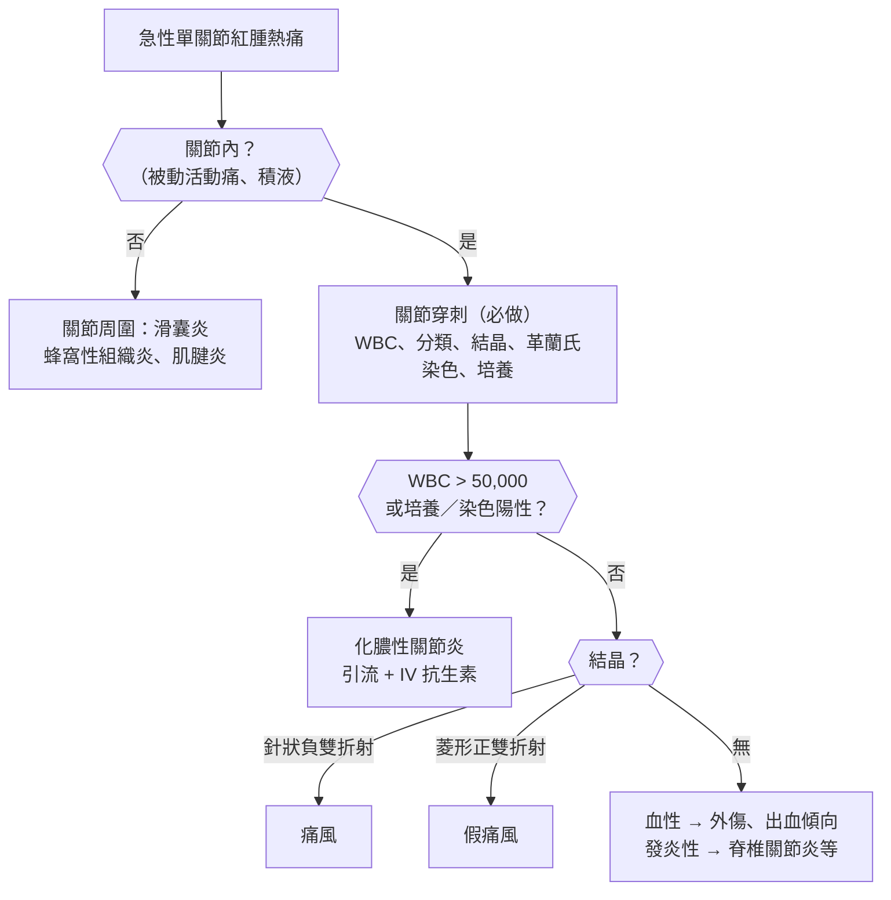
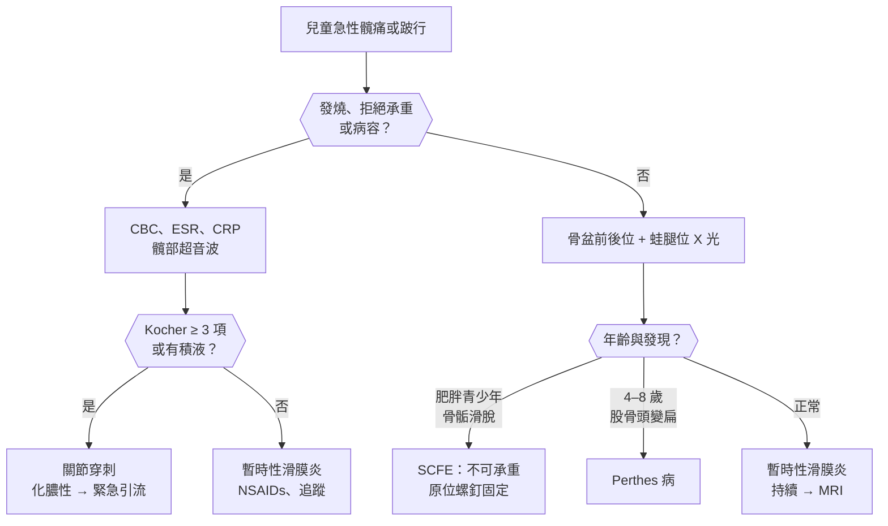
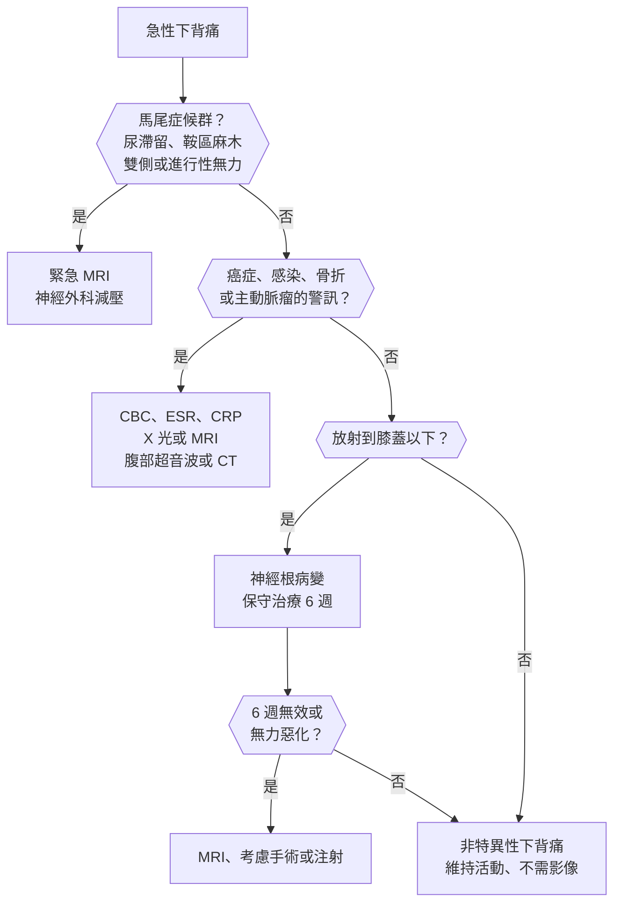

## 關節（Joints）

### 急性單關節炎（Acute Monoarthritis）

#### 定義與分類

- **關節炎（arthritis）**：關節**紅、腫、熱、痛**、活動受限，有**關節積液**；**關節痛（arthralgia）**：只有疼痛、沒有發炎徵象。
- **關節內 vs 關節周圍**：
    - **關節內**：主動與被動活動**各方向都痛**、關節線壓痛、積液。
    - **關節周圍**（滑囊炎、肌腱炎、蜂窩性組織炎）：**只有特定方向或主動活動痛**，壓痛點局限。
- **急性單關節炎三大原因**：**感染（化膿性關節炎）**、**結晶（痛風、假痛風）**、**外傷（關節血腫）**。
- **:red[未證實前都要當作化膿性關節炎]** → 關節破壞在數天內發生，**死亡率可達 10%**。
- 常見位置：
    - **第一蹠趾關節（podagra）** → 痛風。
    - **膝** → 化膿性關節炎、假痛風、痛風。
    - **腕** → 假痛風。

#### Red flags

- **發燒、寒顫**、白血球升高、**無法承重或完全不能動**。
- **人工關節**、近期關節注射或手術、**靜脈注射藥癮**、糖尿病、免疫抑制、RA 病人單一關節特別腫。
- **年輕性活躍者 + 遊走性關節痛 + 腱鞘炎 + 膿疱性皮疹** → 播散性淋病。
- **抗凝血劑或血友病 + 關節腫** → 關節血腫。
- **兒童發燒 + 拒絕走路** → 化膿性髖關節炎，急症。
- 胸鎖關節、恥骨聯合、薦髂關節感染 → 想**靜脈注射藥癮**。

#### 鑑別診斷

| 類別 | 疾病 | 鑑別關鍵 |
|---|---|---|
| **感染** | **[[骨科#化膿性關節炎（Septic Arthritis）\|化膿性關節炎]]**（金黃色葡萄球菌最常見）、**[[感染科#N. gonorrhoeae（淋病雙球菌）\|播散性淋病]]**、[[骨科#人工關節感染（Periprosthetic Joint Infection, PJI）\|人工關節感染]]、結核性、[[感染科#Borrelia burgdorferi（Lyme disease）\|萊姆病]] | **關節液 WBC > 50,000、嗜中性球 > 90%**、革蘭氏染色、培養 |
| **結晶** | **[[骨科#痛風性關節炎（Gout）\|痛風]]**、**[[骨科#假痛風（Pseudogout / CPPD）\|假痛風（CPPD）]]** | **偏光顯微鏡**；**結晶存在不排除合併感染** |
| **外傷** | **關節血腫**、[[骨科#膝關節周圍骨折\|關節內骨折]]、[[復健科#ACL 損傷\|ACL 撕裂]]、[[骨科#半月板損傷（Meniscal Tear）\|半月板撕裂]] | 外傷史；**血性關節液 + 油滴 → 關節內骨折** |
| **出血傾向** | [[血液腫瘤科#血友病（Hemophilia）\|血友病]]、抗凝血劑 | 輕微外傷或自發 |
| **發炎性關節炎首發** | [[免疫風濕科#反應性關節炎（Reactive Arthritis）\|反應性關節炎]]、[[免疫風濕科#乾癬性關節炎（Psoriatic Arthritis, PsA）\|乾癬性關節炎]]、[[免疫風濕科#腸病相關關節炎（Enteropathic Arthritis）\|腸病相關關節炎]]、[[小兒科#幼年型特發性關節炎（Juvenile Idiopathic Arthritis, JIA）\|JIA]] | 下肢不對稱、附著點炎 |
| **退化與其他** | [[骨科#退化性關節炎（Osteoarthritis, OA）\|退化性關節炎]]急性發作、[[骨科#缺血性骨壞死（Avascular Necrosis, AVN）\|缺血性骨壞死]]、色素絨毛結節性滑膜炎 | 非發炎性關節液 |
| **關節周圍** | 滑囊炎（**鷹嘴突、髕前**）、[[皮膚科#蜂窩性組織炎（Cellulitis）與丹毒（Erysipelas）\|蜂窩性組織炎]]、肌腱炎 | **被動活動不痛** |

#### 易混淆鑑別

:::compare[關節液分析]
| | 正常 | 非發炎性（OA、外傷） | 發炎性（RA、結晶） | 化膿性 |
|---|---|---|---|---|
| 外觀 | 清澈 | 清澈、黃 | 混濁 | **膿樣、不透明** |
| 白血球（/μL） | < 200 | < 2,000 | 2,000–50,000 | **:red[> 50,000]**（常 > 100,000） |
| 嗜中性球 | < 25% | < 25% | > 50% | **> 90%** |
| 培養 | 陰性 | 陰性 | 陰性 | **常陽性**（淋病常陰性） |
:::

:::compare[化膿性關節炎 vs 痛風 vs 假痛風]
| | 化膿性關節炎 | 痛風 | 假痛風（CPPD） |
|---|---|---|---|
| 族群 | 任何年齡；人工關節、糖尿病、藥癮、RA | **中年男性**、停經後女性 | **> 60 歲** |
| 常見部位 | **膝**、髖（兒童） | **第一蹠趾**、足背、踝、膝 | **膝、腕** |
| 結晶 | 無（可合併） | **針狀、負雙折射**（平行時黃色） | **菱形、弱正雙折射**（平行時藍色） |
| X 光 | 早期正常，晚期骨破壞 | **打孔狀骨侵蝕（overhanging edge）** | **軟骨鈣化（chondrocalcinosis）** |
| 相關疾病 | 菌血症 | 高尿酸、**thiazide**、腎病 | **副甲狀腺機能亢進、[[消化內科#Hemochromatosis（血色素沉著症）\|血色素沉著症]]、[[腎臟內科#低血鎂（Hypomagnesemia）\|低血鎂]]、甲狀腺機能低下** |
| 處置 | **關節引流 + IV 抗生素** | colchicine、NSAIDs、類固醇 | 同痛風；找相關疾病 |
:::

:::compare[播散性淋病 vs 反應性關節炎]
| | 播散性淋病 | 反應性關節炎 |
|---|---|---|
| 時間 | 性行為後數天到數週 | **腸道或泌尿道感染後 1–4 週** |
| 關節 | **遊走性多關節痛 → 單關節化膿**、**腱鞘炎**（手腕、手背） | **下肢不對稱寡關節炎**、**附著點炎、香腸指** |
| 皮膚 | **少數膿疱**（四肢） | **膿漏性角皮症（掌蹠）**、環狀龜頭炎 |
| 其他 | — | **結膜炎、尿道炎**；**HLA-B27** |
| 關節液培養 | **常陰性** → 驗**尿道、子宮頸、咽喉 NAAT** | 無菌 |
| 治療 | **ceftriaxone** | NSAIDs |
:::

#### 問診與理學檢查

- **發作速度**（痛風數小時內達高峰）、外傷、發燒、過去發作、性行為史、藥癮、近期感染（腹瀉、尿道炎）。
- **用藥**：利尿劑（thiazide、loop）、低劑量 aspirin、抗凝血劑、免疫抑制劑。
- 理學檢查：**關節內 vs 關節周圍**、積液（**浮髕試驗**）、皮膚（膿疱、乾癬、痛風石）、**其他關節**、眼睛、泌尿生殖道、心雜音（心內膜炎）。

#### 檢查流程

- **:red[關節穿刺是最重要的檢查]**；有人工關節 → 骨科處理。
- 血液：CBC、CRP／ESR、**血液培養**、尿酸（**急性發作時可正常**）、腎功能。
- 懷疑淋病 → **尿道、子宮頸、直腸、咽喉 NAAT**。
- X 光：骨折、軟骨鈣化、骨侵蝕、骨髓炎。

#### 初步處置

- **化膿性關節炎**：**關節引流（穿刺、關節鏡或手術）+ IV 抗生素**。
    - 經驗性：革蘭氏陽性球菌 → **vancomycin**；革蘭氏陰性或高風險 → 加第三代頭孢菌素。
    - **兒童化膿性髖關節炎 → 緊急手術引流**（避免股骨頭缺血壞死）。
- **痛風**：**越早治療越好**；**colchicine、NSAIDs 或類固醇**。
    - **:red[已在吃的降尿酸藥不要停]**，維持原劑量。
    - **降尿酸藥適應症（ACR 2020）**：**痛風石**、**影像證實關節或骨骼破壞**、**一年發作 :red[≥ 2 次]**；**首次發作**合併 **CKD 第 3 期以上、尿路結石或尿酸 > 9 mg/dL**；**無症狀高尿酸血症不建議常規治療**。
    - 符合適應症者**發作期間就可以開始**，不必等發作消退；**小劑量起步（allopurinol ≤ 100 mg/day）**，前 **3–6 個月合併低劑量 colchicine 預防**誘發發作。
- **假痛風**：關節內類固醇、NSAIDs、colchicine。
- 關節血腫：冰敷、固定；血友病 → 補充凝血因子。

::chart{id="gout-management"}

:::pitfall
關節液看到尿酸結晶就診斷痛風，沒有送培養 → 漏掉合併的化膿性關節炎。結晶和感染可以同時存在，發燒或關節液白血球很高時要等培養結果。
:::

:::pitfall
急性痛風時血中尿酸正常就排除痛風 → 發作時尿酸可下降。診斷靠關節液結晶，不靠血中尿酸。
:::

:::exam
- 急性單關節炎 → 一定要關節穿刺；WBC > 50,000、嗜中性球 > 90% → 化膿性。
- 痛風：針狀、負雙折射；假痛風：菱形、弱正雙折射、軟骨鈣化。
- 年輕性活躍者 + 腱鞘炎 + 膿疱 → 播散性淋病，關節液培養常陰性 → ceftriaxone。
- 化膿性關節炎最常見致病菌：金黃色葡萄球菌。
:::

### 多關節痛（Polyarthritis / Polyarthralgia）

#### 定義與分類

- **依關節數**：**單關節**（1 個）、**寡關節**（2–4 個）、**多關節**（≥ 5 個）。
- **依時間**：**急性（< 6 週）** → 病毒、反應性、風濕熱、結晶；**慢性（≥ 6 週）** → RA、SLE、脊椎關節炎、OA。
- **發炎性 vs 非發炎性**：
    - **發炎性**：**晨間僵硬 :red[> 30–60 分鐘]**、**休息後加重、活動後改善**、關節腫脹、全身症狀。
    - **非發炎性（OA）**：**晨僵 < 30 分鐘**、**活動後加重、休息後改善**、骨性腫大。
- **分布型態**：
    - **小關節對稱** → RA、SLE、病毒（B19）。
    - **大關節、下肢、不對稱** → 脊椎關節炎、反應性關節炎。
    - **遠端指間關節（DIP）** → OA、**乾癬性關節炎**。
    - **遊走性** → **風濕熱**、淋病、病毒。

#### Red flags

- **發燒 + 新心雜音** → 感染性心內膜炎；兒童 → 風濕熱。
- **多系統侵犯**：皮疹、口腔潰瘍、蛋白尿或血尿、肺部症狀、神經症狀 → SLE、血管炎。
- **體重減輕、夜間盜汗** → 惡性腫瘤（副腫瘤）、結核、淋巴瘤。
- **高燒、鮭魚色皮疹、喉嚨痛、ferritin 極高** → 成人 Still's disease，可併發 [[免疫風濕科#Macrophage Activation Syndrome / Hemophagocytic Lymphohistiocytosis（MAS / HLH）|MAS]]。
- **頸椎不穩**（長期 RA）→ 插管前要評估寰樞椎半脫位。
- **急性多關節炎 + 紫斑** → IgA 血管炎、冷凝球蛋白血症。

#### 鑑別診斷

| 類別 | 疾病 | 鑑別關鍵 |
|---|---|---|
| **發炎性、小關節對稱** | **[[免疫風濕科#類風濕性關節炎（Rheumatoid Arthritis, RA）\|類風濕性關節炎]]**、**[[免疫風濕科#全身性紅斑狼瘡（SLE）\|SLE]]**、[[免疫風濕科#Sjögren's Syndrome（乾燥症候群）\|乾燥症]]、[[免疫風濕科#全身性硬化症（Systemic Sclerosis, SSc）\|硬皮症]]、[[免疫風濕科#Mixed Connective Tissue Disease（MCTD）\|MCTD]] | **RF、anti-CCP**、ANA；**SLE 不造成骨侵蝕（Jaccoud）** |
| **脊椎關節炎** | [[免疫風濕科#僵直性脊椎炎（Ankylosing Spondylitis, AS）\|僵直性脊椎炎]]、**[[免疫風濕科#乾癬性關節炎（Psoriatic Arthritis, PsA）\|乾癬性關節炎]]**、[[免疫風濕科#反應性關節炎（Reactive Arthritis）\|反應性關節炎]]、[[免疫風濕科#腸病相關關節炎（Enteropathic Arthritis）\|腸病相關]] | **下肢不對稱、附著點炎、香腸指、發炎性背痛**、HLA-B27 |
| **病毒** | **[[感染科#Parvovirus B19\|Parvovirus B19]]**、B 型與 C 型肝炎、HIV、[[感染科#德國麻疹（Rubella）\|德國麻疹]]、**屈公病、[[感染科#登革熱（Dengue）\|登革熱]]** | **急性、自限**；小孩接觸史、旅遊史 |
| **細菌與感染後** | **[[心臟內科#感染性心內膜炎（Infective Endocarditis, IE）\|感染性心內膜炎]]**、播散性淋病、**風濕熱**、萊姆病 | 心雜音、ASO、血液培養 |
| **結晶** | 多關節痛風、假痛風 | 長期未控制、痛風石 |
| **退化** | **[[骨科#退化性關節炎（Osteoarthritis, OA）\|退化性關節炎]]** | **DIP（Heberden）、PIP（Bouchard）**、膝、髖；晨僵短 |
| **全身性疾病** | [[免疫風濕科#成人 Still's Disease（Adult-Onset Still's Disease, AOSD）\|成人 Still's disease]]、[[免疫風濕科#Sarcoidosis（類肉瘤病）\|類肉瘤病]]、[[小兒科#過敏性紫斑（Henoch-Schönlein Purpura / IgA Vasculitis）\|IgA 血管炎]]、[[免疫風濕科#Behçet's Disease\|Behçet 病]]、血色素沉著症（第 2、3 掌指關節）、甲狀腺疾病 | 系統性表現 |
| **非關節** | **[[免疫風濕科#風濕性多肌痛（Polymyalgia Rheumatica, PMR）\|風濕性多肌痛]]**、**[[免疫風濕科#Fibromyalgia（纖維肌痛症）\|纖維肌痛症]]**、甲狀腺機能低下、副腫瘤（肥大性骨關節病） | **沒有真正的關節腫脹** |

#### 易混淆鑑別

:::compare[RA vs OA vs 乾癬性關節炎]
| | 類風濕性關節炎 | 退化性關節炎 | 乾癬性關節炎 |
|---|---|---|---|
| 晨僵 | **> 1 小時** | **< 30 分鐘** | > 30 分鐘 |
| 活動 | **活動後改善** | **活動後加重** | 活動後改善 |
| 手部 | **MCP、PIP、腕**；**不侵犯 DIP** | **DIP（Heberden）、PIP（Bouchard）、拇指根部 CMC** | **DIP**、**香腸指**、指甲凹陷 |
| 對稱 | **對稱** | 不一定 | 常不對稱 |
| 變形 | **尺側偏移、天鵝頸、鈕扣孔** | 骨性結節 | **筆套狀（pencil-in-cup）**、毀損性 |
| 抗體 | **RF、anti-CCP（特異性高）** | 陰性 | **陰性** |
| X 光 | **關節旁骨質疏鬆、邊緣骨侵蝕**、對稱關節腔狹窄 | **骨刺**、不對稱狹窄、軟骨下硬化 | 骨侵蝕 + 新骨形成 |
:::

:::compare[RA vs SLE 的關節炎]
| | RA | SLE |
|---|---|---|
| 族群 | 中年女性 | **年輕女性** |
| 骨侵蝕 | **有** | **無**（Jaccoud 關節病變：可復位的變形） |
| 抗體 | **anti-CCP、RF** | **ANA、anti-dsDNA、anti-Sm** |
| 其他表現 | 類風濕結節、間質性肺病 | **蝶形紅斑、口腔潰瘍、光敏感、腎炎、血球低下** |
| 補體 | 正常 | **低（活動期）** |
:::

:::compare[病毒性關節炎 vs 早期 RA]
| | 病毒性（Parvovirus B19 等） | 早期 RA |
|---|---|---|
| 病程 | **急性、< 6 週自行緩解** | **> 6 週持續** |
| 接觸史 | **家中小孩有紅臉頰（傳染性紅斑）** | — |
| 抗體 | **B19 IgM**；RF 可短暫陽性 | **anti-CCP** |
| 處置 | NSAIDs、觀察 | **早期 DMARD（methotrexate）** |
:::

#### 問診與理學檢查

- **關節數、分布、對稱性、遊走性**；**晨僵時間**；發作速度與病程。
- 關節外：**皮疹（乾癬、蝶形紅斑）**、口腔潰瘍、乾眼口乾、**雷諾現象**、眼睛紅（葡萄膜炎）、腹瀉、尿道炎、背痛、發燒。
- 家族史（乾癬、脊椎關節炎）、性行為、旅遊（屈公病、登革熱）、小孩接觸。
- 理學檢查：逐一檢查關節**腫脹 vs 骨性腫大**、壓痛、活動度；**指甲、頭皮、臍周（乾癬）**、心雜音、淋巴結、脾腫大。

#### 檢查流程

- **CBC、ESR、CRP、肝腎功能、尿液檢查**（SLE 腎炎）。
- **RF、anti-CCP、ANA**（ANA 陽性再驗 anti-dsDNA、anti-ENA、補體）；**不要漫無目的開一堆自體抗體**。
- 依臨床：HLA-B27、尿酸、B19 IgM、B 與 C 型肝炎、HIV、ASO、血液培養。
- **手腳 X 光**（RA 骨侵蝕、PsA、OA、軟骨鈣化）；早期 → **超音波或 MRI** 看滑膜炎。
- 有積液 → 關節穿刺。

#### 初步處置

- 非發炎性：減重、運動、NSAIDs、acetaminophen。
- **RA**：**:red[診斷後盡早開始 DMARD]（methotrexate 為基石）**，3 個月內未達目標 → 加或換藥（生物製劑、JAK 抑制劑）；短期低劑量類固醇過渡。
    - **methotrexate 前**：B 與 C 型肝炎、**胸部 X 光**、肝腎功能、CBC、懷孕計畫（**致畸胎**）；補充**葉酸**。
    - **生物製劑前**：**結核篩檢（IGRA）**、B 型肝炎。
- **SLE**：**hydroxychloroquine（所有病人）**；定期眼科檢查。
- 病毒性：支持療法。

:::pitfall
關節痛的病人一次開 RF、ANA 等一大套抗體，ANA 低效價陽性就診斷 SLE → 一般人 ANA 陽性率不低（尤其女性與老人）。抗體要依臨床表現選擇，診斷靠臨床加檢驗。
:::

:::pitfall
早期 RA 只開止痛藥觀察，等到 X 光出現骨侵蝕才轉診 → 關節破壞多在發病前 2 年發生。發炎性多關節炎超過 6 週要盡早轉風濕科開始 DMARD。
:::

:::exam
- 發炎性：晨僵 > 1 小時、活動改善；OA：晨僵 < 30 分鐘、活動加重。
- RA 不侵犯 DIP；DIP → OA（Heberden）或乾癬性關節炎。
- anti-CCP 特異性最高；SLE 關節炎無骨侵蝕（Jaccoud）。
- 用 methotrexate 要補葉酸；生物製劑前篩結核與 B 肝。
:::

### 肩膀痛（Shoulder Pain）

#### 定義與分類

- **旋轉肌袖疾病（rotator cuff disease）**：**最常見**；包括肩峰下夾擊、肌腱病變、部分或全層撕裂；**棘上肌最常受影響**。
    - **側舉 60–120° 疼痛（painful arc）**、夜間側睡壓到會痛。
- **沾黏性關節囊炎（adhesive capsulitis，五十肩）**：**主動與被動活動都受限**，**外旋最先受限**；**糖尿病、甲狀腺疾病**、中風後。
    - 病程：**疼痛期 → 僵硬期 → 解凍期**，1–3 年。
- **肩關節脫臼**：**前方脫臼 > 95%**；後方脫臼 → **癲癇、電擊**。
- **肩鎖關節疾病**、**二頭肌腱炎**、**鈣化性肌腱炎**。
- **轉移痛**：**頸椎神經根病變（C5）**、**心肌缺血**、**膈下病變（肝膽、脾、膈下膿瘍）**、Pancoast 腫瘤、[[心臟內科#主動脈剝離（Aortic Dissection）|主動脈剝離]]。

#### Red flags

- **左肩痛 + 勞動誘發、胸悶、冒冷汗** → ACS。
- **右肩痛 + 右上腹痛、發燒** → 膽囊炎；**左肩痛 + 外傷** → 脾臟破裂（Kehr sign）。
- **吸菸者肩痛 + Horner syndrome + 手部尺側麻木無力** → **Pancoast 腫瘤**。
- **發燒、紅腫、關節積液** → 化膿性關節炎。
- **外傷後無法抬手、變形**；**腋神經**（三角肌外側感覺喪失）或血管受損。
- **50 歲以上兩側肩膀與髖部晨僵** → 風濕性多肌痛（合併頭痛、視力模糊 → [[神經內科#顳動脈炎（Giant Cell Arteritis, GCA）|GCA]]）。
- **急性劇痛數天後出現肩膀無力萎縮** → 神經痛性肌萎縮症（Parsonage-Turner）。

#### 鑑別診斷

| 類別 | 疾病 | 鑑別關鍵 |
|---|---|---|
| **旋轉肌袖** | **[[骨科#肩峰下夾擊症候群（Subacromial Impingement Syndrome）\|肩峰下夾擊]]**、**[[骨科#旋轉肌袖撕裂（Rotator Cuff Tear）\|旋轉肌袖撕裂]]**、鈣化性肌腱炎 | **Painful arc**、Neer、Hawkins；撕裂 → **無力、drop arm** |
| **關節囊** | **[[復健科#五十肩（Frozen Shoulder / Adhesive Capsulitis）\|五十肩]]** | **被動活動也受限、外旋最明顯** |
| **不穩定與外傷** | **[[骨科#肩關節脫臼（Shoulder Dislocation）\|肩關節脫臼]]**、[[骨科#鎖骨骨折（Clavicle Fracture）\|鎖骨骨折]]、[[骨科#肱骨近端骨折（Proximal Humerus Fracture）\|肱骨近端骨折]]、肩鎖關節分離、盂唇撕裂 | 外傷、變形、恐懼試驗 |
| **關節炎** | 盂肱關節或肩鎖關節 OA、RA、化膿性關節炎、**[[免疫風濕科#風濕性多肌痛（Polymyalgia Rheumatica, PMR）\|PMR]]** | 雙側、晨僵、ESR |
| **頸椎** | **[[神經外科#頸椎神經根病變（Cervical Radiculopathy）\|頸椎神經根病變]]（C5、C6）** | **疼痛放射過肘、麻木、Spurling 陽性**、肩關節活動正常 |
| **神經** | [[復健科#臂叢神經損傷（Brachial Plexus Injury）\|臂叢神經損傷]]、神經痛性肌萎縮症、[[骨科#胸廓出口症候群（Thoracic Outlet Syndrome, TOS）\|胸廓出口症候群]]、肩胛上神經壓迫 | 無力萎縮、感覺異常 |
| **轉移痛** | **[[心臟內科#急性冠心症（ACS）\|ACS]]**、**膽囊炎**、脾臟破裂、膈下膿瘍、**[[胸腔外科#Pancoast tumor\|Pancoast 腫瘤]]**、主動脈剝離 | **肩膀活動不影響疼痛** |

#### 易混淆鑑別

:::compare[旋轉肌袖疾病 vs 五十肩 vs 頸椎神經根病變]
| | 旋轉肌袖疾病 | 五十肩 | 頸椎神經根病變 |
|---|---|---|---|
| 主動活動 | **疼痛受限** | **受限** | 正常或因痛受限 |
| 被動活動 | **大致正常** | **同樣受限**（尤其外旋） | 正常 |
| 疼痛位置 | 肩膀外側、三角肌 | 肩膀深處 | **頸部 → 放射到手臂，過肘** |
| 理學 | **Painful arc、Neer、Hawkins、empty can** | 各方向僵硬 | **Spurling 陽性**、皮節感覺異常、反射減弱 |
| 族群 | 過頭動作、> 40 歲 | **40–60 歲、糖尿病** | 頸椎退化 |
| 處置 | 復健、NSAIDs、注射；**急性外傷性撕裂 → 早期手術** | 復健、關節內類固醇、擴張術 | 復健、止痛；無力進行性 → 手術 |
:::

:::compare[前方 vs 後方肩關節脫臼]
| | 前方脫臼 | 後方脫臼 |
|---|---|---|
| 比例 | **> 95%** | < 5% |
| 機轉 | **外展 + 外旋** | **癲癇發作、電擊**、直接撞擊前方 |
| 姿勢 | 手臂**外展外旋**、肩膀方形（失去圓弧） | 手臂**內收內旋、無法外旋** |
| X 光 | 前後位即可見 | **前後位容易漏掉**（燈泡徵象 light bulb sign）→ **腋窩位或 Y 位** |
| 合併傷害 | **腋神經**、Hill-Sachs、Bankart 病變、年長者旋轉肌袖撕裂 | 反向 Hill-Sachs |
:::

#### 問診與理學檢查

- 外傷、過頭動作（游泳、棒球、油漆）、夜間痛、**頸部症狀與手部麻木**、心血管與腹部症狀。
- 理學檢查：
    - **主動 vs 被動活動度**（外展、前屈、外旋、內旋）。
    - **旋轉肌袖**：棘上肌（**empty can**）、棘下肌（抗阻力外旋）、肩胛下肌（**lift-off、belly press**）、**drop arm test**（撕裂）。
    - **夾擊**：**Neer、Hawkins-Kennedy**。
    - **不穩定**：恐懼試驗（apprehension test）。
    - **頸椎**：Spurling test、上肢神經學檢查。

#### 檢查流程

- 外傷、懷疑骨折或脫臼 → **X 光（前後位 + 腋窩位或 Y 位）**；**脫臼復位前後都要檢查腋神經與血管**。
- 慢性旋轉肌袖症狀 → 先保守治療；**無力、懷疑撕裂、保守無效 → 超音波或 MRI**。
- 頸椎神經根病變 → 頸椎 MRI（有無力或保守無效時）、神經傳導檢查。
- 非機械性疼痛 → ECG、肝膽超音波、胸部 X 光（Pancoast）。

#### 初步處置

- 旋轉肌袖疾病與夾擊：**活動調整、復健（肩胛穩定與旋轉肌袖強化）**、NSAIDs、肩峰下類固醇注射。
- **年輕人或活動量大者的急性外傷性全層撕裂 → 早期手術修補**。
- 五十肩：**復健伸展**、關節內類固醇、控制血糖；頑固 → 麻醉下鬆動或關節鏡鬆解。
- 前方脫臼：**復位**（先確認無骨折）→ 吊帶固定；**年輕人復發率高**。

:::pitfall
左肩痛被當成五十肩開止痛藥 → 其實是心肌梗塞的轉移痛。肩膀活動度正常、疼痛與活動無關、或合併胸悶冒汗時，要先做 ECG。
:::

:::pitfall
癲癇發作或電擊後肩痛，前後位 X 光看起來正常就說沒事 → 漏掉後方脫臼。手臂無法外旋時要照腋窩位或 Y 位。
:::

:::exam
- Painful arc 60–120°、Neer、Hawkins → 夾擊；drop arm → 旋轉肌袖撕裂。
- 五十肩：主動與被動都受限、外旋最早；糖尿病相關。
- 前方脫臼最常見 → 腋神經；後方脫臼 → 癲癇、電擊，手臂內旋無法外旋。
- Pancoast：肩痛 + Horner + 尺側麻木。
:::

### 手腕與手部疼痛（Wrist and Hand Pain）

#### 定義與分類

- **神經壓迫**：
    - **腕隧道症候群（carpal tunnel syndrome）**：**正中神經**；**拇指、食指、中指、無名指橈側**麻木，**夜間麻醒、甩手緩解**；最常見的周邊神經壓迫。
    - **肘隧道症候群（cubital tunnel syndrome）**：**尺神經**；**小指與無名指尺側**麻木、手內在肌無力。
- **肌腱與腱鞘**：
    - **De Quervain 腱鞘炎**：**拇指根部橈側**疼痛，**Finkelstein 陽性**；**產後媽媽（抱小孩）**、手機族。
    - **扳機指（trigger finger）**：手指彎曲後卡住、彈響；糖尿病。
- **外傷**：
    - **舟狀骨骨折**：**跌倒手撐地 + 鼻煙壺壓痛**，**X 光初期可正常**。
    - **橈骨遠端骨折（Colles）**：老人、骨質疏鬆。
- **手肘外側痛**：網球肘（外上髁炎）；**內側** → 高爾夫球肘。
- **感染**：**化膿性屈肌腱鞘炎**（Kanavel 四徵）、甲溝炎、**咬傷**。
- **關節炎**：RA（MCP、PIP、腕）、OA（DIP、PIP、**拇指 CMC**）、痛風、假痛風（腕）。

#### Red flags

- **手指腫脹、屈曲姿勢、沿腱鞘壓痛、被動伸直劇痛** → **化膿性屈肌腱鞘炎**，緊急手術。
- **拳頭打到牙齒的掌指關節傷口（fight bite）** → 深部感染、關節污染。
- **高壓注射傷**（油漆槍）→ 外觀小、內部廣泛壞死，緊急手術。
- **鼻煙壺壓痛** → **:red[即使 X 光正常也當舟狀骨骨折固定]**（**缺血性壞死、不癒合**）。
- **快速進行的無力、肌肉萎縮** → 嚴重神經壓迫、[[神經內科#肌萎縮側索硬化症（ALS）|ALS]]、頸椎脊髓病變。
- **手部蒼白、發紺、疼痛** → 急性動脈阻塞、雷諾現象危象。

#### 鑑別診斷

| 類別 | 疾病 | 鑑別關鍵 |
|---|---|---|
| **神經** | **[[骨科#腕隧道症候群（Carpal Tunnel Syndrome）\|腕隧道症候群]]**、[[骨科#肘隧道症候群（Cubital Tunnel Syndrome）\|肘隧道症候群]]、**[[神經外科#頸椎神經根病變（Cervical Radiculopathy）\|頸椎神經根病變（C6–C8）]]**、[[骨科#胸廓出口症候群（Thoracic Outlet Syndrome, TOS）\|胸廓出口症候群]]、多發性神經病變 | **分布**：正中、尺、皮節；**頸部症狀** |
| **肌腱** | **[[骨科#De Quervain's Tenosynovitis\|De Quervain 腱鞘炎]]**、**[[骨科#Trigger Finger（扳機指）\|扳機指]]**、[[骨科#肱骨外上髁炎（Tennis Elbow / Lateral Epicondylitis）\|網球肘]]、[[骨科#肱骨內上髁炎（Golfer's Elbow / Medial Epicondylitis）\|高爾夫球肘]]、[[骨科#Dupuytren's Disease（掌腱膜攣縮症）\|Dupuytren 攣縮]] | Finkelstein、彈響、局部壓痛 |
| **骨折** | **[[骨科#舟狀骨骨折（Scaphoid Fracture）\|舟狀骨骨折]]**、**[[骨科#橈骨遠端骨折（Distal Radius Fracture）\|橈骨遠端骨折]]**、[[骨科#手部骨折\|掌骨骨折]]（拳擊手骨折） | 外傷、**鼻煙壺壓痛** |
| **關節炎** | [[免疫風濕科#類風濕性關節炎（Rheumatoid Arthritis, RA）\|RA]]、[[骨科#退化性關節炎（Osteoarthritis, OA）\|OA]]（拇指 CMC）、[[骨科#假痛風（Pseudogout / CPPD）\|假痛風]]、乾癬性關節炎 | 晨僵、分布 |
| **感染** | **化膿性屈肌腱鞘炎**、甲溝炎、指腹膿瘍（felon）、**咬傷**（人：Eikenella；貓狗：**Pasteurella**） | **Kanavel 四徵**、傷口 |
| **其他** | 腱鞘囊腫（ganglion）、**[[骨科#缺血性骨壞死（Avascular Necrosis, AVN）\|Kienböck 病（月狀骨壞死）]]**、[[復健科#複雜性區域疼痛症候群（CRPS）\|複雜性區域疼痛症候群]]、雷諾現象 | 腫塊、骨折後持續痛 |

#### 易混淆鑑別

:::compare[腕隧道 vs 肘隧道 vs 頸椎神經根病變]
| | 腕隧道症候群 | 肘隧道症候群 | 頸椎神經根病變（C6–C8） |
|---|---|---|---|
| 神經 | **正中神經** | **尺神經** | 神經根 |
| 麻木 | **拇指、食指、中指、無名指橈側**；**手掌近端不麻**（掌皮支在腕隧道外） | **小指、無名指尺側**，含**手背尺側** | **皮節分布**（C6 拇指、C7 中指、C8 小指），可達前臂 |
| 無力萎縮 | **大魚際肌（拇指外展）** | **手內在肌、骨間肌、小魚際肌**；**Froment sign**、爪形手 | 依神經根：C6 二頭肌與腕伸肌、C7 三頭肌 |
| 誘發 | **夜間、握方向盤、手機**；**Phalen、Tinel（腕）** | **手肘彎曲**（講電話、睡覺）；Tinel（肘） | **頸部動作**；**Spurling** |
| 反射 | 正常 | 正常 | **減弱**（C6 肱橈肌、C7 三頭肌） |
| 危險因子 | **懷孕、甲狀腺機能低下、糖尿病、RA、類澱粉沉積、[[代謝內分泌科#肢端肥大症（Acromegaly）/ 巨人症（Gigantism）\|肢端肥大症]]**、洗腎 | 手肘骨折後、倚靠手肘 | 頸椎退化 |
:::

:::compare[舟狀骨骨折 vs 橈骨遠端骨折 vs De Quervain]
| | 舟狀骨骨折 | 橈骨遠端骨折（Colles） | De Quervain 腱鞘炎 |
|---|---|---|---|
| 族群 | **年輕人** | **老人（骨質疏鬆）** | **產後女性**、重複使用 |
| 機轉 | 跌倒手撐地 | 跌倒手撐地 | 重複拇指動作 |
| 壓痛 | **鼻煙壺（snuffbox）** | 橈骨遠端、**餐叉狀變形** | **橈骨莖突**，Finkelstein 陽性 |
| X 光 | **初期可正常** → 固定後 10–14 天重照或 MRI | 背側移位 | 正常 |
| 併發症 | **不癒合、近端缺血性壞死**（血流由遠端逆流供應） | 正中神經病變、**伸拇長肌腱斷裂** | — |
:::

#### 問診與理學檢查

- 疼痛或麻木的**確切分布**、夜間症狀、職業與嗜好、外傷機轉、懷孕、糖尿病、甲狀腺。
- 理學檢查：
    - **感覺分布**、**大魚際與骨間肌萎縮**、握力與捏力。
    - **Phalen、Tinel**（腕、肘）、**Froment sign**（尺神經）、**Finkelstein**。
    - **鼻煙壺壓痛**、腕部變形、關節腫脹（MCP、PIP、DIP）。
    - 頸椎檢查（Spurling、反射）。
    - 傷口、**Kanavel 四徵**（手指屈曲姿勢、梭形腫脹、沿腱鞘壓痛、**被動伸直劇痛**）。

#### 檢查流程

- **神經傳導與肌電圖**：確認神經壓迫的位置與嚴重度、排除頸椎神經根病變、手術前評估。
- 外傷 → **X 光（含舟狀骨位）**；鼻煙壺壓痛但 X 光正常 → **固定 + 10–14 天後重照**，或 **MRI**。
- 腕隧道症候群：依臨床篩檢 **TSH、血糖**、懷孕試驗。
- 懷疑感染 → 手外科會診。

#### 初步處置

- 腕隧道症候群：**夜間中立位腕部護具**、活動調整、局部類固醇注射；**大魚際萎縮、持續麻木、保守無效 → 腕隧道鬆解手術**；懷孕者多於產後緩解。
- De Quervain、扳機指：休息、護具、**類固醇注射**；無效 → 手術。
- 舟狀骨骨折：**拇指人字形石膏（thumb spica）**；移位或近端骨折 → 手術。
- **化膿性屈肌腱鞘炎**：**緊急手術沖洗 + IV 抗生素**。
- **咬傷**：清創、**不要一期縫合**（臉部除外）、**amoxicillin-clavulanate** 預防；破傷風、[[感染科#狂犬病（Rabies）|狂犬病]]評估。

:::pitfall
跌倒手撐地、鼻煙壺壓痛，X 光看不到骨折就說是扭傷 → 舟狀骨骨折漏診，數月後不癒合或缺血性壞死。鼻煙壺壓痛就先用拇指人字形石膏固定，10–14 天後重照或做 MRI。
:::

:::pitfall
打架後掌指關節的小傷口直接縫起來 → 「fight bite」把口腔細菌帶進關節，造成化膿性關節炎與骨髓炎。人咬傷要清創、不縫合、給 amoxicillin-clavulanate，必要時手術探查。
:::

:::exam
- 腕隧道：正中神經、拇食中指、夜間麻醒、Phalen 與 Tinel、大魚際萎縮；懷孕與甲狀腺機能低下。
- 肘隧道：尺神經、小指與無名指尺側、Froment sign。
- 鼻煙壺壓痛 → 舟狀骨骨折，X 光正常也要固定；近端缺血性壞死。
- Kanavel 四徵 → 化膿性屈肌腱鞘炎，緊急手術；貓狗咬傷 → Pasteurella。
:::

### 髖部痛與跛行（Hip Pain / Limp）

#### 定義與分類

- **真正的髖關節痛**：**鼠蹊部（腹股溝）**疼痛，可轉移到**膝蓋**；**內旋受限且疼痛**。
- **外側髖痛**：**大轉子疼痛症候群**（大轉子滑囊炎、臀中肌肌腱病變）→ 側睡壓到痛。
- **後側臀部痛**：多來自**腰椎、薦髂關節**、梨狀肌。
- **依年齡想原因**（兒童跛行尤其重要）：
    - **0–4 歲**：**DDH**、化膿性關節炎、**暫時性滑膜炎**、骨折（兒虐）。
    - **4–10 歲**：**暫時性滑膜炎**、**Legg-Calvé-Perthes 病**、化膿性關節炎。
    - **10–16 歲**：**股骨頭骨骺滑脫（SCFE）**、運動傷害、腫瘤（骨肉瘤、Ewing 肉瘤）。
    - **成人**：OA、**缺血性骨壞死**、股骨頸應力骨折、髖臼盂唇撕裂。
    - **老人**：OA、**股骨頸骨折**（跌倒）、轉移性腫瘤。

#### Red flags

- **兒童發燒 + 拒絕承重** → **化膿性髖關節炎**，數小時內需引流。
- **肥胖青少年 + 膝蓋痛或跛行** → **SCFE**（不要只看膝蓋）。
- **老人跌倒後髖痛、無法站立、患肢縮短外旋** → 股骨頸或粗隆間骨折。
- **類固醇、酗酒、SLE、鐮刀型貧血、潛水夫** + 鼠蹊痛 → **缺血性骨壞死**。
- **夜間痛、休息痛、體重減輕、癌症病史** → 骨轉移、骨腫瘤。
- **長跑者、軍人、骨質疏鬆女性 + 鼠蹊痛** → 股骨頸應力骨折（**壓力側 → 手術**）。

#### 鑑別診斷

| 類別 | 疾病 | 鑑別關鍵 |
|---|---|---|
| **兒童** | **[[骨科#先天性髖關節發育不良（Developmental Dysplasia of the Hip, DDH）\|DDH]]**、**暫時性滑膜炎**、**[[骨科#Legg-Calvé-Perthes Disease（兒童股骨頭缺血性壞死）\|Perthes 病]]**、**[[骨科#股骨頭骨骺滑脫（Slipped Capital Femoral Epiphysis, SCFE）\|SCFE]]**、[[小兒科#幼年型特發性關節炎（Juvenile Idiopathic Arthritis, JIA）\|JIA]] | **年齡**、發燒、肥胖 |
| **感染** | **[[骨科#化膿性關節炎（Septic Arthritis）\|化膿性關節炎]]**、[[骨科#急性骨髓炎（Acute Osteomyelitis）\|骨髓炎]]、腰大肌膿瘍、[[骨科#人工關節感染（Periprosthetic Joint Infection, PJI）\|人工關節感染]] | 發燒、CRP、**Kocher 準則** |
| **退化與缺血** | **[[骨科#退化性關節炎（Osteoarthritis, OA）\|退化性關節炎]]**、**[[骨科#缺血性骨壞死（Avascular Necrosis, AVN）\|股骨頭缺血性壞死]]** | 年齡、類固醇與酒精、MRI |
| **骨折** | **[[骨科#股骨頸骨折（Femoral Neck Fracture）\|股骨頸骨折]]**、[[骨科#股骨粗隆間骨折（Intertrochanteric Fracture）\|粗隆間骨折]]、[[骨科#骨盆骨折（Pelvic Fracture）\|骨盆骨折]]、應力骨折、[[骨科#髖關節脫臼（Hip Dislocation）\|髖關節脫臼]] | 跌倒、縮短外旋；**後脫臼 → 縮短內收內旋** |
| **關節周圍** | **大轉子疼痛症候群**、髂腰肌滑囊炎、內收肌拉傷、髖臼盂唇撕裂、股骨髖臼夾擊 | 外側壓痛、運動員 |
| **轉移痛** | **腰椎神經根病變**、[[神經外科#腰椎管狹窄症（Lumbar Spinal Stenosis）\|腰椎管狹窄]]、薦髂關節炎、[[骨科#梨狀肌症候群（Piriformis Syndrome）\|梨狀肌症候群]]、**[[胃小腸外科#腹股溝疝氣（Inguinal Hernia）\|腹股溝疝氣]]**、腹主動脈瘤、婦科與泌尿問題 | **髖關節活動正常** |
| **腫瘤** | [[骨科#骨轉移癌（Bone Metastasis）\|骨轉移]]、[[骨科#惡性骨骼腫瘤\|骨肉瘤、Ewing 肉瘤]]、[[血液腫瘤科#多發性骨髓瘤（Multiple Myeloma）\|多發性骨髓瘤]] | 夜間痛、體重減輕 |

#### 易混淆鑑別

:::compare[兒童髖痛：暫時性滑膜炎 vs 化膿性關節炎 vs Perthes vs SCFE]
| | 暫時性滑膜炎 | 化膿性髖關節炎 | Perthes 病 | SCFE |
|---|---|---|---|---|
| 年齡 | **3–8 歲** | 任何（**< 3 歲多**） | **4–8 歲男孩** | **10–16 歲、肥胖** |
| 前驅 | **上呼吸道感染後** | — | — | — |
| 發燒 | 無或低燒 | **高燒、病容** | 無 | 無 |
| 承重 | **可跛行走路** | **拒絕承重** | **無痛性跛行**、慢性 | 跛行、**膝痛** |
| 姿勢 | 輕微受限 | **屈曲、外展、外旋** | **外展與內旋受限** | **屈髖時大腿外旋（Drehmann sign）** |
| 檢查 | 正常或輕微發炎 | **Kocher：發燒 :red[> 38.5°C]、無法承重、ESR :red[> 40]、WBC :red[> 12,000]** | X 光：股骨頭變扁、碎裂 | **X 光蛙腿位：骨骺向後下滑（冰淇淋從甜筒滑落）** |
| 處置 | **休息、NSAIDs，自限** | **緊急引流 + 抗生素** | 保持股骨頭在髖臼內、限制活動 | **立即不可承重 → 原位螺釘固定**；對側常也發生 |
:::

:::compare[股骨頸 vs 粗隆間骨折]
| | 股骨頸骨折（關節囊內） | 粗隆間骨折（關節囊外） |
|---|---|---|
| 血流 | **易傷及旋股內動脈 → 缺血性壞死、不癒合** | 血流豐富、**癒合佳** |
| 外觀 | 縮短外旋（移位時） | **縮短外旋更明顯**、出血較多 |
| 治療（老人） | **移位 → 人工關節（半髖或全髖）**；未移位 → 內固定 | **內固定（髓內釘、動力髖螺釘）** |
| 治療（年輕人） | **緊急復位內固定**（保留股骨頭） | 內固定 |
:::

:::compare[髖關節 OA vs 股骨頭缺血性壞死]
| | 退化性關節炎 | 缺血性骨壞死 |
|---|---|---|
| 年齡 | **> 50 歲** | **30–50 歲** |
| 危險因子 | 年齡、肥胖、DDH | **類固醇、酒精、SLE、鐮刀型貧血、潛水夫病、股骨頸骨折後** |
| 早期影像 | X 光：**關節腔狹窄、骨刺** | **X 光早期正常 → MRI 最敏感**；晚期新月徵象（crescent sign）、塌陷 |
| 處置 | 減重、運動、NSAIDs → 全髖置換 | 早期 → 髓心減壓；塌陷 → 全髖置換 |
:::

#### 問診與理學檢查

- 疼痛**位置**（鼠蹊、外側、後側）、外傷、跌倒、發燒、夜間痛。
- **類固醇、酒精**、SLE、癌症病史；兒童 → 近期感染、出生史（臀位、第一胎女嬰 → DDH）。
- 理學檢查：
    - **步態**（Trendelenburg 步態 → 臀中肌無力）、腿長、**髖關節內旋**（最先受限）。
    - **FABER（Patrick）**：鼠蹊痛 → 髖關節；臀部後側痛 → 薦髂關節。
    - FADIR（股骨髖臼夾擊、盂唇）、大轉子壓痛。
    - **新生兒 DDH**：**Ortolani（復位）、Barlow（脫出）**、大腿皮紋不對稱、Galeazzi sign。
    - 腰椎、腹股溝疝氣、下肢脈搏與神經學檢查。

#### 檢查流程

- **X 光（骨盆前後位 + 髖部側位；兒童蛙腿位）**。
- **兒童懷疑化膿性關節炎 → 超音波看積液 → 關節穿刺**。
- **老人跌倒、X 光正常但仍無法承重 → MRI 或 CT**（隱匿性骨折）。
- 缺血性壞死、應力骨折 → **MRI**。
- **DDH**：< 4–6 個月 → **超音波**；> 4–6 個月（股骨頭骨化後）→ X 光。

#### 初步處置

- **老人髖部骨折**：止痛（**髂筋膜阻斷**）、**:red[48 小時]內手術**、預防 VTE、早期下床；術後評估**骨質疏鬆治療**與防跌。
- **SCFE**：立即不可承重、**原位螺釘固定**。
- 化膿性髖關節炎：**緊急手術引流**。
- **DDH**：< 6 個月 → **Pavlik 吊帶**；較大 → 閉鎖或開放復位。
- OA：減重、運動、止痛；嚴重 → **全髖關節置換**。

:::pitfall
肥胖青少年說膝蓋痛，只照膝蓋 X 光正常就回家 → 漏掉 SCFE（髖部疼痛轉移到膝蓋），滑脫惡化造成缺血性壞死。兒童青少年膝痛一定要檢查髖關節，必要時照蛙腿位。
:::

:::pitfall
兒童髖痛 + 低燒被當成暫時性滑膜炎 → 其實是化膿性關節炎，數小時內股骨頭就可能受損。發燒、無法承重、ESR 或 WBC 高（Kocher 準則）時要超音波加穿刺。
:::

:::exam
- 兒童跛行依年齡：DDH（嬰兒）、暫時性滑膜炎與 Perthes（4–8 歲）、SCFE（肥胖青少年）。
- Kocher 準則：發燒、無法承重、ESR > 40、WBC > 12,000 → 化膿性關節炎機率高。
- 股骨頸骨折 → 缺血性壞死；老人移位 → 人工關節；粗隆間 → 內固定。
- DDH：Ortolani、Barlow；< 6 個月超音波、Pavlik 吊帶。
:::

### 膝痛（Knee Pain）

#### 定義與分類

- **急性外傷**：
    - **ACL 撕裂**：**非接觸性急轉、急停**、聽到「啪」一聲、**數小時內明顯腫脹（關節血腫）**。
    - **半月板撕裂**：**扭轉**、腫脹較慢（隔天）、**卡住（locking）、關節線壓痛**。
    - **內側副韌帶（MCL）**：外翻受力；**後十字韌帶（PCL）**：脛骨前方撞擊（**儀表板傷害**）。
    - **Unhappy triad**：ACL + MCL + 半月板。
- **慢性非外傷**：
    - **退化性關節炎**：**最常見**；內側關節腔先狹窄 → O 型腿。
    - **髕股疼痛症候群**：**年輕女性、上下樓梯與久坐（電影院徵象）痛**。
    - **Osgood-Schlatter 病**：**青少年**，**脛骨粗隆**疼痛腫大。
    - **髕腱炎（跳躍膝）**、**髂脛束症候群（跑者外側痛）**、鵝足滑囊炎（內側下方，肥胖與 OA 女性）。
- **腫脹**：關節積液（關節內）、**髕前滑囊炎（跪姿工作）**、**Baker 囊腫（膕窩）**。

#### Red flags

- **發燒、紅熱、無法活動** → 化膿性關節炎。
- **膝關節脫臼**（多條韌帶斷裂）→ **膕動脈損傷**，**:red[即使已自行復位]**，**測 ABI、必要時 CT 血管攝影**。
- **無法伸直膝蓋（主動）** → 股四頭肌腱或髕腱斷裂、髕骨骨折。
- **真正的卡住（locking）** → 移位的半月板撕裂（桶柄狀），盡早關節鏡。
- **膕窩腫塊破裂 → 小腿腫痛** → 需與 **DVT** 鑑別。
- **青少年夜間痛、膝蓋周圍腫塊** → **骨肉瘤**（股骨遠端、脛骨近端最常見）。

#### 鑑別診斷

| 類別 | 疾病 | 鑑別關鍵 |
|---|---|---|
| **韌帶** | **[[復健科#ACL 損傷\|ACL 撕裂]]**、[[復健科#PCL 損傷\|PCL 撕裂]]、[[復健科#側副韌帶損傷\|側副韌帶損傷]] | **Lachman（最敏感）**、前後抽屜、內外翻壓力 |
| **半月板** | **[[骨科#半月板損傷（Meniscal Tear）\|半月板撕裂]]** | **關節線壓痛、McMurray、卡住** |
| **骨折與伸肌機制** | [[骨科#髕骨骨折（Patella Fracture）\|髕骨骨折]]、[[骨科#脛骨平台骨折（Tibial Plateau Fracture）\|脛骨平台骨折]]、[[骨科#髕腱斷裂（Patellar Tendon Rupture）\|髕腱斷裂]]、股四頭肌腱斷裂、髕骨脫臼 | **Ottawa knee rules**、無法主動伸直 |
| **退化** | **[[骨科#退化性關節炎（Osteoarthritis, OA）\|退化性關節炎]]**、退化性半月板撕裂 | 年齡、晨僵短、骨刺 |
| **前膝痛** | 髕股疼痛症候群、髕腱炎、**[[復健科#Osgood-Schlatter Disease\|Osgood-Schlatter 病]]**、髕骨軟化 | 年輕、運動 |
| **發炎與結晶** | [[骨科#化膿性關節炎（Septic Arthritis）\|化膿性關節炎]]、[[骨科#痛風性關節炎（Gout）\|痛風]]、**[[骨科#假痛風（Pseudogout / CPPD）\|假痛風]]**、RA、反應性關節炎 | 關節液分析 |
| **滑囊與囊腫** | 髕前滑囊炎、鵝足滑囊炎、**Baker 囊腫** | 位置；Baker 囊腫 → 常合併 OA 或半月板撕裂 |
| **轉移痛與其他** | **髖關節疾病（SCFE、OA）**、腰椎 L3–L4 神經根病變、[[骨科#惡性骨骼腫瘤\|骨肉瘤]]、[[骨科#缺血性骨壞死（Avascular Necrosis, AVN）\|骨壞死]]、剝離性骨軟骨炎 | **膝蓋檢查正常 → 查髖部** |

#### 易混淆鑑別

:::compare[ACL vs 半月板 vs MCL vs PCL]
| | ACL 撕裂 | 半月板撕裂 | MCL 損傷 | PCL 撕裂 |
|---|---|---|---|---|
| 機轉 | **非接觸性急停、轉向、落地** | **承重下扭轉**；老人可退化性 | **外翻**（從外側撞擊） | **屈膝時脛骨前方撞擊（儀表板）** |
| 腫脹 | **數小時內、明顯（關節血腫）** | **24 小時後、較輕** | 局部、內側 | 中度 |
| 症狀 | **「啪」聲、膝蓋不穩、打軟腿** | **卡住、彈響、關節線痛** | 內側疼痛 | 後側痛 |
| 檢查 | **Lachman（屈膝 :red[20–30°]）**、前抽屜、pivot shift | **McMurray、Thessaly**、關節線壓痛 | **外翻壓力測試（屈膝 30°）** | **後抽屜、脛骨後沉（sag sign）** |
| 處置 | 年輕運動員 → **重建手術**；其他 → 復健 | 有機械症狀 → 關節鏡修補或部分切除；退化性 → 復健 | **保守治療（支架）**，癒合佳 | 多保守 |
:::

:::compare[Ottawa 膝部規則：符合任一 → 照 X 光]
| 條件 |
|---|
| **年齡 ≥ 55 歲** |
| **只有髕骨壓痛**（膝蓋其他處無骨壓痛） |
| **腓骨頭壓痛** |
| **無法屈膝到 90°** |
| **受傷後與在急診都無法承重走 4 步** |
:::

:::compare[Baker 囊腫破裂 vs DVT vs 蜂窩性組織炎]
| | Baker 囊腫破裂 | DVT | 蜂窩性組織炎 |
|---|---|---|---|
| 背景 | **OA、RA、半月板撕裂** | 臥床、手術、癌症、懷孕 | 皮膚破損、足癬、水腫 |
| 表現 | **突然小腿腫痛**、膕窩腫塊消失、**踝部瘀青（新月徵象）** | 小腿腫脹、壓痛、凹陷性水腫 | **紅、熱、邊界**、發燒 |
| 檢查 | **超音波**（同時排除 DVT） | **D-dimer、壓迫超音波** | 臨床診斷 |
| 處置 | 休息、處理原本關節病 | **抗凝血** | 抗生素 |
:::

#### 問診與理學檢查

- **受傷機轉**、聽到聲音、**腫脹出現的時間**、能否繼續運動、卡住或打軟腿。
- 非外傷：年齡、上下樓梯、久坐、晨僵、其他關節。
- 理學檢查：
    - 積液（**浮髕試驗**、bulge sign）、壓痛點（關節線、髕骨、脛骨粗隆、鵝足）。
    - **韌帶**：Lachman、前後抽屜、內外翻壓力測試。
    - **半月板**：McMurray、Thessaly。
    - **伸肌機制**：直腿抬高能否做到。
    - **髖關節檢查**、膕窩、**足背與脛後動脈脈搏**。

#### 檢查流程

- 外傷 → **依 Ottawa 規則決定 X 光**。
- **韌帶或半月板損傷 → MRI**（需手術決策時）。
- 積液原因不明 → **關節穿刺**（血性 → ACL、骨折；油滴 → 關節內骨折）。
- 慢性 OA → **站立前後位 X 光**；臨床典型的 > 45 歲 OA 可不需影像。
- 膝關節脫臼 → **ABI < 0.9 → CT 血管攝影**。

#### 初步處置

- 急性軟組織傷害：**PRICE**（保護、休息、冰敷、加壓、抬高）、早期活動度訓練。
- **OA**：**減重、運動（股四頭肌強化）為核心**；**acetaminophen、局部或口服 NSAIDs**；關節內類固醇；嚴重 → **全膝關節置換**。
    - 關節內玻尿酸、PRP 證據有限。
- ACL：年輕運動員 → 重建手術；半月板撕裂合併卡住 → 關節鏡。
- 髕股疼痛：髖部與股四頭肌強化、活動調整。

:::pitfall
膝蓋外傷後自行復位、看起來還好就讓病人離開 → 膝關節脫臼常自行復位，膕動脈損傷可能數小時後才出現缺血。多條韌帶鬆弛時要量 ABI，異常就做 CT 血管攝影。
:::

:::pitfall
小腿突然腫痛，超音波沒看到 DVT 就停止評估，或者反過來，看到 Baker 囊腫就不再找 DVT → 兩者可以同時存在。超音波要同時評估靜脈與膕窩。
:::

:::exam
- ACL：非接觸急停、數小時內腫脹、Lachman 最敏感；半月板：扭轉、隔天腫、卡住、McMurray。
- Unhappy triad：ACL + MCL + 半月板。
- Ottawa 膝部規則：≥ 55 歲、單獨髕骨壓痛、腓骨頭壓痛、無法屈膝 90°、無法走 4 步。
- Osgood-Schlatter：青少年脛骨粗隆痛。
:::

### 足踝痛（Foot and Ankle Pain）

#### 定義與分類

- **踝關節扭傷（ankle sprain）**：**內翻最常見** → **前距腓韌帶（ATFL）最先受傷**；高位扭傷（脛腓聯合韌帶）恢復較久。
- **足跟痛**：
    - **足底筋膜炎（plantar fasciitis）**：**早上下床第一步最痛**、走一下改善；**跟骨內側結節壓痛**。
    - **跟腱病變**；**跟腱斷裂**：**「被人從後面踢一腳」**、Thompson 陽性。
    - 跟骨應力骨折、跗骨隧道症候群。
- **前足痛**：**痛風（第一蹠趾關節）**、**Morton 神經瘤（第 3–4 趾間）**、蹠骨痛、**行軍骨折（第 2、3 蹠骨應力骨折）**、拇趾外翻。
- **糖尿病足**：神經病變性潰瘍、**Charcot 足（神經病變性關節病變）**、骨髓炎。

#### Red flags

- **糖尿病足：紅腫熱 + 無痛或輕痛** → Charcot 足或感染；**潰瘍可探到骨頭（probe-to-bone）** → 骨髓炎。
- **足部發黑、冰冷、脈搏摸不到** → [[心臟內科#急性肢體缺血（Acute Limb Ischemia）|急性肢體缺血]]、壞疽。
- **小腿劇痛、壓力感、被動伸展劇痛**（外傷或骨折後）→ **腔室症候群**。
- **踝部骨折合併脫位、皮膚緊繃發白** → 立即復位。
- **第 5 蹠骨基部近端骨幹骨折（Jones 骨折）** → 不癒合率高。
- **快速擴散的紅腫、皮膚瘀斑水疱、劇痛與外觀不符** → 壞死性筋膜炎。

#### 鑑別診斷

| 類別 | 疾病 | 鑑別關鍵 |
|---|---|---|
| **踝部外傷** | **[[復健科#踝關節扭傷（Ankle Sprain）\|踝關節扭傷]]**、**[[骨科#踝關節骨折\|踝關節骨折]]**、第 5 蹠骨骨折、[[骨科#跟骨骨折（Calcaneal Fracture）\|跟骨骨折]]、[[骨科#距骨骨折（Talus Fracture）\|距骨骨折]] | **Ottawa ankle/foot rules** |
| **足跟** | **[[復健科#足底筋膜炎（Plantar Fasciitis）\|足底筋膜炎]]**、**[[骨科#跟腱斷裂（Achilles Tendon Rupture）\|跟腱斷裂]]**、跟腱病變、跟骨應力骨折、跗骨隧道症候群 | **早上第一步痛**、Thompson test |
| **前足** | **[[骨科#痛風性關節炎（Gout）\|痛風]]**、Morton 神經瘤、**行軍骨折**、拇趾外翻、蹠骨痛 | 第一蹠趾關節紅腫；趾間麻痛 |
| **糖尿病與神經** | **糖尿病足潰瘍**、**Charcot 足**、[[骨科#急性骨髓炎（Acute Osteomyelitis）\|骨髓炎]]、[[神經內科#糖尿病神經病變\|周邊神經病變]]、[[骨科#腓神經麻痺（Common Peroneal Nerve Palsy）\|腓神經麻痺（垂足）]] | 感覺喪失、單側紅腫 |
| **血管** | **[[心臟內科#周邊動脈疾病（Peripheral Artery Disease, PAD）\|周邊動脈疾病]]**、急性肢體缺血、**[[心血管外科#深部靜脈栓塞（DVT）\|DVT]]** | 脈搏、ABI |
| **感染與軟組織** | [[皮膚科#蜂窩性組織炎（Cellulitis）與丹毒（Erysipelas）\|蜂窩性組織炎]]、**[[皮膚科#壞死性筋膜炎（Necrotizing Fasciitis）\|壞死性筋膜炎]]**、嵌甲、甲溝炎 | 皮膚變化、全身症狀 |
| **發炎性** | **反應性關節炎與脊椎關節炎（附著點炎：跟腱、足底筋膜）**、RA（蹠趾關節） | **雙側足跟痛 + 年輕人 → 想脊椎關節炎** |

#### 易混淆鑑別

:::compare[Ottawa 踝足規則]
| 部位 | 照 X 光的條件 |
|---|---|
| **踝部 X 光** | 踝部疼痛 + **外踝或內踝後緣、尖端 :red[6 cm] 內骨壓痛**，或**受傷後與急診都無法承重走 4 步** |
| **足部 X 光** | 中足疼痛 + **第 5 蹠骨基部或舟狀骨壓痛**，或**無法承重走 4 步** |
:::

:::compare[足底筋膜炎 vs 跟腱斷裂 vs 跟骨應力骨折 vs 跗骨隧道]
| | 足底筋膜炎 | 跟腱斷裂 | 跟骨應力骨折 | 跗骨隧道症候群 |
|---|---|---|---|---|
| 位置 | **足跟內側底部** | **跟骨上方 2–6 cm** | 足跟兩側 | 內踝後方 → 足底 |
| 性質 | **早上第一步最痛**，走一下改善 | **突然「被踢一腳」**、無法踮腳 | **越走越痛** | **燒灼、麻木（脛神經）** |
| 檢查 | 跟骨內側結節壓痛 | **Thompson test：捏小腿，腳掌不會蹠屈** | **跟骨擠壓痛** | Tinel（內踝後） |
| 危險因子 | 肥胖、久站、扁平足 | **fluoroquinolone**、類固醇、週末運動員 | 跑步增量過快、骨質疏鬆 | 腫塊、外傷 |
| 處置 | **伸展、鞋墊**、NSAIDs；多 1 年內緩解 | 手術或功能性支架 | 減少承重 | 保守或手術 |
:::

:::compare[Charcot 足 vs 骨髓炎 vs 蜂窩性組織炎（糖尿病足）]
| | Charcot 足 | 骨髓炎 | 蜂窩性組織炎 |
|---|---|---|---|
| 背景 | **嚴重神經病變** | **潰瘍合併感染** | 皮膚破損 |
| 外觀 | **紅腫熱，疼痛輕**、足弓塌陷（搖椅底） | 潰瘍、**可探到骨頭**、**香腸趾** | 紅腫熱、邊界 |
| 潰瘍 | 通常無 | **有** | 可有 |
| 抬高 5 分鐘 | **發紅消退** | 不消退 | 不消退 |
| 檢查 | X 光：骨碎裂、脫位；MRI | **probe-to-bone、MRI、骨切片培養**、ESR > 70 | 臨床 |
| 處置 | **全接觸石膏、完全不承重** | **長期抗生素 ± 清創截肢** | 抗生素 |
:::

#### 問診與理學檢查

- 受傷機轉（內翻、外翻）、能否承重、腫脹與瘀青、聽到聲音。
- 足跟痛的時間型態、運動量改變、鞋子、體重；**fluoroquinolone、類固醇**。
- **糖尿病**、周邊動脈疾病、痛風病史。
- 理學檢查：
    - **Ottawa 壓痛點**、前抽屜（ATFL）、擠壓測試（脛腓聯合）。
    - **Thompson test**、跟骨內側結節、Morton 神經瘤擠壓（Mulder click）。
    - **足背、脛後動脈脈搏**、單絲（monofilament）感覺、潰瘍、鞋內足部變形。

#### 檢查流程

- 外傷 → **依 Ottawa 規則決定 X 光**；**懷疑高位扭傷或踝關節不穩定 → 承重或壓力位 X 光**。
- **應力骨折**：X 光初期正常 → MRI 或骨掃描。
- 跟腱斷裂：臨床診斷；不確定 → 超音波。
- 糖尿病足：**X 光、ESR／CRP、ABI**、MRI（骨髓炎）、深部組織或骨培養（**不要用表淺拭子**）。

#### 初步處置

- 踝關節扭傷：**PRICE**、**功能性護具、早期承重與復健**（優於石膏固定）；平衡訓練預防再扭傷。
- 足底筋膜炎：**足底筋膜與小腿伸展**、鞋墊、減重、NSAIDs；頑固 → 體外震波、注射。
- 跟腱斷裂：手術或功能性支架（馬蹄足位），早期復健。
- **糖尿病足**：減壓、清創、控制血糖、**評估血流**、依感染程度給抗生素；**每年足部檢查**、衛教每日看腳。

:::pitfall
糖尿病病人足部紅腫熱但不太痛、沒有傷口，被當成蜂窩性組織炎開抗生素 → 其實是 Charcot 足，持續承重造成足弓塌陷變形。單側紅腫熱、神經病變嚴重時要想到 Charcot，先完全不承重並照 X 光。
:::

:::pitfall
腳踝「扭傷」但其實是跟腱斷裂 → 病人還能靠其他肌肉勉強蹠屈，容易被漏掉。小腿後方痛、無法單腳踮腳時，一定要做 Thompson test。
:::

:::exam
- 內翻扭傷 → 前距腓韌帶最先受傷；Ottawa 踝部規則：內外踝後緣 6 cm、第 5 蹠骨基部、舟狀骨、無法走 4 步。
- 足底筋膜炎：早上第一步最痛。
- 跟腱斷裂：被踢一腳感、Thompson 陽性；fluoroquinolone 風險。
- 糖尿病足潰瘍可探到骨頭 → 骨髓炎；Charcot 足 → 全接觸石膏、不承重。
:::

## 脊椎（Spine）

### 下背痛（Low Back Pain）

#### 定義與分類

- **非特異性（機械性）下背痛**：**:red[> 85–90%]**；肌肉韌帶拉傷、退化；**多在 4–6 週內改善**。
- **依時間**：**急性 < 4 週**、亞急性 4–12 週、**慢性 > 12 週**。
- **神經根病變（坐骨神經痛，sciatica）**：**腰椎椎間盤突出**最常見（**L4–L5、L5–S1 佔 > 90%**）→ 疼痛**放射到膝蓋以下**。
- **腰椎管狹窄（lumbar spinal stenosis）**：**神經性跛行**：**走路或站立加重、彎腰或坐下緩解**（推購物車較舒服）。
- **發炎性背痛**：**< 40 歲發病、漸進、晨僵 > 30 分鐘、活動後改善、休息不改善、半夜痛醒** → 脊椎關節炎。
- **嚴重的特定原因**（約 1–2%）：**馬尾症候群**、**脊椎感染**、**惡性腫瘤**、骨折、主動脈瘤破裂。

#### Red flags

- **馬尾症候群**：**:red[尿滯留]（最常見）或失禁、鞍區麻木**、雙側坐骨神經痛、下肢進行性無力、肛門張力降低 → **緊急 MRI 與減壓手術**。
- **癌症病史**、**> 50 歲**、不明體重減輕、**夜間痛、休息痛**、保守治療 1 個月無效 → **骨轉移**、多發性骨髓瘤。
- **發燒、靜脈注射藥癮、近期菌血症、免疫抑制、脊椎手術後** → **脊椎硬膜外膿瘍**、椎體骨髓炎、椎間盤炎。
- **骨質疏鬆、長期類固醇、老人輕微外傷** → 壓迫性骨折。
- **進行性或嚴重的神經缺損**。
- **老年人突然劇烈背痛 + 低血壓 + 搏動性腹部腫塊** → **腹主動脈瘤破裂**。
- 抗凝血劑 + 急性背痛 + 下肢無力 → 硬膜外血腫。

#### 鑑別診斷

| 類別 | 疾病 | 鑑別關鍵 |
|---|---|---|
| **機械性** | **肌肉韌帶拉傷**、小面關節退化、[[神經外科#脊椎退化性疾病\|脊椎退化]]、脊椎滑脫、脊椎解離（青少年運動員） | 活動加重、休息改善 |
| **神經壓迫** | **[[神經外科#椎間盤突出（Herniated Disc / HIVD）\|腰椎椎間盤突出]]**、**[[神經外科#腰椎管狹窄症（Lumbar Spinal Stenosis）\|腰椎管狹窄]]**、**馬尾症候群** | **SLR 陽性**；神經性跛行；**尿滯留** |
| **骨折** | **[[骨科#胸腰椎骨折\|壓迫性骨折]]**（[[骨科#骨質疏鬆症（Osteoporosis）\|骨質疏鬆]]）、外傷性骨折 | 老人、類固醇、局部敲痛 |
| **感染** | **[[神經外科#脊椎硬膜外膿瘍（Spinal Epidural Abscess）\|脊椎硬膜外膿瘍]]**、椎體骨髓炎、**結核性脊椎炎（Pott 病）** | **發燒、CRP 高**、神經缺損；Pott → 胸腰交界、駝背 |
| **腫瘤** | **[[骨科#骨轉移癌（Bone Metastasis）\|骨轉移]]**（乳、肺、攝護腺、腎、甲狀腺）、**[[血液腫瘤科#多發性骨髓瘤（Multiple Myeloma）\|多發性骨髓瘤]]**、[[神經外科#脊髓腫瘤\|脊髓腫瘤]] | **夜間痛**、癌症史、貧血、高血鈣 |
| **發炎性** | **[[免疫風濕科#僵直性脊椎炎（Ankylosing Spondylitis, AS）\|僵直性脊椎炎]]**、其他脊椎關節炎 | **年輕、晨僵、活動改善**、HLA-B27 |
| **轉移痛（內臟）** | **[[心血管外科#腹主動脈瘤（Abdominal Aortic Aneurysm, AAA）\|腹主動脈瘤]]**、**[[腎臟內科#腎結石（Nephrolithiasis）\|腎結石]]**、腎盂腎炎、**胰臟炎**、穿孔性潰瘍、**[[婦科#子宮內膜異位症\|子宮內膜異位症]]**、骨盆腔發炎、[[皮膚科#帶狀疱疹（Herpes Zoster / Shingles）\|帶狀疱疹]] | **與姿勢無關**、腹部或泌尿症狀 |

#### 易混淆鑑別

:::compare[腰椎神經根對照表]
| 神經根 | 疼痛與麻木 | 無力 | 反射 |
|---|---|---|---|
| **L4** | 大腿前側 → **小腿內側** | **股四頭肌（伸膝）**、脛前肌 | **膝反射 ↓** |
| **L5** | 小腿外側 → **足背、大拇趾** | **大拇趾背屈（伸拇長肌）**、足背屈、**髖外展**（Trendelenburg） | 無可靠反射（內膕旁肌） |
| **S1** | 小腿後側 → **足底、足外側、小趾** | **足蹠屈（無法踮腳）**、臀大肌 | **踝反射 ↓** |
:::

- 後外側突出壓迫**下一節**神經根（**:red[L4–L5 突出 → L5 神經根]**；L5–S1 突出 → S1）；**極外側突出 → 同一節**。

:::compare[椎間盤突出 vs 腰椎管狹窄 vs 血管性跛行]
| | 腰椎椎間盤突出 | 腰椎管狹窄（神經性跛行） | 血管性跛行（PAD） |
|---|---|---|---|
| 年齡 | **30–50 歲** | **> 60 歲** | > 60 歲、吸菸、糖尿病 |
| 加重 | **前彎、坐姿、咳嗽** | **站立、走路、後仰** | **走路**（固定距離） |
| 緩解 | 躺下 | **前彎、坐下**（騎腳踏車、推購物車不痛） | **站著休息就緩解** |
| 緩解速度 | — | 數分鐘 | **1–2 分鐘** |
| 脈搏 | 正常 | 正常 | **減弱**、ABI < 0.9 |
| 理學 | **SLR 陽性**、單一神經根缺損 | **常正常**、雙側 | 皮膚變化、冰冷 |
:::

:::compare[機械性 vs 發炎性背痛]
| | 機械性 | 發炎性（脊椎關節炎） |
|---|---|---|
| 發病年齡 | 任何、常 > 40 歲 | **< 40 歲** |
| 發作 | 急性、與用力有關 | **漸進、> 3 個月** |
| 晨僵 | < 30 分鐘 | **> 30 分鐘** |
| 活動 | **加重** | **改善** |
| 休息 | **改善** | **不改善、下半夜痛醒** |
| 其他 | — | **交替臀部痛**、葡萄膜炎、乾癬、IBD、附著點炎 |
| 檢查 | 不需 | **HLA-B27、CRP、薦髂關節 X 光或 MRI**、Schober test |
:::

:::compare[馬尾症候群 vs 脊髓圓錐症候群]
| | 馬尾症候群 | 脊髓圓錐症候群 |
|---|---|---|
| 位置 | **L2 以下神經根** | **脊髓末端（T12–L2）** |
| 疼痛 | **明顯、神經根痛** | 較輕 |
| 對稱 | **不對稱** | 對稱 |
| 運動 | **LMN：無力、萎縮、反射消失** | UMN 與 LMN 混合 |
| 膀胱與直腸 | **較晚出現**（尿滯留） | **早期出現** |
| 鞍區麻木 | 不對稱 | 對稱 |
:::

#### 問診與理學檢查

- 疼痛位置、**是否放射到膝蓋以下**、發作經過、與姿勢活動的關係、**夜間痛**、晨僵。
- **Red flags 逐項問**：**排尿排便、鞍區感覺**、發燒、體重、癌症史、藥癮、類固醇、外傷。
- 心理社會因素（**黃旗**）：恐懼迴避、憂鬱、工作不滿、求償 → 慢性化的預測因子。
- 理學檢查：
    - 脊椎壓痛與敲痛、活動度、**Schober test**。
    - **直腿抬高（SLR）**：**:red[30–70°]** 間引發膝蓋以下放射痛 → L5、S1；**交叉 SLR（健側抬高引發患側痛）特異性高**。
    - **股神經伸張測試**（俯臥屈膝）→ L2–L4。
    - **L4、L5、S1 肌力、感覺、反射**。
    - 有 red flags → **肛門指診（張力）、鞍區感覺、膀胱掃描（餘尿）**。
    - 腹部（主動脈瘤）、脈搏、髖關節。

#### 檢查流程

- **無 red flags 的急性下背痛：:red[前 4–6 週不需要影像]**（無法改善預後，反而增加不必要的處置）。
- 感染或腫瘤 → **CBC、ESR、CRP**、血液培養；骨髓瘤 → 血清蛋白電泳、游離輕鏈、鈣。
- **MRI 是神經壓迫、感染、腫瘤的首選影像**。
- 發炎性背痛 → HLA-B27、CRP、**薦髂關節 MRI**。

#### 初步處置

- **非特異性下背痛**：
    - **衛教、維持日常活動、避免臥床**（臥床會延緩恢復）。
    - 熱敷；**NSAIDs**、短期肌肉鬆弛劑；acetaminophen 效果有限。
    - 慢性 → **運動治療**、CBT、物理治療；**避免長期鴉片類**。
- **神經根病變**：保守治療 6 週（NSAIDs、復健、**gabapentin 或 pregabalin 效果有限**）；**多數 6–12 週改善**；硬膜外類固醇注射可短期緩解。
- **手術適應症**：**馬尾症候群（緊急）**、**進行性或嚴重無力**、保守治療 6–12 週無效的持續神經根痛。
- **脊椎硬膜外膿瘍**：**緊急 MRI、抗生素（含抗 MRSA）+ 手術減壓**。
- 骨質疏鬆壓迫性骨折：止痛、**calcitonin** 短期止痛、背架、治療骨鬆；頑固 → 椎體成形術。

:::pitfall
下背痛病人沒問排尿就開止痛藥回家 → 漏掉馬尾症候群，造成永久性膀胱失禁與下肢無力。每位背痛病人都要問排尿、鞍區感覺與雙腿無力，懷疑時測餘尿並緊急 MRI。
:::

:::pitfall
糖尿病、藥癮或洗腎病人發燒合併背痛，當成肌肉拉傷 → 脊椎硬膜外膿瘍延誤到出現癱瘓。發燒 + 背痛 + 危險因子就要驗 CRP、ESR 並做 MRI；典型三徵（背痛、發燒、神經缺損）同時出現的比例很低。
:::

:::exam
- 無 red flags 的急性下背痛：前 4–6 週不照影像、維持活動、不臥床。
- L4：膝反射、伸膝；L5：大拇趾背屈、足背麻；S1：踝反射、踮腳、足外側麻。
- L4–L5 後外側突出壓迫 L5 神經根。
- 腰椎管狹窄：站立走路加重、前彎坐下緩解（推購物車）；血管性跛行：站著休息就好、脈搏弱。
- 馬尾症候群：尿滯留最常見 → 緊急 MRI 與減壓。
:::

### 頸痛（Neck Pain）

#### 定義與分類

- **機械性頸痛**：**最常見**；姿勢不良（**低頭族、長時間電腦**）、肌肉拉傷、頸椎退化（頸椎病，spondylosis）。
- **頸椎神經根病變（cervical radiculopathy）**：**C6、C7 最常見**；頸痛 + **放射至手臂**的麻痛，**Spurling 陽性**；**手放在頭上反而緩解（shoulder abduction relief sign）**。
- **頸椎脊髓病變（cervical myelopathy）**：老人最常見的脊髓功能障礙；**手部笨拙（扣釦子、拿筷子困難）、步態不穩**、**UMN 徵象**（Hoffmann、反射亢進、Babinski）；**常無明顯頸痛**。
- **揮鞭症候群（whiplash）**：車禍後頸部軟組織傷害。
- **急性斜頸**（落枕）。
- **轉移痛**：心肌缺血、頸動脈或椎動脈剝離、[[耳鼻喉科#咽後膿瘍（Retropharyngeal Abscess）|咽後膿瘍]]、甲狀腺炎。

#### Red flags

- **外傷後頸痛** → 先固定頸椎，依 **Canadian C-spine rule** 或 **NEXUS** 決定影像。
- **手部笨拙、步態不穩、大小便異常、反射亢進** → 脊髓病變，盡早手術減壓。
- **發燒 + 頸部僵硬 + 頭痛** → **腦膜炎**；**發燒 + 吞嚥痛 + 頸部活動受限** → **咽後膿瘍**、頸椎硬膜外膿瘍。
- **頸痛 + 同側 Horner + 頭痛**（尤其按摩或扭頸後）→ **頸動脈剝離**；**後頸痛 + 頭暈、複視** → 椎動脈剝離。
- **類風濕性關節炎、[[小兒科#唐氏症（Down Syndrome, Trisomy 21）|唐氏症]]** → **寰樞椎不穩定**（插管、頸部操作前評估）。
- 癌症病史、夜間痛、體重減輕 → 轉移。
- **勞動誘發的頸部或下顎痛** → 心絞痛。

#### 鑑別診斷

| 類別 | 疾病 | 鑑別關鍵 |
|---|---|---|
| **機械性** | 肌肉拉傷、姿勢性頸痛、**頸椎退化**、揮鞭症候群、落枕、肌筋膜疼痛 | 無神經症狀 |
| **神經壓迫** | **[[神經外科#頸椎神經根病變（Cervical Radiculopathy）\|頸椎神經根病變]]**（[[神經外科#頸椎\|頸椎椎間盤突出]]、骨刺）、**[[神經外科#頸椎脊髓病變（Cervical Myelopathy）\|頸椎脊髓病變]]**、後縱韌帶鈣化（**OPLL，東亞人較常見**） | 放射痛、UMN 徵象 |
| **外傷** | **[[骨科#頸椎骨折\|頸椎骨折]]**、[[骨科#脊髓損傷\|脊髓損傷]]（**中央脊髓症候群：老人過度後仰**） | 外傷、局部壓痛 |
| **感染** | **頸椎硬膜外膿瘍**、椎間盤炎、**咽後膿瘍**、[[神經內科#細菌性腦膜炎\|腦膜炎]] | 發燒、吞嚥困難 |
| **發炎性** | **[[免疫風濕科#類風濕性關節炎（Rheumatoid Arthritis, RA）\|RA]]（寰樞椎半脫位）**、[[免疫風濕科#僵直性脊椎炎（Ankylosing Spondylitis, AS）\|僵直性脊椎炎]]、**[[免疫風濕科#風濕性多肌痛（Polymyalgia Rheumatica, PMR）\|PMR]]**、冠狀齒突症候群（CPPD） | 晨僵、ESR |
| **血管** | **頸動脈或椎動脈剝離**、[[神經內科#蜘蛛膜下腔出血（SAH）\|SAH]]（頸部僵硬） | Horner、雷擊樣頭痛 |
| **轉移痛與其他** | **[[心臟內科#急性冠心症（ACS）\|ACS]]**、亞急性甲狀腺炎（前頸痛）、[[骨科#胸廓出口症候群（Thoracic Outlet Syndrome, TOS）\|胸廓出口症候群]]、Pancoast 腫瘤、腫瘤轉移 | 前頸痛 → 甲狀腺 |

#### 易混淆鑑別

:::compare[頸椎神經根對照表]
| 神經根 | 疼痛與麻木 | 無力 | 反射 |
|---|---|---|---|
| **C5** | 肩膀外側 | **三角肌（肩外展）**、二頭肌 | 二頭肌 |
| **C6** | 前臂外側 → **拇指、食指** | **二頭肌、腕伸肌** | **二頭肌、肱橈肌** |
| **C7（最常見）** | **中指** | **三頭肌、腕屈肌、指伸肌** | **三頭肌** |
| **C8** | **小指、無名指**、前臂內側 | **手指屈肌**、手內在肌 | 無 |
| **T1** | 上臂內側 | 手內在肌（外展手指） | 無 |
:::

- 頸椎的神經根從**同號椎體上方**出來 → **:red[C5–C6 突出壓迫 C6]**、**C6–C7 突出壓迫 C7**。

:::compare[頸椎神經根病變 vs 頸椎脊髓病變]
| | 神經根病變 | 脊髓病變 |
|---|---|---|
| 症狀 | **單側手臂放射痛、麻木** | **雙手笨拙、麻木**、**步態不穩**、大小便功能 |
| 頸痛 | 明顯 | **常不明顯** |
| 反射 | **該節 ↓（LMN）** | **以下 ↑（UMN）**：Hoffmann、Babinski、陣攣 |
| 特殊徵象 | **Spurling**、肩外展緩解 | **Lhermitte（低頭時電擊感沿背傳下）**、手內在肌萎縮（myelopathy hand） |
| 自然病程 | **多數保守治療改善** | **逐步惡化** |
| 處置 | 保守治療 6–12 週 | **中重度 → 手術減壓** |
:::

:::compare[Canadian C-spine rule]
| 步驟 | 內容 | 結果 |
|---|---|---|
| **1. 高風險因子？** | **≥ 65 歲**、**危險機轉**（高處 ≥ 1 公尺或 5 階樓梯、軸向負重、高速車禍、翻車、拋出、機車、腳踏車撞擊）、**肢體感覺異常** | 任一 → **照影像** |
| **2. 低風險因子？** | 單純追撞、在急診能坐、受傷後曾走動、延遲出現頸痛、無中線頸椎壓痛 | 無任一 → **照影像** |
| **3. 能主動左右轉頭 45°？** | — | 不能 → 照影像；能 → **不需影像** |
:::

#### 問診與理學檢查

- 外傷機轉、**手臂放射痛與麻木分布**、**手部靈巧度與步態**、大小便、發燒、頭痛、Horner 症狀。
- 姿勢、工作、睡眠枕頭；RA、唐氏症、癌症史。
- 理學檢查：
    - 頸椎活動度、壓痛。
    - **Spurling test**、**肩外展緩解**。
    - **上肢 C5–T1 肌力、感覺、反射**。
    - **UMN 徵象**：**Hoffmann**、下肢反射亢進、Babinski、陣攣、**tandem gait**。
    - 腦膜刺激徵象、咽喉、甲狀腺。

#### 檢查流程

- **外傷 → 依 Canadian C-spine rule 或 NEXUS**；需要影像 → **頸椎 CT**（優於 X 光）；神經缺損 → MRI。
- 非外傷、無 red flags → **:red[前 4–6 週不需影像]**。
- **神經根病變保守無效或有無力、脊髓病變 → 頸椎 MRI**；神經傳導檢查排除周邊神經壓迫。
- 懷疑剝離 → **CTA／MRA**；咽後膿瘍 → 頸部 CT。

#### 初步處置

- 機械性頸痛：**維持活動、姿勢調整**、熱敷、**運動治療**、NSAIDs、短期肌肉鬆弛劑。
- 神經根病變：NSAIDs、短期頸圈（數天）、復健；**多數 6–12 週改善**；進行性無力或保守無效 → 手術。
- **脊髓病變**：中重度或進行性 → **手術減壓**；**避免頸椎推拿整脊**。
- 外傷：**頸椎固定**直到排除損傷。

:::pitfall
老人手部笨拙、走路不穩被當成老化、Parkinson 或中風 → 漏掉頸椎脊髓病變，跌倒後可能造成中央脊髓損傷。檢查 Hoffmann sign 與下肢反射，懷疑時安排頸椎 MRI。
:::

:::pitfall
年輕人推拿或扭頸後頸痛、頭痛，當成肌肉拉傷 → 漏掉頸動脈或椎動脈剝離，數天後中風。頸痛合併 Horner、頭暈、複視或神經症狀時，安排 CTA 或 MRA。
:::

:::exam
- C6：拇指、二頭肌與肱橈肌反射；C7（最常見）：中指、三頭肌反射；C8：小指。
- C5–C6 椎間盤突出壓迫 C6 神經根。
- 神經根病變：Spurling、肩外展緩解；脊髓病變：Hoffmann、Lhermitte、手部笨拙、步態不穩。
- Canadian C-spine rule：≥ 65 歲、危險機轉、感覺異常 → 照影像。
- RA、唐氏症 → 寰樞椎不穩定。
:::

## 肌肉、骨骼與肢體（Muscle, Bone and Limbs）

### 肌肉痛（Myalgia）

#### 定義與分類

- **肌肉痛（myalgia）**：肌肉疼痛、痠痛或壓痛；要區分是否合併**真正的肌肉無力**與 **CK 上升**。
- **常見原因**：
    - **病毒感染**（流感、登革熱、[[感染科#COVID-19（SARS-CoV-2）|COVID-19]]）→ 最常見的急性原因。
    - **運動後延遲性肌肉痠痛**（24–72 小時）。
    - **藥物**：**statin**（最常見藥物原因）、fibrate、colchicine、zidovudine、類固醇（無痛性近端無力）、**daptomycin**。
- **橫紋肌溶解（rhabdomyolysis）**：肌肉細胞破壞 → **CK :red[> 正常 5 倍]（常 > 10,000）**、**茶色尿（肌紅素尿）**、**急性腎損傷**、高血鉀、低血鈣、高血磷。
- **發炎性肌病變**：**近端對稱無力 > 疼痛**、CK 上升。
- **風濕性多肌痛（PMR）**：**> 50 歲**、**肩膀與髖部晨僵疼痛**、**沒有真正無力**、**CK 正常**、ESR 高。
- **纖維肌痛症（fibromyalgia）**：**廣泛性疼痛 ≥ 3 個月** + 疲倦、睡眠障礙、認知症狀；**檢驗正常**。

#### Red flags

- **茶色尿、尿量減少、CK 極高** → 橫紋肌溶解，可致急性腎損傷與高血鉀。
- **真正的肌肉無力**（爬樓梯、梳頭困難）、**吞嚥困難、呼吸困難** → 發炎性肌病變、[[神經內科#重症肌無力（Myasthenia Gravis, MG）|重症肌無力]]。
- **皮疹（眼瞼紫紅色、Gottron 丘疹）** → 皮肌炎，**篩檢惡性腫瘤**。
- **PMR + 頭痛、顳動脈壓痛、下顎跛行、視力模糊** → **[[神經內科#顳動脈炎（Giant Cell Arteritis, GCA）|GCA]]**，立即高劑量類固醇。
- **發燒、肌肉劇痛、皮膚變化** → [[皮膚科#壞死性筋膜炎（Necrotizing Fasciitis）|壞死性筋膜炎]]、化膿性肌炎、**鉤端螺旋體病**（小腿痛、淹水後）。
- **局部腫脹劇痛 + 被動伸展痛** → 腔室症候群。
- **高體溫 + 肌肉僵硬** → NMS、惡性高熱、中暑。

#### 鑑別診斷

| 類別 | 疾病 | 鑑別關鍵 |
|---|---|---|
| **感染** | **流感**、[[感染科#登革熱（Dengue）\|登革熱]]、COVID-19、**[[感染科#Leptospira interrogans（鉤端螺旋體病）\|鉤端螺旋體病]]**、旋毛蟲、化膿性肌炎 | 發燒、流行病學；**鉤端螺旋體 → 小腿肌肉痛、結膜充血** |
| **藥物與毒物** | **statin**、fibrate、colchicine、zidovudine、**酒精**、古柯鹼、類固醇肌病變 | 用藥時間 |
| **橫紋肌溶解** | **過度運動**、擠壓傷、長時間躺地不起、**中暑**、癲癇、**藥物**（statin + fibrate、[[精神科#惡性抗精神病藥症候群（Neuroleptic Malignant Syndrome, NMS）\|NMS]]）、[[腎臟內科#低血鉀（Hypokalemia，K⁺ < 3.5 mEq/L）\|低血鉀]]、低血磷、感染 | **CK > 5 倍**、茶色尿 |
| **發炎性肌病變** | **[[免疫風濕科#發炎性肌病（Inflammatory Myopathies）\|多發性肌炎、皮肌炎]]**、[[免疫風濕科#Anti-synthetase Syndrome\|抗合成酶症候群]]、**包涵體肌炎**、免疫媒介壞死性肌病（statin 相關） | **近端無力**、CK、肌電圖、肌肉切片 |
| **風濕** | **[[免疫風濕科#風濕性多肌痛（Polymyalgia Rheumatica, PMR）\|風濕性多肌痛]]**、**[[免疫風濕科#Fibromyalgia（纖維肌痛症）\|纖維肌痛症]]**、SLE、血管炎 | CK 正常；PMR → ESR 高 |
| **內分泌與代謝** | **[[代謝內分泌科#甲狀腺機能低下（Hypothyroidism）\|甲狀腺機能低下]]（CK 可升高）**、[[代謝內分泌科#骨軟化症與佝僂病（Osteomalacia / Rickets）\|維生素 D 缺乏]]、[[代謝內分泌科#腎上腺功能不全（Adrenal Insufficiency）\|腎上腺功能不全]]、Cushing、**電解質異常** | TSH、25(OH)D、電解質 |
| **遺傳性肌病變** | [[神經內科#肌肉失養症（Muscular Dystrophies）\|肌肉失養症]]、**McArdle 病（運動誘發、第二陣風）**、肉鹼缺乏 | 家族史、運動不耐 |
| **其他** | **[[外科概論#Compartment Syndrome（四肢）\|腔室症候群]]**、[[心血管外科#深部靜脈栓塞（DVT）\|DVT]]、[[神經內科#巴金森病（Parkinson's Disease, PD）\|Parkinson 病]]（僵硬）、憂鬱 | 局部、單側 |

#### 易混淆鑑別

:::compare[PMR vs 多發性肌炎 vs 纖維肌痛症 vs statin 肌病變]
| | 風濕性多肌痛 | 多發性肌炎／皮肌炎 | 纖維肌痛症 | Statin 肌病變 |
|---|---|---|---|---|
| 族群 | **> 50 歲** | 中年女性 | **年輕到中年女性** | 服用 statin |
| 主要症狀 | **肩、髖帶晨僵與疼痛** | **近端對稱無力** | **廣泛疼痛**、疲倦、睡眠差 | 對稱近端痠痛 |
| 真正無力 | **無**（因痛而動作受限） | **有** | 無 | 輕微或無 |
| CK | **正常** | **↑↑** | 正常 | 正常到 ↑↑（橫紋肌溶解） |
| ESR／CRP | **↑↑** | 可升高 | **正常** | 正常 |
| 其他 | **GCA（15–20%）** | **皮疹、間質性肺病、惡性腫瘤** | 憂鬱、焦慮、大腸激躁症 | **合併 fibrate、CYP3A4 抑制劑（macrolide、azole）** |
| 治療 | **:red[低劑量類固醇]（12.5–25 mg prednisolone），反應極快** | **高劑量類固醇 + 免疫抑制劑** | **運動**、duloxetine、pregabalin、amitriptyline | 停藥或換藥 |
:::

:::compare[皮肌炎 vs 多發性肌炎 vs 包涵體肌炎]
| | 皮肌炎 | 多發性肌炎 | 包涵體肌炎 |
|---|---|---|---|
| 族群 | 女性、**兒童也有** | 成人女性 | **> 50 歲男性** |
| 無力型態 | **近端對稱** | **近端對稱** | **不對稱；股四頭肌與手指屈肌** |
| 皮膚 | **向陽性紅斑（眼瞼）、Gottron 丘疹、披肩徵象** | 無 | 無 |
| 病理 | **束周萎縮、補體沉積（血管）** | **CD8⁺ T 細胞浸潤肌纖維** | **鑲邊空泡（rimmed vacuoles）** |
| 惡性腫瘤 | **↑↑（卵巢、肺、[[耳鼻喉科#鼻咽癌（Nasopharyngeal Carcinoma, NPC）\|鼻咽癌]]）** | 輕度 ↑ | 無 |
| 類固醇反應 | 好 | 好 | **差** |
:::

:::compare[橫紋肌溶解的電解質變化]
| 項目 | 早期 | 恢復期 | 原因 |
|---|---|---|---|
| **鉀** | **↑**（可致心律不整） | 正常 | 細胞內鉀釋出 |
| **磷** | ↑ | 正常 | 細胞釋出 |
| **鈣** | **↓** | **↑（反彈）** | 早期沉積於壞死肌肉，恢復期釋出 |
| **尿酸** | ↑ | — | 核酸分解 |
| **尿液潛血** | **陽性但鏡檢無紅血球** | — | **肌紅素** |
:::

#### 問診與理學檢查

- **疼痛 vs 無力**（爬樓梯、從椅子站起、梳頭、舉手）；分布（近端、遠端、局部）；**晨僵**。
- 運動量、外傷、長時間躺地、癲癇、高溫環境、**尿液顏色**。
- **完整用藥**（statin、fibrate、colchicine）、酒精、毒品；發燒、旅遊、**淹水或泥地接觸**（鉤端螺旋體）。
- 皮疹、吞嚥困難、呼吸困難、雷諾現象、頭痛與視力。
- 理學檢查：**近端肌力**（MMT）、肌肉壓痛、**皮膚（向陽性紅斑、Gottron、技工手）**、顳動脈、甲狀腺、反射、壓痛點。

#### 檢查流程

- **CK**、電解質（**K、Ca、P**）、腎功能、**尿液檢查（潛血陽性但無紅血球 → 肌紅素尿）**、**ESR、CRP**、TSH、肝功能（AST、ALT 也來自肌肉）。
- 發炎性肌病變：**肌炎特異性抗體（anti-Jo-1、anti-Mi-2、anti-MDA5、anti-TIF1γ、anti-HMGCR）**、**肌電圖**、**肌肉 MRI**、**肌肉切片（確診）**；**皮肌炎 → 篩檢惡性腫瘤**；**間質性肺病 → 胸部 CT、肺功能**。
- PMR：ESR、CRP；肩部超音波（滑囊炎）。

#### 初步處置

- **橫紋肌溶解**：**大量 IV 生理食鹽水**，目標**尿量 :red[200–300 mL/hr]**；**監測鉀與心電圖**；**:red[低血鈣無症狀不要補]**（恢復期會反彈）；嚴重高血鉀或腎衰竭 → 透析。
- **Statin 肌痛**：停藥 → 症狀消失後**換另一種 statin 或低劑量**；CK > 10 倍或橫紋肌溶解 → 停藥；停藥後仍持續 → 想**免疫媒介壞死性肌病（anti-HMGCR）**。
- **PMR**：**低劑量類固醇**，反應差 → 重新考慮診斷；慢慢減量（1–2 年）。
- 發炎性肌病變：高劑量類固醇 + methotrexate 或 azathioprine；嚴重 → IVIG。
- 纖維肌痛症：**衛教、規律有氧運動（最有效）**、CBT、duloxetine、pregabalin、amitriptyline；**避免鴉片類**。

:::pitfall
50 歲以上肩膀與髖部晨僵疼痛，CK 正常就以為是退化或纖維肌痛 → 漏掉 PMR，也錯過合併的 GCA。驗 ESR 與 CRP，並問頭痛、下顎跛行與視力症狀。
:::

:::pitfall
橫紋肌溶解病人低血鈣就積極補鈣 → 鈣沉積在壞死肌肉，恢復期反而高血鈣。除非有症狀或高血鉀造成心律不整，否則不補鈣；重點是大量輸液與監測鉀。
:::

:::exam
- PMR：> 50 歲、肩髖晨僵、無真正無力、CK 正常、ESR 高、低劑量類固醇反應極快；合併 GCA。
- 皮肌炎：向陽性紅斑、Gottron、束周萎縮、合併惡性腫瘤；包涵體肌炎：老年男性、股四頭肌與手指屈肌、類固醇無效。
- 橫紋肌溶解：尿潛血陽性但無紅血球、高鉀、早期低鈣；大量輸液。
- Statin + fibrate 或 CYP3A4 抑制劑 → 肌病變風險高。
:::

### 骨痛與脆弱性骨折（Bone Pain / Fragility Fracture）

#### 定義與分類

- **骨痛（bone pain）**：深層、持續、**夜間或休息時也痛**、局部敲痛；與肌肉關節痛不同。
- **脆弱性骨折（fragility fracture）**：**站立高度或更低處跌倒**就骨折 → **:red[定義上就是骨質疏鬆]**（不論骨密度）。
    - 常見部位：**脊椎壓迫性骨折（最常見，多無症狀）**、**髖部**、**橈骨遠端（Colles）**、肱骨近端。
    - **身高變矮 > 4 公分、駝背** → 脊椎壓迫性骨折。
- **骨質疏鬆**：**T-score :red[≤ -2.5]**；骨質減少：-1.0 至 -2.5；停經前女性與年輕男性用 **Z-score**（≤ -2.0 → 低於同齡，找次發性原因）。
- **病理性骨折**：骨骼本身有病變（腫瘤、骨髓瘤、Paget、骨軟化症）→ 輕微外力即骨折。
- **骨痛的其他原因**：骨轉移、多發性骨髓瘤、骨髓炎、**骨軟化症**、Paget 病、應力骨折、白血病（兒童）、鐮刀型貧血危象。

#### Red flags

- **癌症病史 + 新發骨痛** → 骨轉移；**脊椎轉移 + 背痛加劇 + 下肢無力** → **脊髓壓迫，急症**。
- **老人骨痛 + 貧血 + 高血鈣 + 腎功能差** → **多發性骨髓瘤**（CRAB）。
- **兒童夜間骨痛、腫塊、跛行** → 骨肉瘤、Ewing 肉瘤、白血病；**夜間痛、aspirin 或 NSAIDs 極有效** → 類骨瘤（良性）。
- **年輕人脆弱性骨折**、**Z-score 低** → 找次發性原因。
- **高血鈣症狀**（口渴、多尿、便秘、意識改變）。
- **長期使用 bisphosphonate + 大腿或鼠蹊前驅痛** → **非典型股骨骨折**。

#### 鑑別診斷

| 類別 | 疾病 | 鑑別關鍵 |
|---|---|---|
| **代謝性** | **[[骨科#骨質疏鬆症（Osteoporosis）\|骨質疏鬆]]**、**[[代謝內分泌科#骨軟化症與佝僂病（Osteomalacia / Rickets）\|骨軟化症]]**、[[骨科#Paget's disease of bone\|Paget 病]]、**[[代謝內分泌科#原發性副甲狀腺機能亢進（Primary Hyperparathyroidism）\|副甲狀腺機能亢進]]**、[[腎臟內科#腎性骨病變（CKD-MBD）\|腎性骨病變]] | **鈣、磷、ALP、PTH、25(OH)D** |
| **腫瘤** | **[[骨科#骨轉移癌（Bone Metastasis）\|骨轉移]]**、**[[血液腫瘤科#多發性骨髓瘤（Multiple Myeloma）\|多發性骨髓瘤]]**、[[骨科#惡性骨骼腫瘤\|原發性骨惡性腫瘤]]、[[骨科#良性骨骼腫瘤\|良性骨腫瘤]]、白血病 | 夜間痛、癌症史、**骨掃描冷熱** |
| **感染** | **[[骨科#急性骨髓炎（Acute Osteomyelitis）\|骨髓炎]]**、[[骨科#慢性骨髓炎（Chronic Osteomyelitis）\|慢性骨髓炎]]、結核 | 發燒、CRP、MRI |
| **缺血** | [[骨科#缺血性骨壞死（Avascular Necrosis, AVN）\|缺血性骨壞死]]、[[血液腫瘤科#鐮刀型紅血球症（Sickle Cell Disease）\|鐮刀型貧血危象]]、潛水夫病 | 類固醇、酒精 |
| **外傷** | **應力骨折**、隱匿性骨折、**[[小兒科#兒童虐待（Child Abuse）\|兒虐]]（不同癒合期的多處骨折）** | 運動增量、病史不符 |

#### 易混淆鑑別

:::compare[代謝性骨病的實驗室]
| | 骨質疏鬆 | 骨軟化症（維生素 D 缺乏） | 原發性副甲狀腺機能亢進 | Paget 病 | 骨轉移（溶骨性） | 多發性骨髓瘤 |
|---|---|---|---|---|---|---|
| 鈣 | 正常 | **↓ 或正常** | **↑** | 正常 | ↑ | **↑** |
| 磷 | 正常 | **↓** | **↓** | 正常 | 正常或↑ | 正常 |
| ALP | 正常 | **↑** | 正常或↑ | **↑↑↑（單獨升高）** | **↑** | **正常**（純溶骨） |
| PTH | 正常 | **↑**（次發性） | **↑** | 正常 | **↓** | ↓ |
| 骨掃描 | 正常（骨折處熱） | 假性骨折處熱 | — | **熱** | **熱**（成骨性更明顯） | **常冷（偽陰性）** |
:::

:::compare[骨質疏鬆藥物]
| 藥物 | 機轉 | 重點 | 注意 |
|---|---|---|---|
| **Bisphosphonate**（alendronate、zoledronic acid） | 抑制破骨細胞 | **第一線** | **口服：空腹、站立 30 分鐘、大量白開水**；**顎骨壞死**、**非典型股骨骨折**；**腎功能 CrCl < 30–35 禁用**；用 3–5 年考慮停藥假期 |
| **Denosumab** | **anti-RANKL** | 腎功能差可用 | **:red[不可突然停藥]（反彈性多處脊椎骨折）** → 接 bisphosphonate；低血鈣 |
| **Teriparatide** | **間歇 PTH → 促骨生成** | **極高風險** | **:red[最多 2 年]**；Paget 病、骨腫瘤、放射治療過的骨頭禁用 |
| **Romosozumab** | **anti-sclerostin**（促生成 + 抗吸收） | 極高風險，12 個月 | **近 1 年心肌梗塞或中風禁用** |
| **Raloxifene** | SERM | 降低脊椎骨折、**乳癌風險** | **VTE**、熱潮紅；不降低髖部骨折 |
:::

#### 問診與理學檢查

- 骨折機轉（站立高度跌倒？）、**身高變化**、背痛、過去骨折、**家族髖部骨折史**。
- 危險因子：**停經年齡、類固醇（≥ 3 個月）**、吸菸、酒精、低 BMI、RA、甲狀腺、副甲狀腺、性腺功能低下、**抗癲癇藥、PPI、aromatase 抑制劑、androgen deprivation**。
- **跌倒風險**：視力、步態、鎮靜藥物、居家環境。
- 骨痛：夜間痛、體重減輕、癌症史、發燒。
- 理學檢查：**身高**、駝背、**牆壁到枕骨距離**、脊椎敲痛、Timed Up and Go。

#### 檢查流程

- **DXA（腰椎 + 髖部）**、**FRAX**（10 年髖部與主要骨折風險）。
- **次發性原因**：CBC、**鈣、磷、ALP、白蛋白、肌酸酐、25(OH)D、TSH、PTH**；男性 → testosterone；依臨床 → **血清蛋白電泳**（骨髓瘤）、24 小時尿鈣、[[消化內科#Celiac Disease（乳糜瀉）|乳糜瀉]]抗體。
- 身高變矮或背痛 → **胸腰椎側面 X 光**（無症狀壓迫性骨折）。
- 懷疑轉移 → **骨掃描**（骨髓瘤用**全身低劑量 CT 或 MRI、骨骼 X 光**）；局部 → MRI。

#### 初步處置

- **所有人**：**鈣 1000–1200 mg/day、維生素 D 800–1000 IU/day**、負重與阻力運動、平衡訓練、**防跌**、戒菸限酒。
- **藥物治療適應症**：**髖部或脊椎脆弱性骨折**、**T-score ≤ -2.5**、骨質減少合併 FRAX 高風險。
- **台灣健保給付**（已放寬）：
    - **初級預防**：**T-score ≤ -2.5** 且符合**使用胰島素的糖尿病**、**類風濕性關節炎**、**長期類固醇（> 3 個月、每天 ≥ 5 mg）**之一。
    - **次級預防**：已發生**脊椎、髖部、手腕（橈骨遠端）、上臂（肱骨近端）**骨折。
    - **115 年 8 月 1 日起 romosozumab** 可直接作停經後骨鬆的第一或第二線，不再需要先用抗骨吸收藥 12 個月。
    - **DXA 給付**：50 歲以上、停經後婦女、非創傷性骨折、內分泌疾病、乳癌或攝護腺癌荷爾蒙治療等；**間隔 ≥ 2 年、終生最多 3 次**。
- 使用抗骨吸收藥物者**拔牙或牙科治療前主動告知**，降低顎骨壞死風險。
- 骨折後：**骨折聯合服務（Fracture Liaison Service）**，避免「骨折後沒治療骨鬆」的照護缺口。

::chart{id="osteoporosis-treatment"}

:::pitfall
老人髖部骨折手術後出院，沒有評估或治療骨質疏鬆 → 1 年內再骨折風險很高。脆弱性骨折本身就是骨質疏鬆的診斷與治療適應症，不需要等 DXA 結果。
:::

:::pitfall
長期打 denosumab 的病人自行停藥沒接續其他藥 → 停藥後數個月內骨吸收反彈，發生多處脊椎骨折。停 denosumab 前要安排接續 bisphosphonate。
:::

:::exam
- 骨質疏鬆：T-score ≤ -2.5，或脆弱性骨折（不論骨密度）；停經前與年輕男性用 Z-score。
- 骨軟化症：鈣磷低、ALP 與 PTH 高、假性骨折（Looser zones）；Paget：ALP 單獨極高。
- 多發性骨髓瘤：CRAB、骨掃描冷、ALP 正常。
- Bisphosphonate：空腹站立服用、顎骨壞死、非典型股骨骨折；denosumab 不可突然停藥；teriparatide 最多 2 年。
:::

### 肢體外傷與骨折（Limb Injury / Fracture）

#### 定義與分類

- **骨折描述**：位置、**開放或閉鎖**、型態（橫、斜、螺旋、粉碎、壓迫）、**移位**（成角、旋轉、縮短）、關節內與否。
- **開放性骨折（Gustilo 分類）**：
    - **I 型**：傷口 **< 1 公分**、乾淨。
    - **II 型**：1–10 公分、中度軟組織傷害。
    - **III 型**：**> 10 公分**、嚴重軟組織傷害；**IIIC → 合併需修補的血管損傷**。
- **兒童骨折特性**：**青枝骨折、隆突骨折（buckle）**、**生長板骨折（Salter-Harris I–V 型）**；**肱骨髁上骨折 → 肱動脈與正中神經（前骨間神經）損傷**、Volkmann 缺血性攣縮。
- **骨折併發症**：
    - **早期**：**腔室症候群**、血管神經損傷、**脂肪栓塞症候群**、感染、VTE。
    - **晚期**：不癒合、癒合不良、缺血性骨壞死、**[[復健科#複雜性區域疼痛症候群（CRPS）|複雜性區域疼痛症候群]]（CRPS）**。

#### Red flags

- **腔室症候群**：**疼痛與外觀不成比例**、**被動伸展劇痛**（最早）→ 麻木 → 無脈搏（**很晚**）；**壓力 > 30 mmHg 或 ΔP（舒張壓 − 腔室壓）< 30 mmHg** → 筋膜切開術。
- **遠端脈搏消失、肢體冰冷蒼白** → 血管損傷；**膝關節脫臼、肱骨髁上骨折**最常見。
- **開放性骨折** → **:red[1 小時]內給 IV 抗生素**、破傷風、手術清創。
- **骨盆骨折 + 低血壓** → 大量出血，骨盆固定帶、血管栓塞。
- **長骨（股骨）骨折後 24–72 小時呼吸困難 + 意識改變 + 胸前與腋下瘀點** → **脂肪栓塞症候群**。
- **病史與傷勢不符、不同癒合期的骨折、後肋骨骨折、長骨轉角骨折** → **兒虐**。

#### 鑑別診斷

| 類別 | 損傷 | 鑑別關鍵 |
|---|---|---|
| **上肢** | [[骨科#鎖骨骨折（Clavicle Fracture）\|鎖骨骨折]]、[[骨科#肩關節脫臼（Shoulder Dislocation）\|肩關節脫臼]]、[[骨科#肱骨幹骨折（Humeral Shaft Fracture）\|肱骨幹骨折（橈神經 → 垂腕）]]、**[[骨科#肱骨遠端骨折（Distal Humerus Fracture）\|肱骨髁上骨折（兒童）]]**、[[骨科#前臂骨折\|Monteggia、Galeazzi]]、**[[骨科#橈骨遠端骨折（Distal Radius Fracture）\|橈骨遠端骨折]]**、[[骨科#舟狀骨骨折（Scaphoid Fracture）\|舟狀骨骨折]] | **伴隨神經**：腋神經、橈神經、正中神經 |
| **兒童特有** | **橈骨頭半脫位（牽拉肘）**、[[骨科#生長板骨折\|生長板骨折]]、青枝骨折 | **1–4 歲被拉手臂後不肯用手** |
| **骨盆與髖** | **[[骨科#骨盆骨折（Pelvic Fracture）\|骨盆骨折]]**、[[骨科#髖關節脫臼（Hip Dislocation）\|髖關節脫臼（後脫臼 → 坐骨神經）]]、[[骨科#股骨頸骨折（Femoral Neck Fracture）\|股骨頸骨折]] | 出血、縮短內旋（後脫臼） |
| **下肢** | **[[骨科#股骨幹骨折（Femoral Shaft Fracture）\|股骨幹骨折]]**、[[骨科#脛骨平台骨折（Tibial Plateau Fracture）\|脛骨平台骨折]]、**[[骨科#脛骨幹骨折（Tibial Shaft Fracture）\|脛骨幹骨折（腔室症候群最常見）]]**、[[骨科#踝關節骨折\|踝關節骨折]]、[[骨科#跟骨骨折（Calcaneal Fracture）\|跟骨骨折（合併腰椎骨折）]] | 腫脹、出血、腔室壓力 |
| **軟組織** | 扭傷、肌腱斷裂、**[[外科概論#Compartment Syndrome（四肢）\|腔室症候群]]**、擠壓傷、**[[外科概論#破傷風（Tetanus）\|破傷風]]** | 被動伸展痛 |

#### 易混淆鑑別

:::compare[骨折伴隨的神經血管損傷]
| 骨折或脫臼 | 易受傷的構造 | 表現 |
|---|---|---|
| **肩關節前方脫臼、肱骨外科頸骨折** | **腋神經** | 三角肌無力、**肩外側感覺喪失** |
| **肱骨幹骨折（中遠 1/3）** | **橈神經** | **垂腕**、手背虎口麻木 |
| **肱骨髁上骨折（兒童）** | **肱動脈、正中神經（前骨間神經）** | 無脈搏、**OK 手勢做不出來**；Volkmann 攣縮 |
| **肱骨內上髁骨折** | **尺神經** | 小指麻、爪形手 |
| **髖關節後方脫臼** | **坐骨神經** | 垂足、足部麻木 |
| **膝關節脫臼** | **膕動脈**、腓神經 | 遠端脈搏弱、垂足 |
| **腓骨頸骨折** | **腓總神經** | **垂足**、足背麻 |
:::

:::compare[Salter-Harris 生長板骨折（SALTR）]
| 型 | 描述 | 預後 |
|---|---|---|
| **I（S：Straight）** | 沿生長板分離 | 好；X 光可正常 |
| **II（A：Above）** | 生長板 + **幹骺端**（最常見） | 好 |
| **III（L：Lower）** | 生長板 + **骨骺**（關節內） | 需解剖復位 |
| **IV（T：Through）** | 貫穿幹骺端、生長板、骨骺 | 生長停滯風險 |
| **V（R：Rammed／cRush）** | **生長板壓碎** | **最差**，初期 X 光易漏 |
:::

:::compare[腔室症候群的 6P]
| 徵象 | 出現時機 | 意義 |
|---|---|---|
| **Pain out of proportion** | **最早** | 最重要 |
| **Pain on passive stretch** | **早** | **最敏感的理學徵象** |
| Pressure（腫脹緊繃） | 早 | — |
| Paresthesia（麻木） | 中 | 神經缺血 |
| Paralysis（無力） | 晚 | 不可逆傷害 |
| **Pulselessness（無脈搏）** | **很晚** | **:red[有脈搏不能排除腔室症候群]** |
:::

#### 問診與理學檢查

- **受傷機轉**（高能量 vs 低能量、扭轉、直接撞擊）、時間、能否承重、**手部優勢側**、職業。
- 破傷風疫苗史、用藥（抗凝血劑）、骨質疏鬆與癌症病史。
- **兒童**：病史與發展階段是否相符、目擊者、就醫延遲。
- 理學檢查：
    - **ATLS 原則**：先處理致命傷，再處理肢體。
    - 變形、腫脹、**皮膚完整性（開放性？）**、**受傷部位上下關節**。
    - **遠端血流**（脈搏、微血管回填、顏色、溫度）、**神經功能**（感覺、運動）——**復位前後都要記錄**。
    - **腔室觸診、被動伸展痛**。

#### 檢查流程

- **X 光至少兩個正交角度**，**包含骨折上下關節**。
- 懷疑隱匿性骨折（舟狀骨、股骨頸）→ 重照、MRI 或 CT；關節內骨折 → CT。
- 脈搏異常、膝關節脫臼 → **ABI、CT 血管攝影**。
- 腔室症候群：**臨床診斷**；意識不清或不確定 → **腔室壓力測量**。
- 兒虐 → **全身骨骼 X 光（skeletal survey）**、眼底檢查、通報。

#### 初步處置

- **夾板固定（含上下關節）、抬高、冰敷、止痛**；血管受損的變形 → **盡快復位**。
- **開放性骨折**：
    - **:red[1 小時]內 IV 抗生素**：**第一代頭孢菌素**；III 型 → 加 gram-negative 涵蓋；農場或泥土污染 → 加厭氧菌涵蓋（penicillin）。
    - **破傷風**、無菌敷料覆蓋、**24 小時內手術清創**。
- **腔室症候群**：**解除石膏與敷料、肢體放在心臟高度（:red[不要抬高]）**、**緊急筋膜切開術**。
- 橈骨頭半脫位：**旋後 + 屈肘或過度旋前**復位，不需 X 光。
- 骨折後 VTE 預防（下肢、骨盆、髖部）、早期復健。

:::pitfall
脛骨骨折打了石膏後病人疼痛越來越厲害，加止痛藥、腳趾還摸得到脈搏就繼續觀察 → 腔室症候群，數小時內肌肉神經壞死。疼痛與傷勢不成比例或被動伸展痛就要拆石膏、量腔室壓力，有脈搏不能排除。
:::

:::pitfall
小孩肱骨髁上骨折只看 X 光，沒檢查遠端脈搏與前骨間神經 → 漏掉肱動脈損傷，造成 Volkmann 缺血性攣縮。復位前後都要檢查並記錄脈搏、手部顏色與 OK 手勢。
:::

:::exam
- 開放性骨折：1 小時內第一代頭孢菌素、破傷風、清創；Gustilo III > 10 公分。
- 腔室症候群：疼痛不成比例、被動伸展痛最早；無脈搏很晚；筋膜切開。
- 肱骨幹 → 橈神經（垂腕）；兒童肱骨髁上 → 肱動脈、前骨間神經；髖後脫臼 → 坐骨神經；腓骨頸 → 腓總神經（垂足）。
- Salter-Harris II 最常見、V 最差；脂肪栓塞：長骨骨折後呼吸困難、意識改變、瘀點。
:::

### 雷諾現象（Raynaud's Phenomenon）

#### 定義與分類

- **雷諾現象（Raynaud's phenomenon）**：**冷或情緒壓力**誘發的**手指（或腳趾）陣發性血管痙攣**，皮膚顏色**三相變化**：
    1. **白（缺血）** → 2. **藍（缺氧）** → 3. **紅（再灌流）**；伴隨麻木、刺痛。
- **原發性（Raynaud's disease）**：**年輕女性**、對稱、**無組織損傷**、**ANA 陰性**、**甲床微血管正常**；佔大多數。
- **次發性（Raynaud's syndrome）**：合併其他疾病；**發病年齡 > 30–40 歲**、**不對稱**、**指尖潰瘍或壞死**、**甲床微血管異常**、**ANA 陽性**。
    - **全身性硬化症 > 90% 有雷諾現象**，常為**最早的症狀**。

#### Red flags

- **指尖潰瘍、凹陷性疤痕、壞疽** → 次發性，尤其**硬皮症**。
- **單側或單一手指** → 動脈阻塞（栓塞、胸廓出口症候群、振動工具傷害）。
- **皮膚變硬、吞嚥困難、呼吸困難、高血壓與腎功能惡化** → 硬皮症（**硬皮症腎危象**）。
- **> 40 歲首次發作**、男性。
- **持續性缺血**（不會自行恢復）→ 急性動脈阻塞，急症。

#### 鑑別診斷

| 類別 | 疾病 | 鑑別關鍵 |
|---|---|---|
| **原發性** | 雷諾氏病 | 年輕女性、對稱、無組織損傷、檢查正常 |
| **結締組織疾病** | **[[免疫風濕科#全身性硬化症（Systemic Sclerosis, SSc）\|全身性硬化症]]**、**[[免疫風濕科#全身性紅斑狼瘡（SLE）\|SLE]]**、[[免疫風濕科#Mixed Connective Tissue Disease（MCTD）\|MCTD]]、[[免疫風濕科#Sjögren's Syndrome（乾燥症候群）\|乾燥症]]、[[免疫風濕科#發炎性肌病（Inflammatory Myopathies）\|皮肌炎]] | **ANA、抗體（anti-centromere、anti-Scl-70、anti-U1 RNP）**、甲床微血管 |
| **血管** | 動脈粥狀硬化、**[[骨科#胸廓出口症候群（Thoracic Outlet Syndrome, TOS）\|胸廓出口症候群]]**、Buerger 病（年輕吸菸男性）、栓塞、血管炎 | **單側**、脈搏、吸菸 |
| **血液** | **冷凝球蛋白血症（C 型肝炎）**、冷凝集素、[[血液腫瘤科#真性紅血球增多症（Polycythemia Vera, PV）\|真性紅血球增多症]]、副蛋白血症 | 紫斑、C 肝 |
| **藥物與職業** | **β-blocker**、ergotamine、**triptan**、興奮劑、化療（bleomycin、cisplatin）、**振動工具（手臂振動症候群）**、氯乙烯 | 用藥與職業史 |
| **其他** | [[代謝內分泌科#甲狀腺機能低下（Hypothyroidism）\|甲狀腺機能低下]]、[[骨科#腕隧道症候群（Carpal Tunnel Syndrome）\|腕隧道症候群]]、凍瘡 | — |

#### 易混淆鑑別

:::compare[原發性 vs 次發性雷諾現象]
| | 原發性 | 次發性 |
|---|---|---|
| 發病年齡 | **15–30 歲** | **> 30–40 歲** |
| 性別 | 女性 | 女性多，男性也有 |
| 對稱 | **對稱** | 可不對稱 |
| 嚴重度 | 輕 | **重、發作頻繁、疼痛** |
| 組織損傷 | **無** | **指尖潰瘍、凹陷性疤痕、壞疽** |
| 甲床微血管 | **正常** | **擴張、出血、缺失** |
| ANA | **陰性** | **常陽性** |
| ESR | 正常 | 可升高 |
:::

:::compare[侷限型 vs 瀰漫型全身性硬化症]
| | 侷限型（CREST） | 瀰漫型 |
|---|---|---|
| 皮膚 | **手肘、膝蓋以下**與臉 | **近端肢體、軀幹** |
| 雷諾現象 | **多年前就出現** | 與皮膚變化同時出現 |
| 抗體 | **anti-centromere** | **anti-Scl-70（topoisomerase I）**、anti-RNA polymerase III |
| 主要器官併發症 | **肺動脈高壓（晚期）** | **間質性肺病**、**硬皮症腎危象**（早期） |
| 特徵 | **CREST：鈣質沉著、雷諾、[[消化內科#食道運動障礙\|食道運動障礙]]、指端硬化、微血管擴張** | 進展快 |
:::

#### 問診與理學檢查

- 發作誘因（冷、情緒）、**顏色變化**（至少兩相）、持續時間、影響的手指、**對稱性**。
- **組織損傷**：潰瘍、疤痕；**結締組織疾病症狀**：皮膚緊繃、吞嚥困難、胃食道逆流、呼吸困難、關節痛、乾眼口乾、皮疹。
- **吸菸**、**藥物（β-blocker、triptan、興奮劑）**、**振動工具**職業。
- 理學檢查：**指尖（凹陷性疤痕、潰瘍）**、**手指皮膚硬化（sclerodactyly）**、微血管擴張、**甲床微血管鏡（capillaroscopy）**、脈搏、**Allen test**、血壓、胸廓出口測試。

#### 檢查流程

- **原發性的典型表現 + 理學正常 → 只需 ANA、ESR／CRP、CBC**。
- 懷疑次發性：**ANA**、**anti-centromere、anti-Scl-70**、anti-U1 RNP、補體、冷凝球蛋白、C 型肝炎、TSH、尿液檢查。
- **甲床微血管鏡**：擴張、出血、缺失 → 次發性。
- 單側或持續缺血 → **動脈超音波、血管攝影**。
- 硬皮症 → **肺功能（[[胸腔內科#DLCO|DLCO]]）、心臟超音波（肺動脈高壓）、胸部高解析 CT**、腎功能與血壓。

#### 初步處置

- **保暖（全身與手）**、避免冷、**戒菸**、壓力管理、停用誘發藥物。
- **藥物第一線：:red[dihydropyridine 類鈣離子通道阻斷劑]（nifedipine、amlodipine）**。
- 次之：**PDE5 抑制劑**（sildenafil）、局部硝酸鹽、losartan、fluoxetine；**指尖潰瘍 → 靜脈 iloprost**、bosentan（預防新潰瘍）。
- 嚴重缺血或壞疽 → 住院、**IV prostanoid**、抗凝血、**交感神經切除**或 botulinum toxin 注射。
- **硬皮症腎危象 → :red[ACE 抑制劑]**（**captopril**），即使腎功能惡化也要用。

:::pitfall
年輕女性的雷諾現象一律當原發性，不看手指 → 漏掉早期硬皮症。有指尖潰瘍、凹陷性疤痕、手指皮膚緊繃或甲床微血管異常，就要驗 ANA 與硬皮症抗體，並追蹤肺與心臟。
:::

:::pitfall
雷諾現象病人合併高血壓開了 β-blocker → 末梢血管收縮、發作加劇。雷諾現象病人的降壓藥優先選 dihydropyridine 類鈣離子通道阻斷劑。
:::

:::exam
- 三相變化：白 → 藍 → 紅；原發性：年輕女性、對稱、無組織損傷、ANA 陰性。
- 全身性硬化症 > 90% 有雷諾現象；侷限型（CREST）→ anti-centromere、肺動脈高壓；瀰漫型 → anti-Scl-70、間質性肺病、腎危象。
- 第一線藥物：nifedipine；避免 β-blocker。
- 硬皮症腎危象 → captopril。
:::
