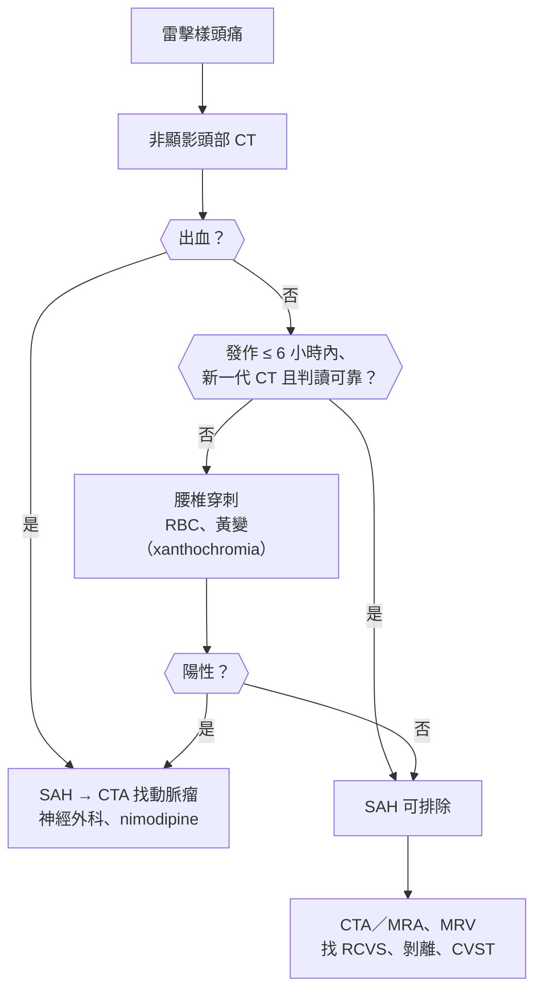
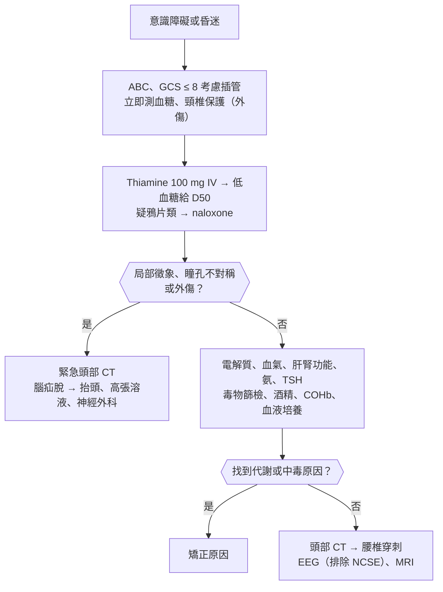
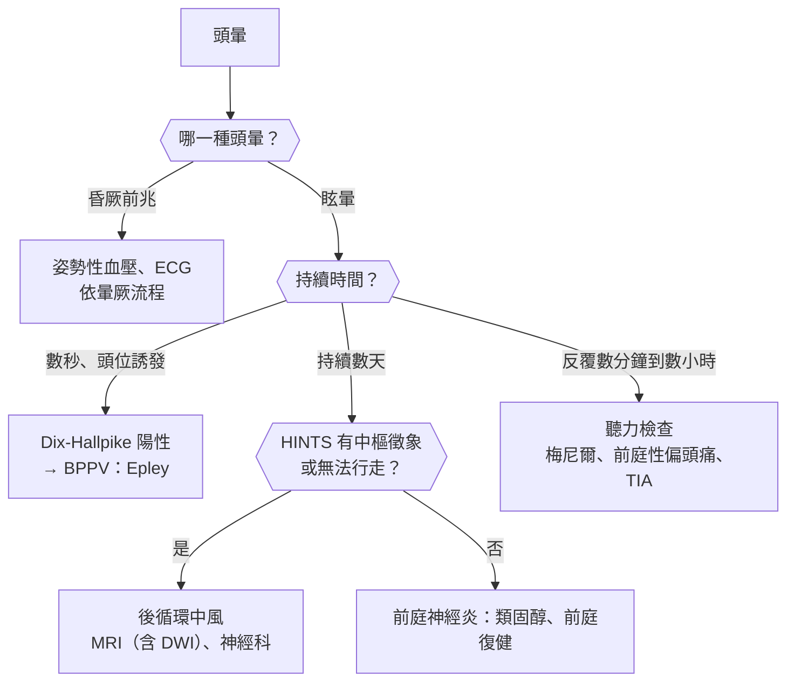
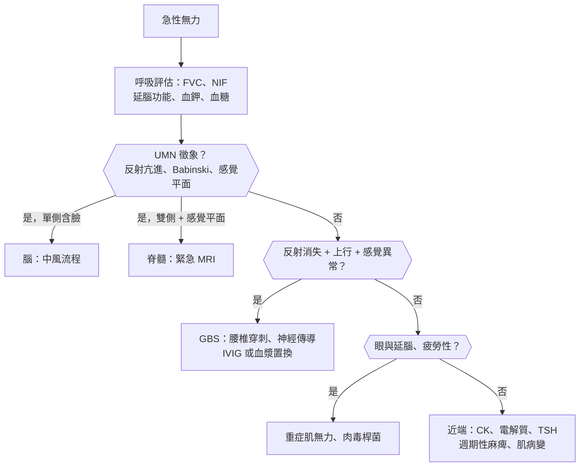

## 頭痛（Headache）

### 急性頭痛（Acute Headache）

#### 定義與分類

- **原發性頭痛（primary headache）**：頭痛本身就是疾病 → 偏頭痛、緊張型、叢集性；**佔 > 90%**。
- **次發性頭痛（secondary headache）**：由其他疾病造成 → 急診的任務是**找出危險的次發性頭痛**。
- **雷擊樣頭痛（thunderclap headache）**：**:red[1 分鐘]內達到最痛**的劇烈頭痛 → **未證實前視為蜘蛛膜下腔出血（SAH）**。
    - 其他原因：**可逆性腦血管收縮症候群（RCVS）**、**腦靜脈竇血栓（CVST）**、頸動脈或椎動脈剝離、[[代謝內分泌科#腦下垂體中風（Pituitary Apoplexy）|腦下垂體中風]]（pituitary apoplexy）、[[眼科#急性隅角閉鎖青光眼（Acute Angle-Closure Glaucoma）|急性閉角型青光眼]]、高血壓危象、第三腦室膠樣囊腫。
- **紅旗徵象（SNOOP）**：
    - **S**ystemic：發燒、體重減輕、**癌症、HIV、免疫抑制**。
    - **N**eurologic：局部神經缺損、意識改變、**[[眼科#視乳頭水腫（Papilledema）|乳突水腫]]（papilledema）**、癲癇發作。
    - **O**nset：**突發（雷擊樣）**。
    - **O**lder：**> 50 歲新發頭痛**（GCA、腫瘤、硬腦膜下出血）。
    - **P**attern change／**P**ositional（平躺加重 → 顱內壓高；站立加重 → 低顱內壓）／**P**recipitated by Valsalva（咳嗽、用力）／**P**regnancy 或產後。

#### Red flags

- **「這輩子最痛的頭痛（worst headache of my life）」**、雷擊樣發作、運動或性行為中發作。
- **發燒 + 頸部僵硬 + 意識改變** → 腦膜炎、腦炎。
- 局部神經缺損、意識改變、癲癇發作、乳突水腫。
- **> 50 歲新發頭痛 + 顳動脈壓痛、下顎跛行、視力模糊** → GCA。
- **眼睛紅痛 + 視力模糊 + 看燈有光暈 + 瞳孔中度散大** → 急性閉角型青光眼。
- **懷孕或產後**：子癇前症、CVST、RCVS、腦下垂體中風。
- 抗凝血劑、頭部外傷（老人、酗酒 → 慢性硬腦膜下出血）。
- 同住家人一起頭痛、冬天燒炭或熱水器 → **一氧化碳中毒**。

#### 鑑別診斷

| 類別 | 疾病 | 鑑別關鍵 |
|---|---|---|
| **血管性** | **[[神經內科#蜘蛛膜下腔出血（SAH）\|SAH]]**、[[神經內科#腦內出血（ICH）\|腦內出血]]、[[神經內科#腦靜脈竇血栓（CVST）\|腦靜脈竇血栓]]、RCVS、頸動脈或椎動脈剝離、[[神經外科#腦下垂體腫瘤（Pituitary Tumors）\|腦下垂體中風]]、缺血性中風 | 雷擊樣；剝離 → **頸痛 + Horner syndrome**；CVST → 懷孕、口服避孕藥、脫水 |
| **感染** | **[[神經內科#細菌性腦膜炎\|細菌性腦膜炎]]**、[[神經內科#HSV Encephalitis\|HSV 腦炎]]、[[神經內科#腦膿瘍（Brain Abscess）\|腦膿瘍]]、[[耳鼻喉科#鼻竇炎（Rhinosinusitis）\|鼻竇炎]]、全身性感染 | 發燒、頸部僵硬、意識改變；HSV → **顳葉、行為改變、癲癇** |
| **顱內壓變化** | 腦腫瘤、[[神經內科#特發性顱內壓升高（Idiopathic Intracranial Hypertension, IIH）\|特發性顱內壓升高（IIH）]]、[[神經外科#水腦症（Hydrocephalus）\|水腦症]]、**低顱內壓（腰椎穿刺後、自發性腦脊髓液滲漏）** | **清晨或平躺加重 + 嘔吐** → 顱內壓高；**站立加重、平躺緩解** → 低顱內壓 |
| **外傷** | [[神經外科#Subdural Hematoma（SDH）\|硬腦膜下出血]]、[[神經外科#Epidural Hematoma（EDH）\|硬腦膜上出血]]、[[神經外科#腦震盪（Concussion）\|腦震盪後頭痛]] | 外傷史；老人與酗酒者可能**不記得外傷** |
| **發炎與血管炎** | **[[神經內科#顳動脈炎（Giant Cell Arteritis, GCA）\|巨細胞動脈炎]]** | > 50 歲、ESR 高 |
| **眼與五官** | **急性閉角型青光眼**、鼻竇炎、顳顎關節障礙 | 眼睛紅痛、光暈 |
| **全身與毒物** | **一氧化碳中毒**、[[心臟內科#高血壓危象（Hypertensive Crisis）\|高血壓危象]]、**[[產科#子癇前症（Preeclampsia）\|子癇前症]]**、低血糖、缺氧、高碳酸血症 | 群聚、季節；懷孕 > 20 週 + 高血壓 |
| **原發性** | [[神經內科#偏頭痛（Migraine）\|偏頭痛]]、[[神經內科#叢集性頭痛（Cluster Headache）\|叢集性頭痛]]、[[神經內科#緊張型頭痛（Tension-type Headache）\|緊張型頭痛]] | **過去有類似發作**、神經學檢查正常 |

#### 易混淆鑑別

:::compare[雷擊樣頭痛：SAH vs RCVS vs CVST vs 頸動脈剝離]
| | SAH | RCVS | CVST | 頸動脈或椎動脈剝離 |
|---|---|---|---|---|
| 頭痛 | **單次、極劇烈** | **1–4 週內反覆多次雷擊樣頭痛** | 漸進或雷擊樣、平躺加重 | 頸部或臉部疼痛 + 頭痛 |
| 誘因 | **動脈瘤破裂**；用力、性行為 | **產後**、**血清素藥物、血管收縮劑（偽麻黃鹼、triptan）**、大麻 | **懷孕產後、口服避孕藥**、脫水、感染、易栓症 | **頸部外傷、按摩（整脊）**、咳嗽 |
| 伴隨 | 頸部僵硬、意識改變、**[[眼科#CN III（動眼神經）麻痺\|動眼神經麻痺]]（後交通動脈瘤）** | 可併發出血或梗塞 | **乳突水腫**、癲癇、局部缺損 | **Horner syndrome**（頸動脈）、[[神經內科#Wallenberg Syndrome（延腦外側症候群）\|延腦外側症候群]]（椎動脈） |
| 診斷 | **非顯影頭部 CT** → 陰性 → **腰椎穿刺（黃變）** | **CTA／MRA：串珠狀血管收縮**，**3 個月內恢復** | **MR 靜脈攝影（MRV）**、CT 靜脈攝影；**空三角徵象（empty delta sign）** | CTA／MRA |
| 治療 | **Nimodipine**、動脈瘤夾閉或栓塞 | 停誘發藥物、**nimodipine 或 verapamil**；**避免類固醇** | **抗凝血（即使有出血性梗塞也要給）** | 抗血小板或抗凝血 |
:::

:::compare[腦膜炎 vs 腦炎]
| | 腦膜炎（meningitis） | 腦炎（encephalitis） |
|---|---|---|
| 主要表現 | **頭痛、發燒、頸部僵硬** | **意識改變、行為異常、癲癇、局部缺損** |
| 意識 | 早期多清醒 | **早期就改變** |
| 頸部僵硬 | **明顯**（Kernig、Brudzinski sign） | 可輕微 |
| 代表病原 | [[感染科#Streptococcus pneumoniae（肺炎鏈球菌）\|肺炎鏈球菌]]、[[感染科#N. meningitidis（腦膜炎雙球菌）\|腦膜炎雙球菌]]、Listeria（老人、新生兒、免疫低下） | **HSV-1（顳葉）**、[[感染科#日本腦炎（Japanese Encephalitis）\|日本腦炎]]、腸病毒 71、**抗 NMDA 受體腦炎（自體免疫，年輕女性 + 卵巢畸胎瘤）** |
| 經驗性治療 | **Ceftriaxone + vancomycin（+ ampicillin：> 50 歲或免疫低下）+ dexamethasone** | **Acyclovir（懷疑就給）** |
:::

:::compare[腦脊髓液（CSF）判讀]
| | 細菌性 | 病毒性 | 結核性 | 隱球菌 |
|---|---|---|---|---|
| 開放壓 | ↑ | 正常或輕度↑ | ↑ | **明顯↑（常 > 25 cmH₂O）** |
| 白血球 | **↑↑（> 1000）** | ↑（< 500） | ↑（100–500） | ↑（可很低：AIDS） |
| 細胞型態 | **嗜中性球** | **淋巴球**（早期可嗜中性球） | **淋巴球** | 淋巴球 |
| 蛋白 | ↑↑ | 正常或輕度↑ | **↑↑（> 100–500）** | ↑ |
| 葡萄糖 | **↓↓（CSF/血糖 :red[< 0.4]）** | **正常** | **↓** | ↓ |
| 特殊檢查 | 革蘭氏染色、培養、抗原 | **PCR（HSV、腸病毒）** | 抗酸菌染色、培養、**ADA**、PCR | **India ink、隱球菌抗原（CrAg）** |
:::

#### 問診與理學檢查

- **發作速度**（幾秒鐘內到最痛？）、最痛程度、與過去頭痛是否相同、位置、伴隨症狀（嘔吐、發燒、視力、神經症狀）。
- 誘因：用力、咳嗽、性行為、姿勢、外傷、新藥、懷孕產後、**同住者是否也有症狀**。
- 理學檢查：**生命徵象（血壓、體溫）**、**意識**、**頸部僵硬**、**眼底（乳突水腫）**、瞳孔與眼球運動、局部神經學檢查、**顳動脈**、眼壓與眼睛外觀、皮膚瘀點。

#### 檢查流程

- **頭部 CT 在 SAH 發作 :red[6 小時]內敏感度接近 100%**，之後逐漸下降。
- **腰椎穿刺黃變**：出血後 **:red[≥ 12 小時]**才明顯（紅血球分解成膽紅素），可持續約 2 週；可與穿刺外傷區分。
- 懷疑腦膜炎：**血液培養 → 立即抗生素與 dexamethasone** → 有局部缺損、意識改變、乳突水腫、免疫低下、新發癲癇者 **先做 CT** → 腰椎穿刺。
- 懷疑 GCA → ESR、CRP、顳動脈切片或超音波。
- 懷疑一氧化碳 → **COHb**（SpO₂ 會假性正常）。

#### 初步處置

- SAH：見[[神經外科#SAH 治療|SAH 治療]]；**nimodipine :red[60 mg 每 4 小時 × 21 天]**（預防血管痙攣造成的延遲性缺血）；收縮壓控制 < 160 mmHg；盡早處理動脈瘤。
- 細菌性腦膜炎：**不要為了 CT 或腰椎穿刺延誤抗生素**。
- GCA：**立即高劑量類固醇**，不等切片。
- 一氧化碳中毒：100% 氧氣；嚴重者高壓氧。
- 急性閉角型青光眼：降眼壓藥物、雷射虹膜切開。

:::pitfall
雷擊樣頭痛病人頭部 CT 正常就讓他回家 → 發作超過 6 小時後 CT 敏感度下降，約 1 成的 SAH 會被漏掉；另外 RCVS、CVST、剝離的 CT 也常正常。CT 陰性時依時間決定是否做腰椎穿刺，並安排血管影像。
:::

:::pitfall
病人以「偏頭痛」就醫，頭痛模式與過去不同、或突然變成最痛的一次，仍照偏頭痛處理 → 漏掉 SAH 的警訊出血（sentinel headache）。已知偏頭痛的病人，頭痛性質改變仍要當作新的頭痛評估。
:::

:::exam
- 雷擊樣頭痛：先 CT，陰性且超過 6 小時再腰椎穿刺看黃變；SAH 用 nimodipine 預防血管痙攣（第 4–14 天最常見）。
- 產後婦女反覆雷擊樣頭痛、CTA 血管串珠狀收縮 → RCVS；產後頭痛 + 癲癇 + 乳突水腫 → CVST，抗凝血。
- 頸痛 + 同側 Horner syndrome + 頭痛 → 頸動脈剝離。
:::

### 慢性與反覆頭痛（Chronic / Recurrent Headache）

#### 定義與分類

- **緊張型頭痛（tension-type headache）**：**最常見**；**雙側、壓迫或緊箍感**、輕到中度、**不因日常活動加劇**、**無噁心嘔吐**（可有畏光或畏聲其中一項）。
- **偏頭痛（migraine）**：**POUND** 口訣：
    - **P**ulsatile（搏動性）、**O**ne-day（持續 **:red[4–72 小時]**）。
    - **U**nilateral（單側）、**N**ausea（噁心嘔吐）、**D**isabling（影響活動、活動加劇）。
    - 合併畏光、畏聲；**女性 > 男性（約 3：1）**、家族史。
    - **先兆（aura）**：約 1/3 的病人有；**逐漸擴展、持續 5–60 分鐘**的可逆性神經症狀，最常見**視覺閃光暗點（scintillating scotoma）**。
- **叢集性頭痛（cluster headache）**：
    - **男性 > 女性**；**單側眼眶周圍**極劇烈疼痛，持續 **:red[15–180 分鐘]**。
    - 合併**同側自主神經症狀**：流淚、結膜充血、流鼻水、眼瞼下垂、瞳孔縮小（Horner）。
    - **坐立不安、來回走動**（偏頭痛是想躺在暗處不動）。
    - 每天固定時間發作（常在夜間）、成串發作數週到數月。
- **藥物過度使用頭痛（medication-overuse headache, MOH）**：**每月頭痛 :red[≥ 15 天]**，且止痛藥使用 **:red[≥ 10–15 天／月]**超過 3 個月 → 停用過度使用的藥物。
- **三叉神經痛（trigeminal neuralgia）**：**單側臉部電擊樣、數秒鐘**的劇痛；**觸發點（洗臉、刷牙、咀嚼、吹風）**；**V2、V3 最常見**；年輕人或雙側 → 想**[[神經內科#多發性硬化症（Multiple Sclerosis, MS）|多發性硬化症]]**。

#### Red flags

- **頭痛模式改變**、進行性惡化、**清晨頭痛合併嘔吐** → 顱內腫瘤、顱內壓高。
- > 50 歲新發。
- **咳嗽或用力誘發**的頭痛 → [[神經外科#Chiari Malformation|Chiari malformation]]、後顱窩病變。
- 先兆 > 60 分鐘、運動無力型先兆、先兆後沒有頭痛的首次發作 → 要排除 [[神經內科#暫時性腦缺血發作（TIA）|TIA]]。
- 年輕肥胖女性 + 頭痛 + 暫時性視力模糊 + 搏動性耳鳴 → **IIH**（可致失明）。

#### 鑑別診斷

| 類別 | 疾病 | 鑑別關鍵 |
|---|---|---|
| **原發性** | [[神經內科#偏頭痛（Migraine）\|偏頭痛]]、[[神經內科#緊張型頭痛（Tension-type Headache）\|緊張型頭痛]]、[[神經內科#叢集性頭痛（Cluster Headache）\|叢集性頭痛]]、其他三叉自主神經頭痛（陣發性半側頭痛 → **indomethacin 完全有效**） | 神經學檢查正常、慢性穩定 |
| **藥物** | **藥物過度使用頭痛**、硝酸鹽、PDE5 抑制劑、咖啡因戒斷 | 止痛藥使用頻率 |
| **顱內病變** | [[神經外科#腦腫瘤（Brain Tumors）\|腦腫瘤]]、[[神經內科#特發性顱內壓升高（Idiopathic Intracranial Hypertension, IIH）\|IIH]]、[[神經外科#Subdural Hematoma（SDH）\|慢性硬腦膜下出血]]、Chiari malformation | 漸進、紅旗徵象 |
| **全身** | [[神經內科#顳動脈炎（Giant Cell Arteritis, GCA）\|GCA]]、**[[胸腔內科#阻塞性睡眠呼吸中止症（OSA）\|OSA]]（清晨頭痛）**、高碳酸血症、貧血、甲狀腺功能低下 | 清晨頭痛 + 打鼾 → OSA |
| **臉部疼痛** | **[[神經外科#三叉神經痛（Trigeminal Neuralgia）\|三叉神經痛]]**、[[耳鼻喉科#鼻竇炎（Rhinosinusitis）\|鼻竇炎]]、顳顎關節障礙、牙痛、[[皮膚科#帶狀疱疹（Herpes Zoster / Shingles）\|帶狀疱疹後神經痛]] | 電擊樣、觸發點 |
| **頸因性** | 頸椎病變 | 頸部活動誘發 |

#### 易混淆鑑別

:::compare[偏頭痛 vs 緊張型頭痛 vs 叢集性頭痛]
| | 偏頭痛 | 緊張型頭痛 | 叢集性頭痛 |
|---|---|---|---|
| 性別 | **女性多** | 女性稍多 | **男性多** |
| 位置 | **單側**（可換邊） | **雙側、緊箍感** | **單側眼眶周圍**（固定同側） |
| 性質 | **搏動性** | 壓迫、緊繃 | **鑽刺、燒灼，極劇烈** |
| 持續 | **4–72 小時** | 30 分鐘–7 天 | **15–180 分鐘** |
| 伴隨 | **噁心嘔吐、畏光畏聲**、先兆 | **無噁心** | **同側流淚、流鼻水、Horner** |
| 發作時行為 | **躺在暗處、不想動** | 照常活動 | **坐立不安、來回走動** |
| 誘因 | 壓力、睡眠、月經、紅酒、巧克力、空腹 | 壓力、姿勢 | **酒精**、硝酸鹽、固定時間（夜間） |
| 急性治療 | **NSAIDs、triptan**（± 止吐劑）；gepant | NSAIDs、acetaminophen | **100% 氧氣（12–15 L/min，15 分鐘）、皮下 sumatriptan** |
| 預防 | **propranolol、topiramate、amitriptyline、flunarizine、valproate**、CGRP 單株抗體 | amitriptyline | **verapamil**（過渡期可短期類固醇） |
:::

:::compare[Triptan 的禁忌]
| 禁忌或注意 | 原因 |
|---|---|
| **冠心症、中風、[[心臟內科#周邊動脈疾病（Peripheral Artery Disease, PAD）\|周邊動脈疾病]]、控制不良的高血壓** | **5-HT1B 致效 → 血管收縮** |
| 偏癱型或腦幹先兆偏頭痛 | 理論上增加缺血風險 |
| **24 小時內用過 ergotamine 或另一種 triptan** | 血管收縮疊加 |
| MAO 抑制劑（部分 triptan） | 代謝受抑制 |
| 與 SSRI／SNRI 併用 | [[精神科#Serotonin Syndrome（血清素症候群）\|血清素症候群]]風險（實際很低，但要知道） |
- 有血管疾病者可改用 **gepant（CGRP 受體拮抗劑）**或 **lasmiditan（5-HT1F，不收縮血管，但會頭暈、不能開車）**。
:::

#### 問診與理學檢查

- **頭痛日記**：頻率、持續時間、誘因、月經關聯、止痛藥使用天數。
- 位置、性質、伴隨症狀、發作時行為、先兆、家族史、睡眠與打鼾、情緒、咖啡因。
- 理學檢查：血壓、**眼底**、神經學檢查、頸部與顳顎關節、顳動脈、BMI。

#### 檢查流程

- **典型原發性頭痛、神經學檢查正常 → 不需影像**。
- 影像適應症：紅旗徵象、頭痛模式改變、神經學檢查異常、非典型先兆 → **MRI（首選）**。
- IIH：**MRI＋MRV 正常** → 腰椎穿刺**開放壓 > 25 cmH₂O**、CSF 成分正常。

#### 初步處置

- 偏頭痛急性期：**及早服藥**；輕中度 → NSAIDs；中重度 → **triptan** ± 止吐劑（metoclopramide）；急診 → IV metoclopramide 或 prochlorperazine + NSAIDs ± dexamethasone（預防復發）。
- **預防性治療的時機**：**每月 :red[≥ 4 天]**發作、嚴重影響生活、急性藥物無效或禁忌、特殊型態。
- **避免鴉片類與含 butalbital 的藥物**（MOH、效果差）。
- 叢集性頭痛：100% 氧氣、sumatriptan SC 或鼻噴；預防 verapamil（**追蹤 ECG**）。
- 三叉神經痛：**carbamazepine（首選）**、oxcarbazepine；藥物無效 → 微血管減壓手術、伽瑪刀。
- MOH：停用過度使用的藥物、開始預防性治療。

:::pitfall
頭痛病人每週吃好幾天止痛藥仍然天天痛，就不斷加強止痛藥 → 藥物過度使用頭痛越來越嚴重。每月頭痛 ≥ 15 天時要問止痛藥使用天數，停藥並給預防性治療。
:::

:::exam
- 單側搏動性、4–72 小時、噁心畏光、想躺暗處 → 偏頭痛；有冠心症者不可用 triptan。
- 男性夜間單側眼眶劇痛 15–180 分鐘、同側流淚流鼻水、坐立不安 → 叢集性頭痛 → 100% 氧氣、sumatriptan；預防 verapamil。
- 單側臉部電擊樣數秒疼痛、刷牙誘發 → 三叉神經痛 → carbamazepine；年輕或雙側 → 想多發性硬化症。
:::

## 意識與認知（Consciousness and Cognition）

### 意識障礙與昏迷（Altered Consciousness / Coma）

#### 定義與分類

- **意識 = 清醒程度（arousal，腦幹網狀活化系統 ARAS）+ 意識內容（awareness，大腦皮質）**。
- 昏迷需要：**雙側大腦半球**廣泛受損，或**腦幹 ARAS** 受損；**單側半球病變不會造成昏迷**（除非造成腦疝脫）。
- 程度：嗜睡（lethargy）→ 混亂（obtundation）→ 木僵（stupor，需強刺激才醒）→ **昏迷（coma，無法喚醒）**。
- **GCS（Glasgow Coma Scale）**：E4 V5 M6，總分 3–15；**:red[≤ 8] → 考慮插管保護呼吸道**。

| | 4 | 3 | 2 | 1 | 5 | 6 |
|---|---|---|---|---|---|---|
| **E（睜眼）** | 自發 | 聲音 | 疼痛 | 無 | | |
| **V（語言）** | 混亂 | 不恰當的字 | 無法理解的聲音 | 無 | **對答正確** | |
| **M（運動）** | **疼痛退縮** | **異常屈曲（去皮質）** | **伸直（去大腦）** | 無 | 定位疼痛 | **遵從指令** |

- 原因分類：
    - **結構性**：中風（腦幹、大面積半球）、出血、腫瘤、膿瘍、外傷、水腦症 → **常有局部徵象、瞳孔不對稱**。
    - **代謝與中毒（最常見）**：低血糖、高血糖、低血鈉、高血鈣、尿毒、肝性腦病變、缺氧、高碳酸、敗血症、甲狀腺、腎上腺、Wernicke、藥物與酒精 → **對稱、瞳孔反射多保留**。
    - **癲癇**：非痙攣性癲癇重積（NCSE）、發作後狀態。
    - **心因性**：假性昏迷（眼皮抗拒被打開、手落下會避開臉）。
- 口訣 **AEIOU TIPS**：Alcohol、Epilepsy／Electrolytes／Encephalopathy、Insulin（低血糖）、Opioids／Oxygen、Uremia、Trauma／Temperature、Infection、Psychiatric／Poisoning、Stroke／Shock。

#### Red flags

- GCS ≤ 8、呼吸型態異常、無法保護呼吸道。
- **瞳孔單側散大、對光無反應** → **[[神經外科#腦疝症候群（Herniation Syndromes）|天幕裂孔疝脫]]（uncal herniation）壓迫動眼神經**。
- **Cushing triad（高血壓 + 心搏過緩 + 呼吸不規則）** → 顱內壓升高、即將腦疝脫。
- 發燒、頸部僵硬、瘀點。
- **針尖瞳孔 + 呼吸抑制** → 鴉片類中毒（或橋腦出血）。

#### 鑑別診斷

| 類別 | 疾病 | 鑑別關鍵 |
|---|---|---|
| **結構：血管** | [[神經內科#腦內出血（ICH）\|腦內出血]]、[[神經內科#蜘蛛膜下腔出血（SAH）\|SAH]]、**基底動脈阻塞**、大面積 MCA 梗塞 | 突發、局部缺損；基底動脈 → 眼球運動異常、四肢癱瘓 |
| **結構：外傷** | [[神經外科#Epidural Hematoma（EDH）\|硬腦膜上出血]]（**清醒期 lucid interval**）、[[神經外科#Subdural Hematoma（SDH）\|硬腦膜下出血]]、[[神經外科#瀰漫性軸突損傷（Diffuse Axonal Injury, DAI）\|瀰漫性軸突損傷]] | 外傷史、頭皮傷口 |
| **結構：其他** | 腫瘤、[[神經內科#腦膿瘍（Brain Abscess）\|膿瘍]]、[[神經外科#水腦症（Hydrocephalus）\|急性水腦症]] | 漸進、乳突水腫 |
| **代謝** | **[[代謝內分泌科#Hypoglycemia\|低血糖]]**、[[代謝內分泌科#糖尿病急性併發症\|DKA／HHS]]、[[腎臟內科#低血鈉（Hyponatremia，Na⁺ < 135 mEq/L）\|低血鈉]]、[[腎臟內科#高血鈣（Hypercalcemia，Ca²⁺ > 10.5 mg/dL）\|高血鈣]]、尿毒、**[[消化內科#肝性腦病變（Hepatic Encephalopathy）\|肝性腦病變]]**、高碳酸血症、[[代謝內分泌科#黏液水腫昏迷（Myxedema Coma）\|黏液水腫昏迷]]、[[代謝內分泌科#腎上腺功能不全（Adrenal Insufficiency）\|腎上腺危象]]、**[[神經內科#Wernicke-Korsakoff Syndrome\|Wernicke 腦病變]]** | 對稱、**撲翼樣震顫（asterixis）**、檢驗異常 |
| **中毒** | **鴉片類**、benzodiazepine、酒精、一氧化碳、抗膽鹼、TCA、水楊酸、有機磷 | 瞳孔、呼吸、皮膚、毒物症候群（toxidrome） |
| **感染** | [[神經內科#細菌性腦膜炎\|腦膜炎]]、[[神經內科#病毒性腦炎\|腦炎]]、**敗血症**（老人） | 發燒、頸部僵硬 |
| **癲癇** | **非痙攣性癲癇重積（NCSE）**、發作後狀態 | 眼球震顫、細微抽動；**EEG** |
| **體溫** | 中暑、低體溫 | 核心體溫 |
| **心因性與類昏迷狀態** | 假性昏迷、**閉鎖症候群（locked-in，腹側橋腦梗塞）**、植物人狀態 | 閉鎖症候群：**意識清楚、只能垂直眼球運動與眨眼** |

#### 易混淆鑑別

:::compare[結構性 vs 代謝性昏迷]
| | 結構性 | 代謝性與中毒性 |
|---|---|---|
| 發作 | 突然（血管）或漸進（腫瘤） | 多漸進，可波動 |
| 局部徵象 | **有**：偏癱、不對稱 | **通常無**（低血糖可有局部缺損） |
| 瞳孔 | **可不對稱、對光反射消失** | **對稱、對光反射保留**（**例外**：鴉片類針尖、缺氧後散大固定、抗膽鹼散大） |
| 眼球運動 | 斜視、偏向一側 | 游走（roving eye movements）、頭眼反射保留 |
| 不自主運動 | 去皮質或去大腦姿勢 | **撲翼樣震顫、肌躍症（myoclonus）** |
| 首要檢查 | **頭部 CT** | **血糖**、電解質、血氣、肝腎功能、毒物、氨 |
:::

:::compare[瞳孔與昏迷定位]
| 瞳孔 | 意義 |
|---|---|
| **單側散大、對光無反應** | **動眼神經受壓：天幕裂孔疝脫**、後交通動脈瘤 |
| **針尖瞳孔（pinpoint）** | **鴉片類**、**橋腦出血**、有機磷 |
| 雙側中等大小、固定 | **中腦**病變 |
| 雙側散大、固定 | **缺氧後**、嚴重腦疝脫、抗膽鹼或擬交感中毒 |
| 小而有反射 | 代謝性、間腦病變 |
| 單側小 + 眼瞼下垂 | **Horner syndrome**（同側下視丘、腦幹、頸動脈病變） |
:::

:::compare[去皮質 vs 去大腦姿勢]
| | 去皮質姿勢（decorticate） | 去大腦姿勢（decerebrate） |
|---|---|---|
| 上肢 | **屈曲**（手臂彎向胸前） | **伸直、內旋** |
| 下肢 | 伸直 | 伸直 |
| 病變位置 | **紅核（red nucleus）以上**（大腦、內囊、視丘） | **紅核以下**（中腦、橋腦） |
| GCS 運動分數 | **M3** | **M2** |
| 預後 | 較好 | **較差** |
:::

#### 問診與理學檢查

- 目擊者：發作速度、之前狀況（頭痛、抽搐、外傷）、**藥物與毒物（找藥罐）**、酒精、糖尿病、肝腎病、精神病史。
- 理學檢查：
    - **ABC、生命徵象、體溫、血糖（立即測）**。
    - 外傷徵象：**熊貓眼、Battle sign（耳後瘀青）→ [[神經外科#顱底骨折|顱底骨折]]**、腦脊髓液鼻漏耳漏。
    - 皮膚（注射痕跡、瘀點、黃疸、櫻桃紅）、呼吸氣味（酒精、酮體、肝臭）、頸部僵硬。
    - **神經學**：GCS、**瞳孔**、眼球運動（頭眼反射 doll's eye、冰水測試）、角膜反射、咳嗽與嘔吐反射、呼吸型態、肢體對稱性、病理反射。

#### 檢查流程

- **先給 thiamine 再給葡萄糖**（酒癮、營養不良者，避免誘發 Wernicke）——但**不可因為等 thiamine 而延誤低血糖治療**。
- 不明原因的昏迷、細微抽動或眼球震顫 → **EEG 排除非痙攣性癲癇重積**。

#### 初步處置

- 保護呼吸道、維持血壓與氧合、矯正低血糖。
- **顱內壓升高或腦疝脫**：床頭抬高 30°、**高張溶液（mannitol 或 3% 食鹽水）**、短暫過度換氣（PaCO₂ 30–35，只作為過渡）、神經外科減壓或引流；見[[神經外科#ICP 升高處理（階梯式）|ICP 升高處理]]。
- 解毒劑：**naloxone（鴉片類）**、flumazenil（**不常規使用**：長期 benzodiazepine 使用者或合併 TCA 會誘發癲癇）、**hydroxocobalamin（氰化物）**、atropine + pralidoxime（有機磷）。
- 肝性腦病變：**lactulose**、rifaximin、找誘因（感染、出血、便秘、利尿劑、鎮靜劑）。
- 腦死判定：見[[神經外科#腦死判定要點（台灣標準）|腦死判定（台灣標準）]]。

:::pitfall
昏迷病人沒有先驗血糖就送去做 CT 或 MRI → 低血糖本身會造成昏迷甚至局部神經缺損（像中風），延誤數十分鐘就可能造成永久腦傷。任何意識改變都要在第一時間測血糖。
:::

:::exam
- 頭部外傷後短暫昏迷 → 清醒期 → 再度昏迷 + 同側瞳孔散大 → 硬腦膜上出血（中腦膜動脈），CT 見雙凸透鏡狀出血。
- 意識清楚但四肢癱瘓、只能上下看與眨眼 → 閉鎖症候群（腹側橋腦，基底動脈阻塞）。
- 昏迷 + 針尖瞳孔 + 呼吸抑制 → 鴉片類中毒 → naloxone。
:::

### 譫妄與急性意識混亂（Delirium / Acute Confusion）

#### 定義與分類

- **譫妄（delirium）**：**急性發作（數小時到數天）**、**病程起伏（fluctuating）**的**注意力**與意識障礙，由**身體疾病、藥物或戒斷**造成。
- **CAM（Confusion Assessment Method）**：
    1. **急性發作且病程起伏**，加上
    2. **注意力不集中**，加上下列任一：
    3. **思考紊亂**，或
    4. **意識程度改變**。
- 亞型：
    - **活動過度型（hyperactive）**：躁動、幻覺、拔管線 → 容易被注意。
    - **[[精神科#譫妄（Delirium）|活動低下型（hypoactive）]]**：嗜睡、退縮、反應慢 → **老人最常見、最容易被忽略、預後最差**。
    - 混合型。
- 危險因子：**高齡**、**失智（最強的危險因子）**、多重疾病、感覺障礙（聽力視力）、手術（**髖部骨折**、心臟手術）、加護病房、**[[家庭醫學科#多重用藥（Polypharmacy）|多重用藥]]**、脫水、尿管、約束、睡眠剝奪。
- 常見誘因（找原因）：**感染（UTI、肺炎）**、**藥物（抗膽鹼、benzodiazepine、鴉片類、類固醇）**、電解質異常、低血氧、尿滯留、便秘、疼痛、**酒精或 benzodiazepine 戒斷**、中風、心肌梗塞。

#### Red flags

- 生命徵象異常、發燒、低血氧。
- 局部神經缺損、頭痛、頸部僵硬。
- **自主神經亢進（心搏過速、冒汗、發抖、高血壓、發燒）+ 幻覺** → **酒精戒斷譫妄（delirium tremens）**，死亡率高。
- 眼肌麻痺 + 運動失調 + 意識混亂 → **[[神經內科#Wernicke-Korsakoff Syndrome|Wernicke]] 腦病變**。

#### 鑑別診斷

| 類別 | 疾病 | 鑑別關鍵 |
|---|---|---|
| **譫妄的原因** | 感染、藥物、代謝異常、缺氧、戒斷、中風、尿滯留、便秘、疼痛 | 找誘因；常多重原因 |
| **失智** | [[神經內科#阿茲海默病（Alzheimer's Disease）\|阿茲海默病]]、[[神經內科#路易體失智（Dementia with Lewy Bodies, DLB）\|路易體失智（病程起伏，易與譫妄混淆）]] | 漸進數月到數年、注意力早期正常 |
| **精神疾病** | [[精神科#思覺失調症（Schizophrenia）\|急性精神病]]、[[精神科#雙極性疾患（Bipolar Disorder）\|躁症]]、[[精神科#鬱症（Depressive Disorders）\|鬱症]]（老人假性失智） | **意識清楚、定向感正常**；幻覺以聽幻覺為主 |
| **非痙攣性癲癇重積** | NCSE | EEG |
| **戒斷** | **[[精神科#酒精戒斷（Alcohol Withdrawal）\|酒精戒斷]]**、benzodiazepine 戒斷 | 停用 48–96 小時、自主神經亢進 |
| **局部腦病變** | 非優勢側頂葉中風、Wernicke 失語症（被誤以為混亂） | 局部徵象、語言檢查 |

#### 易混淆鑑別

:::compare[譫妄 vs 失智 vs 精神病]
| | 譫妄 | 失智 | 急性精神病 |
|---|---|---|---|
| 發作 | **急性（數小時到數天）** | **漸進（數月到數年）** | 急性或亞急性 |
| 病程 | **起伏、夜間惡化（日落症候群）** | 穩定漸進（DLB 例外） | 持續 |
| **注意力** | **明顯受損（核心）** | 早期正常 | 可正常 |
| 意識程度 | **改變** | 正常（到末期） | **清楚** |
| 幻覺 | **視幻覺**多 | 晚期（DLB 早期視幻覺） | **聽幻覺**多 |
| 可逆性 | **多可逆**（找原因） | 多不可逆 | 治療可改善 |
| EEG | **瀰漫性慢波**（戒斷時快波） | 正常或輕度慢波 | 正常 |
:::

:::compare[酒精戒斷的時間軸]
| 停酒後 | 表現 |
|---|---|
| **6–24 小時** | 輕度戒斷：發抖、焦慮、失眠、冒汗、心悸、噁心 |
| **12–48 小時** | **酒精性幻覺（多為視幻覺，意識清楚）** |
| **24–48 小時** | **戒斷癲癇發作**（全身性，常單次或成串） |
| **:red[48–96 小時]** | **戒斷譫妄（delirium tremens）**：意識混亂、幻覺、**自主神經亢進（發燒、心搏過速、高血壓、大量出汗）** |
- 治療：**benzodiazepine（首選；依 CIWA-Ar 評分給藥）**、**thiamine**、補充水分與電解質（鎂）；**抗精神病藥會降低癲癇閾值，不單獨使用**。
:::

#### 問診與理學檢查

- **向家屬或照顧者確認基準狀態**與變化速度。
- **完整用藥清單**（含新藥、停藥、成藥、安眠藥）、酒精、最近手術或住院。
- 理學檢查：生命徵象、感染源、**膀胱（尿滯留）、肛診（糞便嵌塞）**、脫水、神經學檢查、聽力視力。
- 注意力測試：**倒數月份、100 連續減 7**、數字廣度。

#### 檢查流程

- CBC、電解質（鈉、鈣、鎂）、血糖、肝腎功能、尿液分析與培養、CXR、ECG、血氧；依情況加 TSH、B12、氨、毒物、藥物濃度。
- **頭部影像只在有局部徵象、外傷、抗凝血、找不到其他原因時**。

#### 初步處置

- **治療原因**：停用或減少致病藥物、處理感染、矯正電解質、處理尿滯留與便秘、控制疼痛。
- **非藥物介入（第一線、也是預防）**：
    - 定向感（時鐘、日曆、家人陪伴）、戴眼鏡助聽器。
    - 維持日夜節律、早期下床活動、補充水分。
    - **避免約束**、盡早移除管路。
- 藥物：**只在嚴重躁動、危及自身或他人時**，短期低劑量 **haloperidol** 或第二代抗精神病藥（**DLB 或 Parkinson 病人避免 haloperidol** → 改 quetiapine）。
- **benzodiazepine 只用於酒精或 benzodiazepine 戒斷**，其他情況會加重譫妄。

:::pitfall
老人住院後變得安靜嗜睡、吃得少，被認為是「累了」或「憂鬱」→ 其實是活動低下型譫妄，背後可能是肺炎、UTI、電解質或藥物。新發的嗜睡退縮要用 CAM 評估並找原因。
:::

:::exam
- 譫妄的核心是急性發作、病程起伏、注意力不集中；失智早期注意力正常。
- 譫妄最強的危險因子是失智；活動低下型最常見也最常被忽略。
- 停酒 48–96 小時意識混亂、幻覺、發燒、心搏過速、冒汗 → 戒斷譫妄 → benzodiazepine + thiamine。
:::

### 失智與記憶力減退（Dementia / Memory Loss）

#### 定義與分類

- **失智（dementia，重度神經認知障礙）**：**一個或多個認知領域**（記憶、執行功能、語言、視空間、注意力、社會認知）**明顯退化**，**影響日常生活獨立性**，且**不是譫妄或其他精神疾病**造成。
- **輕度認知障礙（MCI）**：認知退化但**日常生活仍可獨立**；每年約 10–15% 進展為失智。
- 篩檢工具：**MMSE（:red[< 24] 異常）**、**MoCA（:red[< 26] 異常，對 MCI 與執行功能較敏感）**、畫時鐘、AD8。
- 原因：
    - **阿茲海默病（最常見，約 60%）**。
    - **血管性失智（第二常見）**。
    - **路易體失智（DLB）**、**額顳葉失智（FTD）**、Parkinson 病失智。
    - **可逆或可治療的原因**：**B12 缺乏**、**甲狀腺功能低下**、**常壓性水腦症（NPH）**、**慢性硬腦膜下出血**、**鬱症（假性失智）**、**梅毒**、HIV、藥物（抗膽鹼、benzodiazepine）、酒精、腫瘤。
    - **快速進展（數週到數月）**：**庫賈氏病（CJD）**、自體免疫腦炎、腫瘤、感染。

#### Red flags

- **快速進展**（數週到數月）→ CJD、自體免疫腦炎、腫瘤。
- **年輕發病（< 65 歲）**、局部神經徵象、早期步態異常或尿失禁。
- **肌躍症（myoclonus）+ 快速認知退化** → CJD。
- 頭痛、跌倒、抗凝血 → 慢性硬腦膜下出血。

#### 鑑別診斷

| 類別 | 疾病 | 鑑別關鍵 |
|---|---|---|
| **退化性** | **[[神經內科#阿茲海默病（Alzheimer's Disease）\|阿茲海默病]]**、[[神經內科#路易體失智（Dementia with Lewy Bodies, DLB）\|路易體失智]]、[[神經內科#額顳葉失智（Frontotemporal Dementia, FTD）\|額顳葉失智]]、[[神經內科#巴金森病（Parkinson's Disease, PD）\|Parkinson 病失智]]、[[神經內科#亨丁頓舞蹈症（Huntington's Disease）\|Huntington]] | 見比較表 |
| **血管性** | 多發性梗塞、小血管病變、[[神經內科#CADASIL\|CADASIL]] | **階梯式惡化**、局部徵象、中風危險因子 |
| **可逆：結構** | **[[神經內科#正常壓力水腦症（NPH）\|常壓性水腦症]]**、**[[神經外科#Subdural Hematoma（SDH）\|慢性硬腦膜下出血]]**、腫瘤 | NPH 三主徵；SDH → 老人、跌倒、抗凝血 |
| **可逆：代謝與營養** | **[[血液腫瘤科#巨球性貧血（Megaloblastic Anemia）\|B12 缺乏]]**、**[[代謝內分泌科#甲狀腺機能低下（Hypothyroidism）\|甲狀腺功能低下]]**、[[神經內科#Wernicke-Korsakoff Syndrome\|Wernicke-Korsakoff]]、[[神經內科#威爾森氏病（Wilson Disease）\|Wilson disease]]（年輕人） | B12 → **合併脊髓後柱與周邊神經病變** |
| **可逆：感染** | [[神經內科#Neurosyphilis\|神經梅毒]]、HIV 相關神經認知障礙 | 血清學 |
| **可逆：精神與藥物** | **[[精神科#鬱症（Depressive Disorders）\|鬱症（假性失智）]]**、抗膽鹼、benzodiazepine、酒精 | 見比較表 |
| **快速進展** | **[[神經內科#Creutzfeldt-Jakob Disease（CJD）\|CJD]]**、自體免疫腦炎（[[神經內科#NMDA Receptor Encephalitis\|抗 NMDA 受體]]、抗 LGI1） | 數週到數月；肌躍症 |

#### 易混淆鑑別

:::compare[四大失智症]
| | 阿茲海默病 | 血管性失智 | 路易體失智（DLB） | 額顳葉失智（FTD） |
|---|---|---|---|---|
| 發病年齡 | > 65 歲 | 中老年 | > 60 歲 | **較年輕（45–65 歲）** |
| 早期表現 | **近期記憶喪失** | 執行功能、處理速度 | **認知起伏、反覆視幻覺** | **人格行為改變**（去抑制、冷漠、飲食改變）或語言障礙 |
| 病程 | **漸進** | **階梯式惡化** | 起伏、漸進 | 漸進 |
| 運動症狀 | 晚期才有 | 局部徵象、步態 | **Parkinson 症狀（1 年內或同時）** | 可合併 [[神經內科#肌萎縮側索硬化症（ALS）\|ALS]] |
| 其他 | 晚期定向感、語言、視空間 | 中風危險因子 | **REM 睡眠行為障礙**、**對抗精神病藥極度敏感** | 記憶相對保留 |
| 影像 | **海馬迴與內側顳葉萎縮**；PET 顳頂葉低代謝 | 多發梗塞、白質病變 | 枕葉低代謝、**DAT scan 異常** | **額葉、顳葉前部萎縮** |
| 病理 | **β-amyloid 斑塊 + tau 神經纖維纏結** | | **α-synuclein（Lewy body）** | tau、TDP-43 |
| 治療 | **AChEI（donepezil 等）**、中重度 **memantine** | 控制危險因子、AChEI | **AChEI 效果好**；**避免 haloperidol** | **AChEI 無效**；SSRI 改善行為 |
:::

:::compare[失智 vs 鬱症假性失智]
| | 失智 | 鬱症假性失智 |
|---|---|---|
| 發作 | 漸進、時間不明確 | **較急、可指出開始時間** |
| 病人態度 | **隱藏或否認**缺損、虛談 | **強調自己記性很差**、抱怨多 |
| 回答 | 盡力但答錯 | **常說「不知道」**、不努力回答 |
| 情緒 | 淡漠或正常 | **低落、過去有鬱症病史** |
| 抗憂鬱治療 | 不改善認知 | **改善** |
- 鬱症也可能是失智的早期表現，兩者常並存。
:::

:::compare[常壓性水腦症（NPH）]
| 項目 | 內容 |
|---|---|
| 三主徵 | **步態障礙（最早、最明顯；磁性步態 magnetic gait）**、**尿失禁**、**失智**（wet, wobbly, wacky） |
| 影像 | **腦室擴大，與腦萎縮不成比例** |
| 腰椎穿刺 | **開放壓正常或輕度上升**；**放出 30–50 mL 腦脊髓液後步態改善 → 預測分流手術效果** |
| 治療 | **腦室腹腔分流（VP shunt）**；**步態改善最多**，認知改善最少 |
:::

#### 問診與理學檢查

- **向家屬詢問**：最早出現的症狀、時間軸、進展速度、日常生活功能（ADL、IADL：理財、用藥、購物、交通）。
- 行為、幻覺、睡眠（REM 睡眠行為障礙）、跌倒、尿失禁、情緒、酒精、用藥、家族史。
- 理學檢查：**認知篩檢**、**步態**、Parkinson 徵象、局部神經徵象、**肌躍症**、眼球運動、本體感覺與震動覺（B12）、聽力視力。

#### 檢查流程

- **可逆原因的基本檢查**：**B12**、**TSH**、CBC、電解質、鈣、血糖、肝腎功能；危險族群加**梅毒（RPR／TPHA）**、HIV。
- **頭部影像（CT 或 MRI）**：排除 NPH、腫瘤、硬腦膜下出血、中風。
- 快速進展：**MRI DWI（CJD：皮質緞帶與基底核高訊號）**、**EEG（週期性尖波）**、**腦脊髓液 14-3-3、RT-QuIC**、自體免疫抗體。
- 診斷不明：神經心理測驗、FDG-PET、類澱粉 PET、腦脊髓液 Aβ42／tau。

#### 初步處置

- 治療可逆原因（B12、甲狀腺、NPH 分流、SDH 引流、停用抗膽鹼藥）。
- **乙醯膽鹼酯酶抑制劑（donepezil、rivastigmine、galantamine）**：輕中度阿茲海默、DLB、Parkinson 失智；副作用 → **心搏過緩、暈厥**、腸胃不適。
- **Memantine（NMDA 拮抗劑）**：中重度阿茲海默。
- 行為與精神症狀：先非藥物（環境、作息、照顧技巧）；抗精神病藥**增加失智老人死亡率（中風）**，只用於嚴重且其他方法無效時。
- 照顧者支持、安全（駕駛、走失、用火）、預立醫療決定；台灣**長照 2.0** 資源。

:::pitfall
失智病人出現幻覺與躁動，給了 haloperidol 後變得僵硬、意識更差、發燒 → 路易體失智對抗精神病藥極度敏感，可誘發嚴重錐體外症狀甚至 [[精神科#惡性抗精神病藥症候群（Neuroleptic Malignant Syndrome, NMS）|NMS]]。認知起伏、視幻覺、Parkinson 症狀的病人要想到 DLB，必要時用 quetiapine 或 clozapine。
:::

:::exam
- 失智的可逆原因必驗：B12、TSH、梅毒（高風險）、頭部影像（NPH、SDH）。
- 步態障礙 + 尿失禁 + 失智、腦室擴大 → NPH，放腦脊髓液試驗後步態改善 → VP shunt。
- 快速進展失智 + 肌躍症 + EEG 週期性尖波 → CJD。
:::

### 抽搐與癲癇發作（Seizure）

#### 定義與分類

- **癲癇發作（seizure）**：大腦神經元**異常、過度同步放電**造成的暫時性症狀。
- **癲癇（epilepsy）**：
    - **≥ 2 次非誘發性發作（間隔 > 24 小時）**；或
    - **1 次非誘發性發作 + 再發風險 :red[≥ 60%]**（EEG 癲癇波、腦部結構病變）；或
    - 癲癇症候群。
- **誘發性發作（provoked／acute symptomatic）**：有明確的急性原因 → **治療原因即可，通常不需長期抗癲癇藥**。
    - 代謝：**低血糖**、**低血鈉**、低血鈣、低血鎂、尿毒、高血糖高滲。
    - **酒精或 benzodiazepine 戒斷**。
    - 藥物：**tramadol**、**bupropion**、**isoniazid（→ pyridoxine）**、theophylline、TCA、carbapenem（imipenem）、cocaine。
    - 急性腦損傷：中風、外傷、感染、出血；**子癇**；高血壓腦病變、PRES。
- **發作分類（ILAE）**：
    - **局部（focal）**：意識保留或受損；可**擴展為雙側強直陣攣**。
    - **全面（generalized）**：強直陣攣（tonic-clonic）、失神（absence）、肌躍（myoclonic）、失張力（atonic）。
- **癲癇重積（status epilepticus）**：**發作 :red[≥ 5 分鐘]**，或**兩次發作之間意識未恢復**。

#### Red flags

- **癲癇重積**。
- 首次發作 + **發燒、頸部僵硬** → 腦膜炎、腦炎。
- 首次發作 + **局部神經缺損、頭痛** → 中風、出血、腫瘤。
- 懷孕 > 20 週或產後 + 高血壓 → **子癇** → magnesium sulfate。
- 外傷、抗凝血、酒癮。

#### 鑑別診斷

| 類別 | 疾病 | 鑑別關鍵 |
|---|---|---|
| **癲癇** | 局部癲癇（顳葉最常見）、全面性癲癇（青少年肌躍性癲癇 [[小兒科#青少年肌陣攣性癲癇（Juvenile Myoclonic Epilepsy, JME）\|JME]]、失神癲癇） | EEG、MRI |
| **誘發性：代謝** | [[代謝內分泌科#Hypoglycemia\|低血糖]]、[[腎臟內科#低血鈉（Hyponatremia，Na⁺ < 135 mEq/L）\|低血鈉]]、[[腎臟內科#低血鈣（Hypocalcemia，Ca²⁺ < 8.5 mg/dL）\|低血鈣]]、[[腎臟內科#低血鎂（Hypomagnesemia）\|低血鎂]] | 檢驗 |
| **誘發性：戒斷與藥物** | **[[精神科#酒精戒斷（Alcohol Withdrawal）\|酒精戒斷]]**、benzodiazepine 戒斷、tramadol、bupropion、isoniazid | 停酒 24–48 小時；用藥史 |
| **誘發性：腦部** | 中風、[[神經內科#腦內出血（ICH）\|出血]]、[[神經外科#腦腫瘤（Brain Tumors）\|腫瘤]]、[[神經內科#HSV Encephalitis\|腦炎]]、外傷、[[神經內科#腦靜脈竇血栓（CVST）\|CVST]]、**[[產科#子癇前症（Preeclampsia）\|子癇]]** | 局部徵象、發燒、懷孕 |
| **兒童** | [[神經內科#Febrile Seizure（熱性痙攣）\|熱性痙攣]]、[[神經內科#Generalized 發作\|失神發作]]、屏氣發作 | 年齡、發燒 |
| **類似發作（非癲癇）** | **[[心血管系統主訴#暈厥（Syncope）\|暈厥]]（抽搐性暈厥）**、**[[精神科#轉化症（Conversion Disorder）\|心因性非癲癇發作（PNES）]]**、[[神經內科#暫時性腦缺血發作（TIA）\|TIA]]、[[神經內科#偏頭痛（Migraine）\|偏頭痛先兆]]、短暫全面性失憶、睡眠障礙（[[神經內科#猝睡症（Narcolepsy）\|猝睡症]]、REM 行為障礙）、低血糖、急性肌張力異常 | 見比較表 |

#### 易混淆鑑別

:::compare[癲癇發作 vs 暈厥]
| | 癲癇發作 | 暈厥 |
|---|---|---|
| 前驅 | **先兆（aura）**：怪味、似曾相識（déjà vu）、上腹往上衝 | **頭暈、眼前發黑、冒冷汗、噁心**；久站、姿勢改變 |
| 姿勢 | 任何姿勢、睡眠中 | **多為站立** |
| 抽動 | **強直陣攣、持續 1–2 分鐘** | 可有短暫（< 15 秒）肌躍抽動 |
| 膚色 | **發紺** | **蒼白** |
| **咬舌** | **側邊咬傷（特異）** | 少（舌尖） |
| 尿失禁 | 常見（不特異） | 可有 |
| **恢復** | **發作後混亂（postictal）數分鐘到數小時**、頭痛、肌肉痠痛 | **迅速恢復意識（< 1 分鐘）** |
| 檢驗 | **乳酸↑、泌乳素↑（:red[20 分鐘]內）**、CK 晚期↑ | 正常 |
- 詳見[[心血管系統主訴#暈厥（Syncope）|暈厥]]。
:::

:::compare[癲癇發作 vs 心因性非癲癇發作（PNES）]
| | 癲癇發作 | PNES |
|---|---|---|
| 眼睛 | **睜開** | **緊閉（抗拒被打開）** |
| 動作 | 刻板、同步 | **不同步、左右甩頭、骨盆前挺（pelvic thrusting）、時強時弱** |
| 持續 | 多 < 2 分鐘 | **常較長（> 5 分鐘）**、起伏 |
| 發生情境 | 睡眠中也會 | **有旁人時、情緒壓力** |
| 發作後 | 混亂、嗜睡 | 迅速恢復或哭泣 |
| 受傷 | 側邊咬舌、燒燙傷 | 少 |
| 確診 | **video-EEG：發作時有癲癇波** | **video-EEG：發作時腦波正常** |
- 約 10–20% 的 PNES 病人同時有癲癇。
:::

:::compare[常見抗癲癇藥物的重點]
| 藥物 | 重點副作用與注意事項 |
|---|---|
| **Valproate** | **致畸（神經管缺陷）→ 育齡女性避免**、肝毒性、胰臟炎、高血氨、體重增加、血小板低下 |
| **Phenytoin** | **牙齦增生**、多毛、**小腦運動失調與眼球震顫（中毒）**、[[皮膚科#Stevens-Johnson Syndrome（SJS）/ Toxic Epidermal Necrolysis（TEN）\|SJS]]（**HLA-B\*15:02**）、零階動力學、致畸 |
| **Carbamazepine** | **SJS／TEN（:red[HLA-B\*15:02]，台灣與東南亞人用藥前需篩檢）**、**低血鈉（[[代謝內分泌科#抗利尿激素不當分泌症候群（SIADH）\|SIADH]]）**、[[血液腫瘤科#再生不良性貧血（Aplastic Anemia）\|再生不良性貧血]]、酵素誘導 |
| **Lamotrigine** | **皮疹與 SJS（劑量要慢慢加；與 valproate 併用風險更高）**、懷孕相對安全 |
| **Levetiracetam** | **情緒與行為副作用（易怒、憂鬱）**；交互作用少、可 IV、懷孕相對安全 |
| **Ethosuximide** | **只用於失神發作** |
| **Topiramate** | 認知遲緩、**腎結石**、體重下降、閉角型青光眼、代謝性酸中毒 |
:::

#### 問診與理學檢查

- **目擊者描述（最重要）**：發作前、中、後的樣子、持續時間、眼睛、動作是否同步、膚色。
- 發作前先兆、發作後混亂多久、咬舌（側邊）、尿失禁、受傷。
- 誘因：睡眠不足、酒精、藥物、發燒、閃光；**懷孕**、糖尿病藥物、外傷。
- 過去病史：熱性痙攣、頭部外傷、腦炎、家族史、發展遲緩。
- 理學檢查：**側邊咬舌**、外傷、**局部神經缺損（Todd 麻痺：發作後暫時性無力，24–48 小時內恢復）**、腦膜徵象、皮膚（神經皮膚症候群）。

#### 檢查流程

- **首次發作**：
    - **血糖**、電解質（鈉、鈣、鎂）、肝腎功能、CBC、**懷孕試驗**、毒物篩檢、酒精。
    - **頭部影像**：急診先 CT（排除出血、腫塊）；之後安排 **MRI（首選，找結構性病變）**。
    - **EEG**：分類與預測再發風險。
    - 發燒或免疫低下 → 腰椎穿刺。
- 已知癲癇病人：**[[神經內科#抗癲癇藥物|抗癲癇藥物]]濃度**（服藥順從性最常見的原因）、誘因。

::chart{id="status-epilepticus"}

#### 初步處置

- 發作中：側躺、保護頭部、**不要塞東西進嘴巴**、計時、給氧。
- **首次非誘發性發作**：多數**不需立即開始抗癲癇藥**；再發風險高（EEG 異常、MRI 病變、夜間發作、神經缺損）可考慮。
- **癲癇確診** → 依發作類型選藥：
    - 局部 → levetiracetam、lamotrigine、carbamazepine。
    - 全面 → valproate（**育齡女性避免**）、levetiracetam、lamotrigine。
    - 失神 → **ethosuximide**、valproate；**carbamazepine 與 phenytoin 會惡化失神與肌躍發作**。
- 懷孕：**計畫懷孕前**調整藥物、單一藥物最低劑量、**葉酸**；子癇 → **magnesium sulfate**（不是抗癲癇藥）。
- 衛教：**駕駛限制**（各國規定不同；需無發作一段時間）、避免游泳泡澡單獨進行、高處作業。
- 誘發性發作：治療原因（例如低血鈉緩慢矯正、低血糖、酒精戒斷給 benzodiazepine）。

:::pitfall
台灣病人需要用 carbamazepine 時沒有先驗 HLA-B*15:02 → 帶有此基因者發生 SJS／TEN 的風險大幅增加。健保已給付篩檢，開立 carbamazepine 前要先檢驗；phenytoin 也與此基因相關。
:::

:::pitfall
懷疑癲癇重積卻只等它「自己停」，或第一線 benzodiazepine 劑量給不足 → 發作越久越難停止、神經損傷越大。發作 ≥ 5 分鐘就照流程給足量 benzodiazepine，10 分鐘內未停就上第二線。
:::

:::exam
- 癲癇重積定義：發作 ≥ 5 分鐘或發作間意識未恢復；第一線 benzodiazepine（IV lorazepam、無 IV 時 IM midazolam），第二線 fosphenytoin、levetiracetam、valproate。
- 側邊咬舌、發作後混亂、乳酸與泌乳素上升 → 癲癇發作；迅速恢復、蒼白、久站誘發 → 暈厥。
- 失神發作用 ethosuximide；carbamazepine 會惡化失神發作；valproate 育齡女性避免（神經管缺陷）。
:::

## 動作、感覺與平衡（Motor, Sensory and Balance）

### 頭暈與眩暈（Dizziness / Vertigo）

#### 定義與分類

- 「頭暈」要先問清楚是哪一種：
    - **眩暈（vertigo）**：**旋轉感**、自己或環境在動 → **前庭系統**（周邊或中樞）。
    - **昏厥前兆（presyncope）**：快要昏倒、眼前發黑 → **心血管**（姿勢性低血壓、心律不整）；見[[心血管系統主訴#暈厥（Syncope）|暈厥]]。
    - **失衡（disequilibrium）**：走路不穩、腳踩不實 → **小腦、本體感覺、多重感覺缺損**（老人）。
    - **非特異性頭昏（lightheadedness）**：頭重、昏沉 → 焦慮、換氣過度、貧血、低血糖、藥物。
- 新的分類法看**時間型態與誘發因素**：
    - **急性持續性前庭症候群（數天）**：**前庭神經炎**、迷路炎 vs **後循環中風**。
    - **誘發性陣發性（數秒到 1 分鐘，頭位改變）**：**BPPV（最常見）**、姿勢性低血壓。
    - **自發性陣發性（數分鐘到數小時）**：**梅尼爾氏病**、**[[神經內科#偏頭痛（Migraine）|前庭性偏頭痛]]**、[[神經內科#暫時性腦缺血發作（TIA）|TIA]]、恐慌發作。
- **周邊性眼球震顫**：**水平（帶旋轉）、單一方向（快相朝健側）**、**注視固定時減弱**。
- **中樞性眼球震顫**：**垂直**、純旋轉、**方向會改變（看左往左、看右往右）**、注視固定時**不減弱**。

#### Red flags

- **無法站立或走路（嚴重運動失調）**、構音障礙、吞嚥困難、複視、面部或肢體麻木無力 → **後循環中風**（小腦、腦幹）。
- **急性眩暈 + 新發頭痛或頸痛** → 椎動脈剝離、小腦出血。
- **突發單側聽力喪失 + 眩暈** → **前下小腦動脈（AICA）梗塞**（也可能是內耳出血、迷路炎）。
- 血管危險因子多（高齡、高血壓、糖尿病、心房顫動）的急性持續性眩暈。
- **小腦梗塞或出血**：後顱窩腫脹 → 壓迫腦幹、阻塞性水腦症 → **需神經外科減壓**。

#### 鑑別診斷

| 類別 | 疾病 | 鑑別關鍵 |
|---|---|---|
| **周邊：短暫** | **[[耳鼻喉科#良性陣發性姿勢性眩暈（BPPV）\|BPPV]]** | **頭位改變誘發、數秒到 < 1 分鐘**、**Dix-Hallpike 陽性**；無聽力症狀 |
| **周邊：持續** | **[[耳鼻喉科#前庭神經炎與迷路炎\|前庭神經炎]]**、迷路炎 | **數天持續眩暈**、噁心嘔吐；前庭神經炎**無聽力喪失**、迷路炎**有聽力喪失** |
| **周邊：反覆** | **[[耳鼻喉科#梅尼爾氏病（Ménière's Disease）\|梅尼爾氏病]]**、[[耳鼻喉科#外淋巴瘻管（Perilymphatic Fistula）\|外淋巴瘻管]]、[[耳鼻喉科#上半規管裂隙症候群（Superior Canal Dehiscence Syndrome, SCDS）\|上半規管裂隙]] | 梅尼爾：**20 分鐘到 12 小時 + 波動性低頻聽力喪失 + 耳鳴 + 耳脹** |
| **周邊：其他** | **[[耳鼻喉科#聽神經瘤（Vestibular Schwannoma / Acoustic Neuroma）\|聽神經瘤]]**、耳毒性藥物（aminoglycoside）、[[耳鼻喉科#膽脂瘤（Cholesteatoma）\|膽脂瘤]]、Ramsay Hunt syndrome | 聽神經瘤 → **單側漸進聽力喪失 + 耳鳴**，眩暈不明顯 |
| **中樞** | **後循環中風或 TIA（小腦、腦幹）**、[[神經內科#Wallenberg Syndrome（延腦外側症候群）\|Wallenberg syndrome]]、**小腦出血**、[[神經內科#多發性硬化症（Multiple Sclerosis, MS）\|多發性硬化症]]、後顱窩腫瘤、**前庭性偏頭痛** | HINTS 中樞型、嚴重運動失調、其他腦幹徵象 |
| **心血管（昏厥前兆）** | 姿勢性低血壓、[[心臟內科#心律不整（Arrhythmias）\|心律不整]]、[[心臟內科#主動脈瓣狹窄（Aortic Stenosis, AS）\|主動脈瓣狹窄]] | 站起時、運動時 |
| **全身與其他** | 貧血、低血糖、脫水、藥物（降血壓藥、抗癲癇藥、鎮靜劑）、焦慮、恐慌、**持續性姿勢知覺性頭暈（PPPD）** | 非旋轉、漫長 |

#### 易混淆鑑別

:::compare[常見周邊性眩暈]
| | BPPV | 前庭神經炎 | 迷路炎 | 梅尼爾氏病 |
|---|---|---|---|---|
| 持續時間 | **數秒到 :red[< 1 分鐘]** | **數天（漸改善）** | 數天 | **:red[20 分鐘到 12 小時]** |
| 誘發 | **頭位改變**（翻身、抬頭、躺下） | 自發（常在上呼吸道感染後） | 感染 | 自發、反覆 |
| 聽力 | 正常 | **正常** | **喪失** | **波動性低頻感音性聽力喪失** |
| 其他 | | | 耳鳴 | **耳鳴、耳脹** |
| 檢查 | **Dix-Hallpike（後半規管）**、supine roll test（水平半規管） | **Head impulse test 異常** | 聽力檢查 | 聽力檢查 |
| 治療 | **Epley 復位術（後半規管）** | **短期**前庭抑制劑（≤ 3 天）、**類固醇**、**前庭復健** | 抗生素（細菌性）、類固醇 | **限鹽、利尿劑**、betahistine；頑固 → 鼓室內 gentamicin |
:::

:::compare[HINTS 檢查：前庭神經炎 vs 後循環中風]
| | 周邊（前庭神經炎） | **中樞（中風）** |
|---|---|---|
| **H**ead **I**mpulse（甩頭試驗） | **異常（出現矯正性跳視）** | **正常**（危險！） |
| **N**ystagmus（眼球震顫） | 單一方向、水平 | **方向改變**、垂直或純旋轉 |
| **T**est of **S**kew（遮蓋試驗） | 無垂直偏移 | **有垂直偏斜（skew deviation）** |
| 走路 | 可走（偏一側） | **常無法站立或行走** |
- **任一項中樞徵象 → 當作中風（INFARCT：Impulse Normal、Fast-phase Alternating、Refixation on Cover Test）**。
- HINTS **只用於「急性持續性眩暈 + 正在眼球震顫」**的病人；由受過訓練的人執行，**敏感度高於早期 MRI**（DWI 在 48 小時內可能偽陰性）。
- 加上聽力檢查（HINTS-plus）：新發單側聽力喪失 → 想 AICA 梗塞。
:::

#### 問診與理學檢查

- **是哪一種頭暈**、**持續時間**、**誘發因素**（頭位、站起、自發）、反覆或首次。
- 聽力喪失、耳鳴、耳脹、頭痛、頸痛、複視、構音、麻木無力、走路情形。
- 血管危險因子、偏頭痛病史、用藥、焦慮。
- 理學檢查：
    - **姿勢性血壓**、心音與心律。
    - **眼球震顫（方向、注視固定、凝視方向）**、**HINTS**、**Dix-Hallpike**。
    - 腦神經、小腦（指鼻、跟脛、**步態**）、Romberg、聽力（音叉）。

#### 檢查流程

- **頭部 CT 對後顱窩梗塞敏感度很低**（約 < 20–40%）→ 懷疑中樞要做 **MRI（DWI）**；早期 MRI 也可能偽陰性，臨床懷疑高時 48–72 小時後重複。
- 單側聽力喪失、耳鳴 → **[[耳鼻喉科#純音聽力檢查（Pure Tone Audiometry, PTA）|純音聽力檢查]]**、**MRI 內耳道（聽神經瘤）**。

#### 初步處置

- **BPPV**：**Epley 復位術**（後半規管，最常見）、Lempert（水平半規管）；**前庭抑制劑無效且不需要**。
- **前庭神經炎**：前庭抑制劑（meclizine、diphenhydramine、benzodiazepine）**只用前幾天**（長期使用會延遲中樞代償）、**早期類固醇**、**盡早前庭復健**。
- 梅尼爾氏病：**低鹽飲食（< 1.5–2 g/day）**、利尿劑、betahistine；頑固者鼓室內類固醇或 gentamicin。
- 後循環中風：依中風流程（血栓溶解、取栓）；小腦大面積梗塞或出血 → **神經外科減壓**。

:::pitfall
急性持續性眩暈的老人頭部 CT 正常，就診斷「前庭神經炎」讓他回家 → CT 幾乎看不到小腦與腦幹的早期梗塞；甩頭試驗正常（中樞型）的病人尤其危險。用 HINTS 判斷，並安排 MRI。
:::

:::exam
- 翻身或抬頭時眩暈數秒、Dix-Hallpike 誘發旋轉性眼球震顫 → BPPV（後半規管）→ Epley。
- 持續數天眩暈、聽力正常、甩頭試驗異常 → 前庭神經炎；加上聽力喪失 → 迷路炎。
- 反覆眩暈數小時 + 波動性低頻聽力喪失 + 耳鳴 + 耳脹 → 梅尼爾氏病 → 限鹽、利尿劑。
:::

### 急性局部神經缺損（Acute Focal Neurologic Deficit）

#### 定義與分類

- 突然出現的**單側無力、麻木、失語、視野缺損、構音障礙、運動失調、複視** → **未證實前視為中風（stroke）或 TIA**。
- **中風（stroke）**：
    - **缺血性（約 80–85%）**：大血管粥狀硬化、**心因性栓塞（心房顫動）**、小血管（腔隙性 lacunar）、其他（剝離、易栓症、血管炎）、不明原因。
    - **出血性**：腦內出血（ICH，高血壓最常見）、蜘蛛膜下腔出血（SAH）。
- **TIA（暫時性腦缺血發作）**：**組織學定義**：暫時性神經功能異常，**影像上沒有梗塞**（多數 < 1 小時）；**之後 48 小時內中風風險最高** → 視同急症。
- **中風擬態（stroke mimics）**：
    - **低血糖（最重要，先測血糖）**、癲癇發作後的 **Todd 麻痺**、**[[神經內科#偏頭痛（Migraine）|複雜性偏頭痛]]**。
    - 轉化症、腦腫瘤、硬腦膜下出血、多發性硬化症、敗血症使舊中風症狀再現、**Bell's palsy（被誤為臉部無力）**、高血壓腦病變、PRES、[[神經內科#Wernicke-Korsakoff Syndrome|Wernicke]]。

| 血管 | 典型症狀 |
|---|---|
| **前大腦動脈（ACA）** | **對側下肢 > 上肢**無力麻木、意志缺乏（abulia）、尿失禁 |
| **中大腦動脈（MCA）** | **對側臉與上肢 > 下肢**、偏盲；**優勢側（左）→ 失語**；**非優勢側（右）→ 半側忽略**；**眼睛看向病灶側** |
| **後大腦動脈（PCA）** | **對側同側偏盲（黃斑保留）**；優勢側 → 失讀不失寫（alexia without agraphia）；視丘 → 感覺缺損 |
| **腔隙性（穿通小動脈）** | **純運動（內囊後肢）**、**純感覺（視丘）**、運動失調性偏癱、構音障礙－笨手症候群；**無皮質徵象（無失語、忽略、偏盲）** |
| **椎基底動脈** | **交叉性徵象（同側腦神經 + 對側肢體）**、眩暈、複視、構音與吞嚥障礙、運動失調、意識障礙 |
| **PICA（延腦外側，Wallenberg）** | **同側臉部、對側身體痛溫覺喪失**、同側 Horner、吞嚥困難、聲音沙啞、同側運動失調、眩暈 |

#### Red flags

- **發作時間在 4.5 小時內（血栓溶解）或 24 小時內（取栓）** → 立即啟動中風小組。
- 意識下降、嘔吐、頭痛 → 出血或大面積梗塞。
- **NIHSS 高**、凝視偏向、失語加偏癱 → 大血管阻塞（LVO）→ 取栓。
- 基底動脈阻塞：意識改變、四肢無力、瞳孔與眼球運動異常 → 死亡率極高。
- TIA 高風險：**ABCD² ≥ 4**、心房顫動、**有症狀的[[神經外科#頸動脈狹窄（Carotid Artery Stenosis）|頸動脈狹窄]]**、反覆發作（crescendo TIA）。

#### 鑑別診斷

| 類別 | 疾病 | 鑑別關鍵 |
|---|---|---|
| **缺血性中風** | 大血管粥狀硬化、心因性栓塞（**[[心臟內科#Atrial Fibrillation（AF）\|心房顫動]]**、[[心臟內科#感染性心內膜炎（Infective Endocarditis, IE）\|心內膜炎]]）、腔隙性梗塞、頸動脈剝離 | 突發、血管分布 |
| **TIA** | [[神經內科#暫時性腦缺血發作（TIA）\|TIA]] | 完全恢復、影像無梗塞 |
| **出血** | [[神經內科#腦內出血（ICH）\|腦內出血]]、[[神經內科#蜘蛛膜下腔出血（SAH）\|SAH]]、[[神經外科#Subdural Hematoma（SDH）\|硬腦膜下出血]] | 頭痛、嘔吐、意識下降、高血壓；**CT 才能區分** |
| **代謝** | **[[代謝內分泌科#Hypoglycemia\|低血糖]]**、[[腎臟內科#低血鈉（Hyponatremia，Na⁺ < 135 mEq/L）\|低血鈉]]、高血糖（非酮酸性高血糖可有偏側舞蹈或局部抽搐） | **血糖** |
| **癲癇** | **Todd 麻痺** | 發作後、24–48 小時內恢復 |
| **偏頭痛** | 偏癱型偏頭痛、先兆 | 症狀**逐漸擴展（march）**、正性症狀（閃光、刺麻）、有頭痛 |
| **結構** | [[神經外科#腦腫瘤（Brain Tumors）\|腦腫瘤]]、[[神經內科#腦膿瘍（Brain Abscess）\|腦膿瘍]] | 漸進、頭痛、癲癇 |
| **脫髓鞘** | [[神經內科#多發性硬化症（Multiple Sclerosis, MS）\|多發性硬化症]] | 年輕女性、數天內進展 |
| **周邊** | **[[#顏面神經麻痺（Facial Palsy）\|Bell's palsy]]**、單一神經病變（橈神經麻痺：**垂腕**） | 額頭是否受影響 |
| **心因性** | [[精神科#轉化症（Conversion Disorder）\|轉化症]] | **Hoover sign**、不符解剖分布 |

#### 易混淆鑑別

:::compare[缺血性中風 vs 腦內出血 vs TIA vs Todd 麻痺]
| | 缺血性中風 | 腦內出血 | TIA | Todd 麻痺 |
|---|---|---|---|---|
| 發作 | 突然（睡醒發現） | 突然、**數分鐘到數小時內惡化** | 突然 | **癲癇發作後** |
| 頭痛嘔吐 | 少 | **常見** | 少 | 發作後頭痛 |
| 意識 | 多清楚（大面積除外） | **常下降** | 清楚 | 發作後混亂 |
| 血壓 | 可高 | **常極高** | | |
| 恢復 | 部分 | 部分 | **完全（多 < 1 小時）** | **24–48 小時內完全恢復** |
| CT | **早期可正常** | **高密度出血** | 正常 | 正常 |
| 急性治療 | **rt-PA、取栓** | **控制血壓、逆轉抗凝血** | 抗血小板、找原因 | 治療癲癇 |
:::

:::compare[中樞性（上運動神經元）vs 周邊性（下運動神經元）顏面麻痺]
| | 中樞性（中風、腫瘤） | 周邊性（Bell's palsy） |
|---|---|---|
| 額頭 | **保留（可抬眉皺額）**：上半臉受雙側皮質支配 | **也無法抬眉、閉眼** |
| 範圍 | **對側下半臉** | **同側整個半臉** |
| 伴隨 | **同側肢體無力**、失語 | 耳後痛、聽覺過敏、味覺改變、淚液減少 |
:::

#### 問診與理學檢查

- **最後正常時間（last known well）**：決定治療時間窗；睡醒發現者以入睡前時間計算。
- 症狀、進展、頭痛、癲癇、外傷；危險因子（心房顫動、高血壓、糖尿病、抽菸）；**抗凝血劑**、近期手術或出血。
- 理學檢查：**血糖**、血壓、心律、頸動脈雜音；**NIHSS**（意識、凝視、視野、臉、四肢、運動失調、感覺、語言、構音、忽略）。
- 到院前篩檢：**BE-FAST**（Balance、Eyes、Face、Arm、Speech、Time）。

#### 檢查流程

::chart{id="acute-ischemic-stroke"}

- **到院 :red[25 分鐘]內完成頭部影像、:red[60 分鐘]內給藥（door-to-needle）**。
- **非顯影頭部 CT**：排除出血（缺血性中風早期 CT 多正常）；**CTA** 找大血管阻塞；CT 灌流或 MRI 找可救的半暗帶（擴大取栓時間窗）。
- 給 rt-PA 前**只有血糖是必須等的檢驗**（除非懷疑凝血異常或使用抗凝血劑）。
- 中風後找原因：ECG 與心電圖監測（**陣發性心房顫動**）、心臟超音波、頸動脈超音波或 CTA、血脂、HbA1c。
- **TIA**：24 小時內完成**腦部 MRI、頸部血管影像、ECG**；**ABCD²** 評估風險：
    - **A**ge ≥ 60（1）、**B**P ≥ 140/90（1）。
    - **C**linical：單側無力（2）、只有言語障礙（1）。
    - **D**uration ≥ 60 分鐘（2）、10–59 分鐘（1）；**D**iabetes（1）。

#### 初步處置

- **靜脈血栓溶解（rt-PA，alteplase 0.9 mg/kg 或 tenecteplase）**：**發作 :red[4.5 小時]內**；給藥前**血壓 :red[< 185/110]**、給藥後 24 小時維持 < 180/105、**24 小時內不給抗血小板或抗凝血**。
- **動脈內取栓（EVT）**：**大血管阻塞（ICA、MCA M1）**、**發作 :red[24 小時]內**（6–24 小時需影像篩選）。
- 未給 rt-PA：**容許性高血壓（< 220/120 不降）**；48 小時內給 aspirin。
- **輕微缺血性中風或高風險 TIA**：**aspirin + clopidogrel 雙重抗血小板 :red[21 天]**，之後單一抗血小板。
- 腦內出血：**收縮壓降到約 :red[140 mmHg]**、**逆轉抗凝血**（warfarin → **PCC + vitamin K**；dabigatran → **idarucizumab**；Xa 抑制劑 → andexanet alfa 或 PCC）、小腦出血 > 3 cm 或腦幹壓迫 → 手術。
- 次級預防：見[[神經內科#中風次級預防|中風次級預防]]；**心房顫動 → 抗凝血**；**有症狀頸動脈狹窄 :red[≥ 70%] → 2 週內頸動脈內膜切除術**。
- [[復健科#吞嚥障礙（Dysphagia）|吞嚥評估]]後才進食（預防吸入性肺炎）、早期復健。

:::pitfall
急性偏癱的病人直接啟動中風流程，沒先測血糖 → 低血糖也會造成局部神經缺損，給 rt-PA 是錯誤又危險的治療。所有疑似中風一律先測指尖血糖。
:::

:::pitfall
TIA 的病人症狀完全恢復就讓他回家、門診追蹤 → TIA 後 48 小時內中風風險最高。TIA 要當天完成影像與血管評估，高風險者住院或快速 TIA 門診，並立即開始抗血小板治療。
:::

:::exam
- 對側下肢無力為主 → ACA；對側臉與上肢 + 失語（左）或忽略（右）→ MCA；對側同側偏盲黃斑保留 → PCA。
- 同側臉部與對側身體痛溫覺喪失 + 同側 Horner + 吞嚥困難 + 眩暈 → Wallenberg（PICA 或椎動脈）。
- rt-PA 4.5 小時內、血壓需 < 185/110；大血管阻塞取栓 24 小時內。
:::

### 肌肉無力（Weakness）

#### 定義與分類

- **真正的無力（weakness）**：肌力客觀下降；要與**疲倦（fatigue）**、**活動受限（疼痛、關節）**區分。
- **定位診斷**（從中樞到肌肉）：
    - **上運動神經元（UMN）**：腦、腦幹、脊髓 → 痙攣、**反射亢進**、**Babinski 陽性**、無萎縮。
    - **前角細胞**：ALS（同時有 UMN 與 LMN）、SMA、小兒麻痺。
    - **神經根與神經叢**：神經根病變（皮節分布疼痛）。
    - **周邊神經**：**遠端 > 近端**、**感覺異常**、**反射減弱**；GBS、CIDP、糖尿病。
    - **神經肌肉接合處（NMJ）**：**疲勞性無力（越用越無力）**、**眼睛與延腦肌肉**、**無感覺異常**、**反射正常**；重症肌無力、LEMS、肉毒桿菌。
    - **肌肉**：**近端 > 遠端、對稱**、**無感覺異常**、反射正常（晚期減弱）、**CK 上升**（發炎性肌病變）。
- **[[腎臟內科#低血鉀（Hypokalemia，K⁺ < 3.5 mEq/L）|低血鉀]]週期性麻痺**：**甲狀腺毒性週期性麻痺（TPP）**好發於**亞洲年輕男性**，**大量碳水化合物或劇烈運動後**夜間或清晨急性四肢無力。

#### Red flags

- **呼吸肌無力**：呼吸淺快、矛盾呼吸、**FVC < 20 mL/kg**、無法數到 20 → 呼吸衰竭。
- **延腦症狀**：吞嚥困難、構音障礙、嗆咳 → 吸入。
- **急性進行性上行性無力 + 反射消失** → GBS。
- **感覺平面 + 大小便功能障礙** → **脊髓壓迫**（腫瘤轉移、硬膜外膿瘍、出血）→ 緊急 MRI。
- **下行性麻痺 + 瞳孔散大 + 複視** → 肉毒桿菌中毒。
- 自主神經不穩定（GBS）：心律不整、血壓劇烈波動。

#### 鑑別診斷

| 定位 | 疾病 | 鑑別關鍵 |
|---|---|---|
| **腦** | 中風、腫瘤、[[神經內科#多發性硬化症（Multiple Sclerosis, MS）\|多發性硬化症]] | 單側、臉部也受影響、皮質徵象 |
| **脊髓** | **[[神經內科#脊髓壓迫症（Spinal Cord Compression）\|脊髓壓迫]]**（腫瘤轉移、[[神經外科#脊椎硬膜外膿瘍（Spinal Epidural Abscess）\|硬膜外膿瘍]]）、橫貫性脊髓炎、[[神經內科#視神經脊髓炎（NMOSD）\|NMOSD]]、[[神經內科#亞急性聯合退化（Subacute Combined Degeneration）\|B12 缺乏]]、[[神經外科#頸椎脊髓病變（Cervical Myelopathy）\|頸椎脊髓病變]] | **感覺平面、大小便障礙**；急性期可反射消失（[[神經外科#脊髓休克（Spinal Shock）\|脊髓休克]]） |
| **前角細胞** | **[[神經內科#肌萎縮側索硬化症（ALS）\|ALS]]**、[[小兒科#脊髓性肌肉萎縮症（Spinal Muscular Atrophy, SMA）\|SMA]] | **UMN + LMN 並存**、**肌束顫動（fasciculation）**、**感覺與眼球運動正常** |
| **周邊神經** | **[[神經內科#Guillain-Barré Syndrome（GBS）\|GBS]]**、[[神經內科#慢性發炎性脫髓鞘多發神經病變（CIDP）\|CIDP]]、血管炎性多發單神經病變、[[神經內科#Charcot-Marie-Tooth Disease（CMT）\|CMT]]、白喉、紫質症 | 遠端、感覺、反射消失 |
| **NMJ** | **[[神經內科#重症肌無力（Myasthenia Gravis, MG）\|重症肌無力]]**、**[[神經內科#Lambert-Eaton 肌無力症候群（LEMS）\|LEMS]]**、**[[感染科#C. botulinum（Botulism，肉毒桿菌）\|肉毒桿菌]]**、有機磷中毒 | 疲勞性、眼與延腦 |
| **肌肉** | [[神經內科#發炎性肌病變\|發炎性肌病變]]（[[皮膚科#皮肌炎（Dermatomyositis）\|皮肌炎]]、多發性肌炎、包涵體肌炎）、**statin 肌病變**、**類固醇肌病變**、[[代謝內分泌科#甲狀腺機能低下（Hypothyroidism）\|甲狀腺]]肌病變、[[神經內科#肌肉失養症（Muscular Dystrophies）\|肌肉失養症]]、橫紋肌溶解 | 近端、CK |
| **電解質與內分泌** | **低血鉀週期性麻痺（含甲狀腺毒性）**、[[腎臟內科#高血鉀（Hyperkalemia，K⁺ > 5.0 mEq/L）\|高血鉀]]、[[腎臟內科#低血磷（Hypophosphatemia）\|低血磷]]、[[腎臟內科#高血鈣（Hypercalcemia，Ca²⁺ > 10.5 mg/dL）\|高血鈣]]、低血鎂 | **急性四肢無力 + 血鉀極低** |

#### 易混淆鑑別

:::compare[無力的定位]
| | UMN | LMN（周邊神經） | NMJ | 肌肉 |
|---|---|---|---|---|
| 分布 | 錐體徑型態（上肢伸肌、下肢屈肌較弱） | **遠端** | **眼、延腦、近端**；**疲勞性** | **近端、對稱** |
| 張力 | **痙攣（spastic）** | 鬆弛 | 正常 | 正常或降低 |
| 反射 | **亢進、Babinski +** | **減弱或消失** | **正常** | 正常（晚期減弱） |
| 萎縮 | 輕（廢用） | **明顯** | 無 | 晚期 |
| 肌束顫動 | 無 | **有** | 無 | 無 |
| 感覺 | 可受影響 | **常受影響** | **正常** | **正常** |
| CK | 正常 | 正常 | 正常 | **上升（發炎、失養症）** |
:::

:::compare[GBS vs 重症肌無力 vs 肉毒桿菌 vs 脊髓壓迫]
| | GBS | 重症肌無力危象 | 肉毒桿菌中毒 | 急性脊髓壓迫 |
|---|---|---|---|---|
| 前驅 | **:red[1–4 週]前腹瀉（Campylobacter jejuni）**、上呼吸道感染、疫苗 | 感染、手術、**藥物（aminoglycoside、fluoroquinolone、β 阻斷劑、magnesium）** | 罐頭食品、蜂蜜（嬰兒）、傷口、**美容肉毒素** | 癌症病史、背痛、發燒（膿瘍） |
| 進展方向 | **上行（下肢 → 上肢 → 呼吸、臉）** | 波動、眼與延腦為主 | **下行（腦神經 → 呼吸 → 四肢）** | 損傷平面以下 |
| 反射 | **消失** | 正常 | 減弱 | 急性期可消失，之後亢進 |
| 感覺 | 輕度異常、**疼痛** | **正常** | **正常** | **感覺平面** |
| 瞳孔 | 正常 | 正常 | **散大、反射差** | 正常 |
| 自主神經 | **不穩定**（心律不整、血壓波動） | 正常 | **口乾、便秘、尿滯留** | **大小便障礙** |
| 關鍵檢查 | **CSF 蛋白細胞分離**（蛋白↑、細胞正常）、神經傳導 | **AChR 抗體**、重複神經刺激遞減、冰敷試驗 | 毒素檢驗、重複神經刺激**遞增**（高頻） | **全脊椎 MRI** |
| 治療 | **IVIG 或血漿置換（類固醇無效）** | **IVIG 或血漿置換**、暫停 pyridostigmine、插管 | **抗毒素** | **Dexamethasone** + 放射治療或手術 |
:::

:::compare[重症肌無力 vs Lambert-Eaton（LEMS）]
| | 重症肌無力 | LEMS |
|---|---|---|
| 抗體 | **突觸後 AChR 抗體**（或 MuSK） | **突觸前電壓門控鈣離子通道（VGCC）抗體** |
| 無力 | **眼（眼瞼下垂、複視）、延腦**；**越用越無力** | **近端下肢**；**反覆用力後短暫改善** |
| 反射 | 正常 | **減弱，用力後恢復** |
| 自主神經 | 無 | **口乾、便秘、勃起障礙** |
| 重複神經刺激 | **低頻遞減** | **高頻遞增（> 100%）** |
| 相關腫瘤 | **胸腺瘤**（約 10–15%；做胸部 CT） | **[[胸腔內科#小細胞肺癌（SCLC，約 15%）\|小細胞肺癌]]**（約 50–60%） |
| 治療 | **Pyridostigmine**、免疫抑制、**胸腺切除** | 治療腫瘤、**3,4-diaminopyridine** |
:::

#### 問診與理學檢查

- 發作速度（分鐘、天、週、月）、分布（近端、遠端、單側、上行或下行）、**疲勞性**、日內變化。
- 感覺症狀、疼痛、大小便、吞嚥與說話、複視、呼吸困難。
- 前驅感染、用藥（**statin、類固醇**、新藥）、飲食（罐頭、大量甜食後）、甲狀腺症狀、家族史、癌症。
- 理學檢查：**肌力分級（0–5）**、張力、**反射**、Babinski、感覺（**平面**）、肌束顫動、萎縮、**疲勞測試（持續上看 1 分鐘看眼瞼下垂）**、呼吸（**單次呼吸數數**、FVC）。

#### 檢查流程

- 血液：**電解質（鉀、磷、鈣、鎂）**、**CK**、**TSH 與 free T4**、血糖、CBC、ESR。
- 神經傳導與[[復健科#肌電圖（EMG）|肌電圖]]（NCS／EMG）：區分神經、NMJ、肌肉。
- 重症肌無力：AChR 抗體、**胸部 CT（胸腺瘤）**；發炎性肌病變：肌炎抗體、MRI、**肌肉切片**、**找潛在癌症（皮肌炎）**。

#### 初步處置

- **呼吸衰竭的插管指標**：**:red[FVC < 20 mL/kg]、NIF 弱於 −30 cmH₂O**（**20／30／40 規則**：FVC < 20、NIF > −30、最大呼氣壓 < 40）、延腦功能不良無法保護呼吸道。
- GBS：**IVIG 或血漿置換**（兩者效果相當、**不要合併**）、**類固醇無效**、監測自主神經、預防 DVT。
- 重症肌無力危象：IVIG 或血漿置換、**暫停 pyridostigmine（插管後）**、停用惡化藥物；區分**膽鹼性危象**（藥物過量：分泌物多、縮瞳、腹瀉、心搏過緩）。
- **甲狀腺毒性週期性麻痺**：**小心補鉀（:red[避免反彈性高血鉀]，因為鉀是轉移到細胞內而非流失）**、**非選擇性 β 阻斷劑（propranolol）**、治療甲亢。
- 脊髓壓迫：**dexamethasone**、神經外科或放射治療。

:::pitfall
年輕亞洲男性半夜突然四肢無力、血鉀 1.8 mEq/L，照一般低血鉀大量補鉀 → 甲狀腺毒性週期性麻痺的鉀是轉移到細胞內，恢復時鉀跑回血中，造成反彈性高血鉀與心律不整。補鉀要保守（總量通常 < 90 mEq）、密切監測，並給 propranolol、查甲狀腺功能。
:::

:::exam
- 腹瀉 2 週後上行性四肢無力、反射消失、CSF 蛋白高細胞正常 → GBS → IVIG 或血漿置換，類固醇無效，監測 FVC。
- 眼瞼下垂、複視、傍晚加重、反射正常、感覺正常 → 重症肌無力 → AChR 抗體、胸部 CT 找胸腺瘤。
- 抽菸老人近端下肢無力、反覆用力後短暫改善、口乾 → LEMS，找小細胞肺癌。
:::

### 麻木與感覺異常（Numbness / Paresthesia）

#### 定義與分類

- **感覺異常（paresthesia）**：刺麻、針刺、蟲爬；**感覺減退（hypoesthesia）**：麻木；**感覺異痛（allodynia）**：輕觸也痛。
- 依**分布**定位：
    - **手套與襪套型（stocking-glove）**：**長度依賴性多發神經病變** → 糖尿病（最常見）、酒精、B12、尿毒、化療、甲狀腺功能低下、HIV。
    - **單一神經分布**：單一神經病變（腕隧道、尺神經、腓神經、股外側皮神經）。
    - **皮節分布 + 放射痛**：**神經根病變**（椎間盤突出、椎管狹窄）。
    - **感覺平面**：**脊髓病變**。
    - **單側半身（含臉）**：腦幹、**視丘**、皮質。
    - **交叉型（同側臉 + 對側身體）**：**延腦外側（Wallenberg）**。
    - **口周與雙手**：**換氣過度、低血鈣**。
- 脊髓症候群：
    - **後柱（dorsal column）**：本體感覺、震動覺 → **B12 缺乏（亞急性聯合退化）**、梅毒（脊髓癆）、銅缺乏、笑氣（N₂O）濫用。
    - **Brown-Séquard（半側脊髓損傷）**：**同側運動與本體感覺喪失、對側痛溫覺喪失**。
    - **中央脊髓症候群**：**上肢 > 下肢**無力、**披肩狀痛溫覺喪失** → 頸椎過度伸展（老人）、**脊髓空洞症**。
    - **前脊髓動脈症候群**：**運動與痛溫覺喪失、後柱保留** → 主動脈手術後。

#### Red flags

- **急性進展**、上行性麻木 + 無力 → [[神經內科#Guillain-Barré Syndrome（GBS）|GBS]]。
- **感覺平面、大小便障礙、背痛** → 脊髓壓迫。
- **鞍狀麻木** → 馬尾症候群。
- 突然單側半身麻木 → 中風（視丘、腦幹）。
- 合併體重減輕、皮疹、腎功能異常 → 血管炎（多發單神經病變）。

#### 鑑別診斷

| 分布 | 疾病 | 鑑別關鍵 |
|---|---|---|
| **手套與襪套** | [[神經內科#糖尿病神經病變\|糖尿病神經病變]]、酒精、**[[血液腫瘤科#巨球性貧血（Megaloblastic Anemia）\|B12 缺乏]]**、尿毒、化療（cisplatin、vincristine、paclitaxel）、isoniazid（B6 缺乏）、[[代謝內分泌科#甲狀腺機能低下（Hypothyroidism）\|甲狀腺功能低下]]、類澱粉沉積、HIV | 從腳趾開始，對稱 |
| **單一神經** | **[[骨科#腕隧道症候群（Carpal Tunnel Syndrome）\|腕隧道症候群]]**（正中神經）、尺神經（肘部）、橈神經（垂腕）、**腓神經（垂足、翹腳）**、股外側皮神經（**感覺異常性股痛 meralgia paresthetica**：大腿外側，肥胖、緊身褲、懷孕） | 單一神經分布 |
| **多發單神經** | 血管炎（結節性多動脈炎、ANCA）、糖尿病、[[免疫風濕科#Sarcoidosis（類肉瘤病）\|類肉瘤病]]、痲瘋 | **不對稱、逐一受累** |
| **神經根** | [[神經外科#椎間盤突出（Herniated Disc / HIVD）\|椎間盤突出]]、[[神經外科#腰椎管狹窄症（Lumbar Spinal Stenosis）\|腰椎管狹窄]]、[[神經外科#頸椎神經根病變（Cervical Radiculopathy）\|頸椎神經根病變]]、[[皮膚科#帶狀疱疹（Herpes Zoster / Shingles）\|帶狀疱疹]] | **皮節分布 + 放射痛**、直腿抬高試驗 |
| **脊髓** | [[神經內科#亞急性聯合退化（Subacute Combined Degeneration）\|亞急性聯合退化]]、[[神經內科#脊髓空洞症（Syringomyelia）\|脊髓空洞症]]、[[神經內科#多發性硬化症（Multiple Sclerosis, MS）\|多發性硬化症]]、脊髓壓迫、橫貫性脊髓炎 | 感覺平面、後柱、披肩狀 |
| **腦** | 視丘中風（**Dejerine-Roussy 中風後疼痛**）、腦幹中風、多發性硬化症、**局部癲癇**、偏頭痛先兆 | 半身、臉部也受影響 |
| **全身性與功能性** | **換氣過度**、**[[腎臟內科#低血鈣（Hypocalcemia，Ca²⁺ < 8.5 mg/dL）\|低血鈣]]**、焦慮、[[精神科#轉化症（Conversion Disorder）\|轉化症]] | 口周與雙手；**Chvostek、Trousseau sign** |

#### 易混淆鑑別

:::compare[常見神經根病變]
| 神經根 | 感覺 | 無力 | 反射 |
|---|---|---|---|
| **C5** | 肩外側 | 肩外展（三角肌） | 二頭肌 |
| **C6** | **拇指、前臂外側** | 屈肘、伸腕 | **肱橈肌**、二頭肌 |
| **C7（最常見頸椎神經根）** | **中指** | **伸肘（三頭肌）**、屈腕 | **三頭肌** |
| **C8** | 小指、前臂內側 | 手指屈曲 | |
| **L4** | 小腿內側 | 伸膝、足背屈 | **膝反射** |
| **:red[L5]** | **足背、大腳趾** | **大腳趾背屈、足背屈（腳跟走路困難）** | 無標準反射（內側膕旁肌） |
| **:red[S1]** | **足外側、足底** | **蹠屈（腳尖走路困難）** | **踝反射** |
- **L4–L5 椎間盤突出 → 壓迫 L5 神經根**；L5–S1 → 壓迫 S1（後外側突出壓迫下一節神經根）。
:::

:::compare[腕隧道症候群 vs C6／C7 神經根病變 vs 尺神經病變]
| | 腕隧道症候群（正中神經） | 頸椎神經根病變 | 尺神經病變（肘部） |
|---|---|---|---|
| 感覺 | **拇指、食指、中指、無名指外側半**；**掌部近端（手掌皮支）保留** | 皮節分布（含前臂、手臂） | **小指、無名指內側半** |
| 疼痛 | **夜間麻醒、甩手緩解** | **頸痛往手臂放射**、頸部動作加劇 | 肘內側 |
| 無力與萎縮 | **魚際肌（拇指外展）** | 依神經根 | **骨間肌、手內在肌**、**Froment sign** |
| 誘發試驗 | **Tinel、Phalen** | **Spurling test** | 肘部 Tinel |
| 危險因子 | 懷孕、甲狀腺功能低下、糖尿病、RA、類澱粉、肢端肥大、洗腎、重複手腕動作 | 頸椎退化 | 肘部長期屈曲、靠肘 |
:::

#### 問診與理學檢查

- **分布**（畫出來）、對稱性、進展速度、從哪裡開始、夜間或姿勢誘發、疼痛性質、無力。
- 糖尿病、酒精、**素食或胃切除（B12）**、**metformin 長期使用（B12↓）**、**笑氣使用**、化療、職業與重複動作、懷孕。
- 理學檢查：**痛溫覺、觸覺、震動覺（128 Hz 音叉）、本體感覺**、**Romberg**、反射、肌力、Tinel／Phalen、Spurling、直腿抬高、**感覺平面**、Chvostek 與 Trousseau。

#### 檢查流程

- 多發神經病變基本檢查：**血糖或 HbA1c**、**B12（± methylmalonic acid）**、TSH、腎功能、肝功能、CBC、**血清蛋白電泳（M 蛋白）**；依情況加 HIV、梅毒、維生素 B6、重金屬。
- **神經傳導與[[復健科#肌電圖（EMG）|肌電圖]]**：區分軸突或脫髓鞘、單一或多發、神經根。
- 脊髓或神經根懷疑 → **MRI**；急性進展 → 腰椎穿刺（GBS）。

#### 初步處置

- 治療病因（血糖控制、補充 B12、戒酒）。
- **神經病變性疼痛**：**pregabalin、gabapentin**、**duloxetine**、**TCA（amitriptyline）**、局部 lidocaine 或 capsaicin。
- [[代謝內分泌科#糖尿病足|糖尿病足部照護]]（每天看腳、合適鞋子、定期檢查）。
- 腕隧道症候群：**夜間護腕（中立位）**、類固醇注射；萎縮或嚴重 → **腕隧道鬆解術**。

:::pitfall
長期服用 metformin 的糖尿病病人出現手腳麻木，被歸因於糖尿病神經病變 → 也可能是 metformin 造成的 B12 缺乏，可治療。糖尿病神經病變也要驗 B12；B12 缺乏合併本體感覺喪失與 Romberg 陽性時更要積極補充。
:::

:::exam
- L5 神經根：足背與大腳趾麻、大腳趾背屈無力、反射無明顯變化；S1：足外側麻、蹠屈無力、踝反射消失。
- 夜間手麻醒、甩手改善、拇指到無名指外側半、Phalen 陽性 → 腕隧道症候群（正中神經）。
- 素食者或胃切除後：手腳麻 + 本體感覺與震動覺喪失 + Romberg 陽性 + 巨球性貧血 → B12 缺乏亞急性聯合退化。
:::

### 不自主運動與顫抖（Tremor / Involuntary Movements）

#### 定義與分類

- **顫抖（tremor）**：規律、有節律的擺動。
    - **靜止型（rest）**：肢體放鬆時出現，動作時減弱 → **Parkinson 病（4–6 Hz、搓藥丸、不對稱）**。
    - **姿勢型（postural）**：維持姿勢時（雙手平舉）→ **原發性顫抖**、**生理性顫抖加強**。
    - **動作型（kinetic）／意向型（intention）**：接近目標時加劇 → **小腦病變**。
- 其他不自主運動：
    - **舞蹈症（chorea）**：不規則、流動、快速 → **Huntington 病**、**Sydenham 舞蹈症（風濕熱）**、**非酮酸性高血糖偏側舞蹈症**、懷孕、SLE、藥物（levodopa）。
    - **半側抽搐（hemiballismus）**：大幅度甩動 → **對側視丘下核（subthalamic nucleus）**中風。
    - **肌張力異常（dystonia）**：持續肌肉收縮造成扭轉姿勢 → **急性肌張力異常（抗精神病藥、metoclopramide）**、斜頸、書寫痙攣。
    - **肌躍症（myoclonus）**：突然短暫的肌肉抽動 → 代謝性腦病變、缺氧後、[[神經內科#Creutzfeldt-Jakob Disease（CJD）|CJD]]、藥物（opioid、gabapentin）。
    - **撲翼樣震顫（asterixis）**：負性肌躍 → **肝性腦病變、尿毒、高碳酸血症**。
    - **抽動（tic）**：刻板、可短暫壓抑 → Tourette syndrome。
    - **遲發性運動不能（tardive dyskinesia）**：長期多巴胺阻斷劑 → 口舌臉部不自主運動。

#### Red flags

- 急性出現的不自主運動 + 意識改變 → 代謝、中毒、腦炎、中風。
- 年輕人（< 40 歲）運動障礙 + 肝病或精神症狀 → **Wilson disease**（角膜 K-F 環）。
- **急性肌張力異常（眼球上吊、斜頸、喉部痙攣）** → 喉部受影響時有窒息風險。
- 快速進展 + 肌躍症 + 失智 → CJD。

#### 鑑別診斷

| 類別 | 疾病 | 鑑別關鍵 |
|---|---|---|
| **靜止型顫抖** | **[[神經內科#巴金森病（Parkinson's Disease, PD）\|Parkinson 病]]**、**藥物引起的 Parkinson 症候群**（抗精神病藥、**metoclopramide**、**flunarizine**、valproate）、[[神經內科#非典型巴金森症候群\|非典型 Parkinson 症候群]] | 不對稱 → PD；**對稱、無靜止型顫抖、用藥史 → 藥物引起** |
| **姿勢型顫抖** | **[[神經內科#原發性顫抖（Essential Tremor）\|原發性顫抖]]**、**生理性顫抖加強**（[[代謝內分泌科#甲狀腺機能亢進（Hyperthyroidism）\|甲亢]]、咖啡因、**β2 致效劑**、**[[精神科#Lithium\|lithium]]**、**valproate**、焦慮、低血糖、酒精或藥物戒斷） | 雙側、對稱；喝酒改善 → 原發性 |
| **意向型顫抖** | 小腦中風、[[神經內科#多發性硬化症（Multiple Sclerosis, MS）\|多發性硬化症]]、酒精、[[神經內科#脊髓小腦萎縮症（SCA, Spinocerebellar Ataxia）\|脊髓小腦萎縮症]]、藥物（phenytoin、lithium 中毒） | 指鼻試驗 |
| **舞蹈症** | [[神經內科#亨丁頓舞蹈症（Huntington's Disease）\|Huntington]]、Sydenham、**高血糖偏側舞蹈症（老年女性、MRI T1 基底核高訊號）**、SLE、懷孕、甲亢 | 家族史、血糖 |
| **肌張力異常** | **急性肌張力異常（藥物）**、[[精神科#抗精神病藥副作用\|遲發性運動不能]]、[[神經內科#威爾森氏病（Wilson Disease）\|Wilson disease]] | 用藥史 |
| **代謝性** | **撲翼樣震顫**：[[消化內科#肝性腦病變（Hepatic Encephalopathy）\|肝性腦病變]]、尿毒、CO₂ 滯留 | 意識改變 |
| **功能性** | 心因性顫抖 | **分心時改變頻率、可被「帶動」（entrainment）** |

#### 易混淆鑑別

:::compare[Parkinson 病 vs 原發性顫抖]
| | Parkinson 病 | 原發性顫抖 |
|---|---|---|
| 顫抖型態 | **靜止型** | **姿勢型與動作型** |
| 頻率 | **:red[4–6 Hz]**（較慢） | 5–10 Hz |
| 對稱性 | **不對稱**（一側開始） | **雙側對稱** |
| 部位 | **手（搓藥丸）**、下巴、腳 | **手、頭（點頭或搖頭）、聲音** |
| 其他症狀 | **動作遲緩、僵硬（齒輪狀）、步態（小碎步）、面具臉、小字症** | 無（其他神經學檢查正常） |
| 家族史 | 少 | **常見（體染色體顯性）** |
| 酒精 | 無影響 | **喝酒後改善** |
| 寫字 | **字越寫越小（micrographia）** | 字跡顫抖、潦草 |
| 治療 | **levodopa**、多巴胺致效劑、MAO-B 抑制劑 | **propranolol、primidone** |
:::

:::compare[抗精神病藥的錐體外症狀]
| | 急性肌張力異常 | 靜坐不能（akathisia） | 藥物引起 Parkinson 症候群 | 遲發性運動不能 |
|---|---|---|---|---|
| 時間 | **數小時到數天** | 數天到數週 | **數週到數月** | **數月到數年** |
| 表現 | **斜頸、眼球上吊（oculogyric crisis）**、舌頭伸出、牙關緊閉 | **坐立不安、一直想動** | **對稱**的僵硬、動作遲緩、靜止型顫抖 | **口舌臉部不自主運動**（咀嚼、舔唇） |
| 好發 | **年輕男性**、高效價藥物（haloperidol） | | 老人、女性 | 老人、女性、長期使用 |
| 治療 | **抗膽鹼（benztropine）或 diphenhydramine IV／IM** | **propranolol**、benzodiazepine、減量 | 減量、換藥、抗膽鹼 | **停藥或換 clozapine**、**VMAT2 抑制劑（valbenazine、deutetrabenazine）**；**抗膽鹼會惡化** |
:::

#### 問診與理學檢查

- 何時出現（靜止、姿勢、動作）、對稱性、家族史、**酒精的影響**、咖啡因。
- **完整用藥清單**（抗精神病藥、止吐藥 metoclopramide、**flunarizine**、lithium、valproate、β2 致效劑、甲狀腺素）。
- 理學檢查：靜止與平舉雙手、指鼻試驗、**畫螺旋（Archimedes spiral）**、寫字、**齒輪狀僵硬**、動作遲緩（手指敲擊）、步態、甲狀腺、K-F 環、撲翼樣震顫。

#### 檢查流程

- **TSH**、血糖、電解質、肝腎功能；年輕人（< 40–50 歲）**加驗血清 ceruloplasmin、24 小時尿銅、裂隙燈檢查（Wilson）**。
- 診斷不明的 Parkinson 症候群：**DAT scan**（PD 與非典型 PD 異常；原發性顫抖、藥物引起者正常）。
- 舞蹈症：血糖、甲狀腺、ASO、ANA、懷孕試驗、Huntington 基因檢測（CAG 重複）、MRI。

#### 初步處置

- 停用或換掉致病藥物；生理性顫抖加強 → 處理原因（甲亢、咖啡因）。
- 原發性顫抖：**propranolol**、**primidone**；頑固 → 深部腦刺激（視丘 VIM 核）、聚焦超音波。
- Parkinson 病：見[[神經內科#巴金森病（Parkinson's Disease, PD）|Parkinson 病]]。
- 急性肌張力異常：**benztropine 或 diphenhydramine 注射**。
- 高血糖偏側舞蹈症：控制血糖後多可改善。

:::pitfall
老人長期服用 flunarizine（頭暈常用藥）或 metoclopramide 後出現動作變慢、手抖、步態不穩，被診斷為 Parkinson 病並開立 levodopa → 其實是藥物引起的 Parkinson 症候群，停藥後數週到數月可改善。新發 Parkinson 症狀一定要先檢視用藥。
:::

:::exam
- 靜止型、不對稱、4–6 Hz 搓藥丸顫抖 + 動作遲緩 + 齒輪狀僵硬 → Parkinson 病。
- 雙手平舉時顫抖、對稱、家族史、喝酒改善 → 原發性顫抖 → propranolol 或 primidone。
- 年輕人運動障礙 + 肝功能異常 + 精神症狀 + K-F 環 → Wilson disease。
:::

### 步態不穩與運動失調（Gait Disturbance / Ataxia）

#### 定義與分類

- **運動失調（ataxia）**：協調障礙。
    - **小腦性**：**寬基步態**、指鼻與跟脛試驗異常、意向型顫抖、眼球震顫、構音障礙（斷續性言語）；**Romberg 陰性**（睜眼閉眼都不穩）。
        - **蚓部（中線）** → 軀幹與步態失調（酒精）。
        - **小腦半球** → **同側**肢體失調。
    - **感覺性（本體感覺）**：**Romberg 陽性（閉眼明顯惡化）**、跨步高、看著腳走 → B12 缺乏、梅毒（脊髓癆）、周邊神經病變、後柱病變。
    - **前庭性**：偏向一側、眩暈、眼球震顫。
- 常見步態：

| 步態 | 特徵 | 原因 |
|---|---|---|
| **Parkinson 步態** | **小碎步、拖步、前傾、手臂擺動減少、整體轉身、急促步（festination）、凍結** | Parkinson 病 |
| **磁性步態** | **腳像黏在地上抬不起來**、寬基 | **常壓性水腦症** |
| **剪刀步態／痙攣步態** | 雙腿僵硬交叉 | **雙側 UMN**（脊髓病變、[[小兒科#腦性麻痺（Cerebral Palsy, CP）\|腦性麻痺]]） |
| **偏癱步態** | 患側下肢**畫圈（circumduction）** | 中風 |
| **跨閾步態（steppage）** | **高抬腿、腳掌拍地** | **垂足**（[[骨科#腓神經麻痺（Common Peroneal Nerve Palsy）\|腓神經麻痺]]、L5 神經根、多發神經病變） |
| **鴨子步態（waddling）** | 骨盆左右擺動 | **近端肌無力**（肌病變、[[神經內科#肌肉失養症（Muscular Dystrophies）\|肌肉失養症]]）、懷孕、髖關節發育不良 |
| **疼痛步態（antalgic）** | 患側站立期縮短 | 關節或骨骼疼痛 |
| **寬基不穩步態** | 像喝醉 | 小腦 |

#### Red flags

- **急性運動失調 + 頭痛、嘔吐、意識改變** → **小腦出血或梗塞**（後顱窩腫脹 → 腦幹壓迫、水腦症）。
- **眼肌麻痺 + 運動失調 + 意識混亂** → Wernicke 腦病變。
- **眼肌麻痺 + 運動失調 + 反射消失** → Miller Fisher syndrome（GBS 變異型）。
- 快速進展 → [[血液腫瘤科#副腫瘤症候群（Paraneoplastic Syndromes）|副腫瘤]]症候群（抗 Yo：卵巢癌、乳癌）、[[神經內科#Creutzfeldt-Jakob Disease（CJD）|CJD]]。

#### 鑑別診斷

| 類別 | 疾病 | 鑑別關鍵 |
|---|---|---|
| **急性小腦性** | **小腦梗塞或出血**、**酒精與藥物中毒**（phenytoin、carbamazepine、**[[精神科#Lithium\|lithium]]**、benzodiazepine）、**[[神經內科#Wernicke-Korsakoff Syndrome\|Wernicke]]**、**[[神經內科#Guillain-Barré Syndrome（GBS）\|Miller Fisher syndrome]]**、兒童急性小腦炎（水痘後） | 時間、用藥、眼肌麻痺 |
| **亞急性與慢性小腦性** | 酒精性小腦退化（蚓部）、[[神經內科#多發性硬化症（Multiple Sclerosis, MS）\|多發性硬化症]]、後顱窩腫瘤、副腫瘤性、[[神經內科#脊髓小腦萎縮症（SCA, Spinocerebellar Ataxia）\|脊髓小腦萎縮症]]、Friedreich ataxia、多系統萎縮症（MSA-C）、甲狀腺功能低下 | 家族史、進展速度 |
| **感覺性** | [[神經內科#亞急性聯合退化（Subacute Combined Degeneration）\|B12 缺乏]]、[[神經內科#Neurosyphilis\|脊髓癆]]、周邊神經病變、化療、Sjögren 感覺神經節病變 | **Romberg 陽性** |
| **錐體外** | [[神經內科#巴金森病（Parkinson's Disease, PD）\|Parkinson 病]]、[[神經內科#非典型巴金森症候群\|進行性核上眼神經麻痺（PSP：早期向後跌倒、垂直凝視麻痺）]]、藥物 | 小碎步 |
| **其他** | **[[神經內科#正常壓力水腦症（NPH）\|常壓性水腦症]]**、[[神經外科#頸椎脊髓病變（Cervical Myelopathy）\|頸椎脊髓病變]]、多重感覺缺損、肌病變、骨關節炎、老年跌倒 | 尿失禁 + 失智；手部笨拙 + 反射亢進 |

#### 易混淆鑑別

:::compare[小腦性 vs 感覺性 vs 前庭性運動失調]
| | 小腦性 | 感覺性 | 前庭性 |
|---|---|---|---|
| **Romberg** | **陰性**（睜眼也不穩） | **陽性**（閉眼明顯惡化） | 閉眼時**倒向患側** |
| 肢體協調 | **指鼻、跟脛異常** | 閉眼時異常 | 正常 |
| 眼球震顫 | 常有（凝視誘發） | 無 | **有** |
| 構音 | **斷續性言語** | 正常 | 正常 |
| 本體感覺、震動覺 | 正常 | **喪失** | 正常 |
| 反射 | 可降低（鐘擺樣） | **減弱或消失** | 正常 |
| 眩暈 | 少 | 無 | **有** |
:::

:::compare[Wernicke 腦病變 vs Miller Fisher syndrome]
| | Wernicke 腦病變 | Miller Fisher syndrome |
|---|---|---|
| 原因 | **Thiamine（B1）缺乏**：酒癮、營養不良、**妊娠劇吐**、減重手術後、**給葡萄糖未先給 thiamine** | **GBS 變異型**，感染後自體免疫 |
| 三主徵 | **眼肌麻痺（眼球震顫、外直肌麻痺）+ 運動失調 + 意識混亂**（三者齊全僅約 1/3） | **眼肌麻痺 + 運動失調 + 反射消失** |
| 意識 | **混亂** | **清楚** |
| 檢查 | MRI：**乳頭體、視丘內側、導水管周圍**高訊號 | **抗 GQ1b 抗體**、CSF 蛋白細胞分離 |
| 治療 | **高劑量 IV thiamine（懷疑就給）** | 多自行恢復；嚴重時 IVIG |
| 後遺症 | **Korsakoff 症候群**：順向與逆向失憶、**虛談** | 預後佳 |
:::

#### 問診與理學檢查

- 發作速度、跌倒、向哪一側偏、夜間或閉眼時是否更差、頭暈、手部笨拙、尿失禁、認知。
- 酒精、用藥（抗癲癇藥、lithium、鎮靜劑）、營養與胃腸手術、家族史、癌症。
- 理學檢查：**觀察步態**（一般、腳跟對腳尖、腳跟走、腳尖走）、**Romberg**、指鼻與跟脛、快速輪替動作、眼球運動與眼球震顫、本體感覺與震動覺、反射、肌力、**起立行走測試（timed up and go）**。

#### 檢查流程

- **急性運動失調**：**頭部影像**（小腦出血可用 CT；梗塞需 **MRI**）、血糖、電解質、酒精與藥物濃度。
- 慢性：MRI、B12、TSH、維生素 E、梅毒、抗麩質抗體、副腫瘤抗體、基因檢測（SCA）。
- 老人跌倒：見[[家庭醫學科#跌倒|跌倒評估]]（姿勢性低血壓、視力、用藥、居家環境、肌力）。

#### 初步處置

- 小腦大面積梗塞或出血（> 3 cm）、水腦症、腦幹壓迫 → **神經外科減壓或腦室引流**。
- 疑似 Wernicke → **立即高劑量 IV thiamine**（再給葡萄糖）。
- 藥物中毒 → 停藥、監測濃度。
- 慢性步態問題 → 物理治療、平衡訓練、輔具、居家安全。

:::pitfall
急診的酒癮病人意識混亂、走路不穩，被當成單純酒醉，給了葡萄糖點滴觀察 → 葡萄糖代謝會耗盡剩餘的 thiamine，誘發或加重 Wernicke 腦病變，可能留下永久的 Korsakoff 失憶。酒癮、營養不良的病人先給 thiamine。
:::

:::exam
- Romberg 陽性 → 感覺性運動失調（本體感覺：B12、脊髓癆、周邊神經病變）；小腦性運動失調 Romberg 陰性。
- 小碎步、前傾、手臂擺動少、轉身困難 → Parkinson 病；腳像黏在地上 + 尿失禁 + 失智 → NPH。
- 眼肌麻痺 + 運動失調 + 意識混亂 → Wernicke；換成反射消失、意識清楚 → Miller Fisher。
:::

### 顏面神經麻痺（Facial Palsy）

#### 定義與分類

- **周邊性（下運動神經元）**：顏面神經核或神經本身受損 → **同側整個半臉**無力（**額頭也受影響**）。
- **中樞性（上運動神經元）**：皮質或內囊受損 → **對側下半臉**無力，**額頭保留**（上半臉受雙側皮質支配）。
- **Bell's palsy（特發性周邊顏面神經麻痺）**：**最常見**；**排除性診斷**；可能與 **HSV-1 再活化**有關；**數小時到 72 小時內**達到最嚴重。
    - 伴隨：**耳後疼痛**、**聽覺過敏（鐙骨肌神經）**、**前 2/3 舌味覺改變（鼓索神經）**、**淚液減少（岩大神經）**。
    - 危險因子：**懷孕（第三孕期）**、**糖尿病**、上呼吸道感染。
    - 預後：**約 :red[70–85%] 在 3 個月內自行完全恢復**；完全麻痺者預後較差。
- 嚴重度：**House-Brackmann 分級（I 正常到 VI 完全麻痺）**。

#### Red flags

- **額頭保留** → 中樞性 → **中風**（合併肢體無力、構音障礙）。
- **漸進（> 3 週）、反覆同側發作、合併其他腦神經麻痺** → 腫瘤（腮腺、聽神經瘤、顱底）。
- **雙側顏面麻痺** → **GBS**、**萊姆病**、**類肉瘤病**、HIV、腦膜炎（癌性、結核）。
- **耳朵水泡 + 耳痛 + 聽力喪失或眩暈** → **Ramsay Hunt syndrome**。
- 耳漏、膽脂瘤、中耳炎 → 耳源性。
- 頭部外傷（顳骨骨折）。
- **6 個月內完全沒有恢復跡象** → 要做影像找腫瘤。

#### 鑑別診斷

| 類別 | 疾病 | 鑑別關鍵 |
|---|---|---|
| **特發性** | **Bell's palsy** | 急性、單側、整個半臉、無其他神經學異常 |
| **感染** | **Ramsay Hunt syndrome（[[皮膚科#帶狀疱疹（Herpes Zoster / Shingles）\|VZV]]）**、[[感染科#Borrelia burgdorferi（Lyme disease）\|萊姆病]]（雙側）、[[耳鼻喉科#急性中耳炎（Acute Otitis Media, AOM）\|急性中耳炎]]、[[耳鼻喉科#膽脂瘤（Cholesteatoma）\|膽脂瘤]]、HIV | 耳部水泡、耳漏、旅遊與蜱叮咬 |
| **中樞** | **中風**、腫瘤、[[神經內科#多發性硬化症（Multiple Sclerosis, MS）\|多發性硬化症]] | **額頭保留**、肢體症狀 |
| **腫瘤** | **[[耳鼻喉科#唾液腺腫瘤（Salivary Gland Tumors）\|腮腺惡性腫瘤]]**、[[耳鼻喉科#聽神經瘤（Vestibular Schwannoma / Acoustic Neuroma）\|聽神經瘤]]、顏面神經鞘瘤、顱底腫瘤 | **漸進**、腮腺腫塊、聽力喪失 |
| **全身性** | **[[神經內科#Guillain-Barré Syndrome（GBS）\|GBS]]**（雙側）、[[胸腔內科#結節病（Sarcoidosis）\|類肉瘤病]]（Heerfordt：葡萄膜炎 + 腮腺腫大 + 顏面麻痺 + 發燒）、糖尿病 | 雙側、其他器官 |
| **外傷與其他** | 顳骨骨折、產傷、Möbius syndrome（先天）、Melkersson-Rosenthal syndrome | 外傷史、先天 |

#### 易混淆鑑別

:::compare[Bell's palsy vs Ramsay Hunt syndrome vs 中風]
| | Bell's palsy | Ramsay Hunt syndrome | 中風 |
|---|---|---|---|
| 病原或機轉 | 特發性（HSV-1？） | **VZV 再活化（膝狀神經節）** | 缺血或出血 |
| 範圍 | **同側整個半臉** | **同側整個半臉** | **對側下半臉（額頭保留）** |
| 耳部 | 耳後痛 | **耳廓或外耳道水泡**、**劇烈耳痛** | 無 |
| 聽力與平衡 | 聽覺過敏 | **聽力喪失、耳鳴、眩暈**（CN VIII） | 正常 |
| 其他 | 味覺、淚液改變 | 舌頭或上顎水泡 | **肢體無力、構音障礙** |
| 預後 | **好（約 70–85% 完全恢復）** | **較差** | 依中風 |
| 治療 | **72 小時內 prednisolone** ± 抗病毒藥 | **類固醇 + 抗病毒藥（acyclovir、valacyclovir）** | 中風流程 |
:::

#### 問診與理學檢查

- 發作速度（數小時 vs 數週）、耳痛、聽力、眩暈、耳朵或口腔水泡、味覺、淚液、前驅感染、懷孕、糖尿病、外傷、蜱叮咬與旅遊。
- 理學檢查：
    - **抬眉、皺額（額頭）**、閉眼（**Bell phenomenon：閉眼時眼球上轉**）、鼓頰、露齒。
    - **耳朵與口腔（水泡）**、鼓膜、**腮腺觸診**、其他腦神經、肢體肌力、聽力。

#### 檢查流程

- **典型 Bell's palsy 不需常規檢驗或影像**。
- 非典型（漸進、反覆、雙側、其他腦神經、6 個月無恢復）→ **MRI（顏面神經全程與腮腺）**。
- 雙側 → 腰椎穿刺、萊姆病血清學、胸部影像（類肉瘤病）。
- 完全麻痺者可做**神經電圖（ENoG）**評估預後（第 3–14 天）。

#### 初步處置

- **口服類固醇（prednisolone 約 60 mg/day × 5 天後遞減，或 50 mg × 10 天）**：**發病 :red[72 小時]內**開始效果最好。
- 抗病毒藥（valacyclovir）：**單獨使用無效**；嚴重者可與類固醇併用（效益不確定）。
- **眼睛保護（最重要的照護）**：**人工淚液、夜間眼藥膏、眼罩或膠帶閉眼** → 預防**[[眼科#角膜炎（Keratitis）|暴露性角膜炎]]**。
- Ramsay Hunt：**類固醇 + 抗病毒藥**。
- 長期後遺症：聯動（synkinesis）、**鱷魚淚（進食時流淚）**；未恢復者可做整形重建。

:::pitfall
Bell's palsy 病人只給類固醇，沒衛教眼睛保護 → 無法閉眼加上淚液減少，角膜乾燥破皮甚至潰瘍。一定要給人工淚液、夜間眼藥膏，並教病人睡覺時貼合眼瞼。
:::

:::exam
- 額頭也無法皺起 → 周邊性（Bell's palsy）；額頭保留 → 中樞性（中風）。
- Bell's palsy：72 小時內口服類固醇，加上眼睛保護；多數 3 個月內恢復。
- 耳廓水泡 + 耳痛 + 顏面麻痺 + 聽力喪失或眩暈 → Ramsay Hunt（VZV）→ 類固醇 + 抗病毒藥，預後較差。
:::
