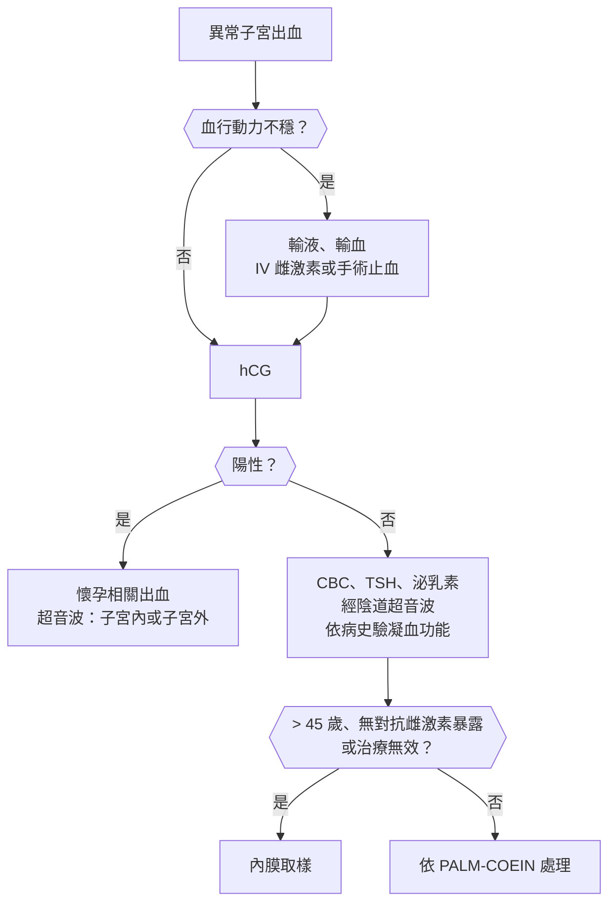
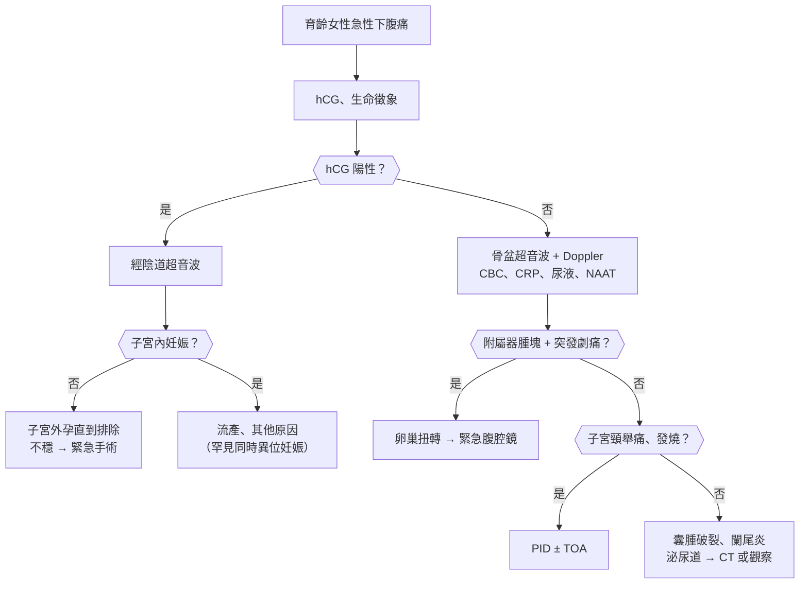
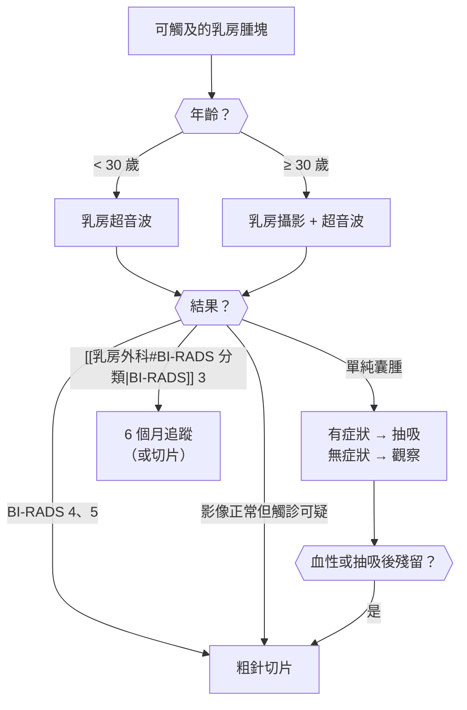

## 婦科（Gynecology）

### 異常子宮出血（Abnormal Uterine Bleeding）

#### 定義與分類

- **正常月經**：週期 **24–38 天**、經期 **≤ 8 天**、週期間變動 **≤ 7–9 天**、失血量不影響生活（約 < 80 mL）。
- **異常子宮出血（AUB）**：頻率、規律性、經期長度、量任一異常；**經間出血（intermenstrual bleeding）**、**性交後出血（postcoital bleeding）**。
- **:red[第一步：育齡女性一定先排除懷孕]**（流產、子宮外孕、葡萄胎）。
- **FIGO [[婦科#PALM-COEIN 分類（FIGO）|PALM-COEIN 分類]]（非懷孕育齡女性）**：
    - **結構性（PALM）**：**P**olyp（息肉）、**A**denomyosis（肌腺症）、**L**eiomyoma（肌瘤）、**M**alignancy/hyperplasia（惡性或增生）。
    - **非結構性（COEIN）**：**C**oagulopathy（凝血異常，**von Willebrand 病**）、**O**vulatory dysfunction（**排卵障礙：PCOS、青春期、更年期前、甲狀腺、泌乳素**）、**E**ndometrial（內膜局部）、**I**atrogenic（醫源性：抗凝血劑、荷爾蒙、IUD）、**N**ot yet classified。
- **依年齡最常見**：
    - **青春期**：**[[婦科#無排卵性出血（Anovulatory Bleeding）|無排卵]]**（HPO 軸未成熟）、**凝血異常（von Willebrand 病）**。
    - **育齡**：**懷孕相關**、**排卵障礙（PCOS）**、**肌瘤、息肉**、感染（子宮頸炎）。
    - **更年期前（perimenopause）**：無排卵、**內膜增生與內膜癌**。
- **[[婦科#停經後出血（Postmenopausal Bleeding, PMB）|停經後出血（postmenopausal bleeding）]]**：停經 **≥ 12 個月**後出血；**:red[未證實前視為子宮內膜癌]**（約 5–10% 是癌）；**最常見原因：萎縮性內膜炎與陰道炎**。

#### Red flags

- **大量出血、血行動力不穩、貧血症狀** → 急性 AUB。
- **懷孕試驗陽性** → 子宮外孕、流產、葡萄胎。
- **停經後出血**。
- **> 45 歲的 AUB**，或 **< 45 歲但有無對抗雌激素暴露（肥胖、PCOS、tamoxifen、無排卵）或治療無效** → 內膜取樣。
- **性交後出血** → 子宮頸癌、子宮頸息肉、子宮頸炎。
- **青春期月經過多到需要輸血**，或**合併流鼻血、牙齦出血、家族史** → von Willebrand 病。
- **Lynch 症候群**家族史（子宮內膜癌、大腸癌）。

#### 鑑別診斷

| 類別 | 疾病 | 鑑別關鍵 |
|---|---|---|
| **懷孕相關** | **[[產科#流產（Abortion / Miscarriage）\|流產]]**、**[[產科#子宮外孕（Ectopic Pregnancy）\|子宮外孕]]**、**[[產科#葡萄胎（Hydatidiform Mole）\|葡萄胎]]** | **hCG** |
| **結構性** | **內膜息肉**、**[[婦科#子宮肌腺症（Adenomyosis）\|子宮肌腺症]]**、**[[婦科#子宮肌瘤（Uterine Leiomyoma）\|子宮肌瘤]]（黏膜下最會出血）**、**[[婦科#子宮內膜癌（Endometrial Cancer）\|內膜增生與內膜癌]]**、**[[婦科#子宮頸癌（Cervial Cancer）\|子宮頸癌]]** | **超音波、內膜取樣** |
| **排卵障礙** | **[[生殖內分泌科#多囊性卵巢症候群（PCOS）\|PCOS]]**、青春期、更年期前、[[代謝內分泌科#甲狀腺機能低下（Hypothyroidism）\|甲狀腺疾病]]、[[生殖內分泌科#高泌乳素血症（Hyperprolactinemia）\|高泌乳素]]、體重變化、壓力 | **週期不規則、量不固定** |
| **凝血** | **von Willebrand 病**、[[血液腫瘤科#免疫性血小板低下紫斑症（Immune Thrombocytopenia, ITP）\|ITP]]、白血病、肝病 | **月經一來就多**、其他出血 |
| **醫源性** | **抗凝血劑**、**荷爾蒙避孕（突破性出血）**、**IUD**、**tamoxifen**、抗精神病藥（泌乳素） | 用藥 |
| **感染與其他** | **子宮頸炎（披衣菌）**、[[婦科#骨盆腔炎（Pelvic Inflammatory Disease, PID）\|骨盆腔炎]]、子宮頸息肉、外傷、異物 | **性交後出血**、分泌物 |
| **停經後** | **萎縮性內膜炎或陰道炎（最常見）**、**內膜癌**、內膜息肉、荷爾蒙治療、子宮頸癌、卵巢顆粒細胞瘤（分泌雌激素） | **內膜厚度** |

#### 易混淆鑑別

:::compare[排卵性 vs 無排卵性出血]
| | 排卵性 | 無排卵性 |
|---|---|---|
| 週期 | **規律** | **不規律、無法預測** |
| 經量 | 規律地過多（經血過多） | **時多時少、有時大出血** |
| 經前症狀 | 有（乳房脹痛、經痛） | 少 |
| 常見原因 | **肌瘤、肌腺症、凝血異常**、IUD | **PCOS、青春期、更年期前**、甲狀腺、泌乳素 |
| 機轉 | — | **無黃體素對抗 → 內膜持續增生、不穩定剝落** |
| 長期風險 | 貧血 | **內膜增生、內膜癌** |
:::

:::compare[子宮肌瘤 vs 子宮肌腺症 vs 內膜息肉]
| | 子宮肌瘤 | 子宮肌腺症 | 內膜息肉 |
|---|---|---|---|
| 年齡 | 30–50 歲 | **40–50 歲、多產** | 任何，停經前後多 |
| 症狀 | **經血過多**（黏膜下）、壓迫（頻尿、便秘）、不孕 | **經血過多 + 嚴重經痛** | **經間出血**、不規則出血 |
| 子宮 | **不規則腫大、結節狀** | **均勻腫大（球狀）、軟、壓痛** | 正常 |
| 超音波 | **邊界清楚的低迴音結節** | 肌層增厚、邊界不清、小囊腫 | 內膜局部增厚（**生理食鹽水灌注超音波**） |
| 停經後 | **縮小** | 縮小 | 可持續 |
| 治療 | GnRH 拮抗劑、肌瘤切除、子宮切除、栓塞 | **LNG-IUD**、子宮切除 | **子宮鏡切除** |
:::

:::compare[停經後出血的評估]
| 項目 | 內容 |
|---|---|
| **第一步** | **經陰道超音波量內膜厚度** 或 **直接內膜取樣** |
| **內膜厚度 :red[≤ 4 mm]** | 內膜癌機率極低（陰性預測值 > 99%）→ 可觀察；**持續出血仍要取樣** |
| **內膜厚度 > 4 mm** | **內膜取樣**（門診吸取） |
| **取樣無法執行或結果不確定** | **子宮鏡 + 擴張刮除術（D&C）** |
| **注意** | **tamoxifen** 使內膜超音波判讀困難；**第二型（漿液性）內膜癌**內膜可很薄 → 持續出血一律取樣 |
:::

#### 問診與理學檢查

- **最後一次月經（LMP）**、**月經史**（週期、天數、量：換衛生棉頻率、血塊、夜間滲漏）、**與月經的關係（經間、性交後）**。
- **懷孕可能**、避孕方式、性行為史、**用藥（抗凝血、荷爾蒙、tamoxifen）**、體重變化、多毛痤瘡、溢乳、甲狀腺症狀。
- **出血傾向**（流鼻血、牙齦出血、手術或生產後出血、家族史）。
- 理學檢查：**生命徵象**、貧血、BMI、多毛、甲狀腺、**骨盆檢查（窺陰器：子宮頸病灶、出血來源；內診：子宮大小與形狀）**。

#### 檢查流程

- **hCG**（所有育齡女性）、**CBC**、ferritin。
- 依臨床：**TSH、泌乳素**、凝血功能與 **von Willebrand 檢測**（青春期大出血、出血傾向）、雄性素（PCOS）、**子宮頸抹片與 HPV**、披衣菌與淋病 NAAT。
- **經陰道超音波**：結構性病變、內膜厚度。
- **內膜取樣**：**≥ 45 歲**、或 < 45 歲合併**無對抗雌激素暴露**（肥胖、PCOS）、**治療無效**、**Lynch 症候群**。

#### 初步處置

- **急性大出血**：穩定生命徵象、**IV conjugated estrogen**、高劑量口服避孕藥或黃體素、**tranexamic acid**；無效 → **D&C、子宮內氣球填塞、子宮動脈栓塞**。
- **排卵障礙**：**口服避孕藥**、**週期性黃體素**、**LNG-IUD**（最有效減少經量）；處理 PCOS、甲狀腺、泌乳素。
- **經血過多（非荷爾蒙）**：**tranexamic acid**、NSAIDs。
- **結構性**：息肉 → 子宮鏡切除；肌瘤、肌腺症 → 見上表；**內膜增生**：無非典型 → 黃體素；**非典型增生 → 子宮切除**（或保留生育者高劑量黃體素）。
- 補鐵。

:::pitfall
年輕女性陰道出血被當成月經不規則，沒有驗 hCG → 漏掉子宮外孕或流產。每一位育齡女性的異常出血，第一步都是懷孕試驗。
:::

:::pitfall
40 多歲肥胖、月經不規則的女性長期只開止血藥或口服避孕藥，沒有做內膜取樣 → 延誤內膜增生或內膜癌診斷。≥ 45 歲，或較年輕但有無對抗雌激素暴露、治療無效時，要做內膜取樣。
:::

:::exam
- 第一步：排除懷孕；PALM-COEIN 分類。
- 青春期 AUB：無排卵、von Willebrand 病；停經後出血 → 未證實前視為內膜癌，最常見原因為萎縮。
- 停經後內膜 ≤ 4 mm 癌機率極低；> 4 mm 或持續出血 → 取樣。
- ≥ 45 歲 AUB 或無對抗雌激素 → 內膜取樣；非典型增生 → 子宮切除。
- 急性大出血：IV 雌激素、tranexamic acid；LNG-IUD 減少經量最有效。
:::

### 無月經（Amenorrhea）

#### 定義與分類

- **[[生殖內分泌科#原發性無月經（Primary Amenorrhea）|原發性無月經]]**：**15 歲仍無月經**（有第二性徵），或**乳房發育後 3 年仍無月經**、**13 歲無任何第二性徵**。
- **[[生殖內分泌科#續發性無月經（Secondary Amenorrhea）|續發性無月經]]**：原本有月經，**停經 ≥ 3 個月（原本規律）或 ≥ 6 個月（原本不規律）**。
- **最常見原因：懷孕**（一定先排除）。
- **依部位（續發性）**：
    - **下視丘**：**功能性下視丘性無月經**（**體重減輕、過度運動、壓力**、飲食障礙）→ **低 FSH、低雌激素**；Kallmann 症候群（嗅覺喪失，原發性）。
    - **腦下垂體**：**高泌乳素**、**Sheehan 症候群**、腫瘤。
    - **卵巢**：**PCOS（最常見的病理原因）**、**早發性卵巢功能不全（POI，< 40 歲）**。
    - **子宮**：**Asherman 症候群（子宮腔沾黏，D&C 後）**。
    - **其他**：**甲狀腺疾病**、藥物（抗精神病藥、荷爾蒙避孕）。
- **原發性無月經最常見**：**性腺發育不全（Turner 症候群）**、**Müller 管發育不全（MRKH 症候群）**、體質性延遲。

#### Red flags

- **懷孕試驗陽性 + 腹痛或出血** → 子宮外孕。
- **頭痛、視野缺損、溢乳** → 腦下垂體腫瘤。
- **嚴重體重過輕、心跳慢、低血壓、低體溫、電解質異常** → 神經性厭食症（住院指標）。
- **男性化（聲音低、陰蒂肥大）** → 雄性素分泌腫瘤。
- **< 40 歲停經 + 熱潮紅** → POI（骨鬆、心血管風險、不孕）。
- **身材矮小、蹼頸、無第二性徵** → Turner 症候群（**心臟：主動脈窄縮、二葉瓣**）。
- **原發性無月經 + 週期性腹痛** → **處女膜閉鎖或陰道橫膈**（經血滯留）。

#### 鑑別診斷

| 類別 | 疾病 | 鑑別關鍵 |
|---|---|---|
| **懷孕** | **懷孕**（含子宮外孕） | **hCG** |
| **下視丘** | **功能性下視丘性無月經**、**[[精神科#神經性厭食症（Anorexia Nervosa, AN）\|神經性厭食症]]**、Kallmann 症候群 | **FSH、LH 低**；體重、運動 |
| **腦下垂體** | **[[生殖內分泌科#高泌乳素血症（Hyperprolactinemia）\|高泌乳素血症]]**、**[[產科#Sheehan Syndrome\|Sheehan 症候群]]**、[[代謝內分泌科#腦下垂體腫瘤\|腦下垂體腫瘤]] | **泌乳素**、MRI |
| **卵巢** | **[[生殖內分泌科#多囊性卵巢症候群（PCOS）\|PCOS]]**、**[[生殖內分泌科#早發性卵巢功能不全（Premature Ovarian Insufficiency, POI）\|早發性卵巢功能不全]]**、**[[小兒科#Turner Syndrome（45,X）\|Turner 症候群]]** | **FSH 高 → 卵巢衰竭**；雄性素高 → PCOS |
| **子宮與出口** | **[[生殖內分泌科#Asherman's Syndrome（子宮腔沾黏）\|Asherman 症候群]]**、**MRKH 症候群**、**處女膜閉鎖**、陰道橫膈、**雄性素不敏感症候群（46,XY）** | **黃體素撤退試驗無出血**；陰道盲端 |
| **其他** | **[[代謝內分泌科#甲狀腺機能低下（Hypothyroidism）\|甲狀腺]]**、**[[代謝內分泌科#庫欣氏症候群（Cushing's Syndrome）\|Cushing]]**、**[[代謝內分泌科#先天性腎上腺增生（Congenital Adrenal Hyperplasia, CAH）\|CAH]]**、藥物（抗精神病藥、**Depo-Provera**） | TSH、雄性素 |

#### 易混淆鑑別

:::compare[續發性無月經：依荷爾蒙判讀]
| | FSH/LH | 雌激素 | 泌乳素 | 其他線索 |
|---|---|---|---|---|
| **功能性下視丘性** | **低或正常** | **低** | 正常 | **體重減輕、過度運動、壓力**、骨鬆 |
| **高泌乳素** | 低 | 低 | **高** | 溢乳、藥物、腺瘤 |
| **PCOS** | **LH/FSH 比值高**（非必要） | 正常 | 正常或輕度高 | **雄性素過多、多囊卵巢、胰島素阻抗** |
| **POI（卵巢衰竭）** | **FSH 高（> 25 IU/L，兩次）** | **低** | 正常 | **< 40 歲、熱潮紅**；Turner、自體免疫、化放療、FMR1 前突變 |
| **Asherman** | 正常 | 正常 | 正常 | **D&C 後**、**雌激素加黃體素也無出血** |
:::

:::compare[原發性無月經：有無乳房、有無子宮]
| | 有子宮 | 無子宮 |
|---|---|---|
| **有乳房發育（有雌激素）** | **出口阻塞（處女膜閉鎖、陰道橫膈）**、續發性無月經的原因（懷孕、PCOS、高泌乳素、下視丘）、體質性延遲 | **MRKH 症候群（46,XX，陰毛正常）**、**雄性素不敏感症候群（46,XY，陰毛稀少、睪固酮高）** |
| **無乳房發育（無雌激素）** | **FSH 高 → 性腺發育不全（Turner 45,X、Swyer 46,XY）**；**FSH 低 → 下視丘或腦下垂體（Kallmann、體質性、腫瘤）** | 罕見（17α-羥化酶缺乏、5α-還原酶缺乏） |
:::

:::compare[MRKH vs 雄性素不敏感症候群]
| | MRKH 症候群 | 完全雄性素不敏感症候群 |
|---|---|---|
| 染色體 | **46,XX** | **46,XY** |
| 性腺 | **正常卵巢** | **睪丸（腹股溝或腹內）** |
| 子宮與陰道上段 | **無** | **無**（AMH 作用） |
| 乳房 | 正常 | 正常（睪固酮芳香化） |
| **陰毛與腋毛** | **正常** | **稀少或無** |
| 睪固酮 | 女性範圍 | **男性範圍** |
| 合併 | **腎臟（單腎）、骨骼異常** | **性腺腫瘤風險 → 青春期後切除性腺** |
:::

#### 問診與理學檢查

- **性行為與避孕、懷孕可能**、月經史、發育史（乳房、陰毛、身高）。
- **體重變化、飲食、運動量、壓力**、慢性病、**用藥（抗精神病藥、荷爾蒙）**、化放療、**D&C 或產後大出血**史。
- **熱潮紅、陰道乾澀**；**溢乳、頭痛、視野**；**多毛、痤瘡**；嗅覺（Kallmann）；週期性腹痛。
- 理學檢查：**BMI**、**[[小兒科#Tanner 分期|Tanner 分期]]**、**多毛與男性化**、溢乳、甲狀腺、**Turner 特徵（身材矮、蹼頸、盾狀胸）**、外生殖器與陰道（處女膜閉鎖、陰道長度）。

#### 檢查流程

- **hCG**（第一步）。
- **FSH、LH、泌乳素、TSH**；雄性素過多 → **total testosterone、DHEA-S、17-OH progesterone**。
- **黃體素撤退試驗**：有出血 → 有雌激素、出口通暢（多為無排卵，PCOS）；無出血 → 雌激素不足或出口問題 → **雌激素 + 黃體素試驗**（仍無出血 → Asherman）。
- 骨盆超音波（子宮有無、多囊卵巢）；FSH 高 → **染色體檢查**（< 30 歲）、FMR1；泌乳素高或 FSH 低 → **腦下垂體 MRI**。
- 長期無月經 → **骨密度**。

#### 初步處置

- 功能性下視丘性：**增加熱量攝取、減少運動、處理壓力**；**口服避孕藥不能恢復排卵也不能改善骨密度**，需改善能量平衡（必要時經皮雌激素）。
- PCOS：見[[生殖內分泌科#多囊性卵巢症候群（PCOS）|PCOS]]；**週期性黃體素或口服避孕藥保護內膜**、減重、metformin；想懷孕 → **letrozole**。
- POI：**荷爾蒙補充至自然停經年齡（約 51 歲）**（骨骼與心血管保護）、生育諮詢（捐卵）。
- 高泌乳素：cabergoline。
- Asherman：**子宮鏡沾黏分離** + 雌激素。
- 雄性素不敏感：**青春期後切除性腺**（腫瘤風險）；MRKH：陰道擴張或重建。

:::pitfall
年輕女性停經 3 個月，直接開黃體素讓月經來，沒有驗 hCG → 若已懷孕延誤產檢；若是下視丘性無月經則忽略了飲食障礙與骨質流失。先驗 hCG，並問體重、飲食與運動。
:::

:::pitfall
運動員或體重過輕的女性無月經，開口服避孕藥讓她「有月經」就以為處理好了 → 撤退性出血掩蓋問題，骨密度仍持續流失（女性運動員三聯症）。要改善能量攝取與運動量，必要時轉介營養與精神科。
:::

:::exam
- 原發性：15 歲無月經（有第二性徵）或 13 歲無第二性徵；續發性：≥ 3 個月（規律）或 ≥ 6 個月（不規律）。
- 最常見原因：懷孕；病理原因最常見：PCOS。
- FSH 高 → 卵巢衰竭（POI、Turner）；FSH 低 → 下視丘或腦下垂體；泌乳素高 → 腺瘤或藥物。
- 黃體素撤退試驗有出血 → 有雌激素（無排卵）；雌激素 + 黃體素仍無出血 → Asherman。
- MRKH：46,XX、陰毛正常、腎臟異常；雄性素不敏感：46,XY、陰毛稀少、切除性腺。
:::

### 急性骨盆腔痛（Acute Pelvic Pain）

#### 定義與分類

- **育齡女性的急性下腹或骨盆腔痛：:red[第一步一定驗 hCG]**。
- **婦科急症（數小時內要處理）**：
    - **子宮外孕破裂**：**停經 + 腹痛 + 陰道出血**；休克、腹膜徵象。
    - **卵巢扭轉**：**突發單側劇痛 + 噁心嘔吐**；**多有卵巢腫塊（> 5 cm，如畸胎瘤）**、排卵誘導後、懷孕。
    - **出血性黃體囊腫破裂**：**月經週期中後期（黃體期）**、性交或運動後；可大量腹內出血（**抗凝血劑**）。
- **感染**：**骨盆腔炎（PID）**、**輸卵管卵巢膿瘍（TOA）**。
- **其他婦科**：**排卵痛（Mittelschmerz，週期中間）**、肌瘤紅色變性（懷孕）或扭轉、子宮內膜異位瘤破裂、流產、子宮穿孔（IUD）。
- **非婦科**：**闌尾炎**、**泌尿道結石或感染**、腸道（[[大腸直腸外科#憩室炎（Diverticulitis）|憩室炎]]、IBD、腸阻塞）、疝氣。

#### Red flags

- **hCG 陽性 + 子宮內未見妊娠囊** → 子宮外孕，直到排除。
- **低血壓、心跳快、腹膜徵象、腹部膨脹、Cullen sign** → 腹內出血。
- **突發劇痛 + 噁心嘔吐 + 附屬器腫塊** → 卵巢扭轉（**時間就是卵巢**）。
- **發燒、附屬器腫塊、全身不適** → 輸卵管卵巢膿瘍（可破裂成敗血症）。
- **懷孕中右下腹痛** → 闌尾炎（位置可上移）。
- **IUD、近期流產或手術後** → 子宮穿孔、感染。

#### 鑑別診斷

| 類別 | 疾病 | 鑑別關鍵 |
|---|---|---|
| **懷孕相關** | **[[產科#子宮外孕（Ectopic Pregnancy）\|子宮外孕]]**、**[[產科#流產（Abortion / Miscarriage）\|流產]]**（不完全、感染性） | **hCG + 經陰道超音波** |
| **附屬器** | **[[婦科#卵巢扭轉（Ovarian Torsion）\|卵巢扭轉]]**、**出血性黃體囊腫破裂**、卵巢囊腫破裂、**子宮內膜異位瘤破裂**、排卵痛 | **突發、月經週期時間點**、超音波 |
| **感染** | **[[婦科#骨盆腔炎（Pelvic Inflammatory Disease, PID）\|骨盆腔炎]]**、**輸卵管卵巢膿瘍**、子宮內膜炎（產後、流產後） | **子宮頸舉痛、發燒、分泌物** |
| **子宮** | 肌瘤紅色變性或扭轉（有蒂）、**經痛**、子宮穿孔 | 懷孕、IUD |
| **腸胃** | **[[大腸直腸外科#闌尾炎（Appendicitis）\|闌尾炎]]**、憩室炎、[[消化內科#發炎性腸道疾病（Inflammatory Bowel Disease, IBD）\|IBD]]、腸阻塞、腸胃炎 | **先食慾差 → 痛移到右下腹** |
| **泌尿** | **[[泌尿科#尿路結石（Urolithiasis）\|泌尿道結石]]**、膀胱炎、腎盂腎炎 | **血尿、肋脊角壓痛** |

#### 易混淆鑑別

:::compare[子宮外孕 vs 卵巢扭轉 vs 黃體囊腫破裂 vs PID vs 闌尾炎]
| | 子宮外孕 | 卵巢扭轉 | 出血性黃體囊腫破裂 | 骨盆腔炎（PID） | 闌尾炎 |
|---|---|---|---|---|---|
| hCG | **陽性** | 陰性（可懷孕） | 陰性 | 陰性 | 陰性 |
| 發作 | 漸進或突發（破裂） | **突發劇痛、陣發** | **突發，黃體期、性交或運動後** | **漸進，月經期間或剛結束** | **漸進，從肚臍周圍轉移到右下腹** |
| 噁心嘔吐 | 可 | **明顯** | 少 | 可 | **常（痛之後）** |
| 發燒 | 無 | 低燒 | 無 | **有** | 低燒 |
| 陰道出血 | **有** | 無 | 無 | 可、**膿性分泌物** | 無 |
| 理學 | 附屬器壓痛、**休克（破裂）** | **附屬器腫塊壓痛** | 腹膜徵象 | **子宮頸舉痛、雙側附屬器壓痛** | **McBurney 點壓痛**、反彈痛 |
| 超音波 | **子宮內無妊娠囊**、附屬器腫塊、骨盆腔積血 | **腫大卵巢、周邊濾泡（串珠）、漩渦徵象**；**Doppler 有血流不能排除** | 複雜囊腫、骨盆腔積血 | 輸卵管增厚積液、TOA | **闌尾腫大 > 6 mm** |
| 處置 | MTX 或腹腔鏡 | **緊急腹腔鏡復位（保留卵巢）** | 多保守；不穩 → 手術 | **抗生素**；TOA → ± 引流 | **闌尾切除** |
:::

#### 問診與理學檢查

- **LMP、月經規律性、避孕方式（IUD）、性行為**、懷孕可能、**輔助生殖（排卵誘導 → 扭轉、[[生殖內分泌科#OHSS（卵巢過度刺激症候群）|OHSS]]、異位妊娠）**。
- **疼痛發作速度、位置、轉移**、與月經週期的關係、性交或運動後、噁心嘔吐、發燒、陰道出血或分泌物、泌尿與腸胃症狀。
- 過去子宮外孕、PID、卵巢囊腫、手術。
- 理學檢查：**生命徵象**、腹部（腹膜徵象、McBurney、腫塊）、**骨盆檢查（子宮頸舉痛、附屬器腫塊與壓痛、分泌物、出血量）**、肋脊角。

#### 檢查流程

- **hCG**（尿液快篩 → 血清定量）。
- **經陰道超音波**：子宮內妊娠、附屬器、骨盆腔積液；**FAST**（不穩定）。
- **CBC、血型與交叉試驗**（出血）、CRP、**尿液檢查**、**披衣菌與淋病 NAAT**。
- 非婦科懷疑 → **CT**（未懷孕）；懷孕 → **MRI**（闌尾炎）。
- **hCG 區分值（discriminatory zone）**：經陰道超音波在 **β-hCG > 1500–3500 mIU/mL** 時應可看到子宮內妊娠囊。

#### 初步處置

- 血行不穩 → **兩條大 IV、輸血、緊急手術**。
- **子宮外孕**：穩定、未破裂、hCG 不高、無胎心 → **methotrexate**；否則 → **腹腔鏡輸卵管切開或切除**；**Rh 陰性給 anti-D**。
- **卵巢扭轉**：**:red[緊急腹腔鏡復位]**（即使看起來發黑也多可保留卵巢）。
- **PID**：門診 → **ceftriaxone IM + doxycycline 14 天 ± metronidazole**；住院指標：TOA、懷孕、無法口服、無法排除外科急症、門診治療無效、重症。
- 囊腫破裂：止痛、觀察 Hb；大量出血 → 手術。

:::pitfall
年輕女性下腹痛、hCG 陽性，超音波子宮內看不到妊娠囊，被當成「太早看不到」讓她回家 → 子宮外孕破裂造成休克。hCG 陽性但子宮內未見妊娠時，要當子宮外孕處理：追蹤 hCG、婦產科評估，並衛教警訊。
:::

:::pitfall
卵巢腫塊合併劇痛，因為 Doppler 看得到血流就排除扭轉 → 扭轉可能是間歇性或靜脈先阻塞、動脈仍有血流。臨床高度懷疑時要直接腹腔鏡探查。
:::

:::exam
- 育齡女性腹痛第一步：hCG；hCG 陽性 + 子宮內無妊娠 → 子宮外孕直到排除。
- 卵巢扭轉：突發劇痛 + 嘔吐 + 附屬器腫塊；Doppler 有血流不能排除 → 緊急腹腔鏡復位。
- 黃體囊腫破裂：黃體期、性交後；PID：子宮頸舉痛、月經後 → ceftriaxone + doxycycline。
- 子宮外孕 MTX 條件：穩定、未破裂、hCG 不高、無胎心；Rh 陰性給 anti-D。
:::

### 經痛與慢性骨盆腔痛（Dysmenorrhea / Chronic Pelvic Pain）

#### 定義與分類

- **原發性經痛（primary dysmenorrhea）**：**無骨盆病變**；**月經初潮後 6–12 個月開始（排卵後）**；**月經開始前後 1–3 天**，下腹絞痛可放射到背與大腿；**前列腺素過多**。
- **續發性經痛（secondary dysmenorrhea）**：**有骨盆病變**；**較晚發生（> 25 歲）**、**逐漸加重**、**經期以外也痛**、合併性交痛、不孕、經血過多。
    - **子宮內膜異位症**（最常見）、**子宮肌腺症**、肌瘤、PID 後沾黏、IUD（銅）、子宮頸狹窄、先天異常（經血流出受阻）。
- **慢性骨盆腔痛（chronic pelvic pain）**：**≥ 6 個月**、非週期性或週期性；
    - 婦科：**子宮內膜異位症**、肌腺症、沾黏、慢性 PID、骨盆腔充血症候群。
    - **非婦科（常被忽略）**：**大腸激躁症**、**[[泌尿科#間質性膀胱炎（Interstitial Cystitis）|間質性膀胱炎]]**、**骨盆底肌筋膜疼痛**、神經痛（陰部神經）、**憂鬱、性創傷史**。
- **性交疼痛（dyspareunia）**：**表淺**（陰道入口：萎縮、陰道炎、外陰痛、陰道痙攣）vs **深部**（子宮內膜異位症、PID、肌腺症）。

#### Red flags

- **原發性經痛治療無效**，或經痛型態改變 → 續發性原因。
- **經痛 + 不孕** → 子宮內膜異位症。
- **年輕女孩初經就劇烈經痛 + 骨盆腫塊** → 先天性生殖道阻塞（陰道積血）。
- **慢性骨盆腔痛 + 體重減輕、出血、腹水** → 卵巢癌等惡性腫瘤。
- **性侵或家暴史**（慢性骨盆腔痛常見）。

#### 鑑別診斷

| 類別 | 疾病 | 鑑別關鍵 |
|---|---|---|
| **原發性經痛** | 前列腺素過多 | **初經後不久、經期 1–3 天、檢查正常** |
| **子宮內膜異位與肌腺症** | **[[婦科#子宮內膜異位症（Endometriosis）\|子宮內膜異位症]]**、**[[婦科#子宮肌腺症（Adenomyosis）\|子宮肌腺症]]** | **深部性交痛、排便痛、不孕**；子宮均勻腫大 |
| **其他婦科** | [[婦科#子宮肌瘤（Uterine Leiomyoma）\|子宮肌瘤]]、**慢性 PID 與沾黏**、骨盆腔充血症候群、IUD、**生殖道阻塞** | 病史、超音波 |
| **泌尿** | **間質性膀胱炎**（膀胱痛症候群）、反覆泌尿道感染 | **膀胱脹時痛、排尿後緩解、頻尿** |
| **腸胃** | **[[消化內科#大腸激躁症（Irritable Bowel Syndrome, IBS）\|大腸激躁症]]**、[[消化內科#發炎性腸道疾病（Inflammatory Bowel Disease, IBD）\|IBD]]、便秘 | **排便後緩解、排便習慣改變** |
| **肌肉骨骼與神經** | **骨盆底肌筋膜疼痛**、陰部神經痛、腹壁神經卡壓（觸發點）、[[骨科#梨狀肌症候群（Piriformis Syndrome）\|梨狀肌症候群]] | **Carnett sign**（抬頭收腹仍痛 → 腹壁） |
| **心理社會** | 憂鬱、焦慮、身體化、**性創傷** | 篩檢 |

#### 易混淆鑑別

:::compare[原發性 vs 續發性經痛]
| | 原發性 | 續發性 |
|---|---|---|
| 發生年齡 | **初經後 6–12 個月（青少年）** | **較晚（> 25 歲）或之前無經痛** |
| 時間 | **月經前到月經第 1–3 天** | **月經前數天開始、持續整個經期、經期外也痛** |
| 進展 | 穩定，年紀大或生產後減輕 | **逐漸加重** |
| 伴隨 | 噁心、腹瀉、頭痛 | **性交痛、排便痛、不孕、經血過多** |
| 骨盆檢查 | **正常** | **異常**（子宮腫大、薦骨子宮韌帶結節、附屬器腫塊） |
| 治療 | **NSAIDs（經前 1–2 天開始）**、口服避孕藥 | 治療病因 |
:::

:::compare[子宮內膜異位症 vs 子宮肌腺症]
| | 子宮內膜異位症 | 子宮肌腺症 |
|---|---|---|
| 位置 | **子宮外**（卵巢、子宮直腸陷凹、薦骨子宮韌帶） | **子宮肌層內** |
| 年齡 | **20–40 歲、未產** | **40–50 歲、多產** |
| 症狀 | **經痛、深部性交痛、排便痛、不孕** | **經血過多 + 經痛** |
| 理學 | **子宮後傾固定、薦骨子宮韌帶觸痛結節**、附屬器腫塊 | **子宮均勻腫大、軟、壓痛** |
| 影像 | **巧克力囊腫（毛玻璃樣均勻低迴音）** | 肌層增厚、不對稱、小囊腫 |
| 確診 | **腹腔鏡（視診 ± 切片）**；現在可**臨床診斷後直接用藥** | 影像、病理 |
| 治療 | **NSAIDs、口服避孕藥、黃體素（dienogest）、GnRH 類似物**；手術（不孕、囊腫） | **LNG-IUD**、荷爾蒙、**子宮切除（根治）** |
| 腫瘤標記 | **CA-125 可升高（非特異）** | 可升高 |
:::

#### 問診與理學檢查

- **經痛開始年齡、時間型態、嚴重度與對生活的影響**、止痛藥效果、經量。
- **性交痛（表淺或深部）、排便痛、排尿痛**、不孕、腸胃與泌尿症狀。
- 性行為、避孕方式、PID 病史、手術、**性創傷或家暴**、情緒。
- 理學檢查：腹部（**Carnett sign**、觸發點）、**骨盆檢查**（子宮大小與活動度、**子宮直腸陷凹結節**、附屬器腫塊、骨盆底肌壓痛）、陰道萎縮、外陰觸痛（棉花棒試驗）。

#### 檢查流程

- **典型原發性經痛（青少年）**：**不需檢查**，先治療 3–6 個月。
- 續發性或治療無效：**hCG**、**經陰道超音波**、**披衣菌與淋病 NAAT**、尿液檢查。
- **子宮內膜異位症**：超音波（巧克力囊腫、深部病灶）、MRI；**腹腔鏡**（診斷與治療）。
- 依臨床：膀胱鏡（間質性膀胱炎）、大腸鏡。

#### 初步處置

- **原發性經痛**：**NSAIDs（經前 1–2 天或一開始就吃，固定時間）**、**熱敷**、運動；無效 → **口服避孕藥（可連續服用）**、LNG-IUD。
- 子宮內膜異位症：**第一線：NSAIDs + 荷爾蒙（口服避孕藥、黃體素）**；第二線：**GnRH 致效劑或拮抗劑**（+ add-back 治療防骨鬆）；**手術：腹腔鏡切除病灶**、囊腫 > 4 cm 或不孕。
- 慢性骨盆腔痛：**多專科處理**、物理治療（骨盆底）、神經病變止痛藥、心理治療；避免長期鴉片類。

:::pitfall
年輕女性經痛多年，一直被說「經痛是正常的，忍一忍」 → 子宮內膜異位症平均延誤 7–10 年才診斷，期間影響生育。NSAIDs 與口服避孕藥治療無效、合併深部性交痛或排便痛時，要評估子宮內膜異位症。
:::

:::pitfall
慢性骨盆腔痛的病人做了多次腹腔鏡都沒找到問題 → 原因可能是大腸激躁症、間質性膀胱炎或骨盆底肌筋膜疼痛。要問排便、排尿與性創傷史，並檢查腹壁與骨盆底肌肉。
:::

:::exam
- 原發性經痛：初經後 6–12 個月、前列腺素、NSAIDs 經前開始；續發性：較晚、漸重、經期外也痛。
- 子宮內膜異位症：經痛、深部性交痛、排便痛、不孕、巧克力囊腫、薦骨子宮韌帶結節；腹腔鏡確診。
- 肌腺症：多產中年、經血過多 + 經痛、子宮均勻腫大軟 → LNG-IUD、子宮切除。
- Carnett sign 陽性 → 腹壁來源。
:::

### 陰道分泌物與外陰搔癢（Vaginal Discharge / Vulvar Itching）

#### 定義與分類

- **生理性分泌物**：**白色或透明、無異味**；**排卵期、懷孕、口服避孕藥**時增加；pH 3.8–4.5（乳酸桿菌）。
- **三大陰道炎**：
    - **細菌性陰道病（BV）**：**最常見**；乳酸桿菌減少、**Gardnerella** 等厭氧菌增生；**魚腥味**、灰白稀薄；**不算性傳染病**但與性行為相關。
    - **念珠菌陰道炎**：**外陰搔癢、灼熱**、**白色乳酪狀分泌物**、**pH 正常**；**抗生素、糖尿病、懷孕、免疫低下、口服避孕藥**。
    - **滴蟲陰道炎**：**性傳染病**；**黃綠色泡沫狀**、異味、**草莓樣子宮頸**；伴侶要一起治療。
- **子宮頸炎**：**披衣菌、淋病**（多無症狀）→ **黏膿性分泌物、子宮頸易出血**；可上行成 PID。
- **其他**：**萎縮性陰道炎（停經後）**、異物（**遺留的棉條 → 惡臭**）、過敏或刺激性（清潔劑、衛生用品）、**脫屑性發炎性陰道炎**。
- **外陰搔癢的非感染原因**：**硬化性苔蘚（停經後女性、白色羊皮紙樣、外陰癌風險）**、扁平苔蘚、接觸性皮膚炎、**外陰上皮內病變與外陰癌**、蟯蟲（兒童）。

#### Red flags

- **發燒、下腹痛、子宮頸舉痛** → PID。
- **惡臭 + 遺留棉條或異物** → 毒性休克症候群風險。
- **懷孕中的陰道炎**（BV → 早產；淋病披衣菌 → [[眼科#新生兒結膜炎（Ophthalmia Neonatorum）|新生兒結膜炎]]與肺炎）。
- **反覆念珠菌（每年 ≥ 4 次）** → 糖尿病、HIV、免疫低下。
- **停經後外陰白斑、潰瘍、腫塊、持續搔癢** → 硬化性苔蘚、**外陰癌**（切片）。
- **兒童陰道分泌物或性傳染病** → **性侵**（通報）。
- **血性分泌物** → 子宮頸或內膜病變。

#### 鑑別診斷

| 類別 | 疾病 | 鑑別關鍵 |
|---|---|---|
| **陰道炎** | **[[婦科#陰道感染\|細菌性陰道病、念珠菌、滴蟲]]** | **pH、氣味、wet mount、KOH** |
| **子宮頸炎與性傳染病** | **[[感染科#Chlamydia\|披衣菌]]**、**[[感染科#N. gonorrhoeae（淋病雙球菌）\|淋病]]**、黴漿菌、[[婦科#HSV（Genital Herpes）\|生殖器疱疹]] | **子宮頸黏膿性分泌物、易出血**、NAAT |
| **上行感染** | **[[婦科#骨盆腔炎（Pelvic Inflammatory Disease, PID）\|骨盆腔炎]]** | 腹痛、子宮頸舉痛 |
| **非感染性** | **萎縮性陰道炎**、異物、刺激或過敏、脫屑性發炎性陰道炎 | 停經、用品 |
| **外陰皮膚病** | **[[皮膚科#硬化性萎縮苔蘚（Lichen Sclerosus）\|硬化性苔蘚]]**、[[皮膚科#扁平苔蘚（Lichen Planus）\|扁平苔蘚]]、[[皮膚科#接觸性皮膚炎（Contact Dermatitis）\|接觸性皮膚炎]]、乾癬 | **白色、萎縮、疤痕** |
| **腫瘤** | **[[婦科#外陰癌（Vulvar Cancer）\|外陰癌]]**、外陰上皮內病變、[[婦科#外陰 Paget's Disease\|外陰 Paget 病]]、[[婦科#子宮頸癌（Cervial Cancer）\|子宮頸癌]] | **持續、潰瘍、腫塊** → 切片 |

#### 易混淆鑑別

:::compare[三大陰道炎比較]
| | 細菌性陰道病 | 念珠菌陰道炎 | 滴蟲陰道炎 |
|---|---|---|---|
| 分泌物 | **灰白、稀薄、均質** | **白色、濃稠、乳酪狀（cottage cheese）** | **黃綠色、泡沫狀** |
| 氣味 | **魚腥味（加 KOH 更明顯：whiff test）** | 無 | 異味 |
| 搔癢 | 少 | **明顯、灼熱、外陰紅腫** | 有 |
| **pH** | **:red[> 4.5]** | **≤ 4.5（正常）** | **:red[> 4.5]** |
| 顯微鏡 | **線索細胞（clue cells）> 20%** | **KOH：假菌絲、孢子** | **生理食鹽水：活動的鞭毛蟲**；白血球多 |
| 其他 | **Amsel 準則（4 取 3）** | — | **草莓樣子宮頸** |
| 治療 | **metronidazole 7 天**（或陰道凝膠）；clindamycin | **fluconazole 150 mg 口服單次**、陰道 azole | **metronidazole（7 天）**；**伴侶同時治療** |
| 伴侶治療 | **不需要** | 不需要 | **:red[需要]** |
| 懷孕 | 早產、早期破水 → 有症狀要治療 | **只能用陰道 azole（避免口服 fluconazole）** | 治療 |
:::

:::compare[子宮頸炎：披衣菌 vs 淋病]
| | 披衣菌 | 淋病 |
|---|---|---|
| 症狀 | **多無症狀** | 可無症狀，較多膿性分泌物 |
| 診斷 | **NAAT（首選）** | **NAAT**、革蘭氏染色（**細胞內革蘭氏陰性雙球菌**） |
| 治療 | **doxycycline 100 mg BID × 7 天**（懷孕：azithromycin 1 g） | **ceftriaxone 500 mg IM 單次** |
| 共同原則 | **兩者常同時存在**：淋病治療時若未排除披衣菌要一起治療；**伴侶治療、7 天內禁止性行為、3 個月後重驗**；**篩檢 HIV、梅毒** | |
| 併發症 | **PID、不孕、子宮外孕**、新生兒結膜炎與肺炎；男性副睪丸炎 | 同左 + **播散性淋病（關節炎、皮膚膿疱）** |
:::

#### 問診與理學檢查

- **分泌物性質（顏色、稠度、氣味）**、搔癢、灼熱、性交痛、排尿痛、**與月經或性行為的關係**、腹痛、發燒、出血。
- **性行為史（新伴侶、多重伴侶、保險套）**、伴侶症狀、**最近抗生素**、糖尿病、懷孕、停經、衛生用品、灌洗習慣。
- 理學檢查：**外陰（紅腫、抓痕、白斑、潰瘍）**、**窺陰器（分泌物、子宮頸外觀、異物）**、**雙合診（子宮頸舉痛、附屬器壓痛）**、腹股溝淋巴結。

#### 檢查流程

- **床邊檢查**：**陰道 pH**、**whiff test（加 KOH 的魚腥味）**、**生理食鹽水 wet mount（線索細胞、滴蟲、白血球）**、**KOH（菌絲）**。
- **披衣菌與淋病 NAAT**（子宮頸、陰道或尿液）；滴蟲 NAAT（比顯微鏡敏感）。
- 反覆或非典型念珠菌 → **培養（非白色念珠菌）**、血糖、HIV。
- 性傳染病 → **HIV、梅毒、B 型肝炎**篩檢。
- 外陰持續病灶 → **切片**。

#### 初步處置

- 依病原治療（見上表）。
- metronidazole 與酒精的 disulfiram 樣反應證據有限，**CDC 2021 已不再要求治療期間禁酒**。
- **避免陰道灌洗**、香氛清潔品；穿棉質內褲。
- 反覆念珠菌：控制血糖、**fluconazole 每週一次維持 6 個月**。
- 萎縮性陰道炎：**陰道雌激素**、保濕劑。
- 硬化性苔蘚：**強效外用類固醇（clobetasol）**、**長期追蹤（外陰鱗狀細胞癌風險）**。
- **性傳染病**：伴侶通知與治療、**HPV 疫苗**、安全性行為衛教。

:::pitfall
外陰搔癢就開抗黴菌藥膏，反覆治療好幾年 → 停經後女性的硬化性苔蘚或外陰上皮內病變被延誤，甚至變成外陰癌。反覆或對抗黴菌藥無效的外陰搔癢要仔細看外陰皮膚，有白斑、萎縮或潰瘍就切片。
:::

:::pitfall
滴蟲陰道炎只治療病人、沒有治療伴侶 → 很快再感染。滴蟲、披衣菌、淋病都是性傳染病，伴侶要同時治療，並篩檢 HIV 與梅毒；BV 與念珠菌則不需要治療伴侶。
:::

:::exam
- BV：魚腥味、pH > 4.5、線索細胞、Amsel 4 取 3 → metronidazole；伴侶不需治療。
- 念珠菌：乳酪狀、癢、pH 正常、KOH 假菌絲 → fluconazole；懷孕只用陰道 azole。
- 滴蟲：黃綠泡沫、草莓樣子宮頸、活動鞭毛蟲 → metronidazole、伴侶同治。
- 淋病 → ceftriaxone 500 mg IM；披衣菌 → doxycycline 7 天（懷孕 azithromycin）。
- 硬化性苔蘚：停經後白色萎縮 → clobetasol、追蹤外陰癌。
:::

### 骨盆腔腫塊（Pelvic / Adnexal Mass）

#### 定義與分類

- **依年齡想原因**：
    - **兒童與青少年**：**生殖細胞腫瘤（成熟畸胎瘤最常見；惡性：無性細胞瘤、卵黃囊瘤）**、功能性囊腫、**[[婦科#卵巢扭轉（Ovarian Torsion）|卵巢扭轉]]**、**生殖道阻塞（陰道積血）**。
    - **育齡**：**功能性囊腫（濾泡、黃體）最常見**、**成熟畸胎瘤（皮樣囊腫）**、**子宮內膜異位瘤**、**子宮肌瘤**、**子宮外孕**、**輸卵管卵巢膿瘍**、**輸卵管積水**、漿液性或黏液性囊腺瘤。
    - **停經後**：**惡性機率明顯上升** → **上皮性卵巢癌**、良性囊腺瘤、肌瘤（停經後長大 → 擔心肉瘤）、**非婦科（大腸癌、轉移）**。
- **卵巢腫瘤分類**：
    - **上皮性（最常見，~90% 的卵巢癌）**：**漿液性（高惡性度最常見、致死最多、BRCA）**、黏液性（可巨大、腹膜假黏液瘤）、**子宮內膜樣與亮細胞（與子宮內膜異位症相關）**。
    - **生殖細胞**：**成熟畸胎瘤（最常見的卵巢腫瘤之一，良性）**、無性細胞瘤（**LDH**）、卵黃囊瘤（**AFP**）、絨毛膜癌（**hCG**）。
    - **性索間質**：**顆粒細胞瘤（雌激素 → 內膜增生、停經後出血；inhibin）**、Sertoli-Leydig（雄性素 → 男性化）、**纖維瘤（Meigs 症候群：腹水 + 肋膜積液）**。
    - **轉移**：**Krukenberg 瘤（胃癌，印戒細胞，雙側）**、大腸癌、乳癌。
- **非婦科**：膀胱脹（尿滯留）、糞便、**闌尾膿瘍**、憩室膿瘍、大腸癌、骨盆腎、後腹腔腫瘤。

#### Red flags

- **:red[停經後女性的附屬器腫塊]**。
- **超音波：實心成分、乳突狀突起、厚分隔、豐富血流、雙側、腹水**。
- **腹脹、早飽、腹圍增加、體重減輕、頻尿**（卵巢癌症狀常被忽略）。
- **CA-125 升高（停經後）**、**腹膜結節、網膜餅（omental cake）**。
- **突發劇痛** → 扭轉、破裂、出血。
- **發燒 + 腫塊** → 輸卵管卵巢膿瘍。
- **BRCA、Lynch 症候群家族史**。
- **年輕女性實心卵巢腫瘤** → 生殖細胞腫瘤（驗 AFP、hCG、LDH）。

#### 鑑別診斷

| 類別 | 疾病 | 鑑別關鍵 |
|---|---|---|
| **功能性** | **濾泡囊腫**、**黃體囊腫**、**卵泡膜黃素囊腫（葡萄胎、多胎）** | **單純囊性、< 10 cm、6–8 週後消退** |
| **良性卵巢腫瘤** | **成熟畸胎瘤**、**[[婦科#子宮內膜異位症（Endometriosis）\|子宮內膜異位瘤]]**、漿液性或黏液性囊腺瘤、纖維瘤 | 特徵性超音波 |
| **惡性卵巢腫瘤** | **[[婦科#上皮性卵巢腫瘤（Epithelial Ovarian Tumors）\|上皮性卵巢癌]]**、**[[婦科#生殖細胞腫瘤（Germ Cell Tumors）\|惡性生殖細胞腫瘤]]**、**[[婦科#性索間質腫瘤（Sex Cord-Stromal Tumors）\|顆粒細胞瘤]]**、交界性腫瘤、**轉移（Krukenberg）** | **實心、乳突、腹水、CA-125** |
| **懷孕與感染** | **[[產科#子宮外孕（Ectopic Pregnancy）\|子宮外孕]]**、**輸卵管卵巢膿瘍**、輸卵管積水 | hCG、發燒 |
| **子宮** | **[[婦科#子宮肌瘤（Uterine Leiomyoma）\|子宮肌瘤]]（有蒂、闊韌帶）**、子宮肉瘤 | 與子宮相連 |
| **非婦科** | **尿滯留**、**[[大腸直腸外科#闌尾炎（Appendicitis）\|闌尾膿瘍]]**、憩室膿瘍、**[[消化內科#大腸癌（Colorectal Cancer, CRC）\|大腸癌]]**、骨盆腎 | 腸胃與泌尿症狀 |

#### 易混淆鑑別

:::compare[附屬器腫塊的超音波特徵]
| | 良性傾向 | 惡性傾向 |
|---|---|---|
| 成分 | **單純囊性、單房、薄壁** | **實心或混合、多房** |
| 內部 | 無 | **乳突狀突起（papillary projection）、厚分隔（> 3 mm）** |
| 血流 | 無或周邊 | **實心部分豐富血流** |
| 側別 | 單側 | **雙側** |
| 其他 | — | **腹水、腹膜結節** |
| 特殊型態 | **成熟畸胎瘤**：高迴音結節（Rokitansky 結節）、脂肪液面、後方陰影；**內膜異位瘤**：均勻毛玻璃樣低迴音；**出血性囊腫**：網狀或蜘蛛網樣、6–8 週消退 | |
:::

:::compare[卵巢腫瘤標記]
| 標記 | 相關腫瘤 | 注意 |
|---|---|---|
| **CA-125** | **上皮性卵巢癌（漿液性）** | **停經前偽陽性多**：子宮內膜異位症、肌瘤、PID、懷孕、月經、肝硬化、腹膜發炎；**不用於一般人篩檢** |
| **HE4** | 上皮性卵巢癌 | 與 CA-125 合用（ROMA 指數），較不受內膜異位影響 |
| **AFP** | **卵黃囊瘤**、胚胎癌、未成熟畸胎瘤 | 年輕女性實心腫瘤 |
| **β-hCG** | **絨毛膜癌**、胚胎癌、（懷孕） | — |
| **LDH** | **無性細胞瘤** | 對應男性精原細胞瘤 |
| **Inhibin** | **顆粒細胞瘤** | 合併雌激素過多 |
| **CEA、CA19-9** | **黏液性**、轉移（腸胃道） | 找原發 |
:::

#### 問診與理學檢查

- **年齡與停經狀態**、LMP、懷孕可能、症狀（**腹脹、早飽、頻尿、便秘、體重減輕**、疼痛、異常出血）。
- **家族史：卵巢癌、乳癌、大腸癌、子宮內膜癌（BRCA、Lynch）**、子宮內膜異位症、不孕治療。
- 理學檢查：**腹部（腹水、腫塊）**、**骨盆雙合診與肛診（大小、活動度、結節）**、鎖骨上與腹股溝淋巴結、**乳房**、肋膜積液。

#### 檢查流程

- **hCG**（育齡）、**經陰道超音波（首選）**。
- 腫瘤標記：**停經後 → CA-125**；**年輕女性實心腫瘤 → AFP、hCG、LDH、inhibin**。
- 依風險分級：**O-RADS** 或 IOTA 簡單規則、**RMI（風險指數：超音波 × 停經狀態 × CA-125）**。
- 不確定 → **MRI**；懷疑惡性 → **腹部與骨盆 CT、胸部影像**（分期）；**大腸鏡或胃鏡**（排除轉移）。
- **:red[不要對可能是卵巢癌的腫塊做經皮穿刺]**（腫瘤播種）。

#### 初步處置

- **育齡、單純囊腫、< 5–10 cm、無症狀** → **6–12 週後超音波追蹤**（功能性多會消退）。
- **持續、> 10 cm、或有特徵性良性腫瘤（畸胎瘤、內膜異位瘤）** → **腹腔鏡囊腫切除**（保留卵巢）。
- **懷疑惡性** → **轉婦癌專科**：**分期手術**（全子宮與雙側附屬器切除、網膜切除、淋巴結、腹膜切片）或**減積手術** + **含鉑化療**；**BRCA → PARP 抑制劑維持**。
- 年輕生殖細胞腫瘤 → **保留生育的手術 + BEP 化療**（化療高度有效）。
- **BRCA 帶因者** → **35–40 歲完成生育後預防性雙側輸卵管卵巢切除**。

:::pitfall
停經後女性長期腹脹、早飽、頻尿，被當成腸胃不適或膀胱過動 → 卵巢癌症狀不明顯，多數發現時已是晚期。停經後女性出現新的持續腹脹、早飽或骨盆壓迫感，要做骨盆超音波與 CA-125。
:::

:::pitfall
年輕女性卵巢囊腫 CA-125 輕度升高，就安排大手術 → 停經前 CA-125 常因子宮內膜異位症、肌瘤、月經或 PID 升高。停經前女性以超音波特徵為主判斷，單純囊腫先追蹤。
:::

:::exam
- 育齡最常見：功能性囊腫（6–8 週消退）；兒童青少年：生殖細胞腫瘤（成熟畸胎瘤）。
- 惡性超音波：實心、乳突、厚分隔、血流、雙側、腹水。
- 標記：CA-125 上皮性；AFP 卵黃囊瘤；hCG 絨毛膜癌；LDH 無性細胞瘤；inhibin 顆粒細胞瘤。
- Meigs：纖維瘤 + 腹水 + 肋膜積液；Krukenberg：胃癌轉移、印戒細胞、雙側。
- 懷疑卵巢癌不做經皮穿刺；BRCA → 預防性輸卵管卵巢切除。
:::

### 乳房腫塊與乳頭分泌物（Breast Mass / Nipple Discharge）

#### 定義與分類

- **乳房腫塊依年齡**：
    - **< 30 歲**：**纖維腺瘤（最常見）**、纖維囊腫變化、囊腫；**惡性少見**。
    - **30–50 歲**：**纖維囊腫變化**、**囊腫**、纖維腺瘤、**乳癌**。
    - **> 50 歲**：**乳癌**機率明顯上升。
- **良性**：
    - **纖維腺瘤**：**年輕女性、圓滑、可移動（像彈珠）、無痛**。
    - **纖維囊腫變化**：**週期性（經前）乳房脹痛**、雙側結節狀。
    - **囊腫**：30–50 歲、圓、可壓縮、**抽吸後消失**。
    - **乳管內乳頭瘤**：**血性乳頭分泌物最常見原因**。
    - **脂肪壞死**：外傷或手術後、可像癌。
    - **葉狀瘤**：**快速長大**、40 多歲、可惡性。
    - **乳房膿瘍**：**哺乳期**（金黃色葡萄球菌）、非哺乳期（乳暈下，抽菸）。
- **乳癌**：**台灣女性最常見的癌症**；**侵襲性管癌最常見**；**硬、不規則、固定、無痛**；**皮膚凹陷、橘皮樣、乳頭內縮**。
- **乳頭分泌物**：
    - **生理性**：**雙側、多孔、需擠壓才出來、乳白或綠色**。
    - **病理性**：**單側、單孔、自發性、血性或清澈漿液性** → 乳管內乳頭瘤（最常見）、**乳癌**。
    - **溢乳**：雙側乳白色 → 泌乳素過高。

#### Red flags

- **硬、不規則、固定、無痛的腫塊**。
- **皮膚凹陷、橘皮樣（peau d'orange）、紅腫（炎性乳癌）、乳頭內縮（新發）、乳頭濕疹樣變化（Paget 病）**。
- **單側、單孔、自發性、血性分泌物**。
- **腋下淋巴結腫大**。
- **哺乳期「乳腺炎」抗生素治療 1–2 週無效** → **炎性乳癌**。
- **BRCA、家族史（年輕乳癌、卵巢癌、男性乳癌）**。
- **快速長大的腫塊** → 葉狀瘤。

#### 鑑別診斷

| 類別 | 疾病 | 鑑別關鍵 |
|---|---|---|
| **良性實心** | **[[乳房外科#纖維腺瘤（Fibroadenoma）\|纖維腺瘤]]**、**[[乳房外科#葉狀瘤（Phyllodes Tumor）\|葉狀瘤]]**、[[乳房外科#脂肪壞死（Fat Necrosis）\|脂肪壞死]]、錯構瘤、脂肪瘤 | 年輕、圓滑、可動；葉狀瘤快速長大 |
| **囊性與纖維囊腫** | **[[乳房外科#乳房囊腫（Breast Cyst）\|囊腫]]**、**[[乳房外科#纖維囊腫變化（Fibrocystic Changes）\|纖維囊腫變化]]** | **週期性、雙側、抽吸後消失** |
| **乳管** | **[[乳房外科#乳管內乳頭瘤（Intraductal Papilloma）\|乳管內乳頭瘤]]**、乳管擴張症 | **血性分泌物**；乳管擴張 → 停經前後、綠色黏稠 |
| **感染** | **[[乳房外科#乳房膿瘍（Breast Abscess）\|乳房膿瘍]]**、乳腺炎、肉芽腫性乳腺炎 | 哺乳、紅熱痛、發燒 |
| **惡性** | **侵襲性管癌**、小葉癌、**[[乳房外科#DCIS（Ductal Carcinoma In Situ）\|DCIS]]**、**[[乳房外科#炎性乳癌（Inflammatory Breast Cancer）\|炎性乳癌]]**、**[[乳房外科#Paget's Disease of the Nipple\|乳頭 Paget 病]]**、淋巴瘤 | **硬、固定、皮膚變化**、> 50 歲 |
| **溢乳** | **[[生殖內分泌科#高泌乳素血症（Hyperprolactinemia）\|高泌乳素血症]]**、藥物、甲狀腺低下 | **雙側、乳白** |

#### 易混淆鑑別

:::compare[纖維腺瘤 vs 囊腫 vs 纖維囊腫變化 vs 乳癌]
| | 纖維腺瘤 | 囊腫 | 纖維囊腫變化 | 乳癌 |
|---|---|---|---|---|
| 年齡 | **15–30 歲** | **30–50 歲（停經前）** | 30–50 歲 | **> 50 歲**（任何年齡） |
| 觸感 | **圓滑、有彈性、極易移動** | 圓、軟到硬、可移動 | **雙側、多發、結節狀、壓痛** | **硬、不規則、固定** |
| 疼痛 | 無 | 可有 | **經前加重** | **常無痛** |
| 月經關係 | 懷孕或哺乳時變大 | 可波動 | **週期性** | 無 |
| 超音波 | **橢圓、邊界清楚、寬大於高、均勻低迴音** | **無迴音、後方增強** | — | **不規則、邊緣毛刺狀、高大於寬、後方陰影** |
| 處置 | **年輕典型 → 觀察**；> 2–3 cm 或長大 → 切除 | **抽吸**（血性或殘留 → 切片） | 支持性內衣、NSAIDs | **粗針切片** |
:::

:::compare[乳頭分泌物：生理性 vs 病理性]
| | 生理性 | 病理性 |
|---|---|---|
| 側別 | **雙側** | **單側** |
| 乳管 | **多孔** | **單孔** |
| 出現方式 | **需擠壓** | **自發性**（內衣上有痕跡） |
| 顏色 | **乳白、綠、黃、灰** | **血性或清澈（漿液性）** |
| 年齡 | 任何 | **> 40 歲風險較高** |
| 常見原因 | 纖維囊腫變化、乳管擴張、溢乳 | **乳管內乳頭瘤（最常見）**、**乳癌（DCIS）** |
| 檢查 | 衛教、泌乳素（乳白） | **[[乳房外科#乳房攝影（Mammography）\|乳房攝影]] + 超音波**、乳管攝影或 MRI、**切除乳管** |
:::

:::compare[BI-RADS 分類]
| 分類 | 意義 | 惡性機率 | 處置 |
|---|---|---|---|
| **0** | 不完全 | — | **補做其他影像** |
| **1** | 陰性 | 0% | 常規篩檢 |
| **2** | **良性** | 0% | 常規篩檢 |
| **3** | **可能良性** | **≤ 2%** | **:red[6 個月]短期追蹤** |
| **4** | **可疑**（4A、4B、4C） | 2–95% | **切片** |
| **5** | **高度懷疑惡性** | **≥ 95%** | **切片** |
| **6** | 已切片證實惡性 | — | 治療 |
:::

#### 問診與理學檢查

- 腫塊**發現時間、大小變化、與月經的關係**、疼痛、**乳頭分泌物（單側或雙側、自發、顏色）**、皮膚變化。
- **年齡、月經史（初經、停經）、生產與哺乳史**、荷爾蒙使用、**胸部放射治療史**、**家族史（乳癌、卵巢癌、男性乳癌、BRCA）**、過去乳房切片（非典型增生）。
- 理學檢查：
    - **視診（坐姿、雙手叉腰、舉手）**：不對稱、**皮膚凹陷、橘皮樣、乳頭內縮**、紅腫、濕疹樣變化。
    - **觸診**：腫塊**大小、形狀、硬度、活動度、與皮膚或胸壁的關係**；**乳頭分泌物來自單孔或多孔**。
    - **腋下、鎖骨上與鎖骨下淋巴結**。

#### 檢查流程

- **影像**：**:red[< 30 歲] → 超音波**；**≥ 30 歲 → 乳房攝影 + 超音波**；懷孕或哺乳 → 超音波。
- **粗針切片（core needle biopsy）**為首選病理診斷；**影像正常但觸診可疑仍要切片**（**三合一評估：理學、影像、病理需一致**）。
- 乳癌確診 → **ER、PR、HER2、Ki-67**、分期影像（依期別）。
- **台灣乳癌篩檢**：**國健署補助 :red[40–74 歲]女性每 2 年一次乳房攝影**（114 年起擴大，原為 45–69 歲）。

#### 初步處置

- 纖維腺瘤：**觀察**；> 2–3 cm、長大、有症狀 → 切除；**葉狀瘤 → 廣泛切除（1 cm 邊緣）**。
- 囊腫：有症狀 → 抽吸。
- 週期性乳房痛：**合適內衣**、NSAIDs、減少咖啡因證據有限；嚴重 → tamoxifen 或 danazol（少用）。
- 乳腺炎：**繼續哺乳或擠奶**、**dicloxacillin 或 cephalexin**；**膿瘍 → 超音波導引抽吸或切開引流**。
- 乳癌：手術（保留乳房 + 放療或全切除）、前哨淋巴結、依分子分型給荷爾蒙、HER2 標靶、化療。
- **BRCA 帶因者**：加強篩檢（MRI）、預防性乳房切除、預防性輸卵管卵巢切除。

:::pitfall
年輕女性摸到乳房硬塊，超音波顯示「疑似纖維腺瘤」就長期觀察，腫塊越來越大 → 可能是葉狀瘤或年輕型乳癌。影像、理學與病理要一致（三合一評估），長大、硬或固定時要切片。
:::

:::pitfall
哺乳期乳房紅腫被當成乳腺炎，換了好幾種抗生素都沒好 → 炎性乳癌。抗生素治療 1–2 週無改善的「乳腺炎」，或非哺乳期的乳房紅腫、橘皮樣皮膚，要做影像與皮膚切片。
:::

:::exam
- < 30 歲最常見：纖維腺瘤；30–50 歲：纖維囊腫變化、囊腫；> 50 歲：乳癌。
- 血性乳頭分泌物最常見原因：乳管內乳頭瘤；病理性：單側、單孔、自發、血性。
- < 30 歲先超音波；≥ 30 歲乳房攝影 + 超音波；三合一評估；粗針切片。
- BI-RADS 3 → 6 個月追蹤；4、5 → 切片。
- 炎性乳癌：橘皮樣、紅腫、抗生素無效；Paget 病：乳頭濕疹樣變化。
:::

### 更年期症狀（Menopausal Symptoms）

#### 定義與分類

- **停經（menopause）**：**連續 12 個月無月經**（回顧性診斷）；**台灣平均約 50 歲**。
- **更年期過渡期（perimenopause）**：停經前數年，**月經週期不規則**、FSH 波動。
- **早發性卵巢功能不全（POI）**：**< 40 歲**停經；**提早停經**：40–45 歲。
- **症狀**：
    - **血管運動症狀**：**熱潮紅、夜間盜汗**（最常見，~75%）。
    - **泌尿生殖症候群（GSM）**：**陰道乾澀、性交痛、反覆泌尿道感染、頻尿急尿**（**不會自行改善、漸進**）。
    - **睡眠障礙、情緒變化、注意力差**、關節痛。
    - **長期**：**骨質疏鬆**、**心血管疾病風險上升**。
- **檢驗**：**> 45 歲典型症狀不需驗荷爾蒙**；FSH 高、estradiol 低（**更年期過渡期 FSH 波動大，單次不可靠**）。

#### Red flags

- **停經後出血** → 內膜癌，取樣。
- **< 40 歲停經** → POI，評估原因與骨鬆、心血管風險。
- **熱潮紅非典型：腹瀉、喘鳴、潮紅、心悸、高血壓** → **類癌症候群**、**嗜鉻細胞瘤**、甲狀腺機能亢進。
- **夜間盜汗 + 體重減輕、發燒** → **淋巴瘤、結核**。
- **憂鬱、自殺意念**。

#### 鑑別診斷

| 類別 | 疾病 | 鑑別關鍵 |
|---|---|---|
| **更年期** | **[[生殖內分泌科#更年期症狀\|更年期與更年期過渡期]]**、**[[生殖內分泌科#早發性卵巢功能不全（Premature Ovarian Insufficiency, POI）\|早發性卵巢功能不全]]**、手術停經、化療或 GnRH 類似物 | 年齡、月經 |
| **內分泌** | **[[代謝內分泌科#甲狀腺機能亢進（Hyperthyroidism）\|甲狀腺機能亢進]]**、**[[代謝內分泌科#嗜鉻細胞瘤（Pheochromocytoma）\|嗜鉻細胞瘤]]**、類癌症候群、低血糖、高泌乳素 | 心悸、腹瀉、高血壓 |
| **感染與腫瘤** | **結核**、**淋巴瘤**、HIV、其他惡性腫瘤 | **B 症狀** |
| **藥物** | **tamoxifen**、aromatase 抑制劑、SSRI、niacin、鈣離子通道阻斷劑、opioid 戒斷 | 用藥 |
| **精神** | **憂鬱、焦慮、恐慌** | 情緒為主 |

#### 易混淆鑑別

:::compare[荷爾蒙治療（MHT）的適應症與禁忌]
| 項目 | 內容 |
|---|---|
| **適應症** | **中重度血管運動症狀（最有效的治療）**、**泌尿生殖症候群**（局部陰道雌激素優先）、**POI 或提早停經（補到約 51 歲）**、骨鬆預防（非第一線） |
| **「時間窗」** | **< 60 歲或停經 10 年內開始**：益處大於風險；**> 60 歲或停經 > 10 年**：心血管風險上升 |
| **有子宮** | **:red[必須加黃體素]**（避免內膜增生與內膜癌）；無子宮 → 單用雌激素 |
| **途徑** | **經皮雌激素 → VTE 與中風風險較低**（不經肝臟首渡） |
| **禁忌** | **乳癌或雌激素依賴性腫瘤**、**不明原因陰道出血**、**活動性或過去 VTE**、**中風、心肌梗塞**、**活動性肝病**、懷孕 |
| **WHI 研究重點** | 雌激素 + 黃體素：**乳癌、VTE、中風、冠心病（老年開始）↑**；**骨折、大腸癌 ↓**；單用雌激素：乳癌未增加 |
:::

:::compare[熱潮紅的非荷爾蒙治療]
| 藥物 | 特點 |
|---|---|
| **SSRI、SNRI（paroxetine 低劑量、venlafaxine、escitalopram）** | **乳癌病人常用**；**tamoxifen 使用者避免 paroxetine、fluoxetine（CYP2D6 抑制）** |
| **gabapentin** | 夜間熱潮紅、失眠 |
| **fezolinetant（NK3 受體拮抗劑）** | 新藥，作用於下視丘體溫調節中樞；監測肝功能 |
| **clonidine** | 效果較弱、副作用多 |
| 生活調整 | 分層穿衣、避免誘因（辛辣、酒精、熱飲）、減重、CBT |
:::

#### 問診與理學檢查

- **月經史（最後一次月經）**、症狀類型與嚴重度、睡眠、情緒、性功能、泌尿症狀。
- **乳癌、VTE、中風、心肌梗塞、肝病**等荷爾蒙禁忌；家族史、骨折與骨鬆危險因子、抽菸。
- 理學檢查：血壓、BMI、**乳房**、**骨盆（陰道萎縮）**、甲狀腺。

#### 檢查流程

- **> 45 歲 + 典型症狀 → 臨床診斷**，不需驗 FSH。
- **< 45 歲或非典型** → **FSH、estradiol、TSH、泌乳素、hCG**。
- **乳房攝影、子宮頸抹片**依篩檢時程；**骨密度（DXA）**：65 歲以上或有危險因子的停經後女性。
- 心血管危險因子評估（血壓、血脂、血糖）。

#### 初步處置

- **中重度熱潮紅、無禁忌、< 60 歲或停經 10 年內** → **荷爾蒙治療（最低有效劑量、定期評估）**；有子宮加黃體素。
- **泌尿生殖症候群** → **局部陰道雌激素**（全身吸收少，可長期）、保濕劑、潤滑劑；ospemifene。
- 有禁忌 → **SSRI、SNRI、gabapentin、fezolinetant**。
- **骨鬆預防**：鈣、維生素 D、運動；依骨密度治療。
- POI → **荷爾蒙補充至約 51 歲**。

:::pitfall
有子宮的停經女性只開雌激素治療熱潮紅 → 無對抗雌激素造成內膜增生與內膜癌。有子宮者一定要合併黃體素（或使用 LNG-IUD）。
:::

:::pitfall
40 歲以下停經的女性被告知「只是比較早更年期」，沒有任何治療 → 早發性卵巢功能不全會增加骨鬆、心血管疾病與失智風險。POI 要評估原因，並補充荷爾蒙到自然停經年齡。
:::

:::exam
- 停經：連續 12 個月無月經；> 45 歲典型症狀不需驗 FSH。
- MHT：中重度血管運動症狀最有效；< 60 歲或停經 10 年內；有子宮加黃體素；經皮雌激素 VTE 風險較低。
- MHT 禁忌：乳癌、不明陰道出血、VTE、中風、心肌梗塞、活動性肝病。
- 泌尿生殖症候群 → 局部陰道雌激素；tamoxifen 使用者避免 paroxetine、fluoxetine。
:::

### 不孕（Infertility）

#### 定義與分類

- **不孕（infertility）**：**規律無避孕性行為 :red[12 個月]未懷孕**；**≥ 35 歲 → :red[6 個月]**；**> 40 歲或有已知問題 → 立即評估**。
- **原因比例（約略）**：**女性因素 ~40–50%**、**男性因素 ~25–35%**、雙方、不明原因 ~15%。
- **女性因素**：
    - **排卵障礙（最常見，~25%）**：**PCOS（最常見）**、下視丘性、高泌乳素、甲狀腺、POI。
    - **輸卵管因素**：**PID（披衣菌、淋病）**、子宮外孕或手術後沾黏、子宮內膜異位症。
    - **子宮因素**：**黏膜下肌瘤、內膜息肉**、**Asherman 症候群**、子宮中隔、肌腺症。
    - **年齡（卵巢儲備下降）**：**35 歲後明顯下降**。
    - 子宮頸因素。
- **男性因素**：**精索靜脈曲張（最常見可矯正原因）**、Klinefelter、**Y 染色體微缺失**、**先天性雙側輸精管缺如（CFTR）**、性腺功能低下、藥物（**外源性睪固酮、合成類固醇**）、感染、[[小兒外科#隱睪症（Cryptorchidism）|隱睪]]症病史、射精障礙。

#### Red flags

- **女性 ≥ 35 歲**（時間寶貴）。
- **無月經或月經嚴重不規則**。
- **已知 PID、子宮內膜異位症、骨盆手術**。
- **反覆流產（≥ 2–3 次）** → 抗磷脂症候群、染色體、子宮異常。
- **男性使用睪固酮或合成類固醇** → 抑制精子生成。
- **精液無精症（azoospermia）** → 染色體、CFTR、阻塞。

#### 鑑別診斷

| 類別 | 疾病 | 鑑別關鍵 |
|---|---|---|
| **排卵** | **[[生殖內分泌科#多囊性卵巢症候群（PCOS）\|PCOS]]**、下視丘性、**[[生殖內分泌科#高泌乳素血症（Hyperprolactinemia）\|高泌乳素]]**、甲狀腺、**[[生殖內分泌科#早發性卵巢功能不全（Premature Ovarian Insufficiency, POI）\|POI]]** | **月經規律性**、黃體期 progesterone |
| **卵巢儲備** | **年齡**、卵巢手術、化放療 | **AMH、濾泡期 FSH、竇狀濾泡數** |
| **輸卵管與骨盆** | **PID 後**、**[[婦科#子宮內膜異位症（Endometriosis）\|子宮內膜異位症]]**、沾黏、輸卵管積水 | **子宮輸卵管攝影（HSG）** |
| **子宮** | 黏膜下肌瘤、息肉、**[[生殖內分泌科#Asherman's Syndrome（子宮腔沾黏）\|Asherman]]**、子宮中隔 | 超音波、子宮鏡 |
| **男性** | **精索靜脈曲張**、**[[小兒科#Klinefelter Syndrome（47,XXY）\|Klinefelter]]**、Y 微缺失、CFTR、**外源性睪固酮**、隱睪 | **精液分析** |
| **其他** | 性功能問題、性交時機、抽菸、肥胖或過瘦、酒精 | 生活史 |

#### 易混淆鑑別

:::compare[不孕的基本評估（男女同時進行）]
| 對象 | 評估 | 內容 |
|---|---|---|
| **女性：排卵** | 月經史、**黃體中期 progesterone（> 3 ng/mL 表示有排卵）**、TSH、泌乳素 | 月經規律多有排卵 |
| **女性：卵巢儲備** | **AMH**、**月經第 2–4 天 FSH 與 estradiol**、**竇狀濾泡數** | AMH 不能預測自然懷孕，用於預測 [[生殖內分泌科#IVF-ET（In Vitro Fertilization – Embryo Transfer）\|IVF]] 反應 |
| **女性：輸卵管與子宮** | **子宮輸卵管攝影（HSG）**、生理食鹽水灌注超音波、子宮鏡、腹腔鏡 | HSG 在月經結束後、排卵前做 |
| **男性** | **精液分析（禁慾 2–5 天）** | 量、濃度、活動力、型態；異常 → 重複、荷爾蒙、基因、泌尿科 |
:::

:::compare[精液分析異常的原因（WHO 參考下限）]
| 結果 | 意義 | 常見原因 |
|---|---|---|
| **無精症（azoospermia）** | 精液中無精子 | **阻塞性（CFTR 先天性雙側輸精管缺如、輸精管結紮）** vs **非阻塞性（Klinefelter、Y 微缺失、睪丸衰竭）** |
| **寡精症（< 16 百萬/mL）** | 濃度低 | **精索靜脈曲張**、荷爾蒙、藥物、熱 |
| **弱精症（前進活動力 < 30%）** | 活動力差 | 精索靜脈曲張、感染、抗精子抗體 |
| **精液量少（< 1.4 mL）** | 量少 | **[[泌尿科#逆行性射精（Retrograde Ejaculation）\|逆行性射精]]（糖尿病、α-blocker、攝護腺手術）**、射精管阻塞 |
| **FSH 高 + 睪丸小** | 原發性睪丸衰竭 | Klinefelter、睪丸炎、化放療 |
| **FSH、LH、testosterone 都低** | 續發性性腺功能低下 | **外源性睪固酮或類固醇**、腦下垂體、Kallmann |
:::

#### 問診與理學檢查

- **女方**：年齡、**月經史**、過去懷孕與流產、**PID、性傳染病、骨盆手術、子宮內膜異位症症狀**、體重、多毛、溢乳、甲狀腺、用藥、抽菸喝酒。
- **男方**：**過去生育史**、隱睪、睪丸手術或外傷、**腮腺炎睪丸炎**、**睪固酮或合成類固醇**、化放療、糖尿病、射精與勃起功能、高溫暴露。
- **雙方**：性交頻率與時機、潤滑劑。
- 理學檢查：女方 BMI、多毛、溢乳、甲狀腺、**骨盆檢查**；男方 **睪丸大小與質地、精索靜脈曲張（站立 Valsalva）、輸精管是否可觸及**、第二性徵。

#### 檢查流程

- 見上表；**男女同時評估**，不要先只查女方。
- 依結果：**AMH、HSG、精液分析**為三大基本檢查。
- 無精症 → **FSH、LH、testosterone、染色體、Y 微缺失、CFTR**。
- 反覆流產 → **抗磷脂抗體**、夫妻染色體、子宮結構。

#### 初步處置

- **生活調整**：體重正常化、戒菸、限酒、**排卵期前 2–3 天到排卵日性交**、**懷孕前補充葉酸**。
- **排卵誘導**：**PCOS → letrozole（第一線）**、clomiphene；下視丘性 → 脈衝式 GnRH 或 gonadotropin；高泌乳素 → cabergoline。
- **輸卵管問題** → **IVF**；**輸卵管積水 → IVF 前切除或結紮**（提高成功率）。
- 子宮問題 → **子宮鏡手術**（息肉、黏膜下肌瘤、沾黏、中隔）。
- 男性 → **停用外源性睪固酮**、**精索靜脈曲張手術**（臨床可觸及且精液異常）、**ICSI**、睪丸取精。
- **不明原因** → **IUI + 排卵刺激 → IVF**。
- **台灣**：**試管嬰兒（IVF）補助方案**（依年齡與次數）；**人工生殖法**規範。
- 注意：**卵巢過度刺激症候群（OHSS）**、多胞胎。

:::pitfall
不孕夫妻只檢查太太，做了一連串排卵與輸卵管檢查，最後才驗精液 → 男性因素佔約三分之一，精液分析便宜又簡單。夫妻要同時評估。
:::

:::pitfall
健身的男性不孕，精液顯示嚴重寡精或無精症，沒問到睪固酮或合成類固醇 → 外源性雄性素抑制 FSH 與 LH，精子生成停止。問用藥並停用，多數數月到一年後恢復。
:::

:::exam
- 定義：12 個月；≥ 35 歲 6 個月；> 40 歲立即評估。
- 女性最常見：排卵障礙（PCOS）→ letrozole 第一線；輸卵管：PID 後 → HSG、IVF。
- 男性最常見可矯正原因：精索靜脈曲張；外源性睪固酮抑制精子生成。
- 無精症：CFTR（先天性雙側輸精管缺如）、Klinefelter、Y 微缺失。
- 黃體中期 progesterone > 3 → 有排卵；AMH 評估卵巢儲備。
:::

## 產科（Obstetrics）

### 懷孕初期出血（First-Trimester Bleeding）

#### 定義與分類

- **懷孕初期（< 14 週）陰道出血**：約 **20–25%** 的孕婦會發生；約一半最後流產。
- **三大要排除**：**子宮外孕**、**流產**、**葡萄胎**。
- **流產（miscarriage）的分類**：
    - **脅迫性流產（threatened）**：出血、**子宮頸口關閉**、胎兒存活。
    - **難免流產（inevitable）**：**子宮頸口打開**、組織尚未排出。
    - **不完全流產（incomplete）**：部分組織排出、子宮頸口打開。
    - **完全流產（complete）**：組織完全排出、子宮頸口關閉、出血減少。
    - **稽留流產（missed）**：**胎兒死亡但未排出**、子宮頸口關閉。
    - **感染性流產（septic）**：發燒、惡臭分泌物、子宮壓痛（不安全墮胎）。
- **其他**：**著床出血**、**子宮頸病變**（息肉、子宮頸炎、外翻、子宮頸癌）、**絨毛膜下血腫**、外傷。

#### Red flags

- **血行動力不穩、腹膜徵象、肩痛** → **子宮外孕破裂**。
- **子宮內未見妊娠 + hCG 高於區分值** → 子宮外孕。
- **發燒、惡臭分泌物、子宮壓痛** → 感染性流產（敗血症）。
- **大量出血、浸濕 > 2 片衛生棉/小時** 持續 2 小時。
- **子宮大於週數、hCG 極高、劇吐、早發性子癇前症（< 20 週）、甲狀腺機能亢進、葡萄串樣組織** → **葡萄胎**。
- **Rh 陰性** → 需要 anti-D。

#### 鑑別診斷

| 類別 | 疾病 | 鑑別關鍵 |
|---|---|---|
| **流產** | **[[產科#流產（Abortion / Miscarriage）\|流產]]**（脅迫性、難免、不完全、完全、稽留、感染性） | **子宮頸口開或關、超音波** |
| **子宮外孕** | **[[產科#子宮外孕（Ectopic Pregnancy）\|子宮外孕]]**（輸卵管最常見、子宮頸、剖腹產疤痕、卵巢） | **子宮內無妊娠、附屬器腫塊、hCG 上升不足** |
| **妊娠滋養層疾病** | **[[產科#葡萄胎（Hydatidiform Mole）\|葡萄胎]]**（完全、部分） | **hCG 極高、雪花狀超音波** |
| **正常懷孕** | **著床出血**、絨毛膜下血腫 | 胎兒存活、量少 |
| **子宮頸與陰道** | 子宮頸息肉、外翻、**子宮頸炎（披衣菌）**、**子宮頸癌**、外傷 | **窺陰器檢查** |

#### 易混淆鑑別

:::compare[流產的分類]
| | 出血 | 腹痛 | 子宮頸口 | 組織排出 | 超音波 | 處置 |
|---|---|---|---|---|---|---|
| **脅迫性** | 少到中 | 輕或無 | **關閉** | 無 | **胎兒存活** | 觀察、衛教（臥床無效） |
| **難免** | 中到多 | 有 | **打開** | 無 | 可存活或不 | 期待、藥物或手術排空 |
| **不完全** | **多** | **明顯** | **打開** | **部分** | 子宮內殘留 | **藥物（misoprostol）或吸引術** |
| **完全** | 減少 | 減少 | **關閉** | **完全** | 子宮內空 | 觀察（確認 hCG 下降） |
| **稽留** | 少或無 | 無 | **關閉** | 無 | **無胎心或空胚囊** | 期待、misoprostol（± mifepristone）、吸引術 |
| **感染性** | 惡臭 | **壓痛、發燒** | 打開 | 可 | 殘留 | **廣效抗生素 + 立即排空** |
:::

:::compare[子宮外孕 vs 流產 vs 葡萄胎]
| | 子宮外孕 | 流產 | 完全葡萄胎 |
|---|---|---|---|
| 子宮大小 | 小於或等於週數 | 小於或等於週數 | **大於週數** |
| hCG | **上升不足（48 小時 < 35–53%）或平台** | **下降** | **極高（> 100,000）** |
| 超音波 | **子宮內無妊娠、附屬器腫塊、骨盆腔積液** | 子宮內殘留或空 | **雪花狀（snowstorm）、無胎兒**、卵泡膜黃素囊腫 |
| 其他 | 腹痛、**破裂 → 休克** | 組織排出 | **劇吐、早發子癇前症、甲狀腺機能亢進** |
| 治療 | **MTX 或腹腔鏡** | 期待、藥物、吸引 | **吸引刮除術** → **hCG 每週追蹤至正常 3 次**、避孕（[[產科#妊娠滋養層腫瘍（Gestational Trophoblastic Neoplasia, GTN）\|GTN]] 風險） |
:::

:::compare[完全 vs 部分葡萄胎]
| | 完全葡萄胎 | 部分葡萄胎 |
|---|---|---|
| 染色體 | **46,XX（父源，空卵受精）** | **69,XXY（三倍體）** |
| 胎兒組織 | **無** | **有**（多異常） |
| hCG | **極高** | 輕度升高 |
| 子宮 | **大於週數** | 小於或等於 |
| 併發症 | 劇吐、子癇前症、甲狀腺機能亢進、卵泡膜黃素囊腫 | 少 |
| **續發 GTN 風險** | **15–20%** | **< 5%** |
| p57 免疫染色 | **陰性** | 陽性 |
:::

.jpg")

#### 問診與理學檢查

- **LMP、懷孕週數**、出血量（衛生棉數）、**組織排出**、腹痛位置與性質、**肩痛**、頭暈。
- **過去子宮外孕、PID、輸卵管手術、IUD、輔助生殖**（子宮外孕危險因子）、過去流產。
- 理學檢查：**生命徵象**、腹部（腹膜徵象）、**窺陰器（出血來源、子宮頸口、組織）**、雙合診（子宮大小、附屬器壓痛或腫塊、子宮頸舉痛）。

#### 檢查流程

- **定量 β-hCG**、**經陰道超音波**、**血型與 Rh**、CBC。
- **hCG 高於區分值（1500–3500）但子宮內無妊娠 → 高度懷疑子宮外孕**。
- **位置不明的懷孕（PUL）**：**48 小時後重複 hCG**：
    - **上升 ≥ 35–53%** → 可能正常子宮內懷孕（太早）。
    - **下降** → 流產。
    - **上升不足或平台** → 子宮外孕或異常子宮內懷孕。
- 懷疑葡萄胎 → hCG、TSH、胸部 X 光；組織病理。

#### 初步處置

- **Rh 陰性** → **:red[anti-D 免疫球蛋白]**。
- 脅迫性流產：**衛教、追蹤**；**臥床休息與黃體素對大多數無效**（反覆流產或黃體素不足者例外）。
- 流產：**期待治療、misoprostol（± mifepristone）、吸引刮除術**。
- 子宮外孕：見[[#急性骨盆腔痛（Acute Pelvic Pain）|急性骨盆腔痛]]。
- 葡萄胎：**吸引刮除術**、**hCG 追蹤**、**有效避孕**（口服避孕藥可用）。

:::pitfall
懷孕初期出血的孕婦超音波看到胎兒存活，就沒有確認血型 → Rh 陰性母親未給 anti-D，下一胎發生胎兒溶血。懷孕出血都要確認 Rh，陰性者給 anti-D。
:::

:::pitfall
懷孕 6 週出血，超音波子宮內看不到妊娠囊，hCG 只驗一次就讓她回家 → 子宮外孕可能在之後破裂。位置不明的懷孕要 48 小時追蹤 hCG 與超音波，並衛教警訊。
:::

:::exam
- 流產：脅迫性子宮頸口關閉、難免與不完全打開；稽留流產胎兒死亡未排出。
- PUL：48 小時 hCG 上升 ≥ 35–53% 可能正常；上升不足 → 子宮外孕。
- 完全葡萄胎：46,XX 父源、無胎兒、hCG 極高、雪花狀、GTN 15–20%；部分葡萄胎：69,XXY。
- Rh 陰性懷孕出血 → anti-D。
:::

### 懷孕後期出血（Antepartum Hemorrhage）

#### 定義與分類

- **懷孕 20 週以後的陰道出血**。
- **前置胎盤（placenta previa）**：胎盤覆蓋或靠近子宮頸內口；**無痛性鮮紅出血**；**危險因子：過去剖腹產、多產、高齡、多胞胎、抽菸、過去前置胎盤**。
- **胎盤早期剝離（placental abruption）**：胎盤在胎兒娩出前與子宮壁分離；**疼痛性出血**、**子宮硬（板狀）、壓痛、持續收縮**；**危險因子：高血壓或子癇前症（最重要）、外傷、古柯鹼、抽菸、早期破水、過去剝離**；**可隱性出血（血積在胎盤後）**、**[[血液腫瘤科#DIC（Disseminated Intravascular Coagulation）|DIC]]**。
- **前置血管（vasa previa）**：胎兒血管經過子宮頸口；**破水時出血 + 胎兒心跳急降（竇狀波）**；**胎兒失血，死亡率極高**。
- **子宮破裂**：**過去剖腹產或子宮手術**、試產中**突發劇痛、胎兒窘迫、胎位上移、收縮停止**。
- **其他**：**見紅（bloody show，產程開始）**、子宮頸病變、早產。
- **異常胎盤植入（placenta accreta spectrum）**：**前置胎盤 + 過去剖腹產** → 風險隨剖腹產次數大增；產後大出血。

#### Red flags

- **懷孕後期出血：在排除前置胎盤前，:red[禁止內診（手指檢查）]**。
- **疼痛 + 子宮硬 + 胎兒窘迫** → 胎盤早期剝離。
- **破水後出血 + 胎心急降** → 前置血管，緊急剖腹產。
- **過去剖腹產 + 試產中劇痛 + 胎兒窘迫** → 子宮破裂。
- **休克程度與外出血量不符** → 隱性胎盤剝離。
- **凝血異常、少尿** → DIC、急性腎損傷。

#### 鑑別診斷

| 類別 | 疾病 | 鑑別關鍵 |
|---|---|---|
| **胎盤** | **[[產科#前置胎盤（Placenta Previa）\|前置胎盤]]**、**[[產科#胎盤早期剝離（Placental Abruption）\|胎盤早期剝離]]**、**[[產科#前置血管（Vasa Previa）\|前置血管]]**、[[產科#異常胎盤植入（Placenta Accreta Spectrum）\|異常胎盤植入]] | **疼痛、子宮硬度、超音波** |
| **子宮** | **[[產科#子宮破裂（Uterine Rupture）\|子宮破裂]]** | 過去剖腹產、試產 |
| **產程** | **見紅**、[[產科#早產（Preterm Labor / Preterm Birth）\|早產]] | 少量帶黏液、規律收縮 |
| **子宮頸與陰道** | 子宮頸息肉、外翻、子宮頸炎、**子宮頸癌**、外傷 | 窺陰器（確定非前置胎盤後） |

#### 易混淆鑑別

:::compare[前置胎盤 vs 胎盤早期剝離 vs 前置血管 vs 子宮破裂]
| | 前置胎盤 | 胎盤早期剝離 | 前置血管 | 子宮破裂 |
|---|---|---|---|---|
| 疼痛 | **無痛** | **疼痛** | 無痛 | **突發劇痛** |
| 出血 | **鮮紅、反覆、量可大** | **暗紅、可隱性（外出血少於實際）** | **破水時出血** | 不一定多 |
| 子宮 | **軟、無壓痛** | **硬（板狀）、壓痛、持續收縮** | 軟 | **收縮停止、胎體可在腹壁下觸及** |
| 胎兒 | 多正常 | **窘迫** | **心跳急降、竇狀波（胎兒失血）** | **窘迫、胎位上移** |
| 母親 | 依出血量 | **休克與出血不符、DIC** | 多穩定 | 休克 |
| 危險因子 | **過去剖腹產、多產、高齡**、多胞胎 | **高血壓、外傷、古柯鹼、抽菸** | 低位胎盤、副胎盤、帆狀臍帶附著、IVF | **過去剖腹產（尤其古典直切口）**、催生 |
| 診斷 | **經腹或經陰道超音波**（安全） | **臨床診斷**（超音波敏感度低） | **產前 Doppler 超音波** | 臨床 |
| 處置 | **禁止內診**、穩定 → 期待到 **36–37 週剖腹產** | 穩定且接近足月 → 陰道生產；不穩 → **剖腹產**、矯正 DIC | **34–35 週預防性剖腹產**；急性 → 緊急剖腹 | **緊急剖腹與修補或子宮切除** |
:::

#### 問診與理學檢查

- **懷孕週數**、出血量與顏色、**疼痛**、**胎動**、收縮、**破水**、外傷、**過去剖腹產與胎盤位置**（產檢超音波報告）。
- 高血壓、子癇前症症狀、抽菸、毒品。
- 理學檢查：**生命徵象**、**子宮張力與壓痛**、宮高、**胎心監測**；**確認胎盤位置前不做內診**，只做**窺陰器**（確認非前置胎盤後）。

#### 檢查流程

- **超音波（胎盤位置、胎兒狀況）**——**先於任何內診**。
- **胎心與子宮收縮監測（CTG）**。
- **CBC、血型與交叉試驗、凝血功能（PT、aPTT、纖維蛋白原）**、腎功能；**Kleihauer-Betke 試驗**（Rh 陰性，估算胎母輸血量決定 anti-D 劑量）。
- **纖維蛋白原 < 200 mg/dL** → 預測嚴重產後出血。

#### 初步處置

- **兩條大 IV、輸液輸血**、**左側臥**、氧氣、**持續胎心監測**。
- **< 34 週且穩定** → **類固醇（betamethasone）促肺成熟**；< 32 週 → **[[產科#MgSO₄ 神經保護（Neuroprotection）|MgSO₄ 神經保護]]**。
- **Rh 陰性 → anti-D**。
- 依原因決定生產時機與方式（見上表）。
- **大量出血 → 啟動大量輸血流程**（紅血球：血漿：血小板 ≈ 1:1:1）、**tranexamic acid**、矯正纖維蛋白原（cryoprecipitate）。

:::pitfall
懷孕 30 週無痛性陰道出血，急診醫師先做內診確認子宮頸 → 前置胎盤時手指可能刺破胎盤造成大出血。懷孕後期出血在超音波排除前置胎盤之前，禁止內診。
:::

:::pitfall
子癇前症的孕婦腹痛、陰道出血不多，被當成早產收縮 → 隱性胎盤早期剝離，血積在胎盤後，母親很快休克、DIC，胎兒窘迫。子宮硬、持續壓痛、胎心異常時要想到剝離，並驗凝血功能。
:::

:::exam
- 前置胎盤：無痛鮮紅出血、禁止內診、超音波診斷、36–37 週剖腹產；危險因子：過去剖腹產。
- 胎盤早期剝離：疼痛、子宮硬、胎兒窘迫、DIC；最重要危險因子：高血壓。
- 前置血管：破水時出血 + 胎心急降（竇狀波）→ 緊急剖腹。
- 子宮破裂：過去剖腹產試產、劇痛、胎位上移、收縮停止。
- 前置胎盤 + 過去剖腹產 → 異常胎盤植入風險。
:::

### 懷孕期間高血壓（Hypertension in Pregnancy）

#### 定義與分類

- **高血壓**：**收縮壓 :red[≥ 140] 或舒張壓 ≥ 90 mmHg**，間隔 4 小時兩次；**嚴重範圍：≥ 160/110**（15 分鐘內確認即可治療）。
- **分類**：
    - **慢性高血壓**：**懷孕前或 < 20 週**就有，或產後 12 週仍持續。
    - **妊娠高血壓（gestational HTN）**：**≥ 20 週新發**、**無蛋白尿與器官損傷**。
    - **子癇前症（preeclampsia）**：**≥ 20 週新發高血壓 + 蛋白尿（≥ 300 mg/24 hr 或 UPCR ≥ 0.3）**，**或沒有蛋白尿但有器官損傷**。
    - **慢性高血壓合併子癇前症**。
- **子癇前症的嚴重特徵**：
    - **血壓 ≥ 160/110**。
    - **血小板 < 100,000**。
    - **肝功能（AST、ALT）≥ 2 倍上限、右上腹或上腹痛**。
    - **肌酸酐 > 1.1 或倍增**。
    - **肺水腫**。
    - **新發頭痛（藥物無效）或視覺障礙**。
- **子癇症（eclampsia）**：子癇前症 + **全身性癲癇發作**（無其他原因）。
- **HELLP 症候群**：**溶血（Hemolysis）、肝指數升高（Elevated Liver enzymes）、血小板低（Low Platelets）**；可**沒有明顯高血壓或蛋白尿**。
- **< 20 週出現子癇前症** → **葡萄胎**、抗磷脂症候群。

#### Red flags

- **血壓 ≥ 160/110**（中風風險）。
- **劇烈頭痛、視力模糊、閃光暗點** → 子癇前兆。
- **右上腹或上腹痛、噁心嘔吐** → HELLP、肝被膜下血腫（破裂致命）。
- **呼吸困難** → 肺水腫。
- **癲癇** → 子癇症。
- **胎動減少、[[產科#胎兒生長遲滯（Fetal Growth Restriction, FGR / IUGR）|胎兒生長遲滯]]、羊水過少**。
- **產後 6 週內**仍可能發生子癇前症與子癇症。

#### 鑑別診斷

| 類別 | 疾病 | 鑑別關鍵 |
|---|---|---|
| **妊娠高血壓疾病** | **[[產科#妊娠高血壓疾病（Hypertensive Disorders of Pregnancy）\|慢性、妊娠高血壓]]**、**[[產科#子癇前症（Preeclampsia）\|子癇前症]]**、**[[產科#子癇症（Eclampsia）\|子癇症]]**、**[[產科#HELLP Syndrome\|HELLP]]** | **20 週、蛋白尿、器官損傷** |
| **類似 HELLP 的肝病** | **[[產科#妊娠期急性脂肪肝（Acute Fatty Liver of Pregnancy, AFLP）\|妊娠急性脂肪肝]]**、**[[產科#妊娠期肝內膽汁淤積（Intrahepatic Cholestasis of Pregnancy, ICP）\|妊娠肝內膽汁淤積]]**、病毒性肝炎 | **低血糖、凝血異常、氨高 → AFLP** |
| **類似 HELLP 的血液病** | **[[血液腫瘤科#血栓性血小板低下紫斑症（Thrombotic Thrombocytopenic Purpura, TTP）\|TTP]]**、**HUS**、SLE 惡化、抗磷脂症候群 | **ADAMTS13**、腎衰竭（HUS） |
| **類似子癇的神經疾病** | **PRES**、**[[神經內科#腦靜脈竇血栓（CVST）\|腦靜脈竇血栓]]**、**[[神經內科#蜘蛛膜下腔出血（SAH）\|SAH]]**、癲癇、低血糖 | 影像 |
| **次發性高血壓** | **腎臟病**、**[[代謝內分泌科#嗜鉻細胞瘤（Pheochromocytoma）\|嗜鉻細胞瘤]]**、甲狀腺、葡萄胎（< 20 週） | < 20 週出現 |

#### 易混淆鑑別

:::compare[HELLP vs 妊娠急性脂肪肝 vs TTP]
| | HELLP | 妊娠急性脂肪肝（AFLP） | TTP |
|---|---|---|---|
| 時間 | 第三孕期、產後 | **第三孕期** | 任何（第二、三孕期多） |
| 高血壓 | **多有** | 可有 | 少 |
| 血小板 | **↓** | 可 ↓ | **↓↓** |
| 溶血 | **有** | 輕 | **明顯（破碎紅血球）** |
| **低血糖** | 無 | **有** | 無 |
| **凝血（PT、纖維蛋白原）** | 正常（重症才異常） | **異常、纖維蛋白原低** | 正常 |
| 氨、膽紅素 | 輕度 | **氨高、膽紅素高** | 間接膽紅素高 |
| 腎功能 | 可受損 | **常受損** | 可受損、**神經症狀** |
| 機轉 | 子癇前症的嚴重型 | **胎兒 LCHAD 缺乏**（脂肪酸氧化異常） | **ADAMTS13 缺乏** |
| 治療 | **生產** | **生產** | **血漿置換**（生產不一定改善） |
:::

:::compare[子癇前症的處置]
| 情況 | 處置 |
|---|---|
| **妊娠高血壓或無嚴重特徵子癇前症** | **≥ 37 週生產**；< 37 週 → 密切追蹤（血壓、檢驗、胎兒） |
| **有嚴重特徵** | **≥ 34 週 → 穩定後生產**；**< 34 週** → 穩定且母胎狀況允許 → 類固醇後期待到 34 週（三級醫院） |
| **降壓（:red[≥ 160/110] 於 30–60 分鐘內處理）** | **IV labetalol、IV hydralazine、口服速效 nifedipine**；目標 140–150/90–100 |
| **預防子癇** | **:red[MgSO₄]**（嚴重特徵、產程中與產後 24 小時）；**中毒：膝反射消失 → 呼吸抑制 → 心跳停止；解毒劑 calcium gluconate** |
| **子癇發作** | **MgSO₄（4–6 g IV 負荷）**、保護呼吸道、左側臥；**穩定後生產** |
| **預防（高風險孕婦）** | **低劑量 aspirin，:red[12–16 週]開始（不晚於 28 週）至 36 週** |
| **禁忌藥物** | **ACEi、ARB、直接腎素抑制劑**（致畸胎、胎兒腎衰竭）；利尿劑少用 |
:::

#### 問診與理學檢查

- **懷孕週數**、**過去血壓**、頭痛、視覺、上腹痛、噁心嘔吐、呼吸困難、水腫（**臉與手突然水腫**）、胎動。
- **危險因子**：**初產、過去子癇前症、多胞胎、慢性高血壓、糖尿病、腎病、SLE 與抗磷脂症候群、肥胖、高齡、IVF**。
- 理學檢查：**正確量血壓（坐姿、合適袖套）**、**深部肌腱反射（陣攣）**、右上腹壓痛、肺部、水腫、眼底、意識；**胎心監測**。

#### 檢查流程

- **尿蛋白（UPCR 或 24 小時）**、**CBC（血小板、Hb）**、**肝功能**、**肌酸酐**、**LDH、膽紅素、haptoglobin、抹片**（溶血）、尿酸。
- 嚴重或非典型 → **凝血功能、纖維蛋白原、血糖、氨**（AFLP）。
- **胎兒評估**：超音波（生長、羊水）、**臍動脈 Doppler**、[[產科#Non-Stress Test（NST）|NST]]、BPP。
- 神經症狀不典型 → **腦部 MRI**（PRES、CVST）。
- **sFlt-1/PlGF 比值**：預測子癇前症（部分醫院使用）。

#### 初步處置

- 見上表；**根治方法是生產（娩出胎盤）**。
- **產後**：持續監測血壓 **至少 72 小時**、**產後 6 週內仍可能發作**；衛教頭痛視覺症狀立即回診。
- **長期**：子癇前症病史 → **日後心血管疾病與慢性高血壓風險上升**，需追蹤。

:::pitfall
子癇前症孕婦血壓 170/115，等抽血結果出來才降壓 → 嚴重高血壓可在數十分鐘內造成腦出血，是孕產婦死亡的重要原因。≥ 160/110 確認後 30–60 分鐘內就要給 labetalol、hydralazine 或 nifedipine。
:::

:::pitfall
產後一週的產婦劇烈頭痛、視力模糊，被當成睡眠不足或偏頭痛 → 產後子癇前症或子癇。產後 6 週內新發頭痛、視覺症狀或上腹痛，都要量血壓、驗尿蛋白與血小板肝功能。
:::

:::exam
- 子癇前症：≥ 20 週 + 高血壓 + 蛋白尿或器官損傷；嚴重特徵：≥ 160/110、血小板 < 100,000、肝指數 2 倍、肌酸酐 > 1.1、肺水腫、頭痛視覺。
- 根治：生產；無嚴重特徵 37 週、有嚴重特徵 34 週。
- MgSO₄ 預防子癇；中毒先膝反射消失 → calcium gluconate。
- 降壓：labetalol、hydralazine、nifedipine；禁 ACEi、ARB。
- 預防：高風險孕婦低劑量 aspirin 12–16 週開始；< 20 週子癇前症 → 葡萄胎。
:::

### 懷孕噁心嘔吐（Nausea and Vomiting of Pregnancy）

#### 定義與分類

- **懷孕噁心嘔吐（NVP，害喜）**：**70–80%** 孕婦；**4–6 週開始、8–12 週最嚴重、多在 16–20 週改善**；與 **hCG** 相關。
- **妊娠劇吐（hyperemesis gravidarum）**：**持續嚴重嘔吐 + 體重減輕 > 5% + 脫水、電解質異常、酮尿**；**0.3–3%**。
- **危險因子**：**多胞胎**、**葡萄胎**（hCG 高）、過去劇吐、家族史、女嬰。
- **併發症**：**低血鉀、低氯代謝性鹼中毒**、**[[神經內科#Wernicke-Korsakoff Syndrome|Wernicke 腦病變]]（thiamine 缺乏）**、**一過性甲狀腺機能亢進（hCG 刺激 TSH 受體）**、食道撕裂、**再餵食症候群**、憂鬱。
- **> 9–10 週才開始或伴隨其他症狀** → 要找其他原因。

#### Red flags

- **意識混亂、眼球震顫、步態不穩** → **Wernicke 腦病變**（給葡萄糖前先 thiamine）。
- **發燒、腹痛、腹瀉、頭痛、神經症狀**（不是典型害喜）。
- **嘔吐在第一孕期之後才開始** → 其他原因（膽囊炎、胰臟炎、闌尾炎、腸阻塞、肝炎、**AFLP、子癇前症**）。
- **子宮大於週數、hCG 極高** → 葡萄胎、多胞胎。
- **嚴重低血鉀、心律不整**、無法進食飲水 > 24 小時。

#### 鑑別診斷

| 類別 | 疾病 | 鑑別關鍵 |
|---|---|---|
| **懷孕相關** | **害喜**、**[[產科#妊娠嘔吐（Hyperemesis Gravidarum）\|妊娠劇吐]]**、**[[產科#葡萄胎（Hydatidiform Mole）\|葡萄胎]]**、多胞胎、**[[產科#妊娠期急性脂肪肝（Acute Fatty Liver of Pregnancy, AFLP）\|AFLP]]（第三孕期）**、**子癇前症 / HELLP** | **時間點**、超音波 |
| **腸胃** | 腸胃炎、**[[消化內科#胃食道逆流（GERD）\|胃食道逆流]]**、消化性潰瘍、**膽囊炎**、**胰臟炎**、**闌尾炎**、腸阻塞、肝炎 | **腹痛、發燒、腹瀉** |
| **泌尿** | **腎盂腎炎**、腎結石 | 發燒、肋脊角壓痛 |
| **內分泌與代謝** | **甲狀腺機能亢進（Graves）**、**DKA**、腎上腺功能不全、高血鈣 | **TRAb、甲狀腺腫**、高血糖 |
| **神經** | 偏頭痛、**顱內壓升高（腫瘤、CVST）**、前庭疾病 | 頭痛、神經徵象 |
| **藥物與其他** | 鐵劑、**大麻劇吐症**、藥物 | 用藥史 |

#### 易混淆鑑別

:::compare[妊娠一過性甲狀腺機能亢進 vs Graves 病]
| | 妊娠一過性甲狀腺機能亢進 | Graves 病 |
|---|---|---|
| 機轉 | **hCG 刺激 TSH 受體** | **TRAb** |
| 時間 | **第一孕期（hCG 高峰）**、16–20 週自行緩解 | 可在任何時間 |
| 甲狀腺腫 | 無 | **有** |
| 眼病變 | 無 | **可有** |
| 懷孕前症狀 | 無 | 可有 |
| TRAb | **陰性** | **陽性** |
| 治療 | **支持療法，不需抗甲狀腺藥物** | 抗甲狀腺藥物（第一孕期 PTU） |
:::

:::compare[害喜的藥物治療階梯]
| 階段 | 治療 |
|---|---|
| **1. 非藥物** | **少量多餐**、避免誘因氣味、**薑**、穴位按壓（P6）、**停用含鐵綜合維他命改單純葉酸** |
| **2. 第一線藥物** | **vitamin B6（pyridoxine）± doxylamine** |
| **3. 加上** | **抗組織胺（diphenhydramine、dimenhydrinate）**、**dopamine 拮抗劑（metoclopramide、prochlorperazine）** |
| **4. 脫水** | **IV 輸液（含 thiamine 先於葡萄糖）**、補鉀鎂 |
| **5. 頑固** | **ondansetron**（第一孕期唇顎裂風險爭議，權衡使用）、**methylprednisolone（10 週後）**、管灌或靜脈營養 |
:::

#### 問診與理學檢查

- **懷孕週數**、嘔吐開始時間與頻率、**能否進食飲水**、**體重變化**、尿量、嘔吐物性質（膽汁、血）。
- 腹痛、發燒、腹瀉、頭痛、泌尿症狀、甲狀腺症狀、用藥。
- 理學檢查：**生命徵象（姿勢性）、脫水程度、體重**、腹部、甲狀腺、神經學（眼球震顫、步態）。

#### 檢查流程

- **電解質（K、Na、Cl、HCO₃⁻、Mg）、BUN、肌酸酐、血糖、尿酮**、肝功能、**TSH 與 free T4**、尿液分析。
- **產科超音波**：**多胞胎、葡萄胎**、確認懷孕位置與週數。
- 依臨床：lipase、腹部超音波。

#### 初步處置

- 見上表。
- **IV 輸液：生理食鹽水或 Lactated Ringer**；**含葡萄糖輸液前先給 thiamine 100 mg**。
- 矯正低血鉀、低血鎂；**長期未進食 → 注意再餵食症候群**（磷）。
- 心理支持（劇吐與憂鬱相關）。

:::pitfall
妊娠劇吐的孕婦連續吐了幾週，急診只給含葡萄糖的點滴 → 誘發 Wernicke 腦病變（意識混亂、眼球震顫、步態不穩），可能留下永久記憶障礙。劇吐孕婦補葡萄糖前先給 thiamine。
:::

:::pitfall
懷孕第一孕期 TSH 低、free T4 偏高，就開了抗甲狀腺藥物 → 多數是 hCG 造成的一過性甲狀腺機能亢進，會自行緩解，抗甲狀腺藥物反而增加胎兒風險。沒有甲狀腺腫、眼病變、TRAb 陰性時，先支持療法。
:::

:::exam
- 害喜 8–12 週最嚴重、16–20 週改善；劇吐：體重減輕 > 5%、脫水、酮尿、低鉀低氯鹼中毒。
- 第一線：vitamin B6 ± doxylamine。
- 補葡萄糖前先給 thiamine（Wernicke）。
- 一過性甲狀腺機能亢進：hCG 刺激、TRAb 陰性、不需治療。
- 多胞胎與葡萄胎 → hCG 高 → 劇吐。
:::

### 破水與早產徵兆（Rupture of Membranes / Preterm Labor）

#### 定義與分類

- **早期破水（PROM）**：**產程開始前破水**；**≥ 37 週**為足月早期破水。
- **早產早期破水（PPROM）**：**< 37 週**破水。
- **早產（preterm labor）**：**20–37 週**規律子宮收縮 + **子宮頸變化**（擴張或變薄）。
    - 危險因子：**過去早產（最強）**、**子宮頸短（< 25 mm）**、多胞胎、感染（**BV、泌尿道感染、牙周病**）、子宮頸手術（錐狀切除）、抽菸、**羊水過多**、子宮異常。
- **假性收縮（Braxton Hicks）**：**不規則、不痛或輕痛、休息或喝水後緩解、子宮頸無變化**。
- **子宮頸閉鎖不全**：**第二孕期無痛性子宮頸擴張** → 流產或早產。
- **絨毛膜羊膜炎（intraamniotic infection）**：**破水後母親發燒 + 母親或胎兒心跳快、子宮壓痛、惡臭羊水**。

#### Red flags

- **發燒、子宮壓痛、惡臭分泌物、胎心快** → 絨毛膜羊膜炎，**生產 + 抗生素**。
- **破水後臍帶從陰道脫出或胎心急降** → **[[產科#臍帶脫垂（Umbilical Cord Prolapse）|臍帶脫垂]]**，緊急剖腹產。
- **破水後陰道出血 + 胎心異常** → 前置血管、胎盤剝離。
- **< 34 週的早產** → 類固醇、轉三級醫院。
- **羊水呈綠色（胎便）**。
- **胎位不正（臀位）+ 破水** → 臍帶脫垂風險高。

#### 鑑別診斷

| 類別 | 疾病 | 鑑別關鍵 |
|---|---|---|
| **破水** | **[[產科#早期破水（Premature Rupture of Membranes, PROM）\|PROM、PPROM]]** | **pooling、nitrazine、fern、AmniSure** |
| **類似破水** | **尿失禁（懷孕常見）**、**陰道分泌物增加**、陰道炎、精液、見紅 | **pH、蕨類結晶陰性** |
| **早產** | **[[產科#早產（Preterm Labor / Preterm Birth）\|早產]]**、**[[產科#子宮頸閉鎖不全（Cervical Insufficiency）\|子宮頸閉鎖不全]]** | **子宮頸變化** |
| **假性收縮** | Braxton Hicks | **不規則、子宮頸無變化** |
| **其他腹痛** | **[[產科#胎盤早期剝離（Placental Abruption）\|胎盤早期剝離]]**、泌尿道感染、腎盂腎炎、闌尾炎、肌瘤紅色變性 | 疼痛型態、出血 |

#### 易混淆鑑別

:::compare[破水的確認檢查]
| 檢查 | 陽性表現 | 偽陽性 |
|---|---|---|
| **窺陰器：後穹窿積液（pooling）** | 液體從子宮頸流出（咳嗽或 Valsalva） | — |
| **Nitrazine 試紙** | **pH > 6.5（藍色，羊水鹼性）** | **血液、精液、BV、尿液、鹼性消毒劑** |
| **Fern test（蕨類結晶）** | 乾燥後顯微鏡下蕨類結晶 | 子宮頸黏液 |
| **AmniSure（PAMG-1）、ROM Plus** | 生化標記陽性 | 少 |
| **超音波** | 羊水過少（支持但非診斷） | — |
| **注意** | **確認或懷疑 PPROM：避免手指內診**（增加感染、縮短潛伏期） | |
:::

:::compare[PROM 的處置依週數]
| 週數 | 處置 |
|---|---|
| **≥ 37 週** | **催生（oxytocin）**；GBS 陽性或未知 → 預防性抗生素 |
| **34–36⁶⁄₇ 週** | **生產**（催生）；**晚期早產類固醇**視情況；[[產科#Group B Streptococcus（GBS）預防\|GBS 預防]] |
| **24–33⁶⁄₇ 週（PPROM）** | **期待治療到 34 週**：**類固醇（betamethasone）**、**預防性抗生素（ampicillin + erythromycin/azithromycin，7 天）**、**< 32 週 MgSO₄ 神經保護**；**感染、胎盤剝離、胎兒窘迫 → 生產** |
| **< 24 週** | 與家屬討論存活率；期待或終止 |
:::

:::compare[早產的處置]
| 處置 | 適應症 | 重點 |
|---|---|---|
| **類固醇（betamethasone 12 mg IM × 2，間隔 24 小時）** | **:red[24–34 週]**（部分 34–36 週） | **降低呼吸窘迫、腦室內出血、[[小兒科#壞死性腸炎（NEC）\|壞死性腸炎]]** |
| **MgSO₄** | **:red[< 32 週]** | **胎兒神經保護（減少腦性麻痺）** |
| **[[產科#安胎（Tocolysis）\|安胎劑（tocolysis）]]** | **24–34 週**、爭取類固醇作用時間（48 小時） | **nifedipine**、**indomethacin（< 32 週；之後動脈導管提早閉合、羊水過少）**、atosiban；β 致效劑（ritodrine：肺水腫、心律不整） |
| **GBS 預防** | 早產且 GBS 未知或陽性 | **penicillin G** |
| **黃體素（陰道）** | **子宮頸短（< 20–25 mm）** 或過去早產 | 預防 |
| **子宮頸環紮術** | **子宮頸閉鎖不全**、過去早產 + 子宮頸短 | 預防 |
:::

#### 問診與理學檢查

- **懷孕週數**、液體流出（**量、顏色、持續或一陣一陣**）、**收縮頻率與疼痛**、陰道出血、**胎動**、發燒。
- **過去早產**、子宮頸手術、多胞胎、**GBS 篩檢結果**、近期感染。
- 理學檢查：**生命徵象（體溫、心跳）**、子宮壓痛、**無菌窺陰器檢查**（pooling、子宮頸外觀、臍帶）、**胎心監測**；**PPROM 避免內診**。

#### 檢查流程

- 破水確認（見上表）。
- **超音波**：週數、胎位、羊水量、胎盤；**經陰道超音波量子宮頸長度**（未破水時）。
- **胎兒纖維蛋白（fetal fibronectin）**：**陰性預測值高**（陰性 → 2 週內早產機率低）。
- **GBS 培養**、尿液、**CBC、CRP**（感染）、披衣菌與淋病。
- **胎心監測與收縮監測**。

#### 初步處置

- 見上表。
- **GBS 預防性抗生素（產程中）**：**35–37 週 GBS 篩檢陽性**、**過去嬰兒 GBS 感染**、**本次 GBS 菌尿**、**狀態未知 + 早產、破水 ≥ 18 小時或發燒** → **penicillin G**（過敏：cefazolin、clindamycin、vancomycin）。
- **絨毛膜羊膜炎** → **ampicillin + gentamicin**、**儘快生產**（不是剖腹產的適應症本身）。
- 臍帶脫垂 → **抬高胎兒先露部、膝胸臥位、緊急剖腹產**。

:::pitfall
懷孕 30 週疑似破水的孕婦，急診做了好幾次內診確認子宮頸 → 增加上行感染、縮短潛伏期。PPROM 用無菌窺陰器確認即可，避免手指內診。
:::

:::pitfall
早產孕婦用了安胎藥，卻沒給類固醇與 MgSO₄ → 安胎本身不改善新生兒預後，真正有效的是類固醇（肺成熟）與 MgSO₄（神經保護）；安胎的目的是爭取 48 小時讓類固醇發揮作用。
:::

:::exam
- PROM ≥ 37 週 → 催生；PPROM 24–34 週 → 類固醇、抗生素（ampicillin + erythromycin）、< 32 週 MgSO₄、期待到 34 週。
- 破水檢查：pooling、nitrazine pH > 6.5、fern、AmniSure；PPROM 避免內診。
- 早產危險因子：過去早產最強、子宮頸短；fetal fibronectin 陰性預測值高。
- 安胎：nifedipine、indomethacin（< 32 週）；目的爭取類固醇 48 小時。
- 絨毛膜羊膜炎：發燒 + 心跳快 + 子宮壓痛 → ampicillin + gentamicin、生產。
:::

### 產後出血（Postpartum Hemorrhage）

#### 定義與分類

- **產後出血（PPH）**：**產後 24 小時內累積失血 :red[≥ 1000 mL]，或合併低血容症狀**（不論生產方式）；傳統定義：陰道生產 > 500 mL、剖腹產 > 1000 mL。
- **早期（原發性）**：產後 24 小時內；**晚期（續發性）**：24 小時到 12 週。
- **[[產科#4T 原因|4T 原因]]**：
    - **Tone（子宮收縮不良，~70%，最常見）**：**子宮過度膨脹（多胞胎、巨嬰、羊水過多）**、**產程過長或過快**、**催生劑使用過久**、**絨毛膜羊膜炎**、**MgSO₄、全身麻醉**、多產、肌瘤。
    - **Trauma（產道裂傷，~20%）**：會陰、陰道、子宮頸裂傷、**血腫**、**子宮破裂**、**子宮內翻**。
    - **Tissue（胎盤殘留，~10%）**：胎盤或胎膜殘留、**異常胎盤植入**。
    - **Thrombin（凝血異常，~1%）**：**DIC（胎盤剝離、羊水栓塞、子癇前症、敗血症、死胎）**、HELLP、von Willebrand、抗凝血劑。
- **晚期產後出血**：**胎盤殘留**、**子宮內膜炎**、子宮復舊不全、**妊娠滋養層腫瘍**。

#### Red flags

- **休克指數（心跳/收縮壓）> 1**、**低血壓（晚期才出現，懷孕血容量大）**。
- **子宮軟、高位（宮底在肚臍以上）** → 收縮不良。
- **子宮收縮良好但持續鮮紅出血** → 產道裂傷。
- **劇烈會陰或直腸疼痛、腫塊** → 血腫。
- **胎盤娩出時陰道出現腫塊、休克與出血不成比例、摸不到宮底** → **子宮內翻**。
- **突發呼吸困難、低血氧、低血壓、DIC（生產中或剛生完）** → **羊水栓塞**。
- **血液不凝固、針孔滲血** → DIC。

#### 鑑別診斷

| 類別 | 疾病 | 鑑別關鍵 |
|---|---|---|
| **Tone** | **子宮收縮不良** | **子宮軟、大**、按摩後變硬 |
| **Trauma** | **[[產科#產道裂傷分級\|產道裂傷]]**、血腫、**[[產科#子宮破裂（Uterine Rupture）\|子宮破裂]]**、**[[產科#子宮內翻（Uterine Inversion）\|子宮內翻]]** | **子宮硬但持續出血**、檢查產道 |
| **Tissue** | **胎盤殘留**、**[[產科#異常胎盤植入（Placenta Accreta Spectrum）\|異常胎盤植入]]** | **檢查胎盤完整性**、超音波 |
| **Thrombin** | **DIC**、**[[產科#羊水栓塞（Amniotic Fluid Embolism）\|羊水栓塞]]**、[[產科#HELLP Syndrome\|HELLP]]、von Willebrand、抗凝血劑 | **凝血功能、纖維蛋白原** |
| **晚期** | 胎盤殘留、**子宮內膜炎**、[[產科#妊娠滋養層腫瘍（Gestational Trophoblastic Neoplasia, GTN）\|GTN]] | hCG、發燒 |

#### 易混淆鑑別

:::compare[PPH 的逐步處置]
| 步驟 | 處置 |
|---|---|
| **1. 呼叫支援與復甦** | **兩條大 IV**、輸液、**備血（大量輸血流程）**、氧氣、導尿監測尿量；**CBC、凝血、纖維蛋白原、交叉試驗** |
| **2. 找原因（4T）** | **雙手子宮按摩**、檢查胎盤完整性、檢查產道 |
| **3. 子宮收縮劑** | **oxytocin（第一線）**；**methylergonovine（高血壓、子癇前症禁用）**；**carboprost（15-methyl PGF2α，氣喘禁用）**；**misoprostol** |
| **4. Tranexamic acid** | **1 g IV，產後 :red[3 小時]內越早越好**（降低出血死亡） |
| **5. 機械止血** | **子宮內氣球填塞（Bakri balloon）**、修補裂傷、移除殘留胎盤 |
| **6. 介入或手術** | **子宮動脈栓塞**、**B-Lynch 壓迫縫合**、**子宮動脈或內髂動脈結紮**、**子宮切除（最後手段）** |
| **矯正凝血** | **纖維蛋白原 < 200 → cryoprecipitate 或纖維蛋白原濃縮液**；紅血球：血漿：血小板接近 1:1:1 |
:::

:::compare[子宮收縮劑的禁忌]
| 藥物 | 機轉 | 禁忌或注意 |
|---|---|---|
| **Oxytocin** | 子宮收縮 | IV 快速推注 → 低血壓；大劑量 → 水中毒（低血鈉） |
| **Methylergonovine（麥角）** | 平滑肌收縮 | **:red[高血壓、子癇前症]**、冠心症 |
| **Carboprost（PGF2α）** | 前列腺素 | **:red[氣喘]**（支氣管收縮） |
| **Misoprostol（PGE1）** | 前列腺素 | 發燒、寒顫、腹瀉 |
:::

#### 問診與理學檢查

- **生產方式與過程**（產程長短、催生、[[產科#器械助產|器械助產]]、胎盤娩出是否完整）、**危險因子**（多胞胎、巨嬰、羊水過多、過去 PPH、前置胎盤或過去剖腹產、子癇前症、凝血疾病、抗凝血劑）。
- **出血量（秤重衛生棉、量測）**、症狀（頭暈、心悸、呼吸困難）。
- 理學檢查：**生命徵象、休克指數**、**宮底高度與硬度**、**檢查胎盤**、**產道（陰道、子宮頸、會陰）**、血腫、凝血異常徵象。

#### 檢查流程

- **CBC、血型與交叉試驗、PT、aPTT、纖維蛋白原（< 200 預測嚴重 PPH）**、腎功能、乳酸。
- **床邊超音波**：胎盤殘留、子宮內積血、腹內出血。
- 床邊凝血檢查（ROTEM、TEG）引導輸血。

#### 初步處置

- 見上表與下圖；**預防：第三產程積極處理（胎兒肩膀娩出後給 oxytocin、控制性臍帶牽引、子宮按摩）**。

::chart{id="pph-management"}

- **高風險孕婦（前置胎盤、異常胎盤植入）** → **在具備輸血與介入的醫院生產**、術前準備。
- 子宮內翻 → **立即徒手復位（胎盤先不剝離）**、子宮鬆弛劑、復位後 oxytocin。
- 產後追蹤貧血；**Sheehan 症候群**（無法哺乳、無月經、疲倦）。

:::pitfall
產後產婦血壓仍正常就以為出血不多 → 孕婦血容量增加，失血 1–1.5 L 以上血壓才下降。用休克指數（心跳/收縮壓 > 1）與實際量測出血量判斷，及早啟動 PPH 流程。
:::

:::pitfall
有子癇前症的產婦產後出血，給了 methylergonovine → 可能造成嚴重高血壓、中風。麥角類收縮劑在高血壓與子癇前症禁用；氣喘病人則避免 carboprost。
:::

:::exam
- PPH：產後 24 小時 ≥ 1000 mL 或低血容症狀；4T：Tone（最常見）、Trauma、Tissue、Thrombin。
- 處置：按摩 → oxytocin → methylergonovine（高血壓禁）、carboprost（氣喘禁）、misoprostol → TXA（3 小時內）→ 氣球 → 栓塞或手術。
- 預防：第三產程積極處理。
- 子宮內翻：徒手復位、胎盤先不剝；羊水栓塞：突發低血氧、休克、DIC。
- 子宮收縮好但持續出血 → 裂傷；Sheehan：產後大出血後無法哺乳。
:::

### 產後發燒（Postpartum Fever）

#### 定義與分類

- **[[產科#產褥期發燒（Puerperal Fever）|產褥熱]]**：產後 **24 小時後到 10 天內**、**任兩天體溫 ≥ 38°C**（產後 24 小時內的單次發燒常不具意義）。
- **常見原因（依時間「5W」）**：
    - **Wind（第 1–2 天）**：**肺擴張不全**、**吸入性肺炎**（全身麻醉）。
    - **Water（第 2–3 天）**：**泌尿道感染**（導尿）。
    - **Womb（第 2–3 天以後）**：**子宮內膜炎（最常見，剖腹產風險高 5–10 倍）**。
    - **Wound（第 4–7 天）**：**傷口感染**（剖腹產、會陰）。
    - **Walking（第 5–7 天）**：**[[心血管外科#深部靜脈栓塞（DVT）|深部靜脈栓塞]]、敗血性骨盆靜脈血栓靜脈炎**。
    - **Weaning/Wonder drugs**：**乳腺炎（1–4 週）**、乳房膿瘍；藥物熱、**麻醉相關**。
- **子宮內膜炎**：**多菌種（厭氧菌、GBS、腸道菌）**；**發燒、子宮壓痛、惡臭惡露**；危險因子：**剖腹產（最重要）**、破水時間長、多次內診、絨毛膜羊膜炎、徒手剝離胎盤。
- **敗血性骨盆靜脈血栓靜脈炎**：**抗生素治療下仍持續發燒**、排除膿瘍 → **抗凝血**。

#### Red flags

- **敗血症徵象**（低血壓、心跳快、意識改變）、**A 群鏈球菌（早期高燒、劇痛、休克）**、**毒性休克症候群**。
- **抗生素 48–72 小時無效** → 膿瘍、血腫感染、敗血性骨盆靜脈血栓靜脈炎、胎盤殘留。
- **單側小腿腫痛、呼吸困難、胸痛** → DVT、PE。
- **劇烈頭痛 + 發燒 + 頸部僵硬（硬脊膜麻醉後）** → 腦膜炎、硬膜外膿瘍。
- **乳房紅腫 + 波動感** → 膿瘍。

#### 鑑別診斷

| 類別 | 疾病 | 鑑別關鍵 |
|---|---|---|
| **子宮** | **子宮內膜炎**、胎盤殘留感染、**子宮肌層膿瘍** | **子宮壓痛、惡臭惡露** |
| **泌尿** | **泌尿道感染、腎盂腎炎** | 排尿症狀、肋脊角壓痛 |
| **傷口** | **剖腹產傷口感染**、**會陰傷口感染**、**[[皮膚科#壞死性筋膜炎（Necrotizing Fasciitis）\|壞死性筋膜炎]]** | 紅腫、分泌物 |
| **乳房** | **乳腺炎**、**[[乳房外科#乳房膿瘍（Breast Abscess）\|乳房膿瘍]]**、乳房脹奶（低燒） | 單側紅腫熱痛 |
| **血栓** | **[[產科#妊娠期 VTE\|DVT、PE]]**、**敗血性骨盆靜脈血栓靜脈炎** | **抗生素無效的持續發燒** |
| **肺** | 肺擴張不全、**吸入性肺炎**、肺炎 | 全身麻醉後 |
| **其他** | **麻醉併發症（硬膜外膿瘍）**、藥物熱、**[[消化內科#闌尾炎（Appendicitis）\|闌尾炎]]**、甲狀腺炎、**偽膜性腸炎（[[感染科#C. difficile（Pseudomembranous colitis，偽膜性大腸炎）\|C. difficile]]）** | 病史 |

#### 易混淆鑑別

:::compare[子宮內膜炎 vs 乳腺炎 vs 傷口感染 vs 敗血性骨盆靜脈血栓靜脈炎]
| | 子宮內膜炎 | 乳腺炎 | 傷口感染 | 敗血性骨盆靜脈血栓靜脈炎 |
|---|---|---|---|---|
| 時間 | **產後 2–3 天後** | **產後 1–4 週** | **4–7 天** | 抗生素治療後仍發燒 |
| 症狀 | **子宮壓痛、惡臭惡露**、下腹痛 | **單側乳房楔形紅腫熱痛**、類流感 | **傷口紅腫、分泌物、裂開** | **持續發燒**、可無局部症狀 |
| 危險因子 | **剖腹產、破水久、多次內診** | 乳汁滯留、乳頭裂傷 | 肥胖、糖尿病 | 剖腹產、子宮內膜炎 |
| 病原 | **多菌種** | **金黃色葡萄球菌** | 金黃色葡萄球菌、鏈球菌 | 多菌種 |
| 治療 | **clindamycin + gentamicin IV**（到無燒 24–48 小時） | **繼續哺乳或擠乳**、**dicloxacillin 或 cephalexin**；MRSA → TMP-SMX 或 clindamycin | 引流、抗生素 | **抗凝血 + 抗生素** |
:::

#### 問診與理學檢查

- **產後天數**、**生產方式**（剖腹產、器械、徒手剝離胎盤）、**破水時間、產程內診次數**、絨毛膜羊膜炎、麻醉方式。
- 發燒時間、**惡露量與氣味**、腹痛、排尿症狀、**傷口**、**乳房**、小腿、呼吸、頭痛、腹瀉。
- 理學檢查：**生命徵象**、**肺部**、**乳房**、**子宮（宮底高度、壓痛）**、**傷口與會陰**、肋脊角、**下肢**、硬膜外穿刺部位。

#### 檢查流程

- **CBC、血液培養（2 套）、尿液檢查與培養**、乳酸。
- 子宮內膜炎是臨床診斷；**懷疑胎盤殘留或膿瘍 → 超音波或 CT**。
- 下肢腫 → **壓迫超音波**；呼吸症狀 → 胸部 X 光、CTPA。
- 抗生素 48–72 小時無效 → **CT**（膿瘍、敗血性骨盆靜脈血栓靜脈炎）。
- 乳房膿瘍 → 超音波。

#### 初步處置

- **子宮內膜炎**：**clindamycin + gentamicin IV**（± ampicillin）直到退燒 24–48 小時，之後不需口服抗生素。
- 乳腺炎：**:red[持續哺乳或擠乳]**（排空最重要）、冷敷、止痛、抗生素；膿瘍 → 抽吸或引流。
- 傷口感染：**打開引流**、抗生素。
- 敗血性骨盆靜脈血栓靜脈炎：**抗凝血**。
- **預防：剖腹產前 60 分鐘內預防性 cefazolin**（破水或產程中再加 azithromycin）。

:::pitfall
乳腺炎的產婦被告知停止哺乳 → 乳汁滯留使感染惡化、容易形成膿瘍。乳腺炎要持續哺乳或擠乳，乳汁對嬰兒無害。
:::

:::pitfall
剖腹產後發燒的產婦換了好幾種抗生素都還在燒，一直找不到病灶 → 可能是敗血性骨盆靜脈血栓靜脈炎或骨盆膿瘍。抗生素 48–72 小時無效要做 CT，排除膿瘍後考慮抗凝血治療。
:::

:::exam
- 產褥熱：產後 24 小時後到 10 天、任兩天 ≥ 38°C；5W（Wind、Water、Womb、Wound、Walking）。
- 子宮內膜炎最常見、剖腹產最重要危險因子 → clindamycin + gentamicin。
- 乳腺炎：金黃色葡萄球菌、繼續哺乳 → dicloxacillin 或 cephalexin。
- 抗生素無效持續發燒 → 敗血性骨盆靜脈血栓靜脈炎 → 抗凝血。
- 剖腹產前 60 分鐘內 cefazolin 預防。
:::
