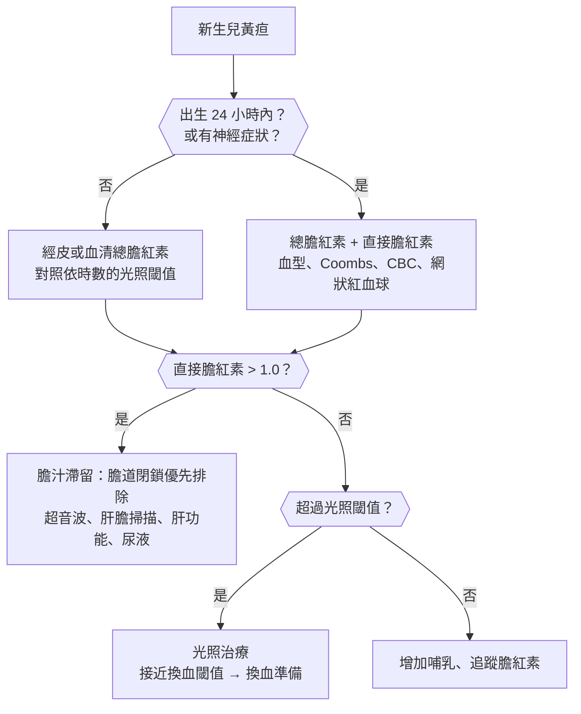
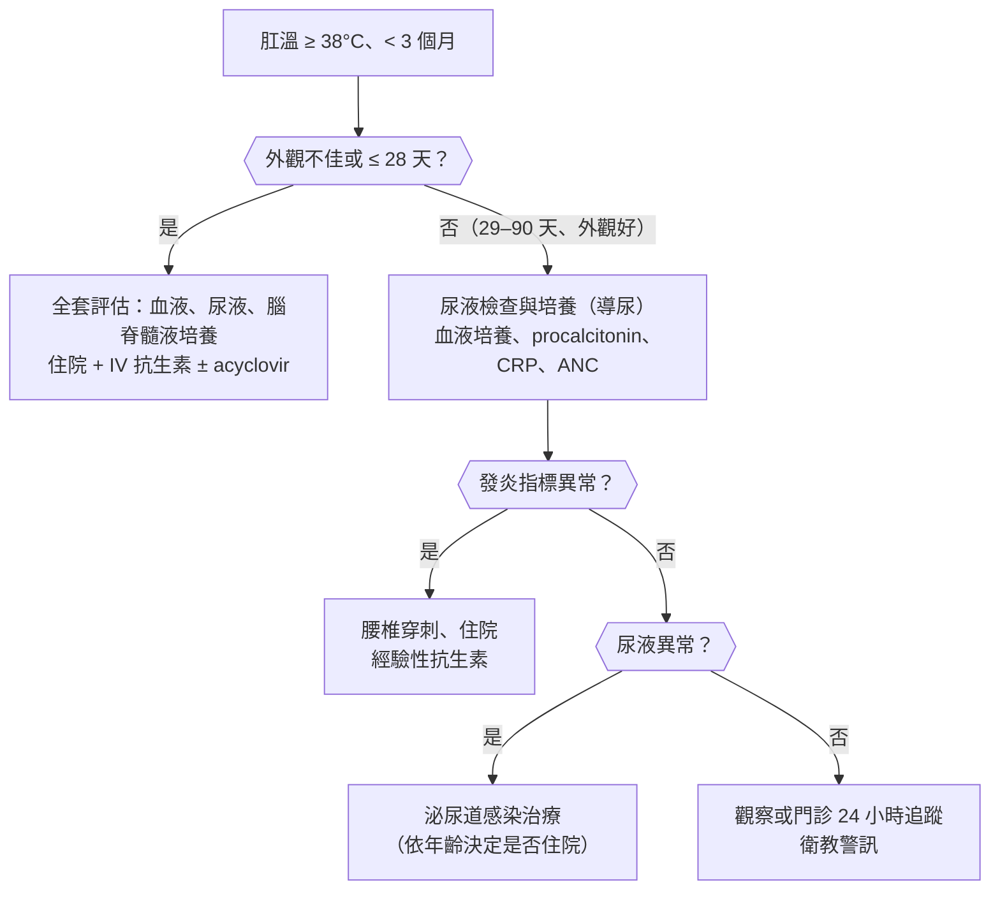
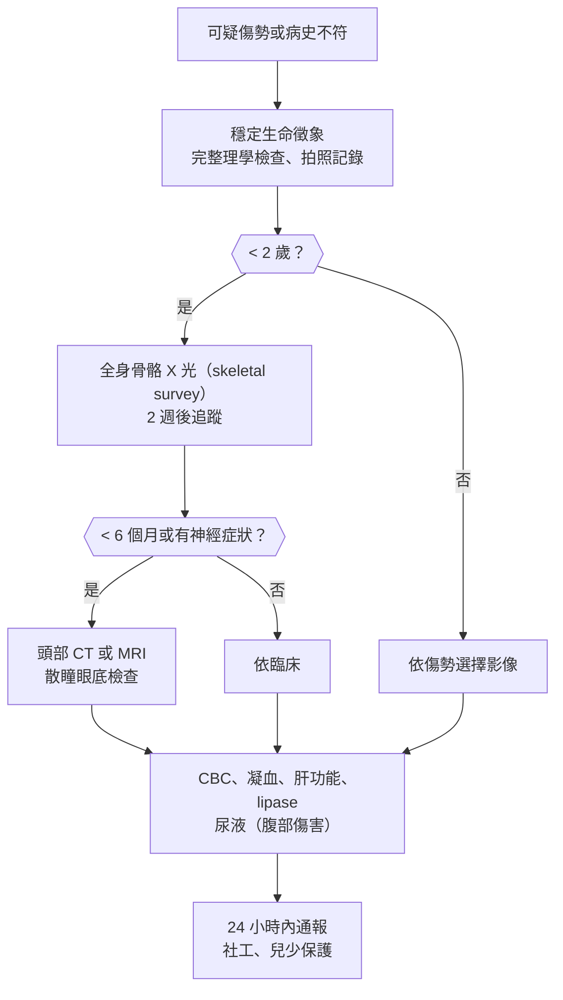

## 新生兒與嬰兒（Newborn and Infant）

### 新生兒黃疸（Neonatal Jaundice）

#### 定義與分類

- **新生兒黃疸**：約 **60% 足月兒、80% 早產兒**會出現；膽紅素 > 5 mg/dL 才看得出來，**由頭往腳進展**。
- **生理性黃疸**：**出生 24 小時後出現**、**第 3–5 天高峰**、足月兒 **2 週內**消退；原因：紅血球壽命短、肝臟 UGT1A1 未成熟、腸肝循環增加。
- **病理性黃疸（任一）**：
    - **出生 :red[24 小時內]出現**。
    - **上升速度 > 0.2 mg/dL/hr（或 > 5 mg/dL/day）**、超過依時數的光照治療閾值。
    - **直接（結合型）膽紅素 > 1.0 mg/dL**（或 > 20% 總膽紅素）。
    - **持續 > 2 週（足月）或 > 3 週（早產）**。
- **間接型（非結合型）高膽紅素血症**：
    - **溶血**：**ABO 血型不合（O 型母親）**、Rh 不合、**G6PD 缺乏（台灣常見，男嬰）**、遺傳性球形紅血球症。
    - **餵食相關**：**哺乳不足性黃疸（breastfeeding jaundice，第一週，攝取不足）** vs **母乳性黃疸（breast milk jaundice，第 2 週後，母乳中物質）**。
    - 頭血腫、紅血球增多症、**先天性甲狀腺低下**、Crigler-Najjar、Gilbert、腸阻塞（腸肝循環）。
- **直接型（結合型）高膽紅素血症（膽汁滯留）**：**一定是病理性** → **膽道閉鎖（最重要）**、新生兒肝炎、總膽管囊腫、感染（[[小兒科#先天性感染（TORCH）|TORCH]]、敗血症、泌尿道感染）、代謝疾病（[[小兒科#半乳糖血症（Galactosemia）|半乳糖血症]]）、Alagille 症候群。

#### Red flags

- **24 小時內出現黃疸** → 溶血。
- **嗜睡、吸吮差、肌張力異常、高聲哭、角弓反張、發燒** → **急性膽紅素腦病變**（[[小兒科#核黃疸（Kernicterus）|核黃疸]]）。
- **灰白便、茶色尿、肝腫大、黃疸 > 2 週** → **膽道閉鎖**（**:red[60 天內]做 Kasai 手術預後最好**）。
- **發燒、嘔吐、活動力差** → 敗血症、泌尿道感染。
- **體重減輕 > 10%、尿量少** → 攝取不足、脫水。
- **G6PD 缺乏家族史**、早產、頭血腫、兄姊曾需要光照治療。

#### 鑑別診斷

| 類別 | 疾病 | 鑑別關鍵 |
|---|---|---|
| **生理性** | **[[小兒科#新生兒黃疸\|生理性黃疸]]** | **24 小時後、3–5 天高峰、2 週內退** |
| **溶血** | **ABO 不合**、Rh 不合、**[[血液腫瘤科#G6PD 缺乏症（Glucose-6-Phosphate Dehydrogenase Deficiency）\|G6PD 缺乏]]**、遺傳性球形紅血球症 | **24 小時內、Coombs、網狀紅血球** |
| **餵食** | **哺乳不足性黃疸**、**母乳性黃疸** | 體重減輕、時間點 |
| **其他間接型** | 頭血腫、紅血球增多症、**[[小兒科#先天性甲狀腺低下（Congenital Hypothyroidism）\|先天性甲狀腺低下]]**、Crigler-Najjar、腸阻塞 | [[小兒科#新生兒篩檢（台灣）\|新生兒篩檢]] |
| **直接型（膽汁滯留）** | **[[小兒外科#膽道閉鎖（Biliary Atresia）\|膽道閉鎖]]**、新生兒肝炎、**[[小兒外科#總膽管囊腫（Choledochal Cyst）\|總膽管囊腫]]**、TORCH、**泌尿道感染**、半乳糖血症、Alagille | **灰白便、直接膽紅素高** |

#### 易混淆鑑別

:::compare[生理性 vs 病理性黃疸]
| | 生理性 | 病理性 |
|---|---|---|
| 出現時間 | **出生 24 小時後** | **24 小時內** |
| 高峰 | 第 3–5 天 | 不定 |
| 上升速度 | 慢 | **> 0.2 mg/dL/hr** |
| 型態 | **間接型** | 間接型或**直接型（一定病理）** |
| 持續 | **< 2 週** | **> 2 週** |
| 其他 | 嬰兒活力好 | 溶血、感染、灰白便、嗜睡 |
:::

:::compare[哺乳不足性黃疸 vs 母乳性黃疸]
| | 哺乳不足性黃疸 | 母乳性黃疸 |
|---|---|---|
| 時間 | **第 1 週（2–4 天）** | **第 2 週後（可持續 2–3 個月）** |
| 機轉 | **攝取不足 → 腸肝循環增加** | **母乳中的 β-glucuronidase 等物質** |
| 體重 | **減輕、尿量少、大便少** | **體重增加良好** |
| 處置 | **增加哺乳次數（每天 8–12 次）**、必要時補充 | **繼續哺乳**；膽紅素很高時可暫停 24–48 小時（多數不需要） |
:::

:::compare[膽道閉鎖 vs 新生兒肝炎 vs 總膽管囊腫]
| | 膽道閉鎖 | 新生兒肝炎 | 總膽管囊腫 |
|---|---|---|---|
| 大便 | **持續灰白色** | 間歇性淡色 | 間歇性 |
| 體型 | **出生體重正常、早期活力好** | 常早產、小於胎齡 | — |
| 超音波 | **三角索徵象（triangular cord sign）、膽囊小或不見** | 膽囊正常 | **囊狀擴張的膽管** |
| 肝膽掃描 | **24 小時腸道無排泄** | 攝取差但有排泄 | — |
| 確診 | **術中膽道攝影** | 肝切片 | 影像 |
| 治療 | **Kasai 手術（60 天內）** → 失敗 → **肝臟移植（兒童肝移植最常見原因）** | 支持 | 切除 + 肝管空腸吻合 |
| 台灣 | **嬰兒大便卡篩檢**（兒童健康手冊） | | |
:::

#### 問診與理學檢查

- **出現時間（以小時計）**、餵食方式與次數、**尿布數（尿 ≥ 6 片/天）**、**大便顏色（對照大便卡）**、體重變化、活動力、發燒。
- **母親與嬰兒血型**、Rh、**G6PD 篩檢結果**、兄姊黃疸史、家族史、懷孕感染、生產過程（器械、頭血腫）、早產週數。
- 理學檢查：**黃疸範圍（由頭往腳）**、蒼白（溶血）、頭血腫、肝脾腫大、**活動力、肌張力、吸吮**、脫水徵象。

#### 檢查流程

- **總膽紅素（經皮篩檢 → 血清確認）+ 直接膽紅素**；**依出生時數與危險因子對照光照與換血閾值（AAP 2022 曲線）**。
- 溶血評估：**母嬰血型、直接 Coombs、CBC、網狀紅血球、抹片**、**G6PD**。
- 黃疸 > 2 週或直接型：**直接膽紅素、肝功能、甲狀腺功能、尿液培養、腹部超音波、肝膽掃描**。

#### 初步處置

- **光照治療**：將膽紅素轉成可排泄的異構物；**不要用陽光替代**；注意**直接型高膽紅素血症時光照會造成青銅嬰兒症候群**。
- **換血**：膽紅素達換血閾值、**急性膽紅素腦病變徵象**；同族免疫溶血 → **IVIG** 可減少換血。
- 持續哺乳、增加次數；不建議用葡萄糖水補充。
- **G6PD 缺乏**：**避免樟腦丸（萘）、紫藥水、特定中藥（黃連等）與磺胺類藥物**。
- 膽道閉鎖 → **儘速轉小兒外科**。

:::pitfall
2 週大的嬰兒仍黃，被當成母乳性黃疸繼續觀察，沒有問大便顏色、沒有驗直接膽紅素 → 膽道閉鎖錯過 60 天內的 Kasai 手術黃金期。黃疸超過 2 週一定要驗直接膽紅素並對照大便卡。
:::

:::pitfall
出生第一天就黃的新生兒，以為是生理性黃疸 → 24 小時內的黃疸都是病理性，常是 ABO 不合或 G6PD 缺乏造成的溶血，膽紅素可快速上升到需要換血。要立即驗膽紅素、血型與 Coombs。
:::

:::exam
- 病理性：24 小時內、上升 > 0.2 mg/dL/hr、直接膽紅素 > 1.0、持續 > 2 週。
- 哺乳不足性（第 1 週、攝取不足）vs 母乳性（第 2 週後、體重增加好、繼續哺乳）。
- 膽道閉鎖：灰白便、三角索徵象、60 天內 Kasai；兒童肝移植最常見原因；台灣大便卡。
- G6PD 缺乏：男嬰、避免樟腦丸、紫藥水、磺胺。
- 直接型高膽紅素血症照光 → 青銅嬰兒症候群。
:::

### 嬰幼兒嘔吐（Vomiting in Infants and Children）

#### 定義與分類

- **溢奶（regurgitation）**：**不費力、量少**、嬰兒生長正常 → **生理性胃食道逆流**，**4 個月高峰、12–18 個月內多消失**（「快樂的溢奶者」）。
- **嘔吐（vomiting）**：用力、腹肌收縮。
- **膽汁性（綠色）嘔吐** → **:red[腸阻塞直到排除]**，新生兒尤其要想 **腸旋轉不良併中腸扭轉**。
- **依年齡想原因**：
    - **新生兒**：**腸旋轉不良併中腸扭轉**、**腸閉鎖（十二指腸：雙泡徵象、[[小兒科#唐氏症（Down Syndrome, Trisomy 21）|唐氏症]]）**、**先天性巨結腸症**、胎便阻塞、**壞死性腸炎（早產）**、**先天代謝異常**、**先天性腎上腺增生（失鹽型）**、敗血症。
    - **2–8 週**：**肥厚性幽門狹窄（噴射狀、非膽汁性）**、胃食道逆流、牛奶蛋白過敏。
    - **6 個月–3 歲**：**腸套疊**、**病毒性腸胃炎（最常見）**、泌尿道感染、中耳炎。
    - **兒童與青少年**：腸胃炎、**闌尾炎**、**[[代謝內分泌科#DKA（Diabetic Ketoacidosis）|DKA]]**、**顱內壓升高**、周期性嘔吐症候群、偏頭痛、懷孕、飲食障礙、**大麻劇吐症**。
- **非腸胃道原因**：**感染（泌尿道感染、中耳炎、肺炎、腦膜炎）**、**顱內壓升高**、代謝（DKA、CAH、先天代謝異常）、中毒、**兒虐（頭部外傷）**。

#### Red flags

- **膽汁性嘔吐** → 腸阻塞，**緊急上腸胃道攝影**。
- **血便、果醬樣大便、陣發性哭鬧** → 腸套疊。
- **腹脹、腹膜徵象、無排便排氣**。
- **噴射狀嘔吐、頭圍增加、囟門膨出、早晨嘔吐、頭痛** → 顱內壓升高。
- **嗜睡、脫水、休克**。
- **體重不增、生長遲滯**。
- **新生兒嘔吐 + 外生殖器模稜兩可 + 低血鈉高血鉀** → **先天性腎上腺增生（失鹽危象）**。
- **多尿、多喝、深快呼吸** → DKA。

#### 鑑別診斷

| 類別 | 疾病 | 鑑別關鍵 |
|---|---|---|
| **新生兒外科急症** | **[[小兒外科#腸旋轉不良與中腸扭轉（Malrotation & Midgut Volvulus）\|腸旋轉不良併中腸扭轉]]**、**[[小兒外科#十二指腸閉鎖（Duodenal Atresia）\|十二指腸閉鎖]]**、[[小兒外科#空迴腸閉鎖（Jejunoileal Atresia）\|空迴腸閉鎖]]、**[[小兒外科#先天性巨結腸症（Hirschsprung Disease）\|先天性巨結腸症]]**、**[[小兒外科#壞死性腸炎（Necrotizing Enterocolitis, NEC）\|壞死性腸炎]]**、[[小兒外科#肛門直腸畸形（Anorectal Malformations / Imperforate Anus）\|肛門直腸畸形]] | **膽汁性、腹脹、胎便延遲** |
| **幽門** | **[[小兒外科#肥厚性幽門狹窄（Hypertrophic Pyloric Stenosis, HPS）\|肥厚性幽門狹窄]]** | **2–8 週、噴射狀、非膽汁性、橄欖狀腫塊** |
| **嬰幼兒腸胃** | **[[小兒科#胃食道逆流（GER / GERD）\|胃食道逆流]]**、牛奶蛋白過敏、**[[小兒科#腸套疊（Intussusception）\|腸套疊]]**、**病毒性腸胃炎**、[[小兒科#闌尾炎（Appendicitis）\|闌尾炎]]、嵌頓性疝氣 | 年齡、血便 |
| **感染** | **[[小兒科#泌尿道感染\|泌尿道感染]]**、中耳炎、肺炎、**[[小兒科#中樞神經感染\|腦膜炎]]**、敗血症 | 發燒 |
| **神經** | **顱內壓升高**（腫瘤、水腦、出血）、**[[小兒科#兒童虐待（Child Abuse）\|虐待性頭部外傷]]**、偏頭痛、周期性嘔吐 | 囟門、頭圍、神經徵象 |
| **代謝與內分泌** | **[[小兒科#先天性腎上腺增生（Congenital Adrenal Hyperplasia, CAH）\|CAH 失鹽]]**、**[[小兒科#先天代謝異常（Inborn Errors of Metabolism, IEM）\|先天代謝異常]]**、**DKA** | 電解質、血糖、氨 |
| **其他** | 過度餵食、中毒、懷孕（青少女） | 病史 |

#### 易混淆鑑別

:::compare[肥厚性幽門狹窄 vs 腸旋轉不良併中腸扭轉 vs 十二指腸閉鎖]
| | 肥厚性幽門狹窄 | 腸旋轉不良併中腸扭轉 | 十二指腸閉鎖 |
|---|---|---|---|
| 年齡 | **2–8 週（3–6 週最多）** | **新生兒（第一個月）**，任何年齡 | **出生後數小時到 1 天** |
| 嘔吐 | **噴射狀、非膽汁性**、吐完想再喝 | **膽汁性** | **膽汁性**（閉鎖多在乏特氏壺腹遠端） |
| 族群 | **頭胎男嬰**、**erythromycin 暴露** | — | **唐氏症（~30%）**、羊水過多 |
| 理學 | **上腹橄欖狀腫塊**、胃蠕動波 | **腹脹、血便、休克**（腸缺血） | 上腹脹 |
| 電解質 | **:red[低氯低鉀代謝性鹼中毒]**、**矛盾性酸尿** | 酸中毒（缺血） | — |
| 影像 | **超音波：幽門肌層 ≥ 3–4 mm、長度 ≥ 15–17 mm** | **上腸胃道攝影：十二指腸空腸交界位置異常、螺旋狀（corkscrew）** | **腹部 X 光：雙泡徵象（double bubble）** |
| 治療 | **先矯正脫水與電解質** → **幽門肌切開術** | **緊急 Ladd 手術** | 十二指腸吻合 |
:::

:::compare[生理性胃食道逆流 vs 胃食道逆流疾病 vs 牛奶蛋白過敏]
| | 生理性 GER | GERD | 牛奶蛋白過敏 |
|---|---|---|---|
| 症狀 | **溢奶，嬰兒快樂** | **餵食困難、哭鬧、拱背、生長不良**、反覆肺炎、喘鳴 | **溢奶、嘔吐、血絲便、濕疹**、哭鬧 |
| 生長 | **正常** | 可能不良 | 可能不良 |
| 處置 | **衛教、避免過度餵食、餵後直立** | 稠化配方、**2–4 週無牛奶蛋白試驗**、必要時制酸劑 | **母親飲食排除牛奶或改水解配方** |
| 注意 | **不需藥物**；PPI 增加感染與骨折 | **先試排除牛奶蛋白**（症狀相似） | 多數 1 歲前耐受 |
:::

#### 問診與理學檢查

- **年齡**、**嘔吐物性質（奶、膽汁綠色、血、咖啡渣）**、**噴射狀**、與餵食的關係、量與頻率。
- **大便（次數、血、果醬樣、胎便何時解）**、尿量、發燒、哭鬧型態、**體重變化**、餵食種類與量。
- 出生史（羊水過多、早產）、**新生兒篩檢**、家族史、用藥（erythromycin）、外傷。
- 理學檢查：**脫水程度**、**腹部（膨脹、腫塊、壓痛）**、**疝氣與睪丸**、肛門、**囟門與頭圍**、意識、外生殖器、皮膚瘀青。

#### 檢查流程

- **膽汁性嘔吐 → 緊急上腸胃道攝影**（腸旋轉不良）；腹部 X 光。
- **疑幽門狹窄 → 腹部超音波** + **電解質、血液氣體**。
- 疑腸套疊 → **超音波（靶狀徵象）**。
- **電解質、血糖、BUN、肌酸酐**、尿液檢查；依臨床 → **血氨、乳酸、尿酮**（代謝）、**17-OH progesterone**（CAH）、頭部影像。

#### 初步處置

- **口服補液**（輕中度脫水）；嚴重 → IV。
- 膽汁性嘔吐：**禁食、鼻胃管減壓、IV 輸液、緊急小兒外科**。
- 幽門狹窄：**先矯正鹼中毒與低鉀再手術**（麻醉後呼吸抑制風險）。
- 腸胃炎：**ondansetron**（> 6 個月，減少嘔吐、利於口服補液）。
- 生理性逆流：**衛教**，不需藥物。

:::pitfall
新生兒綠色嘔吐被當成腸胃炎或溢奶 → 腸旋轉不良併中腸扭轉可在數小時內造成整段小腸壞死。膽汁性嘔吐就是外科急症，立即做上腸胃道攝影並會診小兒外科。
:::

:::pitfall
肥厚性幽門狹窄的嬰兒診斷後直接送手術，沒有先矯正電解質 → 代謝性鹼中毒使麻醉後呼吸抑制、甦醒延遲。先輸液矯正低氯低鉀鹼中毒，再做幽門肌切開。
:::

:::exam
- 膽汁性嘔吐 → 腸阻塞，新生兒想中腸扭轉 → 上腸胃道攝影、Ladd 手術。
- 幽門狹窄：2–8 週頭胎男嬰、噴射狀非膽汁性、橄欖腫塊、低氯低鉀鹼中毒、矛盾性酸尿；先矯正再手術。
- 雙泡徵象 → 十二指腸閉鎖、唐氏症。
- 生理性逆流：快樂溢奶、4 個月高峰、不需藥物。
:::

### 嬰兒哭鬧不止（Excessive Crying / Irritable Infant）

#### 定義與分類

- **嬰兒腸絞痛（infantile colic）**：**健康嬰兒**，**< 5 個月**、**無明顯原因的長時間哭鬧**（傳統 **:red[3 法則]：每天 > 3 小時、每週 > 3 天、持續 > 3 週**），**傍晚好發**、**6 週高峰、3–4 個月後緩解**；**排除診斷**。
- **急性哭鬧不止的器質性原因（約 5%）**：
    - **感染**：**泌尿道感染**、中耳炎、腦膜炎。
    - **腸胃**：**腸套疊**、**嵌頓性疝氣**、便秘、胃食道逆流、牛奶蛋白過敏、肛裂。
    - **疼痛與外傷**：**毛髮纏繞（hair tourniquet，手指、腳趾、陰莖）**、**角膜擦傷**、**骨折（兒虐）**、**睪丸扭轉**。
    - **其他**：**心律不整（SVT）**、心衰竭、藥物或疫苗反應、顱內出血、低血糖。

#### Red flags

- **發燒（< 3 個月）、嗜睡、活動力差、餵食差** → 嚴重感染。
- **嘔吐（尤其膽汁性）、血便、腹脹** → 腸套疊、中腸扭轉。
- **哭聲尖銳、囟門膨出、癲癇** → 顱內問題（**虐待性頭部外傷**）。
- **任何瘀青（不會翻身的嬰兒）、骨折、病史與傷勢不符** → 兒虐。
- **心跳極快（> 220）、蒼白、出汗** → SVT。
- **體重不增**。
- **照顧者崩潰、有搖晃嬰兒的風險** → 支持與安置。

#### 鑑別診斷

| 類別 | 疾病 | 鑑別關鍵 |
|---|---|---|
| **功能性** | **嬰兒腸絞痛**、飢餓、疲倦、過度刺激 | **生長正常、檢查正常、時間規律** |
| **感染** | **[[小兒科#泌尿道感染\|泌尿道感染]]**、中耳炎、[[小兒科#中樞神經感染\|腦膜炎]] | 發燒、尿液 |
| **腸胃** | **[[小兒科#腸套疊（Intussusception）\|腸套疊]]**、**[[小兒外科#小兒腹股溝疝氣\|嵌頓性疝氣]]**、便秘、[[小兒科#胃食道逆流（GER / GERD）\|GERD]]、牛奶蛋白過敏、肛裂 | **陣發性、嘔吐、血便、腹股溝腫塊** |
| **外傷與疼痛** | **毛髮纏繞**、**[[眼科#角膜異物與磨損\|角膜擦傷]]**、**[[小兒科#兒童虐待（Child Abuse）\|骨折、虐待性頭部外傷]]**、[[泌尿科#睪丸扭轉（Testicular Torsion）\|睪丸扭轉]] | **從頭到腳仔細檢查** |
| **心臟** | **[[小兒科#SVT（Supraventricular Tachycardia）\|SVT]]**、[[小兒科#心衰竭（Heart Failure in Children）\|心衰竭]]（餵食時出汗喘） | 心跳 |
| **代謝與藥物** | 低血糖、藥物、疫苗反應、**咖啡因（母乳）** | 病史 |

#### 易混淆鑑別

:::compare[嬰兒腸絞痛 vs 腸套疊 vs 嵌頓性疝氣]
| | 嬰兒腸絞痛 | 腸套疊 | 嵌頓性疝氣 |
|---|---|---|---|
| 年齡 | **2 週–4 個月** | **6 個月–3 歲** | 嬰兒（早產兒多） |
| 型態 | **傍晚規律、雙腿蜷曲、臉紅** | **陣發性劇烈哭鬧、間歇時嗜睡** | 持續哭鬧 |
| 嘔吐 | 無 | **有（後期膽汁性）** | 有 |
| 大便 | 正常 | **果醬樣血便（晚期）** | — |
| 理學 | **正常** | **右上腹臘腸狀腫塊**、右下腹空虛 | **腹股溝或陰囊腫塊、無法推回** |
| 處置 | **安撫、衛教、照顧者支持** | **超音波 → 空氣或水灌腸復位** | **徒手復位 → 手術** |
:::

#### 問診與理學檢查

- **哭鬧開始時間與型態**（突發或規律、持續或陣發）、與餵食的關係、哭聲性質。
- **發燒、嘔吐、大便（血）、餵食與尿量**、體重、最近疫苗或用藥、**外傷**、照顧者是誰、**照顧者的情緒與支持**。
- 理學檢查：**脫光衣服從頭到腳檢查**：
    - **生命徵象（體溫、心跳）**、囟門、**眼睛（螢光染色看角膜擦傷）**、耳朵。
    - **手指、腳趾、陰莖（毛髮纏繞）**、腹股溝與睪丸、腹部、肛門。
    - **皮膚瘀青**、四肢壓痛與活動（骨折）。

#### 檢查流程

- **病史與理學檢查正常、生長正常 → 不需常規檢查**，診斷為腸絞痛並追蹤。
- 依臨床：**尿液檢查與培養**（< 3 個月、發燒）、**角膜螢光染色**、腹部超音波（腸套疊）、ECG（SVT）、血糖。
- 懷疑兒虐 → **全身骨骼 X 光、頭部影像、眼底檢查**、通報。

#### 初步處置

- 腸絞痛：
    - **衛教（會自行緩解）、安撫技巧（包巾、側抱、輕搖、白噪音、安撫奶嘴）**。
    - 哺餵母乳者：**Lactobacillus reuteri** 可能有幫助；**母親排除乳製品**或配方奶改水解配方可嘗試 1–2 週。
    - **照顧者支持**：**哭聲讓人崩潰時把嬰兒放安全處、離開冷靜**；**絕對不要搖晃嬰兒**。
- 毛髮纏繞 → **剪除或脫毛劑**。
- 依器質性原因治療。

:::pitfall
3 個月大的嬰兒突然哭鬧不止，被當成腸絞痛沒有脫衣服檢查 → 漏掉腳趾的毛髮纏繞、腹股溝嵌頓性疝氣、骨折或角膜擦傷。急性哭鬧要脫光衣服從頭到腳仔細檢查。
:::

:::pitfall
哭鬧的嬰兒照顧者疲憊崩潰，醫師只給衛教就讓他們回家 → 腸絞痛的高峰期正是虐待性頭部外傷（搖晃嬰兒）的高峰期。要評估照顧者壓力、教導「放下嬰兒、離開冷靜」，並提供支持資源。
:::

:::exam
- 腸絞痛：3 法則（> 3 小時、> 3 天/週、> 3 週）、6 週高峰、排除診斷。
- 急性哭鬧：毛髮纏繞、角膜擦傷、嵌頓性疝氣、腸套疊、骨折、SVT、泌尿道感染。
- 腸套疊：6 個月–3 歲、陣發性哭鬧、果醬樣血便、臘腸狀腫塊。
- 腸絞痛高峰 = 搖晃嬰兒高峰 → 照顧者支持。
:::

### 新生兒呼吸窘迫（Neonatal Respiratory Distress）

#### 定義與分類

- **新生兒呼吸窘迫**：**呼吸 > 60 次/分**、**呻吟（grunting）**、**鼻翼搧動**、**肋間或胸骨凹陷**、發紺。
- **肺部原因**：
    - **[[小兒科#暫時性呼吸急促（Transient Tachypnea of Newborn, TTN）|新生兒暫時性呼吸急促（TTN）]]**：**最常見**；**足月或近足月、剖腹產（未經產程）**、肺液清除延遲；**24–72 小時內改善**。
    - **[[小兒科#呼吸窘迫症候群（RDS / Hyaline Membrane Disease）|呼吸窘迫症候群（RDS，玻璃膜病）]]**：**早產（表面張力素不足）**、**母親糖尿病**；**出生後數小時內惡化**。
    - **[[小兒科#胎便吸入症候群（Meconium Aspiration Syndrome, MAS）|胎便吸入症候群（MAS）]]**：**過期產、胎兒窘迫、羊水胎便染**；可合併持續性肺高壓。
    - **新生兒肺炎與敗血症**：**GBS**、大腸桿菌；**破水久、母親發燒**。
    - **氣胸**、先天性肺部畸形（CPAM、肺隔離症）、**先天性橫膈疝氣（舟狀腹、腸音在胸部）**。
- **非肺部原因**：
    - **發紺性先天性心臟病**（大動脈轉位、法洛氏四重症等）、**[[小兒科#新生兒持續性肺高壓（PPHN）|持續性肺高壓（PPHN）]]**。
    - **呼吸道**：**後鼻孔閉鎖（哭時改善、餵食時發紺）**、喉軟化症、Pierre Robin。
    - **代謝與神經**：低血糖、低體溫、代謝性酸中毒、**中樞抑制（母親用藥）**、神經肌肉疾病。
    - **食道閉鎖合併氣管食道瘻管**：**口水多、餵食嗆咳發紺**、鼻胃管放不下去。

#### Red flags

- **發紺、SpO₂ 低、給氧後不改善** → 發紺性心臟病、PPHN。
- **呼吸暫停、心跳慢**。
- **舟狀腹 + 單側呼吸音減弱 + 心音偏移** → 先天性橫膈疝氣（**不要用面罩加壓給氧，要插管**）。
- **突然惡化 + 單側呼吸音減弱** → 氣胸。
- **發燒或低體溫、活動力差、破水 > 18 小時、母親 GBS 陽性** → 敗血症。
- **口水多、鼻胃管放不下** → 食道閉鎖。

#### 鑑別診斷

| 類別 | 疾病 | 鑑別關鍵 |
|---|---|---|
| **肺** | **[[小兒科#新生兒呼吸窘迫\|TTN、RDS、胎便吸入]]**、新生兒肺炎、**氣胸** | **週數、生產方式、胸部 X 光** |
| **先天畸形** | **[[小兒外科#先天性橫膈疝氣（Congenital Diaphragmatic Hernia, CDH）\|先天性橫膈疝氣]]**、**[[小兒外科#先天性囊性腺瘤樣畸形（CPAM / CCAM）\|CPAM]]**、[[小兒外科#肺隔離症（Pulmonary Sequestration）\|肺隔離症]]、[[小兒外科#先天性肺葉氣腫（Congenital Lobar Emphysema）\|先天性肺葉氣腫]]、**[[小兒外科#食道閉鎖與氣管食道瘻管（Esophageal Atresia / TEF）\|食道閉鎖與 TEF]]** | **舟狀腹、口水多** |
| **心臟** | **[[小兒科#先天性心臟病分類\|發紺性先天性心臟病]]**、**PPHN** | **高濃度氧氣試驗**、上下肢 SpO₂ |
| **呼吸道** | **後鼻孔閉鎖**、[[耳鼻喉科#先天性喉軟化症（Laryngomalacia）\|喉軟化症]]、Pierre Robin | **哭時改善** |
| **感染** | **[[小兒科#新生兒感染\|新生兒敗血症（GBS）]]** | 危險因子、體溫 |
| **代謝與中樞** | 低血糖、低體溫、酸中毒、**母親用藥（鴉片類、鎂）**、神經肌肉疾病 | 血糖、病史 |

#### 易混淆鑑別

:::compare[TTN vs RDS vs 胎便吸入症候群]
| | TTN | RDS | 胎便吸入症候群 |
|---|---|---|---|
| 週數 | **足月、近足月** | **早產（< 34 週）** | **過期產（> 41 週）** |
| 危險因子 | **剖腹產（無產程）**、母親糖尿病、氣喘 | **早產、母親糖尿病**、男嬰、剖腹產 | **胎兒窘迫、羊水胎便染** |
| 病程 | **24–72 小時改善** | **數小時內惡化**，48–72 小時後改善（表面張力素生成） | 數天，**可合併 PPHN、氣胸** |
| 胸部 X 光 | **肺門血管紋路增加、葉間積液**、肺容積正常或增加 | **毛玻璃樣、空氣支氣管圖、肺容積小** | **斑塊狀浸潤、過度充氣**、氣胸 |
| 治療 | **支持（氧氣）** | **表面張力素（氣管內給予）**、CPAP；**產前類固醇預防** | 支持、呼吸器、表面張力素、**PPHN → 一氧化氮吸入** |
:::

:::compare[高濃度氧氣試驗：肺部 vs 心臟原因]
| | 肺部疾病 | 發紺性心臟病 |
|---|---|---|
| 給 100% 氧氣 10 分鐘後 PaO₂ | **> 150 mmHg** | **:red[< 100 mmHg]（常 < 50）** |
| 呼吸費力 | **明顯** | 常不明顯（**安靜的發紺**） |
| 心雜音 | 少 | 可有可無 |
| 下一步 | 治療肺部疾病 | **心臟超音波、prostaglandin E1 維持動脈導管通暢** |
| **上下肢 SpO₂ 差** | — | **差 > 3% → 動脈導管依賴（主動脈窄縮、PPHN）** |
:::

#### 問診與理學檢查

- **週數、生產方式、Apgar**、羊水（胎便、量）、**破水時間、母親發燒、GBS 篩檢、產前類固醇**、母親糖尿病、懷孕用藥、產前超音波異常。
- 理學檢查：**呼吸速率與費力程度（Silverman 或 Downes 評分）**、**發紺**、**上下肢 SpO₂**、心雜音、股動脈脈搏、**腹部（舟狀腹）**、**鼻孔通暢（插鼻胃管）**、體溫、血糖。

#### 檢查流程

- **胸部 X 光**、**血液氣體**、**血糖**、**CBC、CRP、血液培養**。
- **上下肢 SpO₂**、**高濃度氧氣試驗**、**心臟超音波**（懷疑心臟病或 PPHN）。
- **台灣新生兒先天性心臟病篩檢（脈搏血氧）**：出生 24–36 小時量右手與腳。

#### 初步處置

- **保暖、維持血糖**、**氧氣或 CPAP**，必要時插管。
- RDS：**表面張力素**；預防 → **產前類固醇**（24–34 週）。
- 懷疑敗血症 → **ampicillin + gentamicin**。
- **先天性橫膈疝氣：立即插管 + 鼻胃管減壓，:red[禁止面罩加壓給氧]**（胃腸脹氣壓迫肺）。
- 懷疑**動脈導管依賴型心臟病** → **prostaglandin E1（注意呼吸暫停）**。
- 氣胸 → 針刺減壓或胸管。

:::pitfall
懷疑先天性橫膈疝氣的新生兒用面罩加壓給氧 → 空氣灌入胸腔內的胃腸，進一步壓迫肺與心臟。舟狀腹、呼吸音不對稱、心音偏移時，直接插管並放鼻胃管減壓。
:::

:::pitfall
新生兒發紺、呼吸卻不太喘，一直加氧氣都沒改善，當成肺炎治療 → 可能是發紺性心臟病或動脈導管依賴型病灶，動脈導管關閉後會突然休克。做高濃度氧氣試驗與心臟超音波，必要時給 prostaglandin E1。
:::

:::exam
- TTN：足月剖腹產、24–72 小時改善、葉間積液；RDS：早產、毛玻璃加空氣支氣管圖 → 表面張力素、產前類固醇。
- 胎便吸入：過期產、PPHN → 一氧化氮。
- 高濃度氧氣試驗：PaO₂ < 100 → 心臟原因 → PGE1。
- 先天性橫膈疝氣：舟狀腹 → 插管、禁面罩給氧；食道閉鎖：口水多、鼻胃管放不下；後鼻孔閉鎖：哭時改善。
:::

### 鬆軟兒（Floppy Infant / Hypotonia）

#### 定義與分類

- **鬆軟兒（floppy infant）**：**肌張力低下**；抱起時像布娃娃、**垂直懸吊時從手中滑落**、**水平懸吊呈倒 U 型**、**拉坐時頭部後垂（head lag）**、**青蛙腿姿勢**。
- **先分中樞或周邊**：
    - **中樞性（~60–80%）**：**張力低但力量相對保留**、**反射正常或亢進**、合併**意識或發展遲緩、癲癇、異型特徵**。
        - **缺氧缺血性腦病變**、**染色體異常（唐氏症、Prader-Willi）**、**腦部畸形**、**先天代謝異常**、**先天性甲狀腺低下**、**敗血症**、中樞神經感染、**母親用藥（鎂、鴉片類）**。
    - **周邊性（~15–30%）**：**明顯無力**、**反射消失或減弱**、**舌頭肌束顫動**、**意識清醒、眼神靈活**。
        - **脊髓性肌肉萎縮症（SMA，前角細胞）**、**[[感染科#C. botulinum（Botulism，肉毒桿菌）|嬰兒肉毒桿菌中毒]]（NMJ，蜂蜜）**、**先天性肌強直性失養症（母親遺傳）**、先天性肌病變、**[[神經內科#重症肌無力（Myasthenia Gravis, MG）|新生兒重症肌無力]]（母親 MG）**、脊髓損傷。
- **良性先天性張力低下**：排除診斷，發展逐漸正常。

#### Red flags

- **呼吸費力、吸吮與吞嚥困難、反覆嗆咳** → 呼吸衰竭與吸入性肺炎風險。
- **舌頭肌束顫動、反射消失、清醒有神** → **SMA**（**早期基因治療，越早越好**）。
- **便秘、吸吮差、哭聲弱、眼瞼下垂、瞳孔散大 + 吃過蜂蜜** → **嬰兒肉毒桿菌中毒**。
- **發展退化**（已會的能力消失）→ 代謝或神經退化疾病。
- **嗜睡、癲癇、餵食差、酸中毒、高血氨** → 先天代謝異常。
- **母親有 MG 或肌強直性失養症**。

#### 鑑別診斷

| 類別 | 疾病 | 鑑別關鍵 |
|---|---|---|
| **中樞：腦** | 缺氧缺血性腦病變、腦部畸形、**[[小兒科#腦性麻痺（Cerebral Palsy, CP）\|腦性麻痺（早期張力低）]]**、顱內出血 | **反射保留或亢進**、癲癇、意識 |
| **中樞：遺傳** | **[[小兒科#唐氏症（Down Syndrome, Trisomy 21）\|唐氏症]]**、**[[小兒科#Prader-Willi Syndrome\|Prader-Willi]]**（餵食困難 → 後來暴食） | **異型特徵** |
| **中樞：代謝與全身** | **[[小兒科#先天代謝異常（Inborn Errors of Metabolism, IEM）\|先天代謝異常]]**、**[[小兒科#先天性甲狀腺低下（Congenital Hypothyroidism）\|先天性甲狀腺低下]]**、敗血症、低血糖、**母親用藥** | 新生兒篩檢、血氨 |
| **前角細胞** | **[[小兒科#脊髓性肌肉萎縮症（Spinal Muscular Atrophy, SMA）\|SMA]]** | **舌頭肌束顫動、反射消失、清醒** |
| **神經肌肉接合處** | **嬰兒肉毒桿菌中毒**、新生兒重症肌無力 | **蜂蜜、便秘、瞳孔** |
| **肌肉** | **先天性肌強直性失養症**、先天性肌病變、[[神經內科#肌肉失養症（Muscular Dystrophies）\|先天性肌肉失養症]]、Pompe 病（**心臟肥大、巨舌**） | **CK**、母親握手後無法放開 |

#### 易混淆鑑別

:::compare[中樞性 vs 周邊性張力低下]
| | 中樞性 | 周邊性 |
|---|---|---|
| 比例 | **多數（60–80%）** | 少數 |
| 力量 | **相對保留**（可抗重力） | **明顯無力** |
| 反射 | **正常或亢進** | **減弱或消失** |
| 意識與互動 | **常受影響**、發展遲緩 | **清醒、眼神靈活** |
| 其他 | **癲癇、異型特徵、小頭** | **肌束顫動（舌頭）、肌肉萎縮** |
| 代表 | 缺氧缺血、唐氏症、Prader-Willi、代謝 | **SMA**、肉毒、肌病變 |
| 檢查 | **腦部 MRI、染色體微陣列、代謝篩檢** | **CK、SMN1 基因、肌電圖、肌肉切片** |
:::

:::compare[SMA vs 嬰兒肉毒桿菌中毒]
| | SMA 第 1 型 | 嬰兒肉毒桿菌中毒 |
|---|---|---|
| 年齡 | **< 6 個月** | **1–6 個月** |
| 機轉 | **SMN1 基因缺失（體染色體隱性）、前角細胞退化** | **腸道內孢子產生毒素**（**蜂蜜**、土壤） |
| 發作 | 漸進 | **急性到亞急性** |
| 首發症狀 | **四肢近端無力、反射消失** | **便秘** → 吸吮差、哭聲弱、**下行性麻痺** |
| 腦神經 | **舌頭肌束顫動**、眼球運動與臉部表情保留 | **眼瞼下垂、瞳孔散大、對光反應差** |
| 治療 | **nusinersen、onasemnogene（基因治療）、risdiplam**；台灣**新生兒篩檢含 SMA** | **嬰兒肉毒桿菌免疫球蛋白（BabyBIG）**、支持；**不用 aminoglycoside** |
| 預防 | — | **1 歲以下不吃蜂蜜** |
:::

#### 問診與理學檢查

- **出生史（週數、Apgar、缺氧、胎動減少、羊水過多）**、餵食與吞嚥、呼吸、哭聲、**便秘**、**蜂蜜**、發展里程碑、**是否退化**。
- **母親病史（MG、肌強直性失養症）**、用藥、家族史、近親婚姻。
- 理學檢查：
    - **拉坐、垂直與水平懸吊**、自發活動、**抗重力力量**。
    - **深部肌腱反射**、**舌頭肌束顫動**、眼瞼與瞳孔、臉部表情。
    - 異型特徵、頭圍、**肝脾與心臟（Pompe）**、**母親握手（肌強直）**。

#### 檢查流程

- **中樞懷疑**：**腦部 MRI**、**染色體微陣列（CMA）**、Prader-Willi 甲基化檢測、**代謝篩檢（血氨、乳酸、胺基酸、有機酸）**、TSH。
- **周邊懷疑**：**CK**（肌病變與失養症高）、**SMN1 基因**、**糞便肉毒毒素**、**肌電圖與神經傳導**、肌肉切片、全外顯子定序。
- 心臟超音波（Pompe）、吞嚥評估。

#### 初步處置

- **呼吸與營養支持**（鼻胃管、呼吸器）。
- **SMA → 儘速基因或反義寡核苷酸治療**。
- 嬰兒肉毒 → **BabyBIG**、支持治療。
- **早期療育**（物理、職能、語言治療）、遺傳諮詢。

:::pitfall
鬆軟的嬰兒被當成「發展慢一點、再觀察」 → SMA 錯過基因治療的最佳時機。眼神靈活、四肢無力、反射消失、舌頭肌束顫動時，要立即驗 SMN1 基因。
:::

:::pitfall
4 個月大嬰兒便秘、吸奶無力、哭聲變小，被當成腸胃問題 → 嬰兒肉毒桿菌中毒，可進展到呼吸衰竭。問有沒有吃蜂蜜，檢查眼瞼與瞳孔，懷疑時送糞便毒素並及早給 BabyBIG。
:::

:::exam
- 中樞性：力量保留、反射正常或亢進、意識與發展受影響；周邊性：無力、反射消失、清醒。
- SMA：SMN1、舌頭肌束顫動 → nusinersen、基因治療；台灣新生兒篩檢含 SMA。
- 嬰兒肉毒：蜂蜜、便秘、下行性麻痺、瞳孔散大 → BabyBIG；1 歲以下不吃蜂蜜。
- Prader-Willi：新生兒鬆軟餵食困難 → 之後暴食肥胖；Pompe：鬆軟 + 心臟肥大 + 巨舌。
:::

## 發燒、呼吸與腸胃（Fever, Respiratory and GI）

### 幼兒發燒（Fever in Young Children）

#### 定義與分類

- **發燒**：**肛溫 ≥ :red[38.0°C]**（嬰兒最準）；耳溫、額溫為篩檢。
- **無明顯病灶的發燒（fever without source）**：病史與理學檢查找不到原因。
- **依年齡分層（嚴重細菌感染風險隨年齡下降）**：
    - **≤ 28 天（新生兒）**：**嚴重細菌感染風險最高（~10–20%）**；**GBS、大腸桿菌、Listeria、HSV** → **全套敗血症評估 + 住院 + IV 抗生素**。
    - **29–60（或 90）天**：依外觀與檢驗（**AAP 2021、PECARN、Step-by-Step**）分層。
    - **3–36 個月**：**泌尿道感染最常見的隱匿性細菌感染**；疫苗普及後菌血症少見。
- **嚴重細菌感染（SBI）**：**泌尿道感染（最常見）**、菌血症、**細菌性腦膜炎**、肺炎、骨髓炎、化膿性關節炎。
- **台灣常見兒童發燒**：**病毒性上呼吸道感染**、**腸病毒（夏季）**、**流感、[[感染科#RSV（Respiratory Syncytial Virus）|RSV]]**、**玫瑰疹**、**川崎病（發燒 ≥ 5 天）**、**泌尿道感染**、黴漿菌肺炎。
- **退燒藥不能預防[[神經內科#Febrile Seizure（熱性痙攣）|熱性痙攣]]**；退燒的目的是**舒適**，不是讓體溫正常。

#### Red flags

- **年齡 < 3 個月**的任何發燒。
- **外觀不佳**：**嗜睡、難以喚醒、哭聲弱或尖銳、膚色灰白或斑駁、微血管回填 > 2 秒**。
- **紫斑或瘀點** → 腦膜炎雙球菌血症。
- **囟門膨出、頸部僵硬、癲癇、意識改變** → 腦膜炎、腦炎。
- **呼吸窘迫、低血氧**。
- **發燒 ≥ 5 天** → 川崎病、泌尿道感染、骨髓炎、腫瘤。
- **腸病毒 + 嗜睡、肌躍型抽搐、持續嘔吐、呼吸急促、心跳快** → **腸病毒 71 重症前兆**。
- **免疫低下**（化療、無脾、鐮刀型貧血）、**中心靜脈導管**、**未完成疫苗**。
- **體溫 ≥ 40°C**（嬰兒菌血症風險較高）。

#### 鑑別診斷

| 類別 | 疾病 | 鑑別關鍵 |
|---|---|---|
| **病毒** | **上呼吸道感染**、**[[小兒科#常見出疹性疾病\|玫瑰疹]]**、**腸病毒（[[皮膚系統主訴#發燒合併皮疹（Fever and Rash）\|手足口病、疱疹性咽峽炎]]）**、流感、RSV、腺病毒 | **大多數、自限** |
| **嚴重細菌感染** | **[[小兒科#泌尿道感染\|泌尿道感染]]（最常見）**、菌血症、**[[小兒科#中樞神經感染\|細菌性腦膜炎]]**、[[小兒科#下呼吸道感染\|肺炎]]、[[骨科#急性骨髓炎（Acute Osteomyelitis）\|骨髓炎]]、化膿性關節炎 | **年齡、外觀、尿液、發炎指標** |
| **新生兒特殊** | **[[小兒科#新生兒感染\|GBS、大腸桿菌、Listeria]]**、**新生兒 HSV** | **≤ 28 天** |
| **局部感染** | 中耳炎、咽扁桃腺炎、鼻竇炎、蜂窩性組織炎、腸胃炎 | 理學檢查 |
| **發炎性** | **[[小兒科#川崎病（Kawasaki Disease）\|川崎病]]**、[[小兒科#幼年型特發性關節炎（Juvenile Idiopathic Arthritis, JIA）\|全身型 JIA]]、MIS-C | **發燒 ≥ 5 天** |
| **其他** | **疫苗後發燒**、過熱（包太多）、藥物、**腫瘤（白血病、神經母細胞瘤）** | 病史 |

#### 易混淆鑑別

:::compare[依年齡的發燒處置原則]
| 年齡 | 原則 |
|---|---|
| **:red[≤ 21–28 天]** | **一律全套敗血症評估**：**血液培養、尿液培養（導尿）、腰椎穿刺**、CBC、CRP、procalcitonin → **住院 + IV ampicillin + gentamicin（或 cefotaxime）± acyclovir** |
| **22–28 天至 60 天（AAP 2021）** | **外觀好** → 尿液、血液培養、**發炎指標（procalcitonin、CRP、ANC）**；**指標異常 → 腰椎穿刺與住院**；**全部正常 → 可觀察或門診追蹤** |
| **61–90 天** | 外觀好：**尿液檢查**為主，依發炎指標決定 |
| **3–36 個月** | **外觀不佳 → 完整評估與治療**；**外觀好、無病灶** → **女嬰 < 24 個月、未割包皮男嬰 → 尿液**；疫苗完整者菌血症風險低，不需常規血液檢查 |
| **任何年齡** | **紫斑、腦膜徵象、休克 → 立即抗生素** |
:::

:::compare[熱性痙攣：單純型 vs 複雜型]
| | 單純型 | 複雜型 |
|---|---|---|
| 年齡 | **6 個月–5 歲** | 同 |
| 持續 | **:red[< 15 分鐘]** | **≥ 15 分鐘** |
| 型態 | **全身性** | **局部性** |
| 24 小時內次數 | **1 次** | **≥ 2 次** |
| 預後 | **良好**，日後癲癇風險略高於一般 | 癲癇風險較高 |
| 檢查 | **不需常規 EEG、影像、腰椎穿刺**（除非懷疑腦膜炎、< 12 個月未完成疫苗） | 依臨床 |
| 處置 | **衛教**、找發燒原因；**退燒藥不能預防** | 依臨床 |
:::

#### 問診與理學檢查

- **年齡**、發燒天數與最高溫、**活動力與食慾、尿量**、伴隨症狀（咳嗽、流鼻水、嘔吐、腹瀉、皮疹、哭鬧）。
- **疫苗史**、接觸史（托嬰、手足生病、腸病毒流行）、旅遊、**出生史（早產、母親 GBS、產程發燒）**、慢性病、最近用藥。
- 理學檢查：
    - **整體外觀（[[小兒科#兒童評估三角（Pediatric Assessment Triangle, PAT）|兒童評估三角]]：外觀、呼吸做功、皮膚循環）**、**生命徵象**、微血管回填、脫水。
    - **囟門、頸部、耳朵、咽喉、口腔（小水疱）**、肺、腹部、**皮膚（瘀點、皮疹）**、關節與四肢活動、**眼睛與嘴唇（川崎病）**。

#### 檢查流程

- **尿液檢體**：**導尿或恥骨上抽吸**（尿袋檢體只能排除，不能用來診斷）。
- 依臨床：胸部 X 光（呼吸症狀、白血球高）、**腸病毒快篩**、流感與 RSV 快篩、川崎病評估。

#### 初步處置

- **退燒藥**：**acetaminophen（≥ 2 個月）**、**ibuprofen（≥ 6 個月）**；**:red[不要用 aspirin]（Reye 症候群）**；不需交替使用。
- **補充水分**、衣物不要包太多；**溫水擦拭效果有限**，不要用酒精。
- **抗生素只用於細菌感染**；病毒感染衛教病程。
- **衛教返診警訊**：嗜睡、呼吸急促、持續嘔吐、尿量減少、皮疹變紫、抽搐、發燒 > 5 天。
- 腸病毒重症前兆 → **轉診重症責任醫院**。

:::pitfall
1 個月大的嬰兒發燒，看起來活力不錯就開退燒藥回家 → 新生兒與小嬰兒的嚴重細菌感染常沒有明顯症狀，外觀不能排除。≤ 28 天的發燒要全套評估並住院；29–90 天也要驗尿液與發炎指標。
:::

:::pitfall
1 歲女嬰發燒 3 天沒有其他症狀，被當成病毒感染 → 泌尿道感染是這個年齡最常見的隱匿性細菌感染。2 歲以下無明顯病灶的發燒（尤其女嬰）要做尿液檢查，檢體用導尿取得。
:::

:::exam
- 肛溫 ≥ 38°C；≤ 28 天 → 全套敗血症評估 + 住院 + ampicillin + gentamicin（± acyclovir）。
- 3–36 個月最常見隱匿性細菌感染：泌尿道感染；尿液用導尿檢體。
- 單純熱性痙攣：6 個月–5 歲、< 15 分鐘、全身性、24 小時 1 次；不需 EEG；退燒藥不能預防。
- 兒童不用 aspirin（Reye）；發燒 ≥ 5 天想川崎病。
- 腸病毒重症前兆：嗜睡、肌躍型抽搐、持續嘔吐、呼吸急促、心跳快。
:::

### 兒童喘鳴與呼吸困難（Stridor / Wheezing in Children）

#### 定義與分類

- **吸氣性喘鳴（stridor）**：**胸腔外上呼吸道**（喉、聲門下、氣管上段）阻塞。
- **呼氣性哮鳴（wheeze）**：**胸腔內下呼吸道**（細支氣管）阻塞。
- **雙相喘鳴**：**聲門下或氣管**固定性阻塞。
- **急性喘鳴**：**哮吼（最常見）**、**異物吸入**、會厭炎、細菌性氣管炎、咽後膿瘍、**[[小兒科#過敏性休克（Anaphylaxis）|過敏性休克]]**。
- **慢性或反覆喘鳴**：**喉軟化症（嬰兒最常見）**、聲門下狹窄（長期插管）、**聲門下血管瘤**、血管環、聲帶麻痺。
- **哮鳴**：
    - **細支氣管炎（< 2 歲，[[感染科#RSV（Respiratory Syncytial Virus）|RSV]]）**：**第一次喘、上呼吸道感染前驅**。
    - **氣喘**：**反覆、對支氣管擴張劑有反應**、異位性體質。
    - **異物吸入（單側）**、病毒誘發喘鳴、胃食道逆流、**囊腫性纖維化**、支氣管肺發育不全（早產）。

#### Red flags

- **流口水、三腳架姿勢、高燒、病容、不咳嗽** → **會厭炎**（**不要壓舌、不要激怒**）。
- **突然嗆咳後喘鳴或單側哮鳴** → **異物吸入**。
- **休息時也有喘鳴、明顯凹陷、意識改變、發紺、呼吸音減弱（silent chest）** → 呼吸衰竭。
- **高燒 + 病容 + 膿性分泌物 + 對哮吼治療無效** → **細菌性氣管炎**。
- **合併蕁麻疹、臉腫、接觸過敏原** → 過敏性休克。
- **< 3 個月細支氣管炎、早產、先天性心臟病、呼吸暫停**。

#### 鑑別診斷

| 類別 | 疾病 | 鑑別關鍵 |
|---|---|---|
| **急性喘鳴（感染）** | **[[耳鼻喉科#哮吼（Croup / Laryngotracheobronchitis）\|哮吼]]**、**[[耳鼻喉科#急性會厭炎（Acute Epiglottitis / Supraglottitis）\|會厭炎]]**、細菌性氣管炎、**[[耳鼻喉科#咽後膿瘍（Retropharyngeal Abscess）\|咽後膿瘍]]**、扁桃腺周圍膿瘍 | **犬吠咳 vs 流口水** |
| **急性喘鳴（非感染）** | **[[小兒科#異物吸入（Foreign Body Aspiration）\|異物吸入]]**、**過敏性休克與血管性水腫**、灼傷或吸入傷害 | **突發、嗆咳史** |
| **慢性喘鳴** | **[[耳鼻喉科#先天性喉軟化症（Laryngomalacia）\|喉軟化症]]**、**[[耳鼻喉科#聲門下血管瘤（Subglottic Hemangioma）\|聲門下血管瘤]]**、聲門下狹窄、血管環、聲帶麻痺 | **出生後數週、仰臥加重** |
| **哮鳴** | **[[小兒科#下呼吸道感染\|細支氣管炎]]**、**[[小兒科#氣喘（Asthma）\|氣喘]]**、病毒誘發喘鳴、**[[小兒科#囊腫性纖維化（Cystic Fibrosis, CF）\|囊腫性纖維化]]**、支氣管肺發育不全、GERD | 年齡、反覆、對藥物反應 |

#### 易混淆鑑別

:::compare[哮吼 vs 會厭炎 vs 細菌性氣管炎 vs 異物吸入]
| | 哮吼 | 會厭炎 | 細菌性氣管炎 | 異物吸入 |
|---|---|---|---|---|
| 年齡 | **6 個月–3 歲** | 2–7 歲（**Hib 疫苗後少見**，成人增加） | 3–8 歲 | **6 個月–3 歲**（會走、會撿東西） |
| 病原 | **副流感病毒** | **Hib**、鏈球菌 | **金黃色葡萄球菌**（病毒感染後） | — |
| 發作 | **數天上呼吸道感染後、夜間** | **數小時、急** | 哮吼樣後**突然惡化** | **突然嗆咳** |
| 咳嗽 | **犬吠咳（barking）** | **無**（吞嚥痛） | 犬吠咳、膿痰 | 嗆咳 |
| 外觀 | 多不嚴重 | **病容、流口水、三腳架姿勢**、高燒 | **病容、高燒** | 不一定 |
| X 光 | **尖塔徵象（steeple sign）** | **拇指徵象（thumb sign）** | 氣管內膜不規則 | **單側過度充氣**（呼氣相）、不透光異物 |
| 治療 | **dexamethasone（輕度也給）+ 中重度 epinephrine 噴霧** | **確保呼吸道（手術室）**、ceftriaxone | **插管、抗生素（含抗金黃色葡萄球菌）** | **硬式支氣管鏡取出** |
:::

:::compare[細支氣管炎 vs 氣喘]
| | 細支氣管炎 | 氣喘 |
|---|---|---|
| 年齡 | **< 2 歲（2–6 個月高峰）** | 多 > 2–3 歲（嬰幼兒可反覆喘） |
| 病原 | **RSV（最常見）** | 病毒、過敏原、運動誘發 |
| 次數 | **第一次喘** | **反覆** |
| 前驅 | 上呼吸道感染 2–3 天 | 不一定 |
| 理學 | 哮鳴 + **細囉音**、鼻塞 | **哮鳴**、呼氣延長 |
| 支氣管擴張劑 | **常規不建議**（效果不明顯） | **有效** |
| 類固醇 | **不建議** | **有效** |
| 治療 | **支持療法：鼻吸、補充水分、氧氣（SpO₂ < 90%）**、高流量鼻導管 | **SABA、吸入或口服類固醇** |
| 預防 | **nirsevimab（長效單株抗體）、palivizumab（高風險）**、孕婦 RSV 疫苗 | 控制藥物 |
:::

:::compare[哮吼嚴重度與處置（Westley）]
| 嚴重度 | 表現 | 處置 |
|---|---|---|
| **輕度** | 犬吠咳、**休息時無喘鳴**、無或輕微凹陷 | **dexamethasone 0.15–0.6 mg/kg 口服單次** → 回家 |
| **中度** | **休息時有喘鳴**、凹陷、不躁動 | **dexamethasone + epinephrine 噴霧**，**觀察 2–4 小時**（反彈） |
| **重度** | 休息時明顯喘鳴、凹陷、**躁動不安** | **dexamethasone + 重複 epinephrine 噴霧**、住院 |
| **即將呼吸衰竭** | **嗜睡、發紺、喘鳴與凹陷反而減少** | **插管（用較小的管子）**、加護病房 |
:::

#### 問診與理學檢查

- **發作速度**、**嗆咳史（吃花生、玩小玩具）**、發燒、咳嗽性質、**流口水與吞嚥**、聲音改變、上呼吸道感染前驅、反覆發作。
- **疫苗史（Hib）**、早產、插管史、異位性體質、家族氣喘史、接觸過敏原。
- 理學檢查：
    - **讓孩子保持舒適姿勢（坐在家長懷裡）**，**:red[懷疑會厭炎時不要壓舌、不要強迫躺下]**。
    - **呼吸速率、凹陷、喘鳴（休息時？）、SpO₂**、意識、膚色。
    - **雙側呼吸音是否對稱**（異物）、哮鳴與囉音。

#### 檢查流程

- **臨床診斷為主**：哮吼、細支氣管炎**不需常規 X 光或病毒檢測**。
- **頸部側面 X 光**：只在穩定、診斷不明時（會厭炎、咽後膿瘍）；**不要為了照 X 光延誤呼吸道處理**。
- **異物懷疑 → 胸部 X 光（吸氣與呼氣相、或側臥位）**；**X 光正常不能排除 → 支氣管鏡**。
- 慢性喘鳴 → **軟式喉鏡**。

#### 初步處置

- **哮吼**：見上表與下圖；**dexamethasone 對輕度也有效**；冷空氣或蒸氣證據不足。

::chart{id="croup-management"}

- **細支氣管炎**：**支持療法**；**不建議常規支氣管擴張劑、類固醇、抗生素、胸腔物理治療**。
- **會厭炎**：**保持安靜、坐姿、給氧（不刺激）**、**手術室插管（麻醉、耳鼻喉科待命）**、IV ceftriaxone。
- **異物**：**完全阻塞 → 嬰兒背擊 + 胸壓、兒童哈姆立克法**；部分阻塞 → 不要盲目掏挖，**支氣管鏡取出**。
- 氣喘急性發作：見[[呼吸系統主訴#喘鳴與哮鳴（Stridor / Wheezing）|喘鳴與哮鳴]]。

:::pitfall
喘鳴的孩子流口水、坐著往前傾，急診為了看喉嚨用壓舌板，或讓他躺下照 X 光 → 會厭炎可能瞬間完全阻塞。懷疑會厭炎時讓孩子留在家長懷裡、不刺激，直接在可插管的環境下處理呼吸道。
:::

:::pitfall
幼兒反覆單側肺炎或哮鳴，用氣喘或肺炎治療好幾次 → 漏掉異物吸入。問有沒有嗆咳史（花生、堅果、小零件），聽兩側呼吸音是否不對稱，X 光正常也不能排除，懷疑就做支氣管鏡。
:::

:::exam
- 吸氣性喘鳴 → 胸腔外；呼氣性哮鳴 → 胸腔內。
- 哮吼：副流感、犬吠咳、尖塔徵象 → dexamethasone（輕度也給）+ epinephrine 噴霧（觀察反彈）。
- 會厭炎：Hib、流口水、三腳架、拇指徵象 → 手術室插管、不壓舌。
- 細支氣管炎：RSV、< 2 歲、支持療法，不常規用支氣管擴張劑或類固醇；預防 nirsevimab。
- 異物：單側過度充氣、硬式支氣管鏡；嬰兒背擊胸壓、兒童哈姆立克。
- 喉軟化症：嬰兒慢性喘鳴最常見、仰臥加重、多自行改善。
:::

### 兒童腹瀉與脫水（Diarrhea and Dehydration）

#### 定義與分類

- **腹瀉**：大便**稀水**且**次數增加（≥ 3 次/天）**；**急性 < 14 天**、**持續性 14–30 天**、**慢性 > 30 天**。
- **[[小兒科#急性腸胃炎|急性腸胃炎]]**：
    - **病毒（最常見）**：**輪狀病毒（疫苗後減少）**、**諾羅病毒（群聚、冬季）**、腺病毒、腸病毒。
    - **細菌**：**沙門氏菌（蛋、寵物爬蟲）**、**曲狀桿菌（雞肉）**、**志賀桿菌（血便、高燒、癲癇）**、**腸出血性大腸桿菌 O157:H7（血便 → HUS，避免抗生素）**、耶氏桿菌（假性闌尾炎）。
    - 寄生蟲：梨形鞭毛蟲、隱孢子蟲。
- **脫水程度（依體重減輕）**：**輕度 < 5%（3–5%）**、**中度 5–10%**、**重度 > 10%**。
- **慢性腹瀉**：**感染後乳糖不耐**、**牛奶蛋白過敏**、**乳糜瀉**、**IBD**、**囊腫性纖維化（脂肪便）**、**幼兒腹瀉（toddler's diarrhea，喝太多果汁）**、短腸症、免疫缺陷。

#### Red flags

- **重度脫水**：**嗜睡、眼窩明顯凹陷、哭無眼淚、黏膜極乾、皮膚皺摺回彈慢 > 2 秒、微血管回填延遲、少尿**。
- **血便 + 少尿 + 蒼白 + 水腫**（腹瀉後 5–10 天）→ **HUS**。
- **膽汁性嘔吐、腹脹、果醬樣大便** → 腸阻塞、腸套疊。
- **高燒 + 血便 + 癲癇** → 志賀桿菌。
- **< 6 個月、早產、慢性病**。
- **嚴重電解質異常**：高血鈉（煮過濃奶粉、躁動、癲癇）、低血鈉。
- **體重不增、生長遲滯**（慢性腹瀉）。

#### 鑑別診斷

| 類別 | 疾病 | 鑑別關鍵 |
|---|---|---|
| **病毒性腸胃炎** | **輪狀病毒**、**諾羅病毒**、腺病毒 | **水瀉、嘔吐、無血** |
| **細菌性** | **沙門氏菌**、**曲狀桿菌**、**志賀桿菌**、**EHEC（[[小兒科#溶血性尿毒症候群（HUS）\|HUS]]）**、耶氏桿菌 | **血便、高燒、腹痛** |
| **非腸胃道感染** | **[[小兒科#泌尿道感染\|泌尿道感染]]**、中耳炎、肺炎（嬰兒可腹瀉） | 其他症狀 |
| **外科** | **[[小兒科#腸套疊（Intussusception）\|腸套疊]]**、**[[小兒科#闌尾炎（Appendicitis）\|闌尾炎]]**（穿孔前後可腹瀉）、**[[小兒外科#先天性巨結腸症（Hirschsprung Disease）\|巨結腸症小腸結腸炎]]** | 腹痛、腹脹 |
| **慢性** | **乳糖不耐**、**牛奶蛋白過敏**、**[[小兒科#乳糜瀉（Celiac Disease）\|乳糜瀉]]**、**[[小兒科#發炎性腸道疾病（IBD）\|IBD]]**、**囊腫性纖維化**、幼兒腹瀉 | **生長**、脂肪便、血便 |
| **其他** | **抗生素相關（[[感染科#C. difficile（Pseudomembranous colitis，偽膜性大腸炎）\|C. difficile]]）**、過度餵食、中毒 | 用藥 |

#### 易混淆鑑別

:::compare[臨床脫水程度評估]
| | 輕度（< 5%） | 中度（5–10%） | 重度（> 10%） |
|---|---|---|---|
| 意識 | 正常 | **煩躁或倦怠** | **嗜睡、意識不清** |
| 眼窩 | 正常 | **輕度凹陷** | **明顯凹陷** |
| 眼淚 | 有 | **減少** | **無** |
| 黏膜 | 濕潤 | **乾** | **極乾** |
| 口渴 | 正常 | **想喝** | **喝不動** |
| 皮膚回彈 | 立即 | **< 2 秒** | **> 2 秒** |
| 微血管回填 | < 2 秒 | **2–3 秒** | **> 3 秒** |
| 尿量 | 正常 | 減少 | **極少或無** |
| 心跳、血壓 | 正常 | 心跳快 | **心跳快、血壓低（晚期）** |
| 處置 | **口服補液，持續餵食** | **口服補液 :red[50–100 mL/kg] 於 4 小時**（可鼻胃管） | **IV 生理食鹽水 :red[20 mL/kg] bolus**，重複評估 |
:::

:::compare[兒童細菌性腸胃炎]
| | 沙門氏菌 | 曲狀桿菌 | 志賀桿菌 | EHEC（O157:H7） |
|---|---|---|---|---|
| 來源 | **蛋、家禽、爬蟲寵物** | **未煮熟雞肉**、生乳 | **人傳人（托兒所）** | **未熟牛絞肉**、生菜、生乳 |
| 發燒 | 有 | 有 | **高燒** | **常無或低燒** |
| 血便 | 可 | 可 | **常** | **常（出血性腸炎）** |
| 特殊 | **菌血症、骨髓炎（鐮刀型貧血、嬰兒）** | **[[神經內科#Guillain-Barré Syndrome（GBS）\|Guillain-Barré]]、反應性關節炎** | **熱性痙攣（神經毒性）**、HUS | **HUS（5–10 天後）** |
| 抗生素 | **多不需要**（延長帶菌）；< 3 個月、免疫低下、菌血症才給 | 嚴重時 azithromycin | **建議治療（azithromycin、ceftriaxone）** | **:red[避免抗生素與止瀉劑]**（增加 HUS） |
:::

#### 問診與理學檢查

- **大便次數、性質（水樣、血、黏液、脂肪）**、**嘔吐**、發燒、**尿量（濕尿布數）**、進食與飲水、**最近體重**。
- 接觸史（托兒所、家人、群聚）、**飲食（雞蛋、雞肉、牛肉、生乳）**、寵物、旅遊、**抗生素**、疫苗（輪狀病毒）。
- 慢性：**生長曲線**、與飲食的關係（奶、麩質）、家族史。
- 理學檢查：**體重（與病前比較）**、**脫水評估（上表）**、生命徵象、腹部（壓痛、腫塊、腹脹）、肛門、皮膚（蒼白、紫斑、水腫）。

#### 檢查流程

- **輕中度脫水的病毒性腸胃炎不需常規檢驗**。
- 重度脫水或需 IV → **電解質、BUN、肌酸酐、血糖**、血液氣體。
- **血便、高燒、病容、群聚、持續 > 7 天** → **糞便培養、EHEC（Shiga 毒素）**。
- 疑 HUS → **CBC（破碎紅血球、血小板）、腎功能、LDH**、尿液。
- 慢性 → **生長評估、糞便檢查（脂肪、潛血、calprotectin、寄生蟲）**、乳糜瀉抗體、汗液氯試驗、CBC、白蛋白。

#### 初步處置

- **口服補液（ORS，低滲透壓配方）為第一線**：**少量多次（每 1–2 分鐘 5 mL）**；**運動飲料、果汁、汽水不適合**。
- **持續餵食**：**繼續哺乳、正常飲食**（不必稀釋奶粉或禁食）。
- **ondansetron**：嘔吐影響口服補液時（> 6 個月）。
- **不使用止瀉劑（loperamide）**於幼兒；**益生菌**證據不一。
- **鋅補充**（開發中國家，WHO 建議）。
- 重度脫水 → **IV 20 mL/kg 生理食鹽水 bolus**，之後依缺水量與維持量補充；**高血鈉要緩慢矯正（48 小時）**避免腦水腫。
- **預防**：**輪狀病毒疫苗**（台灣自費）、洗手（**酒精對諾羅病毒效果差 → 肥皂洗手**）。

:::pitfall
腹瀉的孩子被叫家長「先禁食讓腸胃休息、只喝運動飲料」 → 禁食延長病程，運動飲料糖分高、鈉不足反而加重腹瀉。用口服補液液少量多次補充，並持續正常飲食與哺乳。
:::

:::pitfall
血便的孩子給了抗生素和止瀉藥，幾天後蒼白、尿量減少 → EHEC 腸炎進展成 HUS，抗生素與止瀉劑可能增加風險。血便合併不太發燒時要驗 Shiga 毒素，避免抗生素與止瀉劑，並追蹤血球與腎功能。
:::

:::exam
- 脫水：輕 < 5%、中 5–10%、重 > 10%；重度 → IV 20 mL/kg bolus。
- 口服補液為第一線、持續餵食；不用止瀉劑；ondansetron 幫助口服。
- EHEC → HUS（5–10 天後）、避免抗生素；志賀桿菌 → 熱性痙攣、需治療；沙門氏菌多不需抗生素。
- 曲狀桿菌 → Guillain-Barré；高血鈉矯正要慢。
- 諾羅病毒：酒精無效、肥皂洗手。
:::

### 兒童腹痛（Abdominal Pain in Children）

#### 定義與分類

- **急性腹痛**：
    - **內科（多數）**：**腸胃炎**、**便秘（最常見原因之一）**、**泌尿道感染**、**鏈球菌咽炎（腹痛）**、**下葉肺炎（轉移痛）**、腸繫膜淋巴腺炎、**DKA**、**IgA 血管炎**。
    - **外科**：**闌尾炎（最常見外科原因）**、**腸套疊**、**腸旋轉不良併扭轉**、**嵌頓性疝氣**、**睪丸或卵巢扭轉**、梅克爾憩室、外傷（脾臟、肝、十二指腸血腫）。
- **依年齡**：
    - **嬰兒**：腸絞痛、腸套疊、嵌頓性疝氣、中腸扭轉、巨結腸症。
    - **學齡前**：腸胃炎、便秘、泌尿道感染、腸套疊、**闌尾炎（易穿孔，症狀不典型）**。
    - **學齡與青少年**：闌尾炎、便秘、**功能性腹痛**、**卵巢扭轉、[[產科#子宮外孕（Ectopic Pregnancy）|子宮外孕]]、PID**、睪丸扭轉、**IBD**、[[消化內科#膽結石（Cholelithiasis）|膽結石]]（溶血性疾病）。
- **慢性或反覆腹痛**：**功能性腹痛（最常見，~90%）**、便秘、乳糖不耐、IBD、乳糜瀉、**幽門螺旋桿菌**、腹部偏頭痛、心理社會壓力。

#### Red flags

- **膽汁性嘔吐、腹脹、腹膜徵象** → 外科急症。
- **陣發性哭鬧 + 果醬樣大便** → 腸套疊。
- **痛移到右下腹、跳下來會痛、不想動** → 闌尾炎（**< 5 歲常在穿孔後才診斷**）。
- **青少年男孩突發陰囊痛或下腹痛**（**一定要檢查睪丸**）→ 睪丸扭轉。
- **青少女** → **懷孕、子宮外孕、卵巢扭轉、PID**。
- **紫斑 + 關節痛 + 腹痛** → IgA 血管炎（腸套疊風險）。
- **多尿多喝、深快呼吸** → DKA。
- 慢性腹痛的警訊：**夜間痛醒、體重減輕、生長遲滯、血便、持續嘔吐、發燒、關節炎、口腔潰瘍、肛門病灶、IBD 家族史**。

#### 鑑別診斷

| 類別 | 疾病 | 鑑別關鍵 |
|---|---|---|
| **外科** | **[[小兒科#闌尾炎（Appendicitis）\|闌尾炎]]**、**[[小兒科#腸套疊（Intussusception）\|腸套疊]]**、**[[小兒外科#腸旋轉不良與中腸扭轉（Malrotation & Midgut Volvulus）\|中腸扭轉]]**、**[[小兒外科#小兒腹股溝疝氣\|嵌頓性疝氣]]**、**[[小兒科#梅克爾憩室（Meckel Diverticulum）\|梅克爾憩室]]**、腹部外傷 | **腹膜徵象、膽汁性嘔吐、腫塊** |
| **生殖** | **[[泌尿科#睪丸扭轉（Testicular Torsion）\|睪丸扭轉]]**、**[[婦科#卵巢扭轉（Ovarian Torsion）\|卵巢扭轉]]**、子宮外孕、PID | **檢查睪丸**、hCG |
| **內科：腸胃** | **腸胃炎**、**便秘**、腸繫膜淋巴腺炎、**[[小兒科#發炎性腸道疾病（IBD）\|IBD]]**、胰臟炎、膽結石、肝炎 | 大便、生長 |
| **內科：腹外** | **[[小兒科#泌尿道感染\|泌尿道感染]]**、**鏈球菌咽炎**、**下葉肺炎**、**DKA**、**[[小兒科#過敏性紫斑（Henoch-Schönlein Purpura / IgA Vasculitis）\|IgA 血管炎]]**、鐮刀型貧血危象 | **咽喉、肺、尿液、血糖、皮膚** |
| **功能性** | **功能性腹痛**、**腸躁症**、功能性消化不良、**腹部偏頭痛** | **Rome IV**、無警訊 |

#### 易混淆鑑別

:::compare[闌尾炎 vs 腸繫膜淋巴腺炎 vs 腸套疊 vs 便秘]
| | 闌尾炎 | 腸繫膜淋巴腺炎 | 腸套疊 | 便秘 |
|---|---|---|---|---|
| 年齡 | **學齡、青少年**（幼兒易穿孔） | 學齡 | **6 個月–3 歲** | 任何 |
| 疼痛 | **肚臍周圍 → 右下腹、持續** | 右下腹、較瀰漫 | **陣發性、間歇時正常或嗜睡** | **絞痛、左下腹、排便後緩解** |
| 前驅 | **先痛後吐**、食慾差 | **上呼吸道感染**、高燒 | — | 排便少、硬 |
| 發燒 | 低燒（穿孔後高燒） | **常較高** | 不一定 | 無 |
| 理學 | **McBurney 壓痛、反彈痛、跳躍痛** | 壓痛較輕、無腹膜徵象 | **右上腹臘腸狀腫塊**、果醬樣便 | **左下腹可觸及糞塊** |
| 檢查 | **Pediatric Appendicitis Score、超音波（首選）** | **超音波：淋巴結腫大、闌尾正常** | **超音波：靶狀徵象** | 臨床、**X 光不常規** |
| 處置 | **闌尾切除**（部分非複雜性可抗生素） | 支持 | **空氣或水灌腸復位** | **PEG**、飲食、如廁訓練 |
:::

#### 問診與理學檢查

- **疼痛位置與轉移、性質、時間**、**嘔吐（膽汁？在痛之前或之後）**、**大便（次數、硬、血、果醬樣）**、發燒、泌尿症狀、咳嗽與喉嚨痛。
- **年齡、性別**；青少女：**月經、性行為**；外傷；慢性：生長、警訊、壓力、學校。
- 理學檢查：**看孩子怎麼移動（跳、咳嗽會不會痛）**、腹部（**轉移注意力時再壓**）、**:red[疝氣與睪丸]**、肛門、**咽喉、肺部**、皮膚（紫斑）、**體重與生長曲線**。

#### 檢查流程

- **尿液檢查**、**hCG（青少女）**、依臨床：CBC、CRP、血糖、lipase、肝功能。
- **超音波為兒童腹痛首選影像**（闌尾炎、腸套疊、卵巢與睪丸扭轉）；**盡量避免 CT（輻射）**，必要時才做。
- 膽汁性嘔吐 → **上腸胃道攝影**；腸穿孔或阻塞 → 腹部 X 光。
- **慢性無警訊 → 不需大量檢查**；有警訊 → CBC、ESR、CRP、**糞便 calprotectin**、乳糜瀉抗體、內視鏡。

#### 初步處置

- 外科急症 → **禁食、IV 輸液、止痛（不會掩蓋診斷）**、小兒外科。
- 便秘 → **polyethylene glycol（PEG）**、增加纖維與水分、**定時如廁**；嚴重糞便嵌塞先清腸。
- 功能性腹痛 → **衛教與保證**、找壓力來源、**CBT**、少量藥物（必要時）。
- **不要因為擔心掩蓋症狀而不給止痛藥**。

:::pitfall
青少年男孩說「肚子痛」，只檢查腹部 → 睪丸扭轉常以下腹痛表現，青少年不好意思說陰囊痛。男孩腹痛一定要檢查睪丸。
:::

:::pitfall
3 歲孩子腹痛、嘔吐、發燒，被當成腸胃炎 → 幼兒闌尾炎常不典型，就診時多已穿孔。嘔吐出現在腹痛之後、不想動、走路彎腰時，要做超音波並請外科評估。
:::

:::exam
- 兒童急性腹痛最常見外科原因：闌尾炎；幼兒易穿孔。
- 腹外原因：泌尿道感染、鏈球菌咽炎、下葉肺炎、DKA、IgA 血管炎。
- 超音波為首選影像；男孩檢查睪丸、青少女驗 hCG。
- 慢性腹痛最常見：功能性腹痛；警訊：夜間痛醒、體重減輕、生長遲滯、血便。
- 便秘 → PEG。
:::

## 生長與發展（Growth and Development）

### 生長遲滯（Failure to Thrive）

#### 定義與分類

- **生長遲滯（failure to thrive, FTT/faltering growth）**：體重（或身長）生長不足：
    - **體重 < :red[第 3（或 5）百分位]**。
    - **體重跨越 ≥ 2 條主要百分位線往下**。
    - **身長別體重 < 第 5 百分位**、或 WHO z-score < −2。
- **典型順序**：**營養不足 → 先影響體重 → 再影響身長 → 最後影響頭圍**；**頭圍先受影響 → 想神經或先天問題**。
- **原因分類（傳統）**：
    - **熱量攝取不足（最常見）**：**餵食技巧、母乳不足、沖泡錯誤、經濟困難、親子互動、忽略**；吞嚥或口腔問題（唇顎裂）、**神經疾病**。
    - **吸收不良或流失**：**牛奶蛋白過敏**、**乳糜瀉**、**囊腫性纖維化**、慢性腹瀉、**胃食道逆流嚴重嘔吐**、短腸症。
    - **代謝需求增加**：**先天性心臟病**、**慢性肺病**、甲狀腺機能亢進、慢性感染（HIV、結核）、腫瘤。
    - **利用障礙**：先天代謝異常、染色體異常、內分泌（甲狀腺低下、生長激素缺乏）、**腎小管酸中毒**。
- **非器質性（心理社會）原因最常見（> 80%）**，但兩者常並存。

#### Red flags

- **頭圍也生長不足或小頭** → 神經、先天感染、染色體。
- **發展遲緩或退化**。
- **餵食時呼吸喘、出汗、心雜音** → 先天性心臟病。
- **慢性腹瀉、脂肪便、反覆肺炎** → 吸收不良、囊腫性纖維化。
- **反覆或嚴重感染** → 免疫缺陷、HIV。
- **虐待或忽略的徵象**：衛生差、不明瘀傷、照顧者冷漠、就醫延遲。
- **嚴重營養不良**：體重 < 70% 理想體重、脫水、電解質異常 → 住院（**再餵食症候群**）。

#### 鑑別診斷

| 類別 | 疾病 | 鑑別關鍵 |
|---|---|---|
| **攝取不足** | **餵食問題**、**忽略**、貧窮、**唇顎裂**、**神經吞嚥障礙（[[小兒科#腦性麻痺（Cerebral Palsy, CP）\|腦性麻痺]]）**、母乳不足 | **餵食觀察**、住院後體重增加 |
| **吸收不良與流失** | **牛奶蛋白過敏**、**[[小兒科#乳糜瀉（Celiac Disease）\|乳糜瀉]]**、**[[小兒科#囊腫性纖維化（Cystic Fibrosis, CF）\|囊腫性纖維化]]**、慢性腹瀉、嚴重 [[小兒科#胃食道逆流（GER / GERD）\|GERD]]、[[小兒外科#肥厚性幽門狹窄（Hypertrophic Pyloric Stenosis, HPS）\|幽門狹窄]] | **大便、嘔吐** |
| **需求增加** | **[[小兒科#先天性心臟病分類\|先天性心臟病]]**、慢性肺病、甲狀腺機能亢進、慢性感染、**[[小兒科#兒童腫瘤\|腫瘤]]** | 心雜音、呼吸 |
| **利用障礙** | **[[小兒科#先天代謝異常（Inborn Errors of Metabolism, IEM）\|先天代謝異常]]**、**[[小兒科#染色體異常\|染色體異常]]**、[[小兒科#先天性甲狀腺低下（Congenital Hypothyroidism）\|甲狀腺低下]]、**[[腎臟內科#腎小管性酸中毒（Renal Tubular Acidosis, RTA）\|腎小管酸中毒]]**、慢性腎病 | **異型特徵**、電解質 |
| **心理社會** | **忽略、虐待**、照顧者憂鬱、親子關係問題 | 環境評估 |

#### 易混淆鑑別

:::compare[生長型態判讀]
| 型態 | 體重 | 身長 | 頭圍 | 想到 |
|---|---|---|---|---|
| **營養不足** | **最先、最明顯下降** | 之後下降 | 最後才受影響 | **攝取不足、吸收不良、需求增加** |
| **內分泌** | 相對正常或**偏胖** | **最先下降** | 正常 | **甲狀腺低下、生長激素缺乏、Cushing** |
| **體質或家族性** | 比例下降 | 比例下降（**平行百分位**） | 正常 | 家族性矮小、體質性生長遲緩 |
| **神經或先天** | 下降 | 下降 | **最先或同時下降（小頭）** | **先天感染、染色體、腦部病變** |
:::

#### 問診與理學檢查

- **詳細飲食史（3 天飲食紀錄、奶粉沖泡比例、餵食次數與時間）**、**餵食觀察**、嘔吐、大便、吞嚥。
- **出生史（早產、小於胎齡）**、發展、慢性病、反覆感染、家族身高與體型、家庭與社經狀況、照顧者憂鬱。
- 理學檢查：**精準測量體重、身長、頭圍並畫在生長曲線（早產兒用矯正年齡）**、**身長別體重**、異型特徵、心雜音、呼吸、腹部、**皮膚（瘀傷、衛生）**、**親子互動**。

#### 檢查流程

- **病史、飲食與理學檢查是最重要的**；**常規實驗室檢查的診斷率低**，依臨床選擇。
- 初步：**CBC、電解質、BUN、肌酸酐、白蛋白、肝功能、TSH、尿液檢查**、鐵、乳糜瀉抗體。
- 依臨床：**汗液氯試驗**、**糞便檢查（脂肪、潛血、calprotectin）**、**HIV**、染色體、骨齡、心臟超音波。
- **住院觀察餵食**：**在醫院體重增加 → 支持攝取不足或心理社會因素**。

#### 初步處置

- **增加熱量密度**（濃縮配方、添加熱量）、**目標追趕生長（需要量約為同齡 1.5 倍）**、多專科團隊（營養師、職能治療）。
- 治療病因；**嚴重營養不良住院 → 預防再餵食症候群**（監測磷、鉀、鎂）。
- **社工評估**、家庭支持；**懷疑忽略 → 通報**。

:::pitfall
生長遲滯的嬰兒一開始就做一大堆抽血與影像，結果都正常 → 多數原因是熱量攝取不足或餵食問題，詳細飲食史與實際觀察餵食的診斷價值最高。先問清楚奶粉怎麼泡、一天喝多少，必要時住院觀察餵食。
:::

:::pitfall
頭圍跟體重一起往下掉的嬰兒被當成營養不足 → 營養不足時頭圍最後才受影響。頭圍早期就生長不足要想先天感染、染色體或腦部病變。
:::

:::exam
- FTT：體重 < 第 3–5 百分位或跨越 ≥ 2 條百分位線；最常見原因：熱量攝取不足（心理社會）。
- 營養不足：體重先降 → 身長 → 頭圍；內分泌：身長先降、體重相對正常；頭圍先降 → 神經或先天。
- 住院後體重增加 → 攝取不足或環境因素。
- 嚴重營養不良 → 再餵食症候群（低血磷）。
:::

### 身材矮小（Short Stature）

#### 定義與分類

- **身材矮小（short stature）**：**身高 < 第 3 百分位（或 < −2 SD）**，或**生長速率異常（跨越百分位線往下）**，或**明顯低於父母目標身高**。
- **目標身高（mid-parental height）**：
    - **男孩 =（父身高 + 母身高 :red[+ 13]）÷ 2**；**女孩 =（父身高 + 母身高 :red[− 13]）÷ 2**（cm）；**± 8.5 cm** 為目標範圍。
- **正常變異（最常見）**：
    - **家族性矮小**：**父母矮、生長速率正常、骨齡 = 實際年齡**、青春期正常時間、最終身高矮。
    - **體質性生長與青春期延遲（CDGP）**：**生長速率正常但偏慢、骨齡 < 實際年齡**、**青春期延遲**、**家族「晚開竅」史**、**最終身高正常**。
- **病理性**：
    - **內分泌**：**生長激素缺乏**、**甲狀腺低下**、**Cushing**、[[小兒科#性早熟（Precocious Puberty）|性早熟]]（骨齡過快、最終矮）。
    - **遺傳與症候群**：**Turner 症候群（每個矮小女孩都要想）**、Noonan、Prader-Willi、**SHOX 缺陷**、骨骼發育不良（不成比例）、唐氏症。
    - **慢性疾病**：**乳糜瀉**、**IBD**、慢性腎病、先天性心臟病、慢性肺病、**營養不良**。
    - **小於胎齡兒未追趕生長**、**心理社會性矮小**、藥物（長期類固醇、ADHD 興奮劑）。

#### Red flags

- **生長速率下降**（跨越百分位線往下）。
- **身高 < −3 SD**、**遠低於目標身高（> 2 SD）**。
- **身材不成比例**（四肢短）→ 骨骼發育不良。
- **體重相對正常或偏胖但身高停滯** → **內分泌（甲狀腺低下、生長激素缺乏、Cushing）**。
- **女孩矮小 + 青春期延遲、蹼頸、盾狀胸、肘外翻** → **Turner**。
- **頭痛、視野缺損、多尿多喝** → **顱咽管瘤**（腦下垂體功能低下）。
- 慢性腹瀉、腹痛、體重減輕 → 乳糜瀉、IBD。

#### 鑑別診斷

| 類別 | 疾病 | 鑑別關鍵 |
|---|---|---|
| **正常變異** | **家族性矮小**、**體質性生長與青春期延遲** | **生長速率正常、骨齡** |
| **內分泌** | **[[小兒科#生長激素缺乏與矮小症鑑別\|生長激素缺乏]]**、**[[代謝內分泌科#甲狀腺機能低下（Hypothyroidism）\|甲狀腺低下]]**、[[代謝內分泌科#庫欣氏症候群（Cushing's Syndrome）\|Cushing]]、性早熟 | **體重相對保留、骨齡延遲** |
| **遺傳與症候群** | **[[小兒科#Turner Syndrome（45,X）\|Turner 症候群]]**、Noonan、[[小兒科#Prader-Willi Syndrome\|Prader-Willi]]、SHOX、骨骼發育不良（軟骨發育不全）、[[小兒科#唐氏症（Down Syndrome, Trisomy 21）\|唐氏症]] | **異型特徵、比例** |
| **慢性疾病** | **[[小兒科#乳糜瀉（Celiac Disease）\|乳糜瀉]]**、**[[小兒科#發炎性腸道疾病（IBD）\|IBD]]**、**慢性腎病**、心肺疾病、**營養不良** | **體重先下降** |
| **其他** | 小於胎齡未追趕、**心理社會性矮小**、**長期類固醇**、顱咽管瘤、放射治療 | 病史 |

#### 易混淆鑑別

:::compare[家族性矮小 vs 體質性生長延遲 vs 病理性（生長激素缺乏）]
| | 家族性矮小 | 體質性生長與青春期延遲 | 生長激素缺乏 |
|---|---|---|---|
| 家族史 | **父母矮** | **父母晚發育（晚開竅）** | 不一定 |
| 生長速率 | **正常** | **正常偏低** | **下降** |
| 骨齡 | **= 實際年齡** | **< 實際年齡（延遲）** | **< 實際年齡** |
| 青春期 | **正常時間** | **延遲** | 延遲 |
| 最終身高 | **矮（符合目標身高）** | **正常（晚一點長）** | 未治療 → 矮 |
| 體型 | 比例 | 比例 | **偏胖、娃娃臉** |
| 處置 | 衛教 | **衛教、觀察**；必要時短期性荷爾蒙 | **生長激素** |
:::

:::compare[骨齡與身高的判讀]
| | 骨齡 = 實際年齡 | 骨齡 < 實際年齡 | 骨齡 > 實際年齡 |
|---|---|---|---|
| 意義 | 生長潛力與年齡相符 | **還有較多生長空間** | **生長板提早閉合** |
| 代表 | **家族性矮小**、Turner（早期） | **體質性延遲、內分泌（甲狀腺低下、生長激素缺乏）、慢性病、營養不良** | **性早熟**、肥胖、先天性腎上腺增生 |
:::

#### 問診與理學檢查

- **過去身高紀錄（畫生長曲線）**、**父母身高與青春期時間**、出生體重與週數、慢性病、腸胃症狀、頭痛、視力、多尿、用藥、心理社會。
- 理學檢查：**精準身高、體重、坐高與臂展（比例）**、**青春期 Tanner 分期**、**異型特徵（Turner：蹼頸、低髮際、盾狀胸、肘外翻、第 4 掌骨短）**、甲狀腺、視野、眼底。

#### 檢查流程

- **生長速率（至少 6–12 個月）**、**目標身高**、**骨齡（左手 X 光）**。
- 初步：**CBC、ESR/CRP、電解質、腎功能、肝功能、TSH、free T4、IGF-1、IGFBP-3、乳糜瀉抗體、尿液**。
- **:red[所有原因不明矮小的女孩 → 染色體檢查]（Turner）**。
- IGF-1 低 → **生長激素刺激試驗（兩種藥物）**、**腦下垂體 MRI**。
- 不成比例 → 骨骼 X 光（骨骼調查）、SHOX。

#### 初步處置

- 正常變異：**衛教、定期追蹤生長曲線**。
- **生長激素治療適應症**：**生長激素缺乏**、**Turner**、Prader-Willi、慢性腎病、小於胎齡未追趕、SHOX 缺陷等（台灣健保有給付條件）。
- 治療病因：甲狀腺低下補充、乳糜瀉無麩質飲食、控制慢性病。
- 體質性延遲 → 必要時**短期低劑量性荷爾蒙**促進青春期。

:::pitfall
矮小的女孩被當成家族性矮小或體質性延遲觀察 → Turner 症候群可能只有矮小一個表現，延誤生長激素、雌激素治療與心臟、腎臟評估。所有原因不明的矮小女孩都要做染色體檢查。
:::

:::pitfall
孩子身高停滯但體重一直增加，被當成「長胖了」 → 生長速率下降合併體重保留或增加是內分泌原因（甲狀腺低下、生長激素缺乏、Cushing）的典型型態。營養不足的矮小是體重先下降。
:::

:::exam
- 目標身高：男（父 + 母 + 13）÷ 2、女（父 + 母 − 13）÷ 2。
- 家族性：生長速率正常、骨齡 = 年齡；體質性：骨齡延遲、青春期晚、最終身高正常。
- 內分泌：身高先降、體重保留；營養與慢性病：體重先降。
- 矮小女孩 → 染色體（Turner）；骨齡超前 → 性早熟。
:::

### 發展遲緩（Developmental Delay）

#### 定義與分類

- **發展遲緩**：在一個或多個領域明顯落後同齡（**粗動作、細動作、語言、社會情緒、認知**）。
- **全面性發展遲緩（global developmental delay）**：**< 5 歲、≥ 2 個領域**明顯落後 → 之後可能診斷為智能障礙。
- **重要里程碑與警訊（red flags）**：
    - **2 個月**：**不會社會性微笑**。
    - **4 個月**：**頭部控制不好**、不會笑出聲。
    - **6 個月**：**不會翻身**、不會伸手拿東西。
    - **9 個月**：**不會坐**、**不會牙牙學語**。
    - **12 個月**：**不會用手指指東西、不會揮手再見、叫名字沒反應**、不會扶站。
    - **18 個月**：**不會走路**、**不會說任何單字**、不會指東西表示興趣。
    - **24 個月**：**不會說兩個字的詞組**、不會跑。
    - **任何年齡：已會的能力退化**。
- **原因**：**遺傳（染色體、X 染色體脆折症、單基因）**、**腦部結構異常**、**周產期（早產、缺氧缺血、[[小兒科#核黃疸（Kernicterus）|核黃疸]]）**、**先天感染（CMV、德國麻疹、弓漿蟲）**、**先天代謝異常**、**甲狀腺低下**、**聽力或視力障礙**、**鉛中毒**、**環境剝奪與忽略**、**胎兒酒精症候群**。
- **:red[語言遲緩要先排除聽力問題]**；**語言 + 社交溝通遲緩 → 自閉症**。

#### Red flags

- **發展退化**（任何領域）→ Rett 症候群、代謝或神經退化疾病、自閉症退化、癲癇性腦病。
- **頭圍異常**（小頭或巨頭、快速增加）。
- **局部神經徵象、不對稱、手部偏好 < 12–18 個月** → 偏癱（腦性麻痺）。
- **癲癇**、異型特徵、**皮膚病灶（咖啡牛奶斑、白斑）**。
- **叫名字沒反應、眼神接觸少、不會指東西** → 自閉症。
- **肌張力明顯異常**。

#### 鑑別診斷

| 類別 | 疾病 | 鑑別關鍵 |
|---|---|---|
| **遺傳** | **[[小兒科#唐氏症（Down Syndrome, Trisomy 21）\|唐氏症]]**、**[[小兒科#Fragile X Syndrome\|X 染色體脆折症]]**（男孩智能障礙最常見遺傳原因）、Rett、Angelman、Prader-Willi、微缺失 | **異型特徵**、家族史 |
| **神經** | **[[小兒科#腦性麻痺（Cerebral Palsy, CP）\|腦性麻痺]]**、腦部畸形、[[小兒科#水腦症（Hydrocephalus）\|水腦症]]、**[[小兒科#癲癇症候群\|癲癇性腦病]]**、[[小兒科#神經肌肉疾病\|神經肌肉疾病]]（動作遲緩） | 神經學徵象 |
| **神經發展** | **[[精神科#自閉症類群障礙（Autism Spectrum Disorder, ASD）\|自閉症]]**、[[精神科#智能障礙（Intellectual Disability）\|智能障礙]]、語言障礙、發展性協調障礙 | **社交溝通** |
| **感覺** | **聽力障礙**、**視力障礙** | **語言遲緩先驗聽力** |
| **代謝與內分泌** | **[[小兒科#先天代謝異常（Inborn Errors of Metabolism, IEM）\|先天代謝異常]]**、**[[小兒科#先天性甲狀腺低下（Congenital Hypothyroidism）\|甲狀腺低下]]** | 新生兒篩檢、退化 |
| **環境與毒物** | **[[小兒科#鉛中毒（Lead Poisoning）\|鉛中毒]]**、**忽略與剝奪**、**胎兒酒精症候群** | 環境史 |
| **周產期** | **早產**、缺氧缺血、核黃疸、先天感染（CMV） | 出生史（**早產兒用矯正年齡至 2 歲**） |

#### 易混淆鑑別

:::compare[自閉症 vs 語言障礙 vs 聽力障礙 vs 智能障礙]
| | 自閉症 | 語言障礙 | 聽力障礙 | 智能障礙 |
|---|---|---|---|---|
| 語言 | 遲緩、**鸚鵡式仿說、代名詞反轉** | **遲緩，但會用手勢與表情溝通** | 遲緩 | 遲緩 |
| 非語言溝通 | **少（不指物、少眼神接觸、不分享注意力）** | **正常** | **正常、會用手勢** | 與發展相符 |
| 社交互動 | **缺乏互惠、對人興趣少** | 正常 | 正常 | 與發展相符 |
| 行為 | **重複刻板、堅持固定、感覺異常** | 無 | 無 | 可有 |
| 其他領域 | 不一定 | **其他領域正常** | 正常 | **多領域遲緩** |
| 檢查 | **M-CHAT-R（18、24 個月）**、ADOS | 語言評估 | **聽力檢查** | 智力測驗 |
:::

:::compare[發展領域的正常里程碑（重點）]
| 年齡 | 粗動作 | 細動作 | 語言 | 社會 |
|---|---|---|---|---|
| **2 個月** | 趴時抬頭 | — | 發出咕咕聲 | **社會性微笑** |
| **4 個月** | 頭部穩、翻身（前到後） | 雙手合在中線 | 笑出聲 | — |
| **6 個月** | **扶坐**、翻身 | **伸手拿、換手** | 牙牙學語 | 認生開始 |
| **9 個月** | **獨坐**、爬 | **鉗狀抓握（拇指與食指）** | **爸爸媽媽（無特定意義）** | **分離焦慮、躲貓貓** |
| **12 個月** | **扶站、扶走，獨站** | 精細鉗狀抓握 | **第一個有意義的字** | **揮手再見、用手指指** |
| **18 個月** | **獨走、跑** | 疊 3–4 塊積木、塗鴉 | **10–25 個字** | 模仿 |
| **24 個月** | 上下樓梯、踢球 | 疊 6 塊 | **兩字詞組、50 個字** | 平行遊戲 |
| **36 個月** | 單腳站、騎三輪車 | **畫圓** | **三字句、陌生人聽得懂 75%** | 合作遊戲 |
:::

#### 問診與理學檢查

- **各領域里程碑達成時間**、**有無退化**、家長擔心、**聽力與視力**、癲癇、行為（重複、社交）。
- **懷孕與出生史**（早產、感染、酒精藥物、缺氧、黃疸）、**新生兒篩檢（聽力、代謝、甲狀腺）**、家族史（發展遲緩、近親）、環境（鉛、忽略）。
- 理學檢查：**頭圍**、生長、**異型特徵**、**皮膚（咖啡牛奶斑、白斑、血管瘤）**、神經學（肌張力、反射、不對稱、[[復健科#原始反射（Primitive Reflexes）|原始反射]]存留）、眼睛、聽力。

#### 檢查流程

- **發展篩檢工具**：台灣**兒童健康手冊的發展篩檢**、**M-CHAT-R（18、24 個月自閉症篩檢）**；異常 → **轉介兒童發展聯合評估中心**。
- **聽力與視力檢查**（所有語言遲緩）。
- 依臨床：
    - **染色體微陣列（CMA，第一線遺傳檢查）**、**X 染色體脆折症（FMR1）**、全外顯子定序。
    - **TSH**、**血鉛**、代謝篩檢（退化、異常）。
    - **腦部 MRI**（神經學異常、頭圍異常、退化）、**EEG**（癲癇、退化）。

#### 初步處置

- **早期療育（越早越好，:red[< 6 歲]）**：物理、職能、語言、心理治療。
- 台灣：**兒童發展聯合評估中心**、**早期療育通報轉介中心**、身心障礙證明與資源。
- 遺傳諮詢、治療病因（甲狀腺、鉛中毒）、家長支持與衛教。

:::pitfall
2 歲還不太說話的孩子被家長與醫師認為「男生比較晚說話」 → 延誤聽力障礙或自閉症的診斷，錯過早期療育的黃金期。語言遲緩要先驗聽力，並用 M-CHAT-R 篩檢自閉症。
:::

:::pitfall
已經會說的單字或會用的手勢突然不見，被當成暫時退步 → 發展退化是警訊（自閉症退化、Rett 症候群、癲癇性腦病、代謝或神經退化疾病）。任何退化都要儘速轉介神經科評估。
:::

:::exam
- 警訊：2 個月不笑、6 個月不翻、9 個月不坐、12 個月不指不揮手、18 個月不走不說單字、24 個月無兩字詞、任何退化。
- 語言遲緩先驗聽力；自閉症：社交溝通缺損 + 重複行為，M-CHAT-R 18、24 個月。
- 第一線遺傳檢查：染色體微陣列；男孩智能障礙最常見遺傳原因：X 染色體脆折症。
- 早產兒用矯正年齡至 2 歲；早期療育 < 6 歲。
:::

### 性早熟與青春期延遲（Precocious / Delayed Puberty）

#### 定義與分類

- **正常青春期**：
    - **女孩**：**乳房發育（thelarche）最先**（約 10 歲）→ 陰毛 → **生長高峰** → **初經**（乳房發育後約 2–2.5 年）。
    - **男孩**：**睪丸變大（≥ 4 mL）最先**（約 11–12 歲）→ 陰毛 → 陰莖 → **生長高峰較晚**。
- **[[小兒科#性早熟（Precocious Puberty）|性早熟（precocious puberty）]]**：**女孩 :red[< 8 歲]**、**男孩 :red[< 9 歲]**出現第二性徵。
    - **中樞性（GnRH 依賴）**：下視丘-腦下垂體-性腺軸提早活化；**女孩多為特發性（> 90%）**；**男孩多有病因（腦瘤、下視丘錯構瘤）**。
    - **周邊性（GnRH 非依賴）**：**先天性腎上腺增生**、**性腺或腎上腺腫瘤**、**McCune-Albright（咖啡牛奶斑 + 骨纖維發育不良）**、**hCG 分泌腫瘤（男孩）**、**外源性荷爾蒙**、**嚴重甲狀腺低下（Van Wyk-Grumbach）**。
    - **良性變異**：**單純乳房早熟（< 2 歲女嬰）**、**單純腎上腺早熟（陰毛、體味，DHEA-S 輕度升高）**。
- **[[小兒科#性晚熟（Delayed Puberty）|青春期延遲（delayed puberty）]]**：**女孩 13 歲無乳房發育**、**男孩 14 歲睪丸 < 4 mL**；或青春期開始後停滯。
    - **體質性延遲（最常見，尤其男孩）**。
    - **低促性腺激素性（FSH、LH 低）**：**Kallmann（嗅覺喪失）**、慢性病、營養不良（**神經性厭食、過度運動**）、腦瘤、高泌乳素、甲狀腺低下。
    - **高促性腺激素性（FSH、LH 高）**：**Turner（女）**、**Klinefelter（男）**、性腺受損（化放療、自體免疫）。

#### Red flags

- **男孩性早熟** → 多有病因，找腦瘤或腫瘤。
- **快速進展、生長加速、骨齡明顯超前** → 最終身高受損。
- **頭痛、視野缺損、癲癇（笑癲）** → 下視丘錯構瘤、腦瘤。
- **男性化（女孩陰蒂肥大、男孩睪丸小但陰莖大）** → **CAH、雄性素分泌腫瘤**。
- **咖啡牛奶斑（邊緣不規則）+ 骨折 + 性早熟** → McCune-Albright。
- **單側睪丸變大** → 睪丸腫瘤。
- **青春期延遲 + 嗅覺喪失、身材矮、體重過輕、慢性病症狀**。

#### 鑑別診斷

| 類別 | 疾病 | 鑑別關鍵 |
|---|---|---|
| **中樞性性早熟** | **特發性（女孩）**、**下視丘錯構瘤**、腦瘤、水腦、腦部放療或外傷 | **LH 高（刺激後）、骨齡超前、兩側睪丸對稱變大** |
| **周邊性性早熟** | **[[小兒科#先天性腎上腺增生（Congenital Adrenal Hyperplasia, CAH）\|CAH]]**、性腺或腎上腺腫瘤、**McCune-Albright**、hCG 腫瘤、外源性荷爾蒙、嚴重甲狀腺低下 | **LH 被抑制**、男孩睪丸小 |
| **良性變異** | **單純乳房早熟**、**單純腎上腺早熟** | **不進展、骨齡正常、生長速率正常** |
| **青春期延遲：體質性** | **體質性生長與青春期延遲** | 家族史、骨齡延遲 |
| **低促性腺激素** | **Kallmann 症候群**、**功能性（營養、運動、慢性病）**、腦瘤、高泌乳素 | **FSH、LH 低**、嗅覺 |
| **高促性腺激素** | **[[小兒科#Turner Syndrome（45,X）\|Turner]]**、**[[小兒科#Klinefelter Syndrome（47,XXY）\|Klinefelter]]**、性腺受損 | **FSH、LH 高** → 染色體 |

#### 易混淆鑑別

:::compare[中樞性 vs 周邊性性早熟 vs 單純乳房早熟]
| | 中樞性 | 周邊性 | 單純乳房早熟 |
|---|---|---|---|
| 機轉 | **HPG 軸提早活化** | **性荷爾蒙不經 GnRH** | 短暫雌激素 |
| 進展順序 | **與正常青春期相同** | 常**不按順序**（例如先出現陰毛或月經） | **只有乳房** |
| 男孩睪丸 | **兩側變大（≥ 4 mL）** | **小（雄性素來自腎上腺或外源）**；hCG → 稍大；腫瘤 → 單側 | — |
| 生長速率、骨齡 | **加速、超前** | 加速、超前 | **正常** |
| LH（GnRH 刺激後） | **升高** | **被抑制** | 低 |
| 治療 | **GnRH 致效劑（長效）** | **治療病因**（CAH → 糖皮質激素；腫瘤切除；McCune-Albright → aromatase 抑制劑） | **觀察**（多自行消退） |
:::

:::compare[青春期延遲：低 vs 高促性腺激素]
| | 體質性延遲 | 低促性腺激素性 | 高促性腺激素性 |
|---|---|---|---|
| FSH、LH | 低（青春期前範圍） | **低** | **高** |
| 骨齡 | **延遲** | 延遲 | 延遲或正常 |
| 線索 | **家族晚開竅**、身材矮但生長速率正常 | **嗅覺喪失（Kallmann）**、慢性病、厭食、運動員、腦瘤 | **Turner 特徵、小睪丸（Klinefelter）**、化放療 |
| 最終 | **自然進入青春期** | 需治療 | 需荷爾蒙補充 |
| 檢查 | 追蹤 | **腦部 MRI**、泌乳素、嗅覺 | **染色體** |
:::

#### 問診與理學檢查

- **第二性徵出現的順序與時間**、**生長加速**、頭痛、視力、癲癇、**外源性荷爾蒙接觸（家人用的睪固酮凝膠、雌激素乳液）**、腹痛、慢性病、營養與運動、**嗅覺**、家族青春期時間。
- 理學檢查：**身高與生長速率**、**[[小兒科#Tanner 分期|Tanner 分期]]**、**睪丸體積（Prader 睪丸計）**、男性化、**皮膚（咖啡牛奶斑、痤瘡）**、甲狀腺、腹部腫塊、視野、**Turner 特徵**、嗅覺。

#### 檢查流程

- **骨齡**。
- **性早熟**：**基礎 LH（超敏感，> 0.3 IU/L 支持中樞性）**、**GnRH 刺激試驗**、estradiol 或 testosterone、**17-OH progesterone、DHEA-S**、TSH、**hCG（男孩）**；中樞性 → **腦部 MRI**（**男孩、< 6 歲女孩或有神經症狀必做**）；周邊性 → 骨盆或睪丸超音波、腎上腺影像。
- **青春期延遲**：**FSH、LH、estradiol 或 testosterone**、TSH、泌乳素、CBC、ESR、乳糜瀉抗體；FSH 高 → **染色體**；FSH 低 → 追蹤或 MRI、嗅覺檢查。

#### 初步處置

- **中樞性性早熟**：**長效 GnRH 致效劑**（**保留最終身高、心理社會考量**），一般治療到約 11 歲（女）、12 歲（男）。
- 周邊性：治療病因。
- 單純乳房早熟、單純腎上腺早熟：**追蹤**。
- **青春期延遲**：體質性 → 衛教，必要時**短期低劑量睪固酮或雌激素**；性腺功能低下 → **長期性荷爾蒙補充**、生育諮詢。

:::pitfall
7 歲男孩長陰毛、聲音變低，以為是比較早熟 → 男孩性早熟多有病因（腦瘤、先天性腎上腺增生、睪丸或 hCG 分泌腫瘤）。要檢查睪丸大小（小睪丸提示周邊性），驗荷爾蒙並做影像。
:::

:::pitfall
女孩 6 歲乳房發育，只開了 GnRH 致效劑沒有做腦部 MRI → 年紀越小、進展越快，越可能有中樞神經病變。6 歲以下或有神經症狀的中樞性性早熟女孩要做腦部 MRI。
:::

:::exam
- 性早熟：女 < 8 歲、男 < 9 歲；青春期延遲：女 13 歲無乳房、男 14 歲睪丸 < 4 mL。
- 女孩青春期最早：乳房；男孩：睪丸變大。
- 中樞性：女孩多特發性、男孩多有病因 → GnRH 致效劑；周邊性：LH 被抑制、CAH、McCune-Albright。
- Kallmann：低促性腺激素 + 嗅覺喪失；高促性腺激素 → Turner、Klinefelter。
- 體質性延遲最常見（男孩）、骨齡延遲、最終身高正常。
:::

## 其他（Others）

### 兒童水腫與血尿（Edema / Hematuria in Children）

#### 定義與分類

- **兒童腎臟病兩大症候群**：
    - **腎病症候群（nephrotic syndrome）**：**大量蛋白尿（≥ 40 mg/m²/hr 或 UPCR ≥ 2）+ 低白蛋白（< 2.5–3 g/dL）+ 水腫** ± 高血脂；**兒童最常見：微小病變（2–6 歲，~80–90% 類固醇有效）**。
    - **腎炎症候群（nephritic syndrome）**：**血尿（茶色或可樂色尿、紅血球圓柱）+ 高血壓 + 水腫 + 寡尿 + 腎功能下降**；**兒童最常見：鏈球菌感染後腎絲球腎炎（PSGN）**。
- **血尿的其他原因**：**IgA 腎病變（上呼吸道感染同時或 1–2 天內）**、**IgA 血管炎（HSP）腎炎**、**Alport 症候群（聽力、眼睛）**、薄基底膜病、**高尿鈣症**、**腎結石**、**泌尿道感染**、外傷、**Wilms 瘤**、**HUS**、**胡桃夾症候群**、運動後；**紅色尿但非血尿**：**肌紅素、血紅素、食物（紅龍果）、藥物（rifampin）**。
- **水腫的非腎臟原因**：**心衰竭**、**肝病**、**蛋白流失性腸病**、**營養不良**、**甲狀腺低下**、過敏（局部）。

#### Red flags

- **高血壓、高血壓腦病變（頭痛、癲癇、視力模糊）**。
- **寡尿、急性腎損傷、高血鉀**、肺水腫。
- **腹痛 + 發燒（腎病症候群）** → **[[肝膽胰外科#自發性細菌性腹膜炎（SBP）|自發性細菌性腹膜炎]]**（肺炎鏈球菌）。
- **腎病症候群 + 頭痛、肢體腫痛** → **血栓（CVST、[[腎臟內科#腎靜脈血栓（Renal Vein Thrombosis）|腎靜脈血栓]]）**。
- **腹部腫塊 + 血尿** → **Wilms 瘤**（**不要過度觸診**）。
- **血尿 + 聽力障礙或家族腎病** → Alport。
- **腹瀉後蒼白、血小板低、少尿** → HUS。

#### 鑑別診斷

| 類別 | 疾病 | 鑑別關鍵 |
|---|---|---|
| **腎病症候群** | **[[小兒科#腎病症候群（Nephrotic Syndrome）\|微小病變]]**、FSGS、膜性（B 型肝炎）、先天性（< 1 歲） | **大量蛋白尿、低白蛋白、血壓正常** |
| **腎炎症候群** | **[[小兒科#腎炎症候群（Nephritic Syndrome）\|PSGN]]**、**IgA 腎病變**、**[[小兒科#過敏性紫斑（Henoch-Schönlein Purpura / IgA Vasculitis）\|IgA 血管炎腎炎]]**、**[[小兒科#兒童全身性紅斑性狼瘡（SLE）\|狼瘡腎炎]]**、[[腎臟內科#Membranoproliferative GN（MPGN）\|MPGN]] | **茶色尿、高血壓、補體** |
| **非腎絲球血尿** | **[[腎臟內科#泌尿道感染（UTI）與腎盂腎炎\|泌尿道感染]]**、**高尿鈣症**、**[[腎臟內科#腎結石（Nephrolithiasis）\|腎結石]]**、外傷、**[[小兒外科#Wilms Tumor（腎母細胞瘤，Nephroblastoma）\|Wilms 瘤]]**、胡桃夾症候群 | **紅血球型態正常、無蛋白尿** |
| **遺傳性** | **[[小兒科#遺傳性腎病\|Alport 症候群]]**、薄基底膜病、多囊腎 | 家族史、聽力 |
| **血液與血管** | **[[小兒科#溶血性尿毒症候群（HUS）\|HUS]]**、凝血異常 | 血便後、血小板 |
| **非腎臟水腫** | 心衰竭、肝病、**蛋白流失性腸病**、營養不良、甲狀腺低下 | **尿蛋白陰性** |

#### 易混淆鑑別

:::compare[腎病症候群 vs 腎炎症候群（兒童）]
| | 腎病症候群 | 腎炎症候群 |
|---|---|---|
| 典型疾病 | **微小病變（2–6 歲）** | **PSGN（5–12 歲）** |
| 水腫 | **明顯（眼皮早上腫 → 全身、陰囊）** | 輕到中度（眼皮） |
| 尿液 | **大量蛋白尿（泡泡尿）**、少血尿 | **茶色尿、紅血球圓柱**、輕中度蛋白尿 |
| 血壓 | **正常** | **高** |
| 腎功能 | 正常 | **下降、寡尿** |
| 白蛋白 | **低** | 正常或輕度低 |
| 補體 C3 | 正常 | **:red[低]（PSGN、狼瘡、MPGN）** |
| 併發症 | **感染（SBP）、血栓**、低血容 | **高血壓腦病變、肺水腫、高血鉀** |
| 治療 | **prednisolone（4–6 週後慢慢減量）**；不需常規腎臟切片 | **支持：限水限鹽、利尿劑、降壓**；PSGN 多自癒 |
:::

:::compare[PSGN vs IgA 腎病變 vs IgA 血管炎腎炎]
| | PSGN | IgA 腎病變 | IgA 血管炎腎炎 |
|---|---|---|---|
| 感染到血尿的時間 | **咽炎後 1–2 週、皮膚感染後 3–6 週** | **上呼吸道感染同時或 1–2 天內（synpharyngitic）** | 紫斑後數天到數週 |
| 補體 C3 | **低（6–8 週內恢復）** | **正常** | **正常** |
| 證據 | **ASO、anti-DNase B** | 反覆肉眼血尿 | **下肢可觸摸紫斑、關節痛、腹痛** |
| 預後 | **兒童多完全恢復** | 部分慢性腎病 | 多良好；**追蹤尿液 6 個月** |
:::

#### 問診與理學檢查

- **水腫部位與時間（早上眼皮腫）**、尿量、**尿液顏色與泡泡**、最近**咽炎或皮膚感染**、上呼吸道感染、紫斑、關節痛、腹痛、頭痛。
- **家族腎病、聽力障礙**、外傷、腹瀉、藥物、運動。
- 理學檢查：**血壓（依年齡身高百分位）**、**體重**、水腫（陰囊、腹水、肋膜積液）、**皮膚（紫斑、[[皮膚科#膿痂疹（Impetigo）|膿痂疹]]）**、**腹部腫塊**、聽力、眼睛。

#### 檢查流程

- **尿液分析（試紙 + 顯微鏡）**：**紅血球型態（變形 → 腎絲球）、紅血球圓柱**、蛋白。
- **UPCR（第一次早晨尿）**、**血清白蛋白、肌酸酐、電解質、血脂、CBC**。
- 腎炎 → **C3、C4、ASO、anti-DNase B、ANA**、B 型肝炎。
- 孤立性血尿 → **尿鈣/肌酸酐比值**、家族成員驗尿、**腎臟超音波**、聽力。
- **腎臟切片**：**類固醇抗性**腎病症候群、**< 1 歲或 > 12 歲**、**C3 持續低 > 8 週**、腎功能持續惡化、持續大量蛋白尿。

#### 初步處置

- **微小病變**：**prednisolone 60 mg/m²/day（4–6 週）→ 隔日減量**；**限鹽**、必要時利尿劑或白蛋白（嚴重水腫）；**肺炎鏈球菌疫苗**；**活病毒疫苗在高劑量類固醇時暫緩**。
- **PSGN**：**限水限鹽、loop 利尿劑、降壓**；抗生素治療仍存在的鏈球菌感染（不會預防腎炎）。
- 孤立性血尿、無蛋白尿與高血壓 → **追蹤尿液**。
- 高尿鈣 → 多喝水、限鹽、必要時 thiazide。

:::pitfall
腎病症候群的孩子發燒腹痛，被當成腸胃炎 → 自發性細菌性腹膜炎（多為肺炎鏈球菌），類固醇也可能掩蓋腹膜徵象。腎病症候群合併發燒腹痛要做腹水穿刺並給抗生素。
:::

:::pitfall
早上眼皮腫的孩子被當成過敏開抗組織胺 → 腎病症候群的水腫常從眼皮開始。早上眼皮腫要驗尿蛋白。
:::

:::exam
- 腎病症候群：大量蛋白尿、低白蛋白、水腫；兒童最常見微小病變 → prednisolone；併發症：SBP、血栓。
- 腎炎症候群：茶色尿、紅血球圓柱、高血壓、寡尿；PSGN 咽炎後 1–2 週、C3 低、6–8 週恢復。
- IgA 腎病變：上呼吸道感染同時血尿、C3 正常。
- Alport：血尿 + 聽力障礙 + 眼睛（前錐狀水晶體）。
- 腹部腫塊 + 血尿 → Wilms 瘤，不要過度觸診。
:::

### 疑似兒童虐待（Suspected Child Abuse）

#### 定義與分類

- **兒童虐待**：**身體虐待、性虐待、情緒虐待、疏忽（最常見）**；**[[精神科#人為障礙（Factitious Disorder）|代理型人為障礙]]（Munchausen by proxy）**。
- **警訊（sentinel injuries）**：**不會翻身的嬰兒有任何瘀青**、口腔傷害（**上唇繫帶撕裂**）→ 之後嚴重虐待的前兆。
- **可疑的身體徵象**：
    - **瘀青**：**TEN-4-FACESp 規則**：**4 歲以下在軀幹（Torso）、耳朵（Ears）、頸部（Neck）**；**4 個月以下任何部位**；**Frenulum（繫帶）、Angle of jaw、Cheek、Eyelid、Subconjunctival、Patterned（有形狀的瘀青）**。
    - **燙傷**：**手套或襪套狀、邊界整齊、無噴濺痕**（浸泡燙傷）、**菸頭燙傷（圓形）**、臀部與會陰。
    - **骨折**：**後肋骨骨折**、**長骨幹骺端轉角骨折（classic metaphyseal lesion）**、**不會走路的嬰兒股骨骨折**、**不同癒合期的多處骨折**、肩胛骨、棘突、胸骨。
    - **虐待性頭部外傷（搖晃嬰兒）**：**硬腦膜下出血 + 視網膜出血（多層、廣泛）+ 腦病變**，可無外傷痕跡。
    - 腹部：**十二指腸血腫**、胰臟損傷、肝臟撕裂。
- **病史線索**：**病史與傷勢或發展能力不符**、**病史改變**、**延遲就醫**、**歸咎於兄弟姊妹或孩子自己**。

:::source{from="20261028-medical-safeguards"}
- **浸泡燙傷的其他型態**：**斑馬紋**（屈曲時皮膚皺褶處沒碰到熱水，留下帶狀未燙傷皮膚）、**甜甜圈洞**（臀部壓在較涼的浴缸底部，中央未燙傷、周圍一圈燙傷）。
- **簡易篩檢指標**：一年 3 次以上急診外傷、病史前後不一致、病史與身體檢查不符、延遲就醫、1 歲以下骨折或頭部外傷、低處跌落造成顱內損傷或骨折、原因不明的口腔陰部肛門損傷、體重過輕或營養不良；**該打的預防針、該上的學沒有出現**也是警訊。
:::

#### Red flags

- **嬰兒嗜睡、嘔吐、癲癇、呼吸暫停、囟門膨出、頭圍快速增加** → 虐待性頭部外傷。
- **腹部瘀青、膽汁性嘔吐** → 十二指腸血腫、內臟損傷。
- **性病（淋病、梅毒、披衣菌）或懷孕（青春期前）** → 性虐待。
- **兄弟姊妹也可能受害**。
- **照顧者酗酒、毒品、家暴、精神疾病**。

#### 鑑別診斷

| 類別 | 疾病或狀況 | 鑑別關鍵 |
|---|---|---|
| **意外傷害** | 跌倒（**學步兒前額、膝蓋、脛前骨突處**）、學步兒骨折（脛骨螺旋狀，非移位） | **部位與發展能力相符** |
| **出血傾向** | **[[小兒科#出血性疾病\|血友病、von Willebrand]]**、[[血液腫瘤科#免疫性血小板低下紫斑症（Immune Thrombocytopenia, ITP）\|ITP]]、**維生素 K 缺乏**、白血病 | **凝血與血小板檢查** |
| **骨骼脆弱** | **成骨不全症（藍鞏膜、牙齒、家族史）**、佝僂病、骨質缺乏（早產） | 骨骼 X 光、家族史 |
| **皮膚** | **蒙古斑（出生就有、不變色、不痛）**、**刮痧、拔罐、硬幣刮（文化習俗）**、植物光皮膚炎、[[小兒科#過敏性紫斑（Henoch-Schönlein Purpura / IgA Vasculitis）\|IgA 血管炎]]、膿痂疹（像菸頭燙傷） | **病史與外觀** |
| **頭部與眼底** | 良性蛛網膜下腔擴大、生產造成的視網膜出血（**1 個月內消退**）、代謝疾病（**戊二酸血症第 1 型**） | 影像與時間 |
| **代理型人為障礙** | 照顧者製造或捏造症狀 | **症狀只在照顧者在場時出現** |

#### 易混淆鑑別

:::compare[意外 vs 虐待的瘀青]
| | 意外 | 虐待 |
|---|---|---|
| 位置 | **骨突處：前額、下巴、膝蓋、脛前、手肘** | **軟組織：軀幹、耳朵、頸部、臉頰、臀部、大腿內側、手臂上段** |
| 年齡與發展 | **會走路的孩子** | **不會翻身的嬰兒（任何瘀青都可疑）** |
| 形狀 | 不規則 | **有形狀（手掌、皮帶、繩子、咬痕）** |
| 數量與時期 | 少、新 | **多處、不同時期** |
| 病史 | **與發展能力相符、一致** | **不符、改變、延遲就醫** |
:::

:::compare[虐待性頭部外傷 vs 意外頭部外傷]
| | 虐待性頭部外傷 | 意外跌落（短距離） |
|---|---|---|
| 年齡 | **< 1 歲（< 6 個月最多）** | 任何 |
| 病史 | **無外傷或輕微跌落**、與傷勢不符 | 清楚的跌落 |
| 顱內出血 | **硬腦膜下出血（常雙側、不同時期）** | 硬腦膜上出血（線性骨折） |
| **視網膜出血** | **多層、廣泛、延伸到周邊（> 80%）** | 少見或局限 |
| 其他 | **後肋骨骨折、轉角骨折**、腦缺氧 | 局部頭皮腫 |
:::

#### 問診與理學檢查

- **分開詢問照顧者**（與孩子）、**用開放式問題、逐字記錄**；**時間、地點、機轉、目擊者**；就醫延遲原因。
- **發展階段**（會不會翻身、爬、走）、過去受傷與就醫、家族出血與骨病史、家庭狀況。
- 理學檢查：**完整脫衣全身檢查**：
    - **皮膚（瘀青位置與形狀，拍照與量尺）**、**口腔（繫帶）**、**耳朵（耳廓瘀青）**、頭皮、**囟門與頭圍**。
    - **眼底（散瞳，眼科）**、腹部、生殖器與肛門、四肢與肋骨壓痛。
    - **生長曲線**、衛生與營養狀況。

#### 檢查流程

- **:red[< 2 歲]：全身骨骼 X 光**（**2 週後重照**，新骨形成看出隱匿骨折）。
- **< 6 個月或有神經症狀、肋骨或多處骨折**：**頭部影像（CT → MRI）**、**散瞳眼底檢查**。
- **CBC、凝血功能（PT、aPTT、von Willebrand）**排除出血疾病；**肝功能、lipase、尿液**（腹部損傷）。
- 性虐待懷疑 → **性病檢查、法醫採證**（由受過訓練的團隊執行）。
- **檢查兄弟姊妹**。

#### 初步處置

- **確保孩子安全**：必要時**住院保護**，不讓疑似加害者接觸。
- **台灣《兒童及少年福利與權益保障法》**：**醫事人員知悉兒少受虐 → :red[24 小時內]通報**（**懷疑即可通報，不需證實**）；**保護專線 113**。
- **兒少保護醫療整合中心**、社工、多專科團隊。
- 不要對照顧者指控或爭吵，**客觀記錄**。
- 預防：**衛教不要搖晃嬰兒**、照顧者支持、高風險家庭訪視。

:::pitfall
3 個月大嬰兒臉頰有一小塊瘀青，照顧者說「應該是自己撞到」就沒有處理 → 不會翻身的嬰兒不會自己撞出瘀青，這種「哨兵傷害」常是嚴重虐待的前兆。要全身檢查、骨骼 X 光、頭部影像與眼底，並通報。
:::

:::pitfall
懷疑兒虐但「不確定、怕冤枉照顧者」而沒有通報 → 法律規定懷疑就要在 24 小時內通報，由社政單位調查，醫師不需自行證實。延誤通報可能讓孩子再次受害。
:::

:::exam
- 疏忽最常見；哨兵傷害：不會翻身嬰兒的瘀青、上唇繫帶撕裂。
- TEN-4-FACESp：4 歲以下軀幹、耳、頸；4 個月以下任何部位。
- 高度特異骨折：後肋骨、轉角骨折、不同癒合期、肩胛骨。
- 虐待性頭部外傷：硬腦膜下出血 + 多層廣泛視網膜出血 + 腦病變。
- < 2 歲做全身骨骼 X 光（2 週後重照）；24 小時內通報、保護專線 113。
- 鑑別：成骨不全（藍鞏膜）、蒙古斑、出血疾病、刮痧拔罐。
:::
