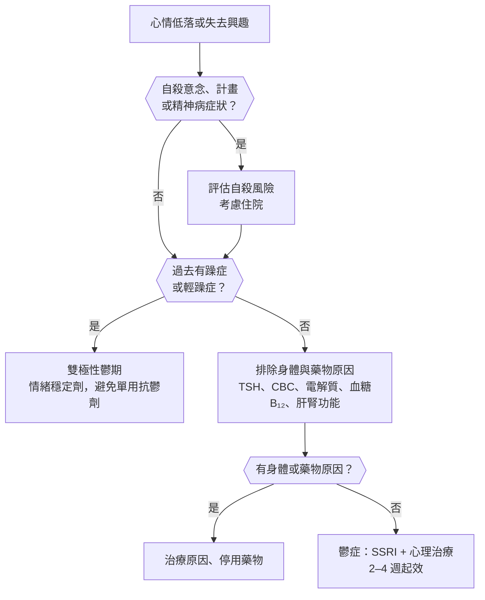
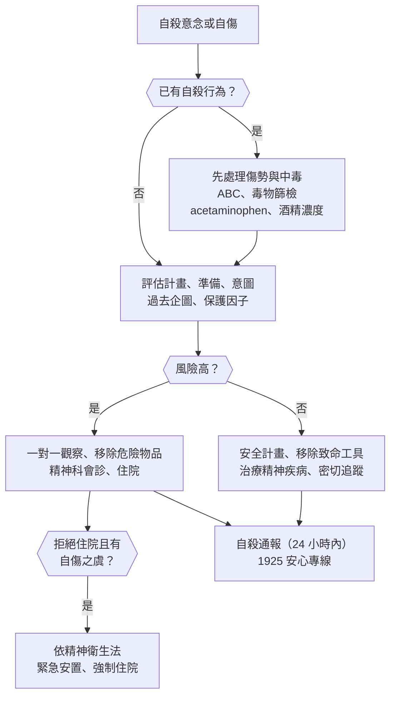
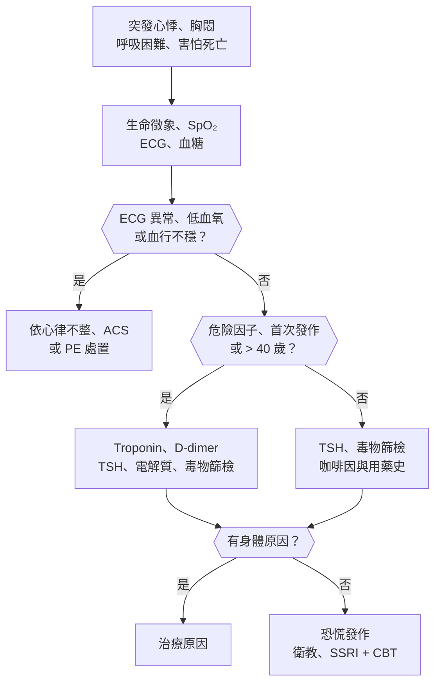
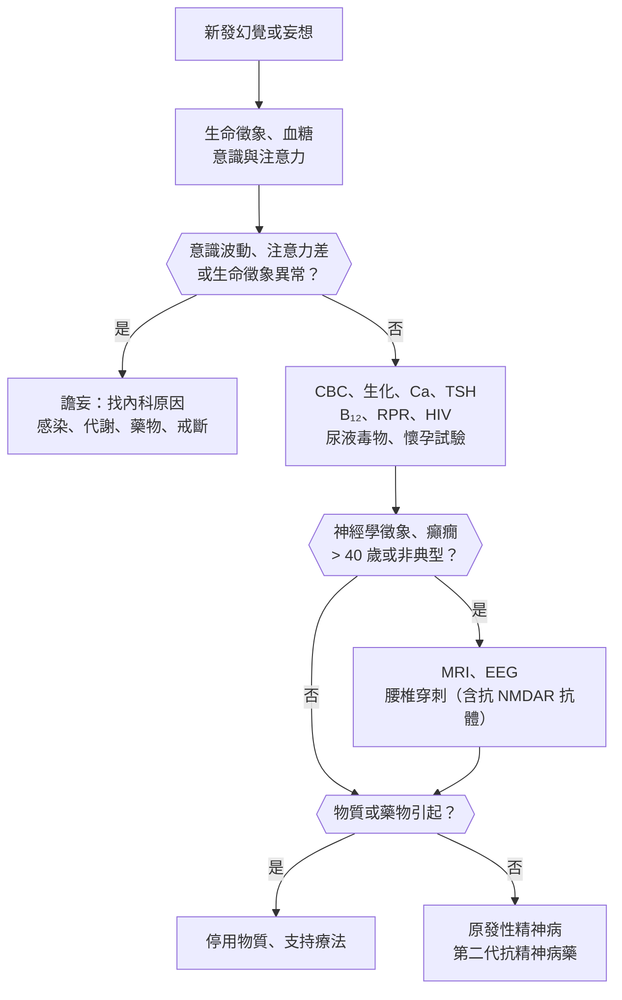
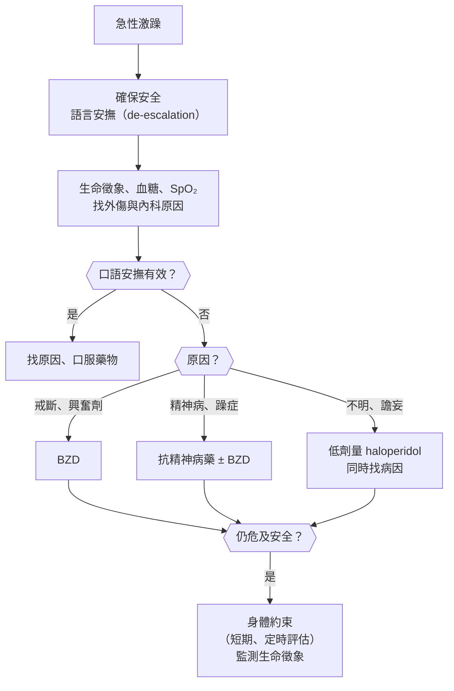

## 情緒與自殺（Mood and Suicide）

### 憂鬱情緒（Depressed Mood）

#### 定義與分類

- **憂鬱情緒（depressed mood）**：心情低落、悲傷、空虛；是症狀，不等於鬱症。
- **鬱症（major depressive disorder, MDD）**：**SIG E CAPS** 加上憂鬱情緒，共 **:red[≥ 5 項、持續 ≥ 2 週]**；**必須包含憂鬱情緒或失去興趣（anhedonia）其中之一**；造成功能減損。
    - **S**leep（失眠或嗜睡）、**I**nterest（失去興趣）、**G**uilt（罪惡感、無價值感）。
    - **E**nergy（疲倦）、**C**oncentration（注意力不集中）、**A**ppetite（食慾或體重改變）。
    - **P**sychomotor（精神運動遲滯或激躁）、**S**uicidal ideation（自殺意念）。
- **持續性憂鬱症（persistent depressive disorder, dysthymia）**：**憂鬱情緒 :red[≥ 2 年]**（兒童青少年 ≥ 1 年），症狀較輕但持續。
- **雙極性鬱期（bipolar depression）**：過去有**躁症或輕躁症**發作；**單用抗鬱劑可能誘發躁症**。
- **其他**：適應障礙（壓力事件後 3 個月內）、哀傷反應、經前不悅症（PMDD）、產後憂鬱、物質或藥物引起、身體疾病引起的憂鬱。
- **華人與老人常以身體症狀表現**：失眠、疲倦、頭暈、全身痠痛、食慾差、「心悸胸悶」，不主動說心情不好 → 要直接問情緒與興趣。

#### Red flags

- **自殺意念、計畫、準備或曾經自殺未遂** → 見[[#自殺意念與自傷（Suicidal Ideation / Self-harm）|自殺意念與自傷]]。
- **精神病症狀**（罪惡妄想、虛無妄想、幻聽）→ 精神病性鬱症（psychotic depression），需抗鬱劑 + 抗精神病藥或 ECT。
- **不吃不喝、木僵（catatonia）** → 脫水、營養不良，考慮 ECT。
- **過去有躁症或輕躁症** → 雙極性，避免單用抗鬱劑。
- **產後 2 週內出現混亂、幻覺、怪異行為** → 產後精神病，有殺嬰與自殺風險，屬急症。
- **老人新發憂鬱合併認知退化、神經學徵象** → 中風、失智、Parkinson、腫瘤。
- **體重減輕 + 上腹或背痛 + 新發憂鬱** → [[消化內科#胰臟癌（Pancreatic Cancer）|胰臟癌]]。

#### 鑑別診斷

| 類別 | 疾病 | 鑑別關鍵 |
|---|---|---|
| **原發性情緒疾患** | **[[精神科#鬱症（Depressive Disorders）\|鬱症]]**、持續性憂鬱症、**[[精神科#雙極性疾患（Bipolar Disorder）\|雙極性鬱期]]**、循環性情緒障礙 | 時間長短、**過去是否有躁症或輕躁症** |
| **壓力與失落** | [[精神科#適應障礙（Adjustment Disorder）\|適應障礙]]、正常哀傷、延長性哀傷障礙、[[精神科#創傷後壓力症候群（PTSD）\|PTSD]] | 與壓力事件的時間關係 |
| **生殖相關** | 經前不悅症（PMDD）、**[[產科#產後憂鬱\|產後憂鬱]]**、更年期 | 與月經週期或生產的時間關係 |
| **內分泌與代謝** | **[[代謝內分泌科#甲狀腺機能低下（Hypothyroidism）\|甲狀腺機能低下]]**、[[代謝內分泌科#庫欣氏症候群（Cushing's Syndrome）\|Cushing 症候群]]、[[代謝內分泌科#腎上腺功能不全（Adrenal Insufficiency）\|腎上腺功能不全]]、[[代謝內分泌科#原發性副甲狀腺機能亢進（Primary Hyperparathyroidism）\|高血鈣]]、糖尿病 | **TSH**、電解質、血鈣 |
| **神經** | [[神經內科#巴金森病（Parkinson's Disease, PD）\|Parkinson 病]]、[[復健科#中風後憂鬱\|中風後憂鬱]]、[[神經內科#失智症概論\|失智]]、[[神經內科#多發性硬化症（Multiple Sclerosis, MS）\|多發性硬化症]]、[[神經內科#亨丁頓舞蹈症（Huntington's Disease）\|Huntington 病]]、腦腫瘤 | 神經學徵象、認知退化 |
| **營養與感染** | [[血液腫瘤科#維生素 B₁₂（Cobalamin）缺乏\|維生素 B₁₂ 缺乏]]、葉酸缺乏、[[感染科#HIV / AIDS\|HIV]]、神經性梅毒 | 貧血、神經病變 |
| **腫瘤與慢性病** | **胰臟癌**、慢性疼痛、心衰竭、**[[胸腔內科#阻塞性睡眠呼吸中止症（OSA）\|OSA]]**、末期腎病 | 體重減輕、打鼾 |
| **藥物與物質** | **類固醇**、interferon、isotretinoin、口服避孕藥、reserpine；**酒精**、BZD；**興奮劑戒斷** | 用藥與症狀的時間關係 |

#### 易混淆鑑別

:::compare[鬱症 vs 正常哀傷 vs 適應障礙]
| | 鬱症 | 正常哀傷（grief） | 適應障礙 |
|---|---|---|---|
| 誘因 | 可有可無 | **親人過世** | **可辨識的壓力事件**（失業、離婚、生病） |
| 情緒 | **持續低落、失去興趣** | **一陣一陣的思念（pangs）**，仍能感受快樂 | 與壓力相關的低落或焦慮 |
| 自我評價 | **無價值感、罪惡感** | **自尊保留** | 多半保留 |
| 自殺意念 | 可有 | 想與逝者團聚，少有計畫 | 可有 |
| 時間 | ≥ 2 週 | 多在 6–12 個月內緩解 | **壓力後 :red[3 個月]內出現，壓力解除後 6 個月內緩解** |
| 處置 | 抗鬱劑、心理治療 | 支持；**符合鬱症診斷時仍要治療** | 心理治療為主 |
:::

:::compare[單極性 vs 雙極性憂鬱]
| | 單極性（鬱症） | 雙極性鬱期 |
|---|---|---|
| 病史 | 無躁症或輕躁症 | **過去有躁症或輕躁症** |
| 發病年齡 | 較晚（20–30 歲） | **較早（< 25 歲）** |
| 特徵 | 失眠、食慾差 | **嗜睡、食慾增加、精神運動遲滯**、精神病症狀、產後發作 |
| 家族史 | 鬱症 | **雙極性疾患** |
| 抗鬱劑反應 | 有效 | **可能誘發躁症或快速循環** |
| 治療 | **SSRI** 首選 | **quetiapine、lurasidone、lamotrigine、lithium**；**:red[避免單用抗鬱劑]** |
:::

:::compare[產後情緒低落 vs 產後憂鬱 vs 產後精神病]
| | 產後情緒低落（baby blues） | 產後憂鬱 | 產後精神病 |
|---|---|---|---|
| 盛行率 | **50–80%** | 10–15% | **0.1–0.2%** |
| 發生時間 | **產後 2–3 天，:red[2 週]內緩解** | 產後 4 週內（可到 1 年） | **產後 2 週內** |
| 症狀 | 情緒起伏、愛哭、焦慮 | 符合鬱症診斷 | **混亂、幻覺、妄想、怪異行為** |
| 照顧嬰兒 | 能照顧 | 能力下降、罪惡感 | **可能傷害嬰兒** |
| 處置 | 支持、衛教 | 心理治療、SSRI（**sertraline 哺乳可用**） | **急症：住院**、抗精神病藥、lithium、ECT；常是**雙極性疾患**的首發 |
:::

:::compare[老人：鬱症 vs 失智]
| | 鬱症（假性失智） | 失智 |
|---|---|---|
| 發病 | **較快、可指出時間點** | 漸進 |
| 情緒 | 先有情緒低落 | 情緒變化在後 |
| 抱怨記憶 | **主動抱怨、誇大缺損** | **否認或不自覺**，家屬帶來 |
| 測驗表現 | **常回答「不知道」**、不努力 | **努力但答錯**、編造答案 |
| 抗鬱劑治療 | **認知改善** | 認知不改善 |
:::

#### 問診與理學檢查

- **直接問兩題（PHQ-2）**：過去 2 週是否**心情低落**？是否**對事情失去興趣**？任一陽性 → **PHQ-9** 完整評估。
    - 台灣基層常用**簡式健康量表（BSRS-5，心情溫度計）**：5 題 + 自殺意念 1 題。
- **一定要問**：自殺意念、**過去是否有躁症或輕躁症**（「有沒有一段時間不太需要睡覺、精力特別旺盛、花很多錢？」）、精神病症狀。
- 物質使用：酒精、安眠藥、毒品。
- 藥物史：類固醇、interferon、isotretinoin、口服避孕藥。
- 女性：與月經週期、懷孕、生產的關係。
- 理學檢查：**甲狀腺**、體重、神經學（Parkinson 徵象、局部缺損）、認知篩檢（老人）。

#### 檢查流程

- 基本檢查：**TSH**、CBC、電解質、血鈣、血糖、肝腎功能；依病史加 **B₁₂**、葉酸、梅毒、HIV、尿液毒物篩檢、懷孕試驗。
- 老人或有神經學徵象 → 認知評估、腦部影像。
- 打鼾、白天嗜睡 → 睡眠檢查。

#### 初步處置

- 輕度：心理治療（認知行為治療 CBT、人際心理治療）、運動、睡眠衛生。
- 中重度：**[[精神科#鬱症治療|抗鬱劑]]（SSRI 首選）+ 心理治療**。
    - **起效需 :red[2–4 週]**，足量足夠時間（4–6 週）評估。
    - **緩解後續用 :red[6–12 個月]**；反覆發作者更久。
    - 年輕人（< 25 歲）**開始治療初期自殺風險可能增加** → 前幾週密切追蹤。
- 合併失眠、食慾差 → **mirtazapine**；擔心性功能或體重 → **bupropion**（**癲癇、厭食或暴食症禁用**）。
- **精神病性鬱症、高自殺風險、拒食、懷孕、藥物無效 → [[精神科#電痙攣治療（Electroconvulsive Therapy, ECT）|ECT]]**。

:::pitfall
病人以「失眠、全身痠痛、胸悶」反覆就醫，做了一堆檢查都正常，卻從來沒人問心情 → 漏掉鬱症。華人憂鬱常以身體症狀表現，身體檢查正常時要主動問情緒、興趣與自殺意念。
:::

:::pitfall
年輕人第一次憂鬱就開 SSRI，沒問過去是否有躁期 → 雙極性疾患被誘發躁症。開抗鬱劑前一定要問躁症、輕躁症病史與家族史。
:::

:::exam
- 鬱症：≥ 5 項 SIG E CAPS、≥ 2 週、須含憂鬱情緒或失去興趣；持續性憂鬱症 ≥ 2 年。
- 產後 2–3 天愛哭、2 週內好 → baby blues，只需支持；產後 2 週內混亂幻覺 → 產後精神病，住院。
- 老人「我記不住、我很笨」、測驗回答不知道 → 憂鬱的假性失智。
- 抗鬱劑起效 2–4 週、緩解後續用 6–12 個月；精神病性鬱症或拒食 → ECT。
:::

### 自殺意念與自傷（Suicidal Ideation / Self-harm）

#### 定義與分類

- **自殺意念（suicidal ideation）**：
    - **被動**：「不想活了」、「睡著不要醒來就好」。
    - **主動**：想要結束自己的生命。
- **自殺計畫、準備行為、[[精神科#自殺（Suicide）|自殺企圖]]（suicide attempt）**：風險逐級升高。
- **非自殺性自傷（non-suicidal self-injury, NSSI）**：割腕、撞頭等，**目的是調節情緒而非求死**；青少年與邊緣型人格常見，但**長期仍會增加自殺風險**。
- **台灣現況**：自殺為**國人十大死因之一**、**青少年主要死因之一**；常見方法為**燒炭、上吊、高處墜落、農藥、藥物過量**。
- **最重要的預測因子：:red[過去自殺企圖]**；其次為精神疾病（**鬱症、雙極性、思覺失調、物質使用、邊緣型人格**）。

#### Red flags

- **有具體計畫、已準備工具（買炭、囤藥、寫遺書）、交代後事** → 高風險。
- **致死性高的方法**（上吊、燒炭、槍、高處）、選擇不易被發現的時間地點。
- **精神病**（命令性幻聽）、**激躁**、嚴重焦慮與失眠、**絕望感（hopelessness）**。
- **酒精或物質中毒**狀態下（衝動性增加）。
- **出院後 1 週到 1 個月**、鬱症治療剛開始精力恢復時。
- **老年男性**、獨居、喪偶、慢性病或慢性疼痛。
- 已服藥過量者：**acetaminophen 早期可無症狀**、**TCA 會突然心律不整**、**農藥（巴拉刈、有機磷）**。

#### 鑑別診斷

| 類別 | 疾病或狀況 | 鑑別關鍵 |
|---|---|---|
| **情緒疾患** | **[[精神科#鬱症（Depressive Disorders）\|鬱症]]**、**[[精神科#雙極性疾患（Bipolar Disorder）\|雙極性疾患]]**（**混合特徵**時風險最高） | 憂鬱症狀、躁鬱病史 |
| **精神病** | [[精神科#思覺失調症（Schizophrenia）\|思覺失調症]]、精神病性鬱症 | **命令性幻聽**；年輕男性、發病早期、病識感恢復後的憂鬱 |
| **物質** | 酒精使用障礙、[[精神科#興奮劑（Stimulants）\|興奮劑]]戒斷、[[精神科#苯二氮平類（Benzodiazepines）\|BZD]] | 中毒時衝動、戒斷時憂鬱 |
| **人格** | **[[精神科#Cluster B（戲劇性/情緒化/不穩定型）\|邊緣型人格]]** | **反覆自傷**、人際關係不穩、怕被拋棄 |
| **焦慮與創傷** | [[精神科#創傷後壓力症候群（PTSD）\|PTSD]]、恐慌症 | 創傷史 |
| **身體疾病** | **癌症、慢性疼痛**、神經退化疾病、HIV、末期疾病 | 病程、疼痛控制 |
| **心理社會** | 失業、負債、喪偶、霸凌、家暴、性侵 | 近期失落事件 |
| **藥物** | 抗鬱劑（< 25 歲初期）、atomoxetine、isotretinoin、levetiracetam | 新開始用藥 |

#### 易混淆鑑別

:::compare[非自殺性自傷 vs 自殺企圖]
| | 非自殺性自傷（NSSI） | 自殺企圖 |
|---|---|---|
| 意圖 | **調節情緒、緩解痛苦、自我懲罰** | **結束生命** |
| 方法 | 割腕、燙傷、撞頭，致死性低 | 致死性較高 |
| 頻率 | **反覆、慣性** | 次數較少 |
| 事後感受 | 緊張緩解 | 失望、或後悔 |
| 族群 | **青少年、邊緣型人格** | 各族群 |
| 處置 | **辯證行為治療（DBT）**、情緒調節 | 安全評估、住院 |
:::

:::compare[自殺風險分層]
| | 低風險 | 中風險 | 高風險 |
|---|---|---|---|
| 意念 | 被動、短暫 | 主動、反覆 | **主動、持續** |
| 計畫 | 無 | 有想法但不具體 | **具體、已準備工具** |
| 意圖 | 無 | 不確定 | **明確想死** |
| 過去企圖 | 無 | 可有 | **有，尤其近期、高致死性** |
| 精神狀態 | 穩定 | 憂鬱、物質使用 | **精神病、激躁、絕望、中毒** |
| 保護因子 | 多（家人、宗教、責任感） | 部分 | 少或無 |
| 處置 | 門診追蹤、安全計畫 | 密切追蹤、考慮住院 | **住院（必要時強制）、一對一觀察** |
:::

#### 問診與理學檢查

- **:red[直接問不會增加自殺風險]**；由淺入深：
    1. 「是否覺得活著沒意思？」→ 「是否想過結束生命？」
    2. **計畫**：怎麼做、何時、何地？
    3. **準備**：是否已經買炭、囤藥？
    4. **意圖**：有多想去做？
    5. **過去企圖**、家族自殺史。
    6. **保護因子**：家人、小孩、宗教、未完成的事。
- 用 **[[精神科#危險因子（SAD PERSONS）|SAD PERSONS]]** 或 Columbia 自殺嚴重度量表（C-SSRS）整理。
- 已有自殺行為：**評估傷勢、服藥種類與量、時間**；詢問是否併用酒精。
- 理學檢查：自傷痕跡（前臂舊疤）、**生命徵象與意識**、瞳孔、氣味、毒物症候群。

#### 檢查流程

- 藥物過量：**血中 acetaminophen 濃度（服藥 4 小時後）**、酒精濃度、尿液毒物篩檢、電解質、肝腎功能、**ECG（TCA → QRS 寬、QT 長）**、動脈血氣。
- 燒炭 → **COHb**；農藥 → 膽鹼酯酶活性（有機磷）、尿液巴拉刈定性。

#### 初步處置

- **高風險**：
    - **一對一觀察**、移除皮帶、鞋帶、尖銳物品與藥物。
    - 住院；**嚴重病人有自傷之虞且拒絕住院** → 依[[精神科#精神科相關法律|精神衛生法]]緊急安置（最長 **:red[7 日]**）、由法院裁定強制住院。
- **中低風險**：
    - 與病人共同擬定**安全計畫（safety plan）**：警訊、因應方式、可聯絡的人、求助專線。
    - **限制致命工具**：家中藥物由家人保管、不囤炭、上鎖農藥。
    - 治療潛在精神疾病；**[[精神科#Lithium|lithium]] 可降低情緒疾患的自殺率**、**clozapine 可降低思覺失調症的自殺率**。
- **台灣通報**：依《自殺防治法》，醫事人員知悉自殺行為 → **:red[24 小時]內通報**自殺防治通報系統，由關懷訪視員追蹤。
- 求助資源：**1925 安心專線（依舊愛我，24 小時）**、生命線 1995、張老師 1980。
- 開藥給高風險病人：**少量多次**、避免 TCA 等過量致命的藥物。

:::pitfall
病人說「現在沒有想死了」就讓他離開急診 → 自殺意念會波動，剛自殺未遂的人常否認。要看行為的致死性與準備程度、詢問家人，並安排出院後密切追蹤；出院後 1 個月內是高風險期。
:::

:::pitfall
服 acetaminophen 過量的病人到院時意識清楚、沒有症狀，以為沒事 → 肝毒性在 24–72 小時後才出現。服藥 4 小時後測血中濃度，依圖表決定是否給 N-acetylcysteine；時間不明者直接給。
:::

:::exam
- 自殺最重要的預測因子：過去自殺企圖；完成自殺男性多，企圖女性多。
- 直接詢問自殺意念不會增加風險。
- 抗鬱劑治療初期精力先恢復、情緒還沒好 → 自殺風險可能上升。
- Lithium 降低情緒疾患自殺率；clozapine 降低思覺失調症自殺率。
:::

### 情緒高昂與躁動（Elevated Mood / Mania）

#### 定義與分類

- **躁症發作（manic episode）**：情緒高昂、易怒或膨脹，**活動量或精力增加**，持續 **:red[≥ 1 週]**（或需住院則不論時間）+ **DIG FAST** ≥ 3 項（只有易怒 → ≥ 4 項）：
    - **D**istractibility（注意力分散）、**I**mpulsivity/Indiscretion（衝動、魯莽：花大錢、性、投資）、**G**randiosity（誇大）。
    - **F**light of ideas（意念飛躍）、**A**ctivity increase（目標導向活動增加）、**S**leep deficit（**睡眠需求減少**，不覺得累）、**T**alkativeness（多話、言語急迫 pressured speech）。
- **輕躁症（hypomania）**：同樣症狀但 **≥ 4 天**、**不需住院、無精神病症狀、無明顯功能減損**。
- **雙極 I 型**：至少 1 次躁症；**雙極 II 型**：輕躁症 + 鬱症，**從未躁症**；**循環性情緒障礙**：≥ 2 年反覆輕微高低起伏。
- **混合特徵（mixed features）**：躁與鬱症狀同時存在 → **自殺風險最高**。

#### Red flags

- **精神病症狀**（誇大妄想、被害妄想）、**攻擊或危險行為**、不吃不睡數天 → 需住院。
- **發燒、意識混亂、神經學徵象**、**首次發作 > 40–50 歲** → 想**次發性躁症**（腦部病變、藥物、甲狀腺）。
- **剛開始抗鬱劑、類固醇、興奮劑**後出現。
- **懷孕或產後**。
- 已服 lithium 者出現**顫抖加劇、嘔吐腹瀉、步態不穩** → 鋰中毒。

#### 鑑別診斷

| 類別 | 疾病 | 鑑別關鍵 |
|---|---|---|
| **原發性** | **[[精神科#雙極性疾患（Bipolar Disorder）\|雙極 I 型、II 型]]**、循環性情緒障礙、[[精神科#思覺失調症光譜\|情感思覺失調症]] | 發作性、家族史 |
| **藥物引起** | **抗鬱劑（尤其 TCA、SNRI）**、**類固醇**、levodopa、isoniazid、甲狀腺素過量 | 用藥後出現 |
| **物質** | **[[精神科#興奮劑（Stimulants）\|安非他命、古柯鹼]]**、咖啡因、酒精 | 尿液毒物篩檢、瞳孔散大 |
| **內分泌** | **[[代謝內分泌科#甲狀腺機能亢進（Hyperthyroidism）\|甲狀腺機能亢進]]**、[[代謝內分泌科#庫欣氏症候群（Cushing's Syndrome）\|Cushing 症候群]] | 心跳快、體重減輕、TSH |
| **神經** | **額葉病變**（腫瘤、中風、外傷）、[[神經內科#額顳葉失智（Frontotemporal Dementia, FTD）\|額顳葉失智]]、[[神經內科#多發性硬化症（Multiple Sclerosis, MS）\|多發性硬化症]]、顳葉癲癇 | **晚發**、神經學徵象 |
| **感染** | [[神經內科#Neurosyphilis\|神經性梅毒]]（誇大型）、[[感染科#HIV / AIDS\|HIV]]、腦炎 | 梅毒血清、腰椎穿刺 |
| **其他精神疾患** | [[精神科#注意力不足過動症（ADHD）\|ADHD]]、**[[精神科#Cluster B（戲劇性/情緒化/不穩定型）\|邊緣型人格]]** | 慢性 vs 發作性 |

#### 易混淆鑑別

:::compare[躁症 vs 輕躁症]
| | 躁症（mania） | 輕躁症（hypomania） |
|---|---|---|
| 時間 | **≥ 1 週**（住院則不論） | **≥ 4 天** |
| 功能 | **明顯減損** | 無明顯減損，甚至效率提高 |
| 精神病症狀 | 可有 | **無**（有就算躁症） |
| 住院 | 可能需要 | 不需要 |
| 對應診斷 | **雙極 I 型** | **雙極 II 型**（需合併鬱症） |
:::

:::compare[雙極性疾患 vs 邊緣型人格 vs ADHD]
| | 雙極性疾患 | 邊緣型人格 | ADHD |
|---|---|---|---|
| 病程 | **發作性**（數天到數週），發作間正常 | **慢性、持續** | **慢性，從兒童期開始** |
| 情緒變化 | 持續數天 | **數小時內變化**，常由**人際事件**觸發 | 易怒、挫折容忍度低 |
| 睡眠 | **睡眠需求減少、不覺得累** | 不一定 | 長期睡眠問題 |
| 特徵 | 誇大、意念飛躍 | **怕被拋棄、反覆自傷、空虛感** | **注意力不集中、衝動**，無誇大 |
| 治療 | 情緒穩定劑 | **DBT** | 興奮劑 |
:::

:::compare[急性躁症用藥]
| 藥物 | 優點 | 注意 |
|---|---|---|
| **Lithium** | 典型躁症、**降低自殺率** | 治療濃度窄（0.6–1.2）、**腎、甲狀腺**、**懷孕第一孕期（[[心血管外科#Ebstein Anomaly\|Ebstein anomaly]]）** |
| **Valproate** | **混合特徵、快速循環** | **肝毒性、胰臟炎、致畸胎（神經管缺損）**、高血氨 |
| **第二代抗精神病藥** | **起效快、合併精神病症狀** | 代謝副作用、錐體外症狀 |
| **BZD（輔助）** | 激躁、失眠 | 短期 |
:::

#### 問診與理學檢查

- 睡眠時間與精力、**花錢、投資、性行為、開車速度**等風險行為；**向家人求證**（病人常缺乏病識感）。
- 過去鬱症或躁症、**家族史**、**近期用藥（抗鬱劑、類固醇）**、毒品。
- 精神狀態：**言語急迫、意念飛躍、誇大**、易分心。
- 理學檢查：**甲狀腺**、心跳、瞳孔、**神經學檢查**、發燒。

#### 檢查流程

- 基本：**TSH**、CBC、電解質、肝腎功能、血糖、**尿液毒物篩檢**、**懷孕試驗**。
- **開 lithium 前**：**腎功能（Cr）、TSH、ECG（> 40 歲或心臟病）、懷孕試驗**。
- **開 valproate 前**：肝功能、CBC（血小板）、懷孕試驗。
- 晚發、非典型、神經學徵象 → **腦部 MRI**、梅毒、HIV、EEG。

#### 初步處置

- **停用抗鬱劑**、類固醇等誘發藥物（可行時）。
- 急性躁症：**lithium 或 valproate ± 第二代抗精神病藥**；嚴重激躁 → 肌肉注射抗精神病藥 ± BZD。
- 有危險行為、拒絕治療 → 住院；**ECT** 用於難治或懷孕。
- **維持治療**：lithium、valproate、lamotrigine（**預防鬱期**）、quetiapine；**定期監測藥物濃度**。

:::pitfall
年輕人「最近很有活力、不太睡、一直買東西」被當成心情好或 ADHD → 漏掉躁症；或把鬱期病人的雙極 II 型當單極性治療。要問睡眠需求與家人觀察。
:::

:::pitfall
50 歲以上第一次出現躁症就診斷雙極性疾患 → 漏掉額葉腫瘤、中風、神經性梅毒、甲狀腺機能亢進、類固醇。晚發躁症要找器質性原因。
:::

:::exam
- 躁症 ≥ 1 週（或住院）、輕躁症 ≥ 4 天且無精神病症狀；雙極 II 型從未躁症。
- Lithium 毒性誘因：脫水、NSAIDs、ACEi/ARB、thiazide；懷孕第一孕期 → Ebstein anomaly。
- Valproate → 神經管缺損、肝毒性、胰臟炎；lamotrigine → [[皮膚科#Stevens-Johnson Syndrome（SJS）/ Toxic Epidermal Necrolysis（TEN）|SJS]]，要慢慢加量。
:::

## 焦慮與身體症狀（Anxiety and Somatic Symptoms）

### 焦慮（Anxiety）

#### 定義與分類

- **焦慮（anxiety）**：對未來威脅的擔憂與緊張，伴隨**自律神經症狀**（心悸、出汗、顫抖、腸胃不適）與肌肉緊繃；程度或持續時間超過情境時才算病態。
- **廣泛性焦慮症（GAD）**：對多件事情**過度擔心、難以控制**，**≥ :red[6 個月]**；合併坐立不安、易疲倦、注意力差、易怒、肌肉緊繃、睡眠障礙中 ≥ 3 項。
- **恐慌症（panic disorder）**：反覆**非預期**的恐慌發作 + 擔心再發作或改變行為 ≥ 1 個月；見[[#恐慌發作（Panic Attack）|恐慌發作]]。
- **社交焦慮症（social anxiety disorder）**：害怕在他人面前被評價、出糗。
- **特定恐懼症（specific phobia）**：對特定物體或情境（高處、動物、打針、血）的恐懼；**血液注射型 → 血管迷走性暈厥**。
- **強迫症（OCD）**：**強迫思考（obsession）** + 為減輕焦慮的**強迫行為（compulsion）**；**病人知道不合理（ego-dystonic）**。
- **創傷相關**：急性壓力症（3 天–1 個月）、**PTSD（> 1 個月）**、適應障礙。
- **次發性焦慮**：身體疾病、藥物、物質中毒或戒斷。

#### Red flags

- **首次焦慮發作 > 40 歲**、無精神病史 → 先找身體原因（心臟、內分泌、肺）。
- **胸痛、呼吸困難、暈厥**、心律不整、低血氧 → ACS、PE、心律不整。
- **發作性頭痛 + 心悸 + 出汗 + 高血壓** → 嗜鉻細胞瘤。
- **體重減輕、怕熱、手抖** → 甲狀腺機能亢進。
- **合併自殺意念、嚴重憂鬱、物質濫用**。
- **酒精或 BZD 突然停用** → 戒斷，可致命。
- 剛開始或加量抗精神病藥後「坐立不安、不斷走動」→ **靜坐不能（akathisia）**，不是焦慮，**自殺風險上升**。

#### 鑑別診斷

| 類別 | 疾病 | 鑑別關鍵 |
|---|---|---|
| **焦慮症** | **[[精神科#廣泛性焦慮症（Generalized Anxiety Disorder, GAD）\|GAD]]**、[[精神科#恐慌症（Panic Disorder）\|恐慌症]]、[[精神科#社交焦慮症（Social Anxiety Disorder）\|社交焦慮症]]、[[精神科#特定恐懼症（Specific Phobia）\|特定恐懼症]]、[[精神科#分離焦慮症（Separation Anxiety Disorder）\|分離焦慮症]] | 擔心的對象、是否預期 |
| **強迫與創傷** | **[[精神科#強迫症（Obsessive-Compulsive Disorder, OCD）\|強迫症]]**、[[精神科#身體臆形症（Body Dysmorphic Disorder, BDD）\|身體臆形症]]、**[[精神科#創傷後壓力症候群（PTSD）\|PTSD]]**、[[精神科#急性壓力症（Acute Stress Disorder, ASD）\|急性壓力症]]、[[精神科#適應障礙（Adjustment Disorder）\|適應障礙]] | 強迫行為、創傷事件 |
| **其他精神疾患** | **鬱症**（焦慮常共病）、雙極性疾患、[[精神科#疾病焦慮症（Illness Anxiety Disorder）\|疾病焦慮症]]、思覺失調症前驅期 | 情緒、精神病症狀 |
| **心肺** | [[心臟內科#上心室心搏過速（SVT）\|心律不整]]、[[心臟內科#急性冠心症（ACS）\|ACS]]、**[[胸腔內科#肺栓塞（Pulmonary Embolism）\|肺栓塞]]**、氣喘、[[胸腔內科#慢性阻塞性肺病（COPD）\|COPD]]、二尖瓣脫垂 | ECG、SpO₂ |
| **內分泌** | **[[代謝內分泌科#甲狀腺機能亢進（Hyperthyroidism）\|甲狀腺機能亢進]]**、**[[代謝內分泌科#嗜鉻細胞瘤（Pheochromocytoma）\|嗜鉻細胞瘤]]**、**[[代謝內分泌科#Hypoglycemia\|低血糖]]**、[[代謝內分泌科#原發性副甲狀腺機能亢進（Primary Hyperparathyroidism）\|高血鈣]]、[[代謝內分泌科#庫欣氏症候群（Cushing's Syndrome）\|Cushing]]、更年期 | TSH、血糖、發作時血壓 |
| **神經** | 顳葉癲癇、前庭疾病、早期失智、Parkinson 病 | 神經學徵象 |
| **藥物與物質** | **咖啡因**、**興奮劑**、β₂ 致效劑、類固醇、甲狀腺素、偽麻黃鹼；**酒精與 BZD 戒斷**；**抗精神病藥 → akathisia** | 用藥史、尿液毒物 |

#### 易混淆鑑別

:::compare[焦慮症比較]
| | GAD | 恐慌症 | 社交焦慮症 | 特定恐懼症 |
|---|---|---|---|---|
| 焦慮對象 | **多件日常事情** | **再次發作**、身體症狀 | **被他人評價** | **特定物體或情境** |
| 型態 | **持續、慢性**（≥ 6 個月） | **突發、10 分鐘內達高峰** | 社交場合出現 | 接觸時立即出現 |
| 迴避 | 少 | **懼曠症（agoraphobia）**：怕在難以逃脫的地方 | 迴避社交、演講 | 迴避恐懼對象 |
| 首選治療 | **SSRI/SNRI + CBT**；buspirone | **SSRI + CBT** | **SSRI + CBT**；表演型 → **propranolol** | **暴露治療（exposure therapy）** |
:::

:::compare[急性壓力症 vs PTSD vs 適應障礙]
| | 急性壓力症 | PTSD | 適應障礙 |
|---|---|---|---|
| 壓力事件 | **創傷（死亡威脅、重傷、性暴力）** | **創傷** | **一般壓力**（失業、分手） |
| 時間 | **事件後 :red[3 天–1 個月]** | **> :red[1 個月]** | **事件後 3 個月內**出現 |
| 症狀 | 侵入、解離、迴避、警覺性高 | **侵入（重歷、惡夢）、迴避、負向認知與情緒、過度警覺** | 情緒或行為困擾 |
| 治療 | 心理急救、創傷焦點 CBT | **創傷焦點 CBT、EMDR、SSRI**；prazosin → 惡夢 | 心理治療 |
:::

:::compare[強迫症 vs 強迫型人格]
| | 強迫症（OCD） | 強迫型人格（OCPD） |
|---|---|---|
| 病識感 | **知道不合理、想擺脫（ego-dystonic）** | **認為自己是對的（ego-syntonic）** |
| 症狀 | **侵入性思考 + 重複行為**（洗手、檢查） | **完美主義、僵化、控制、重視規則** |
| 痛苦來源 | 病人自己痛苦 | **周圍的人痛苦** |
| 治療 | **高劑量 SSRI、clomipramine**、暴露與反應預防（ERP） | 心理治療 |
:::

:::compare[焦慮 vs 靜坐不能（akathisia）]
| | 焦慮 | 靜坐不能 |
|---|---|---|
| 誘因 | 壓力 | **抗精神病藥、metoclopramide、SSRI 開始或加量** |
| 主觀感受 | 擔憂、緊張 | **身體坐不住、雙腳一直想動** |
| 表現 | 心悸、出汗 | **不斷換姿勢、原地踏步、來回走** |
| 處理 | 抗焦慮治療 | **降劑量、propranolol**、BZD；**不要加抗精神病藥** |
:::

#### 問診與理學檢查

- 焦慮的**對象、持續時間、發作型態**（持續 vs 突發）、迴避行為、對功能的影響。
- **咖啡因、能量飲料、減肥藥、偽麻黃鹼、類固醇、甲狀腺素**、毒品；**酒精與安眠藥的使用與停用**。
- 共病：**憂鬱、自殺意念**、物質使用。
- 創傷事件、近期壓力。
- 理學檢查：心跳、血壓、**甲狀腺**、顫抖、眼徵（Graves）、肺部聽診、體重。

#### 檢查流程

- 基本：**TSH**、血糖、CBC、電解質（含 Ca）、**ECG**。
- 依臨床：尿液毒物篩檢、**血漿或尿液 metanephrine**（發作性高血壓）、心臟超音波、肺功能。
- 篩檢量表：**GAD-7**；台灣常用 **BSRS-5**。

#### 初步處置

- **第一線：[[精神科#廣泛性焦慮症（Generalized Anxiety Disorder, GAD）|SSRI 或 SNRI]] + CBT**。
    - SSRI 開始時可能**短暫加重焦慮（jitteriness）** → **低劑量開始**、慢慢加量。
    - Buspirone：GAD 可用，**無依賴性**，起效 2–4 週，對恐慌無效。
- **BZD**：**只用於短期（< 2–4 週）**或等 SSRI 起效時過渡；**避免長期、老人、物質使用者**（依賴、跌倒、認知）。
- 減少咖啡因與酒精、規律運動、睡眠衛生。

:::pitfall
焦慮病人長期只開 BZD（如 alprazolam）→ 產生依賴，停藥時反彈焦慮甚至癲癇。BZD 只作短期過渡，長期治療用 SSRI/SNRI 與 CBT；要停用時必須慢慢減量。
:::

:::pitfall
剛開始抗精神病藥的病人說「很焦慮、坐不住」，再加一顆抗精神病藥 → 靜坐不能惡化，甚至自殺。先想到 akathisia，降劑量或加 propranolol。
:::

:::exam
- GAD ≥ 6 個月、多件事情擔心；恐慌發作 10 分鐘內達高峰；表演型社交焦慮 → propranolol。
- 急性壓力症 3 天–1 個月，PTSD > 1 個月；PTSD 惡夢 → prazosin。
- OCD 知道不合理（ego-dystonic），OCPD 不覺得有問題（ego-syntonic）；OCD 用高劑量 SSRI 或 clomipramine。
- Buspirone 無依賴性、起效慢、不治療恐慌。
:::

### 恐慌發作（Panic Attack）

#### 定義與分類

- **恐慌發作（panic attack）**：**突然出現的強烈恐懼或不適，:red[數分鐘內（約 10 分鐘）達到高峰]**，同時出現 ≥ 4 項症狀：
    - 心悸、出汗、顫抖、**呼吸困難或窒息感**、**胸痛或胸悶**、噁心、頭暈。
    - 發冷或熱潮紅、**手腳或口周麻木刺痛**、失自我感或失現實感、**害怕失控或發瘋**、**害怕死亡**。
- 通常 **20–30 分鐘內緩解**；很少超過 1 小時。
- **恐慌症**：反覆**非預期**發作 + **≥ 1 個月**擔心再發作或行為改變；常合併**懼曠症（agoraphobia）**。
- **恐慌發作本身不是診斷**：也可出現在其他焦慮症、PTSD、鬱症、物質使用、身體疾病。
- **過度換氣（hyperventilation）**：呼吸性鹼中毒 → **游離鈣下降** → **口周與手指麻木、手足抽搐（carpopedal spasm）**。

#### Red flags

- **第一次發作**、**年齡 > 40 歲**、心血管危險因子 → **先排除 ACS、心律不整、PE**。
- **持續胸痛 > 30 分鐘**、勞動誘發、放射至下顎或左手。
- **暈厥或意識喪失**（恐慌很少真正暈倒）、**低血氧**。
- **發作時血壓明顯升高 + 頭痛 + 出汗** → 嗜鉻細胞瘤。
- **發作伴隨刻板動作、意識改變、事後混亂、或嗅覺幻覺** → 顳葉癲癇。
- **低血糖症狀**（糖尿病用藥者）。
- 年輕人發作時心跳 > 150 且**突然開始突然停止** → SVT。

#### 鑑別診斷

| 類別 | 疾病 | 鑑別關鍵 |
|---|---|---|
| **心臟** | **[[心臟內科#急性冠心症（ACS）\|ACS]]**、**[[心臟內科#上心室心搏過速（SVT）\|SVT]]**、心房顫動、WPW、長 QT 症候群、二尖瓣脫垂 | **ECG**、troponin；**突發突止**的規律心跳 → SVT |
| **肺** | **[[胸腔內科#肺栓塞（Pulmonary Embolism）\|肺栓塞]]**、**[[胸腔內科#氣喘（Asthma）\|氣喘]]**、氣胸、COPD 急性惡化 | **SpO₂**、哮鳴音、D-dimer |
| **內分泌** | **[[代謝內分泌科#嗜鉻細胞瘤（Pheochromocytoma）\|嗜鉻細胞瘤]]**、**[[代謝內分泌科#甲狀腺機能亢進（Hyperthyroidism）\|甲狀腺機能亢進]]**、**[[代謝內分泌科#Hypoglycemia\|低血糖]]**、類癌症候群 | **發作時高血壓**、血糖、TSH |
| **神經** | **顳葉癲癇**、前庭疾病、[[神經內科#暫時性腦缺血發作（TIA）\|TIA]] | **意識改變、刻板動作、發作後混亂** |
| **物質** | **興奮劑、咖啡因**、大麻；**酒精、BZD 戒斷** | 尿液毒物篩檢、用藥史 |
| **過敏** | **[[麻醉科#麻醉中過敏反應（Anaphylaxis）\|全身性過敏反應]]（anaphylaxis）** | **蕁麻疹、低血壓**、喉頭水腫 |
| **精神疾患** | **[[精神科#恐慌症（Panic Disorder）\|恐慌症]]**、PTSD、社交焦慮、特定恐懼症、鬱症 | 是否可預期、誘發情境 |

#### 易混淆鑑別

:::compare[恐慌發作 vs ACS vs SVT vs 嗜鉻細胞瘤]
| | 恐慌發作 | ACS | SVT | 嗜鉻細胞瘤 |
|---|---|---|---|---|
| 族群 | **年輕女性**多 | 中老年、危險因子 | 年輕人、各年齡 | 各年齡 |
| 誘發 | 壓力、或無誘因 | **勞動**、或休息時 | 突然 | 姿勢、腹壓、**特定藥物（metoclopramide、β-blocker 單用）** |
| 發作 | 10 分鐘內高峰、**20–30 分鐘緩解** | **持續 > 20 分鐘** | **突發突止** | 發作性，數分鐘到 1 小時 |
| 特徵 | **害怕死亡或失控**、手口麻木 | **壓迫性胸痛**、放射痛、冒冷汗 | **規律心跳 150–250** | **頭痛 + 心悸 + 出汗**、**發作時高血壓** |
| 檢查 | 排除後診斷 | **ECG、troponin** | **ECG（窄 QRS 規律心搏過速）** | **血漿 free metanephrine** |
| 急性處置 | 安撫、短效 BZD | MONA、PCI | **迷走神經刺激 → adenosine** | **先 α-blocker，再 β-blocker** |
:::

:::compare[過度換氣 vs 低血鈣]
| | 過度換氣症候群 | 真正低血鈣 |
|---|---|---|
| 機轉 | **呼吸性鹼中毒 → 白蛋白結合鈣增加 → 游離鈣下降** | [[代謝內分泌科#副甲狀腺機能低下（Hypoparathyroidism）\|副甲狀腺低下]]、維生素 D 缺乏、腎衰竭 |
| 總鈣 | **正常** | **低** |
| 動脈血氣 | **PaCO₂ ↓、pH ↑** | 依病因 |
| 症狀 | 口周與手指麻木、手足抽搐，**隨呼吸平緩而消失** | **Chvostek、Trousseau sign**、QT 延長、癲癇 |
| 處置 | **安撫、放慢呼吸**；**不建議紙袋重複呼吸**（可能低血氧） | 補鈣 |
:::

#### 問診與理學檢查

- 發作經過：**起始速度、持續多久、是否預期、誘發情境**；最近一次與第一次發作的差異。
- 伴隨：胸痛型態、暈厥、意識改變、**發作時血壓與心跳**（自備血壓計紀錄）。
- **咖啡因、能量飲料、毒品、酒精、BZD 使用與停用**。
- 家族史：猝死、心律不整、甲狀腺疾病、嗜鉻細胞瘤（MEN 2）。
- 理學檢查：**生命徵象、SpO₂**、心肺聽診、甲狀腺、皮膚（蕁麻疹）、神經學。

#### 檢查流程

- **每位首次發作者都要 ECG 與血糖**；有危險因子者 troponin。
- 發作性高血壓 → **血漿 free metanephrine**。
- 反覆心悸但就醫時正常 → **Holter、事件記錄器**。

#### 初步處置

- 急性發作：**冷靜安撫、解釋症狀不會致命**、引導放慢呼吸；必要時**短效 BZD（lorazepam）**。
- **恐慌症長期治療：SSRI（低劑量開始）+ CBT**；SNRI、TCA（imipramine、clomipramine）為替代。
- BZD 只用於 SSRI 起效前的過渡。
- **避免咖啡因、酒精、毒品**。

:::pitfall
年輕女性在急診說「快死了」、手腳發麻，直接診斷恐慌發作沒做 ECG → 漏掉 SVT、WPW、長 QT 或年輕女性的冠狀動脈剝離（SCAD）。恐慌發作是排除診斷，至少先做 ECG 與血糖。
:::

:::pitfall
過度換氣的病人用紙袋重複呼吸 → 低血氧，若其實是 PE 或氣喘更危險。現在不建議紙袋呼吸，改用安撫與呼吸引導，並先確認 SpO₂ 正常。
:::

:::exam
- 恐慌發作：10 分鐘內達高峰、≥ 4 項症狀；恐慌症要反覆非預期發作 + ≥ 1 個月擔心。
- 過度換氣 → 呼吸性鹼中毒 → 游離鈣下降 → 口周麻木、手足抽搐，總鈣正常。
- 恐慌症長期：SSRI + CBT；嗜鉻細胞瘤要先 α-blocker 再 β-blocker。
:::

### 無法解釋的身體症狀（Medically Unexplained Symptoms）

#### 定義與分類

- **身體症狀障礙（somatic symptom disorder）**：≥ 1 個**令人困擾的身體症狀** + **過度的想法、情緒或行為**（反覆擔心、花大量時間就醫），**≥ 6 個月**；**症狀可以有醫學解釋**，重點是反應過度。
- **疾病焦慮症（illness anxiety disorder）**：**擔心得了重病**，但**身體症狀很少或沒有**；分為**反覆求醫型**與**迴避就醫型**。
- **轉化症（conversion disorder, functional neurological symptom disorder）**：**神經學症狀**（無力、癱瘓、失明、失聲、非癲癇發作），**與神經解剖不符**，**理學檢查有陽性的功能性徵象**。
- **人為障礙（factitious disorder）**：**故意製造或假裝症狀**，目的是**扮演病人角色（內在動機）**；**Munchausen syndrome**；對他人 → **代理型（by proxy）**，屬兒虐。
- **詐病（malingering）**：**故意假裝**，目的是**外在利益**（保險金、逃避兵役或刑責、取得藥物）；**不是精神疾病診斷**。
- **心理因素影響身體疾病**：例如焦慮使氣喘惡化。

#### Red flags

- **年齡 > 40–50 歲才出現**多重身體症狀、**無精神病史** → 先找身體疾病。
- **客觀異常**：體重減輕、發燒、貧血、發炎指標升高、神經學徵象。
- **症狀侵犯多系統且能以一個疾病解釋**：SLE、多發性硬化症、重症肌無力、紫質症、副甲狀腺機能亢進、HIV、[[消化內科#Hemochromatosis（血色素沉著症）|血色素沉著症]]、早期 Parkinson。
- **合併憂鬱、自殺意念**。
- **代理型人為障礙**：照顧者描述的症狀只在其在場時出現、醫療處置後反覆出現不明感染或低血糖。

#### 鑑別診斷

| 類別 | 疾病 | 鑑別關鍵 |
|---|---|---|
| **身體症狀相關** | **[[精神科#身體症狀障礙（Somatic Symptom Disorder）\|身體症狀障礙]]**、**[[精神科#疾病焦慮症（Illness Anxiety Disorder）\|疾病焦慮症]]**、**[[精神科#轉化症（Conversion Disorder）\|轉化症]]**、**[[精神科#人為障礙（Factitious Disorder）\|人為障礙]]**、詐病 | **症狀是否故意、動機是內在還是外在** |
| **其他精神疾患** | **鬱症**、GAD、恐慌症、[[精神科#身體臆形症（Body Dysmorphic Disorder, BDD）\|身體臆形症]]、**妄想症（身體型）**、思覺失調症 | 憂鬱焦慮症狀、**病識感（妄想程度）** |
| **功能性身體症候群** | [[免疫風濕科#Fibromyalgia（纖維肌痛症）\|纖維肌痛症]]、慢性疲勞症候群、[[消化內科#大腸激躁症（Irritable Bowel Syndrome, IBS）\|大腸激躁症]]、慢性骨盆疼痛 | 特定器官系統、排除後診斷 |
| **易被誤認的身體疾病** | **[[免疫風濕科#全身性紅斑狼瘡（SLE）\|SLE]]**、**[[神經內科#多發性硬化症（Multiple Sclerosis, MS）\|多發性硬化症]]**、**[[神經內科#重症肌無力（Myasthenia Gravis, MG）\|重症肌無力]]**、急性間歇性紫質症、[[代謝內分泌科#原發性副甲狀腺機能亢進（Primary Hyperparathyroidism）\|副甲狀腺機能亢進]]、[[代謝內分泌科#腎上腺功能不全（Adrenal Insufficiency）\|腎上腺功能不全]]、HIV | **客觀檢查異常**、多系統、時好時壞 |

#### 易混淆鑑別

:::compare[身體症狀障礙 vs 疾病焦慮症 vs 轉化症 vs 人為障礙 vs 詐病]
| | 身體症狀障礙 | 疾病焦慮症 | 轉化症 | 人為障礙 | 詐病 |
|---|---|---|---|---|---|
| 身體症狀 | **明顯、多處** | **輕微或沒有** | **神經學症狀** | 假造或自己製造 | 假造或誇大 |
| 故意 | 否 | 否 | **否** | **是** | **是** |
| 動機 | — | **擔心得重病** | 常與心理壓力相關 | **內在：扮演病人角色** | **外在利益**（錢、法律、藥物） |
| 就醫態度 | 頻繁就醫、要求檢查 | 反覆檢查或完全迴避 | 可能**不太在意（la belle indifférence，不可靠）** | **主動要求侵入性檢查與手術**、熟悉醫學術語 | **不配合檢查**、利益達成就好轉 |
| 處置 | **固定一位醫師、定期回診**、CBT | CBT、SSRI | **解釋診斷**、物理治療、CBT | 溫和面質、精神科 | 記錄客觀所見 |
:::

:::compare[轉化症的功能性徵象]
| 症狀 | 功能性徵象 | 意義 |
|---|---|---|
| 單側下肢無力 | **Hoover sign**：抬健側腿時，患側腳跟不自主下壓 | 患側其實有力量 |
| 無力 | **放棄式無力（give-way weakness）**、手臂落下測試時不打到臉 | 非器質性 |
| 感覺喪失 | **剛好在中線分界**、不符合皮節，音叉在額頭中線兩側感覺不同 | 骨傳導不會只到一側 |
| 非癲癇性發作 | **閉眼、骨盆前挺、左右搖頭、發作時間長、可被打斷**、無發作後混亂、**prolactin 不升高** | 見[[神經系統主訴#抽搐與癲癇發作（Seizure）\|抽搐與癲癇發作]] |
| 視力喪失 | **視動性眼振（OKN）存在**、瞳孔反射正常 | 視覺路徑完整 |
:::

#### 問診與理學檢查

- **完整症狀史**：症狀數量、出現時間、就醫次數與已做過的檢查（調閱健保雲端藥歷與檢查紀錄）。
- 症狀對生活的影響、**病人擔心的是什麼**（「你最擔心這是什麼病？」）。
- 情緒、焦慮、**自殺意念**；壓力事件、創傷史、**童年受虐史**。
- 外在利益：訴訟、保險理賠、休假。
- 理學檢查：**完整的身體檢查**（建立信任、找客觀異常）；神經學症狀 → 找**功能性徵象**。

#### 檢查流程

- 依症狀做**合理且有限的基本檢查**：CBC、生化、TSH、ESR/CRP、尿液檢查；神經學症狀 → 影像、EEG、肌電圖。
- **避免重複、無止盡的檢查與侵入性處置**（醫源性傷害、強化疾病行為）。
- 疑人為障礙：**低血糖 → insulin 與 C-peptide**（外源性 insulin：C-peptide 低；sulfonylurea：C-peptide 高 + 藥物篩檢）；不明感染 → 培養出多種腸道菌。

#### 初步處置

- **承認症狀是真實的**，不要說「都是你想太多」。
- **固定一位主治醫師、定期排程回診**（而不是等症狀出現才回診），每次做簡短的身體檢查。
- 目標從「治癒」轉為**改善功能**；處理共病的**憂鬱與焦慮（SSRI、SNRI、CBT）**。
- 轉化症：**清楚說明診斷**（功能性神經症狀是常見且可改善的）、物理治療、CBT。
- 人為障礙：**溫和面質**、避免不必要的處置、精神科照會；**代理型 → 通報兒少保護**。

:::pitfall
多年「身體化」的病人這次的症狀被直接歸因於心理因素 → 漏掉新出現的器質性疾病。每次就診都做簡短的身體檢查，出現客觀異常（體重減輕、發燒、神經學徵象）就要重新評估。
:::

:::pitfall
把轉化症當成病人在裝病 → 破壞醫病關係。轉化症不是故意的；故意假裝且為了外在利益才是詐病，為了扮演病人角色是人為障礙。
:::

:::exam
- 故意與否、動機：轉化症非故意；人為障礙故意、內在動機；詐病故意、外在利益。
- 身體症狀障礙：症狀明顯、反應過度；疾病焦慮症：症狀少、擔心得重病。
- Hoover sign、give-way weakness → 功能性無力。
- 處置：固定醫師、定期回診、避免不必要檢查。
:::

## 精神病與行為急症（Psychosis and Behavioral Emergencies）

### 幻覺與妄想（Hallucinations / Delusions）

#### 定義與分類

- **精神病（psychosis）**：與現實脫節，包含**幻覺、妄想、思考或言語解構、怪異行為**。
- **幻覺（hallucination）**：**沒有外界刺激**卻有知覺；**錯覺（illusion）**：把真實刺激**誤認**（譫妄常見）。
    - **聽幻覺 → 原發性精神病最常見**（評論性、對話性、命令性）。
    - **視幻覺 → 想器質性**：譫妄、**酒精戒斷**、**路易體失智**、Parkinson 藥物、致幻劑。
    - **觸幻覺（蟲爬感 formication）→ 古柯鹼、安非他命、酒精戒斷**。
    - **嗅幻覺、味幻覺 → 顳葉癲癇**、腫瘤。
- **妄想（delusion）**：**固定、錯誤、不符合文化背景**的信念，舉證也無法動搖；被害、關係、誇大、嫉妒、被愛、身體型、被控制。
- **依時間分類的原發性精神病**：
    - **短暫精神病**：**1 天–1 個月**，完全恢復。
    - **類思覺失調症（schizophreniform）**：**1–6 個月**。
    - **思覺失調症**：**≥ :red[6 個月]**（含前驅與殘餘期），活躍期 ≥ 1 個月。
    - **妄想症（delusional disorder）**：**只有妄想 ≥ 1 個月**，功能相對保留，無明顯幻覺。
- **次發性精神病**：物質或藥物、身體疾病引起；**首次發作一定要先排除**。

#### Red flags

- **意識改變、注意力不集中、時好時壞** → **譫妄**，是內科急症。
- **發燒、頸部僵硬、癲癇、局部神經缺損** → 腦炎、腦膜炎、腦部病變。
- **年輕女性 + 精神病 + 癲癇 + 異常不自主運動 + 自律神經不穩** → **抗 NMDA 受體腦炎**（找卵巢畸胎瘤）。
- **首次發作 > 40–45 歲**、急性發作、視或觸幻覺、認知退化。
- **命令性幻聽叫他傷人或自殺**、被害妄想針對特定人。
- **[[精神科#Catatonia（僵直症）|僵直]]（catatonia）**：不動、不語、蠟樣屈曲 → **lorazepam**，避免抗精神病藥。
- **產後 2 週內**出現 → 產後精神病。

#### 鑑別診斷

| 類別 | 疾病 | 鑑別關鍵 |
|---|---|---|
| **原發性精神病** | **[[精神科#思覺失調症（Schizophrenia）\|思覺失調症]]**、[[精神科#思覺失調症光譜\|類思覺失調症、短暫精神病、妄想症、情感思覺失調症]] | **時間長短**、有無情緒症狀 |
| **情緒疾患** | 精神病性鬱症、**[[精神科#躁症發作\|躁症]]** | **妄想內容與情緒一致**（罪惡、誇大） |
| **譫妄與失智** | **[[神經系統主訴#譫妄與急性意識混亂（Delirium / Acute Confusion）\|譫妄]]**、**[[神經內科#路易體失智（Dementia with Lewy Bodies, DLB）\|路易體失智]]**、阿茲海默病（被偷妄想）、[[神經內科#額顳葉失智（Frontotemporal Dementia, FTD）\|額顳葉失智]] | **意識波動**、**生動的視幻覺 + Parkinson 症狀** → DLB |
| **物質** | **[[精神科#興奮劑（Stimulants）\|安非他命]]**、古柯鹼、[[精神科#大麻（Cannabis）\|大麻]]、[[精神科#幻覺劑（Hallucinogens）\|LSD、PCP、ketamine]]；**[[精神科#酒精戒斷（Alcohol Withdrawal）\|酒精幻覺症、DT]]** | 尿液毒物篩檢、**瞳孔、心跳、出汗** |
| **藥物** | **類固醇**、levodopa 與 dopamine 致效劑、抗膽鹼藥、isoniazid、mefloquine | 用藥後出現 |
| **神經** | **[[神經內科#NMDA Receptor Encephalitis\|抗 NMDA 受體腦炎]]**、[[神經內科#病毒性腦炎\|HSV 腦炎]]、**顳葉癲癇**、腦腫瘤、中風、[[神經內科#亨丁頓舞蹈症（Huntington's Disease）\|Huntington 病]]、**[[神經內科#威爾森氏病（Wilson Disease）\|Wilson 病]]** | 癲癇、不自主運動、**角膜 K-F 環** |
| **感染** | **[[神經內科#Neurosyphilis\|神經性梅毒]]**、[[感染科#HIV / AIDS\|HIV]]、腦膜炎 | RPR/VDRL、HIV |
| **內分泌與代謝** | 甲狀腺機能亢進或低下、[[代謝內分泌科#庫欣氏症候群（Cushing's Syndrome）\|Cushing]]、**低血糖**、**低血鈉**、高血鈣、[[消化內科#肝性腦病變（Hepatic Encephalopathy）\|肝性腦病變]]、尿毒症、**[[血液腫瘤科#維生素 B₁₂（Cobalamin）缺乏\|B₁₂ 缺乏]]**、急性間歇性紫質症 | 生化檢查 |
| **自體免疫** | **[[免疫風濕科#全身性紅斑狼瘡（SLE）\|SLE]]（神經精神狼瘡）** | 多系統、ANA |

#### 易混淆鑑別

:::compare[原發性 vs 器質性精神病]
| | 原發性（思覺失調症等） | 器質性（次發性） |
|---|---|---|
| 發病年齡 | **15–35 歲** | **> 40 歲**或任何年齡 |
| 發作 | 漸進（常有前驅期） | **急性** |
| 意識與定向 | **清楚** | **波動、定向感差** |
| 幻覺 | **聽幻覺** | **視、觸、嗅幻覺** |
| 生命徵象與神經學 | 正常 | **異常**（發燒、心跳快、局部缺損、不自主運動） |
| 家族史 | 常有 | 不一定 |
| 處置 | 抗精神病藥 | **治療病因** |
:::

:::compare[思覺失調症光譜：依時間與情緒區分]
| | 短暫精神病 | 類思覺失調症 | 思覺失調症 | 情感思覺失調症 | 情緒疾患合併精神病 |
|---|---|---|---|---|---|
| 時間 | **1 天–1 個月** | **1–6 個月** | **≥ 6 個月** | 長期 | 只在情緒發作期 |
| 情緒症狀 | 不一定 | 不一定 | 短暫 | **大部分病程有情緒發作** | **有** |
| 關鍵 | 常有壓力誘因、完全恢復 | 約 2/3 進展為思覺失調症 | 功能退化 | **有 ≥ 2 週精神病但無情緒症狀** | **精神病只在情緒發作時** |
:::

:::compare[幻覺種類與聯想]
| 幻覺 | 常見原因 |
|---|---|
| **聽幻覺** | **思覺失調症**、情緒疾患合併精神病、酒精幻覺症 |
| **視幻覺** | **譫妄**、**酒精戒斷（DT）**、**路易體失智**、Parkinson 藥物、致幻劑、Charles Bonnet 症候群（視力喪失的老人） |
| **觸幻覺（蟲爬感）** | **古柯鹼、安非他命**、**酒精戒斷** |
| **嗅、味幻覺** | **顳葉癲癇（鉤回發作 uncinate fit）**、腫瘤 |
| **入睡與醒來時幻覺** | **[[神經內科#猝睡症（Narcolepsy）\|猝睡症]]**（hypnagogic/hypnopompic），正常人也可有 |
:::

#### 問診與理學檢查

- 症狀的**起始速度、持續時間**、前驅期（社交退縮、功能下降）、壓力誘因。
- 幻覺的**種類與內容**（命令性？）、妄想內容、**是否要傷害自己或他人**。
- **物質使用**（安非他命、大麻、ketamine、酒精）、**用藥（類固醇、Parkinson 藥物）**。
- 頭部外傷、癲癇、發燒、頭痛、近期感染、體重減輕；女性懷孕產後；**家族史**。
- 理學檢查：**生命徵象**、意識與定向（**注意力**）、**神經學檢查**、不自主運動、**眼睛（K-F 環）**、皮膚（注射痕跡、紅斑）、甲狀腺。

#### 檢查流程

- **首次發作的基本檢查**：CBC、電解質、血糖、Ca、肝腎功能、**TSH**、**B₁₂**、**RPR/VDRL**、**HIV**、**尿液毒物篩檢**、懷孕試驗。
- 非典型（> 40 歲、急性、神經學徵象、癲癇、意識改變）→ **腦部 MRI、EEG、腰椎穿刺**、ANA、**血清 ceruloplasmin**（年輕人）。
- **開抗精神病藥前**：體重、BMI、血糖、血脂、**ECG（QT）**、prolactin（必要時）。

#### 初步處置

- **確保安全**：評估自傷傷人風險；必要時住院。
- **次發性**：治療病因、停用誘發物質或藥物。
- **原發性**：**[[精神科#第二代抗精神病藥（Atypical Antipsychotics）|第二代抗精神病藥]]**（risperidone、olanzapine、aripiprazole、paliperidone）；長效針劑改善服藥順從性。
    - **兩種抗精神病藥足量足時無效 → clozapine**（監測 ANC）。
- **路易體失智與 Parkinson 病的幻覺 → :red[避免典型抗精神病藥]**（嚴重惡化、NMS）；用 **quetiapine、clozapine 或 pimavanserin**。
- 僵直症 → **lorazepam**，無效 → ECT。
- **[[精神科#精神科相關法律|精神衛生法]]**：嚴重病人有傷害自己或他人之虞 → 護送就醫、緊急安置、強制住院。

:::pitfall
年輕女性急性精神病被當成第一次發作的思覺失調症收住精神科，隨後出現癲癇與異常不自主運動 → 抗 NMDA 受體腦炎被延誤。首次精神病合併癲癇、意識改變、自律神經不穩或不自主運動，要做 MRI、EEG 與腰椎穿刺。
:::

:::pitfall
老人突然看到小孩或動物在房間裡，給 haloperidol → 若是路易體失智，可能嚴重僵硬甚至 NMS。老人新發視幻覺先找譫妄原因，懷疑 DLB 時避免典型抗精神病藥。
:::

:::exam
- 時間分類：短暫精神病 < 1 個月、類思覺失調症 1–6 個月、思覺失調症 ≥ 6 個月。
- 聽幻覺 → 原發性；視幻覺 → 器質性或 DLB；蟲爬感 → 古柯鹼、安非他命、酒精戒斷；嗅幻覺 → 顳葉癲癇。
- 情感思覺失調症：有 ≥ 2 週只有精神病沒有情緒症狀。
- 兩種抗精神病藥無效 → clozapine；監測 ANC（顆粒性白血球缺乏）、心肌炎、癲癇。
:::

### 激躁與暴力行為（Agitation / Violence）

#### 定義與分類

- **激躁（agitation）**：過度的動作與言語活動，伴隨內在緊張；可從坐立不安、大聲辱罵，進展到**攻擊與暴力**。
- **原因分四大類**：
    1. **內科或器質性**：**譫妄**、低血糖、缺氧、頭部外傷、癲癇發作後、腦炎、疼痛、尿滯留。
    2. **物質**：**中毒**（安非他命、酒精、PCP、合成卡西酮）或**戒斷**（酒精、BZD）。
    3. **精神疾患**：思覺失調症、**躁症**、激躁型憂鬱、人格障礙、PTSD。
    4. **神經發展與認知**：**失智**、智能障礙、自閉症。
- **暴力最強的預測因子：:red[過去暴力史]**；其他為年輕男性、物質使用、精神病（被害妄想、命令性幻聽）、衝動性。
- **興奮性譫妄（hyperactive delirium with severe agitation）**：極度激躁 + **高體溫、心跳快、出汗**，常見於興奮劑；壓制中可能**猝死**（高血鉀、酸中毒、橫紋肌溶解）。

#### Red flags

- **意識改變、定向感差、時好時壞** → 譫妄，必須找內科原因。
- **高體溫、心跳快、大量出汗、肌肉僵硬** → 興奮劑中毒、NMS、血清素症候群、甲狀腺風暴、中暑。
- **頭部外傷、抗凝血劑、局部神經缺損** → 顱內出血。
- **低血糖**（糖尿病藥物）、**低血氧**。
- **持續肢體約束後** → 橫紋肌溶解、吸入性肺炎、[[心血管外科#深部靜脈栓塞（DVT）|深部靜脈栓塞]]、窒息（**禁止俯臥壓制**）。
- **帶有武器、明確威脅特定對象**。

#### 鑑別診斷

| 類別 | 疾病 | 鑑別關鍵 |
|---|---|---|
| **內科** | **[[神經系統主訴#譫妄與急性意識混亂（Delirium / Acute Confusion）\|譫妄]]**、**低血糖**、**缺氧**、[[神經外科#Subdural Hematoma（SDH）\|顱內出血]]、癲癇發作後、[[神經內科#病毒性腦炎\|腦炎]]、[[代謝內分泌科#甲狀腺風暴（Thyroid Storm）\|甲狀腺風暴]]、[[消化內科#肝性腦病變（Hepatic Encephalopathy）\|肝性腦病變]]、疼痛 | **意識波動、生命徵象異常、局部徵象** |
| **物質中毒** | **[[精神科#興奮劑（Stimulants）\|安非他命、古柯鹼]]**、**[[精神科#酒精中毒（Alcohol Intoxication）\|酒精]]**、[[精神科#幻覺劑（Hallucinogens）\|PCP]]、合成卡西酮（喵喵）、抗膽鹼藥 | **瞳孔、出汗、心跳**、垂直眼振（PCP） |
| **物質戒斷** | **[[精神科#酒精戒斷（Alcohol Withdrawal）\|酒精戒斷]]**、[[精神科#苯二氮平類（Benzodiazepines）\|BZD 戒斷]] | 停用後 6–96 小時、顫抖、出汗 |
| **精神疾患** | [[精神科#思覺失調症（Schizophrenia）\|思覺失調症]]、**[[精神科#躁症發作\|躁症]]**、[[精神科#Cluster B（戲劇性/情緒化/不穩定型）\|反社會型、邊緣型人格]]、PTSD | 意識清楚、病史 |
| **神經發展與認知** | **[[神經內科#失智症概論\|失智]]**、[[精神科#智能障礙（Intellectual Disability）\|智能障礙]]、[[精神科#自閉症類群障礙（Autism Spectrum Disorder, ASD）\|自閉症]] | 無法表達疼痛或不適 → 找便秘、尿滯留、感染 |
| **藥物** | **靜坐不能**、類固醇、抗膽鹼藥（老人） | 新用藥 |

#### 易混淆鑑別

:::compare[依原因選擇鎮靜藥物]
| 原因 | 首選 | 避免 |
|---|---|---|
| **酒精或 BZD 戒斷** | **BZD** | 抗精神病藥單用（**降低癲癇閾值**） |
| **興奮劑中毒** | **BZD** | **β-blocker 單用**（古柯鹼 → α 作用失去對抗） |
| **酒精中毒** | 觀察、**低劑量 haloperidol** | BZD（加重呼吸抑制） |
| **精神病、躁症** | **抗精神病藥 ± BZD** | — |
| **譫妄** | **治療病因**、低劑量 haloperidol 或 quetiapine | **BZD（加重譫妄）**，除非是戒斷 |
| **失智（尤其 DLB）** | 非藥物、找誘因；必要時低劑量 quetiapine | **典型抗精神病藥**（DLB 敏感）、BZD |
| **抗膽鹼中毒** | **BZD**；必要時 physostigmine | 抗精神病藥（有抗膽鹼作用） |
:::

:::compare[快速鎮靜常用藥物]
| 藥物 | 途徑 | 優點 | 注意 |
|---|---|---|---|
| **Haloperidol** | IM/IV | 效果確實、少呼吸抑制 | **急性肌張力不全**、**QT 延長**、NMS |
| **Lorazepam、midazolam** | IM/IV | 戒斷與興奮劑首選 | **呼吸抑制**（尤其合併酒精）、矛盾性激躁（老人） |
| **Haloperidol + lorazepam（± promethazine）** | IM | **合併使用起效快、減少肌張力不全** | 監測呼吸與 QT |
| **Olanzapine** | IM | 少錐體外症狀 | **不可與 IM BZD 同時給（低血壓、呼吸抑制）** |
| **Ketamine** | IM | 極度激躁、興奮性譫妄 | [[麻醉科#喉痙攣（Laryngospasm）\|喉痙攣]]、高血壓，需能處理呼吸道 |
:::

#### 問診與理學檢查

- **先保護自己與病人**：保持距離、站在靠門的位置、有足夠人手、移除危險物品。
- 從家屬、警消、救護人員**取得病史**：發作時間、物質使用、精神與內科病史、用藥。
- **重點身體檢查**：**生命徵象（體溫）**、**血糖**、SpO₂、瞳孔、出汗、外傷、神經學檢查、意識與定向。
- 用量表評估激躁程度（如 Richmond Agitation-Sedation Scale）。

#### 檢查流程

- **血糖必測**；依臨床：電解質、CK、肝腎功能、酒精濃度、尿液毒物篩檢、TSH、ECG（QT）、頭部 CT。
- 鎮靜後一定要**完整的內科評估**（鎮靜前常無法評估）。

#### 初步處置

- **語言安撫（verbal de-escalation）為第一線**：冷靜、尊重、簡短、給予選擇、傾聽需求（餓、痛、想抽菸）。
- **藥物優先口服**；不配合 → 肌肉注射（見上表）。
- **身體約束是最後手段**：
    - 足夠人手、**仰臥或側臥，:red[禁止俯臥壓胸]**、定時評估循環與皮膚、記錄理由與時間、**盡早解除**。
    - 約束中持續激躁 → 想興奮性譫妄，監測體溫、CK、鉀。
- 興奮性譫妄：**快速鎮靜、積極降溫、補液**、監測高血鉀與酸中毒。
- 精神疾病嚴重病人 → 依[[精神科#精神科相關法律|精神衛生法]]處理；**家暴、兒虐 → 依法通報**。

:::pitfall
酒醉的激躁病人被歸因於酒精，鎮靜後放著觀察 → 漏掉同時存在的顱內出血、低血糖或戒斷。酒精濃度與意識程度不符、或意識沒有隨時間改善，就要做頭部 CT。
:::

:::pitfall
多人把激躁病人俯臥壓制在地上、壓背 → 窒息或心跳停止，尤其是興奮劑中毒者。約束時採仰臥或側臥、不壓胸背，並持續監測生命徵象。
:::

:::exam
- 暴力最強預測因子：過去暴力史。
- 酒精戒斷、興奮劑中毒 → BZD；精神病 → 抗精神病藥；譫妄 → 治病因、避免 BZD。
- Haloperidol → 急性肌張力不全（benztropine 或 diphenhydramine）、QT 延長。
- IM olanzapine 不與 IM BZD 同時使用。
:::

### 精神科藥物急症（Psychotropic Drug Emergencies）

#### 定義與分類

- **高體溫與僵硬類**：**[[精神科#惡性抗精神病藥症候群（Neuroleptic Malignant Syndrome, NMS）|惡性抗精神病藥症候群（NMS）]]**、**[[精神科#Serotonin Syndrome（血清素症候群）|血清素症候群]]**、抗膽鹼中毒；見[[全身症狀#高體溫症候群（Hyperthermia Syndromes）|高體溫症候群]]。
- **鋰中毒（lithium toxicity）**：急性、慢性或急性加慢性；**治療濃度 :red[0.6–1.2 mEq/L]**，**> 1.5 開始中毒、> 2.5 嚴重**。
- **TCA 過量**：**抗膽鹼 + 鈉通道阻斷（QRS 增寬）+ α 阻斷（低血壓）+ 癲癇**；過量致命。
- **錐體外症狀（EPS）**：急性肌張力不全、靜坐不能、Parkinson 症候群、遲發性運動異常。
- **QT 延長與 Torsades de Pointes**：haloperidol IV、ziprasidone、citalopram、methadone、TCA。
- **血液**：**clozapine → 顆粒性白血球缺乏（agranulocytosis）**；carbamazepine → [[血液腫瘤科#再生不良性貧血（Aplastic Anemia）|再生不良性貧血]]、白血球下降。
- **皮膚**：**carbamazepine（HLA-B\*15:02）、lamotrigine → SJS/TEN**。
- **代謝**：**SSRI → 低血鈉（SIADH）**，老人常見；valproate → 高血氨、胰臟炎、肝毒性。
- **其他**：**clozapine → 心肌炎（前 2 個月）、癲癇、便秘至腸阻塞**；trazodone → [[泌尿科#陰莖異常勃起（Priapism）|陰莖異常勃起]]；MAOI + tyramine → [[心臟內科#高血壓危象（Hypertensive Crisis）|高血壓危象]]。

#### Red flags

- **高燒 + 肌肉僵硬 + 意識改變 + 血壓心跳不穩** → NMS 或血清素症候群。
- **ECG：QRS > :red[100 ms]** → TCA 過量，有心律不整與癲癇風險；**QTc > 500 ms** → TdP 風險。
- **服用 clozapine 出現發燒、喉嚨痛** → 顆粒性白血球缺乏；**前幾週出現胸痛、心跳快、呼吸困難** → 心肌炎。
- **新用藥後 1–8 週發燒 + 皮疹 + 黏膜潰瘍** → SJS/TEN。
- **鋰中毒 + 意識改變、癲癇、腎衰竭** → 血液透析。
- **喉部肌張力不全** → 呼吸道危險。

#### 鑑別診斷

| 類別 | 疾病 | 鑑別關鍵 |
|---|---|---|
| **高體溫症候群** | **NMS**、**血清素症候群**、抗膽鹼中毒、[[麻醉科#惡性高熱（Malignant Hyperthermia, MH）\|惡性高熱]]、興奮劑中毒、中暑 | 用藥種類、**發病速度**、**反射與肌張力** |
| **感染** | 敗血症、**腦膜炎、腦炎**、clozapine 引起的顆粒性白血球缺乏 | 發燒、CBC、腰椎穿刺 |
| **動作異常** | [[神經系統主訴#不自主運動與顫抖（Tremor / Involuntary Movements）\|錐體外症狀]]、僵直症、癲癇 | 用藥時間 |
| **心臟** | **[[心臟內科#Torsades de Pointes（TdP）\|TdP]]**、TCA 鈉通道阻斷、clozapine 心肌炎 | **ECG：QRS、QTc** |
| **電解質** | **[[腎臟內科#低血鈉（Hyponatremia，Na⁺ < 135 mEq/L）\|低血鈉]]（SSRI、carbamazepine、oxcarbazepine、心因性多喝水）**、鋰引起的**[[腎臟內科#腎性尿崩症（Nephrogenic Diabetes Insipidus）\|腎性尿崩症]]**（高血鈉） | 血鈉、尿滲透壓 |
| **戒斷** | **[[精神科#SSRI Discontinuation Syndrome（停藥症候群）\|SSRI 停藥症候群]]**、[[精神科#苯二氮平類（Benzodiazepines）\|BZD 戒斷]]、clozapine 停藥後膽鹼反彈 | 最近停藥或漏藥 |

#### 易混淆鑑別

:::compare[NMS vs 血清素症候群 vs 抗膽鹼中毒]
| | NMS | 血清素症候群 | 抗膽鹼中毒 |
|---|---|---|---|
| 藥物 | **抗精神病藥**（或**突然停用 levodopa**） | **SSRI、SNRI、MAOI、tramadol、linezolid、meperidine** 合併或過量 | **TCA、抗組織胺、benztropine、atropine** |
| 發病 | **緩慢（數天到數週）** | **快速（:red[24 小時]內）** | 快速 |
| 肌肉 | **鉛管樣僵硬（lead-pipe rigidity）** | **陣攣（clonus）、反射亢進，下肢明顯** | 正常 |
| 瞳孔 | 正常 | **散大** | **散大** |
| 皮膚 | **出汗** | **出汗** | **乾、紅、熱** |
| 腸音 | 正常或減少 | **增加、腹瀉** | **減少** |
| 檢驗 | **CK ↑↑↑**、白血球 ↑ | 無特異 | 無特異 |
| 治療 | 停藥、降溫、**dantrolene、bromocriptine** | 停藥、BZD、**cyproheptadine** | 支持、BZD、**physostigmine** |
:::

:::compare[急性 vs 慢性鋰中毒]
| | 急性（一次大量服用） | 慢性（長期服用、濃度慢慢升高） |
|---|---|---|
| 誘因 | **自殺服藥** | **脫水、腎功能惡化、NSAIDs、ACEi/ARB、thiazide** |
| 早期症狀 | **腸胃道：嘔吐、腹瀉** | **神經：粗大顫抖、步態不穩、構音障礙、意識混亂** |
| 濃度與症狀 | **濃度高但症狀可較輕**（尚未進入腦） | **濃度不高也可能很嚴重** |
| 後遺症 | 較少 | **可留下永久小腦症狀（SILENT）** |
| 處置 | 補液；**不吸附於活性碳**；可**全腸灌洗**（緩釋劑型） | **生理食鹽水**、停用誘發藥物 |
| 透析（強烈建議） | **> 5.0**；或**意識障礙、癲癇、致命心律不整（不論濃度）** | **> 4.0**；或**意識障礙、癲癇、致命心律不整（不論濃度）** |
| 透析（考慮） | > 4.0 合併腎功能不全、預估 > 36 小時才能降到 1.0、症狀惡化 | **> 2.5** 合併同左 |
:::

:::compare[錐體外症狀的時間軸]
| | 急性肌張力不全 | 靜坐不能 | 藥物引起 Parkinson 症候群 | 遲發性運動異常 |
|---|---|---|---|---|
| 出現時間 | **數小時到 :red[數天]** | **數天到數週** | **數週到數月** | **數月到數年** |
| 表現 | **斜頸、眼球上吊（oculogyric crisis）**、牙關緊閉、**喉部痙攣** | **坐立不安、來回走** | 靜止性顫抖、僵硬、動作慢 | **口舌顏面不自主運動**（咀嚼、吐舌） |
| 高風險 | **年輕男性、高效價藥物（haloperidol）** | 高效價藥物 | 老人、女性 | **老人、長期使用** |
| 處理 | **benztropine、diphenhydramine IM/IV** | **propranolol**、降劑量、BZD | 降劑量、換藥、抗膽鹼藥 | **停藥或換 clozapine**、**valbenazine、deutetrabenazine** |
:::

:::compare[TCA 過量的 ECG 與處置]
| 發現 | 意義 | 處置 |
|---|---|---|
| **QRS > 100 ms** | 鈉通道阻斷 → **癲癇風險** | **Sodium bicarbonate IV**（目標血液 pH 7.45–7.55） |
| **QRS > 160 ms** | **心室性心律不整風險** | Sodium bicarbonate；無效 → 高張食鹽水、lidocaine |
| **aVR 導程 R 波 > 3 mm** | 鈉通道阻斷的特徵 | 同上 |
| 竇性心搏過速 | 抗膽鹼 | 支持 |
| 低血壓 | α 阻斷 | 補液、**norepinephrine** |
| 癲癇 | — | **BZD**；**避免 phenytoin、flumazenil、physostigmine** |
:::

#### 問診與理學檢查

- **所有精神科用藥**：名稱、劑量、**最近開始、加量、停藥或合併新藥**（tramadol、linezolid、止吐藥、NSAIDs、利尿劑）。
- 服藥過量：種類、數量、時間、是否為緩釋劑型。
- 理學檢查：**體溫**、**肌肉張力（鉛管樣 vs 陣攣）**、**反射**、**瞳孔**、**皮膚乾或濕**、腸音、意識、顫抖。

#### 檢查流程

- **ECG（QRS、QTc）**、電解質（**Na、K、Ca、Mg**）、血糖、**CK**、肝腎功能、CBC。
- **藥物濃度**：lithium（服藥後 12 小時為準；急性中毒需 **每 2–4 小時重複**）、valproate、carbamazepine；**acetaminophen、salicylate 濃度（合併服藥常見）**。
- Clozapine：**ANC**、troponin、CRP（心肌炎）。
- 高體溫 → 血液培養、尿液檢查、必要時腰椎穿刺。

#### 初步處置

- **NMS**：**立即停用抗精神病藥**、降溫、補液、**dantrolene、bromocriptine**；嚴重 → 加護病房、ECT；恢復後再用藥要間隔 ≥ 2 週、選低效價。
- **血清素症候群**：停藥、**BZD**、**cyproheptadine**；**高體溫 > 41.1°C → 插管、肌肉鬆弛劑**；避免**身體約束**（肌肉對抗加重高體溫）。
- **鋰中毒**：**停藥、生理食鹽水**、停用 NSAIDs 與利尿劑、**血液透析**（見上表）；透析後會**濃度反彈**，要反覆抽血、可能重複透析。
- **TCA 過量**：**sodium bicarbonate**、活性碳（呼吸道安全時）、BZD 處理癲癇。
- **急性肌張力不全**：**benztropine 或 diphenhydramine IV/IM**；喉部肌張力不全 → 確保呼吸道。
- **QTc 延長**：停用延長 QT 的藥物、補鉀與鎂；TdP → **IV magnesium sulfate**。
- **Clozapine 顆粒性白血球缺乏**：停藥、隔離、G-CSF、廣效抗生素；**不可再使用**。

:::pitfall
服用 SSRI 的病人因疼痛開 tramadol，或感染開 linezolid → 血清素症候群。開立新藥前檢查血清素藥物交互作用；陣攣與反射亢進是血清素症候群的線索。
:::

:::pitfall
長期服 lithium 的老人，因關節痛開了 NSAIDs 或高血壓改用 ACEi，數週後顫抖、走路不穩、意識混亂，以為是老化或中風 → 慢性鋰中毒。濃度可能只「稍高」，仍要以臨床症狀決定是否透析。
:::

:::exam
- NMS：數天、鉛管樣僵硬、CK 高 → dantrolene、bromocriptine；血清素症候群：24 小時內、陣攣、腹瀉 → cyproheptadine。
- 抗膽鹼中毒：乾、紅、熱、瞳孔散大、尿滯留 → physostigmine（TCA 過量禁用）。
- TCA 過量：QRS > 100 ms → sodium bicarbonate。
- 鋰中毒誘因：脫水、NSAIDs、ACEi/ARB、thiazide；嚴重 → 血液透析。
- Clozapine：顆粒性白血球缺乏、心肌炎、癲癇、流口水、便秘。
:::

### 物質中毒與戒斷（Intoxication / Withdrawal）

#### 定義與分類

- **中毒（intoxication）**：近期使用物質後，可逆的物質特異性症候群。
- **戒斷（withdrawal）**：長期使用後**停用或減量**出現的症候群。
    - **可致命的戒斷：:red[酒精、BZD、barbiturate]**（癲癇、DT）。
    - **不致命但很難受**：鴉片類、興奮劑、尼古丁、大麻。
- **毒物症候群（toxidrome）**：擬交感、抗膽鹼、鴉片類、鎮靜安眠、膽鹼。
- **台灣《毒品危害防制條例》分級**：
    - **一級**：海洛因、嗎啡、古柯鹼。
    - **二級**：**安非他命**、MDMA、大麻。
    - **三級**：**愷他命（ketamine）**、FM2（flunitrazepam）、硝甲西泮（一粒眠）。
    - **新興毒品「咖啡包」常混合多種成分**，症狀不典型、篩檢不易。
- **台灣特殊**：**愷他命長期使用 → 愷他命膀胱炎**（嚴重頻尿、膀胱攣縮、水腎）；**檳榔**（[[耳鼻喉科#口腔癌（Oral Cavity Cancer）|口腔癌]]）。

#### Red flags

- **意識下降 + 呼吸變慢 + 瞳孔縮小** → 鴉片類中毒，給 naloxone。
- **高體溫（> 40°C）、癲癇、心律不整、胸痛** → 興奮劑中毒、血清素症候群。
- **酒精戒斷 48–96 小時後意識混亂、幻覺、發燒、心跳快** → **震顫性譫妄（DT）**，死亡率高。
- **眼球震顫 + 步態不穩 + 意識混亂** → **Wernicke 腦病變**。
- **酒精中毒但陰離子間隙代謝性酸中毒、視力模糊** → 甲醇或乙二醇。
- **頭部外傷**：酒醉者常合併。
- 懷孕婦女、混用多種物質、**注射使用**（[[心血管外科#感染性心內膜炎（Infective Endocarditis, IE）|感染性心內膜炎]]、HIV、HCV）。

#### 鑑別診斷

| 類別 | 物質 | 鑑別關鍵 |
|---|---|---|
| **鎮靜** | **[[精神科#酒精中毒（Alcohol Intoxication）\|酒精]]**、**[[精神科#苯二氮平類（Benzodiazepines）\|BZD]]**、Z-drug、GHB、barbiturate | **瞳孔正常**、生命徵象相對穩定、呼吸抑制 |
| **鴉片類** | **[[精神科#鴉片類（Opioids）\|海洛因]]**、morphine、fentanyl、tramadol、methadone | **瞳孔縮小 + 呼吸抑制 + 昏迷**；tramadol → 癲癇 |
| **興奮劑** | **[[精神科#興奮劑（Stimulants）\|安非他命]]**、古柯鹼、MDMA、合成卡西酮 | **瞳孔散大、出汗、高血壓、心跳快、高體溫** |
| **解離與致幻劑** | **[[精神科#幻覺劑（Hallucinogens）\|愷他命]]**、PCP、LSD、psilocybin | **眼球震顫**（PCP 垂直）、解離 |
| **大麻** | [[精神科#大麻（Cannabis）\|THC]]、合成大麻 | **結膜充血、食慾增加**；**大麻劇吐症（反覆熱水澡可緩解）** |
| **抗膽鹼** | 抗組織胺、TCA、曼陀羅 | **皮膚乾、紅**、尿滯留、腸音減少 |
| **醇類** | 甲醇、乙二醇、異丙醇 | **滲透壓間隙**、陰離子間隙酸中毒（異丙醇不酸中毒） |
| **戒斷** | **[[精神科#酒精戒斷（Alcohol Withdrawal）\|酒精]]**、BZD、鴉片類、興奮劑 | 停用時間 |
| **類似中毒的內科問題** | **低血糖**、頭部外傷、[[神經系統主訴#抽搐與癲癇發作（Seizure）\|癲癇發作後]]、[[消化內科#肝性腦病變（Hepatic Encephalopathy）\|肝性腦病變]]、**[[神經內科#Wernicke-Korsakoff Syndrome\|Wernicke 腦病變]]**、敗血症 | 血糖、影像、生化 |

#### 易混淆鑑別

:::compare[毒物症候群]
| | 擬交感 | 抗膽鹼 | 鴉片類 | 鎮靜安眠 | 膽鹼（有機磷） |
|---|---|---|---|---|---|
| 意識 | **激躁、偏執** | **譫妄、喃喃自語、抓空氣** | **昏迷** | 嗜睡到昏迷 | 混亂到昏迷 |
| 瞳孔 | **散大** | **散大** | **縮小** | 正常 | **縮小** |
| 皮膚 | **濕、出汗** | **乾、紅、熱** | 正常 | 正常 | **濕、大量分泌物** |
| 心跳血壓 | ↑ | ↑ | ↓ | 正常或↓ | **心跳慢**（毒蕈鹼）或快 |
| 呼吸 | ↑ | ↑ | **↓↓** | ↓ | **支氣管分泌物、支氣管收縮** |
| 腸音 | 正常 | **↓** | ↓ | 正常 | **↑（腹瀉、嘔吐）** |
| 代表 | **安非他命、古柯鹼** | 抗組織胺、TCA | 海洛因、fentanyl | 酒精、BZD | **有機磷農藥** |
| 解毒或處置 | **BZD** | physostigmine、BZD | **naloxone** | 支持（flumazenil 少用） | **atropine + pralidoxime** |
:::

:::compare[酒精戒斷的時間軸]
| 停酒後時間 | 表現 | 意識 |
|---|---|---|
| **6–12 小時** | **輕微戒斷**：顫抖、焦慮、失眠、噁心、心跳快、出汗 | 清楚 |
| **12–48 小時** | **戒斷性癲癇**（全身強直陣攣） | 發作後恢復 |
| **12–48 小時** | **酒精幻覺症**：**視幻覺**為主 | **清楚** |
| **:red[48–96 小時]** | **震顫性譫妄（DT）**：意識混亂、激躁、幻覺、**發燒、心跳快、高血壓、大量出汗** | **混亂** |
:::

:::compare[戒斷：酒精與 BZD vs 鴉片類 vs 興奮劑]
| | 酒精、BZD | 鴉片類 | 興奮劑 |
|---|---|---|---|
| 致命性 | **可致命**（癲癇、DT） | **不致命** | **不致命**（但**自殺風險**） |
| 表現 | 顫抖、出汗、心跳快、高血壓、**癲癇、幻覺** | **打哈欠、流淚流鼻水、起雞皮疙瘩、瞳孔散大、腹瀉、肌肉痛** | **嗜睡、食慾增加、憂鬱（crash）** |
| 處置 | **BZD**；BZD 戒斷 → **長效 BZD 慢慢減量** | **buprenorphine、methadone**、clonidine | 支持、注意自殺 |
:::

#### 問診與理學檢查

- **用了什麼、多少、何時、怎麼用（注射、吸食、口服）**、是否混用；最後一次使用的時間（戒斷時序）。
- 過去戒斷史（**過去有戒斷癲癇或 DT → 這次風險高**）、AUDIT 酒精篩檢。
- 理學檢查：**生命徵象（體溫）**、**瞳孔**、**皮膚濕或乾**、腸音、眼球震顫、**注射痕跡**、外傷、口腔與鼻中隔（古柯鹼穿孔）。
- 酒精病人：**Wernicke 三徵**（意識混亂、眼肌麻痺、步態不穩）；肝病徵象。

#### 檢查流程

- **血糖必測**；電解質、腎功能、肝功能、**CK**、**酒精濃度**、**滲透壓間隙**、動脈血氣、ECG。
- **尿液毒物篩檢的限制**：
    - **偽陰性**：fentanyl、tramadol、合成大麻、合成卡西酮、許多 BZD 新藥。
    - **偽陽性**：安非他命（偽麻黃鹼、bupropion、labetalol）、鴉片類（罌粟籽）。
- 共同服藥：**acetaminophen 濃度**。
- 注射者：血液培養、心臟超音波、HIV、HBV、HCV。

#### 初步處置

- **ABC**、血糖；**酒精使用者:red[先給 thiamine 再給葡萄糖]**。
- **鴉片類中毒**：**naloxone**（0.04–0.4 mg 起，逐步加量）；**:red[半衰期比多數鴉片類短] → 需觀察、可能重複給藥**；依賴者給太多會誘發急性戒斷。
- **興奮劑中毒**：**BZD**、降溫、補液；高血壓 → BZD、phentolamine、nitroglycerin；**古柯鹼胸痛避免單用 β-blocker**。
- **酒精戒斷**：**BZD**（依 CIWA-Ar）、thiamine、補充 Mg 與 K。

::chart{id="alcohol-withdrawal"}

- **長期治療**：酒精 → naltrexone、acamprosate、disulfiram；鴉片類 → **methadone、buprenorphine 替代療法**（台灣美沙冬門診）；尼古丁 → varenicline、NRT。
- 台灣資源：**戒成專線 0800-770-885**、各縣市毒品危害防制中心。

:::pitfall
酒精戒斷病人先打了葡萄糖點滴、沒給 thiamine → 誘發或加重 Wernicke 腦病變。酒精使用者與營養不良者，給葡萄糖前先給 thiamine。
:::

:::pitfall
Naloxone 讓昏迷的鴉片類中毒者醒來後就讓他離院 → naloxone 作用 30–90 分鐘就退，長效鴉片類（methadone、緩釋劑）會再次呼吸抑制。給完 naloxone 至少觀察數小時。
:::

:::exam
- 瞳孔：鴉片類縮小、有機磷縮小；擬交感與抗膽鹼散大，以出汗區分（擬交感濕、抗膽鹼乾）。
- 酒精戒斷：6–12 小時顫抖、12–48 小時癲癇與幻覺症（意識清楚）、48–96 小時 DT。
- 致命的戒斷：酒精、BZD；鴉片類戒斷不致命，打哈欠、流淚、起雞皮疙瘩、瞳孔散大。
- PCP → 垂直眼振與暴力；愷他命 → 膀胱炎；古柯鹼胸痛避免單用 β-blocker。
:::

## 睡眠、飲食與注意力（Sleep, Eating and Attention）

### 失眠（Insomnia）

#### 定義與分類

- **失眠症（insomnia disorder）**：**入睡困難、維持睡眠困難或過早醒來**，有足夠的睡眠機會，仍造成白天功能受損；**每週 :red[≥ 3 晚]、持續 ≥ 3 個月** → 慢性失眠；< 3 個月 → 短期失眠。
- **依型態**：
    - **入睡困難**：焦慮、**睡眠相位後移**、不寧腿症候群、咖啡因。
    - **睡眠中斷**：疼痛、夜尿、**OSA**、[[消化內科#胃食道逆流（GERD）|GERD]]、心衰竭、酒精（後半夜反彈）。
    - **過早醒來**：**鬱症**、**睡眠相位前移**（老人）。
- **晝夜節律睡眠障礙（circadian rhythm sleep-wake disorder）**：
    - **睡眠相位後移（delayed sleep phase）**：**青少年**，晚睡晚起、早上起不來。
    - **睡眠相位前移（advanced sleep phase）**：**老人**，很早想睡、很早醒。
    - **輪班工作型**、**時差**。
- **主觀與客觀不符**：**矛盾性失眠（paradoxical insomnia）**，自覺沒睡、實際睡眠時間正常。

#### Red flags

- **打鼾、目擊呼吸中止、白天嗜睡、晨間頭痛** → **OSA**（使用安眠藥會惡化）。
- **完全不睡也不覺得累** → **躁症**。
- **憂鬱、自殺意念**；失眠是自殺的獨立危險因子。
- **進行性失眠 + 認知退化、自律神經異常、肌陣攣** → 致死性家族失眠症、[[神經內科#Creutzfeldt-Jakob Disease（CJD）|CJD]]（罕見）。
- **睡眠中有暴力的夢境演出行為** → **REM 睡眠行為障礙**（α-synuclein 疾病前兆）。
- **長期使用安眠藥的老人** → 跌倒、髖部骨折、認知下降。
- **服用 zolpidem 後夢遊、夢食、開車而不自知** → 複雜睡眠行為，應停藥。

#### 鑑別診斷

| 類別 | 疾病 | 鑑別關鍵 |
|---|---|---|
| **原發性** | **[[精神科#失眠症（Insomnia Disorder）\|失眠症]]**（心理生理性、睡眠衛生不良） | 擔心睡不著、床上清醒 |
| **晝夜節律** | **睡眠相位後移**、**睡眠相位前移**、輪班、[[家庭醫學科#時差（Jet Lag）\|時差]] | **放假自由作息時睡得好** |
| **其他睡眠疾患** | **[[胸腔內科#阻塞性睡眠呼吸中止症（OSA）\|OSA]]**、**[[神經內科#不寧腿症候群（Restless Leg Syndrome）\|不寧腿症候群]]**、週期性肢體抽動症、[[神經內科#REM Sleep Behavior Disorder\|REM 睡眠行為障礙]] | 打鼾、腿部不適 |
| **精神疾患** | **鬱症（過早醒來）**、**[[精神科#躁症發作\|躁症]]（睡眠需求減少）**、GAD、PTSD（惡夢）、物質使用 | 情緒、焦慮 |
| **身體疾病** | **疼痛**、**夜尿**（攝護腺肥大、糖尿病、心衰竭）、**GERD**、**端坐呼吸（心衰竭）**、COPD 與氣喘、**[[代謝內分泌科#甲狀腺機能亢進（Hyperthyroidism）\|甲狀腺機能亢進]]**、更年期熱潮紅、Parkinson、失智 | 夜間症狀 |
| **藥物與物質** | **咖啡因、尼古丁**、**酒精（後半夜醒來）**、興奮劑、**類固醇**、β₂ 致效劑、SSRI、bupropion、偽麻黃鹼、利尿劑（晚上服用）；**安眠藥反彈性失眠** | 用藥時間 |

#### 易混淆鑑別

:::compare[不寧腿症候群 vs 靜坐不能 vs 夜間腿抽筋 vs 週期性肢體抽動]
| | 不寧腿症候群 | 靜坐不能 | 夜間腿抽筋 | 週期性肢體抽動 |
|---|---|---|---|---|
| 主觀感受 | **腿部深處不舒服、想動腿** | **全身內在不安** | **小腿肌肉疼痛、緊縮** | **多半不自覺**（床伴發現） |
| 時間 | **傍晚與夜間、休息時加重** | 不分時段 | 夜間 | **睡眠中** |
| 活動後 | **緩解** | 部分緩解 | 拉筋緩解 | — |
| 原因 | **缺鐵（ferritin < 75）**、尿毒症、懷孕、SSRI、抗組織胺 | **抗精神病藥** | 脫水、電解質異常、利尿劑 | 常與不寧腿共存 |
| 治療 | **補鐵**、**gabapentin、pregabalin**、dopamine 致效劑（**augmentation**） | propranolol、降劑量 | 拉筋 | 同不寧腿 |
:::

:::compare[睡眠相位後移 vs 前移]
| | 睡眠相位後移 | 睡眠相位前移 |
|---|---|---|
| 族群 | **青少年、年輕人** | **老人** |
| 作息 | **凌晨 2–3 點才睡、中午才起** | **晚上 7–8 點就想睡、凌晨 3–4 點醒** |
| 主訴 | 入睡困難、早上起不來 | 過早醒來 |
| 治療 | **早上照光**、**傍晚低劑量 melatonin** | **傍晚照光** |
:::

:::compare[常用安眠藥]
| 類別 | 代表 | 特點 | 注意 |
|---|---|---|---|
| **BZD** | lorazepam、estazolam、flunitrazepam | 鎮靜、抗焦慮 | **依賴、耐受、跌倒、認知**、呼吸抑制；**老人避免** |
| **Z-drug** | **zolpidem**、zopiclone、eszopiclone | 入睡快、半衰期短 | **複雜睡眠行為（夢遊、夢食、開車）**、依賴；**女性劑量較低** |
| **Melatonin 受體致效劑** | ramelteon | **無依賴** | 效果溫和，入睡困難 |
| **Orexin 受體拮抗劑** | suvorexant、lemborexant | 維持睡眠 | **猝睡症禁用** |
| **鎮靜抗鬱劑** | **低劑量 trazodone**、mirtazapine、doxepin | 合併憂鬱 | trazodone → 陰莖異常勃起、姿態性低血壓 |
| **抗組織胺** | diphenhydramine | 非處方 | **抗膽鹼：老人譫妄、尿滯留** |
:::

#### 問診與理學檢查

- **睡眠日誌（sleep diary）1–2 週**：上床時間、入睡時間、醒來次數、起床時間、午睡、**放假時的作息**。
- **床伴的觀察**：打鼾、呼吸中止、踢腿、夢境演出。
- 睡前習慣：**3C 產品、咖啡因、酒精**、運動時間、在床上工作。
- 情緒、焦慮、**自殺意念**；夜尿、疼痛、心肺症狀。
- **所有用藥**，包括非處方藥與保健食品；安眠藥使用年數與劑量。
- 理學檢查：**BMI、頸圍、上呼吸道（扁桃腺、下顎後縮）**、甲狀腺、心肺、下肢水腫、神經學。

#### 檢查流程

- **失眠是臨床診斷**，**不需要常規睡眠檢查**。
- 懷疑 OSA、週期性肢體抽動、異睡症、治療無效 → **多項睡眠生理檢查（PSG）**。
- 依臨床：TSH、**ferritin（不寧腿）**、血糖、腎功能。
- 晝夜節律 → **睡眠日誌、活動記錄器（actigraphy）**。

#### 初步處置

- **第一線：失眠的認知行為治療（CBT-I）**，效果比安眠藥持久：
    - **刺激控制**：**想睡才上床、睡不著 20 分鐘就離開床**、床只用來睡覺、**固定起床時間**。
    - **睡眠限制**：縮短在床上的時間以提高睡眠效率。
    - 認知重建、放鬆訓練、睡眠衛生。
- **安眠藥**：**短期、最低有效劑量**；**老人避免 BZD 與 Z-drug（Beers criteria）**、避免抗組織胺。
- 長期使用 BZD 要停藥 → **每 2–4 週減 10–25%**，配合 CBT-I。
- 治療共病：鬱症、OSA（CPAP）、不寧腿（補鐵）、疼痛、夜尿。

:::pitfall
打鼾、白天嗜睡的中年男性抱怨睡不好，直接開 BZD → 加重 OSA 的呼吸中止與低血氧。開安眠藥前先問打鼾與呼吸中止，懷疑 OSA 先做睡眠檢查。
:::

:::pitfall
老人睡不好就開 BZD 或 zolpidem 並長期續開 → 夜間跌倒、髖部骨折、譫妄與認知下降。老人以 CBT-I 為主，必要時短期低劑量，並定期評估減藥。
:::

:::exam
- 慢性失眠：每週 ≥ 3 晚、≥ 3 個月；第一線 CBT-I。
- 刺激控制：想睡才上床、20 分鐘睡不著就離床、固定起床時間。
- 過早醒來 → 鬱症或睡眠相位前移（老人）；青少年晚睡晚起 → 睡眠相位後移，早上照光。
- 不寧腿：休息時加重、活動緩解 → 查 ferritin、補鐵。
- Zolpidem → 複雜睡眠行為；orexin 拮抗劑 → 猝睡症禁用。
:::

### 白天過度嗜睡（Excessive Daytime Sleepiness）

#### 定義與分類

- **白天過度嗜睡（excessive daytime sleepiness, EDS）**：在該清醒的時候難以維持清醒、不自主睡著；**和疲倦不同**（疲倦是沒力氣，但不一定睡得著）。
- **Epworth 嗜睡量表（ESS）**：**> :red[10] 分**為過度嗜睡。
- **原因三大類**：
    1. **睡眠不足**（最常見）或**睡眠品質差**（OSA、週期性肢體抽動、疼痛）。
    2. **中樞性嗜睡症**：**猝睡症（narcolepsy）**、特發性嗜睡症、Kleine-Levin 症候群。
    3. **其他**：藥物、鬱症、晝夜節律障礙、內科疾病。
- **猝睡症（narcolepsy）**：**下視丘 orexin（hypocretin）神經元喪失**；**HLA-DQB1\*06:02**。
    - 四大症狀：**白天嗜睡**、**猝倒（cataplexy）**、**入睡或醒來時幻覺**、**睡眠麻痺**（鬼壓床）。
    - **第 1 型**：有猝倒或腦脊髓液 orexin 低；**第 2 型**：無猝倒。
- **猝倒（cataplexy）**：**強烈情緒（大笑、生氣）誘發**的短暫肌肉張力喪失（膝軟、頭垂、臉部鬆弛），**意識清楚**。

#### Red flags

- **開車時打瞌睡、曾發生事故或差點出事** → 立即停止開車並治療。
- **打鼾 + 目擊呼吸中止 + 高血壓、心房顫動** → OSA。
- **新發嗜睡 + 頭痛、嘔吐、神經學徵象** → 顱內病變、[[神經外科#水腦症（Hydrocephalus）|水腦症]]。
- **嗜睡 + 意識波動** → 譫妄、代謝性腦病變、高碳酸血症。
- **兒童嗜睡 + 學業退步 + 行為改變** → OSA、猝睡症、憂鬱。
- **周期性嗜睡數天到數週 + 暴食 + 性慾亢進**（青少年男性）→ Kleine-Levin 症候群。

#### 鑑別診斷

| 類別 | 疾病 | 鑑別關鍵 |
|---|---|---|
| **睡眠不足** | **睡眠不足症候群**、輪班工作 | **放假睡得多、補眠後改善** |
| **睡眠品質差** | **[[胸腔內科#阻塞性睡眠呼吸中止症（OSA）\|OSA]]**、[[胸腔內科#中樞性睡眠呼吸中止（Central Sleep Apnea, CSA）\|中樞性睡眠呼吸中止]]、週期性肢體抽動、[[神經內科#不寧腿症候群（Restless Leg Syndrome）\|不寧腿]]、夜間疼痛 | 打鼾、肥胖、腿部症狀 |
| **中樞性嗜睡** | **[[神經內科#猝睡症（Narcolepsy）\|猝睡症]]**、特發性嗜睡症、Kleine-Levin 症候群 | **猝倒**、MSLT |
| **晝夜節律** | **睡眠相位後移** | 青少年早上爬不起來 |
| **精神疾患** | **鬱症（非典型：嗜睡、食慾增加）**、雙極性鬱期 | 情緒、興趣 |
| **藥物與物質** | **BZD、抗組織胺、抗精神病藥、鴉片類**、抗癲癇藥、**dopamine 致效劑（突然睡著）**、酒精、**興奮劑戒斷** | 用藥史 |
| **內科與神經** | **[[代謝內分泌科#甲狀腺機能低下（Hypothyroidism）\|甲狀腺機能低下]]**、高碳酸血症、[[消化內科#肝性腦病變（Hepatic Encephalopathy）\|肝性腦病變]]、尿毒症、低血糖、腦腫瘤（下視丘）、頭部外傷後、Parkinson 病、失智 | 生化、神經學徵象 |

#### 易混淆鑑別

:::compare[猝睡症 vs OSA vs 睡眠不足 vs 特發性嗜睡症]
| | 猝睡症 | OSA | 睡眠不足 | 特發性嗜睡症 |
|---|---|---|---|---|
| 族群 | **青少年到年輕成人發病** | **中年、肥胖、男性** | 各年齡 | 年輕人 |
| 夜間睡眠 | **片段、多次醒來** | **打鼾、呼吸中止** | **時間不足** | **時間長、很難叫醒（睡醉）** |
| 小睡後 | **短暫小睡後精神好** | 不改善 | 改善 | **小睡後也不清醒** |
| 特徵 | **猝倒**、入睡幻覺、睡眠麻痺 | 晨間頭痛、高血壓、夜尿 | 放假補眠 | — |
| 檢查 | **PSG + MSLT：平均入睡 :red[≤ 8 分鐘] + ≥ 2 次入睡即進入 REM（SOREMP）** | **PSG：AHI ≥ 5 + 症狀**，或 ≥ 15 | 睡眠日誌 | MSLT ≤ 8 分鐘、**SOREMP < 2** |
| 治療 | **modafinil**、pitolisant、sodium oxybate；**猝倒 → 抗鬱劑、sodium oxybate**；規律小睡 | **CPAP**、減重 | 增加睡眠時間 | modafinil |
:::

:::compare[猝倒 vs 暈厥 vs 癲癇失張力發作]
| | 猝倒（cataplexy） | 暈厥 | 失張力發作（atonic seizure） |
|---|---|---|---|
| 誘因 | **大笑、生氣、驚訝** | 久站、姿勢改變、疼痛 | 無 |
| 意識 | **清楚** | **短暫喪失** | **喪失**（很短） |
| 持續 | 數秒到 2 分鐘 | 數秒到 1 分鐘 | **數秒** |
| 伴隨 | **猝睡症其他症狀** | 臉色蒼白、出汗 | 其他型癲癇（[[小兒科#Lennox-Gastaut Syndrome\|Lennox-Gastaut]]） |
:::

:::compare[睡眠中的異常行為]
| | NREM 異睡症（夢遊、夜驚） | REM 睡眠行為障礙（RBD） | 惡夢 | 夜間癲癇 |
|---|---|---|---|---|
| 族群 | **兒童** | **50 歲以上男性** | 各年齡、PTSD | 各年齡 |
| 時間 | **入睡後前 1/3（深睡期）** | **後半夜（REM 多）** | 後半夜 | 任何時間，常在入睡或醒來時 |
| 記憶 | **事後不記得** | **記得夢境（被追打）** | **記得、清醒快** | 不記得 |
| 表現 | 坐起、走動、尖叫、難叫醒 | **把夢演出來：揮拳、踢腿，傷害床伴** | 驚醒 | **刻板、重複、每次一樣** |
| 意義 | 多會自然消失 | **α-synuclein 疾病前兆（Parkinson、DLB、MSA）** | — | — |
| 處置 | 安全環境、規律睡眠 | **clonazepam**、melatonin、安全環境 | 創傷治療、prazosin | 抗癲癇藥 |
:::

#### 問診與理學檢查

- **Epworth 嗜睡量表**；**睡眠時間（平日與假日）**、輪班。
- **何時睡著**：開車、開會、吃飯時；**開車事故或差點出事**。
- 猝倒（大笑時膝軟？）、入睡幻覺、睡眠麻痺；打鼾、呼吸中止、腿部症狀。
- 情緒、用藥（安眠藥、抗組織胺、抗精神病藥、dopamine 致效劑）、酒精。
- 理學檢查：**BMI、頸圍、上呼吸道**、血壓、甲狀腺、神經學。

#### 檢查流程

- **睡眠日誌 1–2 週**或活動記錄器 → 排除睡眠不足。
- **多項睡眠生理檢查（PSG）**：OSA、週期性肢體抽動。
- **PSG 隔天接著做多次入睡潛時測試（MSLT）** → 猝睡症、特發性嗜睡症；檢查前停用 REM 抑制藥物（抗鬱劑）。
- 依臨床：TSH、血糖、肝腎功能、**動脈血氣（高碳酸血症）**、腦部 MRI。

#### 初步處置

- **睡眠不足**：增加睡眠時間、規律作息。
- **OSA**：**CPAP**、減重、側睡、口腔矯正器；見[[胸腔內科#阻塞性睡眠呼吸中止症（OSA）|OSA]]。
- **猝睡症**：規律作息、**白天排定 15–20 分鐘小睡**；**modafinil**、pitolisant、methylphenidate；猝倒 → **sodium oxybate**、venlafaxine。
- 調整鎮靜藥物；治療鬱症與甲狀腺機能低下。
- **衛教開車安全**：嗜睡未控制前不要開車。

:::pitfall
青少年上課一直睡覺被當成懶惰或晚上玩手機 → 漏掉猝睡症；病人平均 8–10 年才被診斷。問有沒有大笑時腳軟、入睡時幻覺、鬼壓床，必要時安排 PSG + MSLT。
:::

:::pitfall
Parkinson 病人開始 dopamine 致效劑後開車時突然睡著 → 把它當成病程變化。Dopamine 致效劑會引起突然睡著（sleep attack），開藥時要衛教開車安全。
:::

:::exam
- Epworth > 10 → 過度嗜睡；最常見原因：睡眠不足。
- 猝睡症：猝倒、入睡幻覺、睡眠麻痺；orexin 喪失；MSLT 平均入睡 ≤ 8 分鐘 + ≥ 2 次 SOREMP。
- 猝倒：大笑誘發、意識清楚。
- RBD：老年男性把夢演出來 → α-synuclein 疾病前兆，clonazepam；夢遊與夜驚：兒童、前 1/3 夜、不記得。
:::

### 飲食行為異常（Disordered Eating）

#### 定義與分類

- **神經性厭食症（anorexia nervosa, AN）**：**限制熱量 → 顯著低體重**、**強烈害怕變胖**、**身體意象扭曲**；**DSM-5 已不需要無月經**。
    - **限制型**；**暴食清除型**。
    - **嚴重度（成人 BMI）**：輕度 ≥ 17、中度 16–16.99、重度 15–15.99、**極重度 :red[< 15]**。
    - **所有精神疾病中死亡率最高之一**（營養不良、心律不整、自殺）。
- **神經性暴食症（bulimia nervosa, BN）**：**反覆暴食 + 代償行為**（催吐、瀉劑、利尿劑、禁食、過度運動），**每週 ≥ 1 次、≥ 3 個月**；**體重多正常**。
- **暴食症（binge eating disorder, BED）**：反覆暴食、失控感，**沒有代償行為**；常合併**肥胖**；**最常見的飲食障礙**。
- **迴避/節制型攝食障礙（ARFID）**：因感覺特性、怕噎到或嘔吐而限制進食，**沒有身體意象扭曲**；兒童常見。
- **異食癖（pica）**：吃非食物（土、冰、紙）≥ 1 個月 → **缺鐵**、鉛中毒。
- **反芻障礙（rumination）**：反覆把食物逆流出來重新咀嚼。

#### Red flags

以下符合任一項 → **考慮住院**：

- **心跳 < :red[40]（成人）/< 50（青少年白天）**、**收縮壓 < 90**、**姿態性變化明顯**、體溫 < 35.5°C。
- **BMI < 15** 或體重 < 理想體重 75%、**快速下降**。
- **低血鉀（< 3.0）、[[腎臟內科#低血磷（Hypophosphatemia）|低血磷]]、低血鎂**、低血糖。
- **ECG 異常：QTc 延長、心律不整**；暈厥。
- **自殺意念**、拒絕進食與飲水、門診治療失敗。
- **重新進食時的再餵食症候群（refeeding syndrome）**風險。

#### 鑑別診斷

| 類別 | 疾病 | 鑑別關鍵 |
|---|---|---|
| **飲食障礙** | **[[精神科#神經性厭食症（Anorexia Nervosa, AN）\|神經性厭食症]]**、**[[精神科#神經性暴食症（Bulimia Nervosa, BN）\|神經性暴食症]]**、[[精神科#暴食症（Binge Eating Disorder, BED）\|暴食症]]、[[精神科#其他飲食障礙\|ARFID、異食癖]] | **身體意象、害怕變胖、代償行為** |
| **其他精神疾患** | **鬱症**、[[精神科#強迫症（Obsessive-Compulsive Disorder, OCD）\|強迫症]]、[[精神科#身體臆形症（Body Dysmorphic Disorder, BDD）\|身體臆形症]]、思覺失調症（食物被下毒妄想）、物質使用（興奮劑） | 食慾真的下降、妄想 |
| **內分泌** | **[[代謝內分泌科#甲狀腺機能亢進（Hyperthyroidism）\|甲狀腺機能亢進]]**、**第 1 型糖尿病（故意少打 insulin 減重）**、[[代謝內分泌科#腎上腺功能不全（Adrenal Insufficiency）\|腎上腺功能不全]] | TSH、血糖、HbA1c |
| **腸胃** | **[[消化內科#發炎性腸道疾病（Inflammatory Bowel Disease, IBD）\|發炎性腸道疾病]]**、**[[消化內科#Celiac Disease（乳糜瀉）\|乳糜瀉]]**、[[消化內科#消化性潰瘍（Peptic Ulcer Disease, PUD）\|消化性潰瘍]]、上腸繫膜動脈症候群（體重快速下降後） | 腹痛、腹瀉、血便、發炎指標 |
| **腫瘤與感染** | 淋巴瘤、腦腫瘤（**下視丘**）、結核、HIV | 發燒、盜汗、神經學徵象 |
| **暴食相關** | [[小兒科#Prader-Willi Syndrome\|Prader-Willi 症候群]]、Kleine-Levin 症候群、下視丘病變、藥物（抗精神病藥、類固醇） | 發展遲緩、週期性 |

#### 易混淆鑑別

:::compare[神經性厭食症 vs 暴食症 vs 暴食障礙]
| | 神經性厭食症 | 神經性暴食症 | 暴食症（BED） |
|---|---|---|---|
| 體重 | **顯著過低** | **正常或稍高** | **常肥胖** |
| 代償行為 | 限制型無；暴食清除型有 | **有（催吐、瀉劑、利尿劑、運動）** | **無** |
| 病識感 | **差，否認問題** | **自覺羞恥、隱藏** | 自覺困擾 |
| 理學 | **胎毛（lanugo）、心跳慢、低血壓、低體溫、無月經**、皮膚乾黃 | **Russell sign（手背指關節被牙齒磨傷）、腮腺腫大、牙齒琺瑯質侵蝕** | 肥胖相關 |
| 實驗室 | 白血球低、貧血、**低血糖**、甲狀腺 low T3、**骨質疏鬆** | **低血鉀、低氯代謝性鹼中毒**、**澱粉酶上升（唾液腺）** | 代謝症候群 |
| 治療 | **營養復健、家族治療（青少年）**；藥物效果有限（olanzapine 可助增重） | **CBT**、**fluoxetine（FDA 核准）** | **CBT**、**lisdexamfetamine**、SSRI |
| 禁忌 | **bupropion（癲癇）** | **bupropion（癲癇）** | — |
:::

:::compare[清除方式與酸鹼電解質]
| | 催吐 | 濫用瀉劑 | 濫用利尿劑 |
|---|---|---|---|
| 酸鹼 | **低氯代謝性鹼中毒** | **代謝性酸中毒**（腸道 HCO₃⁻ 流失；慢性可轉為鹼中毒） | **代謝性鹼中毒** |
| 血鉀 | ↓ | ↓ | ↓ |
| **尿液氯** | **低（< 20）** | 不一定 | **高（> 20）** |
| 線索 | Russell sign、腮腺腫大、牙齒侵蝕 | 腹瀉、**大腸黑變症（melanosis coli，anthraquinone）** | 尿液利尿劑篩檢 |
:::

:::compare[再餵食症候群（Refeeding Syndrome）]
| 項目 | 內容 |
|---|---|
| 機轉 | 長期飢餓後重新進食 → **insulin 分泌 → 磷、鉀、鎂移入細胞** |
| 核心表現 | **:red[低血磷]（最重要）**、低血鉀、低血鎂、**thiamine 缺乏**、水分滯留 |
| 併發症 | **心衰竭、心律不整**、呼吸衰竭、橫紋肌溶解、癲癇、**Wernicke 腦病變** |
| 高風險 | **BMI < 16**、近 3–6 個月體重下降 > 15%、**10 天以上幾乎沒進食**、進食前電解質已偏低 |
| 預防 | **從低熱量開始逐步增加**、**先補 thiamine**、**前幾天每天監測磷、鉀、鎂** |
:::

#### 問診與理學檢查

- **SCOFF 問卷**（≥ 2 題陽性 → 懷疑）：會不會因為太飽而**催吐**？是否擔心**失控**吃太多？3 個月內體重減少 **> 6 公斤**？別人說你瘦你仍覺得**胖**？**食物**主宰你的生活？
- 飲食內容、**暴食與代償行為的頻率**、運動量、**瀉劑、利尿劑、減肥藥、insulin 使用**。
- 月經、骨折、暈厥、心悸；**情緒、自殺意念**、強迫特質、物質使用。
- 理學檢查：**身高體重 BMI（兒童用生長曲線）**、**心跳、血壓（含姿態性）、體溫**、胎毛、**Russell sign**、腮腺、牙齒、水腫、肢端發紺。

#### 檢查流程

- **CBC、電解質（Na、K、Cl、HCO₃⁻）、磷、鎂、鈣、血糖、肝腎功能、澱粉酶**、TSH、**ECG**。
- 慢性無月經 > 6 個月 → **骨密度（DXA）**。
- 排除身體疾病：發炎指標、乳糜瀉抗體、HbA1c；神經學徵象 → 腦部 MRI。

#### 初步處置

- 先評估**是否需要住院**（見 Red flags）。
- **營養復健**：逐步增加熱量；**預防再餵食症候群**（thiamine、監測磷鉀鎂）。
- **心理治療**：**青少年 AN → 家族治療（family-based treatment, Maudsley）**；BN 與 BED → **CBT**。
- 藥物：**BN → fluoxetine**；**BED → lisdexamfetamine**；AN 藥物效果有限；**禁用 bupropion**（癲癇風險）。
- 處理併發症：補鉀、骨質疏鬆（**增重與月經恢復最有效**）、牙科照護。

:::pitfall
極度消瘦的厭食症病人住院後立刻給足量熱量 → 再餵食症候群，低血磷造成心衰竭甚至猝死。從低熱量開始逐步增加，先補 thiamine，前幾天每天監測磷、鉀、鎂。
:::

:::pitfall
年輕女性反覆低血鉀、代謝性鹼中毒，被當成腎小管疾病（Bartter 或 Gitelman 症候群）做一堆檢查 → 其實是暗中催吐或濫用利尿劑。測尿液氯（催吐 < 20）、尿液利尿劑篩檢，並看手背與牙齒。
:::

:::exam
- AN：低體重、害怕變胖、身體意象扭曲（不需無月經）；BMI < 15 極重度；心跳慢、低體溫、胎毛。
- BN：體重正常、Russell sign、腮腺腫大、低鉀低氯代謝性鹼中毒、澱粉酶上升 → fluoxetine；禁 bupropion。
- BED：最常見、無代償行為 → lisdexamfetamine。
- 再餵食症候群：低血磷最重要。
:::

### 注意力不集中與過動（Inattention / Hyperactivity）

#### 定義與分類

- **注意力不足過動症（ADHD）**：
    - **注意力不足**和/或**過動衝動**症狀 **≥ :red[6 項]**（**≥ 17 歲 → ≥ 5 項**），持續 **≥ 6 個月**。
    - **12 歲前出現**、**≥ 2 個場合**（家裡與學校）、造成功能減損。
    - 分型：**注意力不足型**（女生多，易被忽略）、**過動衝動型**、**混合型**。
    - 男：女約 **2–3：1**；約一半持續到成人（過動減少、注意力問題持續）。
- **注意力不集中的其他原因**：學習障礙、智能障礙、**聽力或視力問題**、**睡眠問題（OSA）**、焦慮、憂鬱、創傷、**失神發作**。
- **過動與衝動的其他原因**：自閉症、對立反抗、品行障礙、雙極性疾患、**甲狀腺機能亢進**、**鉛中毒**、藥物（β₂ 致效劑、抗組織胺矛盾反應）。

#### Red flags

- **發呆數秒、叫不回應、每天很多次** → **失神發作（absence seizure）**，做 EEG。
- **發展退化**（已會的語言或技能消失）→ 自閉症、Rett 症候群、代謝或神經退化疾病。
- **打鼾、張口呼吸、夜間呼吸中止** → 兒童 OSA（扁桃腺[[耳鼻喉科#腺樣體肥大（Adenoid Hypertrophy）|腺樣體肥大]]）。
- **受虐、家暴、霸凌、創傷**（PTSD 可表現為過度警覺與注意力差）。
- **自殺意念、自傷、嚴重攻擊行為**。
- **只在一個場合出現** → 環境因素，不符合 ADHD。
- **成人首次出現**、沒有兒童期病史 → 想其他原因（憂鬱、焦慮、物質、睡眠、甲狀腺）。

#### 鑑別診斷

| 類別 | 疾病 | 鑑別關鍵 |
|---|---|---|
| **神經發展** | **[[精神科#注意力不足過動症（ADHD）\|ADHD]]**、**[[精神科#自閉症類群障礙（Autism Spectrum Disorder, ASD）\|自閉症]]**、[[精神科#智能障礙（Intellectual Disability）\|智能障礙]]、**特定學習障礙**、語言障礙、[[精神科#妥瑞症（Tourette's Disorder）\|妥瑞症]] | **社交溝通缺損 → 自閉症**；整體發展落後 → 智能障礙；單一學科 → 學習障礙 |
| **行為** | [[精神科#品行障礙（Conduct Disorder）與對立反抗障礙（ODD）\|對立反抗、品行障礙]] | **故意違抗**、侵犯他人權益 |
| **情緒與焦慮** | **焦慮**、鬱症、**[[精神科#雙極性疾患（Bipolar Disorder）\|雙極性疾患]]**、[[精神科#創傷後壓力症候群（PTSD）\|PTSD]]、適應障礙 | 發作性、與壓力相關 |
| **神經** | **[[神經內科#各型發作特徵\|失神發作]]**、頭部外傷後、[[小兒科#鉛中毒（Lead Poisoning）\|鉛中毒]]、胎兒酒精症候群 | **EEG 3 Hz 棘慢波**、血鉛 |
| **感覺** | **聽力障礙**、視力障礙 | 聽力、視力檢查 |
| **睡眠** | **[[耳鼻喉科#阻塞性睡眠呼吸中止症（OSA）\|兒童 OSA]]**、睡眠不足、不寧腿 | 打鼾、扁桃腺肥大 |
| **內分泌與藥物** | [[代謝內分泌科#甲狀腺機能亢進（Hyperthyroidism）\|甲狀腺機能亢進]]；β₂ 致效劑、抗組織胺、抗癲癇藥（phenobarbital）、類固醇 | TSH、用藥史 |
| **心理社會** | **[[小兒科#兒童虐待（Child Abuse）\|受虐]]**、家庭衝突、教養環境、學習環境不適合 | **只在單一場合** |

#### 易混淆鑑別

:::compare[ADHD vs 自閉症 vs 失神發作 vs 學習障礙]
| | ADHD | 自閉症 | 失神發作 | 學習障礙 |
|---|---|---|---|---|
| 核心問題 | **注意力不足、過動、衝動** | **社交溝通缺損 + 侷限重複行為** | **短暫意識中斷** | **特定學科（讀、寫、算）落後** |
| 社交 | 想交朋友但**衝動搞砸** | **缺乏社交互惠、眼神接觸少** | 正常 | 正常 |
| 發作型態 | 持續 | 持續、**從小就有** | **數秒、一天數十次**、可由**過度換氣誘發** | 持續 |
| 檢查 | 量表（多場合） | **ADOS** 等評估 | **EEG：3 Hz 棘慢波** | **智力正常但學科表現落後** |
| 治療 | **興奮劑**、行為治療 | **早期療育**、行為治療 | **ethosuximide**、valproate | **特殊教育** |
:::

:::compare[兒童 ADHD vs 雙極性疾患]
| | ADHD | 兒童雙極性疾患 |
|---|---|---|
| 病程 | **慢性、持續**，12 歲前開始 | **發作性**，有明顯的變化期 |
| 情緒 | 易怒、挫折容忍度低 | **情緒高昂、誇大** |
| 睡眠 | 長期入睡困難 | **睡眠需求明顯減少** |
| 家族史 | ADHD | **雙極性疾患** |
| 興奮劑 | 有效 | **可能惡化** |
:::

:::compare[ADHD 用藥]
| 類別 | 代表 | 特點 | 副作用與注意 |
|---|---|---|---|
| **興奮劑（第一線）** | **methylphenidate**（Ritalin、Concerta）、amphetamine 類（lisdexamfetamine） | **效果快、有效率 70–80%** | **食慾下降、失眠**、生長稍慢、**心跳血壓上升**、可能加重**抽動**；**濫用風險**（管制藥品） |
| **Atomoxetine** | NE 再回收抑制劑 | **非管制、無濫用**、適合物質使用或抽動者 | **起效慢（數週）**、**自殺意念（黑框警語）**、肝毒性 |
| **α₂ 致效劑** | **guanfacine**、clonidine | **合併抽動、睡眠問題** | 嗜睡、低血壓；**不可突然停藥（反彈性高血壓）** |
:::

#### 問診與理學檢查

- 症狀**開始年齡**、**是否在 ≥ 2 個場合**（請家長與老師填寫量表，如 **SNAP-IV**）、對課業與人際的影響。
- **出生史**（早產、母親懷孕喝酒抽菸）、發展里程碑、家族史。
- 睡眠（打鼾）、情緒、焦慮、學習困難、**家庭與學校環境、受虐**。
- 成人：兒童期病史（**需有 12 歲前的證據**）、工作、駕駛、物質使用。
- 理學檢查：**生長曲線（身高體重）**、**血壓、心跳**、聽力視力、扁桃腺、**皮膚（[[皮膚科#神經皮膚症候群（Neurocutaneous Syndromes）|神經皮膚症候群]]、受虐痕跡）**、異型特徵（胎兒酒精症候群、X 染色體脆折症）、神經學。
- **開興奮劑前**：問**心臟病史、昏厥、家族猝死史** → 有則先做 ECG 或照會心臟科。

#### 檢查流程

- **ADHD 是臨床診斷**，**不需要常規抽血或影像**。
- 依臨床：**聽力與視力篩檢**、**EEG**（懷疑失神發作）、**PSG**（懷疑 OSA）、TSH、血鉛（高風險環境）、智力與學習評估。

#### 初步處置

- **< 6 歲（學齡前）**：**第一線是家長行為訓練（parent training）**；效果不足再考慮 methylphenidate。
- **≥ 6 歲**：**藥物（興奮劑首選）+ 行為治療 + 學校協助**（特殊教育、座位安排）。
- 追蹤：**身高體重、血壓心跳**、睡眠與食慾、抽動。
- 共病處理：學習障礙、焦慮、對立反抗、睡眠問題；**兒童 OSA → 扁桃腺腺樣體切除**後注意力可能改善。
- 台灣：可申請**早期療育**（< 6 歲）與**特殊教育鑑定**。

:::pitfall
上課常發呆、被老師說注意力不集中的小女孩，被診斷為注意力不足型 ADHD → 其實是一天發作數十次的失神發作。發呆可被打斷嗎？過度換氣會誘發嗎？懷疑時做 EEG，治療用 ethosuximide。
:::

:::pitfall
過動、注意力差的孩子打鼾、張口呼吸，直接開 methylphenidate → 漏掉兒童 OSA。問睡眠與打鼾、看扁桃腺；OSA 治療後行為與注意力常會改善。
:::

:::exam
- ADHD：12 歲前出現、≥ 2 個場合、≥ 6 項症狀（≥ 17 歲 ≥ 5 項）、≥ 6 個月。
- < 6 歲先家長行為訓練；≥ 6 歲興奮劑 + 行為治療。
- 興奮劑：食慾下降、失眠、生長變慢、可能加重抽動；atomoxetine 非管制但有自殺意念警語；guanfacine、clonidine 適合合併抽動。
- 失神發作：數秒、一天數十次、過度換氣誘發、EEG 3 Hz 棘慢波 → ethosuximide。
:::
