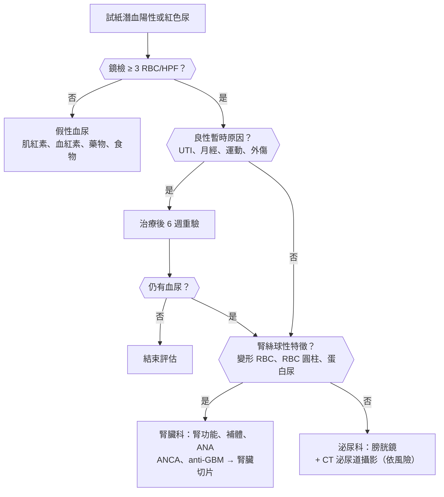
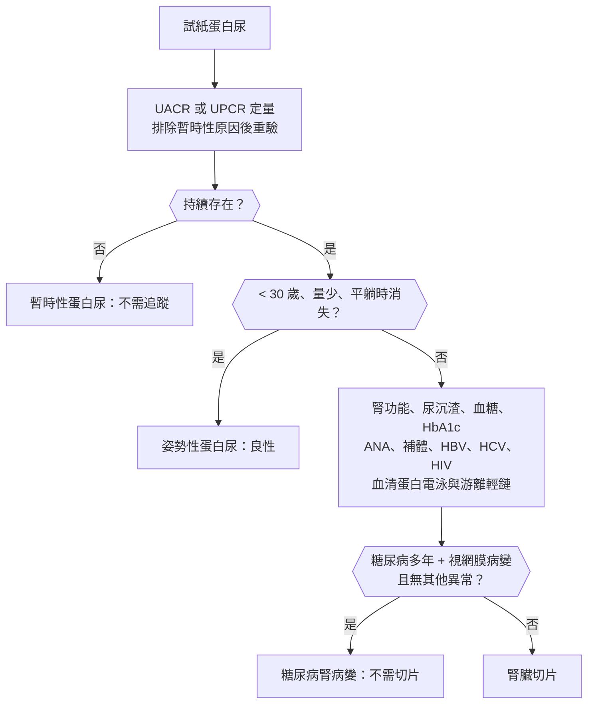
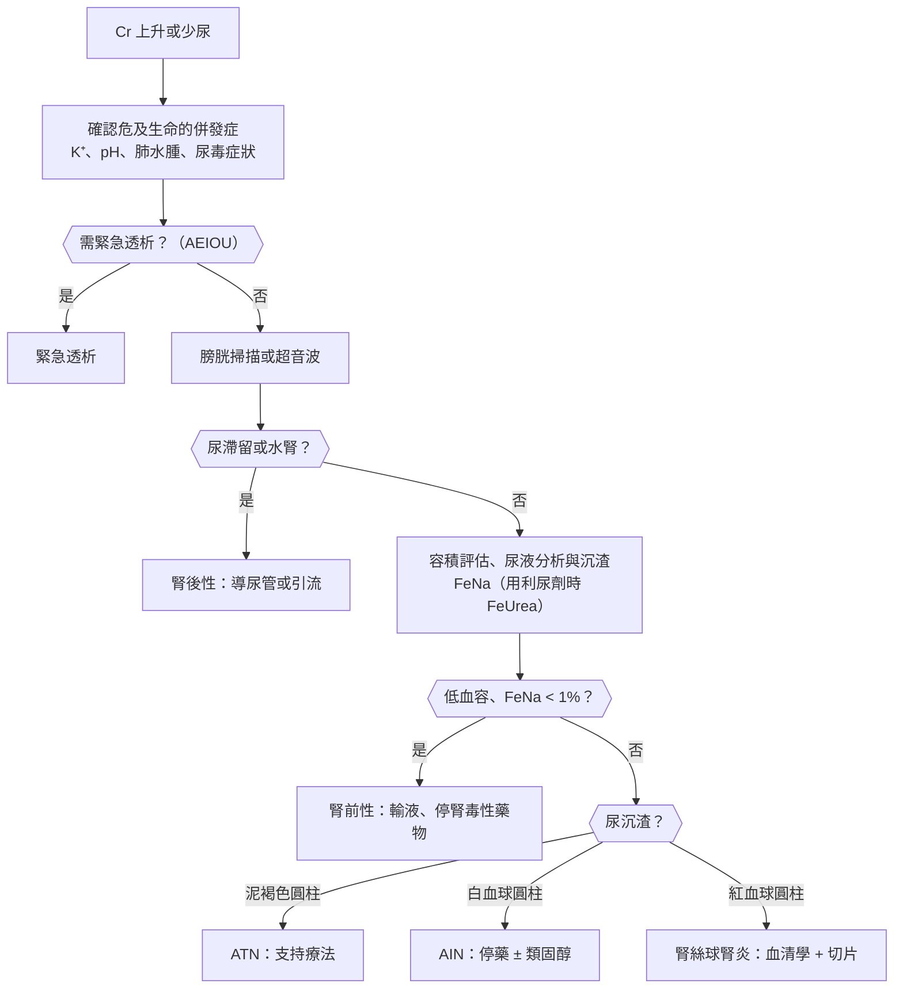
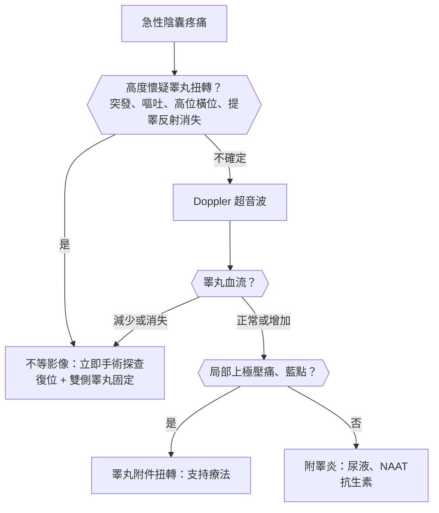

## 尿液異常（Urinary Abnormalities）

### 血尿（Hematuria）

#### 定義與分類

- **鏡下血尿（microscopic hematuria）**：尿沉渣 **:red[≥ 3 RBC/HPF]**（AUA 定義，正確收集的單一檢體）。
- **肉眼血尿（gross hematuria）**：肉眼可見紅色或茶色尿；**1 mL 血就能讓 1 L 尿變紅**。
- **假性血尿**：
    - **試紙陽性但鏡檢沒有紅血球** → **肌紅素尿（橫紋肌溶解）**、**血紅素尿（血管內溶血）**。
    - **紅色尿但試紙陰性** → 甜菜根、**rifampin**、**phenazopyridine**、紫質症（porphyria）、月經污染。
- 依來源：
    - **腎絲球性**：**變形紅血球（dysmorphic RBC，acanthocyte :red[> 5%]）**、**紅血球圓柱（RBC cast）**、蛋白尿、茶色或可樂色尿、**沒有血塊**。
    - **非腎絲球性（泌尿道）**：形態正常的紅血球、**可有血塊**、鮮紅色。
- 依排尿時段（肉眼血尿）：
    - **起始血尿（initial）** → 尿道。
    - **終末血尿（terminal）** → 膀胱頸、攝護腺。
    - **全程血尿（total）** → 膀胱或上泌尿道。

#### Red flags

- **無痛性肉眼血尿** → 未證實前視為**泌尿道上皮癌（膀胱癌）**。
- 泌尿道上皮癌危險因子：
    - **年齡（男 > 40、女 > 50）**、**抽菸（最重要）**。
    - 職業暴露：芳香胺（染料、橡膠、皮革工業）。
    - **馬兜鈴酸（含馬兜鈴酸的中草藥）→ 上泌尿道上皮癌（台灣發生率特別高）**。
    - **砷（台灣西南沿海烏腳病地區）**。
    - **cyclophosphamide**、骨盆腔放射治療、長期留置導尿管（鱗狀細胞癌）、埃及血吸蟲（Schistosoma haematobium）。
- 合併**高血壓、水腫、蛋白尿、腎功能惡化** → 腎絲球腎炎（急進性腎絲球腎炎 [[腎臟內科#Rapidly Progressive Glomerulonephritis（RPGN）|RPGN]]）。
- 血塊造成尿滯留（clot retention）。
- 合併咳血 → 肺腎症候群。

#### 鑑別診斷

| 部位 | 疾病 | 鑑別關鍵 |
|---|---|---|
| **腎絲球** | [[腎臟內科#IgA Nephropathy（Berger's Disease）\|IgA 腎病變]]、[[腎臟內科#Post-Streptococcal Glomerulonephritis（PSGN）\|鏈球菌感染後腎絲球腎炎（PSGN）]]、[[腎臟內科#Lupus Nephritis\|狼瘡腎炎]]、[[腎臟內科#Type III：ANCA-Associated Vasculitis\|ANCA 血管炎]]、[[腎臟內科#Type I：Anti-GBM Disease（Goodpasture's Disease）\|Anti-GBM]]、[[腎臟內科#Alport Syndrome\|Alport syndrome]]、[[腎臟內科#Thin Basement Membrane Disease\|薄基底膜病]]、[[小兒科#過敏性紫斑（Henoch-Schönlein Purpura / IgA Vasculitis）\|IgA 血管炎]] | 變形紅血球、紅血球圓柱、蛋白尿、高血壓 |
| **腎臟（非腎絲球）** | [[泌尿科#腎細胞癌（Renal Cell Carcinoma, RCC）\|腎細胞癌]]、[[泌尿科#多囊腎（Polycystic Kidney Disease, PKD）\|多囊腎]]、[[腎臟內科#腎結石（Nephrolithiasis）\|腎結石]]、腎乳頭壞死、[[腎臟內科#腎靜脈血栓（Renal Vein Thrombosis）\|腎靜脈血栓]]、腎梗塞、[[泌尿科#腎臟創傷\|腎外傷]]、Nutcracker syndrome | 腰痛、腫塊、外傷史 |
| **輸尿管** | **[[泌尿科#尿路結石（Urolithiasis）\|結石]]**、[[泌尿科#上泌尿道上皮癌（Upper Tract Urothelial Carcinoma, UTUC）\|上泌尿道上皮癌]] | 腎絞痛；馬兜鈴酸 |
| **膀胱** | **[[泌尿科#膀胱癌與上泌尿道上皮癌\|膀胱癌]]**、**[[泌尿科#泌尿道感染（UTI）\|膀胱炎]]**、出血性膀胱炎（cyclophosphamide、放射線、腺病毒）、膀胱結石、[[泌尿科#泌尿道結核\|泌尿道結核]] | 無痛 vs 排尿疼痛 |
| **攝護腺與尿道** | [[泌尿科#良性攝護腺肥大（BPH）\|BPH]]（攝護腺表面血管破裂）、[[泌尿科#前列腺炎（Prostatitis）\|攝護腺炎]]、[[泌尿科#攝護腺癌（Prostate Cancer）\|攝護腺癌]]、尿道炎、[[泌尿科#尿道創傷\|尿道外傷]] | 終末血尿、下泌尿道症狀 |
| **全身** | 抗凝血劑過量、[[血液腫瘤科#血小板低下（Thrombocytopenia）\|血小板低下]]、[[血液腫瘤科#凝血因子異常\|血友病]]、鐮刀型貧血 | **抗凝血治療中的血尿仍要找潛在病灶** |
| **其他** | 劇烈運動（運動性血尿，48 小時內消失）、月經污染、性行為後、[[泌尿科#間質性膀胱炎（Interstitial Cystitis）\|間質性膀胱炎]]、子宮內膜異位侵犯膀胱 | 重複檢驗消失 → 暫時性 |

#### 易混淆鑑別

:::compare[IgA 腎病變 vs 鏈球菌感染後腎絲球腎炎（PSGN）]
| | IgA 腎病變 | PSGN |
|---|---|---|
| 與感染的時間關係 | **同時或 :red[1–3 天]內（synpharyngitic）** | **咽喉炎後 :red[1–3 週]、皮膚感染後 3–6 週** |
| 年齡 | **年輕成人**（全球最常見的原發性腎絲球腎炎；亞洲多） | **兒童（5–12 歲）** |
| 表現 | **反覆發作的肉眼血尿**、無症狀鏡下血尿 | **急性腎炎症候群**：茶色尿、水腫、高血壓、少尿 |
| 補體 C3 | **正常** | **下降（6–8 週內恢復）** |
| 其他檢驗 | 血清 IgA 可上升 | **ASO、anti-DNase B 上升** |
| 病理 | **mesangial IgA 沉積** | **上皮下駝峰（subepithelial humps）** |
| 預後 | 20–40% 在 20 年內進展到末期腎病 | **兒童預後佳**，成人較差 |
:::

:::compare[腎絲球性 vs 非腎絲球性血尿]
| | 腎絲球性 | 非腎絲球性 |
|---|---|---|
| 尿色 | **茶色、可樂色** | **鮮紅、粉紅** |
| 血塊 | **無**（腎絲球有 urokinase） | **可有** |
| 紅血球形態 | **變形（acanthocyte）** | 正常 |
| 紅血球圓柱 | **有（特異）** | 無 |
| 蛋白尿 | **常有（> 500 mg/day）** | 無或輕微 |
| 評估 | 腎功能、補體、ANA、ANCA、anti-GBM → **腎臟切片** | **膀胱鏡 + CT 泌尿道攝影** |
:::

:::compare[試紙潛血陽性的三種情況]
| | 血尿 | 肌紅素尿 | 血紅素尿 |
|---|---|---|---|
| 鏡檢紅血球 | **有** | **無** | **無** |
| 離心後 | 上清液清澈、紅色在沉渣 | 上清液紅褐色 | 上清液紅色 |
| 血漿顏色 | 正常 | **正常**（肌紅素分子小、快速從尿排出） | **粉紅色**（與 haptoglobin 結合） |
| 原因 | 泌尿道或腎絲球出血 | **橫紋肌溶解**：擠壓傷、癲癇、statin、高體溫 | **血管內溶血**：[[血液腫瘤科#輸血反應\|輸血反應]]、G6PD、[[血液腫瘤科#Paroxysmal Nocturnal Hemoglobinuria（PNH）\|PNH]]、瘧疾 |
| 檢驗 | | **CK 極高** | **LDH↑、haptoglobin↓、間接膽紅素↑** |
:::

#### 問診與理學檢查

- 肉眼或鏡下、**有無疼痛**、排尿時段、血塊、排尿症狀、腰痛。
- 近期上呼吸道或皮膚感染（間隔幾天）、運動、外傷、月經、性行為。
- **抽菸**、職業、**中草藥（馬兜鈴酸）**、居住地（烏腳病地區）、**cyclophosphamide**、抗凝血劑。
- 家族史：多囊腎、Alport（**聽力喪失、眼睛病變**）、薄基底膜病。
- 理學檢查：**血壓**、水腫、腹部腫塊、肋脊角叩痛、**肛診（攝護腺）**、皮膚紫斑、關節。

#### 檢查流程

- **肉眼血尿（排除感染等暫時原因後）→ 一律膀胱鏡 + CT 泌尿道攝影（CT urography）**。
- 鏡下血尿依**風險分層（AUA 2020）**：
    - **低風險**（女 < 50、男 < 40、不抽菸、3–10 RBC/HPF、無危險因子）→ 可先重驗尿液或膀胱鏡加超音波。
    - **中高風險** → **膀胱鏡 + 腎臟超音波或 CT 泌尿道攝影**。
- **尿液細胞學**：對高惡性度腫瘤與原位癌敏感度較高，**對低惡性度腫瘤敏感度差**。
- 腎功能不全或顯影劑過敏 → MR 泌尿道攝影或逆行性腎盂攝影。

#### 初步處置

- 治療病因；肉眼血尿合併血塊 → **三腔導尿管（three-way Foley）持續膀胱灌洗**、清除血塊。
- 出血性膀胱炎預防：cyclophosphamide 合併 **mesna** 與水分。
- 腎絲球腎炎合併急速腎功能惡化 → 緊急腎臟切片與免疫抑制治療（必要時血漿置換）。

:::pitfall
使用抗凝血劑或抗血小板藥的病人出現血尿，被歸因於藥物而沒有進一步檢查 → 錯過膀胱癌或腎臟腫瘤。抗凝血治療中的血尿與一般病人的潛在病灶比例相近，仍要依風險完成膀胱鏡與影像檢查。
:::

:::exam
- 中老年抽菸男性、無痛性肉眼血尿 → 膀胱癌，膀胱鏡切片確診（TURBT 兼具診斷與治療）。
- 上呼吸道感染 1–2 天後肉眼血尿、補體正常 → IgA 腎病變；咽喉炎 2 週後茶色尿、水腫、高血壓、C3 低 → PSGN。
- 試紙潛血強陽性、鏡檢沒有紅血球、CK 很高 → 橫紋肌溶解（肌紅素尿）。
:::

### 蛋白尿（Proteinuria）

#### 定義與分類

- 正常尿蛋白 **< 150 mg/day**（白蛋白 < 30 mg/day）。
- **白蛋白尿分級（KDIGO，UACR）**：
    - **A1**：< 30 mg/g（正常到輕度）。
    - **A2**：**:red[30–300 mg/g]**（中度，舊稱微量白蛋白尿）→ **糖尿病腎病變最早期指標**。
    - **A3**：> 300 mg/g（重度）。
- **腎病範圍蛋白尿（nephrotic range）**：**:red[≥ 3.5 g/day]**（UPCR ≥ 3–3.5 g/g）。
- 依機轉：
    - **腎絲球性**：白蛋白為主；最常見、量可很大 → 糖尿病、高血壓、原發性腎絲球疾病。
    - **腎小管性**：低分子量蛋白（**β2-microglobulin**、輕鏈）、量 < 1–2 g/day → 間質性腎炎、Fanconi syndrome、重金屬。
    - **溢流性（overflow）**：血中異常蛋白過多 → **多發性骨髓瘤（輕鏈）**、肌紅素、血紅素。
    - **暫時性（transient）**：發燒、劇烈運動、心衰竭、急性疾病 → 重驗消失。
    - **姿勢性（orthostatic）**：**年輕人（< 30 歲）**，站立時蛋白尿、**平躺（早晨第一次尿）時正常** → 良性。
- **試紙只偵測白蛋白**，偵測不到輕鏈 → 懷疑骨髓瘤要用 **UPCR、尿蛋白電泳（UPEP）、血清游離輕鏈**。

#### Red flags

- **腎病症候群**：蛋白尿 ≥ 3.5 g/day + **低白蛋白血症（< 3 g/dL）** + **水腫** + 高血脂（+ 脂肪尿）。
- 合併血尿、紅血球圓柱、高血壓、腎功能下降 → 腎炎症候群或急進性腎絲球腎炎。
- 老人 + 貧血 + [[腎臟內科#高血鈣（Hypercalcemia，Ca²⁺ > 10.5 mg/dL）|高血鈣]] + 腎功能差 + 骨頭痛 → **多發性骨髓瘤**。
- 腎病症候群合併**突發腰痛、血尿、單側腎臟變大**或肺栓塞 → **[[腎臟內科#腎靜脈血栓（Renal Vein Thrombosis）|腎靜脈血栓]]**（膜性腎病變最常見）。

#### 鑑別診斷

| 類別 | 疾病 | 鑑別關鍵 |
|---|---|---|
| **續發性（最常見）** | **[[腎臟內科#Diabetic Kidney Disease（DKD）\|糖尿病腎病變]]（成人腎病症候群最常見原因）**、[[腎臟內科#高血壓腎病\|高血壓腎病變]]、[[腎臟內科#Lupus Nephritis\|狼瘡腎炎]]、[[腎臟內科#Amyloidosis\|類澱粉沉積症]]、B 型與 C 型肝炎、HIV、藥物（NSAIDs、金、penicillamine）、肥胖 | 糖尿病 > 10 年 + 視網膜病變 → DKD 不必切片 |
| **原發性腎病症候群** | [[腎臟內科#Minimal Change Disease（MCD）\|微小變化疾病（MCD）]]、[[腎臟內科#Focal Segmental Glomerulosclerosis（FSGS）\|FSGS]]、[[腎臟內科#Membranous Nephropathy（MN）\|膜性腎病變（MN）]]、[[腎臟內科#Membranoproliferative GN（MPGN）\|MPGN]] | 見比較表 |
| **腎炎症候群** | IgA 腎病變、[[腎臟內科#Post-Streptococcal Glomerulonephritis（PSGN）\|PSGN]]、狼瘡腎炎、ANCA 血管炎 | 血尿、紅血球圓柱為主 |
| **腎小管性** | [[腎臟內科#急性間質性腎炎（AIN）\|急性間質性腎炎]]、Fanconi syndrome、重金屬（鉛、鎘） | 低分子量蛋白、糖尿（血糖正常）、磷酸尿 |
| **溢流性** | [[血液腫瘤科#多發性骨髓瘤（Multiple Myeloma）\|多發性骨髓瘤]]、輕鏈沉積病 | **試紙陰性但 UPCR 高** |
| **良性** | 暫時性、**姿勢性** | 重驗、分段收集尿液 |
| **懷孕** | **[[產科#子癇前症（Preeclampsia）\|子癇前症]]** | 懷孕 20 週後 + 高血壓 |

#### 易混淆鑑別

:::compare[成人原發性腎病症候群]
| | 微小變化疾病（MCD） | FSGS | 膜性腎病變（MN） | MPGN |
|---|---|---|---|---|
| 好發 | **兒童腎病症候群最常見（約 80–90%）**；成人約 10–15% | **美國黑人**、HIV、海洛因、肥胖、腎元減少 | **成人原發性最常見之一**（白人與亞洲） | 兒童與年輕成人 |
| 續發原因 | **NSAIDs**、**[[血液腫瘤科#Hodgkin Lymphoma（HL）\|Hodgkin lymphoma]]** | **HIV（collapsing）**、肥胖、reflux nephropathy | **[[消化內科#Hepatitis B（HBV）\|HBV]]、SLE（class V）、實體腫瘤（> 60 歲）、NSAIDs、gold** | **[[消化內科#Hepatitis C（HCV）\|HCV]]（冷凝球蛋白）**、HBV、自體免疫 |
| 光學顯微鏡 | **正常** | 部分腎絲球局部硬化 | **基底膜增厚**、spike and dome | **雙軌（tram-track）** |
| 電子顯微鏡 | **足突消失（effacement）** | 足突消失 | **上皮下沉積** | 內皮下沉積 |
| 特殊檢驗 | | | **:red[Anti-PLA2R] 抗體（約 70%）** | **補體 C3↓** |
| 類固醇反應 | **極佳（> 90% 兒童）** | 差 | 中等（需 rituximab、calcineurin 抑制劑） | 差 |
| 血栓風險 | | | **最高（腎靜脈血栓）** | |
:::

:::compare[腎病症候群 vs 腎炎症候群]
| | 腎病症候群（nephrotic） | 腎炎症候群（nephritic） |
|---|---|---|
| 蛋白尿 | **≥ 3.5 g/day** | < 3.5 g/day |
| 血尿 | 輕微或無 | **明顯、紅血球圓柱** |
| 水腫 | **嚴重、全身性** | 輕度（眼瞼、臉部） |
| 血壓 | 正常或輕度上升 | **高血壓** |
| 腎功能 | 多正常 | **下降、少尿** |
| 尿沉渣 | **脂肪圓柱、橢圓脂肪體（Maltese cross）** | **紅血球圓柱** |
| 併發症 | **血栓（失去 antithrombin III）**、**感染（失去 IgG）**、高血脂、維生素 D 結合蛋白流失 | 高血壓、肺水腫、急性腎損傷 |
:::

#### 問診與理學檢查

- 泡沫尿、水腫（眼瞼晨起明顯、下肢）、體重增加、尿量。
- 糖尿病與高血壓的病程、視網膜病變、SLE 症狀、肝炎、新藥（NSAIDs）、體重減輕與骨頭痛（骨髓瘤、惡性腫瘤）。
- 理學檢查：血壓、水腫（凹陷性）、腹水、肋膜積液、皮疹、眼底（[[眼科#糖尿病視網膜病變（Diabetic Retinopathy, DR）|糖尿病視網膜病變]]）。

#### 檢查流程

- 姿勢性蛋白尿：比較**早晨第一次尿**（平躺）與白天尿液的 UPCR。
- **腎臟切片適應症**：成人不明原因的腎病症候群、腎炎症候群、蛋白尿 > 1 g/day 合併血尿、不明原因的腎功能下降；**兒童典型腎病症候群先給類固醇，抗類固醇才切片**。

#### 初步處置

- **ACEI 或 ARB**（降低蛋白尿、延緩腎功能惡化）；**SGLT2 抑制劑**（CKD 合併蛋白尿）；糖尿病腎病變加 **finerenone**。
- 腎病症候群：限鹽、利尿劑（loop diuretic）、statin；膜性腎病變白蛋白 < 2–2.5 g/dL 且出血風險低 → 考慮預防性抗凝血。
- 原發性腎病症候群依病理給免疫抑制（MCD → 類固醇）。
- 詳見[[腎臟內科#Nephrotic Syndrome|腎病症候群]]、[[腎臟內科#延緩進展策略|延緩 CKD 進展]]。

:::pitfall
老年病人尿液試紙蛋白陰性，但 UPCR 很高、合併貧血與腎功能下降 → 試紙只偵測白蛋白，漏掉多發性骨髓瘤的輕鏈。試紙與定量結果不一致時，驗血清蛋白電泳、免疫固定電泳與游離輕鏈。
:::

:::exam
- 兒童腎病症候群最常見 MCD，類固醇反應極佳，電顯只見足突消失。
- 成人腎病症候群合併 B 型肝炎或實體腫瘤、anti-PLA2R 陽性 → 膜性腎病變，最容易併發腎靜脈血栓。
- 年輕人白天蛋白尿、早晨第一次尿正常 → 姿勢性蛋白尿，良性。
:::

### 排尿疼痛與膿尿（Dysuria / Pyuria）

#### 定義與分類

- **排尿疼痛（dysuria）**：排尿時灼熱或刺痛感；常合併**頻尿（frequency）、急尿（urgency）、恥骨上疼痛**。
    - **內部排尿痛**（尿道內）→ 膀胱炎、尿道炎。
    - **外部排尿痛**（尿液流過發炎的外陰）→ **陰道炎**、生殖器疱疹。
- **膿尿（pyuria）**：尿沉渣 **:red[> 5–10 WBC/HPF]**。
- **無菌性膿尿（sterile pyuria）**：膿尿但一般培養陰性 → **泌尿道結核**、**披衣菌或淋病尿道炎**、近期用過抗生素、**[[腎臟內科#急性間質性腎炎（AIN）|急性間質性腎炎]]**、結石、間質性膀胱炎、[[小兒科#川崎病（Kawasaki Disease）|川崎病]]。
- **泌尿道感染（UTI）分類**：
    - **單純性（uncomplicated）**：健康、未懷孕、停經前女性的膀胱炎。
    - **複雜性（complicated）**：**男性**、懷孕、結構或功能異常（結石、阻塞、導管）、免疫低下、糖尿病控制不良、上泌尿道感染。
    - **反覆性**：**6 個月內 ≥ 2 次或 1 年內 ≥ 3 次**。
- 最常見病原：**E. coli（約 75–80%）**；年輕性活躍女性第二常見 **S. saprophyticus**；**Proteus**（產尿素酶 → 鹼性尿、鳥糞石結石）。

#### Red flags

- **發燒、寒顫、腰痛、肋脊角叩痛** → 腎盂腎炎。
- 敗血症徵象、**阻塞（結石）合併感染** → 緊急引流。
- **男性 UTI** → 視為複雜性，評估攝護腺炎與阻塞。
- 懷孕 → 無症狀菌尿也要治療。
- 糖尿病 + 嚴重腎盂腎炎 + 影像見腎實質內氣體 → **氣腫性腎盂腎炎**。
- 會陰部劇痛、皮膚變黑、捻髮音 → **[[泌尿科#Fournier's Gangrene|Fournier's gangrene]]**。

#### 鑑別診斷

| 部位 | 疾病 | 鑑別關鍵 |
|---|---|---|
| **膀胱** | **[[泌尿科#泌尿道感染（UTI）\|急性膀胱炎]]**、[[泌尿科#間質性膀胱炎（Interstitial Cystitis）\|間質性膀胱炎]]、出血性膀胱炎、膀胱原位癌、膀胱結石 | 頻尿急尿、恥骨上痛、無發燒 |
| **上泌尿道** | **[[腎臟內科#泌尿道感染（UTI）與腎盂腎炎\|腎盂腎炎]]**、[[泌尿科#腎膿瘍（Renal / Perinephric Abscess）\|腎膿瘍]]、[[泌尿科#氣腫性腎盂腎炎（Emphysematous Pyelonephritis）\|氣腫性腎盂腎炎]]、[[泌尿科#泌尿道結核\|泌尿道結核]] | 發燒、腰痛；結核 → **無菌性膿尿、酸性尿** |
| **尿道** | **[[感染科#Chlamydia\|披衣菌]]**、**[[感染科#N. gonorrhoeae（淋病雙球菌）\|淋病]]**、滴蟲、HSV、尿道狹窄 | **尿道分泌物**、性行為史、**膿尿但培養陰性** |
| **攝護腺與附睪** | [[泌尿科#前列腺炎（Prostatitis）\|急性細菌性攝護腺炎]]、慢性攝護腺炎／慢性骨盆疼痛症候群、[[泌尿科#附睪炎（Epididymitis）\|附睪炎]] | 會陰痛、發燒、**攝護腺腫脹壓痛** |
| **陰道與外陰** | [[婦科#陰道感染\|陰道炎]]（念珠菌、滴蟲、細菌性陰道症）、[[婦科#HSV（Genital Herpes）\|生殖器疱疹]]、萎縮性陰道炎、[[皮膚科#硬化性萎縮苔蘚（Lichen Sclerosus）\|硬化性苔蘚]] | **外部排尿痛**、陰道分泌物或搔癢 |
| **結石與其他** | 輸尿管膀胱交界結石（UVJ stone）、[[免疫風濕科#反應性關節炎（Reactive Arthritis）\|反應性關節炎]]、藥物（cyclophosphamide） | 腎絞痛 + 頻尿；尿道炎 + 關節炎 + [[眼科#結膜炎\|結膜炎]] |

#### 易混淆鑑別

:::compare[膀胱炎 vs 腎盂腎炎 vs 尿道炎 vs 陰道炎]
| | 膀胱炎 | 腎盂腎炎 | 尿道炎（性傳染病） | 陰道炎 |
|---|---|---|---|---|
| 排尿痛 | **內部**、突然 | 可有 | 內部、**漸進** | **外部** |
| 頻尿急尿 | **明顯** | 可有 | 少 | 少 |
| 發燒、腰痛 | **無** | **有、肋脊角叩痛** | 無 | 無 |
| 分泌物 | 無 | 無 | **尿道分泌物** | **陰道分泌物、搔癢、異味** |
| 尿液 | 膿尿、**細菌尿、nitrite +** | 膿尿、**白血球圓柱** | **膿尿、一般培養陰性** | 可正常 |
| 確診 | 臨床 ± 尿液培養 | **尿液與血液培養** | **核酸增幅檢測（NAAT）** | 分泌物鏡檢、pH |
:::

:::compare[尿液試紙：leukocyte esterase 與 nitrite]
| | Leukocyte esterase | Nitrite |
|---|---|---|
| 偵測 | 白血球（膿尿） | **能把硝酸鹽還原的細菌（腸內菌科）** |
| 特異度 | 較低 | **高（陽性時強烈支持細菌感染）** |
| 偽陰性 | 稀釋尿 | **[[感染科#Enterococcus\|Enterococcus]]、S. saprophyticus、Pseudomonas**（不還原硝酸鹽）、**尿液在膀胱停留 :red[< 4 小時]**、頻尿、維生素 C |
| 解讀 | 兩者皆陰性 → UTI 機率低；**兩者皆陽性 → 高度支持 UTI** | |
:::

:::compare[急性細菌性攝護腺炎 vs 慢性攝護腺炎／慢性骨盆疼痛症候群]
| | 急性細菌性攝護腺炎 | 慢性細菌性攝護腺炎 | 慢性骨盆疼痛症候群（CP/CPPS） |
|---|---|---|---|
| 表現 | **高燒、寒顫、會陰痛、排尿困難、尿滯留** | **反覆同一種菌的 UTI** | **骨盆或會陰疼痛 ≥ 3 個月**、排尿症狀、性功能障礙 |
| 肛診 | **腫脹、極度壓痛**；**避免按摩**（菌血症） | 可正常 | 可有壓痛 |
| 培養 | **中段尿陽性** | **攝護腺按摩後尿液（VB3）陽性** | 陰性 |
| 治療 | **Fluoroquinolone 或 TMP-SMX 2–4 週**；尿滯留 → 恥骨上導尿 | **Fluoroquinolone 4–6 週** | 多模式：α-blocker、止痛、骨盆底物理治療 |
:::

#### 問診與理學檢查

- 起始速度、頻尿急尿、血尿、發燒、腰痛、**尿道或陰道分泌物**、性行為與伴侶、懷孕可能。
- 過去 UTI、結石、導管、糖尿病、近期抗生素、結核病史。
- 理學檢查：體溫、**肋脊角叩痛**、恥骨上壓痛、外生殖器（潰瘍、分泌物）、**男性肛診（攝護腺，輕柔）**、陰囊。

#### 檢查流程

- **健康女性典型膀胱炎症狀（排尿痛 + 頻尿、無陰道分泌物）→ 可臨床診斷**，不一定需要尿液培養。
- 尿液分析 + **尿液培養（中段尿 ≥ 10⁵ CFU/mL；有症狀者 ≥ 10³ 即有意義）**：複雜性 UTI、腎盂腎炎、男性、懷孕、反覆或治療失敗者。
- 腎盂腎炎：血液培養；**72 小時治療仍發燒、敗血症、懷疑阻塞或膿瘍** → 腎臟超音波或 CT。
- 尿道炎：**披衣菌與淋病 NAAT**（首段尿或拭子）；同時篩檢梅毒、HIV。
- 無菌性膿尿 + 結核危險因子 → **晨尿抗酸菌培養 ×3**。

#### 初步處置

- **單純性膀胱炎**：
    - **Nitrofurantoin :red[5 天]**、**fosfomycin :red[單次]**、TMP-SMX 3 天（當地 E. coli 抗藥率 < 20% 才用）。
    - 避免把 fluoroquinolone 當第一線（副作用與抗藥性）。
- **腎盂腎炎**：門診 → fluoroquinolone 5–7 天；住院 → **IV ceftriaxone**；依培養調整。
- **男性 UTI**：7 天以上；懷疑攝護腺炎延長療程。
- **懷孕**：nitrofurantoin（避免第三孕期末）、cephalexin、amoxicillin-clavulanate；**避免 fluoroquinolone、TMP-SMX（第一孕期與近足月）**；治療後追蹤培養。
- **無症狀菌尿**：**只有懷孕、即將接受侵入性泌尿道手術**需治療；老人、導尿管、糖尿病病人不治療。
- 尿道炎：**ceftriaxone :red[500 mg] IM（淋病）+ doxycycline :red[7 天]（披衣菌）**；性伴侶一起治療。
- 阻塞合併感染 → **緊急引流（經皮腎造瘻或輸尿管支架）**。

:::pitfall
長期照護機構的老人或留置導尿管者尿液培養有菌，就給抗生素 → 多數是無症狀菌尿，治療不會改善預後，反而增加抗藥菌與 [[感染科#C. difficile（Pseudomembranous colitis，偽膜性大腸炎）|C. difficile]]。老人意識改變時要先找其他原因，不要直接歸因於「尿液有細菌」。
:::

:::exam
- 健康年輕女性排尿痛 + 頻尿、沒有陰道分泌物 → 單純性膀胱炎，nitrofurantoin 或 fosfomycin。
- 無症狀菌尿只在懷孕與泌尿道侵入性手術前治療。
- 膿尿但一般培養陰性、酸性尿 → 泌尿道結核；年輕男性加尿道分泌物 → 披衣菌或淋病。
:::

## 尿量與排尿異常（Urine Output and Voiding Disorders）

### 少尿與急性腎損傷（Oliguria / Acute Kidney Injury）

#### 定義與分類

- **少尿（oliguria）**：**:red[< 400 mL/day]** 或 **< 0.5 mL/kg/hr**；**無尿（anuria）**：**< 100 mL/day**。
- **急性腎損傷（AKI，KDIGO）**，符合任一：
    - Cr **48 小時內上升 :red[≥ 0.3 mg/dL]**。
    - Cr **7 天內上升到基準值 :red[≥ 1.5 倍]**。
    - 尿量 **< 0.5 mL/kg/hr 持續 ≥ 6 小時**。
- **三大類**：
    - **腎前性（prerenal）**：腎灌流不足，腎小管功能正常 → **最常見**。
    - **腎因性（intrinsic）**：**急性腎小管壞死（ATN，最常見）**、急性間質性腎炎（AIN）、急性腎絲球腎炎、血管性。
    - **腎後性（postrenal）**：**雙側**尿路阻塞（或獨腎單側）→ **BPH 最常見**。
- **無尿**要想到：**完全阻塞（最常見、可逆）**、雙側腎動脈阻塞、腎皮質壞死、嚴重急進性腎絲球腎炎、嚴重休克。

#### Red flags

- **[[腎臟內科#高血鉀（Hyperkalemia，K⁺ > 5.0 mEq/L）|高血鉀]]（> 6.5 mEq/L 或 ECG 變化）**、**嚴重代謝性酸中毒（pH < 7.1）**、**肺水腫**、**尿毒症狀（心包膜炎、腦病變、出血）** → 透析適應症（**AEIOU**）。
- 血尿 + 蛋白尿 + 急速惡化 → **急進性腎絲球腎炎**，需緊急切片。
- **CK 極高 + 茶色尿** → 橫紋肌溶解。
- 發燒 + 皮疹 + 新藥 → 急性間質性腎炎。
- 微血管病性溶血 + 血小板低下 → **TTP／HUS**。

#### 鑑別診斷

| 類別 | 疾病 | 鑑別關鍵 |
|---|---|---|
| **腎前性：真性低血容** | 出血、嘔吐、腹瀉、利尿劑、燒傷、第三空間流失 | 姿勢性低血壓、黏膜乾、BUN/Cr > 20 |
| **腎前性：有效循環量↓** | [[心臟內科#心衰竭（Heart Failure）\|心衰竭（心腎症候群）]]、[[消化內科#肝腎症候群（Hepatorenal Syndrome, HRS）\|肝腎症候群]]、敗血症、腹腔室症候群 | 水腫但腎灌流不足 |
| **腎前性：腎內血流動力** | **NSAIDs（收縮入球小動脈）**、**ACEI／ARB（擴張出球小動脈）**、calcineurin 抑制劑、[[腎臟內科#腎動脈狹窄（Renal Artery Stenosis）\|雙側腎動脈狹窄]] | **開始 ACEI 後 Cr 上升 > 30%** → 懷疑腎動脈狹窄 |
| **腎因性：ATN** | [[腎臟內科#急性腎小管壞死（ATN）\|缺血性 ATN]]（長時間腎前性）、**顯影劑**、**aminoglycoside**、cisplatin、amphotericin B、**vancomycin**、橫紋肌溶解、溶血、[[血液腫瘤科#Tumor Lysis Syndrome（TLS）\|腫瘤溶解]]（尿酸）、骨髓瘤（輕鏈管型） | **泥褐色顆粒圓柱（muddy brown cast）**、FeNa > 2% |
| **腎因性：AIN** | [[腎臟內科#急性間質性腎炎（AIN）\|藥物]]（**β-lactam、PPI、NSAIDs、rifampin、allopurinol**）、感染、[[免疫風濕科#Sarcoidosis（類肉瘤病）\|類肉瘤病]]、Sjögren | 發燒、皮疹、嗜酸性球；**白血球圓柱、無菌性膿尿** |
| **腎因性：腎絲球** | [[腎臟內科#Rapidly Progressive Glomerulonephritis（RPGN）\|RPGN]]（anti-GBM、ANCA、免疫複合體）、PSGN、狼瘡腎炎 | **紅血球圓柱**、蛋白尿、高血壓 |
| **腎因性：血管** | [[腎臟內科#血栓性微血管病變（Thrombotic Microangiopathy, TMA）\|TTP／HUS]]、惡性高血壓、[[腎臟內科#Scleroderma Renal Crisis\|硬皮症腎危象]]、[[腎臟內科#膽固醇栓塞腎病（Atheroembolic Renal Disease）\|膽固醇栓塞]]、腎動脈栓塞 | 心導管後 + 網狀青斑 + 嗜酸性球 + 低補體 → 膽固醇栓塞 |
| **結晶性** | **acyclovir**、methotrexate、indinavir、乙二醇（草酸鈣）、sulfonamides | 尿中結晶、用藥史 |
| **腎後性** | **[[泌尿科#良性攝護腺肥大（BPH）\|BPH]]**、攝護腺癌、[[泌尿科#神經性膀胱（Neurogenic Bladder）\|神經性膀胱]]、雙側輸尿管結石、骨盆腔腫瘤（子宮頸癌）、後腹腔纖維化、**導尿管阻塞** | **膀胱脹大、超音波水腎**；導尿後大量尿液 |

#### 易混淆鑑別

:::compare[腎前性 AKI vs ATN]
| | 腎前性 | ATN |
|---|---|---|
| **FeNa** | **:red[< 1%]** | **> 2%** |
| FeUrea（**使用利尿劑時用**） | **:red[< 35%]** | > 50% |
| 尿鈉 | < 20 mEq/L | > 40 mEq/L |
| 尿滲透壓 | **> 500 mOsm/kg** | **< 350**（等張尿） |
| BUN/Cr | **> 20** | 10–15 |
| 尿沉渣 | 正常或透明圓柱 | **泥褐色顆粒圓柱**、腎小管上皮細胞 |
| 輸液反應 | **輸液後 Cr 下降** | 無反應 |
- **FeNa < 1% 但不是腎前性**：顯影劑腎病、橫紋肌溶解早期、急性腎絲球腎炎、**肝腎症候群**、早期阻塞。
- FeNa = (尿 Na × 血 Cr) / (血 Na × 尿 Cr) × 100%。
:::

:::compare[ATN vs AIN vs 急性腎絲球腎炎]
| | ATN | AIN | 急性腎絲球腎炎 |
|---|---|---|---|
| 病因 | 缺血、腎毒性藥物、顯影劑、色素 | **藥物過敏（最常見）**、感染 | 免疫：感染後、IgA、SLE、ANCA、anti-GBM |
| 臨床 | 低血壓或用藥後數天 | **發燒、皮疹、關節痛（三者齊全 < 10%）**；用藥 1–3 週後 | **高血壓、水腫、茶色尿** |
| 尿沉渣 | **泥褐色顆粒圓柱** | **白血球圓柱、無菌性膿尿**、嗜酸性球尿 | **紅血球圓柱、變形紅血球** |
| 蛋白尿 | 輕 | 輕（NSAIDs 可合併 MCD → 大量） | 中到重 |
| 血液 | | **嗜酸性球增加** | 補體↓（感染後、SLE、[[腎臟內科#Membranoproliferative GN（MPGN）\|MPGN]]）、ANCA、anti-GBM |
| 治療 | 支持療法、移除病因 | **停藥（最重要）**、早期類固醇 | 依病因免疫抑制、血漿置換 |
:::

:::compare[肝腎症候群 vs 腎前性 AKI vs ATN（肝硬化病人）]
| | 肝腎症候群（HRS-AKI） | 腎前性 | ATN |
|---|---|---|---|
| 誘因 | **[[肝膽胰外科#自發性細菌性腹膜炎（SBP）\|SBP]]**、大量放腹水、消化道出血、腎毒性藥物 | 利尿劑過量、腹瀉、出血 | 休克、腎毒性藥物、顯影劑 |
| FeNa | **< 1%** | < 1% | > 2% |
| 尿沉渣 | 正常、無蛋白尿 | 正常 | 顆粒圓柱 |
| **停利尿劑 + 白蛋白 1 g/kg 輸注 2 天** | **不改善** | **改善** | 不改善 |
| 治療 | **Terlipressin（或 norepinephrine）+ 白蛋白**；肝臟移植 | 補充容積 | 支持療法 |
:::

#### 問診與理學檢查

- 尿量變化、口渴、嘔吐腹瀉、出血、**用藥（NSAIDs、ACEI／ARB、利尿劑、抗生素、顯影劑、化療）**、近期手術或心導管。
- 排尿困難、攝護腺病史、骨盆腔腫瘤、結石。
- 發燒、皮疹、關節痛、咳血、肌肉痛（橫紋肌溶解）、腹瀉帶血（HUS）。
- 理學檢查：**容積狀態**（姿勢性血壓、頸靜脈、黏膜、水腫、肺部囉音）、**膀胱是否脹大**、皮疹、網狀青斑、腹水。

#### 檢查流程

- **腎臟超音波**：水腎（腎後性）、腎臟大小（**小 → 慢性腎病**；大 → 糖尿病、類澱粉、HIV、[[泌尿科#多囊腎（Polycystic Kidney Disease, PKD）|多囊腎]]、浸潤性疾病）。
- 依線索加驗：CK、尿酸、LDH 與血液抹片、補體、ANA、ANCA、anti-GBM、血清蛋白電泳。

#### 初步處置

- **停用腎毒性藥物**（NSAIDs、aminoglycoside、顯影劑），**依腎功能調整藥物劑量**；暫停 ACEI／ARB、metformin、利尿劑（低血容時）。
- 低血容 → 晶體溶液（**平衡溶液**）；容積過多 → 利尿劑（**利尿劑不能改善 AKI 預後**，只用於處理水分）。
- 腎後性 → 導尿管；解除阻塞後注意**阻塞後利尿（post-obstructive diuresis）**與電解質流失。
- **高血鉀緊急處理**：**鈣劑（穩定心肌）→ insulin + 葡萄糖、β2 agonist（移入細胞）→ 排出（利尿劑、陽離子交換樹脂、透析）**。
- **透析適應症（AEIOU）**：
    - **A**：**頑固性代謝性酸中毒（:red[pH < 7.1]）**。
    - **E**：頑固性高血鉀。
    - **I**：可透析的毒物（methanol、ethylene glycol、lithium、salicylate）。
    - **O**：頑固性體液過多（肺水腫）。
    - **U**：**尿毒症狀**：心包膜炎、腦病變、尿毒性出血。
- **顯影劑腎病預防**：高風險者（eGFR < 30）用藥前後**等張晶體溶液輸注**、最低劑量；**N-acetylcysteine 不再建議**。

:::pitfall
少尿的老人沒先摸膀胱、沒做膀胱掃描就給大量輸液或利尿劑 → 錯過最容易逆轉的 BPH 尿滯留，輸液還可能造成肺水腫。所有 AKI 都要先排除阻塞。
:::

:::pitfall
病人用了利尿劑後算 FeNa > 1%，就判斷是 ATN → 利尿劑會增加尿鈉排出，FeNa 不準。使用利尿劑時改用 FeUrea（< 35% 支持腎前性）。
:::

:::exam
- FeNa < 1%、BUN/Cr > 20、尿滲透壓 > 500 → 腎前性；泥褐色顆粒圓柱、FeNa > 2% → ATN。
- 新開 β-lactam 或 PPI 後 1–3 週：發燒、皮疹、嗜酸性球、白血球圓柱 → 急性間質性腎炎 → 停藥。
- 心導管後數週：腎功能惡化 + 腳趾發紫（網狀青斑）+ 嗜酸性球 + 低補體 → 膽固醇栓塞。
:::

### 多尿（Polyuria）

#### 定義與分類

- **多尿（polyuria）**：成人尿量 **:red[> 3 L/day]**（或 > 40–50 mL/kg/day）。
    - 要與**頻尿（frequency，次數多但總量正常）**、**夜尿（nocturia）**區分。
- 依尿滲透壓分類：
    - **溶質性利尿（solute／osmotic diuresis）**：尿滲透壓 **> 300 mOsm/kg** → **高血糖（最常見）**、mannitol、高蛋白灌食（尿素）、阻塞解除後利尿、[[腎臟內科#急性腎小管壞死（ATN）|ATN]] 恢復期、鹽分輸注。
    - **水利尿（water diuresis）**：尿滲透壓 **< 300 mOsm/kg（多 < 100）** → **原發性多飲（primary polydipsia）**、**中樞性尿崩症**、**腎性尿崩症**。
- **尿崩症（diabetes insipidus，現稱 AVP deficiency／AVP resistance）**：
    - **中樞性**：ADH 分泌不足 → 腦部手術或外傷（**腦下垂體術後**）、腫瘤（顱咽管瘤）、浸潤性疾病（類肉瘤病、Langerhans 組織球增生症）、特發性。
    - **腎性**：腎臟對 ADH 無反應 → **lithium（最常見的後天原因）**、**高血鈣**、**低血鉀**、阻塞解除後、遺傳（X-linked V2 受體突變）、demeclocycline。
- **夜尿**原因：夜間多尿（**心衰竭、水腫回收**、睡前喝水或酒精咖啡因）、[[胸腔內科#阻塞性睡眠呼吸中止症（OSA）|OSA]]、膀胱容量下降（BPH、膀胱過動症）、糖尿病。

#### Red flags

- **[[腎臟內科#高血鈉（Hypernatremia，Na⁺ > 145 mEq/L）|高血鈉]]、意識改變**（無法自由喝水的病人：嬰兒、老人、術後）→ 尿崩症急性脫水。
- **高血糖 + 脫水 + 意識改變** → 高血糖高滲透壓狀態（[[代謝內分泌科#HHS（Hyperosmolar Hyperglycemic State）|HHS]]）或 [[代謝內分泌科#DKA（Diabetic Ketoacidosis）|DKA]]。
- 頭痛、視野缺損 + 多尿 → 腦下垂體或下視丘腫瘤。
- **[[腎臟內科#低血鈉（Hyponatremia，Na⁺ < 135 mEq/L）|低血鈉]] + 大量飲水** → 原發性多飲（精神疾病）→ 水中毒、癲癇。

#### 鑑別診斷

| 類別 | 疾病 | 鑑別關鍵 |
|---|---|---|
| **溶質性** | **[[代謝內分泌科#糖尿病急性併發症\|控制不良的糖尿病]]**、mannitol、高蛋白灌食、阻塞解除後、ATN 恢復期 | **尿糖陽性**、尿滲透壓 > 300 |
| **中樞性尿崩症** | 腦下垂體手術後、頭部外傷、[[代謝內分泌科#腦下垂體腫瘤\|顱咽管瘤]]、類肉瘤病、Langerhans 組織球增生症、[[產科#Sheehan Syndrome\|Sheehan syndrome]] | **突然發作**、喜歡喝冰水、**血鈉偏高** |
| **腎性尿崩症** | **[[精神科#Lithium\|Lithium]]**、[[腎臟內科#高血鈣（Hypercalcemia，Ca²⁺ > 10.5 mg/dL）\|高血鈣]]、[[腎臟內科#低血鉀（Hypokalemia，K⁺ < 3.5 mEq/L）\|低血鉀]]、[[腎臟內科#腎性尿崩症（Nephrogenic Diabetes Insipidus）\|遺傳性]]、慢性腎病、鐮刀型貧血 | 用藥史、電解質異常 |
| **原發性多飲** | 精神疾病（**思覺失調症**）、下視丘病變（口渴中樞）、藥物（抗膽鹼口乾） | **血鈉偏低**、漸進、白天多 |

#### 易混淆鑑別

:::compare[中樞性尿崩症、腎性尿崩症、原發性多飲]
| | 中樞性尿崩症 | 腎性尿崩症 | 原發性多飲 |
|---|---|---|---|
| 問題 | ADH 分泌不足 | 腎臟對 ADH 無反應 | **喝太多水**（ADH 被正常抑制） |
| 血鈉 | **偏高（> 142）** | **偏高** | **偏低（< 137）** |
| 尿滲透壓 | 低 | 低 | 低 |
| **禁水試驗** | **尿滲透壓不上升（< 300）** | **不上升** | **上升（> 600–800）**，與正常人類似 |
| **給 desmopressin 後** | **尿滲透壓上升 :red[> 50%]** | **上升 < 10–50%（幾乎無反應）** | 已濃縮，無額外變化 |
| 血漿 ADH／copeptin | **低** | **高** | 低 |
| 治療 | **Desmopressin** | **Thiazide**（矛盾地減少尿量）、低鹽低蛋白、**停 lithium 或 amiloride（lithium 引起者）**、NSAIDs | 限水、治療精神疾病 |
:::

:::compare[溶質性 vs 水利尿]
| | 溶質性利尿 | 水利尿 |
|---|---|---|
| 尿滲透壓 | **> 300 mOsm/kg** | **< 300（多 < 100）** |
| 24 小時溶質排出 | **> 1000 mOsm/day** | 正常（600–900） |
| 代表 | 高血糖、mannitol、尿素、阻塞解除後 | 尿崩症、原發性多飲 |
:::

#### 問診與理學檢查

- 每日尿量與喝水量、夜尿、**是否喜歡冰水**（中樞性尿崩症）、突然或漸進。
- 多吃多喝多尿與體重減輕（糖尿病）、頭部外傷或手術、頭痛視力、**lithium**、精神病史、月經與泌乳。
- 理學檢查：容積狀態、**視野**、精神狀態。

#### 檢查流程

- 確認 24 小時尿量 > 3 L → 血糖、**血鈉**、鉀、鈣、腎功能、**血與尿滲透壓**。
- 尿滲透壓 > 300 → 溶質性利尿（找糖、尿素、mannitol）。
- 尿滲透壓 < 300 → **禁水試驗（water deprivation test）**：
    - 禁水至體重減少 3–5%、**血鈉 > 145** 或尿滲透壓穩定。
    - 尿滲透壓上升到 > 600 → 原發性多飲。
    - 仍 < 300 → 尿崩症 → 給 **desmopressin**：上升 > 50% → 中樞性；幾乎不變 → 腎性。
- **Copeptin**（ADH 的穩定前驅片段）：基礎值 > 21 pmol/L → 腎性；高張食鹽水刺激後低 → 中樞性。
- 中樞性尿崩症 → **腦下垂體 MRI**（後葉亮點消失）。

#### 初步處置

- 中樞性：**desmopressin**（鼻噴、口服、注射）；**注意低血鈉**（用藥期間不可大量喝水）。
- 腎性：矯正病因（停 lithium、矯正鈣與鉀）、**thiazide + 低鹽飲食**、amiloride（lithium 引起）。
- 原發性多飲：逐漸限水；**快速限水或 desmopressin 誤用 → 低血鈉快速矯正反而危險**。
- **腦下垂體術後三相反應**：尿崩症（1–2 天）→ [[代謝內分泌科#抗利尿激素不當分泌症候群（SIADH）|SIADH]]（第 5–7 天，ADH 從受損神經釋放）→ 永久尿崩症。

:::pitfall
原發性多飲被當成尿崩症給 desmopressin → 病人仍照常喝水，ADH 作用下水分無法排出，造成嚴重低血鈉與癲癇。給 desmopressin 前要看血鈉：偏低時先想原發性多飲。
:::

:::exam
- 躁鬱症病人長期服用 lithium 後多尿、高血鈉、desmopressin 無效 → 腎性尿崩症 → thiazide 或 amiloride。
- 腦下垂體手術後尿量大增、低比重尿、高血鈉 → 中樞性尿崩症 → desmopressin。
- 思覺失調症病人多尿、血鈉低、禁水後尿液可濃縮 → 原發性多飲。
:::

### 下泌尿道症狀與尿滯留（LUTS / Urinary Retention）

#### 定義與分類

- **下泌尿道症狀（lower urinary tract symptoms, LUTS）**：
    - **儲尿症狀（storage）**：頻尿、急尿、夜尿、急迫性尿失禁 → 膀胱過動、發炎、膀胱容量下降。
    - **排尿症狀（voiding）**：尿流細弱、遲疑、用力解、中斷、尿分叉 → 出口阻塞或逼尿肌無力。
    - **排尿後症狀（post-micturition）**：餘尿感、尿後滴漏。
- 嚴重度：**IPSS（國際攝護腺症狀評分）**：輕度 0–7、中度 8–19、重度 20–35。
- **尿滯留（urinary retention）**：
    - **急性**：突然無法排尿、**疼痛**、膀胱脹大。
    - **慢性**：**無痛**、大量殘尿、溢流性尿失禁；可造成雙側水腎與腎衰竭。
    - **殘尿量（post-void residual, PVR）**：**:red[> 100–200 mL]** 為異常；> 300 mL 為慢性尿滯留。
- 尿滯留原因分類：
    - **阻塞**：**BPH（男性最常見）**、尿道狹窄、攝護腺癌、血塊、結石、包莖；女性 → **骨盆腔器官脫垂**、骨盆腔腫塊、**懷孕子宮後傾**。
    - **神經性**：**糖尿病神經病變**、**脊髓損傷**、**馬尾症候群**、多發性硬化症、Parkinson、中風、**[[麻醉科#硬膜外麻醉（Epidural Anesthesia）|硬膜外麻醉]]後**。
    - **藥物**：**抗膽鹼藥**（抗組織胺、TCA、抗精神病藥）、**鴉片類**、**α 致效劑（感冒藥 pseudoephedrine）**、鈣離子阻斷劑。
    - **其他**：術後（疼痛、麻醉）、**便秘與糞便嵌塞**、急性攝護腺炎、生殖器疱疹（薦神經）、心因性。

#### Red flags

- **鞍狀麻木（saddle anesthesia）+ 下背痛 + 下肢無力 + 尿滯留或失禁、肛門張力下降** → **馬尾症候群（cauda equina syndrome）**，緊急 MRI 與手術減壓。
- 慢性尿滯留 + **腎功能惡化、雙側水腎**。
- 尿滯留 + **發燒** → 急性攝護腺炎、阻塞合併感染。
- 肛診**硬、不規則結節** → 攝護腺癌。
- 肉眼血尿、反覆 UTI、膀胱結石 → BPH 併發症，需手術。

#### 鑑別診斷

| 類別 | 疾病 | 鑑別關鍵 |
|---|---|---|
| **攝護腺** | **[[泌尿科#良性攝護腺肥大（BPH）\|BPH]]**、[[泌尿科#攝護腺癌（Prostate Cancer）\|攝護腺癌]]、[[泌尿科#前列腺炎（Prostatitis）\|急性攝護腺炎]] | 肛診：BPH **對稱、橡膠樣**；癌 **硬結節**；炎 **極度壓痛** |
| **尿道** | 尿道狹窄（外傷、淋病、導尿或內視鏡後）、[[泌尿科#Posterior Urethral Valves（PUV，後尿道瓣膜）\|後尿道瓣膜（男嬰）]]、包莖 | 年輕男性 + 外傷或性病史 → 尿道狹窄 |
| **膀胱** | [[泌尿科#膀胱過動症（OAB, Overactive Bladder）\|膀胱過動症]]、膀胱結石、膀胱癌、[[泌尿科#間質性膀胱炎（Interstitial Cystitis）\|間質性膀胱炎]]、**逼尿肌無力（老化、糖尿病）** | 儲尿症狀 vs 排尿症狀 |
| **神經性** | [[泌尿科#神經性膀胱（Neurogenic Bladder）\|神經性膀胱]]：[[神經內科#糖尿病神經病變\|糖尿病]]、[[神經外科#脊髓損傷（Spinal Cord Injury）\|脊髓損傷]]、**[[神經外科#椎間盤突出（Herniated Disc / HIVD）\|馬尾症候群]]**、[[神經內科#多發性硬化症（Multiple Sclerosis, MS）\|多發性硬化症]]、[[神經內科#巴金森病（Parkinson's Disease, PD）\|Parkinson]] | 神經學檢查、會陰感覺、肛門反射 |
| **女性** | [[婦科#骨盆腔器官脫垂（Pelvic Organ Prolapse, POP）\|骨盆腔器官脫垂]]、子宮肌瘤、卵巢腫瘤、產後 | 骨盆檢查 |
| **藥物與其他** | 抗膽鹼、鴉片類、感冒藥、**便秘**、術後 | 新藥、腸道習慣 |
| **非泌尿原因的夜尿與頻尿** | 糖尿病、心衰竭、[[胸腔內科#阻塞性睡眠呼吸中止症（OSA）\|OSA]]、利尿劑、咖啡因與酒精 | **頻尿量多 → 多尿；量少 → 膀胱問題** |

#### 易混淆鑑別

:::compare[BPH vs 攝護腺癌 vs 急性攝護腺炎]
| | BPH | 攝護腺癌 | 急性攝護腺炎 |
|---|---|---|---|
| 好發區域 | **移行區（transition zone）** → 早期就壓迫尿道 | **周邊區（peripheral zone）** → 早期多無症狀 | |
| 症狀 | **LUTS** | 早期無症狀；晚期骨頭痛、LUTS | **發燒、寒顫、會陰痛**、排尿痛、尿滯留 |
| 肛診 | **對稱腫大、橡膠樣、表面光滑** | **硬、不規則結節** | **腫脹、溫熱、極度壓痛** |
| PSA | 輕度上升 | 上升（篩檢工具） | **明顯上升**（治療後 4–6 週再驗） |
| 確診 | 臨床 + 尿流速 + 殘尿 | **MRI + 切片** | 尿液培養 |
:::

:::compare[BPH 藥物]
| | α1 阻斷劑（tamsulosin） | 5α 還原酶抑制劑（finasteride、dutasteride） |
|---|---|---|
| 機轉 | 放鬆攝護腺與膀胱頸平滑肌 | 抑制 DHT → **攝護腺縮小** |
| 起效 | **數天** | **:red[3–6 個月]** |
| 適用 | 所有有症狀者 | **攝護腺 > 30–40 mL**；減少急性尿滯留與手術風險 |
| 副作用 | **姿勢性低血壓**、[[泌尿科#逆行性射精（Retrograde Ejaculation）\|逆行性射精]]、**術中虹膜鬆弛症候群（IFIS，白內障手術前告知）** | 性慾下降、勃起障礙、**PSA 降低約 50%（判讀時乘以 2）** |
- 合併治療（兩者並用）適合大攝護腺、症狀中重度者；**儲尿症狀為主可加抗膽鹼藥或 β3 致效劑（mirabegron）**，但殘尿多時小心。
:::

#### 問診與理學檢查

- 症狀分類（儲尿 vs 排尿）、IPSS、**排尿日誌（頻率與每次尿量）**、喝水量。
- 急性或慢性、疼痛、發燒、血尿、**新藥（感冒藥、抗組織胺、抗憂鬱藥、鴉片類）**、便秘、近期手術或麻醉。
- 神經症狀：下背痛、下肢無力麻木、**會陰感覺**、排便功能。
- 理學檢查：**觸診與叩診膀胱**、**肛診**（攝護腺大小質地、**肛門張力**）、會陰感覺、下肢神經學檢查；女性骨盆檢查。

#### 檢查流程

- **尿液分析**（感染、血尿、尿糖）、**殘尿量（膀胱超音波）**、腎功能。
- **PSA**：預期壽命 > 10 年、PSA 結果會影響處置者；**急性尿滯留、攝護腺炎、導尿或膀胱鏡後 PSA 會上升，數週後再驗**。
- 尿流速（**:red[Qmax < 10 mL/s] 提示阻塞**）、攝護腺超音波（體積）。
- [[泌尿科#尿動力學（Urodynamics）|尿動力學]]：考慮手術前、懷疑神經性膀胱、症狀與檢查不一致。
- 懷疑馬尾症候群 → **緊急腰薦椎 MRI**。

#### 初步處置

- **急性尿滯留**：
    - **立即導尿**（失敗 → 恥骨上膀胱造口；尿道狹窄或外傷者避免盲目反覆嘗試）。
    - 可一次引流（逐步夾管沒有證據）；注意**阻塞後利尿**與**減壓性血尿**。
    - 開始 **α 阻斷劑**，2–3 天後**拔管試排尿（trial without catheter, TWOC）**。
    - 停用誘發藥物、處理便秘。
- 慢性尿滯留：**清潔間歇導尿（CIC）**或留置導尿；治療病因。
- BPH 手術適應症：**反覆尿滯留、反覆 UTI、膀胱結石、腎功能受損、反覆血尿**、藥物無效 → TURP 等。

:::pitfall
老年男性感冒吃了含 pseudoephedrine 與抗組織胺的綜合感冒藥後無法排尿 → α 致效劑收縮膀胱頸、抗膽鹼抑制逼尿肌，在 BPH 基礎上誘發急性尿滯留。開藥前問攝護腺病史，尿滯留時要問最近吃了什麼藥。
:::

:::exam
- 下背痛 + 鞍狀麻木 + 尿滯留 + 肛門張力下降 → 馬尾症候群 → 緊急 MRI、減壓手術。
- 5α 還原酶抑制劑要 3–6 個月見效、PSA 降低約一半；α 阻斷劑數天見效，白內障手術前要告知（IFIS）。
- BPH 好發移行區，攝護腺癌好發周邊區（肛診可摸到）。
:::

### 尿失禁（Urinary Incontinence）

#### 定義與分類

- **尿失禁（urinary incontinence）**：不自主的漏尿。
- **暫時性原因（DIAPPERS，先排除）**：
    - **D**elirium（譫妄）、**I**nfection（UTI）、**A**trophic vaginitis（萎縮性陰道炎）。
    - **P**harmaceuticals（利尿劑、α 阻斷劑、鎮靜劑、抗膽鹼、ACEI 咳嗽）、**P**sychological（憂鬱）。
    - **E**xcess urine output（高血糖、心衰竭、喝太多）、**R**estricted mobility（行動不便）、**S**tool impaction（糞便嵌塞）。
- 慢性尿失禁四型：

| 類型 | 機轉 | 特徵 | 好發 |
|---|---|---|---|
| **應力性（stress）** | **尿道括約肌與骨盆底支撐不足** | **咳嗽、打噴嚏、提重物時少量漏尿**；平躺與夜間不漏 | **經產婦、停經、肥胖**；男性**攝護腺切除術後** |
| **急迫性（urge）** | **逼尿肌過度活動（detrusor overactivity）** | **突然強烈尿意、來不及到廁所**、量較多、夜尿 | **老人最常見**、中風、Parkinson、失智 |
| **溢流性（overflow）** | **膀胱出口阻塞或逼尿肌無力** → 膀胱過度膨脹 | **持續滴漏、殘尿量大**、尿流細弱 | **BPH 男性、糖尿病**、[[神經外科#脊髓損傷（Spinal Cord Injury）\|脊髓損傷]]、抗膽鹼藥 |
| **功能性（functional）** | 泌尿道正常，但**行動或認知障礙** | 來不及上廁所 | 失智、行動不便 |

- **混合型**：應力性 + 急迫性（女性常見）。
- **持續性漏尿（日夜不停）** → **廔管（膀胱陰道廔管：難產、骨盆手術、放射線後）**、**異位輸尿管（女孩正常排尿之外持續滴尿）**。

#### Red flags

- 新發尿失禁合併**下背痛、鞍狀麻木、下肢無力** → 馬尾症候群、脊髓壓迫。
- 血尿、骨盆疼痛、反覆 UTI → 膀胱癌、結石。
- 骨盆手術或放射治療後**持續漏尿** → 廔管。
- **大量殘尿 + 腎功能惡化** → 溢流性，需引流。

#### 鑑別診斷

| 類型 | 疾病 | 鑑別關鍵 |
|---|---|---|
| **應力性** | 骨盆底肌肉鬆弛、尿道過度活動、內括約肌缺損、攝護腺切除術後 | **咳嗽壓力試驗陽性** |
| **急迫性** | [[泌尿科#膀胱過動症（OAB, Overactive Bladder）\|膀胱過動症]]、中風、[[神經內科#巴金森病（Parkinson's Disease, PD）\|Parkinson]]、[[精神科#失智症（Major Neurocognitive Disorder）\|失智]]、[[神經內科#多發性硬化症（Multiple Sclerosis, MS）\|多發性硬化症]]、膀胱炎、膀胱結石或腫瘤 | [[泌尿科#尿動力學（Urodynamics）\|尿動力學]]：逼尿肌不自主收縮 |
| **溢流性** | **BPH**、尿道狹窄、**[[神經內科#糖尿病神經病變\|糖尿病神經病變]]**、脊髓損傷、藥物（抗膽鹼、鴉片類） | **殘尿量大** |
| **功能性** | 失智、中風後、關節炎、環境障礙 | 泌尿道檢查正常 |
| **持續性** | [[婦科#骨盆腔器官脫垂（Pelvic Organ Prolapse, POP）\|骨盆腔手術]]後膀胱陰道廔管、異位輸尿管 | 日夜持續漏尿 |

#### 易混淆鑑別

:::compare[應力性 vs 急迫性 vs 溢流性尿失禁]
| | 應力性 | 急迫性 | 溢流性 |
|---|---|---|---|
| 誘發 | **咳嗽、打噴嚏、運動、提重物** | **強烈尿意**、聽到水聲、開門回家 | 無特定誘發，**持續滴漏** |
| 漏尿量 | **少量** | **中到大量** | 少量但持續 |
| 頻尿夜尿 | 少 | **明顯** | 可有 |
| 殘尿量 | 正常 | 正常 | **大量（> 200–300 mL）** |
| 治療首選 | **骨盆底運動（Kegel）**、減重 → **中段尿道吊帶手術（TVT／TOT）** | **膀胱訓練** → **抗膽鹼藥或 mirabegron** → 膀胱內 Botox → 薦神經調控 | **解除阻塞**（α 阻斷劑、TURP）、**清潔間歇導尿** |
| 禁忌或注意 | | 抗膽鹼藥：**老人認知功能惡化**、閉角型青光眼、尿滯留；**mirabegron 較適合老人** | **不可給抗膽鹼藥** |
:::

#### 問診與理學檢查

- 漏尿的情境、量、頻率、有無尿意、夜尿、**排尿日誌（3 天）**、護墊數量。
- 生產史、停經、骨盆手術或放射治療、神經疾病、**用藥**、便秘、認知與行動能力。
- 理學檢查：腹部（脹大膀胱）、**骨盆檢查（萎縮、脫垂）**、**咳嗽壓力試驗**、肛診（張力、糞便嵌塞、攝護腺）、會陰感覺、認知。

#### 檢查流程

- **尿液分析（感染、血尿、糖尿）**、**殘尿量**；必要時腎功能、血糖。
- 尿動力學：考慮手術、診斷不明、混合型或神經性。
- 膀胱鏡：血尿、疑似廔管、反覆感染。

#### 初步處置

- 先處理暫時性原因（DIAPPERS）。
- 依類型治療（見比較表）；所有類型：減重、限制咖啡因與酒精、定時排尿、處理便秘。
- 停經後陰道萎縮 → **局部陰道雌激素**。
- 抗膽鹼藥在老人慎用（**oxybutynin 最容易造成認知副作用**）。

:::pitfall
老年男性「頻尿漏尿」被當成膀胱過動症開抗膽鹼藥 → 若其實是 BPH 造成的溢流性尿失禁，抗膽鹼會讓逼尿肌更無力，誘發急性尿滯留。開藥前先量殘尿。
:::

:::exam
- 經產婦咳嗽、打噴嚏時少量漏尿 → 應力性尿失禁 → Kegel 運動、中段尿道吊帶。
- 老人突然尿急來不及上廁所 → 急迫性尿失禁（逼尿肌過度活動），老人最常見的類型。
- 糖尿病或 BPH 病人持續滴尿、殘尿量大 → 溢流性尿失禁，不可用抗膽鹼藥。
:::

## 疼痛與腫塊（Pain and Masses）

### 腰痛與腎絞痛（Flank Pain / Renal Colic）

#### 定義與分類

- **腰痛（flank pain）**：肋骨下緣到髂骨之間的側背部疼痛。
- **腎絞痛（renal colic）**：**輸尿管阻塞（結石最常見）**造成的**突發、劇烈、陣發性**腰痛，**往鼠蹊部、睪丸或陰唇放射**；**病人坐立難安（與腹膜炎病人不敢動相反）**。
    - 結石卡在**輸尿管膀胱交界（UVJ）** → 頻尿急尿（像膀胱炎）。
- 輸尿管三個生理性狹窄處（結石好發）：**腎盂輸尿管交界（UPJ）**、**跨越髂血管處**、**輸尿管膀胱交界（UVJ，最窄、最常卡）**。
- 結石種類：

| 種類 | 比例 | 特點 | X 光 |
|---|---|---|---|
| **草酸鈣** | **70–80%** | 高鈣尿、高草酸尿（短腸、Crohn）、低檸檬酸尿 | **顯影** |
| 磷酸鈣 | | 鹼性尿、遠端腎小管酸中毒、副甲狀腺亢進 | 顯影 |
| **鳥糞石（struvite）** | 10–15% | **Proteus 等產尿素酶細菌**、**鹼性尿**、**鹿角狀結石** | 顯影 |
| **尿酸** | 5–10% | **痛風、腫瘤溶解、酸性尿**；可用鹼化尿液溶解 | **不顯影（CT 可見）** |
| 胱胺酸 | 1–2% | 體染色體隱性、**六角形結晶**、年輕即發病 | 微弱顯影 |

#### Red flags

- **發燒 + 阻塞（結石）** → **感染性阻塞，泌尿科急症，需緊急引流**。
- **老人第一次「腎絞痛」** → 先排除**腹主動脈瘤破裂**（低血壓、腹部搏動性腫塊）。
- 獨腎、雙側阻塞、**急性腎損傷**、無尿。
- 無法控制的疼痛或嘔吐。
- 懷孕。

#### 鑑別診斷

| 類別 | 疾病 | 鑑別關鍵 |
|---|---|---|
| **泌尿：阻塞** | **[[泌尿科#尿路結石（Urolithiasis）\|輸尿管結石]]**、[[泌尿科#UPJ Obstruction（腎盂輸尿管交界阻塞）\|UPJ 阻塞]]（**大量喝水後腰痛，Dietl crisis**）、血塊、腎乳頭壞死、腫瘤 | 血尿（> 85%）、水腎 |
| **泌尿：感染** | [[腎臟內科#泌尿道感染（UTI）與腎盂腎炎\|腎盂腎炎]]、[[泌尿科#腎膿瘍（Renal / Perinephric Abscess）\|腎周膿瘍]]、[[泌尿科#氣腫性腎盂腎炎（Emphysematous Pyelonephritis）\|氣腫性腎盂腎炎]] | 發燒、膿尿、持續性痛 |
| **泌尿：血管** | **腎梗塞**（心房顫動 → **LDH 極高**、血尿、CT 楔形低灌流）、[[腎臟內科#腎靜脈血栓（Renal Vein Thrombosis）\|腎靜脈血栓]]（腎病症候群）、腎出血（血管肌脂肪瘤 angiomyolipoma 破裂、抗凝血） | 結石沒看到、LDH 高 |
| **血管（必須排除）** | **[[心臟內科#腹主動脈瘤（Abdominal Aortic Aneurysm, AAA）\|腹主動脈瘤破裂]]**、[[心血管外科#主動脈剝離（Aortic Dissection）\|主動脈剝離]] | **老人、低血壓、搏動性腫塊** |
| **腹部** | [[大腸直腸外科#闌尾炎（Appendicitis）\|闌尾炎（盲腸後位）]]、膽道疾病、[[消化內科#急性胰臟炎（Acute Pancreatitis）\|胰臟炎]]、[[大腸直腸外科#憩室炎（Diverticulitis）\|憩室炎]]、[[消化內科#腸阻塞（Intestinal Obstruction）\|腸阻塞]] | 腹膜刺激徵象 |
| **婦產** | [[產科#子宮外孕（Ectopic Pregnancy）\|子宮外孕]]、[[婦科#卵巢扭轉（Ovarian Torsion）\|卵巢扭轉]]、[[婦科#骨盆腔炎（Pelvic Inflammatory Disease, PID）\|骨盆腔炎]] | **育齡女性一律驗懷孕** |
| **其他** | 肌肉骨骼、肋骨骨折、[[皮膚科#帶狀疱疹（Herpes Zoster / Shingles）\|帶狀疱疹]]（出疹前）、下葉肺炎、後腹腔出血 | 按壓痛、皮節分布 |

#### 易混淆鑑別

:::compare[腎絞痛 vs 腹主動脈瘤破裂 vs 腎盂腎炎]
| | 輸尿管結石 | 腹主動脈瘤破裂 | 腎盂腎炎 |
|---|---|---|---|
| 年齡 | **20–50 歲**、第一次發作多在年輕時 | **> 60 歲、抽菸男性** | 年輕女性最多 |
| 疼痛 | **陣發性、絞痛、坐立難安**、往鼠蹊放射 | **突發劇烈、持續**、腰背痛 | **持續性鈍痛** |
| 生命徵象 | 心搏過速（疼痛）、**血壓正常或偏高** | **低血壓、休克** | **發燒** |
| 理學檢查 | 肋脊角叩痛 | **腹部搏動性腫塊** | **肋脊角叩痛** |
| 尿液 | **血尿** | 可有血尿（壓迫） | **膿尿、細菌尿** |
| 首選影像 | **非顯影 CT**；孕婦、兒童 → 超音波 | **床邊超音波、CT 血管攝影** | 臨床 + 尿液培養；治療反應差才影像 |
:::

:::compare[結石處置依大小與位置]
| 結石 | 處置 |
|---|---|
| **:red[< 5 mm]** 輸尿管 | **約 90% 自行排出** → 止痛、喝水、觀察 |
| **5–10 mm 遠端輸尿管** | **藥物排石（MET）：tamsulosin**（約 50% 自行排出） |
| > 10 mm、無法排出、持續阻塞 | **輸尿管鏡碎石（URS）** 或體外震波碎石（ESWL） |
| 腎結石 **< 2 cm** | **ESWL** 或 URS |
| 腎結石 **:red[> 2 cm]**、**鹿角狀結石** | **經皮腎臟碎石（PCNL）** |
- **ESWL 禁忌**：**懷孕**、凝血異常、**未控制的感染**、遠端阻塞、結石附近有動脈瘤。
:::

#### 問診與理學檢查

- 疼痛發作方式、位置、放射、陣發或持續、血尿、發燒、排尿症狀、噁心嘔吐。
- 結石病史與家族史、痛風、腸道手術、水分攝取、**心房顫動（腎梗塞）**、抗凝血劑、**月經與懷孕可能**。
- 理學檢查：生命徵象、**肋脊角叩痛**、腹部壓痛與腹膜徵象、**腹部搏動性腫塊**、外生殖器、皮膚（疱疹）。

#### 檢查流程

- 尿液分析（血尿、膿尿、pH、結晶）、腎功能、CBC、**育齡女性驗懷孕**；發燒 → 尿液與血液培養。
- **非顯影低劑量 CT（CT KUB）**：結石診斷首選，同時看其他原因。
- **超音波**：孕婦與兒童首選；看水腎；床邊排除腹主動脈瘤。
- 結石取出後做成分分析；反覆結石 → **24 小時尿液**（鈣、草酸、檸檬酸、尿酸、鈉、尿量）、血鈣、副甲狀腺素、尿酸。

::chart{id="urolithiasis-management"}

#### 初步處置

- 止痛：**NSAIDs 首選**（降低輸尿管壓力與水腫；**腎功能不全或懷孕避免**）；不夠再加鴉片類。
- **感染性阻塞**：**抗生素 + 緊急引流**（經皮腎造瘻或輸尿管支架），**感染控制前不碎石**。
- 預防復發：
    - **每天尿量 :red[> 2.5 L]**、**低鈉飲食**、**正常鈣攝取（限鈣反而增加草酸吸收）**、減少動物蛋白。
    - 高鈣尿 → **thiazide**；低檸檬酸尿 → **potassium citrate**；尿酸結石 → **鹼化尿液**、allopurinol。
- 詳見[[泌尿科#尿路結石（Urolithiasis）|尿路結石]]。

:::pitfall
70 歲抽菸男性第一次發生「左腰痛、血尿」，被當成腎結石只給止痛 → 其實是腹主動脈瘤滲漏。老人第一次腎絞痛要先用床邊超音波或 CT 排除腹主動脈瘤。
:::

:::pitfall
結石阻塞合併發燒，只給抗生素、等待結石排出 → 阻塞的腎臟中抗生素濃度不足，快速進展為敗血性休克。感染加阻塞要緊急引流。
:::

:::exam
- 腎絞痛首選影像：非顯影 CT；孕婦、兒童用超音波。
- 結石 < 5 mm 多可自行排出；5–10 mm 遠端輸尿管結石用 tamsulosin 促進排石。
- 尿酸結石 X 光不顯影，鹼化尿液可溶解；鳥糞石結石與 Proteus 感染、鹼性尿、鹿角狀結石有關。
:::

### 急性陰囊疼痛（Acute Scrotal Pain）

#### 定義與分類

- **急性陰囊疼痛（acute scrotum）**：**未證實前視為睪丸扭轉**，因為睪丸存活與時間直接相關。
- 三大原因：
    - **睪丸扭轉（testicular torsion）**：**新生兒與 12–18 歲青少年**；鞘膜附著異常（**bell-clapper deformity**）。
    - **睪丸附件扭轉（torsion of appendix testis）**：**7–12 歲兒童最常見的急性陰囊原因**。
    - **附睪炎（epididymitis）**：**成人最常見的急性陰囊疼痛原因**。
- 睪丸扭轉的**黃金時間**：**:red[6 小時內]**手術，存活率約 90–100%；**> 24 小時幾乎無法挽救**。

#### Red flags

- **突發劇痛（常在睡眠中或運動後）+ 噁心嘔吐** → 睪丸扭轉。
- **睪丸位置高、橫位（horizontal lie）、提睪反射消失**。
- 會陰與陰囊**皮膚變黑、捻髮音、疼痛超過外觀、敗血症** → **Fournier's gangrene**。
- 外傷後陰囊大量血腫 → 睪丸破裂。
- 鼠蹊部腫塊無法推回 → 嵌頓性疝氣。

#### 鑑別診斷

| 類別 | 疾病 | 鑑別關鍵 |
|---|---|---|
| **扭轉** | **[[泌尿科#睪丸扭轉（Testicular Torsion）\|睪丸扭轉]]**、睪丸附件扭轉 | 附件扭轉：**睪丸上極局部壓痛、藍點徵象（blue dot sign）**、提睪反射存在 |
| **感染與發炎** | **[[泌尿科#附睪炎（Epididymitis）\|附睪炎]]**、睪丸炎（**[[感染科#腮腺炎（Mumps）\|腮腺炎]]**）、[[泌尿科#Fournier's Gangrene\|Fournier's gangrene]]、[[小兒科#過敏性紫斑（Henoch-Schönlein Purpura / IgA Vasculitis）\|IgA 血管炎]]（陰囊水腫） | 漸進、發燒、排尿症狀；腮腺腫大後 4–8 天 |
| **外傷** | 睪丸破裂、血腫 | 外傷史；超音波看白膜是否破裂 → 手術修補 |
| **疝氣與積液** | [[胃小腸外科#腹股溝疝氣（Inguinal Hernia）\|嵌頓性腹股溝疝氣]]、急性[[小兒外科#鞘膜積液（Hydrocele）\|鞘膜積液]] | **摸不到腫塊上緣**、腸音 |
| **腫瘤** | [[泌尿科#睪丸癌（Testicular Cancer）\|睪丸癌]]（腫瘤內出血時會痛） | 睪丸實質腫塊 |
| **轉移痛** | 輸尿管結石、[[心臟內科#腹主動脈瘤（Abdominal Aortic Aneurysm, AAA）\|腹主動脈瘤]]、[[大腸直腸外科#闌尾炎（Appendicitis）\|闌尾炎]]、腰椎神經根病變 | **陰囊檢查正常** |

#### 易混淆鑑別

:::compare[睪丸扭轉、睪丸附件扭轉、附睪炎]
| | 睪丸扭轉 | 睪丸附件扭轉 | 附睪炎 |
|---|---|---|---|
| 年齡 | **新生兒、:red[12–18 歲]** | **:red[7–12 歲]** | **性活躍成人**、老人 |
| 發作 | **突發劇痛**、常伴**噁心嘔吐** | 漸進或突發、較輕 | **漸進（數天）** |
| 位置與壓痛 | **整個睪丸**、睪丸**位置高、橫位** | **睪丸上極局部**、**藍點徵象** | **附睪（睪丸後上方）** |
| **提睪反射** | **消失** | 存在 | 存在 |
| **Prehn sign**（抬高陰囊） | **疼痛不減（陰性）** | 不定 | **疼痛減輕（陽性）** |
| 發燒、排尿症狀、膿尿 | 無 | 無 | **常有** |
| **Doppler 超音波** | **血流減少或消失**、漩渦徵象（whirlpool sign） | 睪丸血流正常、附件旁血流增加 | **血流增加** |
| 處置 | **立即手術：復位 + 雙側睪丸固定**；壞死 → 切除 + 對側固定 | **支持療法**（止痛、休息），1–2 週自癒 | **抗生素**、抬高陰囊、NSAIDs |
:::

:::compare[附睪炎的病原與治療（依年齡與性行為）]
| | :red[< 35 歲]、性活躍 | > 35 歲、無性傳染風險 | 肛交（insertive） |
|---|---|---|---|
| 病原 | **披衣菌、淋病** | **E. coli 等腸內菌**（常合併 BPH、導尿） | 披衣菌、淋病 + **腸內菌** |
| 治療 | **Ceftriaxone 500 mg IM + doxycycline 10 天** | **Levofloxacin 10 天** | Ceftriaxone + levofloxacin |
| 其他 | 性伴侶一起治療 | 評估下泌尿道阻塞 | |
:::

#### 問診與理學檢查

- 發作時間（**精確到幾點**）、突然或漸進、噁心嘔吐、過去類似但自行緩解的疼痛（間歇性扭轉）。
- 發燒、排尿症狀、尿道分泌物、性行為、外傷、腮腺腫大、紫斑與腹痛（IgA 血管炎）。
- 理學檢查：**站立與平躺檢查**、睪丸位置與軸向、**提睪反射**、壓痛部位（整個睪丸 vs 上極 vs 附睪）、藍點徵象、Prehn sign、**鼠蹊部**、皮膚顏色與捻髮音。

#### 檢查流程

- **臨床高度懷疑睪丸扭轉 → 不要為了超音波延誤手術**；超音波陰性但仍高度懷疑 → 仍需探查。
- 附睪炎：尿液分析與培養、**披衣菌與淋病 NAAT**。
- 等待手術時可嘗試**手法復位（「打開書本」：由內往外旋轉）**，但**仍要手術固定**。

#### 初步處置

- 睪丸扭轉：**緊急手術**；術中判斷存活 → 復位 + **雙側睪丸固定（orchiopexy）**；壞死 → 切除 + 對側固定。
- 附睪炎：依年齡選抗生素、抬高陰囊、冰敷、NSAIDs。
- 腮腺炎睪丸炎：支持療法；**雙側可能造成不孕**。
- Fournier's gangrene：**緊急廣泛清創** + 廣效抗生素。

:::pitfall
青少年陰囊劇痛，先排超音波、等待報告數小時 → 錯過 6 小時黃金時間，睪丸壞死。臨床高度懷疑扭轉時直接送手術室；超音波正常也不能完全排除（間歇性扭轉、部分扭轉）。
:::

:::exam
- 青少年突發陰囊劇痛 + 嘔吐 + 睪丸高位橫位 + 提睪反射消失 → 睪丸扭轉 → 立即手術，6 小時內救回率最高，雙側固定。
- 7–12 歲兒童睪丸上極局部壓痛 + 藍點 + 提睪反射存在 → 睪丸附件扭轉 → 支持療法。
- 年輕男性漸進陰囊痛 + 排尿痛 + Prehn sign 陽性 + 超音波血流增加 → 附睪炎（披衣菌、淋病）。
:::

### 陰囊腫塊（Scrotal Mass）

#### 定義與分類

- 先判斷腫塊在**睪丸內（intratesticular）**還是**睪丸外（extratesticular）**：
    - **睪丸內實質腫塊 → 未證實前視為睪丸癌**（約 90% 惡性）。
    - 睪丸外 → 多為良性（鞘膜積液、精索靜脈曲張、精液囊腫、疝氣）。
- 透光試驗（transillumination）：**液體會透光**（鞘膜積液、精液囊腫）；實質腫瘤、血腫、疝氣（腸子）不透光。

#### Red flags

- **無痛、堅硬的睪丸內腫塊** → 睪丸癌（**15–35 歲男性最常見的實體腫瘤**）。
- **[[小兒外科#隱睪症（Cryptorchidism）|隱睪症]]病史**（睪丸癌風險 3–5 倍，**固定術後仍有風險**）、對側曾罹癌。
- **右側精索靜脈曲張**、突然出現、**平躺不消退** → 後腹腔腫瘤（右腎細胞癌、下腔靜脈阻塞）。
- 男性乳房發育 + 睪丸腫塊（β-hCG 分泌）。
- 腹部或後腹腔腫塊、背痛（淋巴轉移）。

#### 鑑別診斷

| 位置 | 疾病 | 鑑別關鍵 |
|---|---|---|
| **睪丸內** | **[[泌尿科#睪丸癌（Testicular Cancer）\|睪丸癌]]**（生殖細胞瘤 > 95%）、淋巴瘤（**> 50 歲最常見的睪丸腫瘤**）、睪丸梗塞、睪丸炎 | **堅硬、無痛**、不透光 |
| **鞘膜** | [[小兒外科#鞘膜積液（Hydrocele）\|鞘膜積液（hydrocele）]] | **透光**、包住睪丸（睪丸摸不清楚）；**成人新發 → 超音波排除腫瘤** |
| **精索** | **精索靜脈曲張（varicocele）**、精索囊腫 | **「一袋蟲」（bag of worms）**、**站立或 Valsalva 時變大、平躺消退**、**左側多（約 90%）** |
| **附睪** | 精液囊腫（spermatocele）、附睪囊腫、慢性[[泌尿科#附睪炎（Epididymitis）\|附睪炎]]、**結核性附睪炎（念珠狀輸精管）** | **睪丸上後方、與睪丸分開**、透光 |
| **疝氣** | [[胃小腸外科#腹股溝疝氣（Inguinal Hernia）\|腹股溝疝氣]] | **摸不到上緣**、咳嗽時有衝擊感、可推回、可聽到腸音 |
| **其他** | 血腫、[[泌尿科#Fournier's Gangrene\|Fournier's gangrene]]、陰囊皮膚囊腫 | 外傷史 |

#### 易混淆鑑別

:::compare[常見陰囊腫塊]
| | 睪丸癌 | 鞘膜積液 | 精索靜脈曲張 | 精液囊腫 | 腹股溝疝氣 |
|---|---|---|---|---|---|
| 位置 | **睪丸內** | **包住睪丸** | **睪丸上方、精索** | **睪丸上後方** | 從鼠蹊延伸 |
| 觸感 | **硬、無痛** | 光滑、囊性 | **「一袋蟲」** | 小、圓、囊性 | 可推回 |
| 透光 | **不透光** | **透光** | 不透光 | **透光** | 不透光 |
| 摸得到上緣 | 是 | 是 | 是 | 是 | **否** |
| 姿勢變化 | 無 | 無（交通性者平躺變小） | **站立變大、平躺消退** | 無 | 咳嗽衝擊、平躺可消失 |
| 處置 | **經鼠蹊根治性睪丸切除** | 兒童 1–2 歲前多自癒；成人有症狀 → 手術 | 不孕、疼痛、萎縮 → 顯微手術結紮 | 多不需處理 | 手術修補 |
:::

:::compare[睪丸癌：精原細胞瘤 vs 非精原細胞瘤]
| | 精原細胞瘤（seminoma） | 非精原細胞瘤（NSGCT） |
|---|---|---|
| 年齡 | **稍晚（30–40 歲）** | 較年輕（20–30 歲） |
| AFP | **正常（AFP 上升 → 一定含非精原成分）** | **卵黃囊瘤 → AFP↑** |
| β-hCG | 可輕度上升 | **絨毛膜癌 → β-hCG 極高**（男性乳房發育、甲狀腺亢進） |
| LDH | 可上升（腫瘤負荷） | 可上升 |
| 放射線敏感 | **非常敏感** | 不敏感 |
| 預後 | 極佳 | 佳（cisplatin 化療） |
:::

#### 問診與理學檢查

- 發現多久、大小變化、疼痛、外傷、不孕、隱睪症或睪丸癌病史、男性乳房發育、背痛、咳嗽（肺轉移）。
- 理學檢查：**站立與平躺**、腫塊在睪丸內或外、**能否摸到上緣**、透光試驗、Valsalva、鼠蹊部淋巴結（陰囊皮膚引流到鼠蹊，**睪丸引流到後腹腔主動脈旁淋巴結**）、乳房、腹部。

#### 檢查流程

- **陰囊超音波**（第一線）：分辨睪丸內外、實質或囊性。
- 睪丸內實質腫塊 → **腫瘤標記（AFP、β-hCG、LDH）** → **經鼠蹊部根治性睪丸切除（radical inguinal orchiectomy）**，以病理確診。
    - **禁止經陰囊切片或切除**：會改變淋巴引流（陰囊 → 鼠蹊淋巴結），造成腫瘤播散。
- 分期：胸腹骨盆 CT；術後追蹤腫瘤標記下降。
- 右側或不會消退的精索靜脈曲張 → **腹部 CT 或超音波找後腹腔腫瘤**。

#### 初步處置

- 睪丸癌：根治性睪丸切除 → 依分期觀察、放射治療（精原細胞瘤）或化學治療（**BEP：bleomycin、etoposide、cisplatin**）；術前討論**精子冷凍保存**。
- 精索靜脈曲張：**可矯治的男性不孕最常見原因**；有不孕、疼痛、青少年睪丸萎縮 → 顯微手術結紮或栓塞；見[[泌尿科#男性不孕症|男性不孕症]]。
- 鞘膜積液：兒童交通性者多在 1–2 歲前閉合，持續則手術；成人有症狀才手術（不建議單純抽吸，容易復發）。

:::pitfall
年輕男性無痛睪丸腫塊，被當成附睪炎給抗生素觀察數週 → 延誤睪丸癌診斷。任何睪丸內實質腫塊先做超音波；抗生素治療後仍未消退要重新評估。
:::

:::exam
- 15–35 歲男性無痛堅硬的睪丸內腫塊 → 睪丸癌：超音波 + AFP、β-hCG、LDH → 經鼠蹊根治性睪丸切除，禁止經陰囊切片。
- AFP 上升的睪丸腫瘤 → 一定含非精原細胞成分（純精原細胞瘤 AFP 正常）。
- 新發右側精索靜脈曲張或平躺不消退 → 找後腹腔腫瘤（腎細胞癌）。
:::

## 男性性功能（Male Sexual Function）

### 勃起功能障礙（Erectile Dysfunction）

#### 定義與分類

- **勃起功能障礙（erectile dysfunction, ED）**：持續或反覆無法達到或維持足夠勃起以完成滿意的性行為（**≥ 3 個月**）。
- 原因：
    - **血管性（最常見）**：[[心臟內科#動脈粥狀硬化（Atherosclerosis）|動脈粥狀硬化]]、高血壓、糖尿病、高血脂、抽菸 → **ED 常比冠心症早 2–5 年出現，是心血管疾病的警訊**。
    - **神經性**：糖尿病神經病變、脊髓損傷、[[神經內科#多發性硬化症（Multiple Sclerosis, MS）|多發性硬化症]]、**攝護腺切除或骨盆腔手術後**。
    - **內分泌**：**睪固酮低下（性腺功能低下）**、**高泌乳素血症**、甲狀腺疾病。
    - **藥物**：**thiazide、β 阻斷劑、spironolactone**、**SSRI**、抗精神病藥、**5α 還原酶抑制劑**、雄性素阻斷治療、鴉片類、酒精。
    - **結構**：**Peyronie disease（陰莖纖維化彎曲）**、陰莖外傷、異常勃起後。
    - **心因性**：表現焦慮、憂鬱、關係問題。

#### Red flags

- ED 合併胸痛或運動耐受度下降 → 先評估**冠心症**（性行為也是一種運動負荷）。
- 性慾下降、男性乳房發育、睪丸變小 → 性腺功能低下、泌乳素瘤。
- 頭痛、視野缺損 → [[代謝內分泌科#腦下垂體腫瘤|腦下垂體腫瘤]]。
- **勃起持續 > 4 小時且疼痛** → **缺血性異常勃起（priapism）**，泌尿科急症。

#### 鑑別診斷

| 類別 | 疾病 | 鑑別關鍵 |
|---|---|---|
| **血管性** | 動脈粥狀硬化、[[代謝內分泌科#糖尿病（Diabetes Mellitus）\|糖尿病]]、高血壓、抽菸、[[心臟內科#周邊動脈疾病（Peripheral Artery Disease, PAD）\|周邊動脈疾病]] | 漸進、**晨間勃起也消失** |
| **神經性** | [[神經內科#糖尿病神經病變\|糖尿病神經病變]]、[[神經外科#脊髓損傷（Spinal Cord Injury）\|脊髓損傷]]、攝護腺根除術後 | 手術史、其他自主神經症狀 |
| **內分泌** | 性腺功能低下、[[代謝內分泌科#Prolactinoma\|泌乳素瘤]]、甲狀腺疾病 | **性慾下降**、早上睪固酮低 |
| **藥物** | Thiazide、β 阻斷劑、SSRI、抗精神病藥、5α 還原酶抑制劑 | 時序 |
| **心因性** | 表現焦慮、[[精神科#鬱症（Depressive Disorders）\|憂鬱]] | **突然發生、與情境有關、晨間勃起正常** |
| **結構** | Peyronie disease、[[泌尿科#陰莖異常勃起（Priapism）\|異常勃起]]後纖維化 | 陰莖彎曲、硬塊 |

#### 易混淆鑑別

:::compare[器質性 vs 心因性勃起功能障礙]
| | 器質性 | 心因性 |
|---|---|---|
| 發作 | **漸進** | **突然** |
| 情境 | **所有情境都有** | **特定情境或伴侶**；自慰時正常 |
| 晨間或夜間勃起 | **減少或消失** | **正常** |
| 性慾 | 正常（內分泌原因除外） | 可下降 |
| 危險因子 | 年長、糖尿病、高血壓、抽菸、用藥 | 年輕、壓力、關係問題 |
:::

#### 問診與理學檢查

- 時間、晨間勃起、性慾、射精、情境、**心血管危險因子**、運動耐受度、用藥、酒精與抽菸、情緒。
- 理學檢查：**血壓、周邊脈搏**、**睪丸大小**、男性乳房、陰莖（Peyronie 硬塊）、神經學檢查（會陰感覺、球海綿體反射）。

#### 檢查流程

- **空腹血糖或 HbA1c**、**血脂**、**早上總睪固酮**；睪固酮低 → 重驗並加 LH、FSH、**泌乳素**。
- 評估心血管風險；症狀提示冠心症 → 心臟評估。
- 特殊檢查（陰莖 Doppler 超音波、夜間勃起測試）只在考慮手術或診斷不明時。

#### 初步處置

- 控制危險因子：戒菸、減重、運動、控制血糖血壓血脂；調整致病藥物。
- **PDE5 抑制劑（sildenafil、tadalafil）**：第一線。
    - **禁忌：硝酸鹽類（nitrate）**（嚴重低血壓）；sildenafil 使用後 **:red[24 小時]**、tadalafil **:red[48 小時]**內不可給硝酸鹽。
    - 與 α 阻斷劑併用要小心姿勢性低血壓；不適合從事性行為的心臟病人（不穩定心絞痛、近期心肌梗塞）。
    - 副作用：頭痛、臉潮紅、鼻塞、**視覺藍色色調（sildenafil）**、背痛（tadalafil）、**[[眼科#前部缺血性視神經病變（AION）|非動脈炎性前部缺血性視神經病變]]（NAION）**。
- 睪固酮低下 → 睪固酮補充（**攝護腺癌、未治療的嚴重 [[胸腔內科#阻塞性睡眠呼吸中止症（OSA）|OSA]]、紅血球增多、想生育者避免**）。
- PDE5 抑制劑無效 → 陰莖海綿體注射（alprostadil）、真空吸引器、陰莖植入物。
- 詳見[[泌尿科#勃起功能障礙（Erectile Dysfunction, ED）|勃起功能障礙]]。

:::pitfall
胸痛的病人在急診被給予舌下 nitroglycerin，卻沒問最近有沒有用 PDE5 抑制劑 → 嚴重、頑固的低血壓。給 nitrate 前一定要問 sildenafil（24 小時）或 tadalafil（48 小時）的使用。
:::

:::exam
- ED 是心血管疾病的早期警訊，常比冠心症早數年出現。
- 晨間勃起正常、突然發生、與情境有關 → 心因性 ED。
- PDE5 抑制劑絕對禁忌：同時使用 nitrate。
:::
