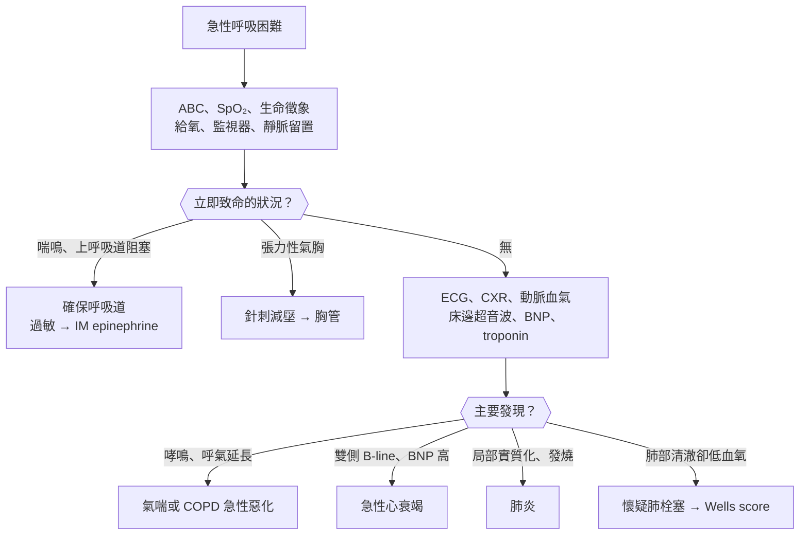
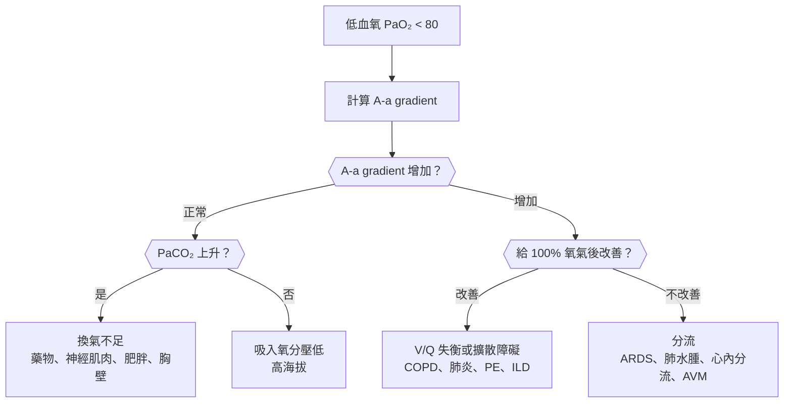
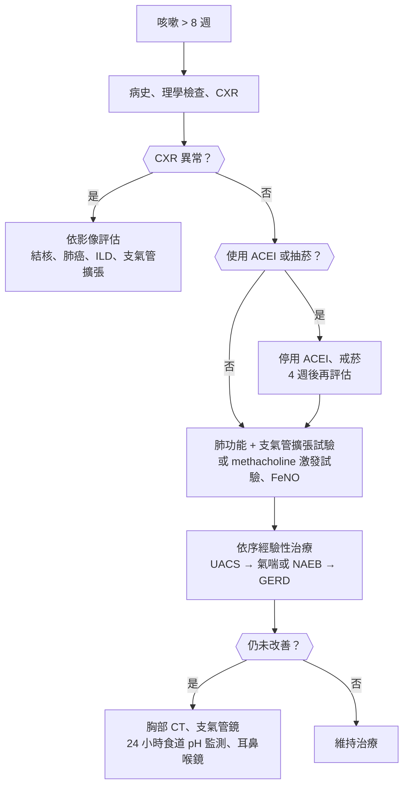
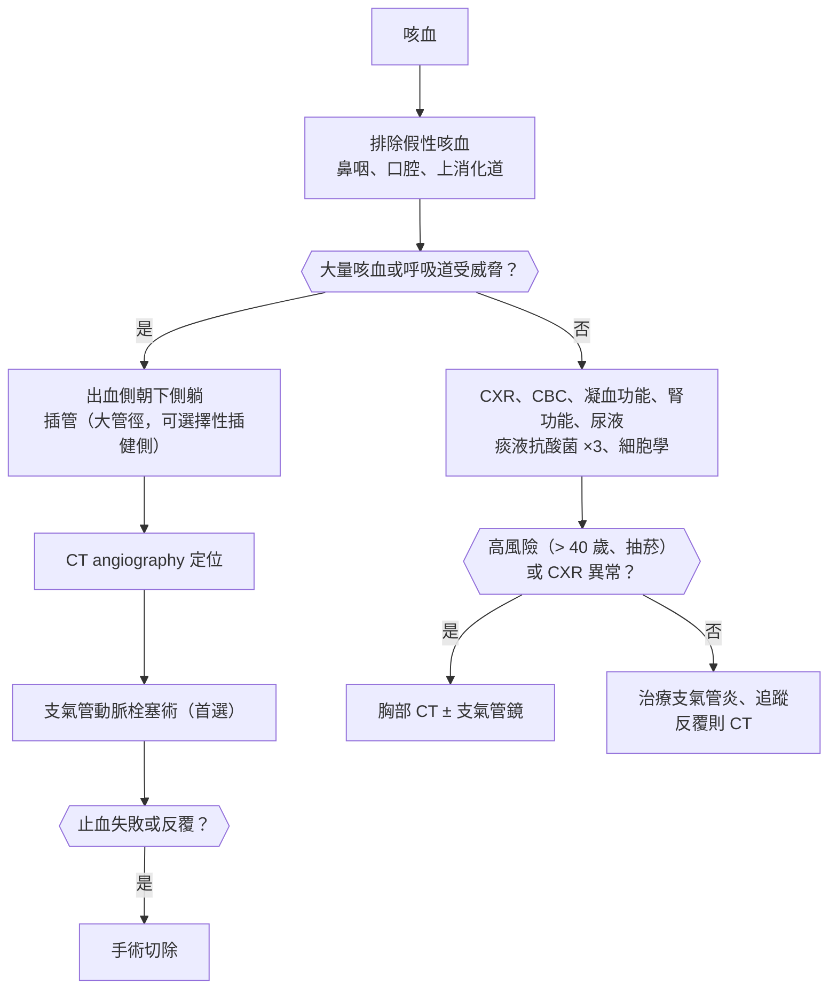
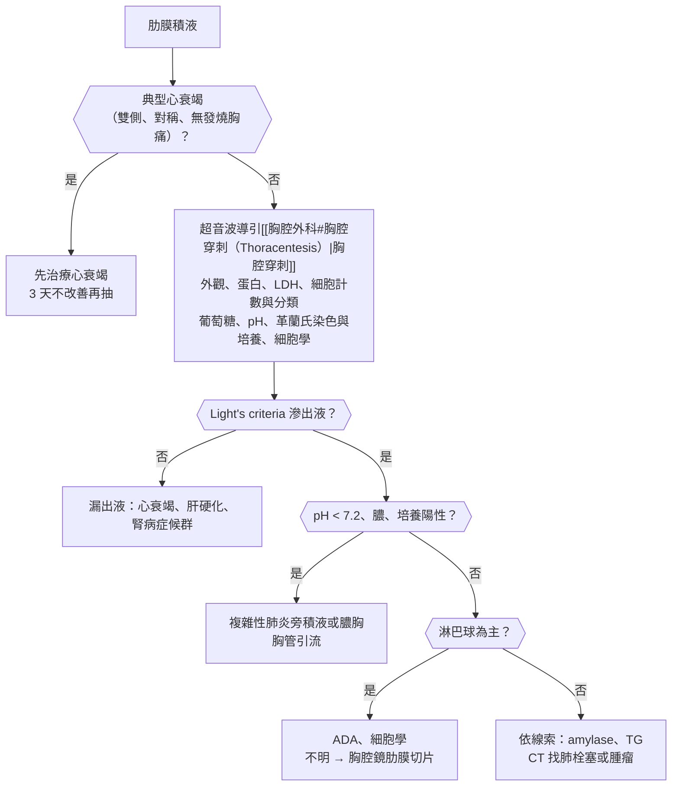

## 呼吸困難（Dyspnea）

### 急性呼吸困難（Acute Dyspnea）

#### 定義與分類

- **呼吸困難（dyspnea）**：主觀的呼吸不適感；與客觀的**呼吸急促（tachypnea，RR > 20/min）**、**換氣過度（hyperventilation）**不同。
- **急性**：數分鐘到數天內發生；第一步看**生命徵象與呼吸做功**，危及生命者先處理再診斷。
- 依機轉分類：
    - **氣道**：上呼吸道阻塞（異物、會厭炎、過敏性休克）、**氣喘**、**COPD 急性惡化**。
    - **肺實質**：肺炎、肺水腫、ARDS、肺出血、間質性肺病急性惡化。
    - **肋膜與胸壁**：**氣胸**、大量肋膜積液、肋骨骨折與連枷胸（flail chest）。
    - **肺血管**：**肺栓塞**、肺高壓惡化。
    - **心臟**：**急性心衰竭**、急性冠心症、心包填塞、心律不整、急性瓣膜疾病（乳突肌斷裂）。
    - **代謝與全身**：**代謝性酸中毒（Kussmaul respiration，DKA）**、敗血症、嚴重貧血、一氧化碳中毒、水楊酸中毒。
    - **神經肌肉**：重症肌無力危象、Guillain-Barré syndrome、高位[[神經外科#脊髓損傷（Spinal Cord Injury）|脊髓損傷]]、有機磷中毒。
    - **心因性**：恐慌發作、換氣過度症候群（排除性診斷）。

#### Red flags

- **意識改變、無法說完整句子、端坐呼吸（tripod position）、使用呼吸輔助肌、矛盾呼吸（paradoxical breathing）**。
- **SpO₂ < 90%**、RR > 30/min 或 < 8/min、心搏過速 > 120 或心搏過緩。
- **安靜胸（silent chest）**：嚴重氣喘時聽不到哮鳴音 → 即將呼吸停止。
- **吸氣性喘鳴（stridor）**、流口水、聲音改變 → 上呼吸道阻塞。
- 單側呼吸音消失 + 低血壓 + 頸靜脈怒張 + 氣管偏移 → **張力性氣胸**。
- 低血壓、休克、新發心律不整、胸痛。

#### 鑑別診斷

| 系統 | 疾病 | 鑑別關鍵 |
|---|---|---|
| **上呼吸道** | [[耳鼻喉科#氣管異物\|異物]]、[[耳鼻喉科#急性會厭炎（Acute Epiglottitis / Supraglottitis）\|會厭炎]]、[[免疫風濕科#過敏性休克（Anaphylaxis）\|過敏性休克]]、[[免疫風濕科#血管性水腫（Angioedema）\|血管性水腫]]、[[耳鼻喉科#深層頸部感染（Deep Neck Space Infections）\|深頸部感染]] | **吸氣性喘鳴**、流口水、聲音沙啞；[[皮膚科#蕁麻疹（Urticaria）\|蕁麻疹]]、低血壓 |
| **下呼吸道** | [[胸腔內科#氣喘（Asthma）\|氣喘]]、[[胸腔內科#急性惡化（COPD AE）\|COPD 急性惡化]]、[[胸腔內科#支氣管擴張症（Bronchiectasis）\|支氣管擴張急性惡化]] | **呼氣性哮鳴（wheezing）**、呼氣延長、過敏或抽菸史 |
| **肺實質** | [[胸腔內科#社區型肺炎（CAP）\|肺炎]]、[[胸腔內科#急性呼吸窘迫症候群（ARDS）\|ARDS]]、[[胸腔內科#特發性肺纖維化（Idiopathic Pulmonary Fibrosis, IPF）\|IPF 急性惡化]]、[[胸腔內科#Pneumocystis jirovecii（PJP）\|PJP]]、瀰漫性肺泡出血 | 發燒、痰、局部囉音（crackles）；免疫低下 → PJP |
| **肋膜** | **張力性氣胸**、[[胸腔內科#氣胸（Pneumothorax）\|氣胸]]、[[胸腔內科#肋膜積液（Pleural Effusion）\|大量肋膜積液]]、[[胸腔外科#血胸（Hemothorax）\|血胸]] | 單側呼吸音減弱；叩診：氣胸 **鼓音（hyperresonance）**、積液 **濁音（dullness）** |
| **肺血管** | [[胸腔內科#肺栓塞（Pulmonary Embolism）\|肺栓塞]]、[[胸腔內科#肺高壓（Pulmonary Hypertension）\|肺高壓]] | **突發、肺部聽診正常卻低血氧**、心搏過速、[[心血管外科#深部靜脈栓塞（DVT）\|DVT]] 危險因子 |
| **心臟** | [[心臟內科#急性心衰竭（Acute Decompensated HF）\|急性心衰竭]]、[[心臟內科#急性冠心症（ACS）\|ACS]]、[[心臟內科#心包填塞（Cardiac Tamponade）\|心包填塞]]、心律不整、[[心臟內科#二尖瓣狹窄（Mitral Stenosis, MS）\|二尖瓣狹窄]] | **端坐呼吸、陣發性夜間呼吸困難（PND）**、頸靜脈怒張、S3、雙側囉音、下肢水腫 |
| **代謝與全身** | [[代謝內分泌科#糖尿病急性併發症\|DKA]]、敗血症、嚴重[[血液腫瘤科#貧血（Anemia）\|貧血]]、一氧化碳中毒、水楊酸中毒 | **深快的 Kussmaul 呼吸**、肺部清澈；陰離子間隙↑ |
| **神經肌肉** | [[神經內科#重症肌無力（Myasthenia Gravis, MG）\|重症肌無力危象]]、[[神經內科#Guillain-Barré Syndrome（GBS）\|GBS]]、[[神經內科#肌萎縮側索硬化症（ALS）\|ALS]]、高位脊髓損傷 | **淺快呼吸**、肺部清澈、**肺活量（FVC）下降**、眼瞼下垂、四肢無力 |
| **心因性** | [[精神科#恐慌症（Panic Disorder）\|恐慌發作]]、換氣過度症候群 | 手指口周麻木、手足抽搐（呼吸鹼中毒）；**SpO₂ 正常** |

#### 易混淆鑑別

:::compare[心因性 vs 肺因性急性呼吸困難（急性心衰竭、COPD 急性惡化、氣喘）]
| | 急性心衰竭 | COPD 急性惡化 | 氣喘急性發作 |
|---|---|---|---|
| 病史 | 心臟病、高血壓、**端坐呼吸、PND**、體重增加 | **抽菸、慢性咳痰**、年長 | **年輕、過敏、夜間或清晨症狀**、反覆發作 |
| 聽診 | **雙側底部細囉音（crackles）**、S3；可有哮鳴音（**cardiac asthma**） | 呼吸音減弱、哮鳴音、粗囉音 | **瀰漫性呼氣哮鳴音**、呼氣延長 |
| 頸靜脈、水腫 | **頸靜脈怒張、下肢凹陷性水腫** | 肺心症（cor pulmonale）時可有 | 無 |
| BNP | **BNP > 400 pg/mL 支持**；**:red[< 100] 幾乎排除** | 正常或輕度上升（肺心症） | 正常 |
| CXR | **心臟擴大、Kerley B line、肺門蝴蝶狀浸潤、肋膜積液** | **過度充氣**、橫膈變平 | 過度充氣或正常 |
| 床邊超音波 | **多條 B-line（雙側）** | A-line | A-line |
| 治療 | **利尿劑、硝酸鹽、[[胸腔內科#非侵入性正壓通氣（NPPV / NIV）\|NIV]]** | 支氣管擴張劑、類固醇、抗生素、**NIV** | SABA、類固醇、MgSO₄ |
:::

:::compare[呼吸困難時的呼吸型態]
| 型態 | 特徵 | 原因 |
|---|---|---|
| **Kussmaul** | **深而快、規律** | **代謝性酸中毒**（DKA、尿毒、乳酸中毒、水楊酸） |
| **Cheyne-Stokes** | 由淺到深再到淺，接著呼吸暫停，週期性 | **心衰竭**、中風、高海拔、腦幹以上的病變 |
| **Biot（ataxic）** | 不規則、深淺不一、暫停不定時 | **延腦（medulla）病變** → 即將呼吸停止 |
| **淺快呼吸** | 潮氣容積小 | 神經肌肉無力、限制性肺病、肋膜性疼痛、肥胖 |
| **呼氣延長 + 噘嘴呼吸（pursed-lip breathing）** | | **COPD**（增加呼氣末氣道壓力、避免氣道塌陷） |
| **矛盾呼吸（腹部吸氣時內縮）** | | **橫膈無力**（神經肌肉疾病）、呼吸肌疲乏 |
| **嘆氣樣呼吸（sighing）** | 正常呼吸中夾雜深嘆氣 | 焦慮、換氣過度症候群 |
:::

:::compare[張力性氣胸、大量肋膜積液、肺塌陷、肺炎實質化]
| | 張力性氣胸 | 大量肋膜積液 | 肺塌陷（atelectasis） | 肺炎實質化（consolidation） |
|---|---|---|---|---|
| 氣管 | **推向對側** | **推向對側** | **拉向患側** | 正中 |
| 叩診 | **鼓音** | **濁音（stony dull）** | 濁音 | 濁音 |
| 呼吸音 | **消失** | **消失** | 減弱或消失 | **支氣管呼吸音** |
| 觸覺震顫（tactile fremitus） | 減弱 | 減弱 | 減弱 | **增強** |
| 羊音（egophony） | 無 | 積液上緣可有 | 無 | **有** |
:::

#### 問診與理學檢查

- **發作方式**：
    - **突發（數秒到數分鐘）**：肺栓塞、氣胸、異物、過敏、急性肺水腫、心律不整。
    - 數小時到數天：肺炎、心衰竭惡化、COPD 或氣喘惡化。
- 伴隨症狀：胸痛（肋膜性 vs 壓迫性）、發燒、咳嗽、痰、咳血、哮鳴、下肢腫脹、心悸。
- 姿勢相關：**端坐呼吸（orthopnea）**、**PND**（心衰竭）、**平躺呼吸（platypnea，坐起更喘 → 肝肺症候群、心房中膈缺損）**、側臥呼吸（trepopnea）。
- 危險因子：抽菸、心臟病、近期手術或長途飛行（PE）、過敏原、職業暴露、免疫狀態。
- 理學檢查：
    - **生命徵象、SpO₂、能否說完整句子**、呼吸輔助肌、意識。
    - 氣管位置、頸靜脈、**兩側呼吸音是否對稱**、叩診、哮鳴音或囉音、心音（S3、雜音）、下肢水腫與 DVT 徵象。

#### 檢查流程

- **動脈血氣**：看 PaO₂、PaCO₂、pH、**A-a gradient**；見[[#低血氧與呼吸衰竭（Hypoxemia / Respiratory Failure）|低血氧與呼吸衰竭]]。
- **床邊肺部超音波（BLUE protocol）**：B-line（肺水腫、肺炎、ILD）、**沒有肺滑動（lung sliding）+ lung point → 氣胸**、肋膜積液、右心擴大（PE）。
- **肺栓塞的診斷流程**：

::chart{id="pe-diagnosis"}

- **Wells score（PE）**：DVT 臨床徵象 **3**、PE 比其他診斷更可能 **3**、心跳 > 100 **1.5**、4 週內手術或臥床 ≥ 3 天 **1.5**、過去 DVT 或 PE **1.5**、咳血 **1**、惡性腫瘤 **1**；**:red[> 4 分] → PE likely**。
- **PERC rule**（臨床可能性低時使用，8 項全符合 → 不需驗 D-dimer）：
    - 年齡 < 50、心跳 < 100、**SpO₂ ≥ 95%**、無咳血。
    - 未使用雌激素、無 DVT／PE 病史、無單側下肢腫脹、4 週內無手術或外傷。
- **年齡校正 D-dimer**：> 50 歲者，cut-off = **:red[年齡 × 10 μg/L]**（FEU）。

#### 初步處置

- 氧氣：目標 **SpO₂ 94–98%**；**COPD 或有 CO₂ 滯留風險 → :red[88–92%]**。
- 呼吸衰竭 → NIV（COPD 急性惡化、心因性肺水腫最有效）或插管。
- 依病因：
    - **急性氣喘發作**：見下方共用流程。
    - **COPD 急性惡化**：SABA ± SAMA、prednisolone 40 mg × 5 天、有膿痰時加抗生素、**NIV（:red[pH < 7.35 且 PaCO₂ > 45]）**。
    - **急性心衰竭**：利尿劑、硝酸鹽（收縮壓夠時）、NIV。
    - **肺栓塞**：抗凝血；休克 → 血栓溶解劑。
    - **過敏性休克**：**IM epinephrine :red[0.5 mg]（大腿外側）**。

::chart{id="asthma-exacerbation"}

:::pitfall
COPD 急性惡化病人給高濃度氧氣（例如 non-rebreather mask）把 SpO₂ 拉到 100% → V/Q 失衡加重、Haldane effect，PaCO₂ 上升、CO₂ 麻醉（意識變差）。COPD 病人目標 SpO₂ 88–92%，用 Venturi mask 精確給氧，並追蹤動脈血氣。
:::

:::pitfall
嚴重氣喘病人哮鳴音「消失」被當成好轉 → 其實是氣流太少聽不到（silent chest），PaCO₂ 從偏低回到「正常」也代表呼吸肌疲乏，即將呼吸停止。這時要準備插管。
:::

:::exam
- 突發呼吸困難、肺部聽診正常、低血氧、心搏過速 → 肺栓塞；ABG 典型為低血氧、低碳酸、A-a gradient 增加。
- 深而快的呼吸 + 肺部清澈 + 高血糖 → DKA 的 Kussmaul 呼吸（代償代謝性酸中毒）。
- BNP < 100 pg/mL → 急性心衰竭可能性很低。
:::

### 慢性呼吸困難（Chronic Dyspnea）

#### 定義與分類

- **持續 > 4–8 週**的呼吸困難，多為**運動時呼吸困難（dyspnea on exertion, DOE）**。
- **約 2/3 的原因是心臟或肺臟**：**氣喘、COPD、間質性肺病、心衰竭、心肌缺血**；其餘為貧血、體能衰退、肥胖、神經肌肉、心因性。
- 嚴重度：**mMRC 呼吸困難量表**（0–4 級）、NYHA 心功能分級。

| mMRC | 描述 |
|---|---|
| 0 | 只有劇烈運動時喘 |
| 1 | 快走或爬小坡時喘 |
| 2 | 走路比同齡人慢，或自己的速度走平地需停下來喘 |
| 3 | 走平地約 **100 公尺或幾分鐘**就要停下 |
| 4 | 喘到無法出門，或穿脫衣服就喘 |

#### Red flags

- 休息時呼吸困難、近期快速惡化。
- 體重減輕、咳血、杵狀指 → 肺癌、間質性肺病。
- 暈厥、運動時胸痛 → **肺高壓**、主動脈瓣狹窄、[[心臟內科#肥厚型心肌病變（Hypertrophic Cardiomyopathy, HCM）|HCM]]。
- 端坐呼吸 + 腹部矛盾呼吸 → **雙側橫膈麻痺**、神經肌肉疾病。

#### 鑑別診斷

| 類別 | 疾病 | 鑑別關鍵 |
|---|---|---|
| **阻塞性肺病** | **[[胸腔內科#慢性阻塞性肺病（COPD）\|COPD]]**、**[[胸腔內科#氣喘（Asthma）\|氣喘]]**、[[胸腔內科#支氣管擴張症（Bronchiectasis）\|支氣管擴張]]、細支氣管炎（bronchiolitis obliterans） | 肺功能 **FEV₁/FVC < 0.7**；氣喘 → 支氣管擴張劑可逆 |
| **間質性肺病** | [[胸腔內科#特發性肺纖維化（Idiopathic Pulmonary Fibrosis, IPF）\|IPF]]、[[胸腔內科#結締組織疾病相關肺病\|結締組織疾病相關]]、[[胸腔內科#職業性/暴露性肺病\|塵肺與石綿肺]]、[[胸腔內科#過敏性肺炎（Hypersensitivity Pneumonitis, HP）\|過敏性肺炎]]、[[胸腔內科#結節病（Sarcoidosis）\|類肉瘤病]]、藥物（amiodarone、methotrexate、bleomycin、nitrofurantoin） | **乾咳、雙側底部 Velcro 囉音、杵狀指**；**限制性 + [[胸腔內科#DLCO\|DLCO]]↓** |
| **肺血管** | [[胸腔內科#肺高壓（Pulmonary Hypertension）\|肺高壓]]、**慢性血栓栓塞性肺高壓（CTEPH）** | 肺功能正常但 **DLCO 單獨下降**、P2 增強、右心衰竭 |
| **心臟** | [[心臟內科#心衰竭（Heart Failure）\|心衰竭（含 HFpEF）]]、[[心臟內科#穩定型心絞痛（Stable Angina）\|穩定型心絞痛]]（呼吸困難可為缺血等同症狀）、[[心臟內科#主動脈瓣狹窄（Aortic Stenosis, AS）\|主動脈瓣狹窄]]、二尖瓣疾病、[[心臟內科#縮窄性心包膜炎（Constrictive Pericarditis）\|縮窄性心包膜炎]]、心律不整 | BNP、心臟超音波 |
| **胸壁與肋膜** | **肥胖**、[[胸腔內科#肥胖低通氣症候群（Obesity Hypoventilation Syndrome, OHS）\|肥胖低通氣症候群]]、[[骨科#脊柱側彎（Scoliosis）\|脊柱側彎]]、慢性肋膜積液、肋膜增厚、[[胸腔內科#惡性肋膜間皮瘤（Malignant Mesothelioma）\|間皮瘤]] | 限制性、**DLCO 正常** |
| **神經肌肉** | [[神經內科#肌萎縮側索硬化症（ALS）\|ALS]]、[[神經內科#重症肌無力（Myasthenia Gravis, MG）\|重症肌無力]]、肌肉病變、橫膈麻痺 | **平躺時更喘**、FVC 坐臥差 > 20%、最大吸氣壓下降 |
| **全身** | **貧血**、[[代謝內分泌科#甲狀腺機能亢進（Hyperthyroidism）\|甲狀腺功能亢進]]或低下、體能衰退（deconditioning）、代謝性酸中毒（CKD） | 肺功能與心臟檢查正常 |
| **上呼吸道** | [[胸腔外科#氣管狹窄（Tracheal Stenosis）\|氣管狹窄]]（插管後）、[[耳鼻喉科#聲帶麻痺（Vocal Cord Paralysis）\|聲帶麻痺]]、甲狀腺腫壓迫 | **flow-volume loop 平頂** |
| **心因性** | 焦慮、換氣過度症候群 | 排除器質性原因 |

#### 易混淆鑑別

:::compare[肺功能型態]
| | 阻塞性 | 限制性：肺實質（ILD） | 限制性：肺外（肥胖、胸壁、神經肌肉） | 肺血管疾病 |
|---|---|---|---|---|
| FEV₁/FVC | **↓（< 0.7）** | 正常或↑ | 正常或↑ | 正常 |
| TLC | 正常或↑（過度充氣） | **↓（< 80%）** | **↓** | 正常 |
| RV | **↑（空氣滯留）** | ↓ | 神經肌肉：**↑**（呼不出去） | 正常 |
| DLCO | **COPD（肺氣腫）↓**、**氣喘正常或↑** | **↓** | **正常** | **↓（單獨下降）** |
| 代表 | COPD、氣喘、支氣管擴張 | IPF、類肉瘤病、塵肺 | 肥胖、脊柱側彎、ALS | 肺高壓、CTEPH、貧血 |
- **DLCO 上升**：氣喘、肺泡出血、紅血球增多症、肥胖、左向右分流。
:::

:::compare[COPD vs 氣喘]
| | COPD | 氣喘 |
|---|---|---|
| 發病年齡 | **> 40 歲** | 多在兒童或年輕時 |
| 危險因子 | **抽菸（最重要）**、空污、職業粉塵、α1-antitrypsin 缺乏 | 異位性體質、過敏原、家族史 |
| 症狀型態 | **慢性、漸進**、持續有痰 | **陣發性、變動大**、夜間或清晨惡化 |
| 支氣管擴張試驗 | 不完全可逆（用藥後 **FEV₁/FVC 仍 < 0.7**） | **可逆**：FEV₁ 增加 **:red[≥ 12% 且 ≥ 200 mL]** |
| DLCO | 肺氣腫 → **↓** | **正常或↑** |
| 痰液與血液嗜酸性球 | 多為嗜中性球 | **嗜酸性球↑**、FeNO↑ |
| 治療主軸 | **LAMA、LABA**；ICS 只用於嗜酸性球高或反覆惡化 | **ICS 為控制藥主軸**；**不可單用 LABA** |
- 兩者並存：**氣喘與 COPD 重疊（ACO）** → 治療要含 ICS。
:::

:::compare[HFrEF vs HFpEF 的慢性呼吸困難]
| | HFrEF | HFpEF |
|---|---|---|
| LVEF | **≤ 40%** | **≥ 50%** |
| 族群 | 男性、心肌梗塞後 | **老年女性、高血壓、肥胖、糖尿病、心房顫動** |
| 心臟超音波 | 左心室擴大、收縮差 | **左心室肥厚、左心房擴大、舒張功能異常** |
| 治療 | **四大藥物**（ARNI／ACEI、β 阻斷劑、MRA、SGLT2 抑制劑） | **SGLT2 抑制劑**、利尿劑、控制血壓與共病 |
:::

#### 問診與理學檢查

- 多久、進展速度、**多少活動量會喘**（mMRC）、姿勢、夜間症狀、喘鳴、咳嗽與痰。
- **抽菸（包年）**、職業與環境暴露（粉塵、石綿、鳥類、黴菌）、用藥（amiodarone、β 阻斷劑、methotrexate）、結締組織疾病症狀（雷諾氏現象、關節痛、皮疹）。
- 理學檢查：BMI、杵狀指、發紺、頸靜脈、**Velcro 囉音**、哮鳴音、P2 增強、心雜音、水腫、肌力與呼吸型態。

#### 檢查流程

- 第一線：**CBC（貧血）**、**CXR**、**ECG**、**肺功能（spirometry + 支氣管擴張試驗）**、BNP、TSH。
- 依結果：
    - 阻塞性 → 氣喘或 COPD 分期；可逆性不明 → **支氣管激發試驗（methacholine challenge）**。
    - 限制性 → **全肺容積、DLCO、高解析電腦斷層（HRCT）**。
    - 心臟懷疑 → **心臟超音波**、負荷試驗。
    - 以上皆正常、DLCO 下降 → 肺高壓（心臟超音波估肺動脈壓）、**V/Q scan 排除 CTEPH**。
    - 仍不明 → **心肺運動測試（CPET）**：區分心因性、肺因性、體能衰退。

#### 初步處置

- 治療病因：COPD 與氣喘吸入藥物、心衰竭藥物、貧血矯正、減重。
- 戒菸（所有肺病最重要的介入）、**[[復健科#肺部復健（Pulmonary Rehabilitation）|肺部復健]]（pulmonary rehabilitation）**、疫苗（流感、肺炎鏈球菌）。
- 長期氧氣治療：**:red[PaO₂ ≤ 55 mmHg 或 SpO₂ ≤ 88%]**（或 PaO₂ 56–59 合併肺心症、紅血球增多症）→ 每天 > 15 小時，**可延長 COPD 存活**。

:::pitfall
慢性呼吸困難的老人只做了 CXR 和心臟超音波就歸因於「年紀大、體力差」→ 錯過 COPD、間質性肺病、肺高壓或貧血。肺功能檢查（含 DLCO）是慢性呼吸困難的必要檢查。
:::

:::exam
- 肺功能 FEV₁/FVC < 0.7、DLCO 下降 → 肺氣腫；FEV₁/FVC < 0.7、DLCO 正常、支氣管擴張劑可逆 → 氣喘。
- 限制性型態 + DLCO 下降 → 間質性肺病；限制性型態 + DLCO 正常 → 肥胖、胸壁、神經肌肉疾病。
- 肺功能與 CXR 正常、DLCO 單獨下降 → 肺血管疾病（肺高壓、CTEPH）或貧血。
:::

### 低血氧與呼吸衰竭（Hypoxemia / Respiratory Failure）

#### 定義與分類

- **低血氧（hypoxemia）**：**PaO₂ < 80 mmHg**；**< 60 mmHg（約 SpO₂ 90%）** 為氧合衰竭的界線（[[胸腔內科#氧氣解離曲線|氧氣解離曲線]]陡降處）。
- **缺氧（hypoxia）**：組織氧氣不足；可以沒有低血氧（貧血、一氧化碳中毒、氰化物中毒、心輸出量低）。
- **呼吸衰竭（respiratory failure）**：

| 類型 | 定義 | 機轉 | 常見原因 |
|---|---|---|---|
| **第一型（低血氧型）** | **PaO₂ < 60 mmHg**、PaCO₂ 正常或↓ | V/Q 失衡、分流、擴散障礙 | 肺炎、ARDS、肺水腫、PE、ILD |
| **第二型（高碳酸型）** | **PaCO₂ > 45 mmHg**、**pH < 7.35（急性）** | **換氣不足** | **COPD 急性惡化**、神經肌肉疾病、藥物過量、肥胖低通氣、胸壁疾病 |
| 第三型（術後） | 肺塌陷 | 功能肺餘量↓ | 腹部或胸部手術後 |
| 第四型（休克） | 呼吸肌灌流不足 | | 各種休克 |

- **低血氧的五大機轉**：

| 機轉 | A-a gradient | 對氧氣的反應 | 例子 |
|---|---|---|---|
| **換氣不足（hypoventilation）** | **正常** | 好 | [[精神科#鴉片類（Opioids）\|鴉片類]]過量、神經肌肉疾病、肥胖低通氣 |
| **吸入氧分壓低** | **正常** | 好 | 高海拔 |
| **V/Q 失衡** | **↑** | **好** | **最常見**：COPD、氣喘、肺炎、PE |
| **分流（shunt）** | **↑** | **差（給 100% 氧氣也上不去）** | **ARDS**、肺水腫、肺塌陷、心內右向左分流、肺動靜脈畸形 |
| **擴散障礙** | **↑** | 好 | ILD（運動時明顯） |

- **A-a gradient** = PAO₂ − PaO₂；PAO₂ = FiO₂ × (760 − 47) − PaCO₂ / 0.8。
    - 室內空氣：PAO₂ ≈ **150 − PaCO₂ / 0.8**。
    - 正常值約 **年齡 / 4 + 4**（年輕人 < 10–15 mmHg）。

#### Red flags

- **SpO₂ < 90%** 或 PaO₂ < 60 mmHg 給氧後仍無法改善。
- **PaCO₂ 上升 + pH < 7.35** → 急性高碳酸呼吸衰竭；意識變差（CO₂ narcosis）。
- 呼吸肌疲乏：矛盾呼吸、RR > 35 或突然變慢、無法說話。
- **SpO₂ 正常但病人看起來很糟**：一氧化碳中毒、氰化物中毒、嚴重貧血、休克。

#### 鑑別診斷

| 機轉 | 疾病 | 鑑別關鍵 |
|---|---|---|
| **換氣不足（中樞）** | 鴉片類、benzodiazepine、酒精過量；腦幹中風；[[胸腔內科#肥胖低通氣症候群（Obesity Hypoventilation Syndrome, OHS）\|肥胖低通氣症候群]]；嚴重甲狀腺功能低下 | 瞳孔縮小（鴉片）→ **naloxone** |
| **換氣不足（神經肌肉）** | [[神經內科#Guillain-Barré Syndrome（GBS）\|GBS]]、[[神經內科#重症肌無力（Myasthenia Gravis, MG）\|重症肌無力]]、[[神經內科#肌萎縮側索硬化症（ALS）\|ALS]]、[[感染科#C. botulinum（Botulism，肉毒桿菌）\|肉毒桿菌]]中毒、[[腎臟內科#低血鉀（Hypokalemia，K⁺ < 3.5 mEq/L）\|低血鉀]]或[[腎臟內科#低血磷（Hypophosphatemia）\|低血磷]]、高位[[神經外科#脊髓損傷（Spinal Cord Injury）\|脊髓損傷]] | **:red[FVC < 15–20 mL/kg]、NIF 弱於 −30 cmH₂O → 考慮插管** |
| **換氣不足（胸壁）** | 嚴重脊柱側彎、連枷胸、極度肥胖 | |
| **V/Q 失衡** | [[胸腔內科#慢性阻塞性肺病（COPD）\|COPD]]、氣喘、肺炎、[[胸腔內科#肺栓塞（Pulmonary Embolism）\|肺栓塞]]、ILD | 給氧可改善 |
| **分流** | [[胸腔內科#急性呼吸窘迫症候群（ARDS）\|ARDS]]、[[心臟內科#急性心衰竭（Acute Decompensated HF）\|心因性肺水腫]]、肺炎（大片實質化）、肺塌陷、[[心血管外科#法洛氏四合症（Tetralogy of Fallot, TOF）\|發紺性心臟病]]、**Eisenmenger syndrome**、肺動靜脈畸形（遺傳性出血性微血管擴張症 HHT）、**肝肺症候群** | **100% 氧氣仍無法改善** |
| **擴散障礙** | [[胸腔內科#間質性肺病（Interstitial Lung Disease, ILD）\|ILD]]、[[胸腔內科#肺高壓（Pulmonary Hypertension）\|肺高壓]]、肺氣腫 | **運動時血氧明顯下降** |
| **血氧測量誤差（非真正低血氧）** | 變性血紅素（methemoglobinemia）、**一氧化碳中毒（SpO₂ 假性正常）**、周邊灌流差、指甲油、深色皮膚 | 用 **co-oximetry** 測各種血紅素 |

#### 易混淆鑑別

:::compare[ARDS vs 心因性肺水腫]
| | ARDS | 心因性肺水腫 |
|---|---|---|
| 機轉 | **肺泡微血管通透性增加** | **肺微血管靜水壓上升** |
| 誘因 | **敗血症（最常見）**、肺炎、吸入、胰臟炎、大量輸血、外傷 | 急性心衰竭、ACS、[[心臟內科#高血壓危象（Hypertensive Crisis）\|高血壓危象]]、心律不整、瓣膜病 |
| 定義（Berlin） | **1 週內**、雙側浸潤、**非心衰竭或輸液過量能完全解釋**、**PaO₂/FiO₂ ≤ 300（PEEP ≥ 5）** | |
| 嚴重度 | 輕度 :red[200–300]、中度 100–200、重度 **≤ 100** | |
| 心臟 | 心臟大小正常、**PCWP ≤ 18 mmHg** | 心臟擴大、**PCWP > 18**、BNP↑ |
| CXR | 周邊分布浸潤、**沒有 Kerley B line** | 中央蝴蝶狀、Kerley B line、肋膜積液 |
| 治療 | **低潮氣容積（:red[6 mL/kg] 理想體重）、平台壓 :red[≤ 30]**、高 PEEP、**俯臥（重度）**、限制輸液 | **利尿劑、硝酸鹽、NIV** |
:::

:::compare[SpO₂ 不可靠的情況]
| | 一氧化碳中毒 | 變性血紅素血症（MetHb） | 氰化物中毒 |
|---|---|---|---|
| SpO₂ | **假性正常**（COHb 被當成 O₂Hb） | **固定在約 85%**，給氧不改善 | 正常 |
| PaO₂ | **正常** | **正常** | 正常 |
| 飽和度差（SpO₂ vs 血氣計算 SaO₂） | 有 | **有（saturation gap）** | 無 |
| 外觀 | 頭痛、噁心、意識改變；**櫻桃紅（少見）** | **巧克力色血液**、發紺但不喘 | **靜脈血呈鮮紅色**、乳酸極高 |
| 原因 | 火災、燒炭、熱水器 | **dapsone、[[麻醉科#局部麻醉劑（Local Anesthetics）\|局部麻醉劑]]（benzocaine、lidocaine）、nitrite**、先天 | 火災（塑膠燃燒）、nitroprusside |
| 治療 | **100% 氧氣**；昏迷、懷孕、COHb 高 → **高壓氧** | **Methylene blue**（**G6PD 缺乏禁用** → 改用 ascorbic acid、換血） | **Hydroxocobalamin** |
:::

#### 問診與理學檢查

- 用藥（鎮靜劑、鴉片）、肌肉無力、火災或燒炭、新藥（dapsone、局部麻醉劑）。
- 理學檢查：呼吸速率與型態、意識、瞳孔、發紺、呼吸音、心雜音、杵狀指、肌力。

#### 檢查流程

- 動脈血氣、CXR、ECG；依情況加 CT、心臟超音波（含氣泡試驗找分流）、co-oximetry、毒物篩檢。
- 神經肌肉疾病：每 4–6 小時測 **FVC 與 NIF**（SpO₂ 和血氣變差時已經太晚）。

#### 初步處置

- 給氧裝置：

| 裝置 | 流速 | FiO₂ | 用途 |
|---|---|---|---|
| 鼻導管 | 1–6 L/min | 24–44%（每 1 L/min 約 +4%） | 輕度 |
| **Venturi mask** | 依顏色 | **24–50%，精確** | **COPD** |
| 非再吸入面罩 | 10–15 L/min | 60–90% | 嚴重低血氧短期使用 |
| **高流量鼻導管（HFNC）** | 最高 60 L/min | 21–100% | 第一型呼吸衰竭、拔管後 |
| **NIV（BiPAP）** | | | **COPD 急性惡化、心因性肺水腫**、免疫低下 |

- **插管適應症**：保護呼吸道失敗（意識差、無法排痰）、給氧仍嚴重低血氧、呼吸肌疲乏、**NIV 失敗**、血行動力學不穩。
- NIV 禁忌：意識不清無法配合、無法保護呼吸道、大量分泌物、嘔吐、上消化道出血、顏面外傷、血行動力學不穩。
- 詳見[[胸腔內科#呼吸衰竭|呼吸衰竭]]、[[胸腔內科#機械通氣（Mechanical Ventilation）|機械通氣]]。

:::pitfall
Guillain-Barré 或重症肌無力危象病人 SpO₂ 一直正常，就以為呼吸沒問題 → 突然呼吸停止。神經肌肉疾病的呼吸衰竭是換氣不足，SpO₂ 在給氧下可維持到最後一刻；要追蹤 FVC 與 NIF，FVC < 20 mL/kg 就要準備插管。
:::

:::exam
- 低血氧 + A-a gradient 正常 + PaCO₂ 上升 → 換氣不足（鴉片類過量、神經肌肉疾病）。
- 給 100% 氧氣低血氧仍無法改善 → 分流（ARDS、心內右向左分流）。
- 吃了 dapsone 或用了 benzocaine 後發紺、SpO₂ 卡在 85%、PaO₂ 正常 → 變性血紅素血症 → methylene blue。
:::

## 咳嗽與咳血（Cough and Hemoptysis）

### 急性咳嗽（Acute Cough）

#### 定義與分類

- **依時間分類（成人）**：
    - **急性 < :red[3 週]**。
    - **亞急性 3–8 週**：多為**感染後咳嗽（post-infectious cough）**、**百日咳**。
    - **慢性 > :red[8 週]**：見[[#慢性咳嗽（Chronic Cough）|慢性咳嗽]]。
    - 兒童慢性咳嗽定義為 > 4 週。
- 急性咳嗽最常見原因：**上呼吸道感染（普通感冒，common cold）**；其次為急性支氣管炎、鼻竇炎、過敏性鼻炎、氣喘或 COPD 惡化。
- **急性支氣管炎（acute bronchitis）**：**> 90% 為病毒**，咳嗽可持續 1–3 週，痰可為黃綠色（**不代表細菌感染**）→ **不需抗生素**。

#### Red flags

- 呼吸困難、低血氧、高燒、寒顫、肋膜性胸痛 → 肺炎。
- **咳血**、體重減輕、盜汗 → 結核、肺癌。
- 突發嗆咳（兒童、老人、意識不清者）→ **異物吸入**、吸入性肺炎。
- 生命徵象異常（心跳 > 100、RR > 24、體溫 > 38°C）或肺部局部異常 → 照 CXR。

#### 鑑別診斷

| 類別 | 疾病 | 鑑別關鍵 |
|---|---|---|
| **上呼吸道** | 普通感冒、[[感染科#Influenza\|流感]]、[[耳鼻喉科#鼻竇炎（Rhinosinusitis）\|急性鼻竇炎]]、[[耳鼻喉科#急性咽扁桃腺炎（Acute Pharyngotonsillitis）\|咽喉炎]]、[[耳鼻喉科#過敏性鼻炎（Allergic Rhinitis）\|過敏性鼻炎]] | 流鼻水、喉嚨痛；流感 → 突發高燒、全身痠痛 |
| **下呼吸道感染** | 急性支氣管炎、[[胸腔內科#社區型肺炎（CAP）\|肺炎]]、[[感染科#Bordetella pertussis（百日咳）\|百日咳]]、[[感染科#Mycoplasma pneumoniae\|黴漿菌]]、[[感染科#COVID-19（SARS-CoV-2）\|COVID-19]] | 肺炎：生命徵象異常、局部囉音、CXR 浸潤 |
| **慢性病急性惡化** | [[胸腔內科#氣喘（Asthma）\|氣喘]]、[[胸腔內科#急性惡化（COPD AE）\|COPD 急性惡化]]、[[胸腔內科#支氣管擴張症（Bronchiectasis）\|支氣管擴張]] | 已知病史、哮鳴音 |
| **其他** | [[胸腔內科#肺栓塞（Pulmonary Embolism）\|肺栓塞]]、[[心臟內科#急性心衰竭（Acute Decompensated HF）\|急性心衰竭]]、[[耳鼻喉科#氣管異物\|異物吸入]]、吸入性肺炎、刺激物吸入 | 呼吸困難為主、突發嗆咳 |

#### 易混淆鑑別

:::compare[普通感冒、流感、COVID-19、急性鼻竇炎]
| | 普通感冒 | 流感 | COVID-19 | 急性細菌性鼻竇炎 |
|---|---|---|---|---|
| 發作 | 漸進 | **突發** | 漸進或突發 | 感冒後 |
| 發燒 | 少、低度 | **高燒（39–40°C）** | 常見 | 可有 |
| 全身症狀 | 輕 | **明顯肌肉痛、頭痛、倦怠** | 倦怠、**嗅覺味覺喪失** | 臉部壓痛 |
| 主要症狀 | **流鼻水、鼻塞、打噴嚏、喉嚨痛** | 乾咳、喉嚨痛 | 乾咳、喉嚨痛、呼吸困難 | **膿鼻涕、單側臉部疼痛、上顎牙痛** |
| 診斷 | 臨床 | 快篩、PCR | 抗原快篩、PCR | **症狀 > 10 天不改善、或先好轉又惡化（double sickening）、或高燒 + 膿鼻涕 ≥ 3 天** |
| 治療 | 症狀治療 | **Oseltamivir（:red[48 小時]內效果最好；高風險者不論時間都給）** | 高風險者抗病毒藥 | Amoxicillin（± clavulanate） |
:::

:::compare[典型 vs 非典型肺炎]
| | 典型（*S. pneumoniae*、*H. influenzae*） | 非典型（*Mycoplasma*、*Chlamydophila*、*Legionella*） |
|---|---|---|
| 發作 | **急性、高燒、寒顫** | 漸進、低燒 |
| 痰 | **膿痰、鐵鏽色痰（肺炎鏈球菌）** | **乾咳**為主 |
| 理學檢查 | 局部囉音、實質化徵象 | **聽診輕微，與 CXR 不相稱（walking pneumonia）** |
| CXR | **大葉性實質化** | 瀰漫性、間質性浸潤 |
| 肺外表現 | 少 | Mycoplasma → **冷凝集素溶血、[[皮膚科#多形性紅斑（Erythema Multiforme, EM）\|多形性紅斑]]、鼓膜炎（bullous myringitis）**；Legionella → **[[腎臟內科#低血鈉（Hyponatremia，Na⁺ < 135 mEq/L）\|低血鈉]]、腹瀉、意識改變、相對心搏過緩** |
| 抗生素 | β-lactam | **Macrolide、doxycycline、quinolone**（β-lactam 無效：沒有細胞壁或在細胞內） |
:::

#### 問診與理學檢查

- 咳嗽多久、有無痰（顏色、量）、發燒、流鼻水、喉嚨痛、呼吸困難、胸痛、咳血。
- 生病接觸者、疫苗史（流感、百日咳）、抽菸、慢性肺病、免疫狀態。
- 理學檢查：生命徵象、SpO₂、鼻竇壓痛、咽喉、**肺部局部囉音或實質化徵象**、哮鳴音。

#### 檢查流程

- **大多數不需檢查**：病毒性上呼吸道感染與急性支氣管炎是臨床診斷。
- **CXR 的時機**：生命徵象異常、肺部局部異常、**老人或免疫低下**、咳嗽 > 3 週、咳血。
- **CURB-65**（肺炎嚴重度）：意識混亂（Confusion）、**BUN > 19 mg/dL（Urea > 7 mmol/L）**、**RR ≥ 30**、**收縮壓 < 90 或舒張壓 ≤ 60**、**年齡 ≥ 65**。
    - **:red[0–1 分] → 門診**；2 分 → 住院；**≥ 3 分 → 考慮加護病房**。
- 流感或 COVID-19 快篩；懷疑百日咳 → 鼻咽 PCR（前 3 週）。

#### 初步處置

- 普通感冒、急性支氣管炎：**症狀治療**（休息、補充水分、蜂蜜；> 1 歲兒童）；**抗生素無效**。
- 流感：高風險族群（**≥ 65 歲、慢性病、懷孕、< 5 歲、免疫低下**）或重症 → **oseltamivir**。
- 肺炎：依 CURB-65 與病原選抗生素；見[[胸腔內科#社區型肺炎（CAP）|社區型肺炎]]、[[胸腔內科#非典型肺炎（Atypical pneumonia）|非典型肺炎]]。
- 百日咳：**macrolide（azithromycin）**；接觸者預防性投藥；咳嗽期給藥主要是**減少傳染**，對症狀幫助有限。

:::pitfall
病人咳黃綠色痰就開抗生素 → 急性支氣管炎 90% 以上是病毒，痰的顏色來自發炎細胞的 myeloperoxidase，不代表細菌感染。沒有肺炎證據的急性咳嗽，抗生素只會增加副作用與抗藥性。
:::

:::exam
- 成人咳嗽 < 3 週急性、3–8 週亞急性、> 8 週慢性。
- 陣發性咳嗽、吸氣時雞鳴聲（whoop）、咳到嘔吐、兩次咳嗽間正常 → 百日咳 → azithromycin。
- 年輕人乾咳、低燒、CXR 浸潤比聽診嚴重、冷凝集素 → 黴漿菌肺炎 → macrolide。
:::

### 慢性咳嗽（Chronic Cough）

#### 定義與分類

- **成人咳嗽 > :red[8 週]**（兒童 > 4 週）。
- **CXR 正常、不抽菸、沒有用 ACEI 的成人**，**> 90%** 由以下原因造成：
    - **上呼吸道咳嗽症候群（upper airway cough syndrome, UACS，舊稱 postnasal drip）**：**最常見**。
    - **氣喘**（含**咳嗽變異型氣喘 cough-variant asthma**，只有咳嗽沒有喘鳴）。
    - **胃食道逆流（GERD）**：可以沒有火燒心。
    - **非氣喘性嗜酸性球支氣管炎（NAEB）**：痰嗜酸性球↑，但沒有氣道過度反應。
- 其他原因：**ACEI**、**抽菸與慢性支氣管炎**、**結核（台灣必須考慮）**、肺癌、支氣管擴張、間質性肺病、感染後咳嗽、[[感染科#Bordetella pertussis（百日咳）|百日咳]]、慢性吸入、心衰竭、**不明原因慢性咳嗽（咳嗽高敏感症候群）**。
- **慢性支氣管炎（chronic bronchitis）**：**連續 2 年、每年咳嗽有痰 ≥ 3 個月**（COPD 的臨床型態）。

#### Red flags

- **咳血**、體重減輕、盜汗、發燒 → 結核、肺癌。
- **抽菸 > 40 歲 + 咳嗽型態改變** → 肺癌。
- 呼吸困難加重、杵狀指、Velcro 囉音 → 間質性肺病。
- 吞嚥時嗆咳、聲音沙啞 → 吸入、喉癌、聲帶麻痺（縱膈腫瘤壓迫喉返神經）。
- 大量膿痰 → 支氣管擴張、[[胸腔內科#肺膿瘍（Lung Abscess）|肺膿瘍]]。

#### 鑑別診斷

| 類別 | 疾病 | 鑑別關鍵 |
|---|---|---|
| **常見四大原因** | 上呼吸道咳嗽症候群（[[耳鼻喉科#過敏性鼻炎（Allergic Rhinitis）\|過敏性鼻炎]]、[[耳鼻喉科#鼻竇炎（Rhinosinusitis）\|慢性鼻竇炎]]）、[[胸腔內科#氣喘（Asthma）\|咳嗽變異型氣喘]]、[[消化內科#胃食道逆流（GERD）\|GERD]]、NAEB | 喉嚨有東西往下流、清喉嚨；夜間或運動、冷空氣誘發；餐後或平躺時咳；痰嗜酸性球↑ |
| **藥物** | **ACEI**（5–35%） | 用藥後數小時到數月出現，**停藥後 :red[1–4 週]緩解（最長 3 個月）**；換 ARB |
| **吸菸相關** | 慢性支氣管炎、[[胸腔內科#慢性阻塞性肺病（COPD）\|COPD]]、[[胸腔內科#肺癌（Lung Cancer）\|肺癌]] | 戒菸後 4 週內多改善 |
| **感染** | **[[胸腔內科#肺結核（Pulmonary Tuberculosis）\|肺結核]]**、[[感染科#Nontuberculous Mycobacteria（NTM）\|NTM]]、百日咳、感染後咳嗽 | 結核：咳嗽 > 2–3 週 + 體重減輕、午後發燒、盜汗 |
| **肺實質與氣道** | [[胸腔內科#支氣管擴張症（Bronchiectasis）\|支氣管擴張]]、[[胸腔內科#間質性肺病（Interstitial Lung Disease, ILD）\|間質性肺病]]、[[胸腔內科#結節病（Sarcoidosis）\|類肉瘤病]]、[[胸腔外科#氣管腫瘤\|氣管腫瘤]] | 支氣管擴張：每天大量膿痰、反覆感染；ILD：乾咳 + 喘 |
| **其他** | [[心臟內科#心衰竭（Heart Failure）\|心衰竭]]、慢性吸入（[[復健科#吞嚥障礙（Dysphagia）\|吞嚥障礙]]）、[[耳鼻喉科#聲帶麻痺（Vocal Cord Paralysis）\|聲帶麻痺]]、耳道刺激（Arnold 神經反射）、心因性咳嗽、咳嗽高敏感症候群 | 夜間平躺咳 → 心衰竭；進食嗆咳 → 吸入 |

#### 易混淆鑑別

:::compare[慢性咳嗽四大常見原因]
| | 上呼吸道咳嗽症候群（UACS） | 咳嗽變異型氣喘 | GERD | NAEB |
|---|---|---|---|---|
| 典型描述 | **鼻涕倒流、常清喉嚨**、鼻塞 | **夜間、運動、冷空氣、感冒後**咳嗽加劇 | **餐後、平躺、說話時**咳；可無火燒心 | 乾咳或少痰 |
| 理學檢查 | **咽後壁鵝卵石樣（cobblestoning）**、鼻黏膜腫脹 | 多正常 | 正常 | 正常 |
| 肺功能 | 正常 | 正常或輕度阻塞；**methacholine 激發試驗陽性** | 正常 | **正常，激發試驗陰性** |
| 痰嗜酸性球、FeNO | 正常 | **↑** | 正常 | **↑** |
| 試驗性治療 | **第一代抗組織胺 + 去充血劑**；鼻用類固醇 | **吸入性類固醇**（ICS）± 支氣管擴張劑 | **PPI（至少 8 週）** + 生活調整 | **吸入性類固醇** |
:::

:::compare[ACEI 咳嗽 vs ACEI 血管性水腫]
| | ACEI 咳嗽 | ACEI [[免疫風濕科#血管性水腫（Angioedema）\|血管性水腫]] |
|---|---|---|
| 機轉 | **Bradykinin、substance P 累積** | **Bradykinin 累積** |
| 發生率 | 5–35%，**女性、東亞人較多** | 0.1–0.7%，**黑人較多** |
| 時間 | 用藥數小時到數月 | **任何時間**，可在使用多年後 |
| 危險 | 不危險 | **可阻塞呼吸道致命** |
| 處理 | **停藥（1–4 週緩解）**、換 ARB | **停藥、確保呼吸道**；對 epinephrine、抗組織胺、類固醇反應差；icatibant（bradykinin B2 受體拮抗劑）、新鮮冷凍血漿 |
| 換 ARB | **可以** | 謹慎（交叉發生率低，但需評估） |
:::

#### 問診與理學檢查

- 咳嗽多久、乾咳或有痰、何時加重（夜間、餐後、平躺、運動）、誘發因素。
- **用藥（ACEI）**、**抽菸**、職業暴露、結核接觸史、過敏史、火燒心、鼻涕倒流。
- 理學檢查：鼻腔與咽喉（cobblestoning）、耳道、肺部（哮鳴、囉音）、杵狀指、淋巴結。

#### 檢查流程

- **台灣**：咳嗽 > 2–3 週合併體重減輕、發燒、盜汗或咳血 → **痰液抗酸菌塗片 ×3 + 培養、CXR**。
- 經驗性治療要**依序疊加**而非逐一替換：慢性咳嗽常是多重原因同時存在。

#### 初步處置

- 依原因治療（見比較表）；ACEI → 換 ARB；戒菸。
- **咳嗽高敏感症候群**（排除其他原因後）：**gabapentin、pregabalin**、言語治療；新藥 P2X3 拮抗劑（gefapixant）。
- 一般止咳藥（dextromethorphan、codeine）對慢性咳嗽效果有限。

:::pitfall
慢性咳嗽一律開止咳藥或試 PPI，沒照 CXR、沒驗痰 → 在台灣可能錯過肺結核，造成社區傳播。慢性咳嗽的第一步一定是 CXR，有結核症狀就驗痰。
:::

:::exam
- 不抽菸、沒用 ACEI、CXR 正常的慢性咳嗽，最常見的三個原因：上呼吸道咳嗽症候群、氣喘、GERD。
- 吃 ACEI 的高血壓病人慢性乾咳 → 停藥換 ARB，通常 1–4 週緩解。
- 慢性咳嗽只在夜間或運動後、肺功能正常、methacholine 激發試驗陽性 → 咳嗽變異型氣喘 → 吸入性類固醇。
:::

### 咳血（Hemoptysis）

#### 定義與分類

- **咳血（hemoptysis）**：**聲門以下**呼吸道出血、經咳嗽咳出。
- **假性咳血（pseudohemoptysis）**：血來自**鼻咽、口腔（上呼吸道）或上消化道**，要先排除。
- 依量分類：
    - **少量**：血絲痰（blood-tinged sputum）。
    - **[[胸腔內科#大量咳血（Massive Hemoptysis）|大量咳血]]（massive hemoptysis）**：24 小時 **:red[≥ 100–600 mL]**（各定義不同，常用 ≥ 500–600 mL），或出血速度 ≥ 100 mL/hr，或**造成呼吸道阻塞、低血氧、血行動力學不穩**者。
- **致死原因是窒息，不是失血**：解剖死腔約 150 mL，少量血就能塞住呼吸道。
- 出血來源：**約 90% 來自支氣管動脈（體循環，高壓）**；約 5% 來自肺動脈（低壓）。
- 常見原因：
    - **感染**：**支氣管炎（門診最常見）**、**結核（台灣與開發中國家重要原因）**、肺炎、肺膿瘍、**麴菌球（aspergilloma，結核空洞內）**。
    - **氣道**：**支氣管擴張（大量咳血最常見之一）**、**肺癌**、支氣管類癌。
    - **血管**：肺栓塞與肺梗塞、肺動靜脈畸形、**二尖瓣狹窄**、肺高壓、主動脈支氣管瘻管。
    - **免疫**：**肉芽腫合併多發血管炎（GPA）**、**Goodpasture syndrome（anti-GBM）**、SLE 肺泡出血。
    - **其他**：抗凝血或抗血小板藥物、凝血病變、外傷、醫源性（切片後）、**月經性咳血（catamenial，肺部子宮內膜異位）**、cocaine。

#### Red flags

- **大量咳血**、呼吸困難、低血氧、血行動力學不穩。
- **年齡 > 40 歲、抽菸**、體重減輕 → 肺癌。
- **咳血 + 血尿（腎絲球腎炎）** → **肺腎症候群**（GPA、Goodpasture、SLE）。
- 發燒、盜汗、慢性咳嗽 → 結核。
- 結核病史 + 空洞 → 麴菌球、Rasmussen aneurysm（結核空洞壁的肺動脈瘤）。

#### 鑑別診斷

| 類別 | 疾病 | 鑑別關鍵 |
|---|---|---|
| **假性咳血** | [[耳鼻喉科#鼻出血（Epistaxis）\|鼻出血]]、[[耳鼻喉科#鼻咽癌（Nasopharyngeal Carcinoma, NPC）\|鼻咽癌]]、牙齦出血、**[[消化系統主訴#上消化道出血（Upper GI Bleeding）\|上消化道出血]]（吐血）** | 鼻咽檢查；**咖啡渣樣、酸性、混有食物 → 吐血** |
| **感染** | **[[胸腔內科#肺結核（Pulmonary Tuberculosis）\|肺結核]]**、急性支氣管炎、[[胸腔內科#社區型肺炎（CAP）\|肺炎]]、[[胸腔內科#肺膿瘍（Lung Abscess）\|肺膿瘍]]、[[感染科#Aspergillus\|麴菌球]] | 發燒、慢性咳嗽、空洞 |
| **氣道** | **[[胸腔內科#支氣管擴張症（Bronchiectasis）\|支氣管擴張]]**、**[[胸腔內科#肺癌（Lung Cancer）\|肺癌]]**（**鱗狀細胞癌**等中央型腫瘤）、支氣管類癌 | 大量膿痰；抽菸 > 40 歲 |
| **血管** | [[胸腔內科#肺栓塞（Pulmonary Embolism）\|肺栓塞]]、[[心臟內科#二尖瓣狹窄（Mitral Stenosis, MS）\|二尖瓣狹窄]]、肺動靜脈畸形、[[胸腔內科#肺高壓（Pulmonary Hypertension）\|肺高壓]] | 突發呼吸困難 + 肋膜性胸痛；舒張期雜音 |
| **血管炎與肺泡出血** | [[免疫風濕科#小血管炎（Small-vessel Vasculitis）\|GPA]]、[[腎臟內科#Type I：Anti-GBM Disease（Goodpasture's Disease）\|Goodpasture syndrome]]、[[免疫風濕科#全身性紅斑狼瘡（SLE）\|SLE]] | **血尿 + 腎衰竭**；GPA → [[耳鼻喉科#鼻竇炎（Rhinosinusitis）\|鼻竇炎]]、鞍鼻、c-ANCA |
| **出血傾向** | 抗凝血劑、抗血小板藥、[[血液腫瘤科#血小板低下（Thrombocytopenia）\|血小板低下]]、[[血液腫瘤科#DIC（Disseminated Intravascular Coagulation）\|DIC]] | 其他部位出血 |

#### 易混淆鑑別

:::compare[咳血 vs 吐血（hematemesis）]
| | 咳血 | 吐血 |
|---|---|---|
| 前驅 | 咳嗽、喉嚨癢 | **噁心、嘔吐** |
| 顏色與性狀 | **鮮紅、起泡沫** | **暗紅、咖啡渣樣**、可有食物殘渣 |
| pH | **鹼性** | **酸性** |
| 混合物 | 痰、**含鐵血黃素巨噬細胞** | 食物 |
| 病史 | 肺病、抽菸 | [[消化內科#消化性潰瘍（Peptic Ulcer Disease, PUD）\|消化性潰瘍]]、[[消化內科#肝硬化（Liver Cirrhosis）\|肝硬化]]、酒精、NSAIDs |
| 之後 | 數天內持續血痰 | **黑便** |
:::

:::compare[Goodpasture syndrome vs GPA vs 顯微多發血管炎（MPA）]
| | Goodpasture（anti-GBM） | GPA | MPA |
|---|---|---|---|
| 抗體 | **Anti-GBM 抗體**（線狀 IgG 沉積） | **c-ANCA（PR3）** | **p-ANCA（MPO）** |
| 上呼吸道 | **無** | **有：鼻竇炎、鞍鼻、中耳炎** | 無 |
| 肺 | 肺泡出血 | **結節、空洞**、出血 | 肺泡出血 |
| 腎 | 急進性腎絲球腎炎 | 急進性腎絲球腎炎 | 急進性腎絲球腎炎 |
| 病理 | **線狀免疫螢光** | **肉芽腫性**、少免疫沉積（pauci-immune） | **無肉芽腫**、少免疫沉積 |
| 治療 | **血漿置換** + 類固醇 + cyclophosphamide | 類固醇 + **rituximab** 或 cyclophosphamide | 同 GPA |
:::

:::compare[大量咳血的原因：已開發國家 vs 台灣與開發中國家]
| | 已開發國家 | 台灣、開發中國家 |
|---|---|---|
| 最常見 | **支氣管擴張**、肺癌、麴菌球 | **結核**（活動性或後遺症：支氣管擴張、麴菌球、Rasmussen aneurysm） |
| 共通 | 支氣管動脈出血為主 → **支氣管動脈栓塞術** | 同左 |
:::

#### 問診與理學檢查

- **先確認是咳血**：問鼻出血、牙齦出血、噁心嘔吐；檢查鼻咽與口腔。
- 量與次數、痰的性質、發燒、體重減輕、盜汗、抽菸、結核病史、抗凝血藥、血尿、鼻竇症狀、月經週期相關性。
- 理學檢查：生命徵象、SpO₂、鼻咽、杵狀指、淋巴結、局部囉音、心雜音（二尖瓣狹窄）、DVT 徵象。

#### 檢查流程

- 胸部 CT（含血管攝影）是定位與找病因最有用的檢查；病人穩定時**先 CT 再做支氣管鏡**。
- 尿液分析：**血尿、蛋白尿 → 肺腎症候群**，驗 ANCA、anti-GBM、ANA。

#### 初步處置

- **大量咳血**：
    - 確保呼吸道、氧氣；**出血側朝下（bleeding side down）**，保護健側肺。
    - **大管徑氣管內管**（方便支氣管鏡）；必要時**選擇性插入健側主支氣管**或雙腔管。
    - 矯正凝血異常、停抗凝血劑；**tranexamic acid**（口服、靜脈或霧化）。
    - **支氣管動脈栓塞術（bronchial artery embolization, BAE）**：首選的止血方式。
    - 支氣管鏡：定位、冰生理鹽水灌洗、局部 epinephrine、氣球填塞。
    - 手術：栓塞失敗、局部病灶（麴菌球、外傷）。
- 少量咳血：治療病因；抽菸 > 40 歲或反覆咳血 → CT 與支氣管鏡排除肺癌。
- 結核 → **呼吸道隔離**、抗結核治療。

:::pitfall
大量咳血病人讓他平躺或健側朝下 → 血流進健側肺，雙側呼吸道都被血塞住而窒息。要讓出血側朝下；病人死於窒息的速度遠快於失血。
:::

:::exam
- 大量咳血的主要危險是窒息；出血大多來自支氣管動脈 → 支氣管動脈栓塞術。
- 咳血 + 血尿 + 腎衰竭 → 肺腎症候群：GPA（c-ANCA、鼻竇炎）、Goodpasture（anti-GBM）。
- 結核空洞內的圓形腫塊、姿勢改變會移動（air crescent sign）→ 麴菌球，可大量咳血。
:::

## 呼吸道與胸部徵象（Airway and Chest Signs）

### 喘鳴與哮鳴（Stridor / Wheezing）

#### 定義與分類

- **喘鳴（stridor）**：**大氣道（喉、氣管）**狹窄造成的高頻、單音聲音；**上呼吸道阻塞的徵象，屬急症**。
    - **吸氣性** → **胸腔外（extrathoracic）**：聲門上、聲門（會厭炎、喉軟化、聲帶麻痺）。
    - **呼氣性** → **胸腔內（intrathoracic）**：氣管下段、主支氣管（氣管軟化、異物、腫瘤）。
    - **雙相（biphasic）** → **固定性阻塞**：聲門下（哮吼、聲門下狹窄）、聲門。
- **哮鳴（wheezing）**：**小氣道**狹窄、**呼氣**為主的音樂性聲音；**單側或局部的哮鳴 → 想到局部阻塞（異物、腫瘤）**。
- 「**會喘的不一定是氣喘（all that wheezes is not asthma）**」：[[心臟內科#急性心衰竭（Acute Decompensated HF）|心衰竭]]（cardiac asthma）、COPD、異物、腫瘤、PE、聲帶功能異常、過敏性休克、細支氣管炎。

#### Red flags

- **流口水、吞嚥困難、三腳架姿勢（tripod）、不願平躺、悶住的聲音（hot potato voice）** → 會厭炎、深頸部感染。
- **發紺、意識改變、喘鳴聲突然變小（不是好轉，可能是氣流變少）**。
- [[皮膚科#蕁麻疹（Urticaria）|蕁麻疹]]、低血壓、嘴唇舌頭腫脹 → 過敏性休克、血管性水腫。
- 突發嗆咳後喘鳴或單側哮鳴 → 異物吸入。
- 頸部手術後（甲狀腺切除）喘鳴 → **頸部血腫**、雙側喉返神經損傷、[[腎臟內科#低血鈣（Hypocalcemia，Ca²⁺ < 8.5 mg/dL）|低血鈣]][[麻醉科#喉痙攣（Laryngospasm）|喉痙攣]]。

#### 鑑別診斷

| 年齡與性質 | 疾病 | 鑑別關鍵 |
|---|---|---|
| **嬰兒慢性喘鳴** | **[[耳鼻喉科#先天性喉軟化症（Laryngomalacia）\|喉軟化症]]（最常見）**、[[耳鼻喉科#聲門下血管瘤（Subglottic Hemangioma）\|聲門下血管瘤]]、聲帶麻痺、血管環（vascular ring） | 喉軟化：**吸氣性、平躺或哭時加重、趴睡改善**，多在 **:red[12–18 個月]**內自行改善 |
| **兒童急性喘鳴** | **[[耳鼻喉科#哮吼（Croup / Laryngotracheobronchitis）\|哮吼]]**、**[[耳鼻喉科#急性會厭炎（Acute Epiglottitis / Supraglottitis）\|會厭炎]]**、細菌性氣管炎、[[小兒科#異物吸入（Foreign Body Aspiration）\|異物]]、[[耳鼻喉科#咽後膿瘍（Retropharyngeal Abscess）\|咽後膿瘍]] | 見比較表 |
| **成人急性喘鳴** | [[免疫風濕科#過敏性休克（Anaphylaxis）\|過敏性休克]]、[[免疫風濕科#血管性水腫（Angioedema）\|血管性水腫（ACEI、遺傳性）]]、會厭炎、[[耳鼻喉科#路德維希氏咽峽炎（Ludwig's Angina）\|Ludwig's angina]]、異物、頸部血腫、吸入性傷害（燒傷） | 用藥、過敏原、牙齒感染、燒傷 |
| **成人慢性喘鳴** | [[耳鼻喉科#喉癌（Laryngeal Cancer）\|喉癌]]、[[耳鼻喉科#聲帶麻痺（Vocal Cord Paralysis）\|雙側聲帶麻痺]]、[[胸腔外科#氣管狹窄（Tracheal Stenosis）\|插管後氣管狹窄]]、[[胸腔外科#氣管腫瘤\|氣管腫瘤]]、甲狀腺腫壓迫、[[胸腔外科#氣管軟化（Tracheomalacia）\|氣管軟化]] | 抽菸喝酒 + 聲音沙啞；長期插管或氣切病史 |
| **哮鳴：氣道** | [[胸腔內科#氣喘（Asthma）\|氣喘]]、[[胸腔內科#慢性阻塞性肺病（COPD）\|COPD]]、[[小兒科#細支氣管炎（Bronchiolitis）\|細支氣管炎]]、[[胸腔內科#支氣管擴張症（Bronchiectasis）\|支氣管擴張]]、ABPA、[[免疫風濕科#小血管炎（Small-vessel Vasculitis）\|EGPA]] | 過敏與氣喘病史；嗜酸性球↑ → ABPA、EGPA |
| **哮鳴：非氣道** | **急性心衰竭（cardiac asthma）**、[[胸腔內科#肺栓塞（Pulmonary Embolism）\|肺栓塞]]、過敏性休克、**聲帶功能異常（vocal cord dysfunction）**、類癌症候群 | 心臟病史、雙側囉音；**氣喘治療無效、SpO₂ 正常** → 聲帶功能異常 |

#### 易混淆鑑別

:::compare[哮吼、會厭炎、細菌性氣管炎、異物吸入]
| | 哮吼（croup） | 會厭炎（epiglottitis） | 細菌性氣管炎 | 異物吸入 |
|---|---|---|---|---|
| 年齡 | **6 個月–3 歲** | 2–7 歲（疫苗後減少，**成人增加**） | 3–10 歲 | **1–3 歲**、老人 |
| 病原 | **副流感病毒（parainfluenza）** | **Hib**（疫苗前）、鏈球菌、*S. aureus* | **S. aureus** | |
| 發作 | 感冒後 1–2 天，**夜間加重** | **數小時內急速惡化** | 哮吼後惡化 | **突發嗆咳** |
| 特徵 | **犬吠樣咳嗽（barking cough）**、聲音沙啞、吸氣性喘鳴 | **高燒、流口水、吞嚥困難、三腳架姿勢、不咳嗽** | 高燒、**看起來很毒（toxic）**、膿性分泌物 | **單側哮鳴或呼吸音減弱** |
| 頸部 X 光 | **尖塔徵象（steeple sign）** | **拇指徵象（thumb sign）** | 氣管內膜不規則 | 不透光異物；**吐氣相肺部過度充氣（單向閥）** |
| 處置 | **Dexamethasone :red[0.15–0.6 mg/kg]**、中重度加**霧化 epinephrine** | **不要壓舌、不要讓孩子平躺或哭鬧**；**在手術室確保呼吸道**、ceftriaxone | 插管、抗生素 | **硬式支氣管鏡**取出 |
:::

:::compare[氣喘 vs 聲帶功能異常（VCD）]
| | 氣喘 | 聲帶功能異常（paradoxical vocal fold motion） |
|---|---|---|
| 聲音 | **呼氣性哮鳴（胸部）** | **吸氣性喘鳴（喉部最大聲）** |
| 族群 | 任何 | **年輕女性、運動員**、焦慮 |
| SpO₂、血氣 | 嚴重時下降、PaCO₂ 上升 | **通常正常** |
| 肺功能 | 呼氣流量下降 | **吸氣流量環平坦（flow-volume loop 吸氣段截斷）** |
| 確診 | 支氣管擴張試驗、激發試驗 | **發作時喉鏡：吸氣時聲帶內收** |
| 治療 | 吸入藥物 | **言語治療、呼吸訓練**；氣喘藥物無效 |
:::

:::compare[Flow-volume loop 的上呼吸道阻塞]
| | 變動性胸腔外阻塞 | 變動性胸腔內阻塞 | 固定性阻塞 |
|---|---|---|---|
| 平坦段 | **吸氣段** | **呼氣段** | **吸氣與呼氣段都平坦** |
| 例子 | 聲帶麻痺、聲帶功能異常、喉軟化 | 氣管軟化、下段氣管腫瘤 | **氣管狹窄（插管後）**、甲狀腺腫壓迫 |
:::

#### 問診與理學檢查

- 發作速度、年齡、發燒、流口水、聲音改變、嗆咳史、過敏原、用藥（ACEI）、插管或頸部手術史、抽菸喝酒。
- 理學檢查：**先觀察，不要刺激懷疑會厭炎的孩子**（不壓舌、不抽血、讓家長抱著）；喘鳴的時相、聲音、呼吸做功、SpO₂、皮膚（蕁麻疹）、頸部。

#### 檢查流程

- **不穩定 → 先確保呼吸道再檢查**；懷疑會厭炎由麻醉科與耳鼻喉科在手術室處理。
- 穩定者：頸部側面 X 光（thumb sign、steeple sign、咽後軟組織增厚）、**軟式喉鏡**、胸部 CT、肺功能（flow-volume loop）。
- 懷疑異物 → 吸氣與吐氣相 CXR、側臥 X 光；**高度懷疑時即使 X 光正常也要做支氣管鏡**（多數異物不透光）。

#### 初步處置

- **過敏性休克**：**IM epinephrine 0.5 mg（成人；兒童 0.01 mg/kg）**，可 5–15 分鐘重複。
- **ACEI 血管性水腫**：停 ACEI、確保呼吸道（清醒下纖維支氣管鏡插管）；icatibant、新鮮冷凍血漿。
- **遺傳性血管性水腫（C1 酯酶抑制劑缺乏）**：C1 inhibitor 濃縮劑、icatibant、ecallantide；**epinephrine 與抗組織胺效果有限**。
- 哮吼：dexamethasone；中重度加霧化 epinephrine，**觀察 3–4 小時**（反彈）。
- 異物：**意識清楚且咳得出來 → 鼓勵咳嗽**；完全阻塞 → **成人與 > 1 歲兒童哈姆立克法（Heimlich），< 1 歲背部拍擊 + 胸部按壓**。
- 甲狀腺術後血腫壓迫呼吸道 → **床邊立即拆開縫線、打開傷口**減壓。

:::pitfall
懷疑會厭炎的孩子用壓舌板檢查喉嚨、強迫平躺照 X 光或抽血 → 孩子哭鬧掙扎誘發喉痙攣，呼吸道完全阻塞。讓孩子維持舒服的姿勢（坐在家長懷裡），直接送手術室由有經驗的人員確保呼吸道。
:::

:::exam
- 嬰兒吸氣性喘鳴、平躺或哭時加重、趴著改善、生長正常 → 喉軟化症，多自行改善。
- 6 個月到 3 歲、感冒後夜間犬吠樣咳嗽、吸氣性喘鳴、steeple sign → 哮吼 → dexamethasone ± 霧化 epinephrine。
- 高燒、流口水、三腳架姿勢、thumb sign → 會厭炎 → 手術室確保呼吸道。
:::

### 發紺（Cyanosis）

#### 定義與分類

- **發紺（cyanosis）**：皮膚與黏膜呈藍紫色；微血管中**去氧血紅素（deoxyhemoglobin）≥ :red[5 g/dL]** 時出現（約 SaO₂ < 85%）。
    - **貧血**病人即使嚴重低血氧也可能**看不到發紺**（血紅素總量不夠）。
    - **紅血球增多症**病人較容易出現發紺。
- **中央性發紺（central cyanosis）**：**舌頭、口腔黏膜**與四肢都發紫 → 動脈血氧飽和度低。
- **周邊性發紺（peripheral cyanosis）**：只有**手指、腳趾、鼻尖**，**舌頭與口腔正常** → 局部血流慢、組織取氧增加。
- 異常血紅素：**變性血紅素（MetHb ≥ 1.5 g/dL 即發紺）**、硫化血紅素（sulfhemoglobin）。
- 假性發紺：銀中毒（argyria）、amiodarone 皮膚色素沉著。

#### Red flags

- 急性中央性發紺 + 呼吸困難 → 呼吸衰竭。
- **新生兒中央性發紺** → 發紺性先天性心臟病、肺部疾病、持續性肺高壓（[[小兒科#新生兒持續性肺高壓（PPHN）|PPHN]]）。
- **發紺但 PaO₂ 正常、不喘** → 變性血紅素血症。
- 單一肢體周邊發紺 + 冰冷、無脈搏 → **[[心臟內科#急性肢體缺血（Acute Limb Ischemia）|急性肢體缺血]]**。

#### 鑑別診斷

| 類別 | 疾病 | 鑑別關鍵 |
|---|---|---|
| **中央：肺部** | 呼吸衰竭、[[胸腔內科#慢性阻塞性肺病（COPD）\|COPD]]、肺炎、ARDS、[[胸腔內科#肺栓塞（Pulmonary Embolism）\|肺栓塞]]、ILD、高海拔 | 給氧可改善（分流除外） |
| **中央：心臟分流** | **[[心血管外科#法洛氏四合症（Tetralogy of Fallot, TOF）\|法洛氏四合症]]**、[[心血管外科#大血管轉位（Transposition of Great Arteries, TGA）\|大血管轉位]]、**Eisenmenger syndrome**、肺動靜脈畸形 | **給 100% 氧氣不改善（hyperoxia test）**、杵狀指 |
| **中央：血紅素異常** | **變性血紅素血症**、硫化血紅素血症 | **PaO₂ 正常**、SpO₂ 約 85%、巧克力色血液 |
| **周邊** | 低心輸出量（**心衰竭、休克**）、寒冷暴露、**雷諾氏現象**、[[心臟內科#周邊動脈疾病（Peripheral Artery Disease, PAD）\|周邊動脈疾病]]、靜脈阻塞、[[心臟內科#心衰竭（Heart Failure）\|心衰竭]] | 舌頭不紫、四肢冰冷、按摩或保暖改善 |

#### 易混淆鑑別

:::compare[中央性 vs 周邊性發紺]
| | 中央性 | 周邊性 |
|---|---|---|
| 部位 | **舌頭、口腔黏膜**、嘴唇、四肢 | **手指、腳趾、鼻尖、耳垂**；**舌頭正常** |
| 皮膚溫度 | 溫暖 | **冰冷** |
| 機轉 | **動脈血氧飽和度低**、異常血紅素 | 血流慢、組織取氧增加 |
| 按摩或保暖 | **不改善** | **改善** |
| 給氧 | 肺部原因可改善 | 不一定 |
| 原因 | 肺病、右向左分流、MetHb | 寒冷、休克、心衰竭、雷諾氏、動脈或靜脈阻塞 |
- 兩者可並存：心衰竭合併肺水腫。
:::

:::compare[差異性發紺（differential cyanosis）]
| | 下肢發紺、上肢粉紅 | 上肢發紺、下肢粉紅（反向差異性發紺） |
|---|---|---|
| 疾病 | **開放性動脈導管（[[心血管外科#開放性動脈導管（PDA）\|PDA]]）合併 Eisenmenger**（肺動脈血經 PDA 流到降主動脈）、主動脈弓中斷 | **大血管轉位（TGA）合併 PDA 與肺高壓** |
:::

#### 問診與理學檢查

- 急性或慢性、從小或後天、呼吸困難、用藥（dapsone、[[麻醉科#局部麻醉劑（Local Anesthetics）|局部麻醉劑]]、nitrite）、寒冷誘發、心臟病史。
- 理學檢查：**看舌頭**、四肢溫度、**杵狀指（慢性中央性發紺）**、心雜音、肺部、四肢脈搏、上下肢 SpO₂ 差異。

#### 檢查流程

- **SpO₂ + 動脈血氣（PaO₂）+ co-oximetry**：
    - PaO₂ 低 → 肺部或心臟分流；**高氧試驗（給 100% 氧氣，PaO₂ :red[< 150 mmHg] → 心臟分流）**。
    - **PaO₂ 正常、SpO₂ 低、飽和度差 → 變性血紅素血症**。
- CXR、ECG、**心臟超音波（含氣泡試驗）**、CBC（紅血球增多症）。

#### 初步處置

- 中央性：給氧、治療病因；變性血紅素血症 → **methylene blue :red[1–2 mg/kg] IV**（G6PD 缺乏禁用）。
- 周邊性：保暖、改善心輸出量與灌流。
- 新生兒發紺性心臟病依賴動脈導管 → **prostaglandin E1** 維持 PDA 暢通。

:::exam
- 中央性發紺看舌頭；周邊性發紺舌頭正常、四肢冰冷、保暖後改善。
- 嚴重貧血的病人即使低血氧也不容易發紺（去氧血紅素達不到 5 g/dL）。
- 發紺性心臟病給 100% 氧氣 PaO₂ 仍 < 150 mmHg（hyperoxia test 失敗）。
:::

### 肋膜積液（Pleural Effusion）

#### 定義與分類

- **肋膜積液（pleural effusion）**：肋膜腔液體異常增加；正常約 10–20 mL。
- CXR：直立 **> 200–250 mL 才看到肋膈角變鈍（blunting）**；側臥位 **> 50 mL** 可見；**超音波最敏感**。
- **漏出液（transudate）**：靜水壓↑或膠體滲透壓↓，肋膜本身正常 → 治療原發病。
    - **心衰竭（最常見的肋膜積液原因）**、肝硬化（**肝性胸水，多在右側**）、腎病症候群、低白蛋白、[[腎臟內科#腹膜透析（Peritoneal Dialysis, PD）|腹膜透析]]、肺塌陷、黏液水腫。
- **滲出液（exudate）**：肋膜發炎或淋巴回流受阻 → 需找原因。
    - **肺炎旁積液（parapneumonic）與膿胸（最常見的滲出液）**、**惡性**（肺癌、乳癌、淋巴瘤、間皮瘤）、**結核**、肺栓塞（漏出或滲出都可能）、胰臟炎、自體免疫（RA、SLE）、食道破裂、Dressler syndrome、乳糜胸、藥物（amiodarone、methotrexate）。

#### Red flags

- 大量積液 + 呼吸困難 + 縱膈腔推向對側。
- 發燒、膿性積液 → **膿胸（empyema）**，需引流。
- 體重減輕、抽菸、**血性積液** → 惡性。
- 嘔吐後胸痛、積液 amylase↑、pH 很低 → **食道破裂**。
- 外傷後 → 血胸。

#### 鑑別診斷

| 類型 | 疾病 | 鑑別關鍵 |
|---|---|---|
| **漏出液** | **[[心臟內科#心衰竭（Heart Failure）\|心衰竭]]**、[[消化內科#肝硬化（Liver Cirrhosis）\|肝硬化]]、[[腎臟內科#Nephrotic Syndrome\|腎病症候群]]、腹膜透析、[[代謝內分泌科#甲狀腺機能低下（Hypothyroidism）\|黏液水腫]] | **雙側、對稱**（心衰竭時右 > 左）；肝性胸水多右側 |
| **感染** | **肺炎旁積液**、[[胸腔外科#膿胸（Empyema）\|膿胸]]、**[[胸腔內科#肺結核（Pulmonary Tuberculosis）\|結核性肋膜炎]]** | 肺炎病史；結核 → **淋巴球為主、ADA > 40** |
| **惡性** | [[胸腔內科#肺癌（Lung Cancer）\|肺癌]]、乳癌、淋巴瘤、[[胸腔內科#惡性肋膜間皮瘤（Malignant Mesothelioma）\|間皮瘤]]、卵巢癌（Meigs syndrome：卵巢纖維瘤 + 腹水 + 肋膜積液，切除後消失） | **血性**、細胞學陽性；**大量積液縱膈腔卻沒被推開 → 主支氣管阻塞或縱膈固定（肺癌、間皮瘤）** |
| **血管與心臟** | [[胸腔內科#肺栓塞（Pulmonary Embolism）\|肺栓塞]]、Dressler syndrome（心肌梗塞或心臟手術後）、[[心臟內科#縮窄性心包膜炎（Constrictive Pericarditis）\|縮窄性心包膜炎]] | 肋膜性胸痛、突發呼吸困難 |
| **腹部** | [[消化內科#急性胰臟炎（Acute Pancreatitis）\|胰臟炎]]（**左側、amylase↑**）、膈下膿瘍、**[[胸腔外科#食道穿孔（Esophageal Perforation）\|食道破裂]]**（Boerhaave，**左側、唾液型 amylase↑、pH < 7**） | 腹痛、嘔吐史 |
| **自體免疫** | [[免疫風濕科#類風濕性關節炎（Rheumatoid Arthritis, RA）\|RA]]（**葡萄糖極低 < 30 mg/dL**）、[[免疫風濕科#全身性紅斑狼瘡（SLE）\|SLE]]（ANA 陽性） | 關節炎、皮疹 |
| **其他** | [[胸腔外科#乳糜胸（Chylothorax）\|乳糜胸]]（胸管損傷、淋巴瘤）、[[胸腔外科#血胸（Hemothorax）\|血胸]]、石綿暴露（良性石綿肋膜積液）、藥物、尿毒症 | 乳白色、TG > 110 mg/dL |

#### 易混淆鑑別

:::compare[Light's criteria：漏出液 vs 滲出液]
| | 漏出液 | 滲出液（**符合任一項**） |
|---|---|---|
| 肋膜液／血清蛋白 | ≤ 0.5 | **:red[> 0.5]** |
| 肋膜液／血清 LDH | ≤ 0.6 | **:red[> 0.6]** |
| 肋膜液 LDH | ≤ 血清正常上限 2/3 | **> 血清正常上限 2/3** |
- Light's criteria **敏感度高（約 98%）、特異度較低**：使用**利尿劑的心衰竭**病人約 25% 會被誤判為滲出液。
- 臨床像漏出液卻符合滲出液 → 看 **血清－肋膜液白蛋白差 > :red[1.2 g/dL]** 或 **肋膜液 NT-proBNP 高** → 仍判為漏出液（心衰竭）。
:::

:::compare[肋膜液分析的關鍵線索]
| 結果 | 意義 |
|---|---|
| **嗜中性球為主** | 肺炎旁積液、膿胸、肺栓塞、胰臟炎、早期結核 |
| **淋巴球為主（> 50%）** | **結核、惡性**、淋巴瘤、[[免疫風濕科#Sarcoidosis（類肉瘤病）\|類肉瘤病]]、乳糜胸、手術後 |
| **:red[ADA > 40 U/L]** | **結核性肋膜炎**（台灣高盛行率下陽性預測值高）；膿胸、淋巴瘤、RA 也可上升 |
| **葡萄糖 < 60 mg/dL** | **膿胸、RA（常 < 30）**、結核、惡性、食道破裂、SLE |
| **:red[pH < 7.2]** | **複雜性肺炎旁積液或膿胸 → 需胸管引流** |
| **Amylase↑** | **胰臟炎**（胰型）、**食道破裂**（唾液型）、惡性 |
| **:red[TG > 110 mg/dL]**（乳白色） | **乳糜胸**：胸管損傷（手術、外傷）、**淋巴瘤** |
| 膽固醇 > 200 mg/dL、TG 正常 | **假性乳糜胸**：長期積液（結核、RA） |
| **血性（Hct > 1% 血液）** | 惡性、肺栓塞、外傷、結核 |
| **肋膜液 Hct／血液 Hct > 50%** | **血胸** → 胸管 |
| 細胞學陽性 | 惡性（單次敏感度約 60%，重複可提高） |
:::

:::compare[肺炎旁積液的分類與處置]
| | 單純性（uncomplicated） | 複雜性（complicated） | 膿胸（empyema） |
|---|---|---|---|
| 外觀 | 清澈 | 混濁 | **膿** |
| pH | **> 7.2** | **< 7.2** | — |
| 葡萄糖 | > 60 mg/dL | **< 60 mg/dL** | — |
| LDH | < 1000 IU/L | > 1000 IU/L | — |
| 革蘭氏染色、培養 | 陰性 | **可陽性** | 陽性 |
| 處置 | **抗生素即可** | **抗生素 + 胸管引流** | **胸管引流**；包膜化 → 肋膜腔內 tPA + DNase；失敗 → **[[胸腔外科#VATS\|VATS]] 剝離（decortication）** |
:::

#### 問診與理學檢查

- 呼吸困難、肋膜性胸痛、咳嗽、發燒、體重減輕、心衰竭或肝腎病史、抽菸、石綿、結核接觸、用藥、近期手術。
- 理學檢查：**患側呼吸音減弱、叩診濁音、觸覺震顫減弱**、積液上緣可有羊音（egophony）、氣管偏向對側（大量時）；心衰竭與肝硬化徵象。

#### 檢查流程

- **超音波導引**下穿刺（降低氣胸風險）；積液厚度 **> 1 cm**（超音波或側臥 X 光）才做。
- 診斷不明的滲出液 → 胸部 CT（加顯影）、**胸腔鏡肋膜切片（結核與惡性的確診率最高）**。

#### 初步處置

- 漏出液：治療原發病（利尿劑、白蛋白、透析）；有症狀才治療性抽液。
- 治療性抽液：**一次 :red[≤ 1.5 L]**，避免**再擴張性肺水腫（re-expansion pulmonary edema）**；病人出現胸悶、咳嗽就停。
- 肺炎旁積液與膿胸：見比較表；結核 → 抗結核藥物（積液通常不需反覆引流）。
- **[[胸腔外科#惡性肋膜積液|惡性肋膜積液]]**：反覆抽液、**肋膜沾黏術（talc pleurodesis）**、**長期留置導管（indwelling pleural catheter）**；肺無法擴張（trapped lung）→ 不適合沾黏術。

:::pitfall
肋膜積液病人有發燒，只給抗生素沒有抽液 → 錯過複雜性肺炎旁積液或膿胸，引流太晚形成包膜，只能手術剝離。肺炎合併有意義的肋膜積液（> 1 cm）都要穿刺，pH < 7.2 就要放胸管。
:::

:::exam
- Light's criteria 任一項符合 → 滲出液：蛋白比 > 0.5、LDH 比 > 0.6、LDH > 血清上限 2/3。
- 淋巴球為主 + ADA > 40 → 結核性肋膜炎；確診靠肋膜切片（肉芽腫）與培養。
- 肋膜積液葡萄糖 < 30 mg/dL → RA；amylase 高 → 胰臟炎或食道破裂；TG > 110 → 乳糜胸。
:::

### 杵狀指（Digital Clubbing）

#### 定義與分類

- **杵狀指（clubbing）**：指尖軟組織增生，指甲床與指甲角度消失。
    - **Lovibond angle（指甲與甲褶的角度）> :red[180°]**。
    - **Schamroth sign**：兩手指甲背對背靠攏時，正常會有菱形空隙，**杵狀指時空隙消失**。
    - 甲床浮動感（指甲根部按壓有海綿感）。
- 機轉：巨核細胞或血小板團塊未經肺微血管過濾，到達指尖釋放 **PDGF、VEGF** → 組織增生（右向左分流、肺部病變）。
- **肥大性骨關節病變（hypertrophic osteoarthropathy, HOA）**：杵狀指 + **長骨骨膜炎（疼痛）** + 關節積液 → 最常見於**肺癌（尤其腺癌）**。

#### Red flags

- **新出現的杵狀指** → 優先排除**肺癌**。
- **[[胸腔內科#慢性阻塞性肺病（COPD）|COPD]] 病人出現杵狀指 → COPD 本身不會造成，要找肺癌或支氣管擴張**。
- 合併骨頭疼痛（HOA）。

#### 鑑別診斷

| 類別 | 疾病 | 鑑別關鍵 |
|---|---|---|
| **肺部（最常見，約 80%）** | **[[胸腔內科#肺癌（Lung Cancer）\|肺癌（NSCLC）]]**、[[胸腔內科#惡性肋膜間皮瘤（Malignant Mesothelioma）\|間皮瘤]]、**化膿性肺病**（[[胸腔內科#支氣管擴張症（Bronchiectasis）\|支氣管擴張]]、[[小兒科#囊腫性纖維化（Cystic Fibrosis, CF）\|囊腫性纖維化]]、[[胸腔內科#肺膿瘍（Lung Abscess）\|肺膿瘍]]、膿胸）、**[[胸腔內科#特發性肺纖維化（Idiopathic Pulmonary Fibrosis, IPF）\|IPF]]**、石綿肺 | **不會出現在 COPD、單純氣喘、肺炎** |
| **心臟** | **發紺性先天性心臟病**、[[心臟內科#感染性心內膜炎（Infective Endocarditis, IE）\|感染性心內膜炎]]、心房黏液瘤 | 發紺、雜音 |
| **消化道** | [[消化內科#發炎性腸道疾病（Inflammatory Bowel Disease, IBD）\|IBD]]（Crohn 較多）、[[消化內科#肝硬化（Liver Cirrhosis）\|肝硬化]]（尤其 [[消化內科#原發性膽汁性膽管炎（Primary Biliary Cholangitis, PBC）\|PBC]]、肝肺症候群）、[[消化內科#Celiac Disease（乳糜瀉）\|乳糜瀉]] | 腸胃症狀、肝病徵象 |
| **其他** | [[代謝內分泌科#甲狀腺機能亢進（Hyperthyroidism）\|Graves disease（thyroid acropachy）]]、家族性（原發性）、單側（血管病變、動靜脈廔管） | 突眼、脛前黏液水腫；單側 → 局部血管問題 |

#### 易混淆鑑別

:::compare[有杵狀指 vs 沒有杵狀指的慢性肺病]
| 會出現杵狀指 | 不會出現杵狀指（出現時要找其他原因） |
|---|---|
| **肺癌**、間皮瘤 | **COPD** |
| **支氣管擴張、囊腫性纖維化、肺膿瘍、膿胸**（慢性化膿） | **氣喘** |
| **IPF**、石綿肺 | 肺炎、急性支氣管炎 |
| 肺動靜脈畸形 | 類肉瘤病（少見） |
:::

#### 問診與理學檢查

- 出現時間（新出現或從小）、抽菸、咳嗽、痰、咳血、體重減輕、骨頭痛、腸胃症狀、心臟病史。
- 理學檢查：Lovibond angle、Schamroth sign、發紺、肺部 Velcro 囉音、心雜音、肝病徵象、甲狀腺。

#### 檢查流程

- **CXR（第一步）** → 不明或高風險 → 胸部 CT；依線索做肺功能、心臟超音波、肝功能、腸胃檢查。
- HOA：X 光或骨掃描看長骨骨膜新生骨。

#### 初步處置

- 治療原發病；肺癌切除或感染治療後杵狀指與 HOA 可改善。

:::exam
- COPD 病人出現杵狀指 → 不是 COPD 造成，要找肺癌。
- 杵狀指 + 長骨疼痛與骨膜炎 → 肥大性骨關節病變，最常見於肺癌。
:::
