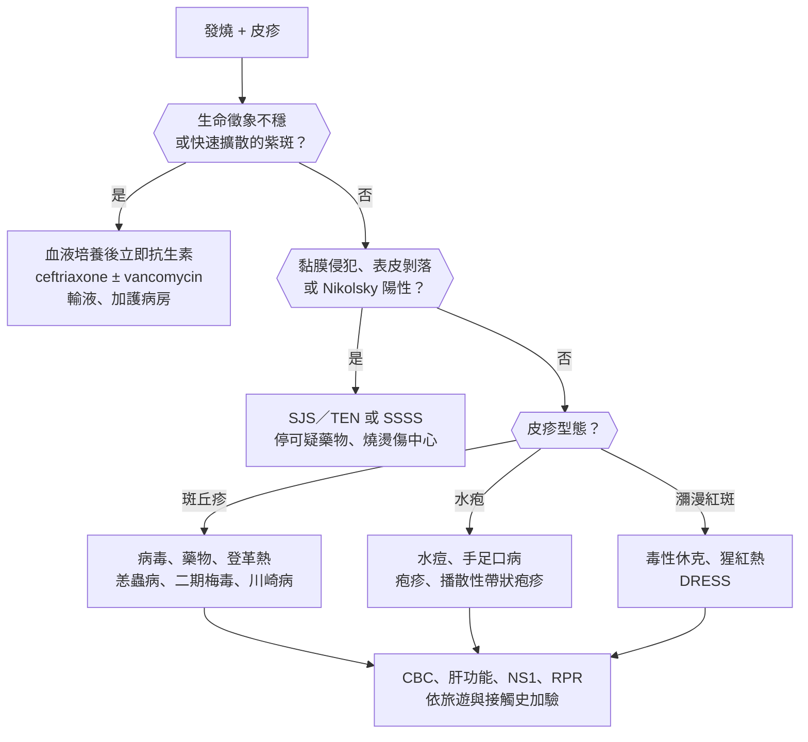
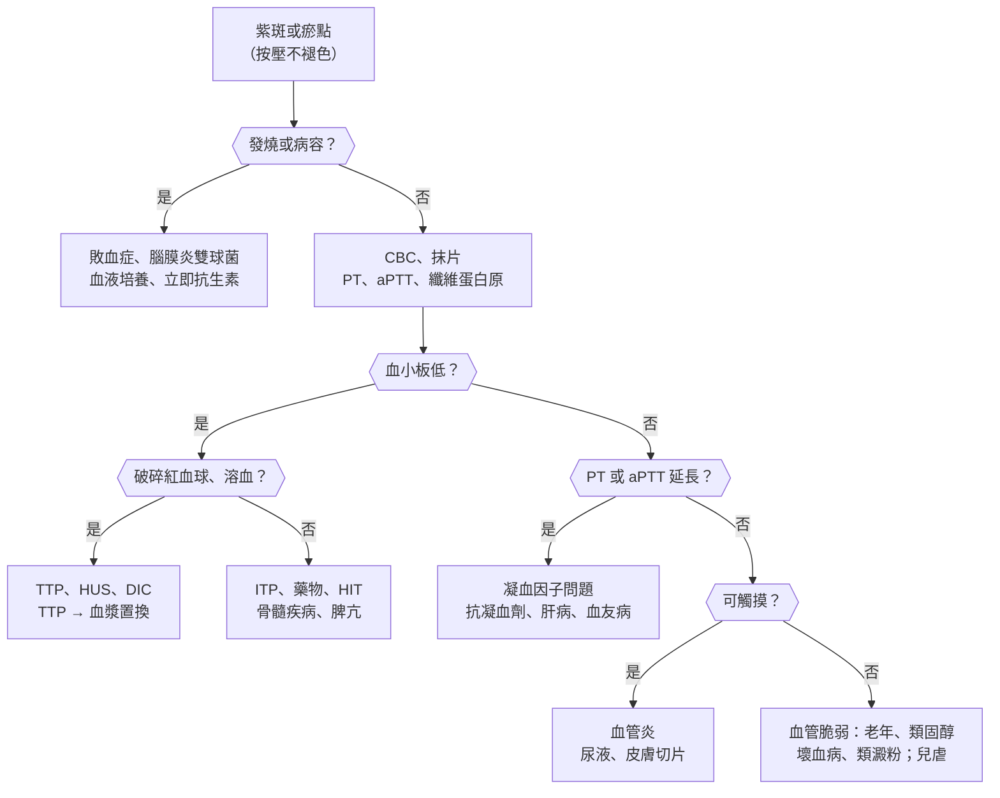
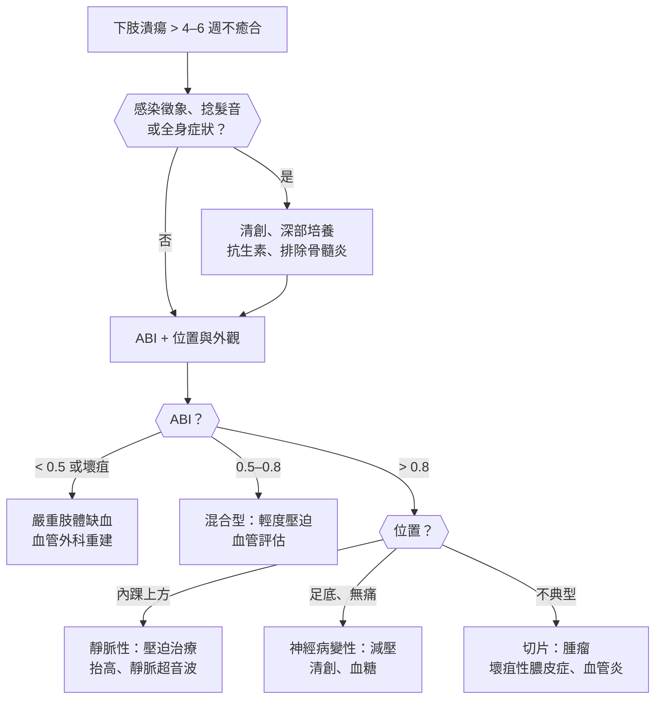

## 急性皮疹（Acute Rashes）

### 發燒合併皮疹（Fever and Rash）

#### 定義與分類

- **描述皮疹的四個重點**：**型態**（斑、丘疹、水疱、膿疱、紫斑）、**分布**（向心或離心、手掌腳掌、黏膜）、**出現順序**（從哪裡開始、往哪擴散）、**與發燒的時間關係**。
- **依型態分類**：
    - **斑丘疹（maculopapular）**：病毒疹（麻疹、德國麻疹、玫瑰疹）、**藥物疹**、**登革熱**、猩紅熱、**川崎病**、急性 HIV、二期梅毒、恙蟲病。
    - **瘀點紫斑（petechial / purpuric）**：**腦膜炎雙球菌血症**、**落磯山斑疹熱**、登革熱、**感染性心內膜炎**、[[血液腫瘤科#血栓性血小板低下紫斑症（Thrombotic Thrombocytopenic Purpura, TTP）|TTP]]、[[血液腫瘤科#DIC（Disseminated Intravascular Coagulation）|DIC]]、血管炎。
    - **水疱（vesicular）**：**水痘**、帶狀疱疹、**手足口病**、單純疱疹、播散性淋病（膿疱）。
    - **瀰漫性紅斑（diffuse erythroderma）**：**毒性休克症候群**、**葡萄球菌燙傷樣皮膚症候群（SSSS）**、猩紅熱、**川崎病**、DRESS。
- **手掌腳掌皮疹**：**二期梅毒**、**手足口病**、**落磯山斑疹熱**、**多形性紅斑**、**川崎病**、感染性心內膜炎（Janeway 病灶）、毒性休克症候群（脫皮）。

#### Red flags

- **發燒 + 快速擴散的瘀點紫斑** → **腦膜炎雙球菌血症**，數小時內致命，**:red[立即抗生素]**。
- **發燒 + 低血壓 + 瀰漫性紅斑** → **毒性休克症候群**（棉條、傷口、術後）。
- **皮膚痛、水疱、表皮剝落、黏膜侵犯（≥ 2 處）** → **SJS／TEN**。
- **發燒 + 皮疹 + 嗜酸性球高 + 肝炎**，新藥 2–8 週後 → **DRESS**。
- **兒童發燒 :red[≥ 5 天]** + 結膜充血、草莓舌、手腳腫脹 → **川崎病**（冠狀動脈瘤）。
- **腸病毒 + 嗜睡、肌躍型抽搐、持續嘔吐、呼吸急促、心跳快** → **腸病毒 71 重症**前兆。
- **登革熱 + 腹痛、持續嘔吐、黏膜出血、嗜睡、血比容上升合併血小板快速下降** → 重症登革熱警示徵象。
- **免疫低下**、**嗜中性球低下**、**脾臟切除**。

#### 鑑別診斷

| 類別 | 疾病 | 鑑別關鍵 |
|---|---|---|
| **兒童病毒疹** | **[[感染科#麻疹（Measles）\|麻疹]]**、[[感染科#德國麻疹（Rubella）\|德國麻疹]]、**[[小兒科#常見出疹性疾病\|玫瑰疹、傳染性紅斑、水痘]]**、**手足口病（腸病毒）** | **出疹順序、與燒退的關係**、Koplik 斑 |
| **細菌毒素** | **[[感染科#Group A Streptococcus（S. pyogenes）\|猩紅熱]]**、**毒性休克症候群**、**[[皮膚科#葡萄球菌燙傷樣皮膚症候群（SSSS, Staphylococcal Scalded Skin Syndrome）\|SSSS]]** | 砂紙樣皮疹、低血壓、**Nikolsky 陽性但黏膜不侵犯（SSSS）** |
| **侵襲性細菌** | **[[感染科#N. meningitidis（腦膜炎雙球菌）\|腦膜炎雙球菌血症]]**、**[[心臟內科#感染性心內膜炎（Infective Endocarditis, IE）\|感染性心內膜炎]]**、[[皮膚科#蜂窩性組織炎（Cellulitis）與丹毒（Erysipelas）\|蜂窩性組織炎]]、播散性淋病 | 紫斑、心雜音 |
| **蟲媒與立克次體** | **[[感染科#登革熱（Dengue）\|登革熱]]**、**[[感染科#Rickettsia & related\|恙蟲病、斑疹熱]]**、屈公病 | **旅遊、草叢、焦痂（eschar）**、白血球與血小板低 |
| **性傳染與 HIV** | **[[皮膚科#梅毒（Syphilis）\|二期梅毒]]**、**[[感染科#HIV / AIDS\|急性 HIV]]** | **手掌腳掌**、淋巴結、性行為史 |
| **疱疹病毒** | [[感染科#VZV\|水痘、播散性帶狀疱疹]]、EBV（**amoxicillin 後出疹**） | 水疱、不同時期病灶並存 |
| **藥物** | **[[皮膚科#藥物疹類型\|麻疹樣藥物疹]]**、**[[皮膚科#Stevens-Johnson Syndrome（SJS）/ Toxic Epidermal Necrolysis（TEN）\|SJS／TEN]]**、**[[皮膚科#Drug Reaction with Eosinophilia and Systemic Symptoms（DRESS）\|DRESS]]**、[[皮膚科#Acute Generalized Exanthematous Pustulosis（AGEP）\|AGEP]] | **新藥時間軸**、黏膜、嗜酸性球 |
| **發炎與免疫** | **[[小兒科#川崎病（Kawasaki Disease）\|川崎病]]**、[[免疫風濕科#成人 Still's Disease（Adult-Onset Still's Disease, AOSD）\|成人 Still's disease]]、[[免疫風濕科#全身性紅斑狼瘡（SLE）\|SLE]]、[[小兒科#過敏性紫斑（Henoch-Schönlein Purpura / IgA Vasculitis）\|IgA 血管炎]]、[[皮膚科#多形性紅斑（Erythema Multiforme, EM）\|多形性紅斑]] | 鮭魚色暫時性皮疹、可觸摸紫斑 |

#### 易混淆鑑別

:::compare[兒童出疹性疾病]
| | 麻疹 | 德國麻疹 | 玫瑰疹 | 傳染性紅斑 | 水痘 | 猩紅熱 | 手足口病 |
|---|---|---|---|---|---|---|---|
| 病原 | Measles virus | Rubella virus | **HHV-6** | **Parvovirus B19** | VZV | **A 群鏈球菌** | **腸病毒（克沙奇 A16、EV71）** |
| 前驅 | **高燒 + 3C（咳嗽、鼻炎、結膜炎）+ Koplik 斑** | 輕微、**耳後與枕部淋巴結腫** | **高燒 3–5 天** | 輕微 | 輕微發燒 | **發燒、喉嚨痛** | 發燒、喉嚨痛 |
| 出疹 | **從髮際、臉往下擴散**，融合 | 從臉往下，**不融合、3 天退** | **燒退後才出疹**，軀幹開始 | **紅臉頰（被打耳光）→ 四肢網狀紅斑** | **不同時期病灶並存**（丘疹、水疱、結痂），向心性 | **砂紙樣、Pastia 線**、口周蒼白、**草莓舌** | **口腔潰瘍 + 手掌腳掌水疱**、臀部 |
| 併發症 | **肺炎、腦炎、SSPE**；**維生素 A** | **先天性德國麻疹**（白內障、心臟、耳聾） | **[[神經內科#Febrile Seizure（熱性痙攣）\|熱性痙攣]]** | **再生不全危象（溶血性貧血）**、**胎兒水腫** | 皮膚感染、肺炎、腦炎、**Reye（勿用 aspirin）** | **風濕熱、腎絲球腎炎** | **EV71：腦幹腦炎、肺水腫** |
:::

:::compare[腦膜炎雙球菌血症 vs 登革熱 vs 恙蟲病 vs 落磯山斑疹熱]
| | 腦膜炎雙球菌血症 | 登革熱 | 恙蟲病 | 落磯山斑疹熱 |
|---|---|---|---|---|
| 流行病學 | 兒童、青少年、**群聚**、補體缺乏、脾切除 | **台灣南部夏秋**、東南亞旅遊 | **草叢、離島（金門、澎湖、花東）** | 美洲、壁蝨 |
| 皮疹 | **快速擴散的瘀點紫斑** | **退燒期「紅海中的白島」**、瘀點 | 軀幹斑丘疹（可不明顯） | **從手腕腳踝往中心擴散、含手掌腳掌** |
| 特徵 | **休克、DIC**、腦膜炎 | **眼窩後痛、肌肉骨頭痛**、止血帶試驗 | **焦痂（腋下、鼠蹊、腰帶處）**、淋巴結腫 | 頭痛、壁蝨叮咬 |
| 檢驗 | 血液培養 | **白血球、血小板下降**、NS1 抗原 | **肝功能上升**、血小板下降 | 低血鈉、血小板下降 |
| 治療 | **立即 ceftriaxone**；接觸者預防 | **支持療法；避免 NSAIDs 與 aspirin** | **doxycycline** | **doxycycline（兒童也用）** |
:::

:::compare[毒性休克症候群 vs SSSS vs 猩紅熱 vs 川崎病]
| | 毒性休克症候群 | SSSS | 猩紅熱 | 川崎病 |
|---|---|---|---|---|
| 病原或機轉 | **金黃色葡萄球菌 TSST-1** 或 A 群鏈球菌 | **金黃色葡萄球菌剝落毒素（攻擊 desmoglein-1）** | A 群鏈球菌致熱外毒素 | 不明（血管炎） |
| 族群 | **棉條、傷口、鼻腔填塞** | **< 5 歲**、腎功能差的成人 | 5–15 歲 | **< 5 歲** |
| 皮膚 | **瀰漫紅斑 → 1–2 週後手掌腳掌脫皮** | **紅斑、大片表皮剝落、Nikolsky 陽性**，**黏膜不侵犯** | 砂紙樣、Pastia 線 | 多形性皮疹、**指尖脫皮（恢復期）** |
| 全身 | **低血壓、多重器官衰竭** | 一般狀況尚可 | 喉嚨痛 | **發燒 ≥ 5 天、結膜充血（無分泌物）、草莓舌、頸淋巴結、手腳腫** |
| 治療 | 移除來源、輸液、**抗生素 + clindamycin（抑制毒素）** | 抗葡萄球菌抗生素 | **penicillin** | **IVIG + aspirin** |
:::

#### 問診與理學檢查

- **皮疹出現的時間、部位、擴散方向**、與發燒的先後、癢或痛。
- **新藥（2 個月內）**、疫苗史、**旅遊史**（東南亞、離島、山區）、**蚊蟲與壁蝨叮咬**、動物接觸、性行為史、**群聚與接觸史**、月經與棉條。
- 理學檢查：
    - **生命徵象**、意識、頸部僵硬。
    - 皮疹型態：**按壓是否褪色**（不褪色 → 紫斑）、**Nikolsky sign**、焦痂（腋下、鼠蹊、腰帶處）。
    - **黏膜**（口腔、眼、生殖器）、**手掌腳掌**、淋巴結、肝脾、心雜音、關節。

#### 檢查流程

- **CBC（白血球、血小板、嗜酸性球）**、肝腎功能、CRP、**血液培養**、尿液檢查。
- 依臨床：**登革熱 NS1 抗原**、恙蟲病抗體或 PCR、**RPR／TPPA**、HIV、ASO、喉嚨快篩、麻疹 IgM、水疱 PCR；川崎病 → 心臟超音波。
- 診斷不明 → **皮膚切片**。

#### 初步處置

- **腦膜炎雙球菌血症**：**立即 ceftriaxone**（不等腰椎穿刺）、輸液；**密切接觸者預防性投藥（rifampin、ciprofloxacin 或 ceftriaxone）**；屬法定傳染病。
- **毒性休克症候群**：移除棉條或引流傷口、輸液、**β-lactam + clindamycin**、嚴重者 IVIG。
- **登革熱**：**acetaminophen 退燒、:red[避免 NSAIDs 與 aspirin]**、補充水分、監測血比容與血小板；**通報**。
- **恙蟲病、斑疹熱**：**doxycycline**。
- **麻疹、水痘**：**空氣隔離**；麻疹 → **維生素 A**；高危險水痘 → **acyclovir**。
- **法定[[家庭醫學科#傳染病通報|傳染病通報]]**：麻疹、德國麻疹、登革熱、恙蟲病、**腸病毒感染併發重症**、侵襲性腦膜炎雙球菌感染症等。

:::pitfall
發燒兒童身上有幾個紫色小點，以為是病毒疹就讓他回家 → 腦膜炎雙球菌血症在數小時內進展成休克與 DIC。瘀點紫斑合併發燒要當急症，先抽血液培養並立即給抗生素。
:::

:::pitfall
登革熱病人發燒全身痠痛，開 NSAIDs 或打 diclofenac 止痛 → 增加出血風險。台灣南部夏秋季、或東南亞旅遊回來的發燒病人，在排除登革熱前只用 acetaminophen。
:::

:::exam
- 玫瑰疹：高燒 3–5 天、燒退後出疹；傳染性紅斑：紅臉頰、再生不全危象、胎兒水腫。
- 麻疹：3C + Koplik 斑、由上往下；給維生素 A；水痘：不同時期病灶並存。
- 手掌腳掌皮疹：二期梅毒、手足口病、斑疹熱、多形性紅斑、川崎病。
- SSSS：Nikolsky 陽性、黏膜不侵犯；SJS／TEN：黏膜侵犯。
- 恙蟲病：焦痂 → doxycycline；登革熱避免 NSAIDs。
:::

### 藥物疹與嚴重皮膚反應（Drug Eruptions / SCAR）

#### 定義與分類

- **藥物疹（drug eruption）**：最常見為**麻疹樣（斑丘疹）藥物疹**，佔 **> 90%**；通常**用藥後 :red[4–14 天]**出現，**不侵犯黏膜**、無全身症狀。
- **嚴重皮膚不良反應（severe cutaneous adverse reactions, SCAR）**：
    - **SJS／TEN**：**表皮壞死剝落 + 黏膜侵犯**；依剝落面積：**SJS :red[< 10%]**、重疊 10–30%、**TEN :red[> 30%]**。
    - **DRESS**：**發燒、皮疹、臉部腫脹、淋巴結腫、嗜酸性球增多、內臟侵犯（肝最常見）**；**用藥後 :red[2–8 週]**。
    - **AGEP**：**數百個小膿疱（非毛囊性）在紅斑上**，**用藥後 1–2 天**，常見於 β-lactam。
- **其他型態**：**蕁麻疹與過敏性休克**（數分鐘到數小時）、**固定性藥物疹**（同一位置反覆出現的圓形暗紅斑，**NSAIDs、sulfonamide**）、光敏感、藥物性紫斑、苔蘚樣疹。
- **台灣重要的基因篩檢**：
    - **:red[HLA-B\*15:02] → carbamazepine**（SJS／TEN）：**健保給付用藥前篩檢**。
    - **:red[HLA-B\*58:01] → allopurinol**（SJS／TEN、DRESS）。
    - HLA-B\*13:01 → dapsone（DRESS）。

#### Red flags

- **皮膚疼痛**（比癢更嚴重的警訊）、**水疱、表皮剝落、Nikolsky 陽性**。
- **黏膜侵犯**：口腔糜爛、**結膜炎（眼睛紅痛）**、生殖器糜爛。
- **發燒 > 38.5°C、臉部腫脹、淋巴結腫、肝功能上升、嗜酸性球增多** → DRESS。
- **蕁麻疹合併呼吸困難、喘鳴、低血壓、腸胃症狀** → 過敏性休克。
- **暗紫紅色斑、靶狀病灶不典型（只有兩圈）** → 早期 SJS。

#### 鑑別診斷

| 類別 | 疾病 | 鑑別關鍵 |
|---|---|---|
| **輕型藥物疹** | **[[皮膚科#藥物疹類型\|麻疹樣藥物疹]]**、固定性藥物疹、光敏感 | 無黏膜、無全身症狀 |
| **SCAR** | **[[皮膚科#Stevens-Johnson Syndrome（SJS）/ Toxic Epidermal Necrolysis（TEN）\|SJS／TEN]]**、**[[皮膚科#Drug Reaction with Eosinophilia and Systemic Symptoms（DRESS）\|DRESS]]**、**[[皮膚科#Acute Generalized Exanthematous Pustulosis（AGEP）\|AGEP]]** | **時間軸、黏膜、嗜酸性球、膿疱** |
| **立即型過敏** | [[皮膚科#蕁麻疹（Urticaria）\|蕁麻疹]]、**[[免疫風濕科#過敏性休克（Anaphylaxis）\|過敏性休克]]**、[[免疫風濕科#血管性水腫（Angioedema）\|血管性水腫]] | **數分鐘到數小時內**、風疹塊 |
| **感染** | **病毒疹**、[[皮膚科#葡萄球菌燙傷樣皮膚症候群（SSSS, Staphylococcal Scalded Skin Syndrome）\|SSSS]]、毒性休克症候群、**黴漿菌引起的黏膜炎（MIRM）** | 前驅感染、兒童 |
| **水疱病** | [[皮膚科#多形性紅斑（Erythema Multiforme, EM）\|多形性紅斑]]、[[皮膚科#類天疱瘡（Pemphigoid）\|類天疱瘡]]、[[皮膚科#天疱瘡（Pemphigus）\|天疱瘡]] | **典型三圈靶狀、肢端** → EM（HSV） |
| **其他** | 移植物抗宿主病、急性 HIV、[[皮膚科#紅斑性狼瘡（Lupus Erythematosus）\|亞急性皮膚狼瘡]]（藥物引起） | 病史 |

#### 易混淆鑑別

:::compare[嚴重皮膚藥物反應比較]
| | 麻疹樣藥物疹 | SJS／TEN | DRESS | AGEP |
|---|---|---|---|---|
| 發生時間 | **4–14 天** | **4–28 天** | **2–8 週** | **1–2 天** |
| 皮膚 | 對稱斑丘疹、癢 | **暗紅斑、非典型靶狀 → 水疱、剝落**、痛 | 麻疹樣 → 瀰漫紅斑、**臉部腫脹** | **紅斑上數百個非毛囊性小膿疱**，皺褶處開始 |
| 黏膜 | 無 | **≥ 2 處（口、眼、生殖器）** | 輕微或無 | 輕微或無 |
| 全身 | 無 | 發燒、**多重器官** | **發燒、淋巴結腫、肝炎、腎炎、肺炎、心肌炎** | 發燒、**嗜中性球增多** |
| 血液 | 正常 | 白血球可下降 | **嗜酸性球增多、非典型淋巴球** | **嗜中性球增多** |
| 常見藥物 | β-lactam、sulfonamide | **allopurinol、carbamazepine、[[精神科#Lamotrigine\|lamotrigine]]、phenytoin、sulfonamide、NSAIDs（oxicam）、nevirapine** | **allopurinol、抗癲癇藥、sulfonamide、vancomycin、minocycline、dapsone** | **β-lactam**、macrolide、diltiazem |
| 死亡率 | 極低 | **SJS 約 5%、TEN 約 30%** | 約 10% | < 5% |
| 治療 | 停藥、抗組織胺、外用類固醇 | **停藥、燒燙傷照護、眼科**；cyclosporine、IVIG、etanercept | **停藥、全身性類固醇並慢慢減量**（數週到數月） | 停藥、外用類固醇 |
:::

:::compare[SJS／TEN vs 多形性紅斑]
| | 多形性紅斑（EM major） | SJS／TEN |
|---|---|---|
| 誘因 | **HSV（最常見）**、黴漿菌 | **藥物** |
| 病灶 | **典型三圈靶狀**（中心暗、白圈、紅暈） | **非典型靶狀、暗紅斑、融合** |
| 分布 | **肢端（手腳）往中心** | **軀幹與臉往外** |
| 表皮剝落 | < 10%、局限 | **廣泛** |
| 全身症狀 | 輕 | **重** |
| 復發 | 常隨 HSV 復發 | 再用同藥才發生 |
:::

:::compare[SCORTEN（TEN 嚴重度評分，每項 1 分）]
| 項目 |
|---|
| **年齡 ≥ 40 歲** |
| **惡性腫瘤** |
| **心跳 ≥ 120 次／分** |
| **初始表皮剝落 ≥ 10%** |
| **BUN > 28 mg/dL** |
| **血糖 > 252 mg/dL** |
| **HCO₃⁻ < 20 mEq/L** |
:::

- SCORTEN 越高死亡率越高：0–1 分約 3%，**≥ 5 分 > 90%**。

#### 問診與理學檢查

- **詳細用藥時間表**：所有藥物（含**中藥、保健食品、成藥、顯影劑**）的**開始日期**；**最可疑的是皮疹前 1–4 週內開始的藥**。
- 過去藥物過敏、家族史、**HIV**（藥物疹風險高）。
- 理學檢查：
    - 皮疹型態與**範圍（體表面積）**、**Nikolsky sign**、靶狀病灶型態。
    - **口、眼、生殖器黏膜**、臉部腫脹、淋巴結、肝脾。

#### 檢查流程

- **CBC（嗜酸性球、非典型淋巴球）**、**肝腎功能**、電解質、血糖、BUN、HCO₃⁻（SCORTEN）。
- DRESS → 肝、腎、肺、**心臟（troponin、心臟超音波）**、甲狀腺（後期自體免疫）、**HHV-6 再活化**。
- **皮膚切片**：SJS／TEN（**全層表皮壞死**）、AGEP（角層下膿疱）。
- 確認致病藥物：**藥物因果評估（ALDEN）**；急性期後可做淋巴球活化試驗；**不建議再挑戰（rechallenge）**。

#### 初步處置

- **:red[立即停用所有可疑藥物]**（越早停預後越好）。
- **SJS／TEN**：
    - **燒燙傷中心或加護病房**、傷口照護、保溫、輸液與營養、**避免感染**。
    - **眼科會診**（**每天評估，預防角膜與眼瞼沾黏造成失明**）、口腔與泌尿生殖道照護。
    - 免疫治療：cyclosporine、IVIG、etanercept（證據有限）。
- **DRESS**：停藥、**全身性類固醇並緩慢減量（數週到數月）**，太快減量會復發。
- **過敏卡與病歷註記**：**同類藥物也要避免**（如芳香族抗癲癇藥 carbamazepine、phenytoin、phenobarbital 之間交叉反應）。
- **台灣藥害救濟**：正當使用合法藥物造成死亡、障礙或嚴重疾病 → 可申請**藥害救濟**。

:::pitfall
病人吃了 allopurinol 3 週後出疹、發燒，當成感冒開了止痛藥並繼續服用 allopurinol → DRESS 或 SJS 惡化，可能死亡。新開始用藥後出現發燒合併皮疹，先停可疑藥物並驗 CBC 與肝功能；台灣人開 allopurinol 前可先驗 HLA-B*58:01。
:::

:::pitfall
DRESS 用類固醇控制後 1–2 週就停藥 → 復發，甚至數月後出現自體免疫甲狀腺炎或第 1 型糖尿病。DRESS 的類固醇要慢慢減量，並長期追蹤甲狀腺與血糖。
:::

:::exam
- SJS < 10%、TEN > 30% 表皮剝落；黏膜侵犯；SCORTEN 評估預後。
- DRESS：2–8 週、嗜酸性球增多、肝炎、臉部腫脹 → 類固醇慢慢減量。
- AGEP：1–2 天、β-lactam、小膿疱、嗜中性球。
- 台灣：carbamazepine 前驗 HLA-B*15:02；allopurinol → HLA-B*58:01。
- 多形性紅斑：HSV、典型靶狀、肢端。
:::

### 蕁麻疹與血管性水腫（Urticaria / Angioedema）

#### 定義與分類

- **蕁麻疹（urticaria）**：**風疹塊（wheal）**：隆起、搔癢、中央蒼白周圍紅暈，**單一病灶 :red[< 24 小時]消退、不留痕跡**。
    - **急性 < 6 週**：感染（兒童最常見，病毒）、**食物、藥物（NSAIDs、抗生素）**、昆蟲叮咬、顯影劑。
    - **慢性 :red[≥ 6 週]**：**大多為慢性自發性蕁麻疹**（自體免疫，抗 IgE 受體抗體）；少數為**誘發性**（皮膚劃紋症、冷、熱、壓力、膽鹼性、日光）。
- **血管性水腫（angioedema）**：真皮深層與皮下組織腫脹（**眼瞼、嘴唇、舌、喉嚨、生殖器、腸道**），**不太癢、較痛或緊繃**，持續 **1–3 天**。
    - **組織胺媒介**：常與蕁麻疹同時出現、對抗組織胺有效。
    - **緩激肽（bradykinin）媒介**：**沒有蕁麻疹**、**對抗組織胺、類固醇、epinephrine 反應差** → **ACE 抑制劑**、**遺傳性血管性水腫（C1 抑制劑缺乏）**、後天性 C1 抑制劑缺乏。
- **蕁麻疹性血管炎**：**單一病灶 > 24 小時、燒灼痛、消退後留紫斑或色素** → 皮膚切片。

#### Red flags

- **呼吸困難、喘鳴、聲音沙啞、吞嚥困難、流口水** → 上呼吸道水腫。
- **低血壓、暈厥、腹痛嘔吐** → **過敏性休克**（皮膚 + 另一器官系統）。
- **使用 ACE 抑制劑**、**反覆舌頭或喉頭水腫而無蕁麻疹**、**家族史** → 緩激肽型。
- **單一病灶 > 24 小時、留下紫斑、發燒、關節痛** → 蕁麻疹性血管炎、SLE。

#### 鑑別診斷

| 類別 | 疾病 | 鑑別關鍵 |
|---|---|---|
| **急性蕁麻疹** | **[[皮膚科#蕁麻疹（Urticaria）\|蕁麻疹]]**（病毒、食物、藥物、昆蟲） | 誘因時間關係 |
| **過敏性休克** | **[[免疫風濕科#過敏性休克（Anaphylaxis）\|過敏性休克]]** | **合併呼吸、循環、腸胃症狀** |
| **慢性** | 慢性自發性蕁麻疹、誘發性蕁麻疹、[[代謝內分泌科#Graves' Disease\|自體免疫甲狀腺疾病]]相關 | ≥ 6 週、劃紋症 |
| **緩激肽型血管性水腫** | **[[免疫風濕科#血管性水腫（Angioedema）\|ACE 抑制劑、遺傳性血管性水腫]]** | **無蕁麻疹**、C4 低（遺傳性） |
| **類似蕁麻疹** | 蕁麻疹性血管炎、[[皮膚科#肥大細胞增生症（Mastocytosis）\|肥大細胞增生症]]（**Darier sign**）、[[皮膚科#多形性紅斑（Erythema Multiforme, EM）\|多形性紅斑]]、類天疱瘡前驅期、昆蟲叮咬 | 病灶持續時間、色素 |
| **類似血管性水腫** | 接觸性皮膚炎（臉）、蜂窩性組織炎、[[代謝內分泌科#甲狀腺機能低下（Hypothyroidism）\|甲狀腺機能低下黏液水腫]]、上腔靜脈症候群、皮肌炎 | 發紅、癢、全身症狀 |

#### 易混淆鑑別

:::compare[組織胺型 vs 緩激肽型血管性水腫]
| | 組織胺型（過敏） | 緩激肽型 |
|---|---|---|
| 蕁麻疹 | **常合併** | **沒有** |
| 癢 | 癢 | **不癢** |
| 發作速度 | 數分鐘到數小時 | **較慢（數小時），持續 2–5 天** |
| 腸道水腫 | 少 | **反覆腹痛（腸壁水腫）** |
| 原因 | 食物、藥物、昆蟲、特發性 | **ACE 抑制劑**（任何時間點都可能，**亞洲人與黑人較常見**）、**遺傳性（C1 抑制劑缺乏，C4 低）** |
| 治療 | **epinephrine、抗組織胺、類固醇** | **停 ACE 抑制劑**；**icatibant（緩激肽 B2 受體拮抗劑）、C1 抑制劑濃縮液**、新鮮冷凍血漿；**確保呼吸道** |
:::

:::compare[過敏性休克的診斷（符合任一）]
| 情境 | 條件 |
|---|---|
| **1** | **急性皮膚或黏膜症狀**（蕁麻疹、潮紅、嘴唇舌頭腫脹）+ **呼吸症狀**或**低血壓或器官灌流不足**或**嚴重腸胃症狀** |
| **2** | 暴露於**已知或極可能的過敏原**後，**急性低血壓**或**[[麻醉科#支氣管痙攣（Bronchospasm）\|支氣管痙攣]]**或**喉部侵犯**，**即使沒有皮膚症狀** |
:::

#### 問診與理學檢查

- 單一病灶**持續多久**、是否留痕跡、**癢或痛**；發作時間與頻率。
- **24 小時內的食物、藥物（NSAIDs、ACE 抑制劑、抗生素）**、昆蟲叮咬、運動、冷熱、壓力、感染。
- 呼吸困難、聲音改變、吞嚥困難、腹痛；**家族史**。
- 理學檢查：**生命徵象**、**上呼吸道**（舌、懸壅垂、聲音、喘鳴）、**皮膚劃紋症**、病灶消退後是否留紫斑、甲狀腺。

#### 檢查流程

- **急性蕁麻疹不需常規檢查**。
- **慢性自發性蕁麻疹**：**CBC、CRP 或 ESR**；依臨床 → TSH 與甲狀腺抗體；**不需大範圍過敏原檢測**。
- **無蕁麻疹的反覆血管性水腫** → **C4**（遺傳性的篩檢）→ 低 → C1 抑制劑濃度與功能。
- 過敏性休克 → **發作後 1–2 小時內 tryptase**（佐證診斷）。
- 病灶 > 24 小時、留紫斑 → **皮膚切片**（蕁麻疹性血管炎）。

#### 初步處置

- **過敏性休克**：**:red[epinephrine 0.01 mg/kg（最多 0.5 mg）IM 大腿前外側]**，5–15 分鐘可重複；**平躺抬腳**、氧氣、**大量輸液**；抗組織胺與類固醇為輔助。
    - **觀察數小時**（**雙相反應**）；出院給**腎上腺素自動注射筆**與衛教。
    - 使用 **β-blocker** 的病人對 epinephrine 反應差 → **glucagon**。
- **蕁麻疹**：**第二代 H1 抗組織胺**（cetirizine、loratadine、fexofenadine），慢性者可**加到 4 倍劑量**；無效 → **omalizumab** → cyclosporine；**全身性類固醇只短期用於嚴重急性發作**。
- **避免 NSAIDs**（會使慢性蕁麻疹惡化）。

::chart{id="anaphylaxis"}
- **ACE 抑制劑血管性水腫**：**停藥並終身避免 ACE 抑制劑**；改 ARB 須謹慎（低風險）。

:::pitfall
過敏性休克病人先給抗組織胺與類固醇、延遲 epinephrine → 死亡最常見的原因就是延遲給 epinephrine。符合過敏性休克就立即 IM epinephrine，抗組織胺與類固醇不能取代。
:::

:::pitfall
吃了多年 ACE 抑制劑的病人嘴唇舌頭腫，給抗組織胺與類固醇後讓他繼續吃藥 → 下次可能喉頭水腫窒息。ACE 抑制劑血管性水腫可在用藥多年後才發生，對抗組織胺反應差，必須停藥並註記。
:::

:::exam
- 蕁麻疹：單一病灶 < 24 小時、不留痕跡；> 24 小時留紫斑 → 蕁麻疹性血管炎。
- 慢性 ≥ 6 週；第二代抗組織胺可加到 4 倍 → omalizumab。
- 無蕁麻疹的血管性水腫：ACE 抑制劑、遺傳性（C4 低、C1 抑制劑缺乏）→ icatibant、C1 抑制劑。
- 過敏性休克：epinephrine 0.01 mg/kg IM 大腿；β-blocker 使用者 → glucagon；雙相反應要觀察。
:::

### 紫斑與瘀點（Purpura / Petechiae）

#### 定義與分類

- **紫斑（purpura）**：紅血球滲出血管外，**按壓不褪色**；**瘀點（petechiae）< 3 mm**、**紫斑 3–10 mm**、**瘀斑（ecchymosis）> 1 cm**。
- **不可觸摸（非隆起）紫斑**：
    - **血小板問題**（瘀點為主）：ITP、TTP、DIC、骨髓衰竭、藥物、肝病、脾腫大。
    - **凝血問題**（瘀斑、深部血腫、關節血腫）：血友病、抗凝血劑、維生素 K 缺乏。
    - **血管脆弱**：**老年性紫斑**、**類固醇**、**壞血病**（毛囊周圍出血、牙齦出血）、Cushing、類澱粉沉積（**眼周紫斑**）、Ehlers-Danlos。
- **可觸摸（隆起）紫斑** → **血管炎**（小血管）：IgA 血管炎、冷凝球蛋白血症、ANCA 血管炎、白血球破碎性血管炎（藥物、感染）。
- **網狀紫斑（retiform purpura）** → **血管阻塞**：DIC、**猛爆性紫斑**、抗磷脂症候群、**鈣化防禦（calciphylaxis，洗腎病人）**、膽固醇栓塞、warfarin 皮膚壞死。

#### Red flags

- **發燒 + 紫斑** → 腦膜炎雙球菌血症、敗血症併 DIC、感染性心內膜炎、立克次體。
- **血小板低 + 溶血性貧血（破碎紅血球）+ 意識改變或腎衰竭** → **TTP**（緊急血漿置換）。
- **黏膜出血（口腔血疱）、血小板 < 20,000** → 嚴重出血風險。
- **網狀紫斑、皮膚壞死** → 血管阻塞。
- **兒童不尋常部位的瘀青**（耳朵、頸部、軀幹、TEN-4 區）、**不會爬的嬰兒有瘀青** → **兒虐**。
- **剛開始 warfarin + 脂肪多處（乳房、大腿、臀部）的疼痛紫斑壞死** → warfarin 皮膚壞死（蛋白 C 缺乏）。

#### 鑑別診斷

| 類別 | 疾病 | 鑑別關鍵 |
|---|---|---|
| **血小板低下** | **[[血液腫瘤科#免疫性血小板低下紫斑症（Immune Thrombocytopenia, ITP）\|ITP]]**、**[[血液腫瘤科#血栓性血小板低下紫斑症（Thrombotic Thrombocytopenic Purpura, TTP）\|TTP]]**、[[血液腫瘤科#溶血性尿毒症症候群（Hemolytic Uremic Syndrome, HUS）\|HUS]]、**[[血液腫瘤科#DIC（Disseminated Intravascular Coagulation）\|DIC]]**、白血病、[[血液腫瘤科#再生不良性貧血（Aplastic Anemia）\|再生不良性貧血]]、**藥物（heparin → [[血液腫瘤科#Heparin-Induced Thrombocytopenia（HIT）\|HIT]]）**、肝硬化脾亢 | **CBC、抹片**（破碎紅血球、芽細胞） |
| **凝血異常** | **[[血液腫瘤科#血友病（Hemophilia）\|血友病]]**、**抗凝血劑**、**維生素 K 缺乏**、肝病、von Willebrand 病 | **PT、aPTT**；瘀斑與深部出血 |
| **血管炎（可觸摸）** | **[[小兒科#過敏性紫斑（Henoch-Schönlein Purpura / IgA Vasculitis）\|IgA 血管炎]]**、[[免疫風濕科#ANCA 相關血管炎（AAV）\|ANCA 血管炎]]、**冷凝球蛋白血症（C 型肝炎）**、[[皮膚科#血管炎\|白血球破碎性血管炎]] | **下肢可觸摸紫斑**、血小板正常 |
| **感染** | **[[感染科#N. meningitidis（腦膜炎雙球菌）\|腦膜炎雙球菌血症]]**、[[感染科#登革熱（Dengue）\|登革熱]]、[[心臟內科#感染性心內膜炎（Infective Endocarditis, IE）\|感染性心內膜炎]]、立克次體 | 發燒、病容 |
| **血管脆弱** | **老年性紫斑**、**類固醇**、**壞血病**、Cushing、**類澱粉沉積**、Ehlers-Danlos | **血小板與凝血正常** |
| **血管阻塞** | 抗磷脂症候群、**鈣化防禦**、膽固醇栓塞、**warfarin 皮膚壞死**、猛爆性紫斑 | **網狀紫斑、壞死** |
| **其他** | **[[小兒科#兒童虐待（Child Abuse）\|兒虐]]**、外傷、劇烈咳嗽或嘔吐（臉部瘀點）、**刮痧、拔罐** | 病史、分布 |

#### 易混淆鑑別

:::compare[血小板問題 vs 凝血因子問題]
| | 血小板或血管問題（初級止血） | 凝血因子問題（次級止血） |
|---|---|---|
| 出血型態 | **瘀點、紫斑**、**黏膜出血**（流鼻血、牙齦、月經過多） | **瘀斑、深部血腫、關節血腫** |
| 發生時間 | **立即**（小傷口流血不止） | **延遲**（傷後數小時再出血） |
| 代表疾病 | ITP、von Willebrand 病、抗血小板藥 | **血友病**、抗凝血劑、維生素 K 缺乏 |
| 檢查 | **血小板數、出血時間**、PFA-100 | **PT、aPTT**、凝血因子濃度 |
:::

:::compare[ITP vs TTP vs HUS vs DIC]
| | ITP | TTP | HUS | DIC |
|---|---|---|---|---|
| 機轉 | **抗血小板抗體** | **ADAMTS13 缺乏 → 大型 vWF** | **志賀毒素（E. coli O157:H7）** | 凝血廣泛活化 → 消耗 |
| 族群 | 兒童（病毒後）、成人女性 | 成人 | **兒童、血便後** | 敗血症、產科、癌症、外傷 |
| 血小板 | ↓↓ | ↓↓ | ↓ | ↓ |
| 溶血與破碎紅血球 | **無** | **有** | **有** | 可有 |
| PT、aPTT | **正常** | **正常** | **正常** | **延長** |
| 纖維蛋白原 | 正常 | 正常 | 正常 | **↓** |
| 器官 | 只有出血 | **神經、腎、發燒** | **急性腎損傷** | 多重器官 |
| 治療 | 觀察或**類固醇、IVIG** | **緊急血漿置換**、caplacizumab；**避免輸血小板** | **支持療法、透析**；**避免抗生素** | **治療病因**、補充血品 |
:::

:::compare[IgA 血管炎（HSP）的四大表現]
| 表現 | 內容 |
|---|---|
| **可觸摸紫斑** | **下肢與臀部**、**血小板正常**（100%） |
| **關節痛或關節炎** | 膝、踝（約 75%） |
| **腹痛** | 腸壁水腫、出血；**[[小兒科#腸套疊（Intussusception）\|腸套疊]]（迴腸迴腸型）** |
| **腎炎** | 血尿、蛋白尿；**決定長期預後**，追蹤尿液 6 個月 |
:::

#### 問診與理學檢查

- 出血型態（瘀點 vs 瘀斑、黏膜出血、關節血腫）、**發生時間**（立即 vs 延遲）、外傷程度與傷勢是否相符。
- **用藥**：**抗血小板、抗凝血劑、NSAIDs、類固醇**、heparin（5–10 天後血小板掉 → HIT）、quinine、中藥與保健食品（銀杏、魚油）。
- 近期感染、腹瀉血便、發燒、體重減輕、肝病、飲食（壞血病）、家族出血史、月經量。
- 理學檢查：紫斑**是否可觸摸**、**分布**（下肢 → 血管炎；眼周 → 類澱粉；毛囊周圍 → 壞血病）、**黏膜出血**、肝脾淋巴結、關節、神經學。

#### 檢查流程

- **CBC + 周邊血液抹片**（破碎紅血球、芽細胞、**假性血小板低下 → 檸檬酸管重驗**）、**PT、aPTT、纖維蛋白原、D-dimer**。
- 溶血：LDH、膽紅素、haptoglobin、網狀紅血球；**ADAMTS13**（TTP）。
- 可觸摸紫斑 → **尿液檢查（腎炎）**、腎功能、補體、**冷凝球蛋白、C 型肝炎**、ANCA、ANA；**皮膚切片（直接免疫螢光：IgA 沉積 → IgA 血管炎）**。
- 疑兒虐 → **全身骨骼 X 光**、凝血檢查、通報。

#### 初步處置

- **TTP**：**緊急血漿置換**（死亡率由 90% 降到 10–20%）、類固醇、rituximab、caplacizumab；**:red[避免輸血小板]**（加重血栓）。
- **ITP**：兒童多自行緩解，**有出血才治療**；成人血小板 < 30,000 或出血 → **類固醇**、**IVIG**（快速提升）；危及生命出血 → 輸血小板 + IVIG + 類固醇。
- **HIT**：**停所有 heparin**（含沖管），改**非 heparin 抗凝血劑**（argatroban、fondaparinux）；**不要輸血小板、不要立即用 warfarin**。
- IgA 血管炎：支持療法；嚴重腹痛或腎炎 → 類固醇與腎臟科。
- **兒虐 → 依法 24 小時內通報**。

:::pitfall
血小板低又溶血的病人，看到血小板很低就輸血小板 → TTP 時輸血小板會加重微血栓、使病情惡化甚至死亡。血小板低合併破碎紅血球時先想 TTP，做血漿置換。
:::

:::pitfall
病人住院打 heparin 第 5–10 天血小板掉一半，以為是敗血症或藥物 → 漏掉 HIT，反而因血栓截肢或栓塞。依 4T score 評估，懷疑時立即停所有 heparin、改用 argatroban。
:::

:::exam
- 可觸摸紫斑 → 血管炎；IgA 血管炎：下肢紫斑 + 關節 + 腹痛（腸套疊）+ 腎炎，血小板正常。
- TTP：血小板低、破碎紅血球、神經、腎、發燒（五徵）→ 血漿置換、避免輸血小板；HUS：兒童血便後。
- 血小板問題 → 瘀點、黏膜、立即出血；凝血因子 → 關節血腫、延遲出血。
- HIT：heparin 5–10 天血小板掉 > 50% → 停 heparin、改 argatroban。
:::

### 水疱與大疱（Vesicles / Bullae）

#### 定義與分類

- **水疱（vesicle）< 1 cm**；**大疱（bulla）≥ 1 cm**；膿疱（pustule）含膿。
- **依水疱位置**：
    - **表皮內（鬆弛、容易破）**：**天疱瘡**、SSSS、膿痂疹、病毒性水疱 → **Nikolsky 陽性**（天疱瘡、SSSS、TEN）。
    - **表皮下（緊繃、不易破）**：**類天疱瘡**、疱疹樣皮膚炎、**SJS／TEN**、表皮分解性水疱症、遲發性皮膚紫質症。
- **常見原因**：
    - **感染**：**單純疱疹**、**帶狀疱疹**、水痘、手足口病、**膿痂疹**（大疱性）。
    - **過敏與物理**：**接觸性皮膚炎**（直線排列、植物）、昆蟲叮咬、**燒燙傷**、摩擦、凍傷。
    - **藥物**：**SJS／TEN**、固定性藥物疹。
    - **自體免疫水疱病**：天疱瘡、類天疱瘡、疱疹樣皮膚炎。
    - **代謝**：遲發性皮膚紫質症（日曬處、C 型肝炎）、糖尿病大疱。

#### Red flags

- **廣泛表皮剝落 + 黏膜侵犯** → **SJS／TEN**。
- **天疱瘡**：**口腔糜爛先出現**，未治療死亡率高。
- **眼部帶狀疱疹（V1）**：**鼻尖水疱（Hutchinson sign）** → [[眼科#角膜炎（Keratitis）|角膜炎]]、視力喪失，眼科會診。
- **耳朵帶狀疱疹 + 顏面神經麻痺** → Ramsay Hunt 症候群。
- **播散性帶狀疱疹**（> 2–3 個皮節）或**免疫低下** → IV acyclovir、空氣隔離。
- **異位性皮膚炎病人突發成群的打孔狀糜爛 + 發燒** → **疱疹樣濕疹（Kaposi varicelliform eruption）**，緊急 acyclovir。
- **新生兒水疱** → 新生兒 HSV（致命）、SSSS。

#### 鑑別診斷

| 類別 | 疾病 | 鑑別關鍵 |
|---|---|---|
| **病毒** | **[[皮膚科#單純疱疹（Herpes Simplex）\|單純疱疹]]**、**[[皮膚科#帶狀疱疹（Herpes Zoster / Shingles）\|帶狀疱疹]]**、[[感染科#VZV\|水痘]]、手足口病 | **紅底上成群水疱**、**單側皮節**、Tzanck 多核巨細胞 |
| **細菌** | **[[皮膚科#膿痂疹（Impetigo）\|大疱性膿痂疹]]**、**[[皮膚科#葡萄球菌燙傷樣皮膚症候群（SSSS, Staphylococcal Scalded Skin Syndrome）\|SSSS]]** | **蜂蜜色痂**、兒童 |
| **自體免疫** | **[[皮膚科#天疱瘡（Pemphigus）\|天疱瘡]]**、**[[皮膚科#類天疱瘡（Pemphigoid）\|類天疱瘡]]**、**[[皮膚科#疱疹樣皮膚炎（Dermatitis Herpetiformis, DH）\|疱疹樣皮膚炎]]**、線狀 IgA 皮膚病 | **年齡、黏膜、Nikolsky、免疫螢光** |
| **藥物** | **[[皮膚科#Stevens-Johnson Syndrome（SJS）/ Toxic Epidermal Necrolysis（TEN）\|SJS／TEN]]**、固定性藥物疹（大疱型） | 新藥、黏膜 |
| **過敏與物理** | **[[皮膚科#接觸性皮膚炎（Contact Dermatitis）\|接觸性皮膚炎]]**、昆蟲叮咬、燒燙傷、摩擦、凍傷、**隱翅蟲皮膚炎（線狀，台灣夏季）** | **形狀與接觸物相符**、直線排列 |
| **發炎** | [[皮膚科#多形性紅斑（Erythema Multiforme, EM）\|多形性紅斑]]、汗疱疹（手掌側緣小水疱） | 靶狀病灶 |
| **遺傳與代謝** | [[皮膚科#表皮分解性水疱症（Epidermolysis Bullosa, EB）\|表皮分解性水疱症]]、**遲發性皮膚紫質症**、糖尿病大疱 | **日曬處 + 皮膚脆弱 + 多毛** → 紫質症 |

#### 易混淆鑑別

:::compare[天疱瘡 vs 類天疱瘡 vs 疱疹樣皮膚炎]
| | 尋常性天疱瘡 | 類天疱瘡 | 疱疹樣皮膚炎 |
|---|---|---|---|
| 年齡 | **40–60 歲** | **> 70 歲** | 20–40 歲 |
| 抗原 | **desmoglein-3（± 1）**：**表皮細胞間** | **BP180、BP230**：**半橋粒（基底膜）** | **表皮與組織轉麩醯胺酸酶** |
| 水疱 | **鬆弛、易破、糜爛** | **緊繃、不易破**；前驅期可只有蕁麻疹樣斑塊 | **小水疱、極癢**，成群 |
| Nikolsky | **陽性** | 陰性 | 陰性 |
| 黏膜 | **口腔幾乎都有（常最先）** | **少** | 無 |
| 分布 | 口、頭皮、臉、軀幹 | **四肢屈側、腹部** | **手肘、膝蓋伸側、臀部** |
| 免疫螢光 | **表皮細胞間網狀 IgG** | **基底膜線狀 IgG、C3** | **真皮乳頭顆粒狀 IgA** |
| 相關 | 藥物（penicillamine、captopril） | **DPP-4 抑制劑（gliptin）**、神經疾病 | **[[消化內科#Celiac Disease（乳糜瀉）\|乳糜瀉]]** |
| 治療 | **全身性類固醇 + rituximab** | **強效外用類固醇**、doxycycline、全身性類固醇 | **dapsone + 無麩質飲食** |
:::

:::compare[單純疱疹 vs 帶狀疱疹 vs 接觸性皮膚炎]
| | 單純疱疹 | 帶狀疱疹 | 過敏性接觸性皮膚炎 |
|---|---|---|---|
| 前驅 | 刺痛、灼熱 | **數天的皮節疼痛**（可誤為心絞痛、膽絞痛） | 接觸後 **24–72 小時** |
| 分布 | **嘴唇、生殖器**，同一處反覆 | **單側、單一皮節，不過中線** | **與接觸物形狀一致**（錶帶、耳環、膏藥） |
| 病灶 | 紅底上成群小水疱 → 糜爛結痂 | 紅底上成群水疱 | 紅斑、小水疱、**直線或幾何形** |
| 症狀 | 痛、灼熱 | **痛** | **癢** |
| 治療 | acyclovir、valacyclovir | **72 小時內 valacyclovir**；**疫苗（Shingrix）預防** | 避開過敏原、外用類固醇；貼膚試驗 |
:::

#### 問診與理學檢查

- 年齡、**起始部位**（口腔先？）、**癢或痛**、前驅疼痛、反覆同一處。
- 新藥（DPP-4 抑制劑、penicillamine）、接觸物、日曬、昆蟲、燒燙傷、**C 型肝炎**、腹瀉（乳糜瀉）。
- 理學檢查：水疱**鬆弛或緊繃**、**Nikolsky sign**、**黏膜**（口、眼、生殖器）、分布（皮節、伸側、日曬處）、**Hutchinson sign**、範圍。

#### 檢查流程

- **病毒**：水疱底部刮取 **PCR**（首選）；Tzanck 抹片（多核巨細胞，無法區分 HSV 與 VZV）。
- **細菌**：膿液革蘭氏染色與培養。
- **自體免疫水疱病**：**病灶邊緣切片（H&E）+ 病灶旁正常皮膚切片（直接免疫螢光）**；血清 **anti-desmoglein、anti-BP180** ELISA。
- 疱疹樣皮膚炎 → **乳糜瀉抗體（anti-tTG IgA）**。
- 遲發性皮膚紫質症 → 尿液紫質、C 型肝炎、鐵代謝。

#### 初步處置

- **帶狀疱疹**：**:red[72 小時]內 valacyclovir 或 famciclovir**（老人、眼部、免疫低下即使超過 72 小時也給）；止痛；**眼部 → 眼科**；**帶狀疱疹後神經痛 → gabapentin、pregabalin、TCA、lidocaine 貼片**；**50 歲以上接種重組疫苗（Shingrix）**。
- 單純疱疹：口服 acyclovir 或 valacyclovir；**疱疹樣濕疹、新生兒 HSV → IV acyclovir**。
- 天疱瘡：**全身性類固醇 + rituximab**；類天疱瘡：**強效外用類固醇**為主，停用 DPP-4 抑制劑。
- 膿痂疹：**外用 mupirocin**；廣泛 → 口服抗生素。
- 大水疱：**保留疱頂作為天然敷料**，可用無菌針抽吸。

:::pitfall
老人口腔反覆糜爛，被當成口腔潰瘍或念珠菌治療數月 → 漏掉天疱瘡，之後全身水疱、感染、敗血症。慢性口腔糜爛不癒合要切片並做直接免疫螢光。
:::

:::pitfall
胸口單側燒灼痛數天、還沒出水疱，做了 ECG 正常就當成肋間神經痛 → 2–3 天後出現帶狀疱疹，錯過抗病毒的黃金時間；反之，帶狀疱疹前驅痛也不要忘了排除心絞痛。單側皮節疼痛要追蹤皮膚，出疹後 72 小時內給藥。
:::

:::exam
- 天疱瘡：desmoglein、表皮內、鬆弛、Nikolsky 陽性、口腔先；類天疱瘡：BP180、表皮下、緊繃、老人、DPP-4 抑制劑。
- 疱疹樣皮膚炎：伸側極癢小水疱、真皮乳頭 IgA、乳糜瀉 → dapsone + 無麩質飲食。
- Hutchinson sign → 眼部帶狀疱疹；Ramsay Hunt → 耳 + 顏面神經麻痺。
- 異位性皮膚炎 + 打孔狀糜爛 → 疱疹樣濕疹，IV acyclovir。
:::

## 慢性與局部皮膚病灶（Chronic and Localized Lesions）

### 搔癢（Pruritus）

#### 定義與分類

- **搔癢（pruritus）**：引起搔抓慾望的不舒服感覺；**慢性 ≥ 6 週**。
- **先分有沒有原發性皮膚病灶**：
    - **有原發皮疹**：皮膚病引起（**異位性皮膚炎、疥瘡、蕁麻疹、乾癬、接觸性皮膚炎、類天疱瘡、皮癬菌**）。
    - **沒有原發皮疹**（只有抓痕、苔蘚化、結節性癢疹）→ **全身性疾病**、神經性、心因性、**乾燥（老人最常見）**。
- **全身性原因**：
    - **腎**：**尿毒症搔癢**（洗腎病人）。
    - **肝膽**：**膽汁滯留**（[[消化內科#原發性膽汁性膽管炎（Primary Biliary Cholangitis, PBC）|原發性膽汁性膽管炎]]、**妊娠肝內膽汁滯留**、膽道阻塞）→ **手掌腳掌**、夜間。
    - **血液**：**真性紅血球增多症（洗澡後癢，aquagenic）**、**淋巴瘤（Hodgkin）**、缺鐵。
    - **內分泌**：甲狀腺機能亢進或低下、糖尿病。
    - **感染**：HIV、寄生蟲。
    - **藥物**：**鴉片類**、chloroquine、ACE 抑制劑、hydroxyethyl starch。
- **神經性**：**肱橈肌搔癢（brachioradial pruritus，日曬、頸椎）**、**感覺異常性背痛（notalgia paresthetica，肩胛間）**、帶狀疱疹後。

#### Red flags

- **無原發皮疹的全身癢 + 體重減輕、發燒、夜間盜汗** → **淋巴瘤**、實體癌。
- **洗澡後癢 + 血紅素高、脾腫大** → 真性紅血球增多症。
- **黃疸、茶色尿、灰白便** → 膽道阻塞（胰頭癌、[[消化內科#膽管癌（Cholangiocarcinoma, CCA）|膽管癌]]）。
- **懷孕後期手掌腳掌癢、沒有皮疹** → **妊娠肝內膽汁滯留**（**胎死腹中風險**），驗膽酸。
- **同住者也癢、夜間加重、指縫與生殖器丘疹** → **疥瘡**。
- **老人新發廣泛癢、蕁麻疹樣斑塊** → 類天疱瘡前驅期。

#### 鑑別診斷

| 類別 | 疾病 | 鑑別關鍵 |
|---|---|---|
| **皮膚病** | **[[皮膚科#異位性皮膚炎（Atopic Dermatitis, AD）\|異位性皮膚炎]]**、**[[皮膚科#疥瘡（Scabies）\|疥瘡]]**、[[皮膚科#蕁麻疹（Urticaria）\|蕁麻疹]]、[[皮膚科#接觸性皮膚炎（Contact Dermatitis）\|接觸性皮膚炎]]、[[皮膚科#乾癬（Psoriasis）\|乾癬]]、[[皮膚科#扁平苔蘚（Lichen Planus）\|扁平苔蘚]]、[[皮膚科#類天疱瘡（Pemphigoid）\|類天疱瘡]]、[[皮膚科#皮癬菌感染（Dermatophytosis / Tinea）\|皮癬菌]]、[[皮膚科#蝨病（Pediculosis）\|蝨病]] | **有原發皮疹** |
| **乾燥** | **乾燥性濕疹（老人、冬天、過度洗澡）** | 小腿龜裂（碎瓷樣） |
| **腎** | **尿毒症搔癢** | 洗腎、高磷、高 PTH |
| **肝膽** | **膽汁滯留**：原發性膽汁性膽管炎、**[[產科#妊娠期肝內膽汁淤積（Intrahepatic Cholestasis of Pregnancy, ICP）\|妊娠肝內膽汁滯留]]**、膽道阻塞、肝硬化 | ALP、GGT、**膽酸** |
| **血液與腫瘤** | **[[血液腫瘤科#真性紅血球增多症（Polycythemia Vera, PV）\|真性紅血球增多症]]**、**[[血液腫瘤科#Hodgkin Lymphoma（HL）\|Hodgkin 淋巴瘤]]**、**缺鐵**、[[皮膚科#蕈狀肉芽腫（Mycosis Fungoides, MF）\|蕈狀肉芽腫]] | CBC、ferritin、淋巴結 |
| **內分泌** | [[代謝內分泌科#甲狀腺機能亢進（Hyperthyroidism）\|甲狀腺機能亢進]]、甲狀腺機能低下（乾燥）、糖尿病 | TSH |
| **感染** | [[感染科#HIV / AIDS\|HIV]]、寄生蟲 | 嗜酸性球增多 |
| **藥物** | **鴉片類**、chloroquine、ACE 抑制劑、他汀、**隱藏性藥物過敏** | 用藥史 |
| **神經與心因** | 肱橈肌搔癢、感覺異常性背痛、[[神經內科#多發性硬化症（Multiple Sclerosis, MS）\|多發性硬化症]]、**寄生蟲妄想症**、焦慮憂鬱 | 局部、無皮疹 |

#### 易混淆鑑別

:::compare[疥瘡 vs 異位性皮膚炎 vs 乾燥性濕疹]
| | 疥瘡 | 異位性皮膚炎 | 乾燥性濕疹 |
|---|---|---|---|
| 族群 | **群聚：長照機構、家人、宿舍** | **兒童**、個人或家族過敏史 | **老人、冬天** |
| 癢 | **夜間加劇** | 持續、搔抓循環 | 洗澡後 |
| 分布 | **指縫、手腕、腋下、腰、生殖器（陰莖丘疹）、乳暈**；**不侵犯臉（嬰兒除外）** | 嬰兒：臉頰、伸側；**兒童與成人：屈側（手肘窩、膝窩）** | **小腿前側** |
| 特徵 | **隧道（burrow）**、丘疹、結節 | **苔蘚化**、乾燥 | **碎瓷樣龜裂** |
| 診斷 | **刮取顯微鏡下找疥蟲、蟲卵、糞便**；皮膚鏡（三角翼徵） | 臨床 | 臨床 |
| 治療 | **permethrin 全身塗抹（頸部以下），1 週後重複**；**:red[同住者同時治療]**；**結痂型 → 口服 ivermectin** | **保濕**、外用類固醇、calcineurin 抑制劑、dupilumab | **保濕**、減少洗澡、溫水 |
:::

:::compare[全身性搔癢的原因與線索]
| 原因 | 線索 | 檢查 |
|---|---|---|
| **尿毒症** | 洗腎、背部 | 腎功能、Ca、P、PTH |
| **膽汁滯留** | **手掌腳掌、夜間**、黃疸 | ALP、GGT、膽紅素、膽酸、AMA |
| **真性紅血球增多症** | **洗澡後癢**、臉紅、脾大 | CBC、**JAK2** |
| **Hodgkin 淋巴瘤** | **年輕人**、淋巴結、B 症狀、**喝酒後淋巴結痛** | CBC、LDH、胸部 X 光 |
| **缺鐵** | 貧血或無 | ferritin |
| **甲狀腺** | 心悸、體重變化 | TSH |
:::

#### 問診與理學檢查

- **先有疹還是先有癢**、部位、**夜間加重**、洗澡後、**同住者是否也癢**、季節、職業。
- 全身症狀：體重減輕、發燒、盜汗、黃疸、多尿、疲倦；**懷孕**。
- **用藥**（鴉片類、新藥）、洗澡習慣、清潔劑、保養品。
- 理學檢查：**區分原發病灶與搔抓造成的次發病灶**、**指縫與生殖器（疥瘡）**、皮膚乾燥、**淋巴結、肝脾**、黃疸。

#### 檢查流程

- **有原發皮疹** → 依皮膚病診斷（刮取、KOH、切片）。
- **無原發皮疹的慢性全身癢**：**CBC 與分類、ferritin、肝功能（ALP、膽紅素）、腎功能、血糖或 HbA1c、TSH**；依風險 → HIV、B 與 C 型肝炎、**胸部 X 光**；與年齡相符的**癌症篩檢**。
- 懷孕後期 → **血清膽酸**、肝功能。

#### 初步處置

- **一般**：**保濕（洗澡後 3 分鐘內）**、溫水短時間洗澡、避免熱水與肥皂、剪短指甲、棉質衣物。
- 外用：薄荷醇、pramoxine、外用類固醇（有發炎時）。
- 依原因：
    - **尿毒症** → 充分透析、控制鈣磷、**difelikefalin（κ 鴉片受體致效劑）**、gabapentin、UVB。
    - **膽汁滯留** → **cholestyramine**、rifampin、naltrexone、sertraline；**妊娠 → ursodeoxycholic acid，37 週左右生產**。
    - 真性紅血球增多症 → 放血、aspirin、JAK 抑制劑。
    - 神經性 → gabapentin、pregabalin。
- **抗組織胺對非組織胺性的癢（尿毒、膽汁）效果差**；第一代抗組織胺可幫助睡眠，**老人避免**。

:::pitfall
長照機構的老人全身癢、抓痕，被當成乾燥或老年癢開抗組織胺 → 疥瘡在機構內擴散，甚至變成結痂型疥瘡（極具傳染力）。看指縫、手腕、腋下與生殖器，問其他住民與照顧者是否也癢。
:::

:::pitfall
年輕人慢性全身癢、沒有皮疹，一直開抗組織胺與外用藥 → 漏掉 Hodgkin 淋巴瘤。無原發皮疹的頑固性全身癢要做 CBC、肝腎功能、TSH、ferritin 與胸部 X 光。
:::

:::exam
- 疥瘡：夜間癢、指縫、生殖器、群聚 → permethrin 全身、同住者同治、1 週重複；結痂型 → ivermectin。
- 洗澡後癢 → 真性紅血球增多症（JAK2）；手掌腳掌夜間癢 → 膽汁滯留。
- 妊娠肝內膽汁滯留：後期手掌腳掌癢、膽酸高 → ursodeoxycholic acid、胎死風險。
- 尿毒症與膽汁滯留的癢：抗組織胺效果差。
:::

### 紅斑脫屑性皮疹（Eczematous / Papulosquamous Rash）

#### 定義與分類

- **濕疹（eczema）**：**急性**（紅斑、小水疱、滲液）→ **亞急性**（脫屑、結痂）→ **慢性**（**苔蘚化**、色素沉著）；**癢**。
    - **異位性皮膚炎**、**接觸性皮膚炎**（刺激性、過敏性）、**脂漏性皮膚炎**、乾燥性濕疹、**汗疱疹**、錢幣狀濕疹、**鬱積性皮膚炎**。
- **丘疹鱗屑性疾病（papulosquamous）**：邊界清楚的紅色斑塊合併鱗屑。
    - **乾癬**、**扁平苔蘚**、**玫瑰糠疹**、**二期梅毒**、**皮癬菌（體癬）**、**蕈狀肉芽腫**。
- **環狀病灶（annular）**：**體癬**（邊緣有鱗屑、中央較淡）、環狀肉芽腫、多形性紅斑、亞急性皮膚狼瘡、玫瑰糠疹前驅斑、萊姆病（遊走性紅斑）。

#### Red flags

- **全身紅皮症（erythroderma）：> 90% 體表紅、脫屑** → 體溫調節失常、脫水、高輸出心衰竭、感染；原因：**乾癬、濕疹、藥物、蕈狀肉芽腫（Sézary）**。
- **對外用類固醇無效、固定位置多年的斑塊** → **蕈狀肉芽腫**、Bowen 病（切片）。
- **全身性類固醇停藥後乾癬急速惡化成膿疱** → **全身性膿疱型乾癬**。
- **玫瑰糠疹樣皮疹 + 手掌腳掌病灶** → 二期梅毒，驗 RPR。
- 濕疹病人突發**打孔狀糜爛 + 發燒** → 疱疹樣濕疹。

#### 鑑別診斷

| 類別 | 疾病 | 鑑別關鍵 |
|---|---|---|
| **濕疹** | **[[皮膚科#異位性皮膚炎（Atopic Dermatitis, AD）\|異位性皮膚炎]]**、**[[皮膚科#接觸性皮膚炎（Contact Dermatitis）\|接觸性皮膚炎]]**、**[[皮膚科#脂漏性皮膚炎（Seborrheic Dermatitis）\|脂漏性皮膚炎]]**、[[皮膚科#其他濕疹\|錢幣狀、汗疱疹、鬱積性皮膚炎]] | 癢、邊界不清 |
| **丘疹鱗屑性** | **[[皮膚科#乾癬（Psoriasis）\|乾癬]]**、**[[皮膚科#扁平苔蘚（Lichen Planus）\|扁平苔蘚]]**、**玫瑰糠疹** | **邊界清楚**、銀白鱗屑、紫色多角形丘疹 |
| **感染** | **[[皮膚科#皮癬菌感染（Dermatophytosis / Tinea）\|體癬、股癬]]**、[[皮膚科#皮膚念珠菌症（Cutaneous Candidiasis）\|念珠菌症]]、**[[皮膚科#汗斑（Pityriasis Versicolor / Tinea Versicolor）\|汗斑]]**、**[[皮膚科#梅毒（Syphilis）\|二期梅毒]]**、[[皮膚科#紅癬（Erythrasma）\|紅癬]] | **KOH**、Wood 燈、RPR |
| **自體免疫** | [[皮膚科#紅斑性狼瘡（Lupus Erythematosus）\|盤狀與亞急性皮膚狼瘡]]、[[皮膚科#皮肌炎（Dermatomyositis）\|皮肌炎]] | **日曬處**、光敏感 |
| **腫瘤** | **[[皮膚科#蕈狀肉芽腫（Mycosis Fungoides, MF）\|蕈狀肉芽腫]]**、**[[皮膚科#Bowen Disease（SCC in situ）\|Bowen 病]]**、乳房外 Paget 病 | **固定、治療無效** → 切片 |
| **藥物** | 苔蘚樣藥物疹、乾癬樣藥物疹（**β-blocker、lithium 加重乾癬**） | 用藥史 |

#### 易混淆鑑別

:::compare[乾癬 vs 異位性皮膚炎 vs 脂漏性皮膚炎 vs 體癬]
| | 乾癬 | 異位性皮膚炎 | 脂漏性皮膚炎 | 體癬 |
|---|---|---|---|---|
| 邊界 | **非常清楚** | 不清楚 | 不清楚 | **清楚、邊緣隆起** |
| 鱗屑 | **厚、銀白色** | 細 | **黃色油膩** | **邊緣細鱗屑** |
| 分布 | **伸側（手肘、膝蓋）、頭皮、薦骨、指甲** | **屈側**（兒童與成人） | **頭皮、眉毛、鼻唇溝、耳後、胸前** | 任何處，**環狀、中央較淡** |
| 癢 | 輕到中度 | **極癢** | 輕 | 癢 |
| 特徵 | **Auspitz sign、Koebner 現象、指甲凹陷** | 苔蘚化、過敏史 | **Malassezia**；**Parkinson、HIV 嚴重** | **KOH 菌絲** |
| 治療 | 外用類固醇、維生素 D 類似物；中重度 → 光照、methotrexate、生物製劑 | 保濕、外用類固醇、dupilumab | **ketoconazole 洗劑**、弱效類固醇 | **外用抗黴菌**；**勿用類固醇（難辨癬）** |
:::

:::compare[刺激性 vs 過敏性接觸性皮膚炎]
| | 刺激性 | 過敏性 |
|---|---|---|
| 比例 | **~80%** | ~20% |
| 機轉 | **直接傷害**（不需致敏） | **第 IV 型（延遲型）過敏** |
| 發生 | 接觸後**數分鐘到數小時** | 致敏後再接觸 **24–72 小時** |
| 症狀 | **灼熱、刺痛** | **癢** |
| 範圍 | **局限於接觸處** | **可擴散到接觸範圍外** |
| 常見原因 | **洗手、清潔劑、濕工作（手部濕疹）** | **鎳（飾品）**、香料、防腐劑、**橡膠、染髮劑（PPD）**、外用藥（neomycin）、植物 |
| 診斷 | 臨床 | **貼膚試驗（patch test）** |
:::

:::compare[扁平苔蘚 vs 玫瑰糠疹]
| | 扁平苔蘚 | 玫瑰糠疹 |
|---|---|---|
| 病灶 | **6P：紫色、多角形、平頂、搔癢丘疹與斑塊**；**Wickham 紋** | **前驅斑（herald patch）→ 1–2 週後沿皮紋的橢圓形斑（聖誕樹分布）** |
| 分布 | 手腕屈側、**口腔（白色網狀）**、生殖器、指甲 | **軀幹** |
| 相關 | **C 型肝炎**、藥物 | **HHV-6、HHV-7** |
| 病程 | 慢性；**口腔糜爛型有 SCC 風險** | **6–8 週自行消退** |
| 鑑別 | 苔蘚樣藥物疹 | **二期梅毒（手掌腳掌）** → 驗 RPR |
:::

#### 問診與理學檢查

- **癢的程度**、分布、病程（急性或慢性）、**接觸物**（工作、飾品、保養品、染髮）、季節、壓力。
- 過敏史（氣喘、[[耳鼻喉科#過敏性鼻炎（Allergic Rhinitis）|過敏性鼻炎]]）、家族史（乾癬、異位性）、關節痛（[[免疫風濕科#乾癬性關節炎（Psoriatic Arthritis, PsA）|乾癬性關節炎]]）。
- **用藥**（β-blocker、lithium、抗瘧藥使乾癬惡化）、性行為史。
- 理學檢查：**邊界、鱗屑性質、分布**、**頭皮、指甲、口腔、生殖器**、Auspitz、Koebner、苔蘚化。

#### 檢查流程

- **KOH 刮取**：所有環狀或有鱗屑的病灶（**:red[擦類固醇前先刮]**）。
- **RPR**：玫瑰糠疹樣、手掌腳掌病灶。
- **貼膚試驗**：懷疑過敏性接觸性皮膚炎、慢性手部濕疹。
- **皮膚切片**：非典型、治療無效、懷疑蕈狀肉芽腫或 Bowen。
- 乾癬：**[[代謝內分泌科#代謝症候群（Metabolic Syndrome）|代謝症候群]]篩檢**（血壓、血糖、血脂）；扁平苔蘚 → C 型肝炎。

#### 初步處置

- **濕疹**：**保濕是基礎**、避開刺激與過敏原；急性 → **外用類固醇**（臉與皺褶用弱效）、calcineurin 抑制劑；中重度異位性 → **dupilumab**、JAK 抑制劑、光照；**滲液 → 濕敷**。
- **乾癬**：輕度 → 外用類固醇 + **維生素 D 類似物（calcipotriol）**；中重度 → **光照（NB-UVB）**、methotrexate、cyclosporine、**生物製劑（TNF、IL-17、IL-23 抑制劑）**；**:red[避免全身性類固醇]**。
- 體癬：外用 azole 或 terbinafine **2–4 週**；廣泛或頭癬 → 口服。
- **外用類固醇副作用**：皮膚萎縮、皺紋、酒糟樣皮膚炎、**擦在臉或皺褶要特別小心**。

:::pitfall
環狀紅疹直接開類固醇藥膏 → 若是體癬，類固醇讓黴菌擴散、邊界變模糊（難辨癬），之後更難診斷。環狀有鱗屑的病灶先做 KOH 刮取。
:::

:::pitfall
乾癬病人用全身性類固醇快速控制，停藥後全身冒出膿疱 → 全身性膿疱型乾癬，可能發燒、低血鈣、敗血症。乾癬避免全身性類固醇。
:::

:::exam
- 乾癬：伸側、銀白鱗屑、Auspitz、Koebner、指甲凹陷；β-blocker、lithium 惡化；避免全身性類固醇。
- 異位性皮膚炎：屈側、苔蘚化；接觸性：刺激性 80%、過敏性鎳最常見 → 貼膚試驗。
- 玫瑰糠疹：前驅斑、聖誕樹分布，排除二期梅毒；扁平苔蘚：6P、Wickham 紋、C 型肝炎。
- 脂漏性皮膚炎：Malassezia、Parkinson 與 HIV 嚴重。
:::

### 臉部紅疹（Facial Rash）

#### 定義與分類

- **痤瘡（acne vulgaris）**：**粉刺（comedone）**為特徵；青少年；毛囊皮脂腺單位發炎。
- **酒糟（rosacea）**：**中年**、**潮紅、紅斑、微血管擴張、丘疹膿疱**、**沒有粉刺**；熱飲、酒精、辛辣、日曬誘發；可合併**眼睛酒糟**（瞼緣炎）、**鼻瘤（rhinophyma）**。
- **口周皮膚炎（perioral dermatitis）**：**口周小丘疹膿疱、唇紅緣旁留一圈正常皮膚**；**外用類固醇**常是誘因。
- **脂漏性皮膚炎**：鼻唇溝、眉毛、髮際的油膩鱗屑。
- **系統性疾病**：
    - **SLE 蝶形紅斑**：**兩頰與鼻樑**，**不侵犯鼻唇溝**、光敏感。
    - **皮肌炎**：**眼瞼紫紅色（向陽性紅斑）**、**侵犯鼻唇溝**、披肩徵象。
- **其他**：接觸性皮膚炎（化妝品）、**丹毒**（邊界隆起清楚、發燒）、**傳染性紅斑**（兒童紅臉頰）、**類固醇依賴性皮膚炎**、黑斑。

#### Red flags

- **發燒 + 單側臉部邊界清楚的紅腫熱痛** → 丹毒、蜂窩性組織炎；**眼周 → 眼眶蜂窩性組織炎**（眼球運動痛、突眼、視力下降）。
- **蝶形紅斑 + 關節痛、口腔潰瘍、蛋白尿、血球低下** → SLE。
- **眼瞼紫紅 + 近端無力** → 皮肌炎，**篩檢惡性腫瘤（台灣：[[耳鼻喉科#鼻咽癌（Nasopharyngeal Carcinoma, NPC）|鼻咽癌]]）**。
- **鼻尖水疱** → 眼部帶狀疱疹。
- **嚴重結節囊腫型痤瘡 + 發燒、關節痛** → 猛爆性痤瘡。
- **年輕女性痤瘡 + 多毛 + 月經不規則** → PCOS；**突然發生 + 男性化** → 雄性素分泌腫瘤。

#### 鑑別診斷

| 類別 | 疾病 | 鑑別關鍵 |
|---|---|---|
| **毛囊皮脂腺** | **[[皮膚科#痤瘡（Acne Vulgaris）\|痤瘡]]**、**[[皮膚科#酒糟（Rosacea）\|酒糟]]**、口周皮膚炎、**類固醇痤瘡**（單一型態丘疹） | **粉刺有無**、年齡、潮紅 |
| **濕疹類** | **[[皮膚科#脂漏性皮膚炎（Seborrheic Dermatitis）\|脂漏性皮膚炎]]**、[[皮膚科#接觸性皮膚炎（Contact Dermatitis）\|接觸性皮膚炎]]、[[皮膚科#異位性皮膚炎（Atopic Dermatitis, AD）\|異位性皮膚炎]] | 油膩鱗屑、接觸物 |
| **自體免疫** | **[[皮膚科#紅斑性狼瘡（Lupus Erythematosus）\|SLE 蝶形紅斑、盤狀狼瘡]]**、**[[皮膚科#皮肌炎（Dermatomyositis）\|皮肌炎]]** | **鼻唇溝有無侵犯**、光敏感 |
| **感染** | **[[皮膚科#蜂窩性組織炎（Cellulitis）與丹毒（Erysipelas）\|丹毒]]**、[[皮膚科#膿痂疹（Impetigo）\|膿痂疹]]、**[[皮膚科#帶狀疱疹（Herpes Zoster / Shingles）\|帶狀疱疹]]**、**傳染性紅斑**、蠕形蟎 | 發燒、單側、蜂蜜色痂 |
| **內分泌** | **[[生殖內分泌科#多囊性卵巢症候群（PCOS）\|PCOS]]**、Cushing（滿月臉、痤瘡）、類癌症候群（潮紅） | 多毛、月經 |
| **色素** | **[[皮膚科#黑斑（Melasma）\|黑斑]]**、發炎後色素沉著 | 對稱棕色斑 |

#### 易混淆鑑別

:::compare[痤瘡 vs 酒糟 vs 口周皮膚炎]
| | 痤瘡 | 酒糟 | 口周皮膚炎 |
|---|---|---|---|
| 年齡 | **青少年** | **30–50 歲** | 年輕女性 |
| 粉刺 | **有（必要條件）** | **無** | 無 |
| 潮紅與微血管擴張 | 無 | **有** | 無 |
| 分布 | 臉、胸、背 | **臉部中央（鼻、頰、下巴、額）** | **口周、鼻周、眼周，唇紅緣旁留白** |
| 誘因 | 荷爾蒙、遺傳 | **熱、酒、辛辣、日曬、情緒** | **外用類固醇**、含氟牙膏 |
| 治療 | **外用 retinoid、benzoyl peroxide**；中重度 → 口服抗生素；**囊腫型 → isotretinoin** | **metronidazole、ivermectin、azelaic acid 外用**；口服 doxycycline；brimonidine（紅） | **停外用類固醇**、外用 metronidazole、口服 tetracycline |
:::

:::compare[SLE 蝶形紅斑 vs 皮肌炎 vs 酒糟 vs 脂漏性皮膚炎]
| | SLE 蝶形紅斑 | 皮肌炎 | 酒糟 | 脂漏性皮膚炎 |
|---|---|---|---|---|
| 鼻唇溝 | **不侵犯** | **侵犯** | 可侵犯 | **侵犯（最典型）** |
| 顏色 | 紅、略水腫 | **紫紅色（眼瞼）** | 紅、潮紅 | 紅 + **黃色油膩鱗屑** |
| 其他部位 | 日曬處 | **Gottron 丘疹、披肩、V 字** | 眼睛 | 頭皮、眉毛、耳後 |
| 全身 | 關節、腎、血球 | **近端無力、惡性腫瘤、間質性肺病** | 無 | 無 |
:::

:::compare[Isotretinoin 用藥重點]
| 項目 | 內容 |
|---|---|
| 適應症 | **結節囊腫型痤瘡**、留疤、其他治療無效 |
| **:red[致畸胎]** | **最重要**：服藥前與服藥期間**懷孕試驗、兩種避孕**、停藥後 1 個月內避孕 |
| 副作用 | **嘴唇乾裂（最常見）**、乾眼、**高三酸甘油脂**、肝功能上升、夜盲、顱內壓升高（**勿併用 tetracycline**）、情緒變化 |
| 監測 | 懷孕試驗、**血脂、肝功能** |
:::

#### 問診與理學檢查

- 發作年齡、**粉刺有無**、潮紅誘因、**外用藥（尤其類固醇）**與化妝品、日曬反應。
- 女性：**月經、多毛、體重**；全身症狀（關節痛、無力、口腔潰瘍）。
- 理學檢查：**粉刺、潮紅、微血管擴張**、**鼻唇溝**、眼瞼顏色、**手指（Gottron）**、頭皮、眼睛。

#### 檢查流程

- 典型痤瘡與酒糟 → **臨床診斷**。
- 痤瘡合併雄性素過多徵象 → **total testosterone、DHEA-S、LH／FSH、prolactin**、骨盆超音波。
- 懷疑 SLE → **ANA、anti-dsDNA、補體、CBC、尿液檢查**；皮肌炎 → **CK、肌炎抗體、惡性腫瘤篩檢**。
- 不典型 → 皮膚切片。

#### 初步處置

- 痤瘡：
    - **粉刺型** → **外用 retinoid**。
    - **發炎型** → **retinoid + benzoyl peroxide ± 外用抗生素**（**不單用抗生素**，避免抗藥性）。
    - 中重度 → **口服 doxycycline 或 minocycline（≤ 3 個月）**；女性 → 口服避孕藥、spironolactone。
    - 結節囊腫型 → **isotretinoin**。
- 酒糟：避開誘因、**防曬**、外用 metronidazole 或 ivermectin、口服 doxycycline；雷射治療微血管擴張。
- SLE 與皮肌炎的皮膚 → **防曬**、**hydroxychloroquine**、外用類固醇。

:::pitfall
臉部紅疹長期擦含類固醇的藥膏（含部分「萬用藥膏」），停藥就惡化，只好越擦越多 → 類固醇依賴性皮膚炎或口周皮膚炎。臉部避免長期使用外用類固醇；停藥時可能短期反彈，改用 metronidazole 或口服 tetracycline 類。
:::

:::pitfall
女性用 isotretinoin 沒有確認懷孕與避孕 → 嚴重胎兒畸形（顱面、心臟、中樞神經）。開藥前與每月都要懷孕試驗，並落實兩種避孕方式。
:::

:::exam
- 痤瘡必有粉刺；酒糟沒有粉刺、有潮紅與微血管擴張。
- SLE 蝶形紅斑不侵犯鼻唇溝；皮肌炎侵犯鼻唇溝、向陽性紅斑。
- 口周皮膚炎：外用類固醇誘發、唇紅緣旁留白。
- Isotretinoin：致畸胎、高三酸甘油脂、勿併 tetracycline（顱內壓升高）。
:::

### 色素變化（Pigmentation Changes）

#### 定義與分類

- **色素減少（hypopigmentation）或脫失（depigmentation）**：
    - **白斑（vitiligo）**：**完全脫色、乳白色、邊界清楚**、**Wood 燈下亮白**；**自體免疫**（甲狀腺、第 1 型糖尿病、惡性貧血、Addison）。
    - **汗斑（tinea versicolor）**：**淡色或褐色細鱗屑斑**、胸背、**夏天、流汗**；KOH「義大利麵與肉丸」。
    - **白色糠疹**：兒童臉部淡白斑、細鱗屑，異位性體質。
    - **發炎後色素減退**、**漢生病**（**感覺喪失**的淡色斑）、結節性硬化症（**葉狀白斑**）。
- **色素增加（hyperpigmentation）**：
    - **局部**：**黑斑（melasma）**、雀斑、**發炎後色素沉著**、**黑色棘皮症**、咖啡牛奶斑、日光性黑子。
    - **全身瀰漫**：**Addison 病**（**手掌紋、牙齦、疤痕**）、**血色素沉著症**（古銅色）、**藥物（amiodarone 藍灰色、minocycline、化療、chloroquine）**、Cushing（ACTH 依賴性）、慢性腎病、膽汁滯留。
- **黑色棘皮症（acanthosis nigricans）**：**頸後、腋下、鼠蹊的天鵝絨樣色素增厚** → **胰島素阻抗**（肥胖、PCOS、第 2 型糖尿病）；**突然發生、廣泛、侵犯黏膜或手掌（牛肚掌）** → **胃腺癌**。

#### Red flags

- **全身色素增加 + 疲倦、體重減輕、低血壓、低血鈉、高血鉀** → **Addison 病**（[[代謝內分泌科#腎上腺危象（Adrenal Crisis）|腎上腺危象]]風險）。
- **中老年人突然出現廣泛黑色棘皮症** → 內臟惡性腫瘤（**胃癌**）。
- **淡色斑合併感覺喪失、神經粗大** → **漢生病**。
- **多發咖啡牛奶斑（≥ 6 個，青春期前 > 5 mm）+ 腋下雀斑** → 神經纖維瘤病第 1 型。
- **黑色病灶不對稱、變大、顏色不均** → 黑色素瘤（見下一個主訴）。

#### 鑑別診斷

| 類別 | 疾病 | 鑑別關鍵 |
|---|---|---|
| **色素脫失或減少** | **[[皮膚科#白斑（Vitiligo）\|白斑]]**、**[[皮膚科#汗斑（Pityriasis Versicolor / Tinea Versicolor）\|汗斑]]**、白色糠疹、發炎後色素減退、**[[感染科#Mycobacterium leprae（漢生病/麻風）\|漢生病]]**、[[小兒科#Tuberous Sclerosis（TSC）\|結節性硬化症]]、白化症 | **Wood 燈、KOH、感覺** |
| **局部色素增加** | **[[皮膚科#黑斑（Melasma）\|黑斑]]**、**發炎後色素沉著**、雀斑、日光性黑子、**[[皮膚科#真皮黑色素細胞增生\|太田母斑、蒙古斑]]**、咖啡牛奶斑、[[皮膚科#黑色棘皮症（Acanthosis Nigricans）\|黑色棘皮症]] | 分布、年齡、日曬 |
| **全身色素增加（內分泌）** | **[[代謝內分泌科#腎上腺功能不全（Adrenal Insufficiency）\|Addison 病]]**、[[代謝內分泌科#Cushing's Disease\|ACTH 依賴性 Cushing]]、[[代謝內分泌科#甲狀腺機能亢進（Hyperthyroidism）\|甲狀腺機能亢進]] | **黏膜、手掌紋**、電解質 |
| **全身色素增加（其他）** | **[[消化內科#Hemochromatosis（血色素沉著症）\|血色素沉著症]]**、慢性腎病、[[消化內科#原發性膽汁性膽管炎（Primary Biliary Cholangitis, PBC）\|原發性膽汁性膽管炎]]、**藥物**、[[大腸直腸外科#Peutz-Jeghers Syndrome\|Peutz-Jeghers]]（唇部雀斑） | 鐵代謝、肝功能、用藥 |

#### 易混淆鑑別

:::compare[白斑 vs 汗斑 vs 白色糠疹 vs 漢生病]
| | 白斑 | 汗斑 | 白色糠疹 | 漢生病（類結核型） |
|---|---|---|---|---|
| 顏色 | **完全脫色、乳白** | 淡色或粉紅褐色 | 淡白 | 淡色、紅色邊緣 |
| 鱗屑 | 無 | **細鱗屑（刮了更明顯）** | 細鱗屑 | 乾燥 |
| 分布 | **口周、眼周、手指、生殖器、骨突處**；對稱 | **胸背、上臂** | **兒童臉頰** | 任何處、少數幾個 |
| 感覺 | 正常 | 正常 | 正常 | **喪失** |
| Wood 燈 | **亮白** | **黃綠色螢光** | 不明顯 | — |
| 檢查 | 臨床、甲狀腺 | **KOH：短菌絲 + 孢子** | 臨床 | **皮膚抹片、切片**、神經 |
| 治療 | 外用類固醇或 calcineurin 抑制劑、**NB-UVB**、JAK 抑制劑外用 | **外用 azole、selenium sulfide**；色素恢復需數月 | 保濕、防曬 | **多重藥物治療（MDT）**、通報 |
:::

:::compare[全身瀰漫性色素沉著的原因]
| 原因 | 特徵 | 檢查 |
|---|---|---|
| **原發性腎上腺功能不全（Addison）** | **手掌紋、牙齦、疤痕、乳頭**；低血壓、**低鈉高鉀** | **清晨 cortisol、ACTH（高）**、ACTH 刺激試驗 |
| **血色素沉著症** | **古銅色**、糖尿病（青銅色糖尿病）、肝硬化、心肌病變 | **transferrin 飽和度、ferritin**、HFE |
| **藥物** | **amiodarone（日曬處藍灰）**、**minocycline（藍黑）**、chloroquine、化療（bleomycin 鞭打狀） | 用藥史 |
| **慢性腎病、膽汁滯留** | 黃褐色 | 腎、肝功能 |
:::

#### 問診與理學檢查

- 發生時間、**變化速度**、日曬與季節、**先前發炎或外傷**、懷孕或口服避孕藥（黑斑）、**用藥**。
- 全身症狀：疲倦、體重減輕、低血壓、腸胃症狀、糖尿病。
- 理學檢查：**顏色（脫色或減色）**、**鱗屑**、分布、**黏膜與手掌紋**、**Wood 燈**、**感覺**（漢生病）、**周邊神經粗大**、咖啡牛奶斑數目。

#### 檢查流程

- **KOH**（汗斑）、**Wood 燈**。
- 白斑 → **TSH、甲狀腺抗體**；依臨床 → 血糖、B₁₂。
- 全身色素沉著 → **清晨 cortisol 與 ACTH、電解質、鐵代謝、肝腎功能**。
- 黑色棘皮症 → **血糖、HbA1c、血脂、胰島素**；女性 → PCOS 評估；突發廣泛 → **胃鏡**。
- 不確定 → 皮膚切片。

#### 初步處置

- 白斑：外用類固醇或 calcineurin 抑制劑、**NB-UVB 光照**、**防曬**；局部穩定 → 植皮。
- 汗斑：外用 azole、selenium sulfide；**常復發 → 定期預防性使用**。
- **黑斑**：**嚴格防曬**、hydroquinone、**三合一霜**、tranexamic acid（口服或外用）；避免雷射過度刺激。
- 黑色棘皮症：**減重、改善胰島素阻抗**（metformin）。
- Addison 病 → **hydrocortisone + fludrocortisone**；衛教壓力劑量。

:::pitfall
全身皮膚越來越黑、疲倦、血壓低的病人被當成曬黑或貧血 → Addison 病在感染或手術時發生腎上腺危象。皮膚變黑合併手掌紋與牙齦色素、低鈉高鉀時，驗清晨 cortisol 與 ACTH。
:::

:::pitfall
淡色斑塊以為是汗斑或白斑，開外用藥治療多年 → 其實是漢生病，神經持續受損。淡色斑合併感覺減退、周邊神經粗大，要做皮膚抹片與切片。
:::

:::exam
- 白斑：完全脫色、Wood 燈亮白、自體免疫（甲狀腺）；汗斑：KOH 義大利麵與肉丸、Wood 燈黃綠。
- Addison：手掌紋、牙齦、疤痕色素沉著（ACTH 高）；續發性腎上腺功能不全不會色素沉著。
- 黑色棘皮症：胰島素阻抗；突發廣泛 → 胃腺癌。
- Amiodarone → 藍灰色；minocycline → 藍黑色。
:::

### 皮膚腫塊與痣的變化（Skin Lumps / Changing Mole）

#### 定義與分類

- **良性常見**：
    - **脂漏性角化症（seborrheic keratosis）**：老人、**黏貼上去的（stuck-on）**、蠟樣、角質囊腫；**突然大量出現（Leser-Trélat sign）→ 內臟癌（胃腺癌）**。
    - **表皮囊腫**（中央開口）、**脂肪瘤**（軟、可移動）、**皮膚纖維瘤**（**夾捏時中央凹陷**）、軟垂疣、**櫻桃血管瘤**、**化膿性肉芽腫**（易出血）。
    - **疣、傳染性軟疣**（**中央臍凹**）。
- **癌前病變**：**日光性角化症**（日曬處粗糙鱗屑）、**Bowen 病**（原位 SCC）。
- **皮膚癌**：
    - **基底細胞癌（BCC）**：**最常見**；**臉部（中上臉）**、**珍珠樣光澤、捲邊、微血管擴張**；**亞洲人常為色素型**；局部侵犯、**極少轉移**。
    - **鱗狀細胞癌（SCC）**：日曬處、**角化性結節或不癒合潰瘍**；**慢性傷口與疤痕（Marjolin 潰瘍）**、**砷暴露（台灣烏腳病地區）**、器官移植者；可轉移。
    - **黑色素瘤（melanoma）**：**死亡率最高**；**亞洲人以肢端黑痣型（手掌、腳底、指甲下）最常見**。
    - 其他：Merkel 細胞癌、卡波西肉瘤（HIV）、血管肉瘤（老人頭皮）、蕈狀肉芽腫。

#### Red flags

- **ABCDE**：**A**symmetry 不對稱、**B**order 邊界不規則、**C**olor 顏色不均、**D**iameter **:red[> 6 mm]**、**E**volving **變化**（最重要）。
- **醜小鴨徵象（ugly duckling）**：與身上其他痣都不一樣的那顆。
- **腳底或手掌新出現或變大的黑斑**、**指甲縱向黑線變寬、顏色不均、延伸到甲周（Hutchinson sign）** → 肢端黑色素瘤。
- **不癒合 > 4 週的傷口或潰瘍**、反覆出血。
- **快速長大**的結節（角化棘皮瘤、Merkel、無色素黑色素瘤）。
- **免疫抑制（器官移植）**、**砷暴露**、大量日曬或燒傷疤痕。

#### 鑑別診斷

| 類別 | 疾病 | 鑑別關鍵 |
|---|---|---|
| **良性黑色病灶** | **[[皮膚科#黑色素細胞痣（Melanocytic Nevi）\|黑色素細胞痣]]**、**脂漏性角化症**、日光性黑子、皮膚纖維瘤、血管瘤（血栓） | 黏貼樣、對稱、穩定 |
| **良性腫塊** | [[皮膚科#良性腫瘤\|表皮囊腫、脂肪瘤、軟垂疣、化膿性肉芽腫]]、**[[皮膚科#疣（Warts / Verruca）\|疣]]**、**[[皮膚科#傳染性軟疣（Molluscum Contagiosum）\|傳染性軟疣]]** | 中央開口、臍凹、黑點（血管） |
| **癌前** | **[[皮膚科#日光性角化症（Actinic Keratosis, AK）\|日光性角化症]]**、**[[皮膚科#Bowen Disease（SCC in situ）\|Bowen 病]]** | 日曬處、粗糙鱗屑 |
| **皮膚癌** | **[[皮膚科#基底細胞癌（Basal Cell Carcinoma, BCC）\|BCC]]**、**[[皮膚科#鱗狀細胞癌（Squamous Cell Carcinoma, SCC）\|SCC]]**、**[[皮膚科#黑色素瘤（Melanoma）\|黑色素瘤]]**、[[皮膚科#Merkel Cell Carcinoma\|Merkel 細胞癌]]、[[皮膚科#卡波西肉瘤（Kaposi Sarcoma）\|卡波西肉瘤]]、[[皮膚科#血管肉瘤（Angiosarcoma）\|血管肉瘤]] | 切片 |
| **皮下與深部** | [[骨科#軟組織腫瘤（Soft Tissue Sarcoma）\|軟組織肉瘤]]、淋巴結、轉移性腫瘤、[[皮膚科#結節性紅斑（Erythema Nodosum）\|結節性紅斑]]、痛風石 | **> 5 cm、深層、固定、長大** → 影像 |

#### 易混淆鑑別

:::compare[BCC vs SCC vs 黑色素瘤]
| | 基底細胞癌 | 鱗狀細胞癌 | 黑色素瘤 |
|---|---|---|---|
| 發生率 | **最常見** | 第二 | 較少，**死亡率最高** |
| 位置 | **臉部中上部（鼻、眼周）** | **日曬處、下唇**、慢性傷口、疤痕 | 白人：軀幹、腿；**亞洲人：手掌、腳底、指甲下** |
| 外觀 | **珍珠樣光澤、捲邊、微血管擴張**、中央潰瘍（侵蝕性潰瘍）；**亞洲人常色素型** | **角化性結節、鱗屑、易出血、潰瘍** | **ABCDE**、黑色或多色 |
| 危險因子 | **間歇性強烈日曬**、淺膚色 | **累積日曬**、**砷**、**HPV**、**免疫抑制**、慢性傷口 | 間歇性曬傷、**多痣、家族史**、發育不良痣 |
| 前驅病灶 | 無 | **日光性角化症、Bowen 病** | 既有痣或新發 |
| 轉移 | **極少** | **可轉移**（唇、疤痕、免疫低下較高） | **早期轉移** |
| 預後關鍵 | 局部切除 | 分化程度、深度 | **Breslow 厚度**（最重要）、潰瘍、**前哨淋巴結** |
| 治療 | 切除、**Mohs 手術**（臉部）、外用 imiquimod（表淺型） | 切除、Mohs | **廣泛切除 + [[乳房外科#前哨淋巴結切片（Sentinel Lymph Node Biopsy, SLNB）\|前哨淋巴結切片]]**；晚期 → **免疫治療（PD-1）、BRAF 標靶** |
:::

:::compare[黑色素瘤的四種型態]
| 型態 | 比例 | 特徵 |
|---|---|---|
| **表淺擴散型** | **白人最常見** | 軀幹、腿；先水平生長 |
| **結節型** | 15–30% | **快速垂直生長**、預後差、可無 ABCD |
| **惡性雀斑型** | 老人 | **臉部長期日曬處**、緩慢 |
| **肢端黑痣型** | **亞洲人與黑人最常見** | **手掌、腳底、指甲下**；常延誤診斷 |
:::

:::compare[黑色素瘤切除邊緣（依 Breslow 厚度）]
| Breslow 厚度 | 切除邊緣 |
|---|---|
| 原位 | 0.5–1 cm |
| **≤ 1 mm** | **1 cm** |
| 1–2 mm | 1–2 cm |
| **> 2 mm** | **2 cm** |
| 前哨淋巴結切片 | **> 0.8 mm，或 ≤ 0.8 mm 合併潰瘍** |
:::

#### 問診與理學檢查

- 病灶**出現時間、變化（大小、顏色、形狀）、出血、癢**；過去皮膚癌、家族黑色素瘤史。
- **日曬史、曬傷、日光浴**、職業、**砷暴露（井水、烏腳病地區）**、免疫抑制、HPV。
- 理學檢查：
    - **全身皮膚檢查**（含**頭皮、手掌、腳底、指甲、指縫、生殖器、口腔**）。
    - **ABCDE、醜小鴨**、**皮膚鏡**。
    - **區域淋巴結**。

#### 檢查流程

- **皮膚鏡**：輔助區分良惡性。
- **懷疑黑色素瘤 → 全層切除切片（excisional biopsy，邊緣 1–3 mm）**；**:red[不要刮除或燒掉]**（無法判斷厚度）。
- BCC、SCC → **刮取切片（shave）或打孔切片（punch）**。
- 黑色素瘤分期 → 前哨淋巴結切片；晚期 → CT、PET、LDH、**BRAF 突變**。
- 深部或 > 5 cm 腫塊 → **超音波或 MRI 後再切片**（懷疑肉瘤）。

#### 初步處置

- 良性病灶：觀察，或因美觀、刺激切除（**切下來的組織送病理**）。
- 日光性角化症：**冷凍治療**、外用 5-FU、imiquimod、光動力治療。
- BCC、SCC：**手術切除**；**臉部或高風險 → Mohs 手術**；無法手術 → 放射治療。
- 黑色素瘤：**廣泛切除** + 前哨淋巴結切片 → 依分期輔助免疫治療或標靶治療。
- **預防**：**防曬**（SPF ≥ 30、遮蔽、避開 10–16 時）、**避免日光浴與曬黑機**、高風險者定期全身皮膚檢查。

:::pitfall
腳底的黑斑被當成雞眼或瘀青，用藥水或雷射處理 → 延誤肢端黑痣型黑色素瘤（亞洲人最常見）。手掌腳底與指甲下新出現或變化的黑色病灶要用皮膚鏡評估，懷疑就切片。
:::

:::pitfall
懷疑黑色素瘤的病灶用刮除或雷射燒掉 → 病理無法測量 Breslow 厚度，影響分期與治療。懷疑黑色素瘤要做全層切除切片。
:::

:::exam
- ABCDE：E（變化）最重要；> 6 mm；醜小鴨。
- 黑色素瘤預後：Breslow 厚度；亞洲人最常見肢端黑痣型。
- BCC：最常見、珍珠樣捲邊、極少轉移；SCC：日光性角化症、砷、免疫抑制、Marjolin 潰瘍。
- Leser-Trélat：突然大量脂漏性角化症 → 胃腺癌。
:::

### 皮膚與軟組織感染（Skin and Soft Tissue Infection）

#### 定義與分類

- **膿痂疹（impetigo）**：兒童，**蜂蜜色痂**；金黃色葡萄球菌或 A 群鏈球菌。
- **丹毒（erysipelas）**：**真皮淺層、淋巴**；**邊界清楚隆起**、鮮紅；**A 群鏈球菌**；**下肢與臉**。
- **蜂窩性組織炎（cellulitis）**：**真皮深層與皮下**；**邊界不清**；**鏈球菌**（非化膿性）、**金黃色葡萄球菌**（化膿性）。
- **膿瘍（abscess）、癤（furuncle）、癰（carbuncle）**：**金黃色葡萄球菌**（含 **MRSA**）→ **引流是主要治療**。
- **壞死性筋膜炎（necrotizing fasciitis）**：筋膜層快速擴散；
    - **第 I 型**：**多菌種**（糖尿病、術後、**會陰部 → Fournier 壞疽**）。
    - **第 II 型**：**A 群鏈球菌**（健康人也會）。
    - **海洋弧菌（Vibrio vulnificus）**：**[[消化內科#肝硬化（Liver Cirrhosis）|肝硬化]]** + **海鮮或海水傷口** → **台灣沿海夏季**，死亡率極高。
- **特殊暴露**：**貓狗咬傷（Pasteurella）**、**淡水（Aeromonas）**、**魚缸（Mycobacterium marinum）**、**玫瑰刺（Sporothrix）**。

#### Red flags

- **:red[疼痛與外觀不成比例]**、**皮膚麻木**、**紫黑色變化、水疱（出血性大疱）**、**捻髮音（皮下氣體）**、快速擴散 → **壞死性筋膜炎**。
- **低血壓、意識改變、多重器官衰竭** → 敗血症、毒性休克。
- **肝硬化、酗酒 + 海鮮或海水接觸後下肢劇痛、出血性水疱** → **海洋弧菌**。
- **眼周紅腫 + 眼球運動痛、突眼、視力下降** → **眼眶蜂窩性組織炎**。
- **臉部中央三角區**的感染 → 海綿竇血栓。
- **糖尿病足**、**嗜中性球低下**、免疫抑制。

#### 鑑別診斷

| 類別 | 疾病 | 鑑別關鍵 |
|---|---|---|
| **表淺感染** | **[[皮膚科#膿痂疹（Impetigo）\|膿痂疹]]**、毛囊炎、**[[皮膚科#蜂窩性組織炎（Cellulitis）與丹毒（Erysipelas）\|丹毒]]** | 蜂蜜色痂、邊界清楚 |
| **深層感染** | **[[皮膚科#蜂窩性組織炎（Cellulitis）與丹毒（Erysipelas）\|蜂窩性組織炎]]**、**膿瘍**、**[[皮膚科#壞死性筋膜炎（Necrotizing Fasciitis）\|壞死性筋膜炎]]**、[[感染科#C. perfringens（Gas gangrene，氣性壞疽）\|氣性壞疽]]、化膿性肌炎 | **波動感**、疼痛不成比例 |
| **類似蜂窩性組織炎（假性蜂窩性組織炎）** | **鬱積性皮膚炎（雙側）**、**[[心血管外科#深部靜脈栓塞（DVT）\|DVT]]**、**[[骨科#痛風性關節炎（Gout）\|痛風]]**、接觸性皮膚炎、淋巴水腫、[[皮膚科#結節性紅斑（Erythema Nodosum）\|結節性紅斑]]、Baker 囊腫破裂、**[[皮膚科#帶狀疱疹（Herpes Zoster / Shingles）\|帶狀疱疹前驅]]** | **雙側、不發燒、不痛但癢** |
| **特殊暴露** | 海洋弧菌、Aeromonas、Pasteurella、M. marinum、Sporothrix | 暴露史 |

#### 易混淆鑑別

:::compare[丹毒 vs 蜂窩性組織炎 vs 壞死性筋膜炎]
| | 丹毒 | 蜂窩性組織炎 | 壞死性筋膜炎 |
|---|---|---|---|
| 深度 | **真皮淺層、淋巴** | **真皮深層、皮下** | **筋膜** |
| 邊界 | **清楚、隆起** | 不清楚 | 不清楚、**擴散快（數小時）** |
| 病原 | **A 群鏈球菌** | 鏈球菌、金黃色葡萄球菌 | 多菌種、A 群鏈球菌、**海洋弧菌**、梭菌 |
| 疼痛 | 痛 | 痛 | **極痛、與外觀不成比例**；晚期**麻木** |
| 皮膚 | 鮮紅、腫 | 紅腫熱 | **紫黑、出血性水疱、捻髮音、壞死** |
| 全身 | 發燒 | 輕到中度 | **敗血症、休克** |
| 檢驗 | — | — | **LRINEC 分數**（CRP、白血球、血紅素、鈉、肌酸酐、血糖）；CT 看筋膜氣體或積液 |
| 治療 | **penicillin** | cephalexin、cefazolin；MRSA 風險 → 加 TMP-SMX 或 vancomycin | **緊急手術清創（最重要）** + 廣效抗生素 **+ clindamycin（抑制毒素）** |
:::

:::compare[蜂窩性組織炎 vs 鬱積性皮膚炎 vs DVT]
| | 蜂窩性組織炎 | 鬱積性皮膚炎 | DVT |
|---|---|---|---|
| 側 | **幾乎都單側** | **常雙側** | 單側 |
| 發燒 | 常有 | 無 | 可低燒 |
| 皮膚 | 紅、熱、痛 | **紅褐色、癢、鱗屑**、靜脈曲張、含鐵血黃素沉著 | 腫脹、輕度紅 |
| 檢查 | 臨床 | 臨床 | **壓迫超音波** |
| 治療 | 抗生素 | **壓力襪、抬高、外用類固醇** | 抗凝血 |
:::

:::compare[特殊暴露的皮膚軟組織感染]
| 暴露 | 病原 | 治療 |
|---|---|---|
| **海水、生蠔、海鮮（肝硬化）** | **Vibrio vulnificus** | **doxycycline + ceftazidime**、緊急清創 |
| **淡水、水蛭** | **Aeromonas** | fluoroquinolone、TMP-SMX |
| **貓狗咬傷** | **Pasteurella multocida**、Capnocytophaga（脾切除） | **amoxicillin-clavulanate** |
| **人咬傷** | Eikenella、厭氧菌 | amoxicillin-clavulanate |
| **魚缸、游泳池** | **Mycobacterium marinum**（手部結節沿淋巴） | clarithromycin + ethambutol |
| **玫瑰刺、園藝** | **[[感染科#Sporothrix schenckii\|Sporothrix schenckii]]**（沿淋巴結節） | itraconazole |
| **鐵釘刺穿球鞋** | **Pseudomonas**（骨髓炎） | 抗綠膿桿菌抗生素 |
:::

#### 問診與理學檢查

- 發生速度、**疼痛程度與外觀是否相符**、傷口與**暴露史**（海水、海鮮、動物、園藝、注射）。
- **肝硬化、糖尿病、免疫抑制**、靜脈注射藥癮、過去 MRSA。
- 理學檢查：**生命徵象**、紅腫範圍（**用筆標記邊界追蹤**）、波動感、**捻髮音**、水疱、壞死、**麻木**、淋巴管炎、足癬（下肢入口）、雙側比較。

#### 檢查流程

- **單純蜂窩性組織炎不需常規檢查**。
- 全身症狀、免疫低下 → **血液培養**、CBC、CRP、肌酸酐、乳酸。
- **波動感不確定 → 床邊超音波**找膿瘍。
- **懷疑壞死性筋膜炎**：**不要因檢查延誤手術**；**手術探查是診斷黃金標準**（**手指測試**：筋膜容易剝離、灰色混濁液體、無出血）；CT 可輔助。
- 膿液或組織培養。

#### 初步處置

- **非化膿性蜂窩性組織炎** → **cephalexin**（口服）或 cefazolin（IV）；**抬高患肢**、治療足癬；療程約 5 天。
- **膿瘍** → **切開引流（主要治療）**；有全身症狀、免疫低下、蜂窩性組織炎合併 → 加抗 MRSA（TMP-SMX、doxycycline、clindamycin）。
- **壞死性筋膜炎** → **:red[緊急手術清創]（數小時內）**、反覆清創；**vancomycin + piperacillin-tazobactam（或 carbapenem）+ clindamycin**；海洋弧菌 → **doxycycline + 第三代頭孢菌素**。
- 反覆蜂窩性組織炎 → 處理水腫、足癬；預防性 penicillin。
- **肝硬化病人衛教：避免生食海鮮、傷口避免接觸海水**。

:::pitfall
腿部紅腫但病人痛到不行、看起來只有一點紅，當成蜂窩性組織炎打抗生素觀察 → 壞死性筋膜炎在數小時內擴散，延遲手術死亡率大增。疼痛與外觀不成比例、麻木、出血性水疱、快速擴散，就要立刻會診外科手術探查。
:::

:::pitfall
雙側小腿紅、癢、沒有發燒，一直被當成雙側蜂窩性組織炎打抗生素 → 其實是鬱積性皮膚炎。蜂窩性組織炎很少同時雙側；雙側、慢性、癢、有靜脈曲張時想鬱積性皮膚炎。
:::

:::exam
- 丹毒：邊界清楚、A 群鏈球菌 → penicillin；蜂窩性組織炎：邊界不清。
- 膿瘍：切開引流是主要治療；MRSA → TMP-SMX、doxycycline、clindamycin。
- 壞死性筋膜炎：疼痛不成比例 → 緊急手術清創 + clindamycin；Fournier 壞疽在會陰。
- 肝硬化 + 海水海鮮 → 海洋弧菌：doxycycline + ceftazidime。
- 貓狗咬傷 → Pasteurella → amoxicillin-clavulanate。
:::

### 皮膚潰瘍（Skin Ulcer）

#### 定義與分類

- **潰瘍（ulcer）**：表皮與至少部分真皮缺損；**慢性潰瘍：> 4–6 週不癒合**。
- **下肢慢性潰瘍三大類**：
    - **靜脈性（最常見，~70%）**：**內踝上方（足靴區）**、淺、不規則、**滲液多、疼痛輕**、周圍色素沉著與脂肪皮膚硬化。
    - **動脈性**：**腳趾、足背、骨突處**、**打孔狀、乾、基底蒼白**、**很痛（抬高更痛、下垂緩解）**、脈搏弱。
    - **神經病變性（糖尿病）**：**足底受壓處（蹠骨頭、足跟）**、**無痛**、周圍胼胝。
- **壓瘡（pressure injury）**：臥床病人骨突處（**薦骨最常見**、足跟、坐骨、大轉子）；分 1–4 期與無法分期。
- **其他**：**壞疽性膿皮症**（快速擴大、紫色潛行邊緣、**[[消化內科#發炎性腸道疾病（Inflammatory Bowel Disease, IBD）|IBD]]**）、**血管炎**、**鈣化防禦**（洗腎）、**惡性腫瘤（SCC、BCC、Marjolin 潰瘍）**、感染（結核、黴菌、梅毒）、**Martorell 潰瘍（高血壓）**、鐮刀型貧血。

#### Red flags

- **潰瘍 + 發燒、蜂窩性組織炎、捻髮音** → 感染、壞死性筋膜炎。
- **糖尿病潰瘍可探到骨頭** → 骨髓炎。
- **ABI < 0.5、靜息痛、壞疽** → **嚴重肢體缺血**，血管外科。
- **不典型位置、外觀，或標準治療 3 個月不癒合** → **切片排除惡性腫瘤**。
- **快速擴大的疼痛潰瘍、紫色潛行邊緣、清創後惡化（pathergy）** → 壞疽性膿皮症（**不可清創**）。

#### 鑑別診斷

| 類別 | 疾病 | 鑑別關鍵 |
|---|---|---|
| **血管性** | **靜脈性潰瘍**、**動脈性潰瘍（[[心臟內科#周邊動脈疾病（Peripheral Artery Disease, PAD）\|PAD]]）**、混合型、Martorell 潰瘍 | **位置、疼痛、脈搏、ABI** |
| **神經病變性** | **糖尿病足潰瘍**、[[感染科#Mycobacterium leprae（漢生病/麻風）\|漢生病]]、脊髓病變 | **足底、無痛、胼胝** |
| **壓力** | **[[復健科#壓瘡（Pressure Injury）\|壓瘡]]** | **骨突處、臥床** |
| **發炎性** | **[[皮膚科#壞疽性膿皮症（Pyoderma Gangrenosum, PG）\|壞疽性膿皮症]]**、[[皮膚科#血管炎\|血管炎]]、類風濕性潰瘍、[[免疫風濕科#Behçet's Disease\|Behçet 病]] | 紫色潛行邊緣、IBD、RA |
| **惡性** | **[[皮膚科#鱗狀細胞癌（Squamous Cell Carcinoma, SCC）\|SCC（Marjolin 潰瘍）]]**、[[皮膚科#基底細胞癌（Basal Cell Carcinoma, BCC）\|BCC]]、黑色素瘤、淋巴瘤 | **邊緣隆起、不規則、不癒合** → 切片 |
| **感染** | 壞死性感染、**[[皮膚科#梅毒（Syphilis）\|梅毒（硬下疳、梅毒瘤）]]**、結核、深部黴菌、**[[皮膚科#單純疱疹（Herpes Simplex）\|慢性 HSV（免疫低下）]]**、炭疽 | 培養、切片 |
| **其他** | **鈣化防禦**（洗腎、網狀紫斑）、**[[血液腫瘤科#鐮刀型紅血球症（Sickle Cell Disease）\|鐮刀型貧血]]**、**hydroxyurea**、自傷 | 病史 |

#### 易混淆鑑別

:::compare[靜脈性 vs 動脈性 vs 神經病變性潰瘍]
| | 靜脈性 | 動脈性 | 神經病變性（糖尿病） |
|---|---|---|---|
| 位置 | **內踝上方（足靴區）** | **腳趾、足背、外踝、骨突處** | **足底受壓處（蹠骨頭、足跟）** |
| 外觀 | **淺、不規則、滲液多**、紅色肉芽 | **打孔狀、乾、基底蒼白或壞死** | **打孔狀、周圍胼胝** |
| 疼痛 | 輕到中度，**抬高緩解** | **劇痛、抬高加重、下垂緩解**（靜息痛） | **無痛** |
| 周圍皮膚 | **色素沉著、脂肪皮膚硬化、鬱積性皮膚炎、水腫** | **冰冷、蒼白、無毛、指甲變厚** | 乾燥、感覺喪失 |
| 脈搏 | **正常** | **減弱或消失** | 正常或減弱 |
| ABI | 正常（**:red[> 0.8] 才能壓迫治療**） | **< 0.9（< 0.5 嚴重）** | 可假性升高（**> 1.3 → 血管鈣化**） |
| 治療 | **壓迫治療**、抬高、處理靜脈逆流 | **血管重建**；**禁用壓迫** | **減壓（全接觸石膏）**、清創、控制血糖 |
:::

:::compare[壓瘡分期（NPIAP）]
| 分期 | 描述 |
|---|---|
| **第 1 期** | **皮膚完整、按壓不褪色的紅斑** |
| **第 2 期** | **部分真皮缺損**、淺粉紅色潰瘍或完整或破的水疱，**無腐肉** |
| **第 3 期** | **全層皮膚缺損**、可見皮下脂肪，**看不到骨頭、肌腱、肌肉** |
| **第 4 期** | **全層組織缺損，可見或可觸及骨頭、肌腱、肌肉** |
| **無法分期** | 被腐肉或焦痂覆蓋，無法判斷深度 |
| **深部組織損傷** | 皮膚完整但**深紅、紫色或褐紅色不褪色**，或血疱 |
:::

#### 問診與理學檢查

- 潰瘍**多久、如何開始**（外傷？）、疼痛特性（抬高或下垂）、**間歇性跛行**、靜脈曲張與 DVT 病史。
- **糖尿病、PAD、吸菸、IBD、RA、洗腎**、臥床與營養狀況、用藥（hydroxyurea）。
- 理學檢查：
    - **位置、大小（量測與拍照）、深度、基底、邊緣（潛行、隆起）、滲液、氣味**。
    - **周圍皮膚**、**脈搏、微血管回填**、**ABI**、單絲感覺、**probe-to-bone**。

#### 檢查流程

- **ABI**（所有下肢潰瘍，壓迫治療前必做）；ABI 不可靠（鈣化）→ **趾肱指數（TBI）**、經皮氧分壓。
- **靜脈雙功能超音波**（逆流）、**動脈超音波或血管攝影**。
- 感染 → **深部組織培養**（不用表淺拭子）、**X 光、MRI**（骨髓炎）、ESR／CRP。
- **非典型或 3 個月不癒合 → 邊緣切片**。
- **營養評估**（白蛋白、前白蛋白）、血糖控制（HbA1c）。

#### 初步處置

- **處理病因是關鍵**：
    - 靜脈性 → **壓迫治療**（ABI > 0.8）、抬高、運動；靜脈手術或燒灼。
    - 動脈性 → **血管重建**、戒菸、抗血小板、statin。
    - 神經病變性 → **減壓**、清創、血糖控制、**每日自我檢查足部**。
    - 壓瘡 → **每 2 小時翻身**、減壓床墊、營養、控制失禁。
- **傷口照護**：清創（**壞疽性膿皮症除外**）、維持濕潤環境、控制感染與滲液、適當敷料。
- 壞疽性膿皮症 → **全身性類固醇、cyclosporine、TNF 抑制劑**；**:red[避免手術清創]**。

:::pitfall
下肢潰瘍沒有量 ABI 就纏彈性繃帶做壓迫治療 → 動脈性或混合型潰瘍缺血惡化，甚至截肢。壓迫治療前一定要測 ABI，< 0.8 不要做標準壓迫。
:::

:::pitfall
快速擴大的疼痛潰瘍被當成感染反覆清創 → 壞疽性膿皮症因 pathergy 越清越大。潰瘍邊緣紫色潛行、合併 IBD 或 RA、清創後惡化時，想壞疽性膿皮症，改用免疫抑制治療。
:::

:::exam
- 靜脈性：內踝上方、滲液多、壓迫治療；動脈性：腳趾、打孔、劇痛、抬高加重、禁壓迫；神經病變性：足底、無痛。
- 壓迫治療前測 ABI（> 0.8）；糖尿病 ABI > 1.3 → 鈣化不可靠。
- 壓瘡：第 1 期不褪色紅斑、第 4 期露骨頭；薦骨最常見；每 2 小時翻身。
- 壞疽性膿皮症：IBD、pathergy、不可清創；慢性潰瘍不癒合 → 切片排除 SCC。
:::

## 毛髮與指甲（Hair and Nails）

### 掉髮（Hair Loss / Alopecia）

#### 定義與分類

- **正常**：每天掉 **50–100 根**；毛髮週期：**生長期（anagen，85–90%，2–6 年）→ 退化期（catagen）→ 休止期（telogen，10–15%，約 3 個月）**。
- **非疤痕性（毛囊保留，可再生）**：
    - **雄性禿（androgenetic alopecia）**：**最常見**；男性 → **前額 M 型後退、頭頂**；女性 → **頭頂瀰漫變稀、前額髮線保留**。
    - **休止期落髮（telogen effluvium）**：**壓力事件後 :red[2–3 個月]**（發燒、手術、生產、減重、大出血、停口服避孕藥）**突然大量瀰漫性掉髮**；**拉髮試驗陽性**、多可自行恢復。
    - **圓禿（alopecia areata）**：**自體免疫**；**邊界清楚的圓形禿斑、皮膚正常**、**驚嘆號毛髮**；可進展為全禿、全身禿；**指甲凹陷**。
    - **生長期落髮（anagen effluvium）**：**化療**，用藥後 1–4 週。
    - **頭癬（tinea capitis）**：**兒童**；鱗屑、斷髮（黑點）、**膿癬（kerion）**。
    - **拔毛症（trichotillomania）**：**不規則形狀、長短不一的斷髮**。
    - **牽引性禿髮**：綁頭髮太緊。
- **疤痕性（毛囊破壞，無法再生）**：**盤狀紅斑狼瘡**、扁平毛髮苔蘚、**前額纖維化禿髮**、禿髮性毛囊炎、中央離心性疤痕性禿髮；**皮膚光滑發亮、看不到毛囊開口** → 早期切片與治療。

#### Red flags

- **疤痕性禿髮**（毛囊開口消失）→ 盡早切片治療，避免永久掉髮。
- **女性禿髮 + 多毛、痤瘡、月經不規則、聲音變低、陰蒂肥大** → 雄性素過多（PCOS、**雄性素分泌腫瘤**）。
- **全身症狀**：疲倦、體重變化、怕冷怕熱 → 甲狀腺；**口腔潰瘍、關節痛、皮疹** → SLE。
- **蟲蛀狀（moth-eaten）掉髮** → **二期梅毒**。
- **兒童頭皮紅腫化膿（膿癬）** → 口服抗黴菌，**不要切開引流**。

#### 鑑別診斷

| 類別 | 疾病 | 鑑別關鍵 |
|---|---|---|
| **非疤痕性、瀰漫** | **雄性禿**、**休止期落髮**、生長期落髮（化療）、**甲狀腺機能低下或亢進**、**缺鐵**、營養不良（蛋白質、鋅、生物素）、**[[免疫風濕科#全身性紅斑狼瘡（SLE）\|SLE]]**、**[[皮膚科#梅毒（Syphilis）\|二期梅毒]]** | **型態、時間、拉髮試驗** |
| **非疤痕性、局部** | **[[皮膚科#脫髮（Alopecia）\|圓禿]]**、**[[皮膚科#皮癬菌感染（Dermatophytosis / Tinea）\|頭癬]]**、**[[精神科#拔毛症（Trichotillomania）與摳皮症（Excoriation Disorder）\|拔毛症]]**、牽引性禿髮 | 禿斑邊界、皮膚正常或鱗屑 |
| **疤痕性** | [[皮膚科#紅斑性狼瘡（Lupus Erythematosus）\|盤狀紅斑狼瘡]]、扁平毛髮苔蘚、前額纖維化禿髮、禿髮性毛囊炎 | **毛囊開口消失** → 切片 |
| **內分泌** | **[[生殖內分泌科#多囊性卵巢症候群（PCOS）\|PCOS]]**、[[代謝內分泌科#甲狀腺機能低下（Hypothyroidism）\|甲狀腺機能低下]]、[[代謝內分泌科#甲狀腺機能亢進（Hyperthyroidism）\|甲狀腺機能亢進]]、[[生殖內分泌科#更年期症狀\|更年期]]、高泌乳素血症 | 月經、多毛 |
| **藥物** | **化療**、**retinoid**、抗凝血劑、**抗甲狀腺藥**、lithium、valproate、β-blocker、口服避孕藥（停用） | 用藥時間 |

#### 易混淆鑑別

:::compare[雄性禿 vs 休止期落髮 vs 圓禿 vs 頭癬]
| | 雄性禿 | 休止期落髮 | 圓禿 | 頭癬 |
|---|---|---|---|---|
| 發作 | **漸進、數年** | **突然、壓力後 2–3 個月** | 突然 | 數週 |
| 型態 | 男：**M 型 + 頭頂**；女：**頭頂變稀、前額保留** | **瀰漫性** | **圓形禿斑、皮膚正常** | 禿斑 + **鱗屑、斷髮、黑點、膿癬** |
| 毛髮 | **毛髮變細（微小化）** | 掉落的毛髮有**白色球狀毛根** | **驚嘆號毛髮**（近端細） | 斷髮 |
| 拉髮試驗 | 陰性 | **陽性** | 活動期邊緣陽性 | 陽性 |
| 族群 | 成人 | 成人、產後 | 任何年齡、**自體免疫** | **兒童** |
| 治療 | **minoxidil（外用或口服）**；男 → **finasteride**（**孕婦禁碰**）；女 → spironolactone | **去除誘因**，6 個月內恢復 | **局部類固醇注射**、外用類固醇；廣泛 → **JAK 抑制劑（baricitinib）** | **口服 griseofulvin 或 terbinafine**（外用無效） |
:::

:::compare[非疤痕性 vs 疤痕性禿髮]
| | 非疤痕性 | 疤痕性 |
|---|---|---|
| 毛囊開口 | **存在** | **消失、皮膚光滑發亮** |
| 可逆性 | **可再生** | **不可逆** |
| 代表 | 雄性禿、休止期、圓禿、頭癬 | 盤狀狼瘡、扁平毛髮苔蘚、前額纖維化禿髮 |
| 處置 | 依病因 | **早期切片、積極抗發炎治療** |
:::

#### 問診與理學檢查

- 掉髮**型態**（瀰漫或局部、髮際後退）、**速度**、**2–3 個月前的壓力事件**（生產、手術、發燒、減重、COVID-19）。
- 用藥、飲食、月經、多毛痤瘡、家族史、**梳頭習慣與髮型**、拔頭髮行為。
- 理學檢查：**分布、毛囊開口、頭皮（鱗屑、紅斑、膿疱）**、**拉髮試驗**（> 10% 毛髮脫落為陽性）、**皮膚鏡（trichoscopy）**、**指甲（凹陷 → 圓禿）**、雄性素過多徵象。

#### 檢查流程

- 瀰漫性落髮 → **CBC、ferritin、TSH**；依臨床 → 鋅、維生素 D、ANA、**RPR**。
- 女性雄性素過多 → **total testosterone、DHEA-S、prolactin**。
- 頭癬 → **KOH、黴菌培養**、Wood 燈（Microsporum 螢光）。
- **疤痕性或診斷不明 → 頭皮切片**。

#### 初步處置

- 雄性禿：**minoxidil**（男女都可用，需持續使用，前幾個月可能暫時掉更多）；男性 → **finasteride**（**孕婦或可能懷孕者不可碰觸碎錠**）；植髮。
- 休止期落髮：**衛教**（會恢復）、處理誘因、補鐵（ferritin 低）。
- 圓禿：局部類固醇注射、外用類固醇；廣泛 → JAK 抑制劑。
- 頭癬：**口服抗黴菌 6–8 週**、家人檢查、清洗梳子帽子。

:::pitfall
產後 3 個月突然大量掉髮的媽媽被開了一堆生髮藥與營養品 → 這是產後休止期落髮，多在半年到一年內自行恢復。問掉髮前 2–3 個月有沒有壓力事件，並衛教預後。
:::

:::pitfall
兒童頭皮紅腫化膿的腫塊被當成膿瘍切開引流 → 其實是頭癬的膿癬，切開會留疤痕性禿髮。兒童頭皮化膿合併斷髮先做 KOH，用口服抗黴菌治療。
:::

:::exam
- 休止期落髮：壓力事件後 2–3 個月、瀰漫、拉髮試驗陽性、可恢復。
- 圓禿：圓形禿斑、驚嘆號毛髮、指甲凹陷、自體免疫。
- 頭癬：兒童、口服 griseofulvin 或 terbinafine；膿癬不切開。
- 疤痕性禿髮：毛囊開口消失 → 切片；二期梅毒 → 蟲蛀狀掉髮。
- Finasteride：孕婦不可碰觸。
:::

### 多毛（Hirsutism / Hypertrichosis）

#### 定義與分類

- **多毛症（hirsutism）**：**女性**在**雄性素依賴區域**（上唇、下巴、胸、腹中線、背、大腿內側）出現**男性型態的終毛**；**改良式 Ferriman-Gallwey 分數**（亞洲人 **≥ 4–6** 即有意義）。
- **毛髮過多症（hypertrichosis）**：**非雄性素依賴**、全身或局部的毛髮增加（**藥物：minoxidil、cyclosporine、phenytoin**、厭食症胎毛、遲發性皮膚紫質症、甲狀腺機能低下）。
- **多毛症原因**：
    - **PCOS**：**最常見（70–80%）**。
    - **特發性多毛**：雄性素與月經都正常（周邊敏感性高）。
    - **[[代謝內分泌科#先天性腎上腺增生（Congenital Adrenal Hyperplasia, CAH）|先天性腎上腺增生]]（非典型，21-羥化酶缺乏）**。
    - **雄性素分泌腫瘤**（卵巢、腎上腺）、**Cushing**、**高泌乳素血症**、肢端肥大症、**藥物（雄性素、danazol、valproate）**。
- **男性化（virilization）**：**聲音低沉、陰蒂肥大、肌肉增加、乳房萎縮、顳部禿** → 雄性素明顯過高 → **想腫瘤**。

#### Red flags

- **快速進展（數月內）**、**男性化徵象** → 雄性素分泌腫瘤。
- **total testosterone > :red[150–200 ng/dL]** → 卵巢腫瘤；**DHEA-S > 700 μg/dL** → 腎上腺腫瘤。
- **停經後新發**多毛 → 卵巢腫瘤、卵巢莢膜細胞增生。
- **Cushing 徵象**：紫紋、近端無力、高血壓、高血糖、易瘀青。

#### 鑑別診斷

| 類別 | 疾病 | 鑑別關鍵 |
|---|---|---|
| **卵巢** | **[[生殖內分泌科#多囊性卵巢症候群（PCOS）\|PCOS]]**、**卵巢雄性素分泌腫瘤**（Sertoli-Leydig）、卵巢莢膜細胞增生 | 月經不規則、超音波、**testosterone 很高** |
| **腎上腺** | **非典型先天性腎上腺增生**、**[[代謝內分泌科#庫欣氏症候群（Cushing's Syndrome）\|Cushing 症候群]]**、腎上腺腫瘤 | **17-OH progesterone**、**DHEA-S 很高** |
| **其他內分泌** | 高泌乳素血症、[[代謝內分泌科#肢端肥大症（Acromegaly）/ 巨人症（Gigantism）\|肢端肥大症]]、甲狀腺機能低下 | prolactin、IGF-1 |
| **特發性** | 特發性多毛 | **雄性素與月經正常** |
| **藥物** | 雄性素、danazol、valproate（PCOS 樣）；**minoxidil、cyclosporine、phenytoin（毛髮過多症）** | 用藥史 |

#### 易混淆鑑別

:::compare[多毛的原因比較]
| | PCOS | 非典型 CAH | 雄性素分泌腫瘤 | Cushing | 特發性 |
|---|---|---|---|---|---|
| 發生 | **青春期後漸進** | 青春期前後 | **快速（數月）** | 漸進 | 漸進 |
| 月經 | **不規則** | 不規則 | 停經 | 不規則 | **規則** |
| 男性化 | 少 | 少 | **常見** | 少 | 無 |
| Testosterone | 輕度 ↑ | 輕度 ↑ | **↑↑（> 150–200）** | 輕度 ↑ | **正常** |
| 特殊檢查 | **超音波多囊卵巢**、LH／FSH 比值高、胰島素阻抗 | **清晨 17-OH progesterone ↑**（ACTH 刺激試驗確認） | **DHEA-S ↑↑（腎上腺）**、影像 | **24 小時尿液 cortisol、深夜唾液 cortisol、1 mg dexamethasone 抑制試驗** | 排除診斷 |
:::

#### 問診與理學檢查

- **發作年齡與進展速度**、**月經史**、生育計畫、體重變化、用藥、家族史（PCOS、CAH）、族裔（體毛基準不同）。
- 理學檢查：**Ferriman-Gallwey 分數**、**男性化徵象**（陰蒂、聲音、顳部禿）、**黑色棘皮症**、痤瘡、BMI、**Cushing 徵象**、溢乳、骨盆或腹部腫塊。

#### 檢查流程

- **清晨 total testosterone**（第一步）。
- 依臨床：**DHEA-S**、**清晨 17-OH progesterone（濾泡期）**、prolactin、TSH、**懷孕試驗**。
- PCOS → **骨盆超音波**、**75 g OGTT、血脂**（代謝評估）。
- 雄性素極高 → **經陰道超音波、腹部 CT 或 MRI**（找腫瘤）。
- Cushing 徵象 → 篩檢試驗。

#### 初步處置

- **非藥物**：**減重（PCOS 減 5–10% 即可改善）**；雷射除毛、電解除毛。
- **藥物第一線：口服避孕藥**（降低卵巢雄性素、增加 SHBG）；**6 個月以上**才看到效果。
- **加抗雄性素藥物**：**spironolactone**、cyproterone、finasteride（**都會致畸胎 → 須避孕**）。
- 局部：eflornithine 外用。
- 病因治療：腫瘤 → 手術；CAH → 糖皮質激素；Cushing → 依病因。

:::pitfall
女性多毛就直接當成 PCOS 開口服避孕藥 → 漏掉雄性素分泌腫瘤或非典型 CAH。快速進展、男性化或 testosterone 很高時，要找腫瘤；也要驗 17-OH progesterone 排除 CAH。
:::

:::pitfall
多毛女性開了 spironolactone 但沒有避孕 → 抗雄性素藥物會使男性胎兒外生殖器女性化。抗雄性素藥物一定要合併有效避孕，通常與口服避孕藥一起使用。
:::

:::exam
- 多毛最常見原因：PCOS；男性化或快速進展 → 腫瘤。
- Testosterone > 150–200 → 卵巢腫瘤；DHEA-S 很高 → 腎上腺腫瘤；17-OH progesterone 高 → 非典型 CAH。
- 第一線：口服避孕藥；抗雄性素藥要避孕。
- Minoxidil、cyclosporine、phenytoin → 毛髮過多症（非雄性素依賴）。
:::

### 指甲變化（Nail Changes）

#### 定義與分類

- **指甲黴菌病（onychomycosis）**：**最常見的指甲疾病**；**腳趾甲 > 手指甲**；**增厚、變黃、甲下角化、甲板分離**；老人、糖尿病、足癬。
- **乾癬指甲**：**凹陷（pitting）**、**油滴徵象（oil drop sign）**、甲板分離、甲下角化；**指甲侵犯 → 乾癬性關節炎風險高**。
- **甲溝炎（paronychia）**：
    - **急性**：**金黃色葡萄球菌**、紅腫痛、膿 → 引流。
    - **慢性**：**濕工作**（洗碗、廚師）、**念珠菌**、刺激性 → 避免潮濕。
- **黑甲（melanonychia）**：**縱向黑線**；常見原因為**良性黑色素細胞活化（多條、深膚色人種）**；**單一條、變寬、顏色不均、延伸到甲周（Hutchinson sign）** → **甲下黑色素瘤**。
- **系統性疾病的指甲變化**：見下表。
- **甲下血腫**：外傷、**紅黑色、不隨指甲生長以外的方向移動**；> 50% 甲床 → 考慮骨折。

#### Red flags

- **單一指甲的縱向黑線**：**寬度 :red[> 3 mm]、變寬、顏色不均、邊界模糊、Hutchinson sign、甲板破壞** → 黑色素瘤，切片。
- **單一指甲持續變形、出血、甲板破壞、不癒合** → **甲下 SCC**（HPV）、Bowen 病。
- **甲下血腫沒有外傷史**、或不隨生長往前移 → 黑色素瘤。
- **新出現杵狀指** → 肺癌、慢性肺病、發紺性心臟病、IBD、[[消化內科#肝硬化（Liver Cirrhosis）|肝硬化]]（見[[呼吸系統主訴#杵狀指（Digital Clubbing）|杵狀指]]）。
- **裂片狀出血（splinter hemorrhage）+ 發燒 + 心雜音** → 感染性心內膜炎。

#### 鑑別診斷

| 類別 | 疾病 | 鑑別關鍵 |
|---|---|---|
| **感染** | **指甲黴菌病**（皮癬菌最常見）、**急性甲溝炎**（金黃色葡萄球菌）、**慢性甲溝炎**（念珠菌）、**綠甲症（Pseudomonas）**、疣 | **KOH、培養**；綠色 → Pseudomonas |
| **皮膚病** | **[[皮膚科#乾癬（Psoriasis）\|乾癬]]**、**[[皮膚科#扁平苔蘚（Lichen Planus）\|扁平苔蘚]]**（**翼狀胬肉**、甲萎縮）、**圓禿**（細小凹陷）、濕疹 | **凹陷、油滴**、其他部位病灶 |
| **腫瘤** | **[[皮膚科#黑色素瘤（Melanoma）\|甲下黑色素瘤]]**、**甲下 SCC**、Bowen 病、血管球瘤（**指尖劇痛、冷敏感**）、黏液囊腫 | 單一指甲、變化 |
| **外傷** | **甲下血腫**、反覆微創（**大拇趾鞋子壓迫**）、**習慣性摳甲（中央凹槽）**、嵌甲 | 病史 |
| **系統性** | **杵狀指**、匙狀甲（**缺鐵**）、**Terry 甲（肝硬化）**、**半半甲（慢性腎病）**、**Muehrcke 線（低白蛋白）**、**Beau 線（重病、化療）**、**Mees 線（砷）**、**裂片狀出血（[[心臟內科#感染性心內膜炎（Infective Endocarditis, IE）\|心內膜炎]]）**、黃甲症候群、**甲周微血管擴張（[[免疫風濕科#全身性硬化症（Systemic Sclerosis, SSc）\|硬皮症]]、[[皮膚科#皮肌炎（Dermatomyositis）\|皮肌炎]]、[[免疫風濕科#全身性紅斑狼瘡（SLE）\|SLE]]）** | 全身疾病線索 |

#### 易混淆鑑別

:::compare[系統性疾病的指甲變化]
| 指甲變化 | 外觀 | 相關疾病 |
|---|---|---|
| **杵狀指（clubbing）** | **甲床角 > 180°、Schamroth 窗消失** | **肺癌**、支氣管擴張、肺纖維化、發紺性心臟病、**IBD**、肝硬化 |
| **匙狀甲（koilonychia）** | **中央凹陷像湯匙** | **[[血液腫瘤科#缺鐵性貧血（Iron Deficiency Anemia, IDA）\|缺鐵性貧血]]**、Plummer-Vinson |
| **Terry 甲** | **近端 2/3 白、遠端紅褐色帶** | **肝硬化**、心衰竭、糖尿病 |
| **半半甲（Lindsay 甲）** | **近端白、遠端紅褐（各半）** | **慢性腎病** |
| **Muehrcke 線** | **成對的白色橫線，按壓會消失**（甲床） | **低白蛋白**（腎病症候群、肝病） |
| **Mees 線** | **白色橫線，隨指甲往前長**（甲板） | **砷中毒**、鉈、化療 |
| **Beau 線** | **橫向凹溝** | **重病、高燒、化療**後指甲暫停生長 |
| **裂片狀出血** | 甲床縱向紅褐細線 | **感染性心內膜炎**、外傷（較常見）、血管炎 |
| **黃甲症候群** | 黃、厚、生長慢 | **淋巴水腫 + [[胸腔內科#肋膜積液（Pleural Effusion）\|肋膜積液]]** |
:::

:::compare[指甲黴菌病 vs 乾癬指甲]
| | 指甲黴菌病 | 乾癬指甲 |
|---|---|---|
| 分布 | **腳趾甲多、不對稱**，常先從一兩個開始 | **手指甲多**、多個指甲 |
| 凹陷 | 無 | **有（不規則較深）** |
| 油滴徵象 | 無 | **有** |
| 合併 | **足癬** | **皮膚乾癬、乾癬性關節炎** |
| 檢查 | **KOH、培養、PAS 染色** | 臨床；KOH 陰性 |
| 治療 | **口服 terbinafine（腳趾 :red[12 週]、手指 6 週）**；**治療前確認黴菌**；監測肝功能 | 局部類固醇注射、生物製劑 |
:::

:::compare[甲下黑色素瘤的 ABCDEF]
| 字母 | 內容 |
|---|---|
| **A**ge | 50–70 歲；**亞洲人與黑人比例高** |
| **B**and | 棕黑色、**寬度 ≥ 3 mm**、邊界模糊 |
| **C**hange | **快速變寬或變深**、治療無效 |
| **D**igit | **大拇指、大拇趾、食指**；單一指甲 |
| **E**xtension | **色素延伸到甲周皮膚（Hutchinson sign）** |
| **F**amily / personal history | 家族或個人黑色素瘤或發育不良痣病史 |
:::

#### 問診與理學檢查

- 幾個指甲、**手或腳**、發生時間與變化、外傷、**職業（濕工作）**、指甲美容、摳甲習慣。
- 皮膚病（乾癬、扁平苔蘚）、關節痛、**全身疾病**（肝、腎、肺、心臟）、用藥（化療、tetracycline 光甲板分離）。
- 理學檢查：**所有手指與腳趾甲**、甲周皮膚、**Hutchinson sign**、皮膚與頭皮、關節、杵狀指、皮膚鏡。

#### 檢查流程

- 疑黴菌 → **KOH、培養或 PAS 染色（剪下甲片）**；**口服治療前要確認**。
- 疑黑色素瘤或 SCC → **甲母質切片**（皮膚科或手外科）。
- 系統性變化 → **CBC、ferritin、肝腎功能、白蛋白**、胸部 X 光（杵狀指）、血液培養與心臟超音波（心內膜炎）。

#### 初步處置

- 指甲黴菌病：**口服 terbinafine**（最有效）；輕度或禁忌 → 外用 efinaconazole、ciclopirox；**治癒率有限、易復發**；處理足癬。
- 急性甲溝炎：溫水浸泡；**有膿 → 切開引流**；必要時抗葡萄球菌抗生素。
- 慢性甲溝炎：**避免潮濕與刺激**、戴棉手套加橡膠手套、外用類固醇 ± azole。
- 嵌甲：正確剪甲（**平剪**）、棉花墊；反覆 → 部分甲板切除與甲母質燒灼。
- 甲下血腫：**疼痛明顯且甲板完整 → 甲板穿孔引流（trephination）**。

:::pitfall
單一指甲的黑色縱線被當成黴菌或外傷瘀血，治療好幾年 → 甲下黑色素瘤延誤到晚期。單一條、變寬、顏色不均或 Hutchinson sign 時，要轉皮膚科做皮膚鏡與甲母質切片。
:::

:::pitfall
指甲變厚變黃就直接開口服抗黴菌藥 → 約一半的指甲營養不良其實不是黴菌（乾癬、外傷、老化），白白承擔肝毒性。口服抗黴菌前先做 KOH 或培養確認。
:::

:::exam
- 匙狀甲 → 缺鐵；Terry 甲 → 肝硬化；半半甲 → 慢性腎病；Muehrcke 線 → 低白蛋白；Mees 線 → 砷。
- 乾癬指甲：凹陷、油滴、乾癬性關節炎風險；圓禿：細小規則凹陷。
- 黑甲 + Hutchinson sign → 甲下黑色素瘤；血管球瘤：指尖劇痛、冷敏感。
- 指甲黴菌病：口服 terbinafine（腳 12 週）；治療前確認黴菌。
- 急性甲溝炎：金黃色葡萄球菌 → 引流；慢性：濕工作、念珠菌。
:::
