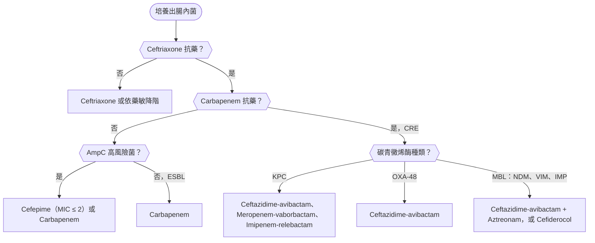

## β-lactam 總論（General Principles）

### 機轉與抗藥性（Mechanism & Resistance）

- 機轉：β-lactam 環模擬 **D-Ala-D-Ala** → 結合 **PBP（penicillin-binding protein）** → 抑制 transpeptidation → 細胞壁無法交聯 → autolysin 作用 → 菌體破裂。
- **殺菌型（bactericidal）**、**時間依賴型（time-dependent）**：療效取決於 **fT > MIC**。
    - 提高 fT > MIC：縮短給藥間隔、**延長輸注（extended infusion）**。
- 天生無效：**沒有細胞壁**的 Mycoplasma；細胞內菌 Chlamydia、Legionella、Rickettsia。
- 四大類：Penicillin、Cephalosporin、Carbapenem、Monobactam。
- 抗藥機制：

| 機制 | 代表 |
|------|------|
| **β-lactamase 水解**（最重要） | ESBL、AmpC、carbapenemase |
| **PBP 改變** | **MRSA（mecA → PBP2a）**、PRSP（肺炎鏈球菌）、E. faecium |
| Porin 減少 | **Pseudomonas 失去 OprD → Imipenem 抗藥** |
| Efflux pump | Pseudomonas |

- β-lactamase 分類（Ambler）：

| 分類 | 代表 | 重點 |
|------|------|------|
| A | TEM、SHV、**CTX-M（ESBL）**、**KPC** | ESBL → 3rd gen cephalosporin 無效；KPC → carbapenem 無效 |
| B | **NDM**、VIM、IMP（metallo-β-lactamase，MBL） | 需要 Zn²⁺；**所有 BLI 都無效**；不水解 Aztreonam |
| C | **AmpC** | Enterobacter、Citrobacter；3rd gen cephalosporin 無效、**Cefepime 穩定** |
| D | **OXA-48**（腸內菌）、OXA-23（Acinetobacter） | Avibactam 可抑制 OXA-48 |

- β-lactamase inhibitor（BLI）：
    - 傳統：**Clavulanate、Sulbactam、Tazobactam** → 只抑制 class A，**對 AmpC、carbapenemase 無效**。
    - 新型：**Avibactam**（A、C、OXA-48）、Vaborbactam、Relebactam（A、C，含 KPC）。
    - **Sulbactam 本身對 Acinetobacter 有活性**。
- 各抗藥菌的首選治療見[[#依菌種選藥（Pathogen-Directed Therapy）|依菌種選藥]]、[[感染科#重要抗藥性機制|感染科的抗藥性機制]]。

### 藥物動力學（Pharmacokinetics）

- 多數經腎排除 → 依 CrCl 調整劑量。
    - **不需調整**：**Ceftriaxone**（膽汁 + 腎）、**Oxacillin**（肝）、Cefoperazone（膽汁）。
- 中樞穿透：腦膜**發炎時**才進得去 → 腦膜炎用**高劑量**。
    - 可用：Penicillin G、Ampicillin、**Ceftriaxone**、Cefotaxime、Ceftazidime、**Cefepime**、**Meropenem**。
    - **不可用**：**Cefazolin**、第 2 代、**Imipenem**（易癲癇）。
- Probenecid → 抑制腎小管分泌 → **Penicillin 濃度↑**。

### 過敏與交叉反應（Allergy & Cross-reactivity）

- 自稱 penicillin 過敏約 10%，**真正過敏 < 5%**；IgE 過敏 10 年後約 80% 消失。
- 過敏標籤 → 改用 Vancomycin、FQ、Clindamycin → **SSI、C. difficile、MRSA/VRE↑**。
- 過敏類型：

| 類型 | 時間 | 表現 | 之後 |
|------|------|------|------|
| **IgE（Type I）** | 1 小時內 | 蕁麻疹、血管性水腫、支氣管痙攣、anaphylaxis | 皮膚測試；必要時 desensitization |
| 輕度延遲型（Type IV） | 數天 | **Maculopapular rash**，無黏膜侵犯 | 多可再挑戰 |
| **SCAR** | 1–8 週 | [[皮膚科#Stevens-Johnson Syndrome（SJS）/ Toxic Epidermal Necrolysis（TEN）\|SJS/TEN]]、[[皮膚科#Drug Reaction with Eosinophilia and Systemic Symptoms（DRESS）\|DRESS]]、AGEP | **終身禁用、不可挑戰** |
| 其他 | 數天–數週 | 溶血性貧血、[[腎臟內科#急性間質性腎炎（AIN）\|AIN]]、藥物熱、serum sickness | 避免同藥 |

- **PEN-FAST**：**F**ive years 內（2）、**A**naphylaxis/angioedema 或 **S**CAR（2）、**T**reatment required（1）→ **:red[< 3 分]低風險** → 可直接口服 Amoxicillin 挑戰。
- 交叉反應：取決於 **R1 側鏈**，不是 β-lactam 環。

| 已知過敏 | 換用 | 交叉反應 |
|----------|------|----------|
| Penicillin | Cephalosporin | **約 1–2%**（舊說 10% 是高估） |
| Penicillin | **Cefazolin** | **極低**（側鏈獨特）→ 即使 anaphylaxis 史也可用 |
| **Amoxicillin/Ampicillin** | **Cephalexin、Cefaclor、Cefadroxil** | 高（**R1 側鏈相同**） |
| Penicillin | Carbapenem | **< 1%** |
| 所有 β-lactam | **Aztreonam** | **幾乎沒有**；例外：**Ceftazidime**（側鏈相同） |

### 副作用總覽（Adverse Effects）

| 副作用 | 代表藥物 | 重點 |
|--------|----------|------|
| **過敏** | 所有 | 最常見 |
| **神經毒性（癲癇、NCSE）** | **Cefepime**、Imipenem、高劑量 Penicillin G | 腎功能差未調劑量 |
| C. difficile | 3rd/4th gen cephalosporin、carbapenem、Augmentin | 廣效 → 風險↑ |
| 血球低下 | Oxacillin、Piperacillin、Ceftaroline | 長期（> 2 週）使用 |
| 溶血性貧血 | Ceftriaxone、Penicillin | Immune-mediated |
| AIN | **Methicillin**（經典，已停用）、Oxacillin | 發燒 + 皮疹 + eosinophilia |
| 膽汁鬱積型肝炎 | **Augmentin（clavulanate）**、Oxacillin | 可在停藥後數週才出現 |
| 膽泥（pseudolithiasis） | **Ceftriaxone** | 與鈣結合沉澱 |
| **凝血異常 + disulfiram-like** | **Cefoperazone（Brosym）**、Cefmetazole、Cefotetan | NMTT 側鏈 → 抑制 Vit K；禁酒 |
| **Jarisch-Herxheimer reaction** | Penicillin（治療梅毒、鉤端螺旋體病） | 24 小時內發燒、寒顫；**非過敏、不停藥** |

- **Cefepime 神經毒性**：腎功能差 + 意識改變、肌躍症 → 易誤認為敗血症或尿毒 → 腦波找 **NCSE**、減量或停藥。

## Penicillins（青黴素類）

| 類別 | 代表藥物 | 主要涵蓋 |
|------|----------|----------|
| Natural | **Penicillin G**、Penicillin V | **Streptococcus**、**Treponema**、口腔厭氧菌 |
| Anti-staphylococcal | **Oxacillin** | **MSSA** |
| Aminopenicillin | **Ampicillin**、Amoxicillin | 加 **Enterococcus**、Listeria、部分 GNR（E. coli、H. influenzae） |
| Aminopenicillin + BLI | **Augmentin、Curam**、**Unasyn** | 加 MSSA、**厭氧菌**、產 β-lactamase 的 GNR |
| Anti-pseudomonal | **Tazocin** | 加 **Pseudomonas** |

### Natural Penicillins（天然青黴素）

- **Penicillin G（aqueous）**：IV，半衰期短 → q4h 或 continuous infusion。
- **Benzathine penicillin G**：**只能 IM**，長效數週。
    - 誤打入血管 → 栓塞、心跳停止（**Nicolau syndrome**）。
- Penicillin V：口服、耐酸。
- **[[感染科#Treponema pallidum（Syphilis，梅毒）|梅毒]]：所有分期首選**。
    - 早期（一期、二期、早期潛伏）：Benzathine PG **:red[240 萬單位 IM × 1]**。
    - 晚期潛伏、分期不明：240 萬單位 IM **每週 1 次 × 3**。
    - **神經性梅毒**：**Aqueous PG IV**（每天 1800–2400 萬單位）× **10–14 天**。
    - **孕婦只能用 Penicillin** → 過敏也要 **desensitization**。
- **GAS [[耳鼻喉科#急性咽扁桃腺炎（Acute Pharyngotonsillitis）|咽炎]]**：Penicillin V 或 Amoxicillin **× 10 天**（預防 rheumatic fever）。
    - **GAS 從未出現 penicillin 抗藥**。
    - Rheumatic fever 次級預防：Benzathine PG 每 3–4 週 IM。
- 其他首選：**Actinomyces**、**C. perfringens（gas gangrene）**、Leptospirosis、敏感株 N. meningitidis。
- **Necrotizing fasciitis、Strep TSS**：Penicillin + **Clindamycin**（抑制毒素合成）。
- Jarisch-Herxheimer reaction：治療梅毒後 24 小時內發燒 → **不是過敏**、繼續治療。

### Anti-staphylococcal Penicillins（抗葡萄球菌青黴素）

- 代表：**Oxacillin**（台灣靜脈注射）；Nafcillin、Dicloxacillin（口服）。
- 側鏈大 → **不被 penicillinase 水解**。
- **MSSA 首選：Oxacillin 或 Cefazolin**。
    - **Vancomycin 治療 MSSA 效果較差** → 培養出 MSSA 就要換藥。
    - 菌血症：Cefazolin 與 Oxacillin 相當，Cefazolin 副作用少、q8h 方便。
    - **中樞感染**（腦膜炎、腦膿瘍）：用 **Oxacillin**（Cefazolin 進不了 CNS）。
- **不需腎功能調整**（肝代謝）。
- 副作用：**肝炎**、**嗜中性球低下**、AIN、靜脈炎。
- 無效：**MRSA**、Enterococcus、GNR。

### Aminopenicillins（胺基青黴素）

- **Amoxicillin**（口服，吸收較好）：
    - **[[耳鼻喉科#急性中耳炎（Acute Otitis Media, AOM）|急性中耳炎]]首選**：**高劑量 :red[80–90 mg/kg/day]**（對抗 PRSP）。
    - GAS 咽炎、急性鼻竇炎、輕度 CAP。
    - **[[消化內科#H. pylori|H. pylori]]** 除菌組成之一。
- **Ampicillin**（IV）：
    - **[[感染科#Enterococcus|Enterococcus faecalis]] 首選**；心內膜炎 → **Ampicillin + Ceftriaxone** 或 + Gentamicin。
    - **[[感染科#Listeria monocytogenes|Listeria]] 首選** → cephalosporin 天生無效。
        - 腦膜炎經驗治療：**新生兒、> 50 歲、免疫低下**要**加 Ampicillin**。
    - [[產科#Group B Streptococcus（GBS）預防|GBS 產時預防]]：Penicillin G 或 Ampicillin。
    - 新生兒敗血症：**Ampicillin + Gentamicin**。
- **[[感染科#EBV（Infectious Mononucleosis）|EBV]] 病人吃 Amoxicillin → 全身 maculopapular rash**。
    - **非真正過敏** → 不要貼上 penicillin 過敏標籤。
- 無效：**MSSA**（產 penicillinase）、**Klebsiella**（天生產 SHV）；台灣 E. coli 抗藥率高 → 不單用於 GNR。

### Aminopenicillin + β-lactamase Inhibitor

- **Augmentin、Curam（Amoxicillin-clavulanate）**：口服。
    - **動物咬傷首選**（狗、貓 → **Pasteurella multocida**）、人咬傷。
    - AOM 第二線（30 天內用過 Amoxicillin、合併結膜炎）、鼻竇炎、COPD 急性惡化。
    - 副作用：**腹瀉**、**膽汁鬱積型肝炎**（clavulanate）。
- **Unasyn（Ampicillin-sulbactam）**：IV。
    - **吸入性肺炎**、腹腔與骨盆感染、糖尿病足。
    - **Acinetobacter**：靠 sulbactam → 高劑量（sulbactam 每天 :red[9 g]）+ 第二種藥。
- 涵蓋：**MSSA**、**厭氧菌（含 B. fragilis）**、產 β-lactamase 的 H. influenzae、Moraxella。
- **不涵蓋：Pseudomonas、MRSA、ESBL**。

### Anti-pseudomonal Penicillin（抗綠膿桿菌青黴素）

- **Tazocin（Piperacillin-tazobactam）**：GPC + GNR + **Pseudomonas** + **厭氧菌**。
- 院內感染經驗治療主力：**HAP/VAP**、[[血液腫瘤科#Febrile Neutropenia|嗜中性球低下發燒]]、複雜性腹腔感染、糖尿病足。
    - **不涵蓋 MRSA** → 需要時加 Vancomycin。
- 4.5 g q6h；Pseudomonas、重症 → **延長輸注（每劑 4 小時）**。
- **ESBL 菌血症不用 Tazocin**：**MERINO trial**（2018）→ 死亡率高於 Meropenem（**12.3% vs 3.7%**）。
- 合併 **Vancomycin** → AKI 風險↑（觀察性研究；ACORN 隨機試驗則無差異）。
- 副作用：血小板功能異常、低血鉀、血球低下（長期）。

## Cephalosporins（頭孢菌素類）

| 世代 | 代表藥物 | 涵蓋 | 重點 |
|------|----------|------|------|
| 1st | **Cefazolin**、Cephalexin | GPC 強（MSSA、Strep）、少數 GNR（PEcK） | **手術預防首選** |
| 2nd | Cefuroxime；**Cefoxitin、Cefmetazole、Flumarin** | 加 H. influenzae、Moraxella；cephamycin 加**厭氧菌** | 呼吸道；腹腔、骨盆感染 |
| 3rd | **Ceftriaxone**、Cefotaxime；Ceftazidime | GNR 強；Ceftazidime 加 **Pseudomonas** | CAP、腦膜炎、淋病 |
| 4th | **Cefepime** | GPC + GNR + Pseudomonas；**對 AmpC 穩定** | 嗜中性球低下發燒 |
| 5th | **Ceftaroline** | **唯一涵蓋 MRSA** | 皮膚軟組織感染、CAP |

- 世代越高 → GNR 越強、GPC 越弱（**4th gen 例外：兩者都強**）。
- Cephalosporin **不涵蓋 LAME**：**L**isteria、**A**typicals、**M**RSA（Ceftaroline 除外）、**E**nterococcus。

### 第 1 代 Cephalosporin（1st Generation）

- **Cefazolin**（IV）：
    - **[[外科概論#預防性抗生素|手術預防性抗生素]]首選**：**2 g**（≥ 120 kg → 3 g）、**:red[切皮前 60 分鐘內]**。
        - 手術 > **:red[4 小時]**或失血 > 1500 mL → 追加。
    - **MSSA**：菌血症、骨髓炎、[[皮膚科#蜂窩性組織炎（Cellulitis）與丹毒（Erysipelas）|蜂窩性組織炎]]。
    - **不進 CNS** → 不能治腦膜炎。
- **Cephalexin**（口服）：蜂窩性組織炎、單純 UTI；與 **Amoxicillin 側鏈相同**。
- GNR 只涵蓋 **PEcK**：**P**roteus、**E**. **c**oli、**K**lebsiella。

### 第 2 代 Cephalosporin 與 Cephamycin（2nd Generation）

- **Cefuroxime**（IV、口服）：鼻竇炎、中耳炎、輕度 CAP、Lyme disease。
- Cefaclor（口服）：兒童呼吸道；**serum sickness-like reaction**。
- **Cephamycin**（Cefoxitin、Cefmetazole）與 oxacephem（**Flumarin（Flomoxef）**）：
    - **涵蓋厭氧菌** → 腹腔、骨盆感染、**大腸直腸手術預防**。
    - Cefoxitin + Doxycycline → [[婦科#骨盆腔炎（Pelvic Inflammatory Disease, PID）|PID]]。
    - **對 ESBL 較穩定**（7-α-methoxy），但**會被 AmpC 水解**。
    - **ESBL 菌血症證據不一**：台灣長庚研究 → Flomoxef 死亡率高於 carbapenem（MIC 2–8 時更差）→ 只在病情穩定、MIC 低時考慮。
    - **Cefmetazole**：NMTT 側鏈 → 凝血異常、disulfiram-like。
- 不涵蓋：**Pseudomonas**、Enterococcus。

### 第 3 代 Cephalosporin（3rd Generation）

- **Ceftriaxone**：
    - **q24h**（半衰期長）；**膽汁 + 腎排除 → 不需腎功能調整**。
    - [[胸腔內科#社區型肺炎（CAP）|CAP]] 住院：**Ceftriaxone + Macrolide**。
    - [[神經內科#細菌性腦膜炎|細菌性腦膜炎]]：**:red[2 g q12h]** + **Vancomycin**（PRSP）± Ampicillin（Listeria）。
    - **[[感染科#N. gonorrhoeae（淋病雙球菌）|淋病]]**：**:red[500 mg IM × 1]** + 治療 Chlamydia。
    - [[腎臟內科#泌尿道感染（UTI）與腎盂腎炎|腎盂腎炎]]、[[肝膽胰外科#自發性細菌性腹膜炎（SBP）|SBP]]、傷寒、Lyme disease（神經、心臟侵犯）。
    - 副作用：**膽泥（pseudolithiasis）**、溶血性貧血。
    - **新生兒禁用**：取代白蛋白上的膽紅素 → kernicterus；與含鈣輸液沉澱 → 改用 Cefotaxime。
- **Ceftazidime**：**涵蓋 Pseudomonas**，但 **GPC 弱**。
    - **[[感染科#其他重要病原|Melioidosis]]**（Burkholderia pseudomallei，**台灣南部、颱風後**）：Ceftazidime 或 Meropenem → TMP-SMX 維持。
- **Brosym（Cefoperazone-sulbactam）**：GNR + Pseudomonas + 厭氧菌 + **Acinetobacter**（sulbactam）。
    - **膽汁排除** → 膽道感染。
    - **NMTT 側鏈** → **凝血異常**（追 PT/INR、補 Vit K）、**disulfiram-like**。
- 口服：Cefixime、Cefdinir → 兒童中耳炎、UTI。
- 無效：**ESBL**、**AmpC**；Ceftriaxone、Cefotaxime 不涵蓋 Pseudomonas。

### 第 4 代 Cephalosporin（4th Generation）

- **Cefepime**：GPC + GNR + **Pseudomonas**；**對 AmpC 穩定**。
- **[[血液腫瘤科#Febrile Neutropenia|嗜中性球低下發燒]]經驗治療**、HAP/VAP、院內腦膜炎。
- **AmpC 高風險菌**（**E. cloacae、K. aerogenes、C. freundii**）→ 選 Cefepime，不選 Ceftriaxone。
- **神經毒性**：**腎功能差**未調劑量 → 意識改變、肌躍症、**NCSE**。
- 不涵蓋：厭氧菌、MRSA；**ESBL 不建議**。

### 第 5 代 Cephalosporin（Anti-MRSA）

- **Ceftaroline**：**唯一涵蓋 MRSA 的 cephalosporin**（結合 **PBP2a**）。
- 皮膚軟組織感染、CAP；MRSA 菌血症救援（+ Daptomycin）。
- **不涵蓋 Pseudomonas**。
- 副作用：長期使用 → 嗜中性球低下。
- 其他 MRSA 用藥見[[感染科#MRSA 治療|MRSA 治療]]。

### 新型 β-lactam/β-lactamase Inhibitor（Novel Agents）

| 藥物 | 主要對象 | 無效 |
|------|----------|------|
| **Ceftazidime-avibactam** | **KPC、OXA-48 CRE**、DTR Pseudomonas | **MBL**、Acinetobacter |
| **Ceftolozane-tazobactam** | **DTR Pseudomonas** | Carbapenemase |
| Meropenem-vaborbactam、Imipenem-relebactam | **KPC** CRE | **OXA-48**、MBL |
| **Cefiderocol** | **MBL CRE**、CRAB、Stenotrophomonas | — |

- **MBL（NDM）CRE → Ceftazidime-avibactam + Aztreonam**（avibactam 保護 aztreonam 不被 ESBL/AmpC 水解）。
- **Cefiderocol**：**siderophore**，搭鐵離子轉運系統進入菌體（**Trojan horse**）。
- DTR（difficult-to-treat resistance）：對所有第一線 β-lactam 與 FQ 都抗藥。

## Carbapenems（碳青黴烯類）

- **最廣效的 β-lactam**：GPC、GNR、厭氧菌；**ESBL、AmpC 都穩定**。
- **ESBL 感染首選**（MERINO trial）。
- 不涵蓋：**MRSA**、**E. faecium**、**Stenotrophomonas**（天生產 MBL）、atypicals、CRE。
- 確定菌種後要**降階** → carbapenem 是 CRE 的主要選擇壓力。

| 藥物 | 用法 | 重點 |
|------|------|------|
| **Tienam（Imipenem-cilastatin）** | q6h | Cilastatin 抑制腎臟 dehydropeptidase-I；**癲癇風險最高** |
| **Mepem（Meropenem）** | q8h；腦膜炎 **:red[2 g q8h]** | **腦膜炎可用**；可延長輸注 |
| **Invanz（Ertapenem）** | **q24h** | **不涵蓋 Pseudomonas、Acinetobacter、Enterococcus** → 社區 ESBL、降階 |

- **與 Valproic acid 併用禁忌** → Valproate 濃度 24 小時內**下降 60–100%**、加量也拉不回 → **癲癇發作**。
- 其他副作用：**癲癇**（Imipenem > Meropenem）、C. difficile、念珠菌感染。
- Stenotrophomonas 天生抗藥 → **TMP-SMX**。

## Monobactam（Aztreonam）

- **只涵蓋需氧 GNR（含 Pseudomonas）**；**不涵蓋 GPC、厭氧菌**。
- **與其他 β-lactam 幾乎無交叉過敏** → 嚴重 penicillin 過敏者的 GNR 用藥。
    - 例外：**Ceftazidime 過敏**（側鏈相同）。
- **不被 MBL 水解** → MBL CRE：**Ceftazidime-avibactam + Aztreonam**。
- 腎毒性低。

## 臨床選藥（Clinical Use）

### 依菌種選藥（Pathogen-Directed Therapy）

| 菌種 | 首選 β-lactam | 備註 |
|------|---------------|------|
| GAS、GBS | **Penicillin G**、Amoxicillin | 從未抗藥；重症 + Clindamycin |
| S. pneumoniae | Penicillin G（敏感株）、**Ceftriaxone** | 腦膜炎 + Vancomycin |
| **MSSA** | **Oxacillin、Cefazolin** | 由 Vancomycin 降階 |
| MRSA | Ceftaroline | 其他見[[感染科#MRSA 治療\|MRSA 治療]] |
| **E. faecalis** | **Ampicillin** | E. faecium 多抗藥 → Vancomycin |
| **Listeria** | **Ampicillin** | Cephalosporin 天生無效 |
| **Treponema pallidum** | **Penicillin G** | 孕婦過敏 → desensitization |
| Pasteurella（動物咬傷） | **Augmentin** | |
| B. fragilis（厭氧菌） | Augmentin、Unasyn、Tazocin、carbapenem | 3rd/4th gen cephalosporin 要加 Metronidazole |
| **Pseudomonas** | Tazocin、Ceftazidime、Cefepime、Meropenem | 重症延長輸注 |
| **ESBL** | **Carbapenem** | 非重症、降階 → Ertapenem |
| **AmpC** | **Cefepime**、carbapenem | 避免 Ceftriaxone |
| **CRE** | 依 carbapenemase | 見下方流程圖 |
| **CRAB**（Acinetobacter） | **高劑量 Unasyn + 第二種藥** | Colistin、Cefiderocol |

### 抗藥腸內菌選藥（Resistant Enterobacterales）

- 台灣 CRE（尤其 K. pneumoniae）以 **KPC** 最多，OXA-48、NDM 逐年增加。
- 台灣已出現 PBP3 插入突變、Ceftazidime-avibactam 敏感性下降的 KPC 菌株，見[[感染科#重要抗藥性機制|感染科]]。

### 涵蓋範圍比較（Coverage）

| | 涵蓋 | 不涵蓋（常被誤會） |
|--|------|------------------|
| **Pseudomonas** | Tazocin、Ceftazidime、Cefepime、Brosym、Meropenem、Tienam、Aztreonam | **Ceftriaxone**、Augmentin、Unasyn、Cefazolin、Flumarin、**Ertapenem**、Ceftaroline |
| **厭氧菌（B. fragilis）** | Augmentin、Unasyn、Tazocin、Brosym、carbapenem、Cefoxitin、Cefmetazole、Flumarin | **Ceftriaxone、Ceftazidime、Cefepime**、Cefazolin、Aztreonam |
| **MRSA** | **Ceftaroline**（β-lactam 中唯一） | 其他所有 β-lactam |
| **Enterococcus** | **Ampicillin**、Amoxicillin、Tazocin、Imipenem | **所有 cephalosporin**、Ertapenem、Aztreonam |

| | Ceftriaxone | Ceftazidime | Cefepime |
|--|-------------|-------------|----------|
| 世代 | 3rd | 3rd | 4th |
| GPC | **強** | **弱** | 強 |
| Pseudomonas | ✗ | **✓** | **✓** |
| AmpC | 不穩定 | 不穩定 | **穩定** |
| 給藥 | **q24h** | q8h | q8–12h |
| 腎功能調整 | **不需要** | 需要 | 需要（否則**神經毒性**） |
