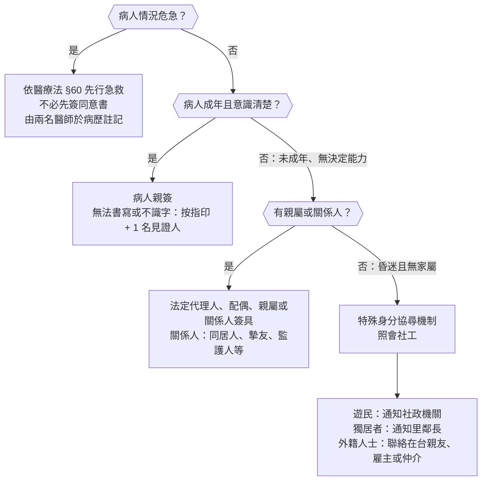

## 摘要

楊淑貞社工師從社工的角度談醫療人員的四道防線：辨識保護性個案、法規、醫病溝通、社工轉介。前半講兒虐與老人保護的辨識指標，後半講醫療爭議怎麼來（多半是溝通問題，而非技術過失）、醫療法第 82 條的責任界線，以及同意書由誰簽的決策樹。

## 四大防線

- 辨識：認出疑似受虐、受疏忽的個案。
- 法規：通報義務、知情同意、醫療責任的法律界線。
- 醫病溝通：預防醫療爭議。
- 社工轉介：知道何時呼叫院內社工。

## 保護性個案

- 常見的家暴案件類型：親密關係暴力、兒少保護、老人保護、其他家庭成員間的暴力。
- 部北的保護性案件每年約 500 例，其中性侵害每月約 1–2 例。

:::supplement
- 醫事人員在執行業務時知道有家暴、兒少受虐或疏忽、老人受虐、性侵害的情形，依各該法律（家庭暴力防治法、兒童及少年福利與權益保障法、老人福利法、性侵害犯罪防治法）都屬責任通報人員，應在 **24 小時內通報**直轄市、縣（市）主管機關，見[[家庭醫學科#家庭暴力（Domestic Violence）|家庭暴力]]。
- 通報不需要確定，「疑似」就要通報；調查與認定是主管機關的工作。
:::

### 兒虐的辨識

兒虐的完整鑑別與處置見[[小兒主訴#疑似兒童虐待（Suspected Child Abuse）|疑似兒童虐待]]，以下是講者強調的辨識重點。

- **瘀傷「4」的原則**：
    - 4 歲以下，軀幹、耳朵、頸部出現瘀傷 → 高度懷疑。
    - 4 個月以下（還不會移動）**任何部位**的瘀傷都要高度懷疑。
- **受虐傷的特徵**：
    - 位在有皮下脂肪保護的軟組織處（不是骨突處）。
    - 形狀特殊，和施暴工具吻合。
    - 新舊雜陳：不同癒合時期的傷，代表反覆發生。
- **燙傷**：虐待造成的燙傷**界線明顯**，包括斑馬紋、甜甜圈洞、手套或長襪型燙傷。
- **骨折**：虐待性骨折多發生在 1 歲以下、還不會走路的孩子，同樣新舊雜陳。
- **虐待性頭部外傷**（AHT, Abusive Head Trauma）：硬腦膜下出血（SDH）、腦實質傷害、視網膜出血、肋骨骨折，四項符合三項時，虐待的機率高達 85%。
- **該出現卻沒出現**：該打預防針、該上學的時候沒有出現，也是警訊；預防針漏打幾次之後就會被通報。

:::supplement
- 瘀傷的原則就是 **TEN-4**（Torso、Ears、Neck；4 歲以下；4 個月以下任何部位），擴充版 TEN-4-FACESp 再加上繫帶、下顎角、臉頰、眼瞼、結膜下與有形狀的瘀傷。
- 燙傷的三種型態都是**浸泡燙傷**（強迫把孩子壓進熱水）的痕跡：
    - 斑馬紋：孩子屈曲時皮膚皺褶處沒有碰到熱水，留下一條條未燙傷的帶狀皮膚。
    - 甜甜圈洞：臀部壓在較涼的浴缸底部，中央沒有燙傷，周圍一圈燙傷。
    - 手套、長襪型：手或腳被浸入熱水，界線整齊、沒有噴濺痕；意外潑灑的燙傷通常界線不規則、有噴濺狀。
- 虐待性頭部外傷的機率：講者引用的是 Maguire 等人 2011 年的統合分析（Pediatrics 2011;128:e550–e564）。這篇研究的對象是 3 歲以下有顱內傷害的孩子，看六個臨床特徵：**呼吸暫停、視網膜出血、肋骨骨折、長骨骨折、癲癇、頭頸部瘀傷**；在顱內傷害之外合併其中三項以上時，虐待的陽性預測值超過 85%。
- 疑似虐待時的檢查：2 歲以下做**全身骨骼 X 光**（skeletal survey）、眼底檢查、頭部影像；並排除凝血異常、成骨不全症等鑑別診斷。
:::

:::supplement
- 查證：講者的四項和文獻不完全相同。
    - 「三項以上、> 85%」出自上面的 Maguire 2011：前提是已經有顱內傷害（例如硬腦膜下出血），再看六項特徵中符合幾項；其中**肋骨骨折或視網膜出血**合併任何一項其他特徵，陽性預測值也 > 85%。
    - 「硬腦膜下出血 + 視網膜出血 + 骨折」三聯徵另有研究（J Neurosurg Pediatr 2023）報告陽性預測值 100%，但陽性個案數少，信賴區間很寬。
:::

#### 簡易篩檢指標

符合任一項就要提高警覺：

- 一年內 3 次以上因外傷到急診就醫。
- 病史前後不一致。
- 病史與身體檢查不一致。
- 延遲就醫。
- 1 歲以下的骨折或頭部外傷。
- 從低處跌落卻造成顱內損傷或骨折。
- 原因不明的口腔、陰部、肛門疼痛或損傷。
- 體重過輕或營養不良。

參考文獻：

- [Maguire S, et al. Estimating the probability of abusive head trauma: a pooled analysis. Pediatrics 2011;128:e550–e564](https://pubmed.ncbi.nlm.nih.gov/21844052/)
- [Subdural hematoma, retinal hemorrhage, and fracture triad as a clinical predictor for the diagnosis of child abuse. J Neurosurg Pediatr 2023](https://thejns.org/pediatrics/view/journals/j-neurosurg-pediatr/33/2/article-p142.xml)

### 老人保護

辨識指標分三大類：

| 類別 | 指標 |
|---|---|
| 一般與情緒 | 與照顧者爭吵、表現恐懼、低自尊、緊纏來訪者不放 |
| 身體 | 不明原因的傷口、捆綁痕跡、用藥異常、眼鏡破損 |
| 照顧疏忽 | 長期褥瘡、濕疹、異常體重減輕、營養不良、衣著不適當 |

- 醫療人員的法定義務：評估、辨識、通報與取證、跨單位合作。

:::supplement
- 「緊纏來訪者不放」指老人在家訪或就醫時特別黏著醫療人員、不願對方離開，可能是在家中孤立、害怕的表現。
- 「用藥異常」包括藥量過多（用鎮靜藥物控制老人）或過少（藥被挪用、沒有給藥）。
- 老人保護的通報依據是老人福利法，同樣 24 小時內通報；老人受虐的型態除了身體與精神虐待、疏忽，還有**財務剝削**（挪用存款、年金）。
:::

## 醫病溝通與醫療爭議

### 溝通的漏斗效應

- 台灣的醫療糾紛約 80% 起因於醫病溝通不良，而非單純的醫療技術過失；超過一半的病人對病情與治療內容一知半解。
- 漏斗效應：你想表達的是 100%，表達出來的剩 80%，對方聽到 60%、理解 40%、記住 20%，最後真正照著做的可能趨近於 0。

同一個療程，醫方和病方各有一套解讀：

| 階段 | 醫方視角 | 病方視角 |
|---|---|---|
| 告知診斷 | 醫療專業，有憑有據 | 是否誤診了？不敢面對 |
| 討論治療方案 | 醫病共享資訊，提高病人參與 | 是否沒救了？不理解醫療專業，無從選擇 |
| 術前風險說明 | 履行告知義務，以實證說明可能結果 | 過分解讀機率；不只關心結果，也想瞭解過程 |
| 術前同意書 | 符合法令規範，佐證已告知 | 為了活只好簽，無法完全理解，有時間壓力 |
| 不良結果發生 | 醫療本有風險，該做的都做了 | 為什麼之前都沒說！是不是有疏失？ |

### 醫預法

- 醫療事故預防及爭議處理法（醫預法）：[全國法規資料庫](https://law.moj.gov.tw/LawClass/LawAll.aspx?pcode=L0020227)。

:::supplement
- 醫預法 2024 年 1 月 1 日施行，三大重點：
    - **說明、溝通、關懷**：醫療事故發生後，醫院要在一定期間內由專業人員向病方說明、溝通，提供關懷；一定規模以上的醫院要設醫療事故關懷小組。說明過程中醫方的道歉或遺憾表達，不得作為訴訟的證據。
    - **調解先行**：醫療爭議在提起民事訴訟或刑事告訴前，要先經地方政府的醫事爭議調解會調解。
    - **事故預防**：重大醫療事故要分析根本原因、提出改善方案，向主管機關通報（不究責的學習機制）。
:::

### 員工關懷與支援

- 事件處理支援：事件檢討、啟動爭議處理機制、安排說明會、調解會議。
- 財務層面：部北有醫療爭議處理互助金，每月繳納，主治醫師 500 元、住院醫師 250 元、其他員工 100 元。

## 知情同意與醫療責任

### 醫療法第 82 條：責任的界線

- 醫療人員要盡醫療常規與醫療上必要的注意義務。
- 只有在**故意**，或**違反醫療上必要之注意義務且逾越合理臨床專業裁量**時，才負刑事責任與損害賠償責任。

:::supplement
- 醫療法第 82 條 2018 年修正，把醫療過失明文化：
    - 民事：醫事人員因執行業務致病人損害，以故意，或違反醫療上必要之注意義務且逾越合理臨床專業裁量者為限，負損害賠償責任。
    - 刑事：醫事人員因執行業務致病人死傷，以違反醫療上必要之注意義務且逾越合理臨床專業裁量者為限，負刑事責任。
    - 判斷標準：該醫療領域當時當地的醫療常規、醫療水準、醫療設施、工作條件及緊急迫切等客觀情況。
    - 醫療機構因執行業務致病人損害，以故意或過失為限，負損害賠償責任。
- 「逾越合理臨床專業裁量」是修法新增的門檻：醫師在合理範圍內的臨床判斷，即使事後看來不是最好的選擇，也不構成過失。
:::

### 同意書由誰簽：決策樹

:::supplement
- 法律依據：醫療法第 63 條（手術）、第 64 條（侵入性檢查或治療）要求向病人或其法定代理人、配偶、親屬或關係人說明，並經其同意、簽具同意書；**情況緊急者不在此限**。
- 醫療法第 60 條：醫院、診所遇有危急病人，應先予適當之急救，不得無故拖延。
- 知情同意的要素見[[家庭醫學科#知情同意（Informed Consent）|知情同意]]。
:::

## 轉介與後援

- 何時該呼叫院內社工：疑似保護性個案（兒虐、家暴、老人保護、性侵害）、無家屬或身分不明需要協尋、醫療爭議需要關懷與溝通、經濟或照顧資源需要連結時。

:::supplement
- 上面「何時呼叫社工」的情境是依講者四大防線的內容整理，筆記沒有列出講者的完整清單。
:::
