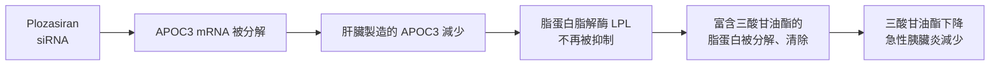

## 本週頭條

### ISCHEMIA 試驗追蹤 11 年：穩定型冠心病一開始就做心導管，並沒有活得更久

::::news{subjects="心臟內科" evidence="大型臨床試驗" source="JAMA" date="2026-11-07" url="https://doi.org/10.1001/jama.2026.20375"}
《美國醫學會期刊》（JAMA）11 月 7 日刊出 ISCHEMIA 試驗的長期追蹤 ISCHEMIA-EXTEND：5,179 位中度到重度心肌缺血的穩定型冠心病病人，中位追蹤 9 年、最長 13.4 年，一開始就做心導管與血管再通的那組，11 年全死因死亡率 **25.8%**，先吃藥、藥物控制不了才做的那組 **26.9%**，兩組沒有顯著差異。

:::background
- **穩定型冠心病（chronic coronary disease）**：冠狀動脈狹窄造成活動時胸痛，但沒有急性冠心症（[[心臟內科#穩定型心絞痛（Stable Angina）|穩定型心絞痛]]）。治療有兩條路：一開始就做心導管、放支架或繞道（侵入性策略），或先用指引建議的藥物治療（保守策略），藥物控制不了才做。
- **直覺 vs 證據**：「有狹窄就打通」很直覺，但打通是否真的讓病人活得更久，要靠隨機試驗回答。
- **前兩個關鍵試驗**：
    - **COURAGE**（NEJM 2007）：2,287 位穩定型冠心病病人，藥物加經皮冠狀動脈介入治療（percutaneous coronary intervention，PCI）和單用藥物比較，4.6 年的死亡或非致命心肌梗塞 19.0% vs 18.5%，沒有差異。
    - **ISCHEMIA**（NEJM 2020）：專門收缺血程度中度到重度、理論上最可能從打通得益的病人；中位追蹤 3.2 年，主要心血管事件沒有顯著差異，死亡人數 145 vs 144。
:::

#### 這次的長期追蹤

- **對象**：37 國 320 個中心，左心室射出分率 35% 以上，排除左主幹病變、無法接受的心絞痛與近期急性冠心症。
- **追蹤**：2012 年 8 月開始收案，追蹤到 2025 年 12 月，總共 1,071 人死亡，其中 782 人是在延長追蹤期間。

| 11 年結果 | 侵入性策略 | 保守策略 | 差異 |
|---|---|---|---|
| 全死因死亡 | 25.8% | 26.9% | −1.0 個百分點（HR 0.97，不顯著） |
| 心血管死亡 | 15.8% | 17.1% | −1.4 個百分點（HR 0.88，不顯著） |
| 非心血管死亡 | 9.1% | 8.1% | +1.0 個百分點（HR 1.18，不顯著） |
| 11 年平均存活時間 | | | 只差 14 天 |

- 用貝氏分析估計，侵入性策略讓存活多 1 個百分點以上的機率只有 **18%**。

#### 怎麼解讀

- **存活不是做心導管的理由**：從 COURAGE、ISCHEMIA 到這次 11 年的追蹤，結論一致：穩定型冠心病一開始就打通，不會讓病人活得更久。
- **還是有該做的人**：試驗排除了左主幹病變、射出分率低於 35%、藥物控制不了心絞痛與急性冠心症的病人；這些族群和症狀難以控制、想改善生活品質的病人，仍然是血管再通的對象。
- **心血管死亡略低、非心血管死亡略高**：兩者都沒有達到統計顯著，抵消之後全死因沒有差異。
- 同一期 JAMA 也刊出 COURAGE 試驗的延長追蹤。

出處：[JAMA ISCHEMIA-EXTEND（依摘要）](https://doi.org/10.1001/jama.2026.20375)、[ISCHEMIA（NEJM 2020）](https://doi.org/10.1056/NEJMoa1915922)、[COURAGE（NEJM 2007）](https://doi.org/10.1056/NEJMoa070829)
::::

## 臨床更新

### FDA 加速核准皮下注射 amivantamab 治療復發或轉移性頭頸部鱗狀細胞癌，十年來第一個後線新藥

::::news{subjects="耳鼻喉科,血液腫瘤科" evidence="官方公告" source="FDA" date="2026-11-05" url="https://www.fda.gov/news-events/press-announcements/fda-grants-accelerated-approval-new-treatment-head-and-neck-squamous-cell-carcinoma"}
美國 FDA 11 月 5 日加速核准嬌生（Janssen）的 Rybrevant Faspro（amivantamab 與玻尿酸酶的皮下注射劑型），用於含鉑化療與免疫治療後惡化的復發或轉移性頭頸部鱗狀細胞癌（head and neck squamous cell carcinoma，HNSCC）成人。這是十年來第一個核准給這群病人的新藥。

:::background
- **頭頸部鱗狀細胞癌**：口腔、咽、喉的鱗狀細胞癌，台灣的口腔癌與檳榔、菸、酒密切相關（[[耳鼻喉科#口腔癌（Oral Cavity Cancer）|口腔癌]]）。復發或轉移後，第一線治療包括含鉑化療合併免疫治療；兩者都失敗後，FDA 指出現有治療的反應率約 20% 以下。
- **amivantamab 是什麼**：在台灣與美國原本核准用於表皮生長因子受體（epidermal growth factor receptor，EGFR）突變的非小細胞肺癌。這次核准的是皮下注射劑型，成分中加入玻尿酸酶（hyaluronidase）。
:::

#### 核准的依據

| | Amivantamab 皮下注射 | 現有後線治療 |
|---|---|---|
| 試驗 | 開放標籤、多中心，102 人 | — |
| 整體反應率 | **42%** | 約 20% 以下 |
| 反應持續 6 個月以上 | 反應者中 56% | — |

- 屬於加速核准：依據是反應率與反應持續時間，藥廠還要完成驗證試驗，確認能延長存活。
- **不適用**人類乳突病毒（HPV）相關的口咽鱗狀細胞癌。
- 主要警語：過敏與注射相關反應、間質性肺病、皮膚毒性、眼睛毒性、胚胎毒性。

#### 台灣現況

- amivantamab 在台灣叫「肺倍恩」，靜脈注射劑型 2021 年取得許可證、皮下注射劑型 2026 年 6 月取得許可證，適應症都是 **EGFR 突變的非小細胞肺癌**；健保有給付靜脈劑型的肺癌用途。
- **頭頸癌不在台灣核准的適應症內**。

出處：[FDA 11/5](https://www.fda.gov/news-events/press-announcements/fda-grants-accelerated-approval-new-treatment-head-and-neck-squamous-cell-carcinoma)、[食藥署藥品許可證開放資料](https://data.fda.gov.tw/)、[健保用藥品項開放資料](https://info.nhi.gov.tw/api/iode0000s01/Dataset?rId=A21030000I-E41001-001)
::::

### 公費流感疫苗開放 50 歲以上；本季流感重症 98% 未接種疫苗

::::news{subjects="感染科,家庭醫學科" evidence="官方公告" source="疾管署" date="2026-11-03" url="https://www.cdc.gov.tw/Bulletin/Detail/57M9H7NQtbjNyO5ygCgNiA?typeid=9"}
疾管署 11 月 3 日表示，公費流感與新冠疫苗 11 月 2 日起進入第二階段，開放 50 到 64 歲、沒有高風險慢性病的成人接種，等於 **50 歲以上全面公費**。同時公布，本季流感併發重症病例中，**98.3% 未接種本季疫苗**。

:::background
- **今年的流感季**：疫情提前進入流行期，社區流行的病毒以 A 型 H1N1 為主（[[感染科#Influenza|流感]]）。
- **健康幣**：疾管署用健康幣鼓勵民眾接種，接種疫苗可以獲得健康幣。
:::

#### 疫情數字（截至 11 月 2 日）

| | 數字 |
|---|---|
| 上週新增流感重症 | 151 例（H1N1 146 例） |
| 上週流感死亡 | 46 例（均為 H1N1） |
| 本季累計流感重症 | 542 例、死亡 95 例 |
| 重症中 65 歲以上 | 69.0% |
| 重症中有慢性病史 | 85.4% |
| 重症中未接種本季疫苗 | **98.3%** |
| 社區流感病毒 H1N1 比例 | 92.7% |

- 接種量：流感疫苗已逾 474.7 萬人次、新冠疫苗逾 134.4 萬人次，分別是去年同期的 1.02 倍與 1.3 倍。
- 新冠疫情持續下降，本季累計 75 例本土重症、13 例死亡，全部未接種本季新冠疫苗；主要變異株是 PQ.16.1.1。

#### 對門診的意義

- 50 歲以上、65 歲以上長者與慢性病人，都是現在就可以公費接種的對象。
- 疾管署提醒的危險徵兆：呼吸困難、呼吸急促、發紺、血痰、胸痛、意識改變、低血壓，出現時應儘速就醫。

出處：[疾管署 11/3](https://www.cdc.gov.tw/Bulletin/Detail/57M9H7NQtbjNyO5ygCgNiA?typeid=9)
::::

## 新研究

### 新生兒不打維生素 K 的比例 9 年翻倍，出血風險增加 47%、顱內出血風險增加 1.4 倍

::::news{subjects="小兒科" evidence="初步研究" source="JAMA" date="2026-11-05" url="https://doi.org/10.1001/jama.2026.21764"}
JAMA 11 月 5 日刊出美國的回溯性世代研究：2017 到 2025 年出生的 524 萬名嬰兒中，出生時沒有接受維生素 K 肌肉注射的比例從 **3.1% 增加到 6.8%**；沒有接受注射的嬰兒，出生 6 個月內出血的風險高 47%，顱內出血的風險高 1.43 倍。

:::background
- **新生兒維生素 K 缺乏性出血（vitamin K deficiency bleeding，VKDB）**：新生兒體內的維生素 K 存量低、母乳中的維生素 K 也少，肝臟製造的凝血因子 II、VII、IX、X 不足，就可能出血，常以顱內出血表現，可能造成腦傷或死亡（[[小兒科#新生兒出血性疾病（Hemorrhagic Disease of Newborn / VKDB）|新生兒出血性疾病]]）。
- **預防**：出生後肌肉注射維生素 K1 1 mg，多數國家都建議常規施打，讓這個病變得罕見。
- **台灣**：食藥署核准的維生素 K1 注射液（phytonadione，例如「血納定」），適應症就是「預防或治療新生兒維生素 K 缺乏性出血」。
- 以下對話的角色借用動畫《葬送的芙莉蓮》（2026 年 1 到 3 月播出第二季）：活了一千多年、對時間的感受和人類不同、四處旅行蒐集魔法的精靈魔法使**芙莉蓮**，和她的人類徒弟、一級魔法使**費倫**。
:::

#### 旅館裡的對話

:::dialogue
**費倫**：芙莉蓮大人，您看這篇 JAMA。美國不讓新生兒打維生素 K 的家長，九年內變成兩倍多。

**芙莉蓮**：一針就能預防的事啊。人類真奇怪，花了很多年才找到方法，卻又自己不用。

**費倫**：您先說說，為什麼新生兒一定要補維生素 K？

**芙莉蓮**：剛出生的嬰兒，身體裡存的維生素 K 很少，母乳裡也不多。肝臟做凝血因子 II、VII、IX、X 需要它，不夠的時候就會出血，最可怕的是出血在腦裡面。

**費倫**：這篇研究是誰做的？

**芙莉蓮**：美國的團隊，用 Epic Cosmos 這個電子病歷資料庫，分析 2017 到 2025 年在 50 個州出生、懷孕 35 到 43 週的 524 萬名嬰兒。他們比較出生時有打和沒打維生素 K 的嬰兒，看 6 個月內有沒有出血。

**費倫**：結果呢？

**芙莉蓮**：沒打的比例從 3.1% 變成 6.8%。沒打的嬰兒，6 個月內出血的發生率每萬人 288 例，有打的是 186 例，風險高 47%。**顱內出血**每萬人 33 例對 13 例，高 1.43 倍；出生住院期間合併出血的死亡，風險也高 1.69 倍。

**費倫**：那為什麼還有家長不讓孩子打？

**芙莉蓮**：這篇摘要沒有寫原因。同一期 JAMA 另外有一篇文章，在談醫療人員要怎麼跟拒打的家長說明風險。

**費倫**：所以，有家長拒絕的時候，我們該怎麼做？

**芙莉蓮**：把數字說清楚。打一針，換掉的是腦出血的風險。決定權在家長，但他們應該知道自己放棄的是什麼。

**費倫**：……芙莉蓮大人，您說得很好。那您手上那本書是什麼？

**芙莉蓮**：剛才在市場買的魔導書，「讓早餐自動變熱的魔法」。

**費倫**：又是這種魔法。
:::

#### 一張表整理

| 每萬名嬰兒 | 未接種維生素 K | 有接種 | 風險比 |
|---|---|---|---|
| 6 個月內出血 | 288.0 | 185.9 | 1.47 |
| 顱內出血 | 33.0 | 13.2 | 2.43 |
| 出生住院期間合併出血的死亡 | 2.9 | 1.1 | 2.69 |

- 2017 到 2025 年間，兩組的出血發生率都在上升：未接種的從每萬人 225 增加到 394，有接種的從 137 增加到 222。
- 這是回溯性研究，出血是用診斷碼判定；依摘要。

出處：[JAMA 11/5（依摘要）](https://doi.org/10.1001/jama.2026.21764)、[JAMA：如何溝通拒打維生素 K 的風險](https://doi.org/10.1001/jama.2026.23146)、[Wikipedia：VKDB](https://en.wikipedia.org/wiki/Vitamin_K_deficiency_bleeding)、[食藥署藥品許可證開放資料](https://data.fda.gov.tw/)
::::

### Plozasiran 讓嚴重高三酸甘油酯血症病人的急性胰臟炎減少近八成

::::news{subjects="代謝內分泌科,消化內科" evidence="大型臨床試驗" source="NEJM" date="2026-11-05" url="https://doi.org/10.1056/NEJMoa2610014"}
NEJM 11 月 5 日刊出兩個第 3 期試驗 SHASTA-3 與 SHASTA-4：嚴重高三酸甘油酯血症的病人，皮下注射 small interfering RNA 藥物 plozasiran，12 個月時三酸甘油酯下降約 **80%**，急性胰臟炎的發生率從每 100 人年 5 次降到 **1 次**。

:::background
- **嚴重高三酸甘油酯血症**：三酸甘油酯（triglyceride，TG）> 500 mg/dL，最大的風險是[[消化內科#急性胰臟炎（Acute Pancreatitis）|急性胰臟炎]]；現行治療以 fibrate 為首選，加上限酒、減重（[[代謝內分泌科#Severe Hypertriglyceridemia|嚴重高三酸甘油酯血症]]）。
- **APOC3 的角色**：載脂蛋白 C-III（apolipoprotein C-III，APOC3）由肝臟與小腸分泌，附在乳糜微粒、極低密度脂蛋白等富含三酸甘油酯的脂蛋白上；它會抑制脂蛋白脂解酶（lipoprotein lipase，LPL）與肝脂解酶，也可能抑制肝臟回收這些脂蛋白，讓三酸甘油酯降不下來。
- **small interfering RNA（siRNA）**：人工合成的短雙股 RNA，進入細胞後讓特定的 mRNA 被分解，那個蛋白就做不出來。
- plozasiran 2025 年 11 月已在美國核准用於罕見的家族性乳糜微粒血症症候群（familial chylomicronemia syndrome，FCS），這次的試驗把對象擴大到一般的嚴重高三酸甘油酯血症。
:::

#### 試驗怎麼做

- 由 Arrowhead Pharmaceuticals 贊助的兩個雙盲、安慰劑對照試驗，設計完全相同；757 位嚴重高三酸甘油酯血症成人，以 2:1 隨機分到 plozasiran 或安慰劑。
- 主要終點是 12 個月時空腹三酸甘油酯的變化；急性胰臟炎用兩個試驗合併分析。

#### 結果

| | Plozasiran | 安慰劑 |
|---|---|---|
| 12 個月三酸甘油酯中位數下降 | **79%、81%** | 扣除安慰劑後多降 45、47 個百分點 |
| 三酸甘油酯 < 500 mg/dL 的比例 | 91%、93% | 51%、50% |
| 急性胰臟炎（每 100 人年） | **1** | 5（風險比 0.22） |
| 治療期間不良事件 | 73% | 73% |

#### 怎麼解讀

- **不只是數字變好**：除了三酸甘油酯下降，這次也用急性胰臟炎這個臨床事件證明效果。
- **副作用**：不良事件的比例兩組相同（73%）。
- **台灣現況**：plozasiran **在台灣沒有許可證**，健保也沒有收載。

出處：[NEJM 11/5（依摘要）](https://doi.org/10.1056/NEJMoa2610014)、[Wikipedia：Plozasiran](https://en.wikipedia.org/wiki/Plozasiran)、[Wikipedia：Apolipoprotein C-III](https://en.wikipedia.org/wiki/Apolipoprotein_C3)、[食藥署藥品許可證開放資料](https://data.fda.gov.tw/)
::::

### 急性心肌梗塞合併心因性休克：靜脈 cangrelor 抑制血小板較快，但 30 天預後沒有證明不劣於磨碎的 ticagrelor

::::news{subjects="心臟內科" evidence="大型臨床試驗" source="Lancet" date="2026-11-07" url="https://doi.org/10.1016/S0140-6736(26)00976-1"}
Lancet 11 月 7 日刊出 DAPT-SHOCK-AMI 試驗：急性心肌梗塞合併心因性休克的病人，用靜脈注射的 P2Y12 抑制劑 cangrelor，做完心導管時血小板被充分抑制的比例是 **100%**，磨碎從鼻胃管灌的 ticagrelor 只有 22%；但 30 天死亡、心肌梗塞或缺血性中風 38% vs 41%，**沒有證明不劣於** ticagrelor。

:::background
- **心因性休克**：心肌梗塞後心臟打不出足夠血液，造成低血壓與器官灌流不足，死亡率很高。
- **雙重抗血小板治療**：急性心肌梗塞做 PCI 時，除了 aspirin，還要加一個 P2Y12 抑制劑（clopidogrel、ticagrelor、prasugrel 都是口服）。
- **口服藥的問題**：心因性休克會影響口服 P2Y12 抑制劑的給藥與吸收，臨床上常把藥磨碎後給。
- **cangrelor**：靜脈注射的 P2Y12 抑制劑，美國 2015 年核准（商品名 Kengreal）。
:::

#### 試驗怎麼做

- 捷克、法國、德國、波蘭、斯洛伐克 29 家醫院的雙盲試驗，由捷克衛生部、查理大學與歐盟復甦基金支持，605 位急性心肌梗塞合併心因性休克的病人隨機分組。
- cangrelor：靜脈推注後持續輸注至少 2 小時；ticagrelor：磨碎後給 180 mg 負荷劑量。

#### 結果

| | Cangrelor | 磨碎 ticagrelor |
|---|---|---|
| PCI 結束時血小板充分抑制 | **100%**（56/56） | 22%（15/68） |
| 30 天死亡、心肌梗塞或缺血性中風 | 38% | 41%（未證明不劣性） |
| 30 天大出血 | 6% | 5% |

#### 怎麼解讀

- **藥效確實更快**：cangrelor 在休克病人身上能穩定抑制血小板，這點沒有疑問。
- **但臨床結果沒有定論**：作者預設的不劣性界限只有 1 個百分點，兩組差距的信賴區間太寬，結果無法下結論；這是第一個專門在心因性休克病人身上比較 P2Y12 抑制劑的隨機試驗，可以作為之後試驗的基礎。
- **台灣現況**：cangrelor **在台灣沒有許可證**。

出處：[Lancet 11/7（依摘要）](https://doi.org/10.1016/S0140-6736(26)00976-1)、[Wikipedia：Cangrelor](https://en.wikipedia.org/wiki/Cangrelor)、[食藥署藥品許可證開放資料](https://data.fda.gov.tw/)
::::

## 台灣醫界

### 單次使用醫材明年起禁止醫院自行重新消毒，醫院協會估一年多花百億元

::::news{subjects="公共衛生" evidence="媒體報導" source="聯合報" date="2026-11-08" url="https://udn.com/news/story/7266/9864341"}
衛福部規定，仿單標示「單次使用」的醫材，若要重新消毒再使用，必須由廠商辦理查驗登記，否則不得使用，預計 **2027 年 1 月 1 日**起實施。聯合報 11 月 8 日報導，醫界認為緩衝時間不足，台灣醫院協會初估全國醫療院所一年將**增加百億元**負擔，要求暫緩，並在 11 月 12 日與衛福部開會。

:::background
- **單次使用醫材**：仿單標示只能用一次的醫療器材。過去醫院在符合清潔、消毒與安全要求下，會把部分器械重新消毒後再使用，例如骨科手術的鋸子、鑽頭、電鑽。
- **政策緣由**：衛福部 2021 年（民國 110 年）公告相關指引，要求重新消毒使用必須由廠商提出並辦理查驗登記，並設下落日期限。
:::

#### 醫界的說法

- **成本**：長庚醫療財團法人行政中心執行長游進邦舉例，成本 1 萬元的醫材若能用 30 多次，每次只要 300 多元；依規定用一次就丟，每台手術都要重新支出。
- **臨床實務**：醫院協會理事長李飛鵬以耳科手術的骨骼電鑽為例，手術中會依深度從粗到細換用好幾支鑽頭，全部改成單次使用，支出勢必大增。
- **仿單不會改**：游進邦指出，落日後一律依仿單使用，但廠商多半不願修改仿單；已有廠商推出可重複使用的醫材，但醫院要全面更換品項、調整採購與臨床作業，需要時間。
- **供貨與支付**：倉促上路可能讓醫材用量暴增、供貨吃緊；醫材規定改變，健保支付卻沒有配套。

#### 衛福部的回應

衛福部醫事司副司長劉玉菁表示，會持續蒐集意見、進行綜合評估。

#### 兩難在哪裡

一邊是病人安全：仿單標示單次使用，代表廠商沒有驗證過重新消毒後的安全與性能。另一邊是成本、醫療廢棄物與供貨：游進邦也提到，國外在循環經濟的趨勢下，已有讓醫材依規定重新處理的制度。11 月 12 日的會議結果，下一期追蹤。

出處：[聯合報 11/8](https://udn.com/news/story/7266/9864341)
::::

### 高雄骨科醫師遭病人家屬毆打至輕度腦震盪，家屬依違反醫療法及傷害罪送辦

::::news{subjects="骨科" evidence="媒體報導" source="中央社" date="2026-11-02" url="https://cna.com.tw/news/asoc/202611020080.aspx"}
高雄市中正脊椎骨科醫院一名林姓醫師 10 月 28 日看診時，遭陪母親回診的 53 歲潘姓男子毆打，造成臉部挫傷、下唇撕裂傷與輕度腦震盪。警方依違反醫療法與傷害罪嫌移送高雄地檢署，11 月 2 日對外說明。

:::background
- **醫療暴力的罰則**：依《醫療法》第 24 條第 2 項，任何人不得以強暴、脅迫、恐嚇、公然侮辱或其他非法方法妨礙醫療業務；高雄市衛生局表示，違反者可處 25 萬元罰鍰，涉及傷害等刑責也同步移送司法偵辦。
- **事發原因**：病人是 80 歲的母親，一年多前跌倒造成肩胛骨與鎖骨骨折，手術後仍常喊痛。家屬不滿醫師一年來每次都回應「恢復需要時間」、可以開止痛藥。
:::

#### 事件經過

- 10 月 28 日中午前回診時，家屬在診間辱罵醫師，雙方爭執後動手，毆打醫師頭部與臉部。
- 警方到場控制現場、調閱監視器後依法逮捕，全案移送地檢署。
- 院方表示嚴正譴責醫療暴力，當天已為醫師做緊急醫療處置與關懷，醫師情緒已平復，後續配合司法程序；對家屬認為母親恢復不良一事，皆依醫療程序處置。
- 中央社報導為「前金區一間骨科診所」，自由時報報導為中正脊椎骨科醫院。

#### 值得想的事

骨折術後長期疼痛的老年病人並不少見，家屬的不滿常常來自「每次都說要時間」卻看不到進展。暴力沒有任何理由；但在長期追蹤的病人身上，清楚說明預期的恢復時程、疼痛的可能原因與下一步的評估，也許能讓家屬比較不會覺得被敷衍。

出處：[中央社 11/2](https://cna.com.tw/news/asoc/202611020080.aspx)、[自由時報 11/2：院方回應](https://news.ltn.com.tw/news/society/breakingnews/5626467)、[自由時報 11/2：衛生局說明](https://news.ltn.com.tw/news/society/breakingnews/5626857)
::::

## 國際醫界

### 美國同一週兩起傳染病死亡：紐約州 30 多年來首例麻疹死亡、華盛頓州一年來首例 H5N1 禽流感死亡

::::news{subjects="感染科,小兒科" evidence="官方公告" source="紐約州衛生局" date="2026-11-02" url="https://www.fox9.com/news/child-dies-nys-first-measles-associated-death-over-30-years-amid-ongoing-outbreak"}
紐約州衛生局與 Lewis 郡公衛單位 11 月 2 日聯合證實，一名兒童死於麻疹併發症，是紐約州 **30 多年來第一例麻疹相關死亡**。同一週，華盛頓州 Yakima 郡一名接觸過受感染乳牛的居民死於 H5N1 禽流感，是美國**一年來第一例**禽流感死亡。

:::background
- **麻疹**：經空氣傳播、傳染力極強的病毒感染，症狀出現在感染後 7 到 14 天，發燒後 3 到 5 天從髮際線開始出疹、往下擴散；併發症包括肺炎、腦炎與「免疫失憶」（[[感染科#麻疹（Measles）|麻疹]]）。
- **疫苗**：麻疹、腮腺炎、德國麻疹混合疫苗（MMR）1 劑保護力 93%、2 劑 97%。
- **H5N1 禽流感**：高致病性禽流感。2024 年 3 月起在美國的乳牛間擴散，已有 19 州的牛群受感染；病毒集中在牛奶與乳房，靠擠奶設備在牛隻間傳播，但從牛傳人的效率低，也沒有人傳人。
:::

#### 紐約州麻疹

- 到 10 月 24 日，紐約州今年累計 178 例麻疹，其中 170 例在紐約市以外的郊區與鄉村。
- 州長 Hochul 10 月初宣布麻疹災難緊急狀態，擴大可以施打疫苗的醫療人員範圍。
- 未具免疫力的接觸者需要隔離 21 天；有症狀的人就醫前要先打電話，讓院所做好感染管制。

#### 華盛頓州禽流感

- 死者有潛在疾病，住院後死亡；是 2024 年禽流感成為美國公衛議題以來的第三例死亡。
- 華盛頓州 10 月 8 日首次在 Yakima 郡的乳牛驗出 H5N1，到 10 月 30 日已有 Yakima 郡 39 群、Benton 郡 1 群受感染，受感染牛群都已隔離。
- 美國疾病管制與預防中心（CDC）評估對一般民眾的風險仍低。

#### 和本期其他新聞的關聯

麻疹死亡和這期另一則新生兒維生素 K 的研究，指向同一件事：有疫苗或預防措施可以避免的疾病，在預防措施沒有被使用時又出現了。

出處：[FOX 9 引述紐約州衛生局 11/2](https://www.fox9.com/news/child-dies-nys-first-measles-associated-death-over-30-years-amid-ongoing-outbreak)、[CNY Central 11/2](https://cnycentral.com/news/local/new-york-state-confirms-first-measles-death-in-30-years-lewis-county-wrgb)、[Newsweek：華盛頓州 H5N1 死亡](https://newsweek.com/first-us-bird-flu-death-in-a-yearmap-shows-where-dairy-herds-are-infected-12654036)
::::

### 剛果伊波拉確診破萬，英國醫護確診後送倫敦；疫苗試驗納入三支候選疫苗

::::news{subjects="感染科" evidence="官方公告" source="UKHSA" date="2026-11-05" url="https://ukhsa.blog.gov.uk/2026/11/05/uk-providing-specialist-care-to-aid-worker-with-ebola/"}
[[2026-w43#剛果本迪布焦型伊波拉疫情外溢：肯亞累計 9 例、奈及利亞出現首例|第 43 週]]報導過的剛果本迪布焦型伊波拉疫情持續擴大：剛果確診病例 10 月 27 日**突破 1 萬例**，到 11 月第一週確診死亡 5,433 人。11 月 5 日，一名在剛果參與防疫時感染的英國人，被專機後送到倫敦 Royal Free Hospital 治療。

:::background
- **本迪布焦型伊波拉**：這波疫情的病原，現有核准的伊波拉疫苗與抗體藥物都是針對薩伊型，本迪布焦型沒有專用的疫苗或藥物。
- **傳染途徑**：直接接觸病人的嘔吐物、腹瀉、血液等體液，不經空氣傳播；潛伏期 2 到 21 天，平均 8 到 10 天。
- **高後果傳染病病房**：英國專門收治伊波拉這類罕見、嚴重傳染病的 NHS 病房（high consequence infectious disease unit），有高規格的隔離床位。
:::

#### 英國病例

- 英國衛生安全局（UK Health Security Agency，UKHSA）表示，病人是協助剛果疫情應變的英國人，搭乘專門的醫療後送班機，全程由穿著完整防護裝備的人員照護。
- 病人在 Royal Free Hospital 的隔離病房治療，UKHSA 評估**英國民眾的風險仍然很低**，民眾不需要額外的防護措施。
- UKHSA 指出，大規模疫情需要國際支援，參與應變的人員本來就有感染風險。

#### 疫苗試驗

- **Tumaini 試驗**：由流行病防範創新聯盟（CEPI）、剛果國家生物醫學研究所、世界衛生組織、無國界醫生等單位合作的第 2/3 期適應性疫苗試驗，10 月 23 日開始，採環狀接種：替確診者的接觸者接種。
- 到 11 月 6 日，已有三支候選疫苗獲准納入：薩伊型疫苗 Ervebo、ChAdOx1-BDBV-GP、mRNA-1469。
- 這個試驗少見地**允許孕婦與哺乳中的婦女參加**；Lancet 本週也刊出評論，稱這是重要的進展。

出處：[UKHSA 11/5](https://ukhsa.blog.gov.uk/2026/11/05/uk-providing-specialist-care-to-aid-worker-with-ebola/)、[Wikipedia：2026 Ebola epidemic](https://en.wikipedia.org/wiki/2026_Ebola_epidemic)、[Lancet 評論：Tumaini 試驗納入孕婦與哺乳婦女](https://pubmed.ncbi.nlm.nih.gov/42982075/)
::::

## 正反觀點

### 行政院對老福法修法不予副署：6.6 萬名中低收入長者的醫療補助，成為雙方攻防焦點

::::news{subjects="公共衛生" evidence="官方公告" source="行政院" date="2026-11-06" url="https://news.pts.org.tw/article/834641"}
行政院 11 月 6 日，也就是副署期限的最後一天，宣布行政院長卓榮泰對《老人福利法》第 22 條修正案**不予副署**，65 歲以上長者有條件免繳健保費的修法暫時無法上路，現行條文繼續適用。這是卓榮泰內閣第 9 次不副署。

:::background
**前情提要**（詳見[[2026-w43#立法院三讀 65 歲以上長輩免繳健保費：誰受惠、誰可能受影響|第 43 週]]與[[2026-w44#老福法副署倒數：修法會不會讓 6.6 萬名弱勢長者失去醫療補助？|第 44 週]]）

- 10 月 16 日三讀：65 歲以上、所得未達申報標準或稅率未達 20% 的長者，健保費由中央全額補助，衛福部估計約 83% 的長者符合。
- 同時刪除原條文中，對無力負擔「健保部分負擔」與「健保不給付的醫療費用」的老人予以補助的規定。
- 上週的爭點：被刪掉的補助，《社會救助法》是否接得住。
:::

#### 行政院：三個理由

行政院發言人李慧芝說明：

1. **弱勢長者的保障出現缺口**：修法刪除兩類補助的法源，影響 **6.6 萬名中低收入老人**，也就是家庭總收入介於最低生活費 1.5 倍到 2.5 倍的長者。他們**不是《社會救助法》的救助對象**，只靠《老人福利法》補助，法源刪除後可能因無力負擔醫療費用而陷入更嚴重的困境。
2. **財政負擔與代際正義**：修法幾乎沒有排富效果，超過八成長者都能免繳，每年新增約 400 億元；無論用舉債、調整預算或調整健保費籌措，最後都會轉嫁給青壯世代。
3. **侵害行政院的預算權**：依憲法第 70 條與預算法第 91 條的精神，立法院不得提出增加政府支出的提議；這次修法由立委提案、再修正動議通過，沒有和行政院研議，也沒有說明財源。

李慧芝也列舉政府既有的長者照顧：長照 3.0 預算超過 1,100 億元、70 歲以上弱勢老人健保費補助、假牙補助與老人健康檢查。

#### 國民黨團：給三明治世代生路

- 國民黨團引用健保署數據：全台 417.6 萬名 65 歲以上長者中，有 234.3 萬人的健保費掛在子女名下；修法是由國家扛起責任，讓 200 多萬「三明治世代」喘口氣。
- 書記長許宇甄批評，政府用數千億元填補台電、中油的虧損，輪到照顧長輩時卻說沒錢；行政院連續 9 次不副署，是把多數民意踩在腳底。

#### 民進黨團與行政院的後續

- 民進黨團副幹事長陳培瑜回應，撥補中油、台電是為了在國際能源價格波動時穩定物價；國民黨應回答弱勢保障、財源規劃與健保永續的問題。
- 卓榮泰 11 月 7 日表示，行政院樂意與立法院重新協商，廣泛徵詢意見，在財政負擔與可行步驟下，找到兼顧財政永續與長者健保的方案。

#### 回到上週的問題

上週對照《社會救助法》條文時留下的疑問，這週行政院給了答案：受影響的 6.6 萬人是收入在最低生活費 1.5 到 2.5 倍之間的中低收入長者，行政院認為他們不在《社會救助法》的救助範圍內。國民黨方面則主張其他法律的保障仍在。法案不副署後，這個缺口暫時不會發生；接下來看雙方是否重新協商出新版本。

出處：[公視 11/6](https://news.pts.org.tw/article/834641)、[知新聞 11/6](https://www.knews.com.tw/news/FBD5CA39890588E0AC00CDA3FE16F050)、[今周刊 11/6](https://www.businesstoday.com.tw/article/category/183021/post/202611060047/)、[經濟日報（國民黨團與民進黨團回應）](https://money.udn.com/money/story/7307/9864014)、[CTWANT 11/8（卓榮泰願重啟協商）](https://www.ctwant.com/article/505831/)
::::

## 醫學史與冷知識

### X 光發現 131 週年：倫琴在暗房裡看見螢光幕自己發光

:::news{evidence="媒體報導" source="Wikipedia" date="2026-11-08" url="https://en.wikipedia.org/wiki/Wilhelm_R%C3%B6ntgen"}
1895 年 11 月 8 日傍晚，德國物理學家倫琴（Wilhelm Conrad Röntgen，1845–1923）在符茲堡大學的實驗室裡，發現了一種看不見、卻能穿透物體的射線。他用數學上代表「未知」的 X 為它命名，這就是 **X 光**。

#### 那一個傍晚

- 倫琴當時在重複用陰極射線管做的實驗。他用黑色厚紙板把 Crookes–Hittorf 管包得密不透光，把房間弄暗，想先確認紙板真的不透光。
- 通電之後，他注意到幾英尺外的桌上有微弱的光在閃。他重複放電好幾次，每次都一樣；劃了一根火柴才發現，發光的是他原本準備下一步才要用的**塗了氰亞鉑酸鋇的螢光幕**。
- 那天是星期五，他利用週末反覆實驗，接下來幾週吃住都在實驗室。某次他把一小塊鉛放到射線前面，在螢光幕上看見了**自己手的骨骼影子**，這是人類第一個放射影像。

#### 第一張醫學 X 光片

發現後大約六週，倫琴拍下妻子 Anna Bertha 的手。她看到自己的骨骼時說：「我看見了自己的死亡！」

#### 後來

- 論文〈論一種新的射線〉1895 年 12 月 28 日發表，1896 年 1 月 5 日就上了奧地利的報紙。
- 1901 年，倫琴成為**第一位諾貝爾物理學獎得主**；他個性害羞，沒有發表諾貝爾演講。
- 他和居禮夫婦一樣，**拒絕為 X 光申請專利**，希望整個社會都能使用這項發現。
- X 光也帶動了後續的發現：Henri Becquerel 因此去研究磷光，在 1896 年發現天然放射性。
- 德文和許多中歐、東歐語言，至今仍以倫琴的名字稱呼 X 光；元素錀（roentgenium）也以他命名。

出處：[Wikipedia：Wilhelm Röntgen](https://en.wikipedia.org/wiki/Wilhelm_R%C3%B6ntgen)
:::
